# 1963年，一支光笔怎样让线条“记住关系”？走进 Sketchpad

在屏幕上画一条线并不难。难的是，你把它的一端拖走之后，还希望它保持水平；把一组零件放大之后，连接处仍然接得上；修改一个符号，图里所有同类符号也跟着改变。

这些要求听起来像今天的CAD、矢量编辑器或游戏关卡工具。但在1963年的博士论文里，Ivan Sutherland已经把一组关键想法做成了能操作的系统：Sketchpad。

它最值得惊讶的，不只是“可以在屏幕上画图”，而是：**画出来的不再只是痕迹，也是带着身份、连接和约束的数据。**

先看真实现场，再亲手算一个小约束。你会发现，拖动鼠标时看似理所当然的动作，底下藏着怎样的问题。

## 先回到那台真正的机器旁边

Sketchpad运行在MIT林肯实验室的TX-2上。它不是一款安装在普通个人电脑上的绘图软件。使用者面对专门的显示设备，拿光笔指向画面，并借助按键指定操作。

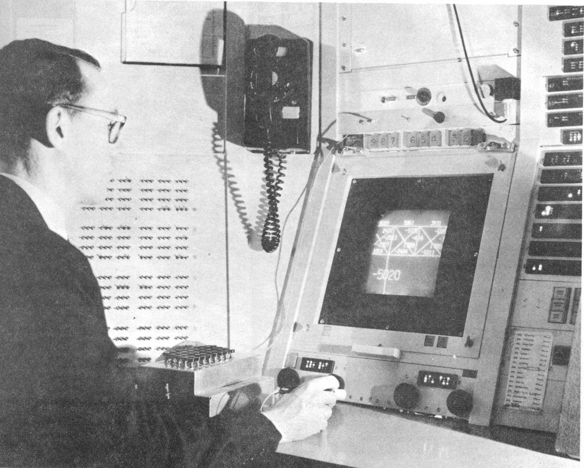

图1：Sutherland操作Sketchpad的历史照片，论文图1.2。能看见光笔、显示器和桌前的按钮盒。Ivan Sutherland原始影像，Kerry Rodden经许可扫描；[CC BY-SA 3.0](https://creativecommons.org/licenses/by-sa/3.0/)，本文从论文内嵌原图转换为PNG。

Sutherland在1963年提交了[博士论文](https://www.cl.cam.ac.uk/techreports/UCAM-CL-TR-574.html)。今天较容易阅读的版本，是Alan Blackwell和Kerry Rodden在2003年整理的电子版。理解这个年份差别很重要：网页或PDF封面的2003年，不是Sketchpad诞生的年份。

历史照片还有一个文字难以替代的作用：它提醒我们，当时的“交互”建立在怎样的物理设备上。手里的笔、桌上的按钮和屏幕，都参与了操作语言，而不是后来常见的鼠标加菜单。

## 光笔不是往屏幕上发光的笔

容易望文生义：是不是笔尖发出一道光，电脑看见光点在哪里？

Sketchpad使用的光笔恰好从另一方向工作：笔内传感器检测屏幕发出的光，系统再把检测与显示过程联系起来，帮助确定指向位置和对象。论文还专门讨论了跟踪光笔的显示与预测策略，这并不是一个天然精确、无需软件配合的输入器。

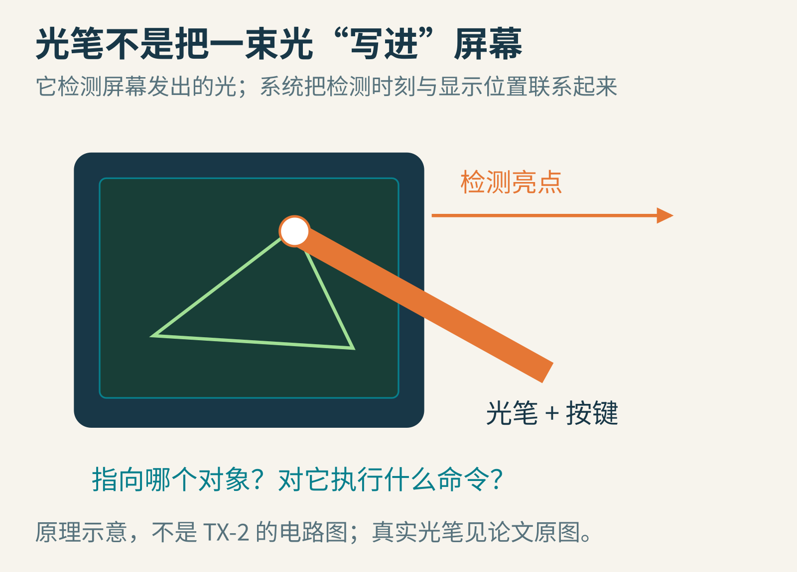

图2：原创原理示意。图中的橙色长条代表笔，不是投射到屏幕上的光束。

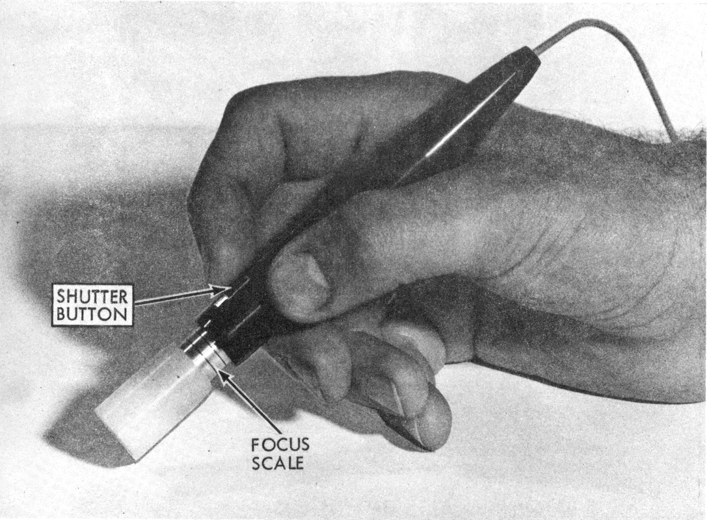

图3：论文图4.1，真实光笔；原论文注明由MIT Electronic Systems Laboratory提供。Ivan Sutherland原作品，Kerry Rodden扫描，CC BY-SA 3.0，仅格式转换。

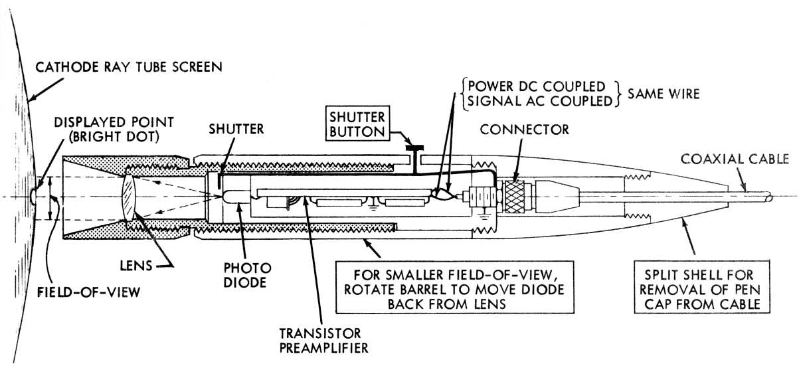

图4：论文图4.2，光笔构造；原论文注明由MIT Electronic Systems Laboratory提供。真实器件和上面的概念图属于不同层次：概念图解释方向，原图保留设备细节。Ivan Sutherland原作品，Kerry Rodden扫描，CC BY-SA 3.0，仅格式转换。

“指到哪里”和“想做什么”也不同。你可以指向一条线，然后要求移动、删除或施加某种关系。今天的交互系统仍在处理同一个基本问题：对象选择和操作意图，应该怎样组合才清楚？

## 屏幕上的线，可以有两种完全不同的身份

想象两种画板。

第一种把你经过的像素涂黑。拖动一个角时，程序需要搬移或重画一片像素。它并不天然知道哪几颗像素共同构成“一条线”。

第二种保存端点A与B，保存“线段AB连接这两个点”，再由显示程序画出它。此时你是在操作几何对象。线条的黑白像素只是对象暂时呈现出来的外观。

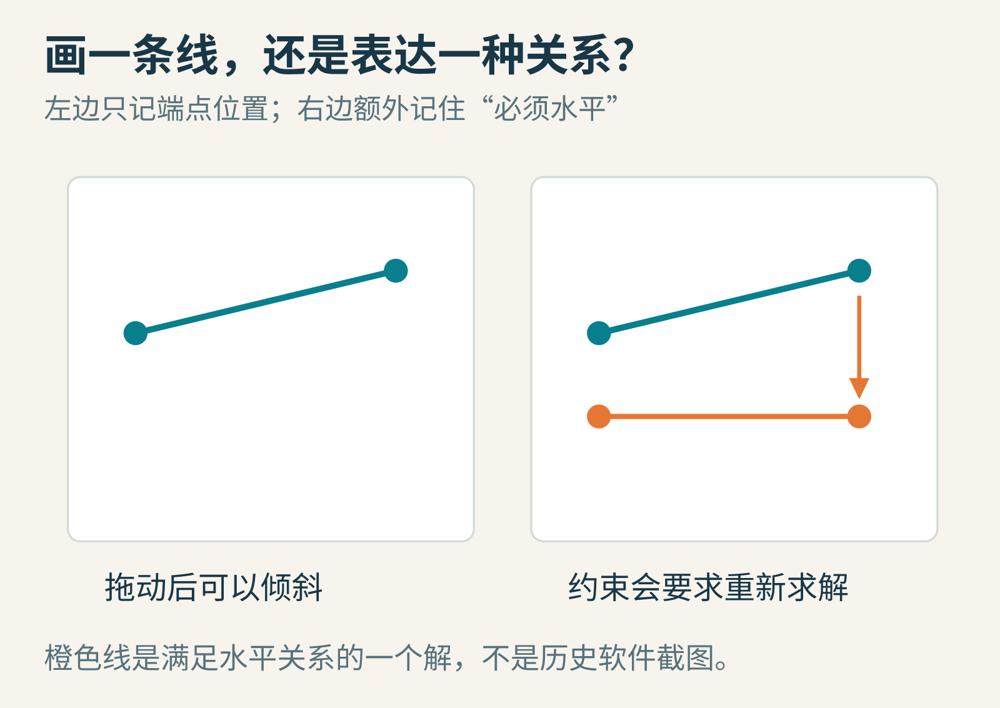

图5：原创示意。橙色水平线是满足关系的一个新形状；计算机保留的东西，已经超出了原来那条斜线的外观。

Sketchpad还进一步保存图形的连接关系。例如两条边共用一个顶点，移动这个顶点，两条边都应跟着改变。连接不是“看起来刚好挨在一起”，而是数据层面知道它们共享什么。

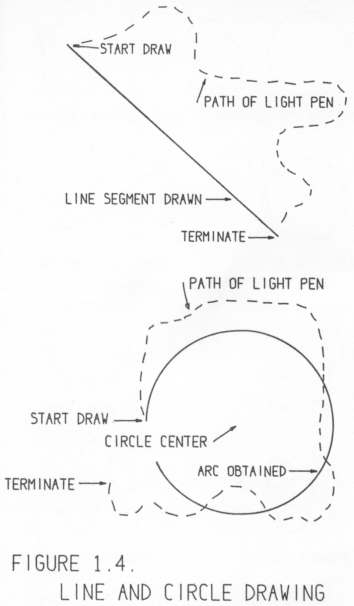

图6：论文图1.4展示直线和圆弧绘制。几何对象是后续关系操作的基础。Ivan Sutherland原作品，Kerry Rodden扫描，CC BY-SA 3.0，仅格式转换。

这里已经能推导出一个工程判断：如果你的关卡编辑器只是保存每条边各自的端点副本，那么“两个端点看上去重合”和“它们是同一个逻辑顶点”仍然是两回事。后续修改会把这个差别暴露出来。

## 在一条线后面，加一句必须成立的话

设A=(0,0)，B=(4,1)。现在添加约束：“线AB必须水平。”

写成方程非常简单：`yA=yB`。

但程序还得决定怎样移动。是A往上走？B往下走？两端各动一半？如果没有别的要求，这些都可能满足水平约束。

一种合理的教学选择，是让两个点的总移动平方最小。横坐标不用改，只需决定共同的新高度t：

`总代价 = (t−0)² + (t−1)²`

这个量在t=0.5处最小，所以A变成(0,0.5)，B变成(4,0.5)。两端各移动半个单位。

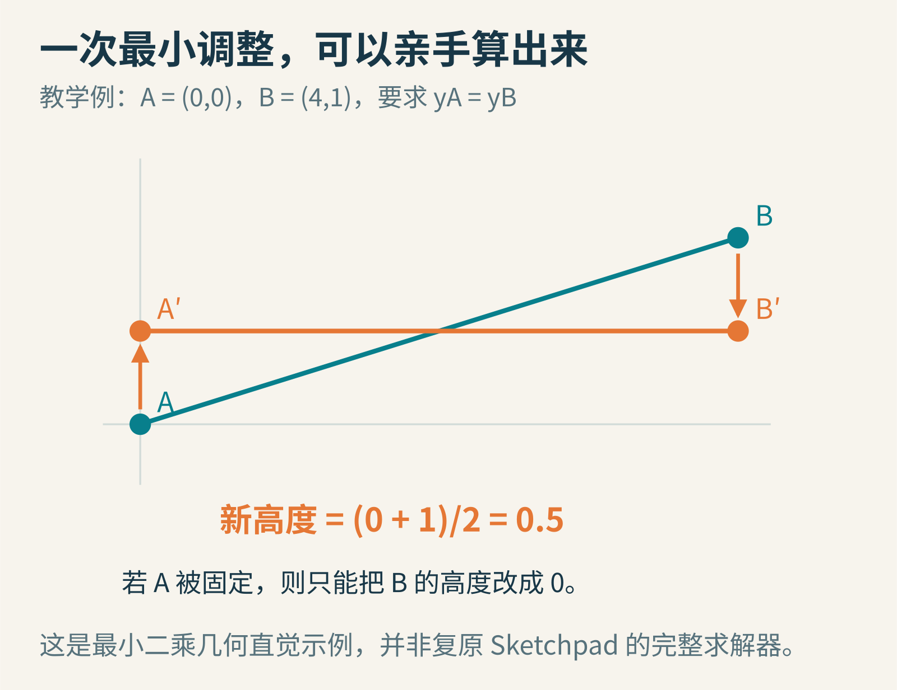

图7：这道小计算解释约束求解的直觉，不是声称历史Sketchpad逐行执行了本文的公式。

如果A被用户固定住，答案立即改变：A不能动，B只能把高度从1改成0。

如果B正被光笔拖向某处，又该怎样分配？软件可能把拖动目标作为强要求，或作为一项带权误差；固定、优先级、软硬约束的定义都会影响手感。

因此，约束求解不只是在数学上“找到一个解”，也涉及界面承诺：**哪些关系必须保持？哪些对象可以动？有多个答案时，哪个最符合用户的动作？**

## 约束多了，反而会冒出三种不同问题

一条二维线段有四个坐标量。只要求水平，通常还剩很多自由：可以左右移动、上下移动，也可以改变长度。

这叫欠约束。它不是程序坏了，而是用户还没有说够条件。有时这种自由正是你想保留的。

固定A、要求水平、规定长度4，位置就更受限制。但B还可能在A的左边或右边。非线性关系可能带来多个离散解，简单数一数方程并不总能宣布“唯一”。

如果同时要求长度4和长度5，就发生冲突，没有完全满足全部条件的解。一个最小二乘程序也许返回4.5，但这只是折中，不能偷偷冒充两个要求都满足了。

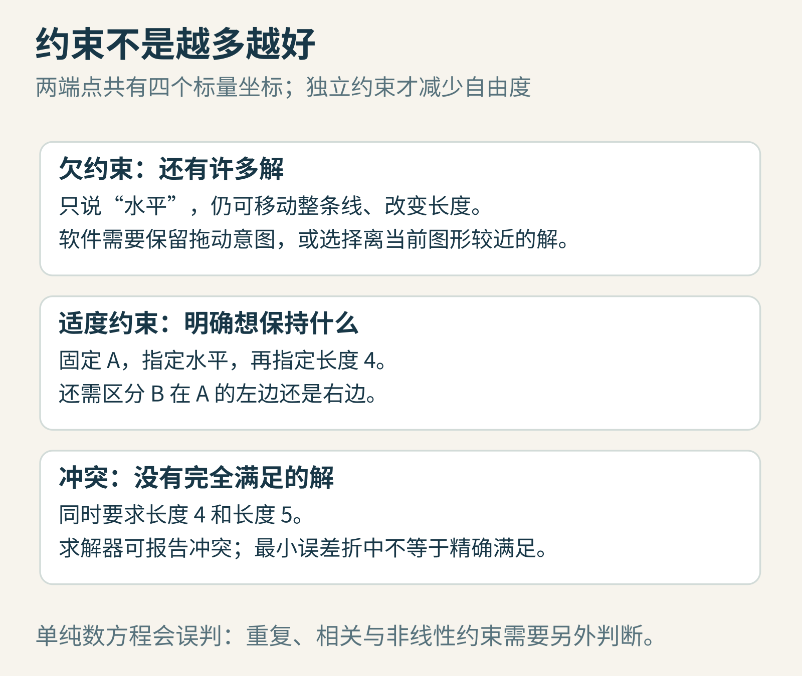

图8：独立条件才真正减少自由度。把“水平”说两遍，不会让线段多失去一个自由方向。

Sketchpad论文的约束章节讨论了两类处理：在能找到合适顺序时，一次安排变量的求值；在不能这样处理时，逐步减小约束误差的松弛方法。它也明确讨论了复杂情形的速度与求解问题，没有把任意关系都包装成瞬间完成。

这对今天依然很有启发：一次拖动引起多个对象互相牵连时，求解顺序、局部变化和数值误差，会变成界面延迟或跳动。算法的细节最终会被手感“翻译”出来。

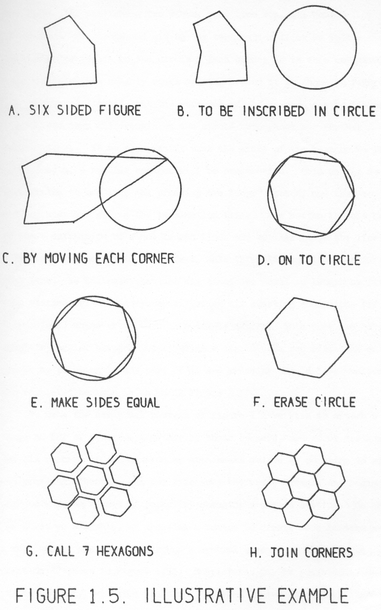

图9：论文图1.5的构图示例，展示图形如何经过操作与关系指定形成。它是一组过程图，不是单张静态成果。Ivan Sutherland原作品，Kerry Rodden扫描，CC BY-SA 3.0，仅格式转换。

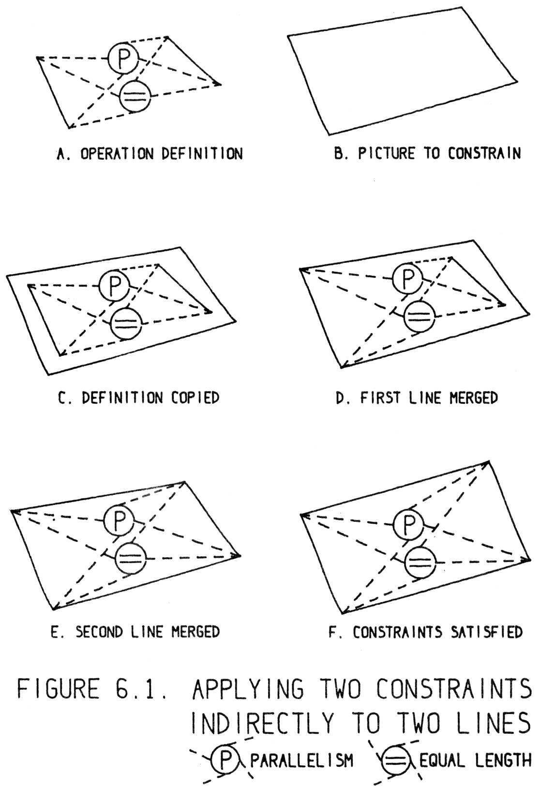

图10：论文图6.1讨论通过间接关系约束两条线。观察关系怎样通过共享对象传播，比只盯着最后的外形更有帮助。Ivan Sutherland原作品，Kerry Rodden扫描，CC BY-SA 3.0，仅格式转换。

## 怎样知道“这次移动影响了谁”

把所有图形保存成一大串互不相关的数字，会给编辑操作制造麻烦。每移动一个点，都要从头搜索哪些线引用它吗？删除某个对象之后，又怎样找到依赖它的对象？

Sketchpad用称为ring structure的数据组织方式管理关联。今天不必照抄它的具体存储布局，也能理解这里的问题：**几何对象不仅有属性，还要能找到与它发生关系的其他对象。**

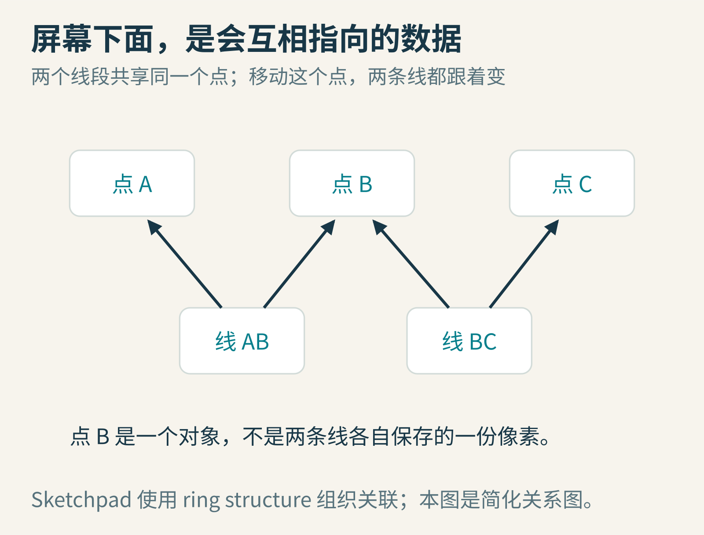

图11：原创数据关系图。点B只是一份对象，两条线引用它；屏幕上的连接有了可维护的数据来源。

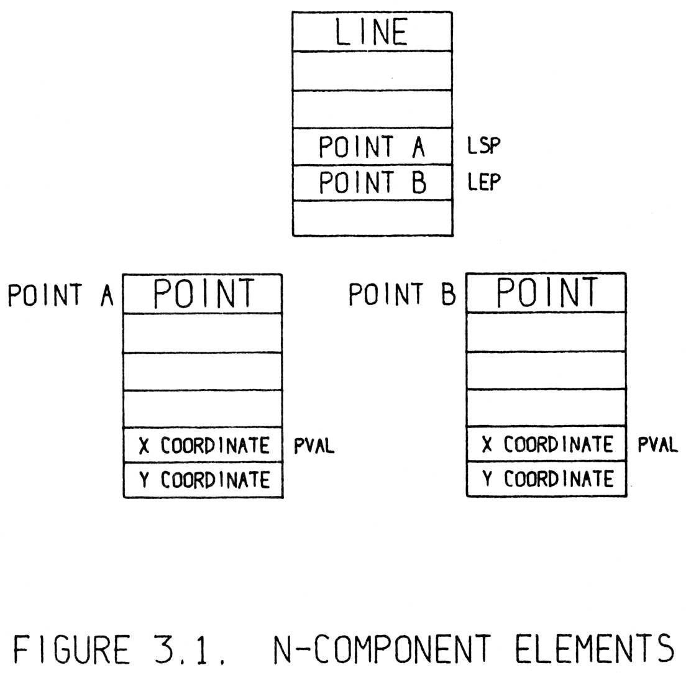

图12：论文图3.1，包含多分量的元素。它展示的是数据怎样表示对象，不是显示器怎样画出线。Ivan Sutherland原作品，Kerry Rodden扫描，CC BY-SA 3.0，仅格式转换。

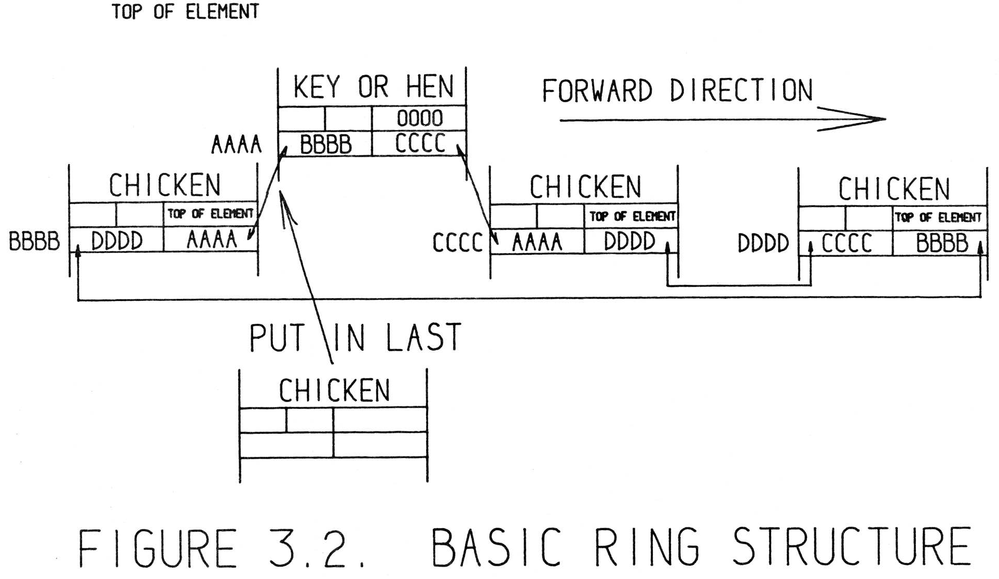

图13：论文图3.2，基本ring structure。可以把阅读重点放在“如何从一个对象找到相关对象”，不必第一次就记住所有字段。Ivan Sutherland原作品，Kerry Rodden扫描，CC BY-SA 3.0，仅格式转换。

用现代编辑器打个比方：若一个门框关联着墙、门板、碰撞体和导航开口，你改变门框宽度时，系统需要知道哪些数据应联动。即使技术实现不同，“对象关系必须进入数据模型”这条要求仍在。

## 母版和实例：复制外观之外，再保存来源

接下来要画一张电路图。某个小符号重复出现几十次。直接复制线条当然能画出来，但之后如果要统一改符号，你得改几十份。

另一种方式是先定义一个母版，然后在不同位置放置它的实例。实例记录位置、比例等信息，并且仍然指向定义。当定义改变，所有相关实例随之更新。

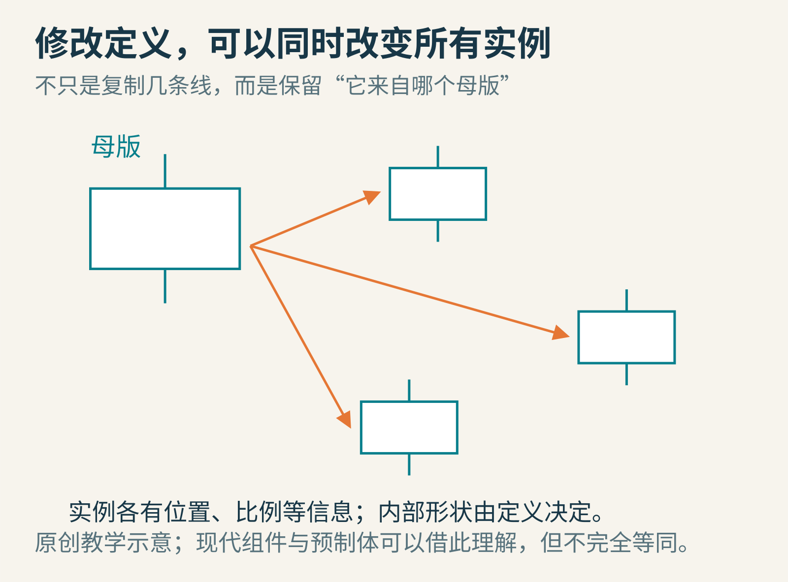

图14：原创教学示意。每个实例可以有自己的放置方式，又共享同一份内部结构。

Sketchpad支持子图形及实例化使用，这使图形有了层次。由小部件组合成复杂部件，再把复杂部件作为整体使用，屏幕上的形状开始承载抽象。

现代游戏引擎的预制体、界面组件、CAD装配件，可以帮助我们理解这种收益，但不应直接说它们与Sketchpad完全相同。今天的系统还有覆盖规则、版本管理、脚本行为和许多后来发展的机制。

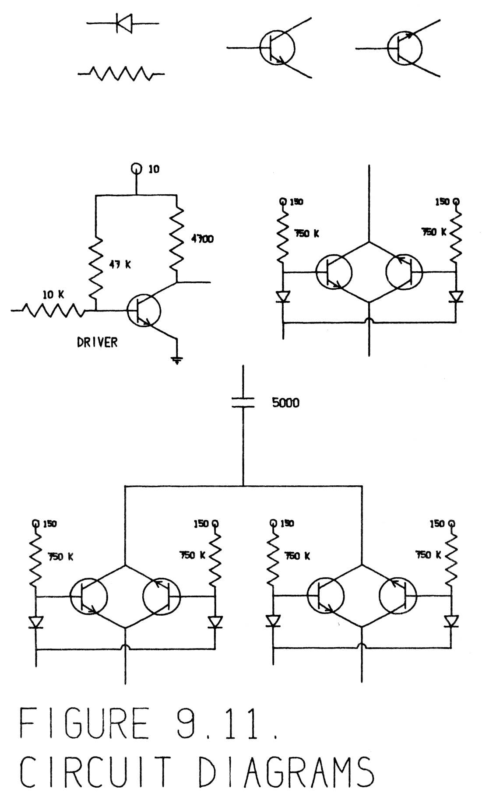

图15：论文图9.11，电路图应用。重复结构说明，图形定义与复用可以服务真实绘图工作。Ivan Sutherland原作品，Kerry Rodden扫描，CC BY-SA 3.0，仅格式转换。

## 显示画面，也是一项需要程序解决的工作

今天容易把显示看成调用一个API后的理所当然结果。早期交互系统却必须同时考虑如何形成图像、保持显示、跟踪光笔，并把屏幕上的亮点对应回逻辑对象。

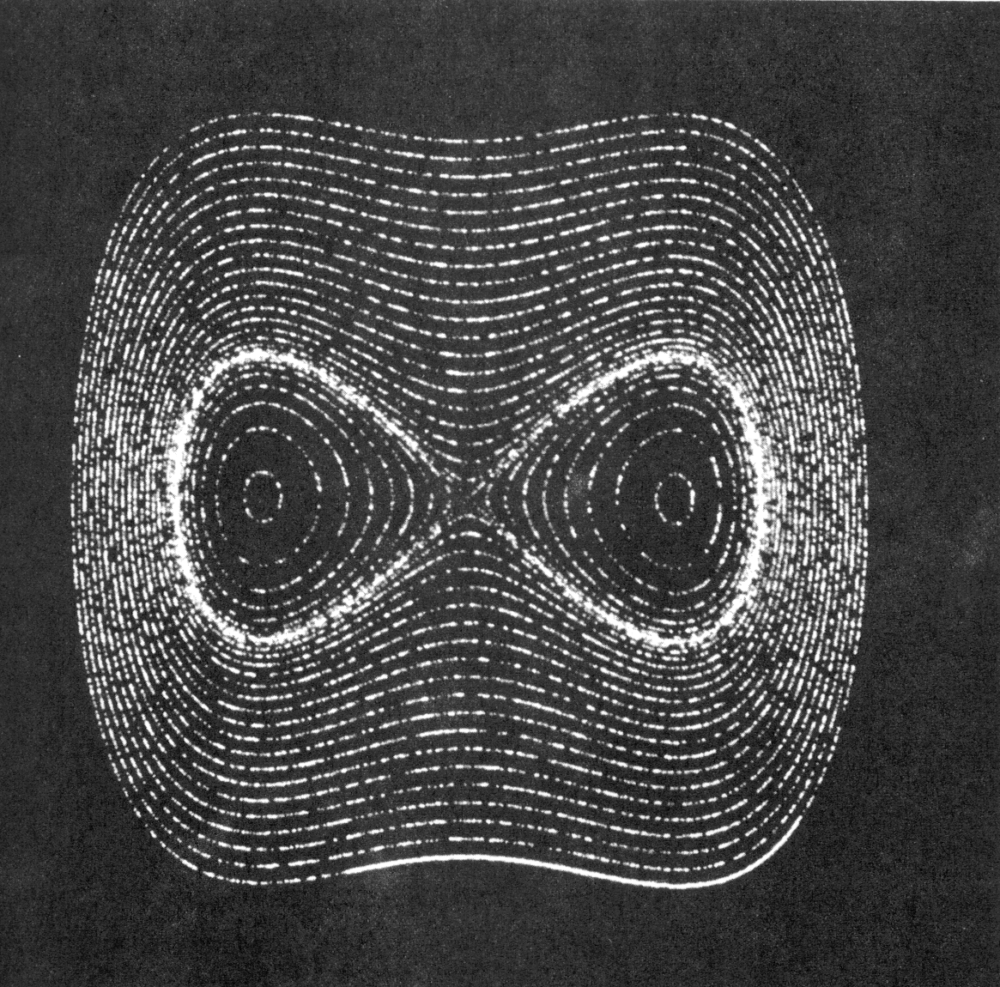

图16：论文图5.1，Twinkled Display。它提醒我们，画面如何出现与对象如何存储是不同问题，交互系统要把两者接起来。Ivan Sutherland原作品，Kerry Rodden扫描，CC BY-SA 3.0，仅格式转换。

这也提供一个今天仍实用的分层思路：数据模型回答“有什么”，渲染回答“怎样显示”，选择机制回答“用户指到了什么”，操作系统回答“允许怎样修改”。把几层混在一起，简单功能也许能跑，复杂编辑就会越来越难维护。

## 看看它当时拿来做了什么

机器能保存约束之后，就不必局限于精确画一张静态图。杆件长度不变、某个端点固定，其余端点能怎样运动？这已经接近一个可探索的模型。

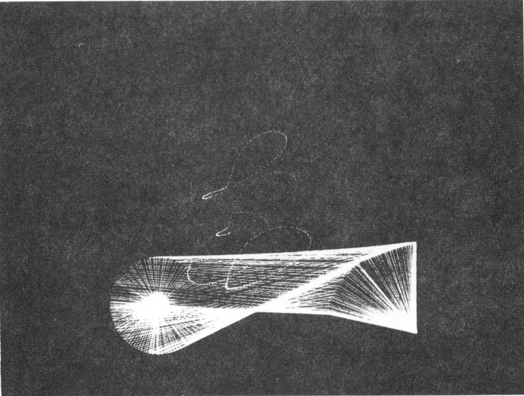

图17：论文图9.3，用15秒曝光记录三杆连杆机构中四个点的运动轨迹。图形关系让“移动一部分后，其余部分怎么办”成为可计算的问题。Ivan Sutherland原作品，Kerry Rodden扫描，CC BY-SA 3.0，仅格式转换。

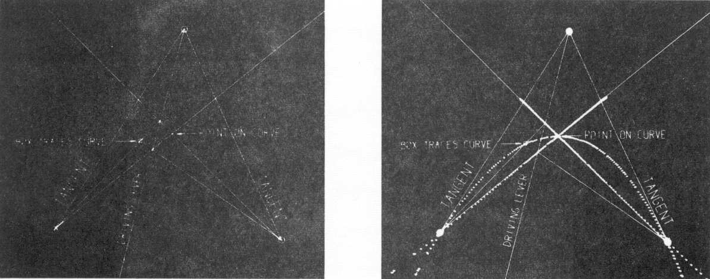

图18：论文图9.4，圆锥曲线绘制连杆。复杂曲线也可以由部件之间的关系产生。Ivan Sutherland原作品，Kerry Rodden扫描，CC BY-SA 3.0，仅格式转换。

机械机构是几何关系的自然用途。桥梁与桁架又进一步提醒我们：图中的边可以代表具有工程意义的杆件，输入的图形拓扑可以为计算提供结构。不过，画出桥不等于工程安全验证；具体载荷、材料和物理模型仍不可省略。

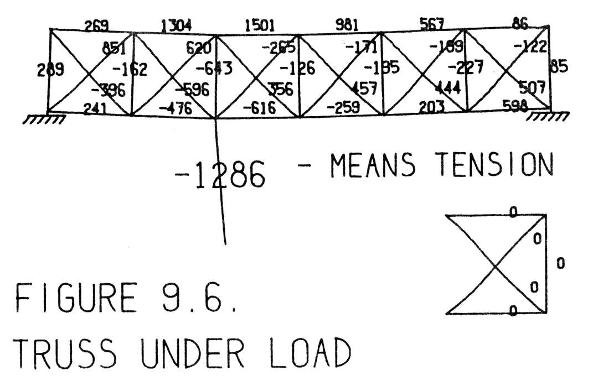

图19：论文图9.6，受载桁架的例子。这里展示历史应用，不把它当作可直接施工的设计。Ivan Sutherland原作品，Kerry Rodden扫描，CC BY-SA 3.0，仅格式转换。

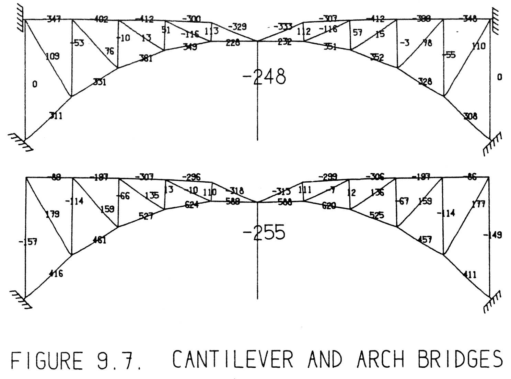

图20：论文图9.7，悬臂桥和拱桥例子。不同连接结构使同一种交互工具能探索不同对象。Ivan Sutherland原作品，Kerry Rodden扫描，CC BY-SA 3.0，仅格式转换。

甚至人物图案，也能拆成可操作的部件。这里最有趣的不是画得多像，而是形状能否被有组织地改动。

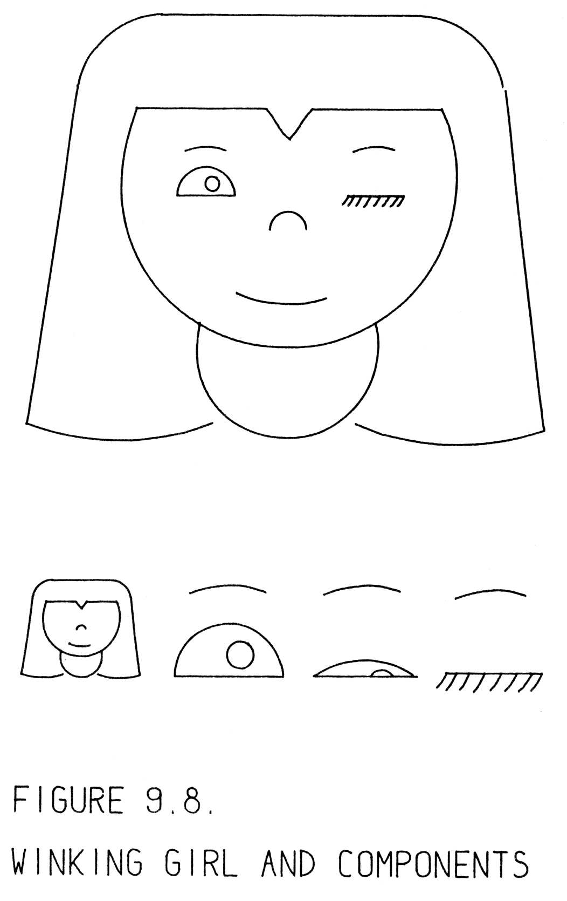

图21：论文图9.8，Winking Girl and Components。眼睛、面部等部分被组织成可修改结构，展示了图形分解与复用的另一种方向。Ivan Sutherland原作品，Kerry Rodden扫描，CC BY-SA 3.0，仅格式转换。

## 别把整个现代图形界面都归给一个人

Sketchpad是交互式计算机图形史的重要工作，但“重要”不需要靠“一个人发明了今天的一切”来证明。

它依赖TX-2和实验室的设备、同事与已有研究。Sutherland在论文致谢中明确记录了这种支持。现代图形用户界面、窗口系统、鼠标、面向对象语言和商用CAD，也都有各自的团队、背景与后续发展。

更准确、也更有用的历史阅读方式，是问：它已经把哪些思想连成了可工作的系统？哪些后来被继续发展？哪些局限暴露了尚待解决的问题？

在这篇文章里，最值得带走的三件事是：对象身份、关系约束、定义与实例。它们让“图像”从一种输出，变成一种可以参与计算的表达方式。

## 做一个小实验，重新体验这次转变

你可以不用复原TX-2，只做一个极小的现代演示：

1. 保存两个二维点和一条引用它们的线，不直接保存线上的像素。
2. 允许拖动任意端点，重新画线。
3. 增加“水平”开关。开启时，把两个点的y坐标投到同一高度。
4. 增加“固定A”。重新思考求解规则，而不是继续机械地把两端平均。
5. 再增加“长度4”，观察多个约束如何互相作用；故意再加“长度5”，设计一个清楚的冲突提示。

这只是教学练习，没有在此声称实现或测试了完整交互软件。它的价值在于让你发现：每多一句“应该一直保持”，就多出了一项数据结构、求解或交互设计责任。

下一次拖动一个图形时，可以留意那个几乎看不见的瞬间：软件并非只把像素搬过去。它正在决定，移动之后，哪些关于这个世界的关系还必须是真的。

图片来源：历史图来自[Ivan Sutherland论文的高分辨率原扫描](https://commons.wikimedia.org/wiki/Category:Sketchpad)，Kerry Rodden经作者许可扫描，CC BY-SA 3.0；对应[剑桥大学档案](https://www.repository.cam.ac.uk/items/5a5fc4ef-328a-4482-8b72-010f00f21a34)保留来源背景。五幅历史图由原TIFF无损转为PNG，其余十幅取自论文内嵌原尺寸图像；图3.2和9.7只校正阅读方向，其余仅转换格式。六张关系与机制图为原创教学示意。延伸阅读：[Sketchpad论文电子版及说明](https://www.cl.cam.ac.uk/techreports/UCAM-CL-TR-574.html)。
