# 不用电，两把尺子为什么会算乘法？把对数拿在手里的计算尺

有一道题：2.4 × 3.2。

你可以列竖式，也可以按计算器。但还有一种办法：把两张刻着数字的纸条并排放好，移动其中一张，在一个数字的正下方读出答案。

没有齿轮进位，没有芯片运算，甚至不用在纸上写出中间结果。手只做了一次平移。

难道答案事先印在上面了？

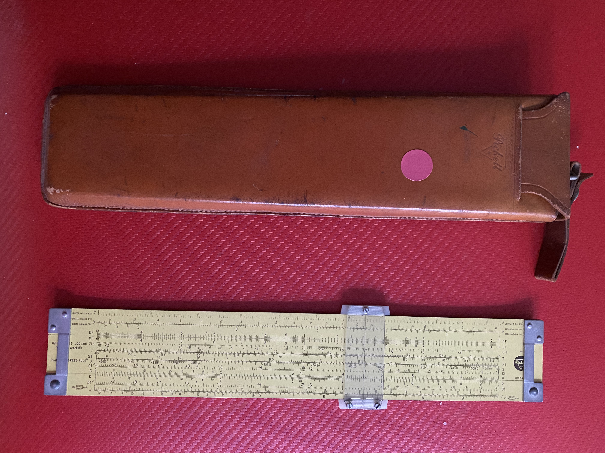

图：Pickett N4ES及皮套，ArnoldReinhold摄，2022年；[原文件与署名](https://commons.wikimedia.org/wiki/File:Pickett_N4ES_front_aligned_with_case.agr.jpg)，CC BY-SA 4.0，原图未修改。上面有许多专用刻度，我们先只研究两行最基本的刻度。

1953年，Pickett & Eckel的一本说明书在序言里写到：一个经常进行困难计算的“computer”，通常会把函数表或计算尺放在手边。这里的computer，指的是负责计算的人。今天听来像一台电脑的随身装备，当时却是人的工作台。[原说明书](https://sliderulemuseum.com/Manuals/M134_HowToUsePickettTrigSlideRules1953.pdf)

这篇文章不要求你已经学会对数。我们先看看手究竟移动了什么，再给它一个数学名字。最后，你可以打印两张纸条，把这个原理变成自己的实验。

## 1. 普通尺子其实已经会算一道题

拿两把普通直尺。把上尺的0对准下尺的2，再看上尺的3。

它会对准下尺的5。

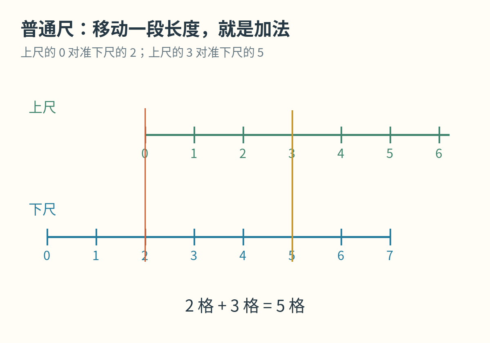

这没什么神秘的：先从0走2格，再走3格，一共走5格。

所以，**两把尺子相对滑动，天然擅长做的是“长度相加”。**

如果想让同一个动作完成乘法，关键不在手指，而在刻度。

我们需要重新安排数字的位置，让“数值相乘”对应“距离相加”。换句话说，要把乘法换一个地方表示。

## 2. 让每一次“翻倍”，都走同样远

普通直尺上，1到2和2到3相隔一样远，因为它们都增加1。

现在改一条规则：

- 从1到2，走一段距离；
- 从2到4，也走同样长的一段；
- 从4到8，再走同样长的一段。

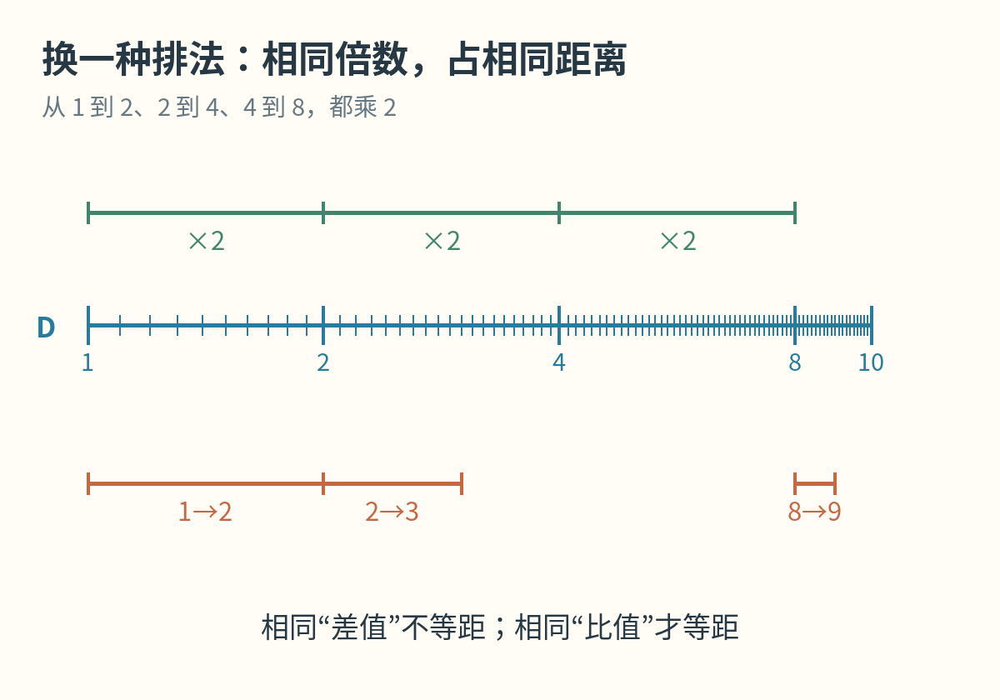

注意，这几段对应的数值增加量分别是1、2、4，但它们的倍数变化都是“乘2”。

因此，右边的数字会越挤越密。8到9只增长了八分之一，当然不需要像1到2那样走那么远。

这就是对数刻度最重要的直觉：**相同的比值，对应相同的距离。**

于是，1到2的长度搬到3后面，会落在6；1到3的长度搬到2后面，也会落在6。两段长度的相加，已经开始替我们做乘法了。

## 3. “对数”不是一串神秘小数，而是地址

为了准确印出刻度，仍需要一种描述位置的方法。

设从1到10的总长度是L。字母L只表示整段尺长，不是新的一种数。某个正数x离左端的距离，记作s。

我们规定：

s = L × log10(x)

log10读作“以10为底的对数”。它回答的问题是：**10要取多少次方，才会得到x？**

10的0次方是1，所以1的地址是0；10的1次方是10，所以10的地址是L。2的地址约为整段的0.301倍，4约为0.602倍。

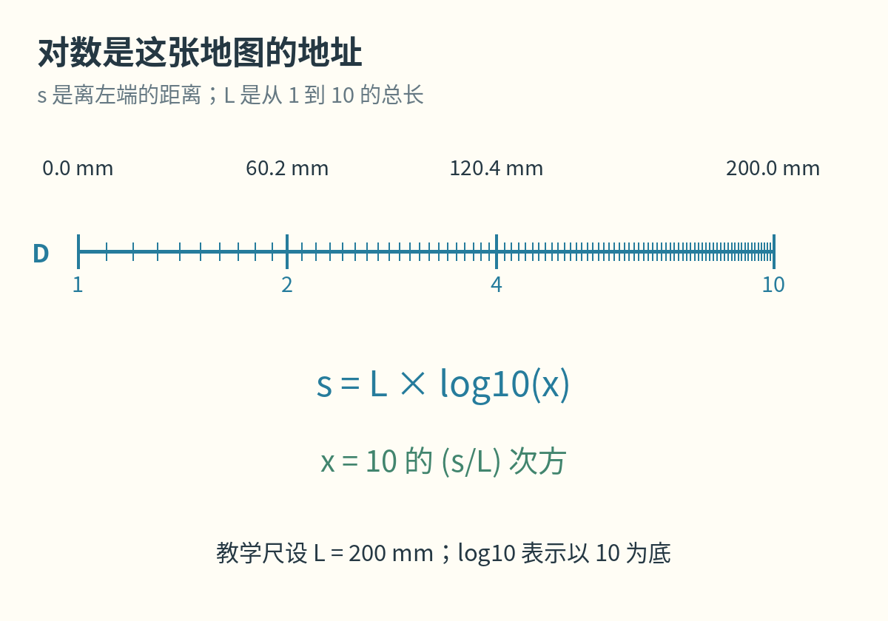

不用因为出现小数就紧张。对于使用者来说，这些地址已经被制尺者变成刻线。你不必先算出log10(2.4)，才能在尺上找到2.4，就像不用计算经纬度，才能在地图上找到标好的城市。

为什么这种地址能把乘法变成加法？设a是10的u次方，b是10的v次方。两个数相乘，就得到10的(u+v)次方。

所以：

log10(a × b) = log10(a) + log10(b)

右边是两段地址的和，左边是乘积的地址。这不是计算尺碰巧有效，而是它的刻度就是照着这条关系设计的。

## 4. 一张表、一把分规，再到两把尺

这条路并非某一天突然出现一件完整的现代产品。

1614年，约翰·纳皮尔发表《奇妙对数表的说明》。他的工作让繁重的计算有了新的处理方法。这里用来解释刻度的现代log10记法，不应直接当成纳皮尔原书的定义。[1614年原书馆藏记录](https://catalogue.etoncollege.com/B18527)

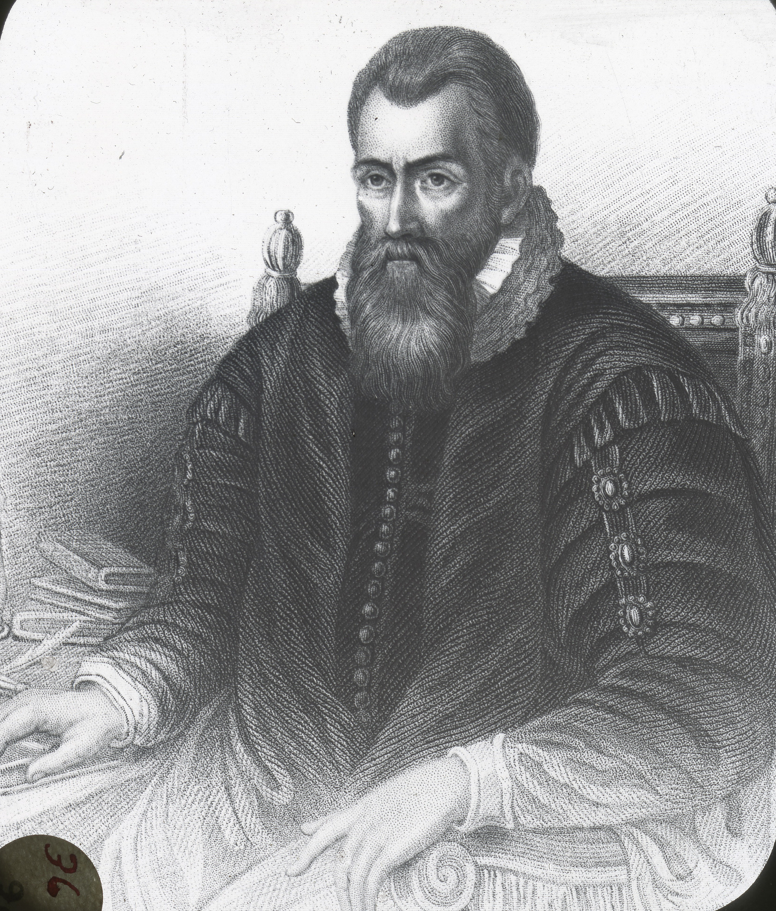

图：John Napier后世版画肖像。Commons文件页标注为Samuel Freeman作、1835年出版，原作品已进入公有领域；本稿保留下载原文件，未修改。这不是纳皮尔的照片。[出处](https://commons.wikimedia.org/wiki/File:John_Napier.JPG)

接下来，埃德蒙·冈特把对数关系放到刻度上。只有一把尺，也可以用分规量出一段长度，再把这段长度搬到别的位置。伦敦博物馆对其著作的馆藏说明，明确记载了这种“单尺加分规”的做法。[馆藏说明](https://www.londonmuseum.org.uk/collections/v/object-95568/the-description-and-use-of-the-sector-cross-staff-and-other-instruments/)

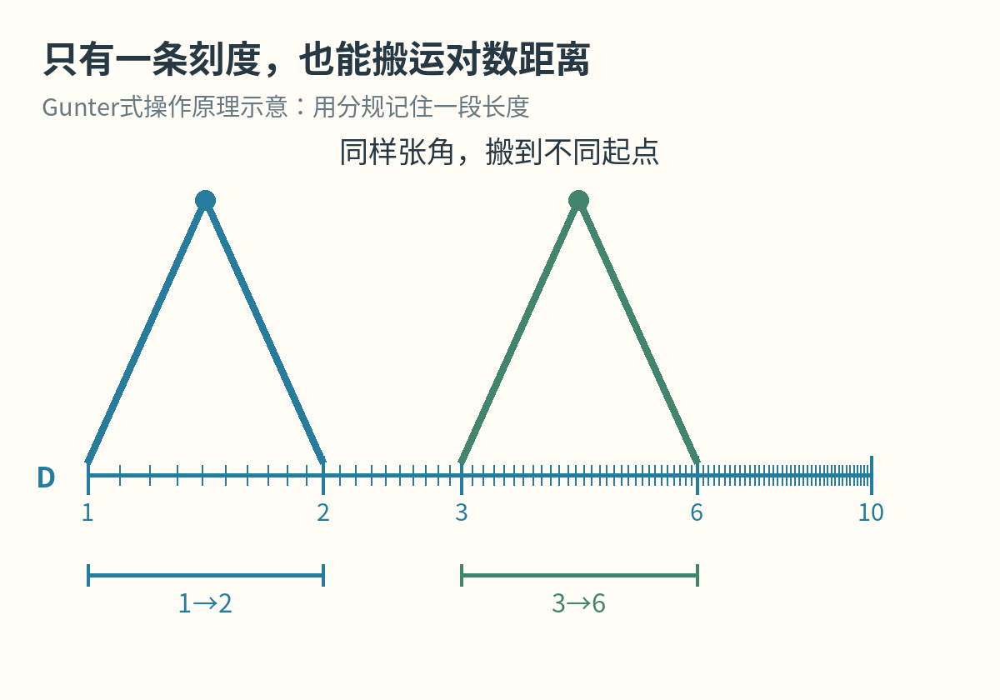

图为操作原理示意，不是某一件历史仪器的尺寸复原。

威廉·奥特雷德的两尺做法，则把需要搬运的长度留在另一条刻度上。我们读到的1660年版本，在“The Use of the two Rulers”第244页直接举出355乘48得17040，并描述两尺数字之间的对准关系。[原书数字馆藏](https://dc.tulips.tsukuba.ac.jp/s/pub_ja/document/rb_10020016101)

“刻度之间保持什么关系”，成了器械能保存的东西。

不过，不宜把整段历史压成“某年某人独自发明了一切”。直线、圆形、分规和滑动结构有不同发展过程；奥特雷德与理查德·德拉曼之间还有发明优先权争论。数学史家Cajori在1920年的研究中，就说明自己此前对德拉曼的认识受限，后来才获得其原著资料。出版时间、作者自述和后人的归属判断，需要分开看。[Cajori的研究](https://www.gutenberg.org/cache/epub/42216/pg42216-images.html)

我们接着亲手走一次最基本的两尺操作。

## 5. 把2.4乘3.2拆成两个看得见的动作

把可滑动的一行叫C，把固定的一行叫D。这是常见的刻度名称。本文教学图把两行分开画，方便看清；实际计算尺的两行通常挨得很近。

第一步：找到D上的2.4，把C左端的1移到它上面。

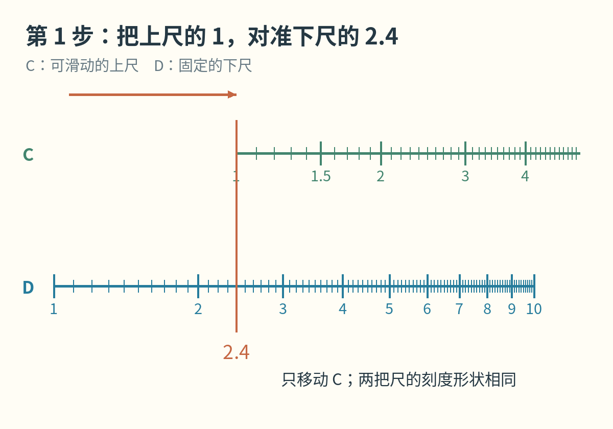

为什么对的是1，而不是0？因为在这条刻度上，1的对数地址才是0。它是整段对数距离的起点。

第二步：在C上找到3.2，垂直向下看D。

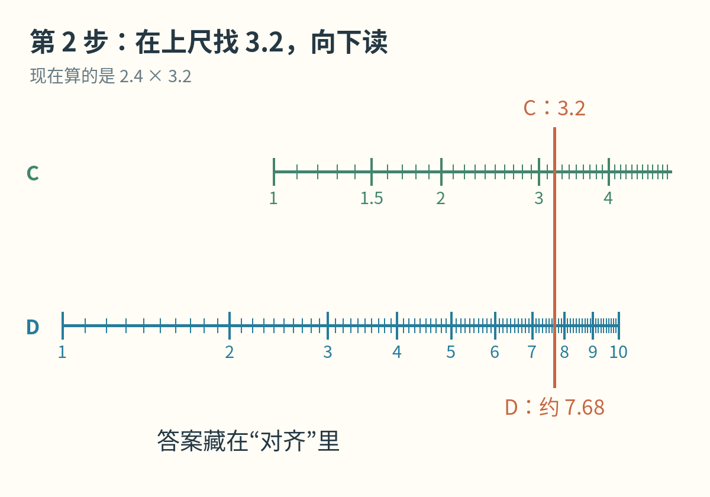

你会读到大约7.68。

用一把从1到10长200毫米的理想教学尺检验：

- 2.4的地址约为76.042毫米；
- 3.2的地址约为101.030毫米；
- 拼起来约177.072毫米；
- D上这个位置的数字正是7.68。

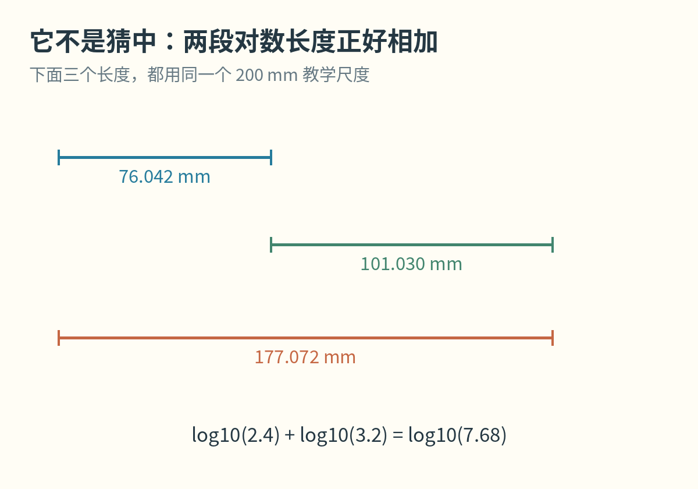

这些毫米数是根据公式计算的理想值，不是拿实物量出来的读数，也不代表纸尺能读到千分之一毫米。它们只是把“滑动”背后的几何关系摊开给你看。

实际读尺时，刻线有宽度，眼睛也要估读，所以通常说“约7.68”。题目本身的准确乘积则可以用竖式验证。

## 6. 结果跑到尺外面，该怎么办？

试试6 × 4。

如果把C左端的1对准D上的6，C的4已经跑到D的右端之外。

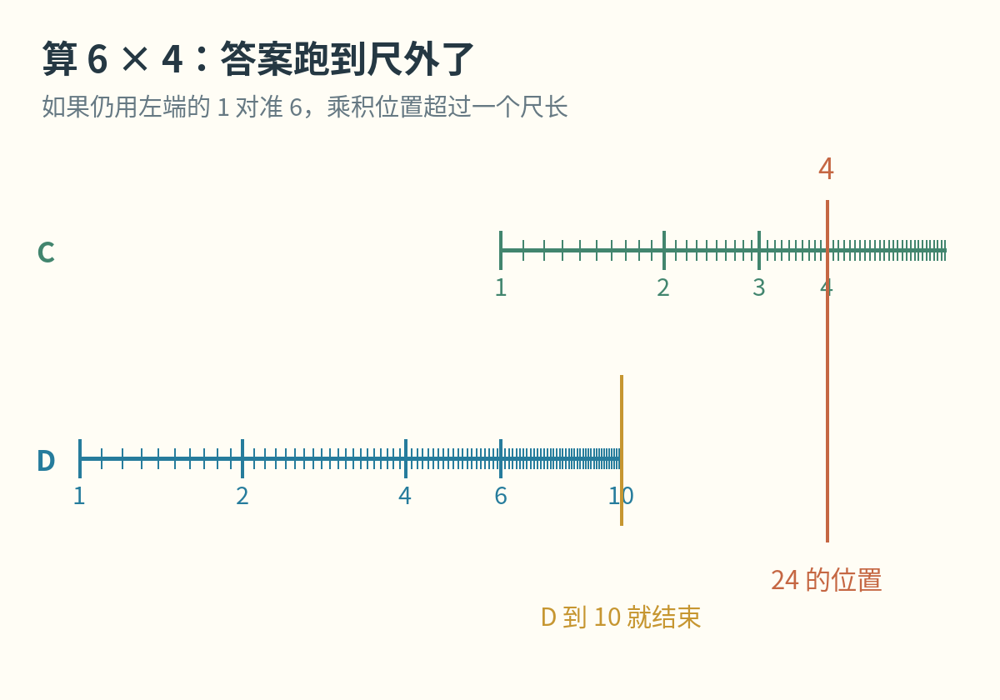

尺子没有坏。乘积是24，本来就大于这一段末尾的10。

解决办法是换一个起点：把C右端的10对准D上的6。现在C的4下面，会出现D上的2.4。

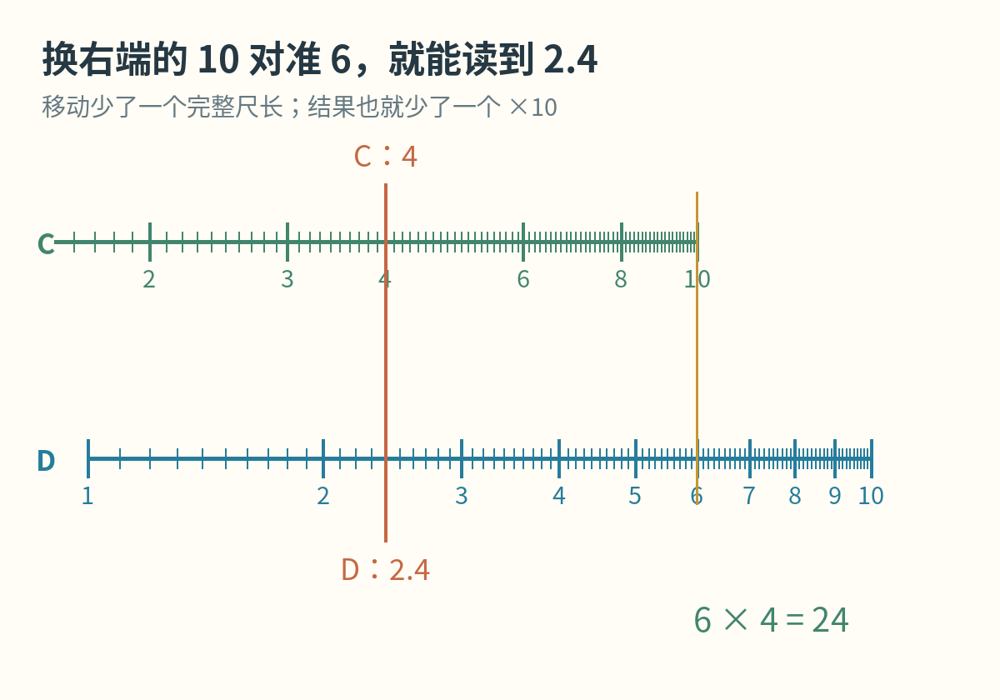

怎么又少了十倍？

因为C相对于刚才的位置，正好向左移动了一个完整尺长L。对数地址减去1，对应数值除以10。因此，尺上读到2.4，你需要根据题目把它记成24。

真实尺子的右端常常也标成“1”，暗示下一个数量级的开头。为了让第一次学习的人看清，这篇教学图把右端写成10。

## 7. 计算尺不会自动告诉你小数点在哪

24 × 32，与2.4 × 3.2，用的是同样的一组有效数字。计算尺的基本一段刻度，不能独自区别它们。

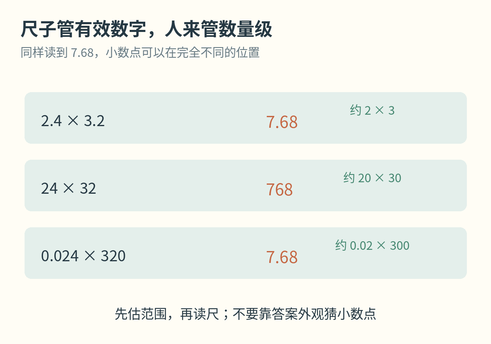

这里有两件分开的工作：

**刻度负责有效数字，使用者负责数量级。**

比如24 × 32，大约是20 × 30，也就是几百。因此读到“768”这组数字时，应当记成768，不是7.68或76800。

更系统的办法是科学记数法：

24 = 2.4 × 10的一次方

32 = 3.2 × 10的一次方

所以乘积是7.68 × 10的二次方，也就是768。

这看上去像计算尺的缺点，却逼着使用者保留一项重要能力：在接受细节答案之前，先知道它大概应该落在哪儿。

当然，有估算习惯不等于不会犯错。数量级算错十倍，刻度再精细也救不回来。

## 8. 除法，是把一段长度拿走

如果乘法是拼接对数距离，除法就应该是相减。

要算7.68 ÷ 3.2，先把C上的3.2对准D上的7.68。然后去看C的1下面是什么。

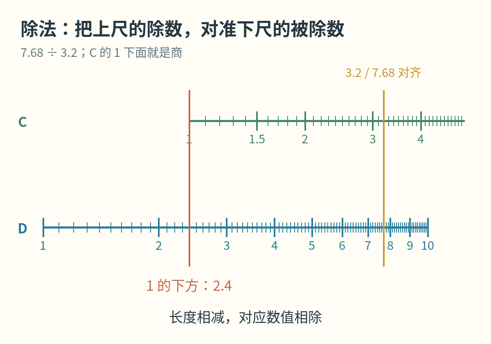

读到2.4。

因为上尺左端的位置，等于7.68的对数距离减去3.2的对数距离。它也就是商的地址。

不同题目可能需要读左端或右端指标，数量级仍要单独处理。不要把“在1下面读答案”背成永远不需要判断的口诀。

实际计算尺还有一个透明游标，上面刻着细线。它不是又一台计算器，而是一枚能滑动的书签：帮你对齐不同的刻度，也帮你暂存一个位置。

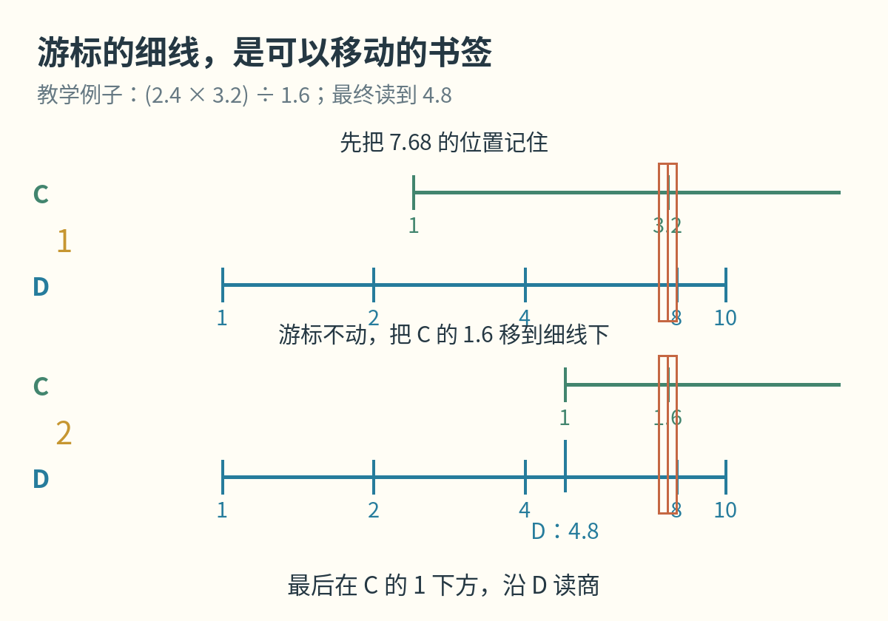

例如算(2.4 × 3.2) ÷ 1.6：先得到7.68的位置，让游标停在那里；保持游标不动，移动C，把1.6送到细线下；最后读C的1下面的D，约为4.8。

中间结果可以先以“位置”的形式留下，不必立刻抄成几位小数。但调整、对齐和估读依然会带来误差，并不会因为没有抄数字就变成精确运算。

## 9. 平方与开方，可以靠另一种刻度配对

假设下面的D，还是从1到10的一段对数尺。上面另刻一行A：在同样长的空间里，从1排到100。

A需要装下两个十倍区间，所以每个十倍区间只有D的一半长。

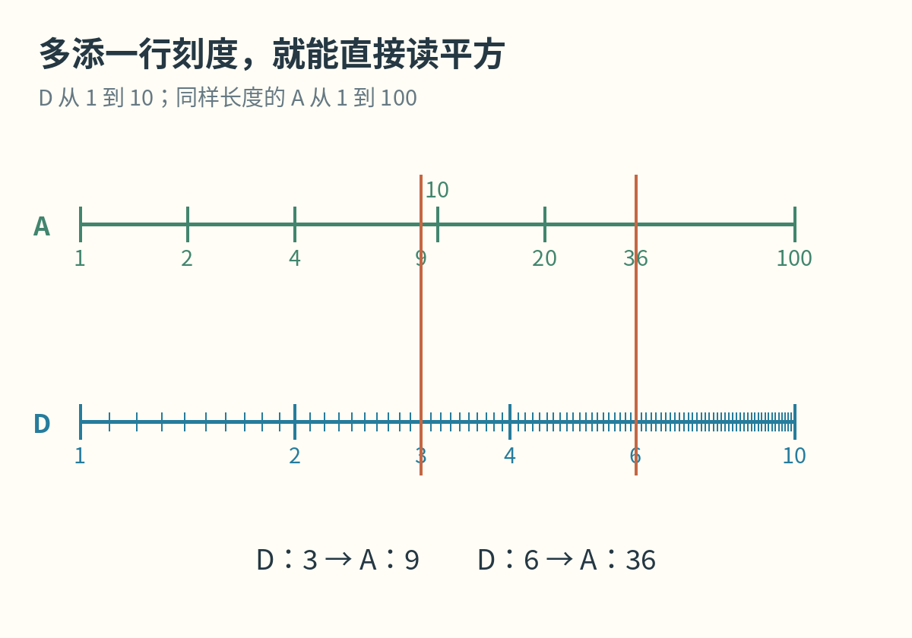

同一个位置上，若D读到x，A读到的数a就满足：

L × log10(x) = (L/2) × log10(a)

于是a = x × x。

你不一定要靠公式记它。看图就行：D上的3，上面是9；D上的6，上面是36。把D的数映到A，就读到了平方；反过来从A读D，就是平方根。

但这里有个常见坑：有些实物A刻度的左右两半都用1到10这组数字标记。左半的2与右半的2，并不是同一个数量级。

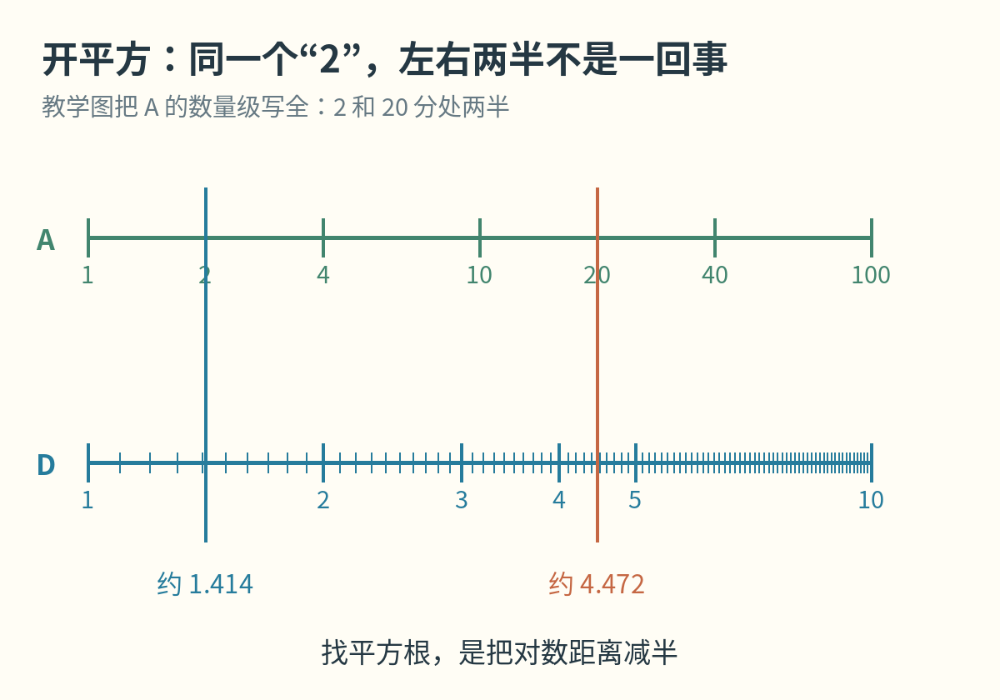

我们的教学图故意把右半写成20、40等完整数值：2的平方根约1.414，20的平方根约4.472。若你把20放到了左半的2上，结果就错了。

更大的数先拆开。例如200 = 2 × 100，平方根就是2的平方根再乘10，约14.14。这里选哪一半，由数量级决定，不是由“看到一个2”决定。

## 10. 最后的那一位数字，从哪里来？

计算尺给的是位置，读者把位置读成数。

先看实物上的两条已知刻线。它们之间若细分成若干段，必须先确认这一带每小段代表多大的数值变化。

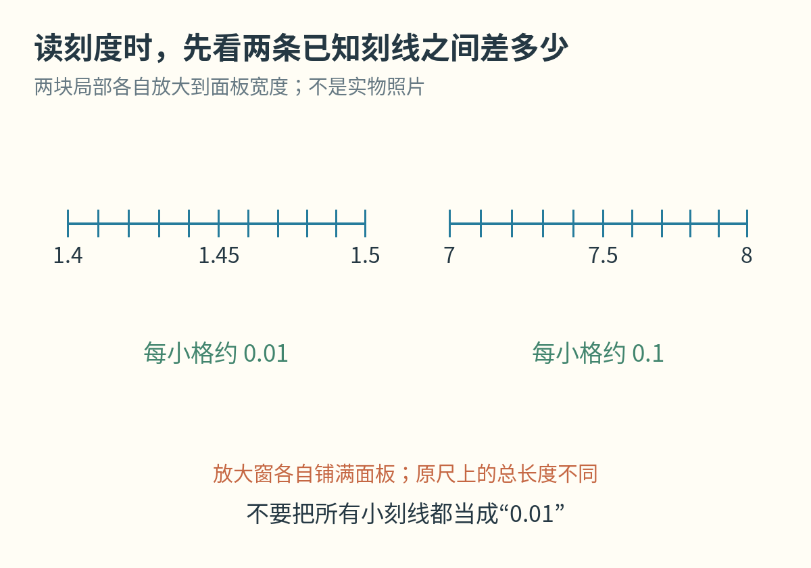

图中是两块分别放大的局部教学刻度，不是同一放大倍率的实物照片。1.4到1.5分十段，每小段约0.01；7到8分十段，每小段约0.1。实际尺子的细分密度会随区域和型号变化，不能机械套用这张图的细分规则。

刻线之间还可以估读，但估读不是凭空创造无限位数字。线宽、游标的对齐、视线角度、印刷误差都会限制结果。

一个小模型能说明为什么计算尺比较自然地保持“相对精度”。

假设理想尺长200毫米，最终读数位置只向右偏了0.2毫米。注意，我们只分析这一次最终位置误差，不是在模拟整套实物操作。

偏移占总长的0.001，所以读数会被乘上10的0.001次方，约为1.002305。

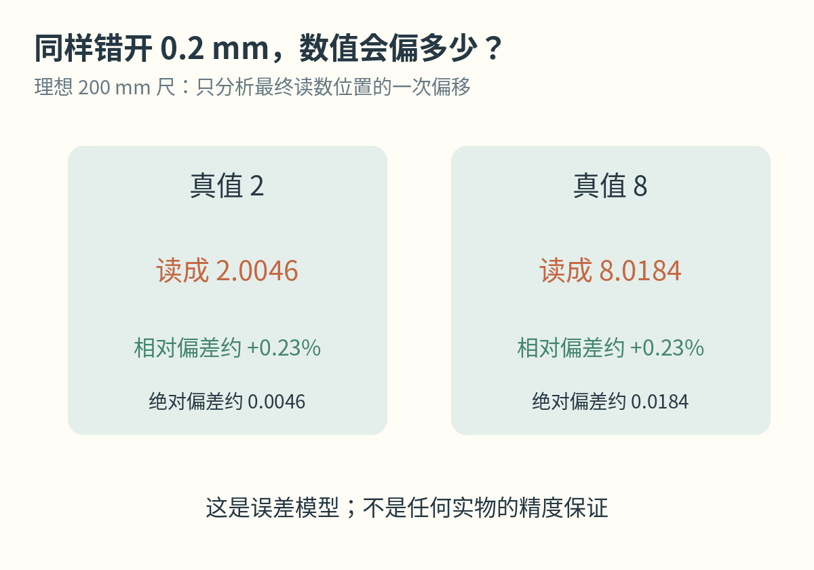

真值2会读成约2.0046；真值8会读成约8.0184。绝对误差不同，相对误差都是约0.23%。

这并不是“所有计算尺都保证0.23%”。它只是说明：同样的距离误差，经过对数刻度转换，比较接近同样的百分比误差。

也就不难理解，为什么一把尺往往能给出几位有用数字，却不能因为答案变大，就自动保留同样多的小数位。

## 11. 为了更清楚地分开刻线，人们把尺子绕了起来

如果手的定位误差大致不变，把刻度做长，就能让细小的数值差异占据更多空间。

但长十几米的直尺，显然不好放在桌上。

于是，长刻度可以分段排在圆柱的不同位置。旋转和轴向移动，让使用者把需要比较的段送到一起。

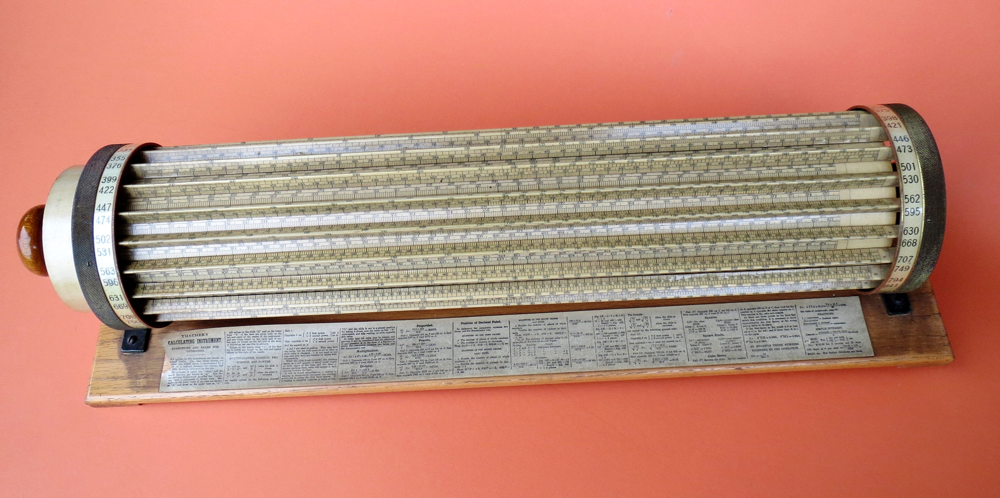

图：Thacher计算仪，Gotanero摄，2014年；[原文件](https://commons.wikimedia.org/wiki/File:Thacher%27s_Calculating_Instrument.jpg)，CC BY-SA 4.0，原图未修改。照片里的长条刻度与内筒，可帮助理解“把长尺度安放在较小器械中”的办法。

Edwin Thacher在1881年的美国专利中，就明确写出目标：增加尺度长度与精细程度，同时不把器械做得同样长。他描述了可旋转、也可纵向移动的圆柱和外围刻度条。[专利US249117A](https://patents.google.com/patent/US249117A/en)

这是机械布局在替数学解题。改变的不是对数定律，而是容纳、移动和阅读刻度的方式。

还可以把一段刻度直接绕成圆。

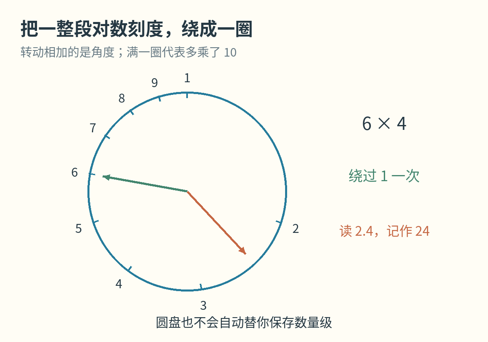

平移变成转动，距离相加变成角度相加。跨过一圈，就相当于跨过一个十倍区间。圆形结构不会让结果掉到物理尺子外面，但不会因此自动记住数量级。

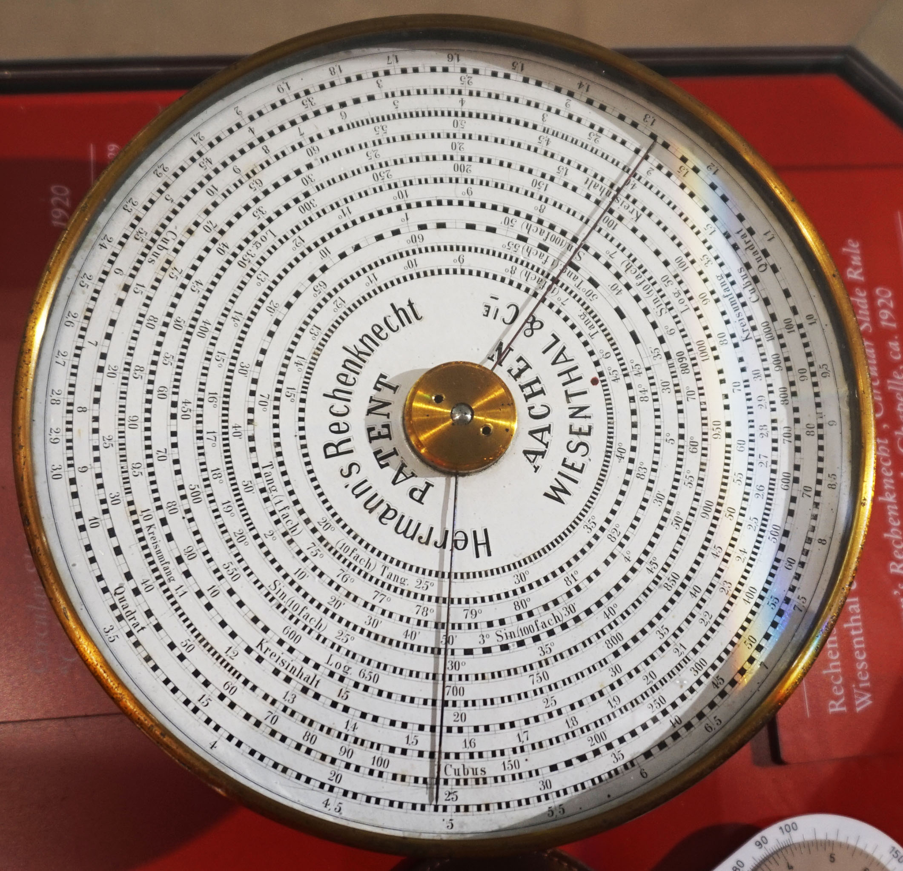

图：慕尼黑德意志博物馆的“Hermann's Rechenknecht”圆形计算尺，Tiia Monto摄，2017年；[原文件](https://commons.wikimedia.org/wiki/File:Circular_slide_rule.jpg)，CC BY-SA 3.0，原图未修改。它有许多环形刻度；上面的单圈教学图只解释基本原理，不是对全部环线的复原。

## 12. 这把尺，也有明确的不能

首先，你找不到0。

不是印漏了，而是普通实数对数没有log10(0)这个有限地址。从1变成0.1，再变成0.01，每次都向左走一个完整尺长。不断接近0，需要不断往左走。

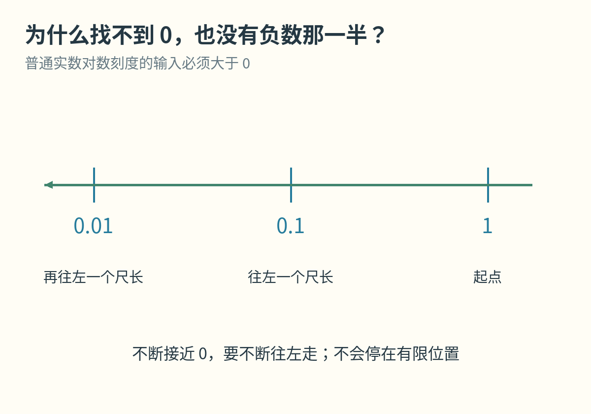

普通实数对数刻度也不直接放负数。计算负数乘除时，可以先处理绝对值，符号另记；除以0仍然没有定义，不能通过换刻度解决。

其次，刚才这套C/D动作不能直接求2.4 + 3.2。

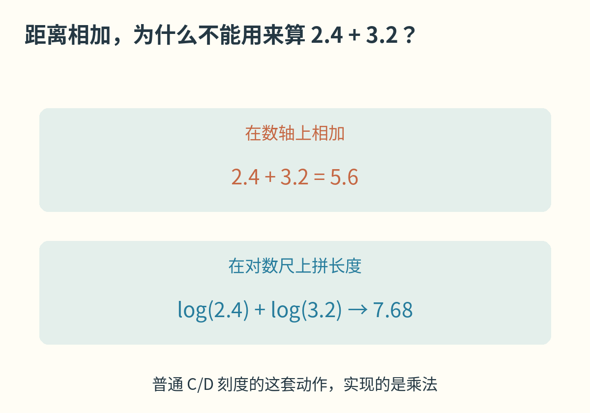

你拼起来的是两段对数距离，得到的是7.68，不是5.6。某些器械另设等距加法刻度，或者用其他步骤转化问题，那是额外的安排，不能把它混成普通乘法尺的本领。

最后，它不适合提供任意多位精确整数答案。需要精确记账、很长的整数乘法，或者要区分极其接近的结果时，应选择适合的工具。

知道限制，不会让这个发明失去魅力。它恰恰展示了一种很有用的设计方式：把一个难做的操作，变成另一种介质里容易做的动作。

## 13. 做一把纸尺，再故意让它出错

这里有一份[可打印的两行纸尺](examples/paper-slide-rule.svg)。两条刻度必须采用相同的缩放比例；整体放大或缩小不影响理想乘法关系，只会影响读数的方便程度。

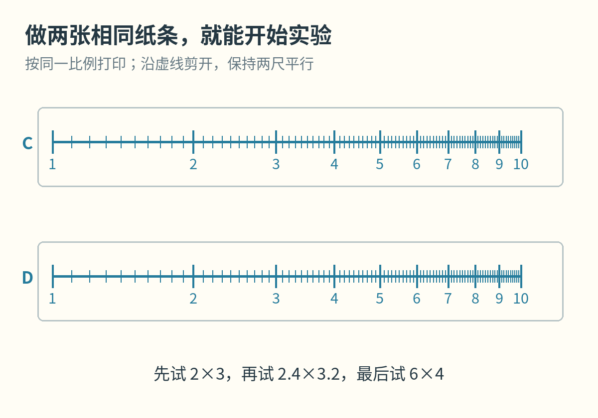

可以按这个顺序试：

1. 先算2 × 3。用整数检查你有没有对错刻度。
2. 再算2.4 × 3.2。看看能否读出接近7.7的结果；不要要求简易纸尺证明最后两位。
3. 算6 × 4，观察为什么需要换端指标。
4. 算24 × 32，在移动前先写下“答案应是几百”。
5. 把一张纸条单独拉伸一点，再试同样的题。为什么两条尺不再可靠配合？

第五步很重要。相对滑动能算乘法，不仅要求两边都是对数刻度，还要求它们的比例系数相同。若C的一段尺长和D不同，“同一段物理距离”就不再代表同一个对数增量。

[配套Python实验](examples/log_distance.py)只使用标准库，能生成这份纸尺，也能检查理想模型。本文实际运行了3721组正数的乘除关系及7个平方根检查；这是对公式和制图坐标的核验，不是纸尺或历史器械的精度测试。

现在再回头看开头的问题：答案确实在某种意义上被“印”进了尺子，但不是把所有乘法题的答案逐项列出来。

被印进去的是一套关系。

人负责选题、移动、判断数量级；尺子负责把乘法关系变成长度；眼睛负责把位置重新读成数。几个世纪以前，一项抽象的数学变换，就这样被放进了人的手掌。
