# 给奔跑中的系统拍合影：Chandy–Lamport 快照怎样找回路上的消息

两台机器各保管一些游戏代币。P 有 5 枚，Q 有 3 枚，总共 8 枚。玩家让 Q 给 P 转 2 枚：Q 先扣掉，消息在网络里走一会儿，P 收到后再加上。

这时管理员想问一句很朴素的话：**系统里一共还有多少代币？**

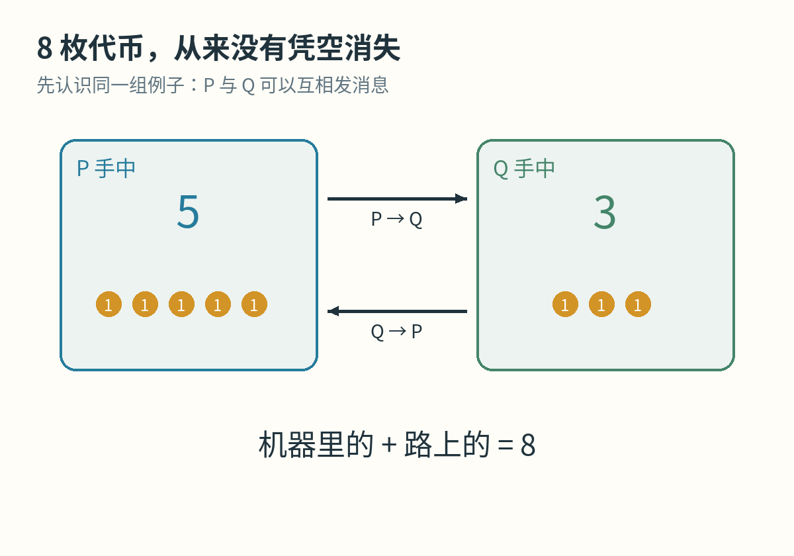

图中机器、代币和网络都是自设教学模型。这里没有真实支付，也没有假定转账已经完成。

管理员分别问两台机器“你现在有多少”。P 回答得早，说 5；Q 回答得晚，已经扣掉 2，说 1。合起来只有 6。代币没有丢，只是统计漏掉了在路上的那 2 枚。

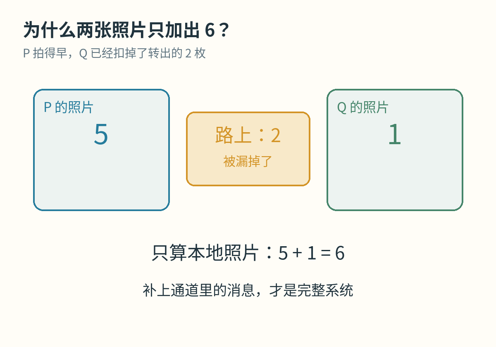

换个询问次序还会更离奇：Q 在发送前说 3，P 在接收后说 7，合起来竟有 10！同一笔转移被两张照片重复计算了。

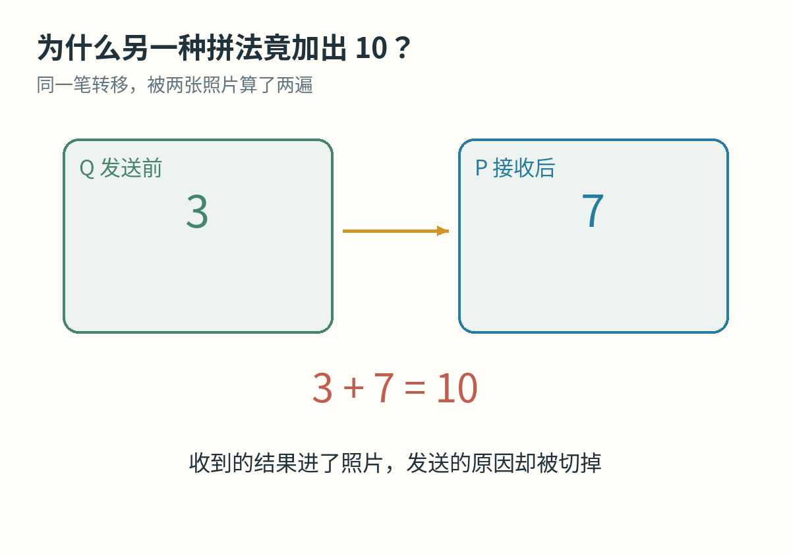

这不是“把机器时钟调准”就能轻松消失的问题。读取、发送、接收都有先后，消息也需要时间。我们真正缺少的，是一条规则：哪些局部照片可以拼在一起，路上的东西又该放在哪里？

## 1. 1985 年的转折：把通信线路也拍进去

K. Mani Chandy 与 Leslie Lamport 在 1985 年发表《Distributed Snapshots: Determining Global States of Distributed Systems》。他们研究的并非如何找一台更精确的钟，而是怎样在分布式计算继续进行时，记录一个有意义的全局状态。[原论文](https://lamport.azurewebsites.net/pubs/chandy.pdf)

“全局”不能只理解成所有机器的文件夹。它至少包含两部分：每个进程的本地状态，以及每条通信通道里已经发出、尚未接收的消息。进程可以先理解为独立做事的一位工作者，通道则是有方向的传递路线。

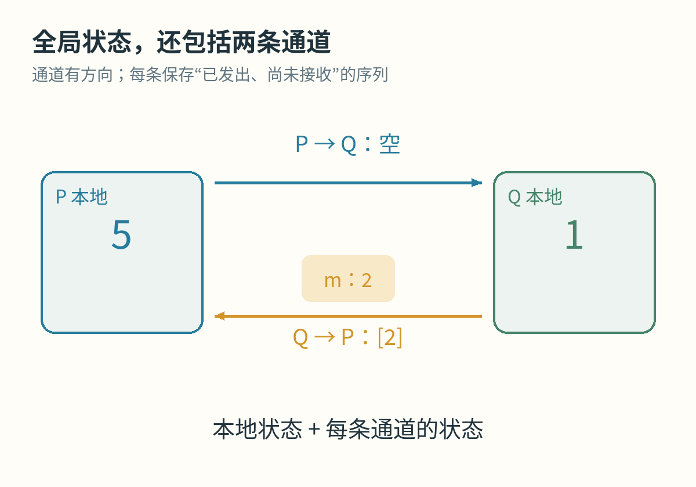

P→Q 与 Q→P 是两条不同的通道。P 不能直接打开网络的肚子清点消息，Q 也不能替 P 决定何时截取状态。算法的巧妙之处，在于让两端合作，**只靠本地记录和特殊消息，就划出一笔“在途库存”。**

本文先采用一个明确模型：消息不丢失、不重复，最终能到达；同一条通道按发送顺序接收，也就是 FIFO，先进先出。延迟可以长短不一，不要求各机器共享时钟。后面会看到，FIFO 不是可有可无的小字。

## 2. 什么叫“能拼在一起”？

把每个进程的经历画成一条时间线，在各自某处划一刀：刀前的事件算进照片，刀后的不算。整组刀口叫一个“切面”。各刀口不必对应同一堵墙上时钟的读数。

但有条因果底线：**照片里若已经出现“收到消息”，就必须也包括那条消息的“发送”。** 不能保留结果，却删掉产生结果的原因。

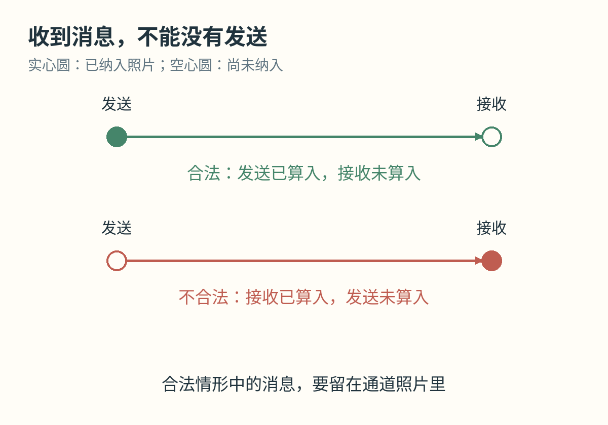

发送已算入、接收尚未算入则完全可以。那条消息应该留在照片里的通道状态中。这正是前面漏算的 2 枚代币应该待的地方。

这样的切面称为“一致切面”。“一致”在这里指因果关系能对上，并不表示所有机器已经就同一个决策投票，也不是数据库 MVCC 中某个事务能看到的版本集合。问题的中心是：怎样让进程状态和通信状态相互配套。

## 3. 用一张小标记，把长长的历史分开

算法引入一种控制消息：marker，下面叫“标记”。它不携带代币，不改变游戏业务；它表达的是：发送者已经为这轮快照记录过自己的状态。

我们继续同一组 8 枚代币，完整走一遍。下图中的左右顺序只是方便讲解的事件次序，不是算法需要的全局时钟。

### 第一步：Q 先发送 2 枚，消息还在路上

Q 的实时余额变成 1，P 仍是 5。携带 2 枚代币的业务消息记作 m。此刻还没开始快照。

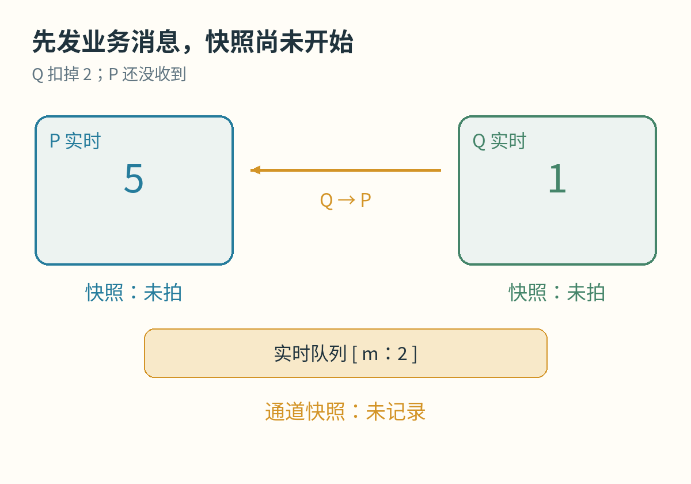

### 第二步：P 发起快照，记住自己的 5

P 保存一份不可被后续业务改写的本地记录：5。随后，P 在所有出通道上发送标记，且必须让标记排在它此后发送的业务消息之前。

同时，P 开始记录每条入通道上接下来到达的业务消息，直到那条通道的标记到达。我们这里只有 Q→P 一条入通道。

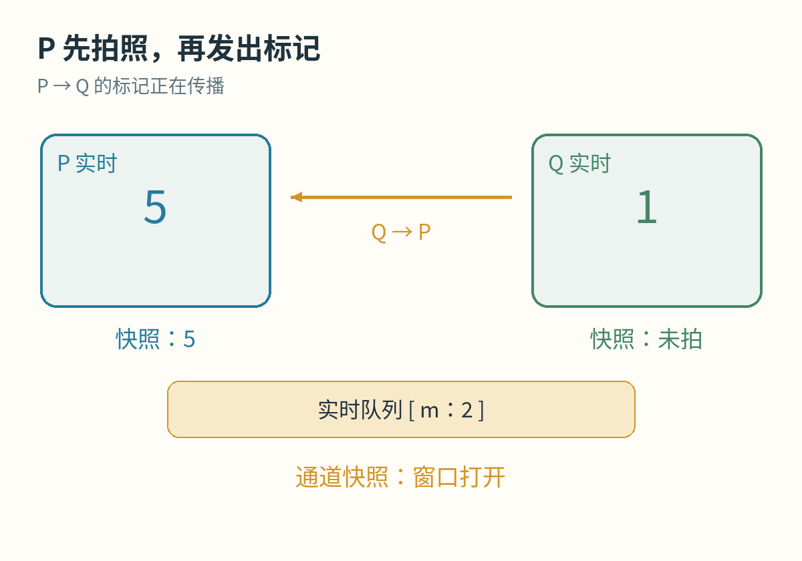

### 第三步：Q 收到第一个标记，记住自己的 1

设 P→Q 的标记先到 Q，而业务消息 m 仍在另一条 Q→P 通道里。这并不违反 FIFO：两条不同通道的速度可以不同。

Q 此前还没参加这一轮快照，所以收到第一个标记时，立即保存本地状态 1。触发它拍照的 P→Q 通道记为空；然后 Q 也向所有出通道发送标记。

为什么这条入通道可以直接记空？P 拍照前发送给 Q 的消息都排在标记前，已经到过 Q；P 拍照后发送的消息又都排在标记后。第一个标记恰好让 Q 在这两批之间拍下照片，中间没有需要补录的消息。

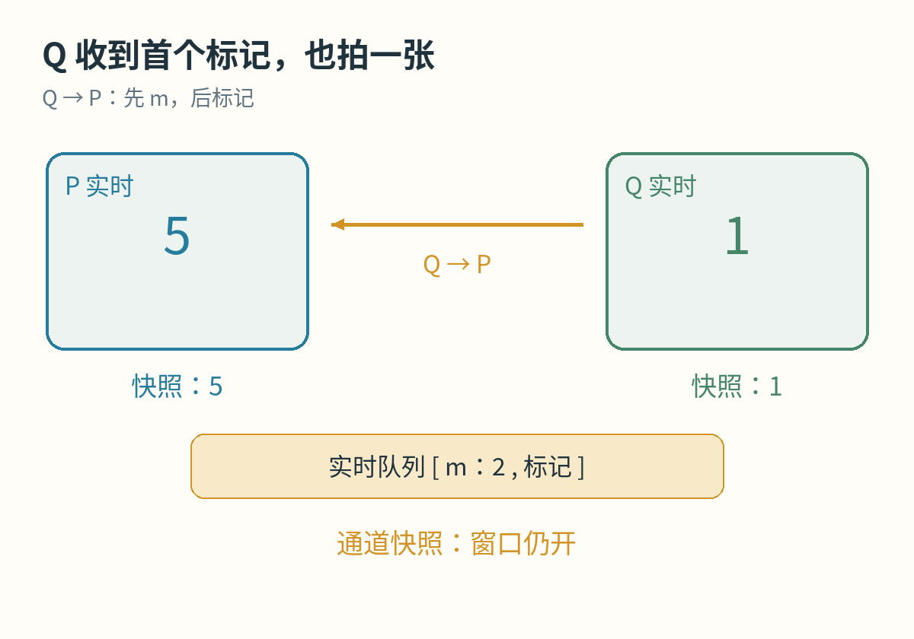

注意 Q→P 队列：业务消息 m 先发，标记后发。因此 m 必须先到 P。这个排队顺序马上就要发挥作用。

### 第四步：P 收到 m，业务照常，照片另记

P 的实时余额从 5 变成 7。这是正常业务，不能因为快照而假装没收到。

但快照中的本地记录仍然是 5。由于 Q→P 的标记还没到，P 还把 m 记进该通道的快照日志。一个数属于现在的运行现场，另一个数属于已经冻结的照片，二者用途不同。

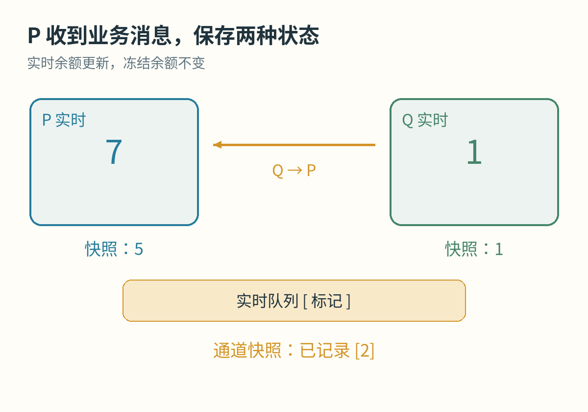

### 第五步：标记到 P，关上记录窗口

P 收到 Q 发来的标记，停止记录 Q→P。最终收集起来的是：P 的本地记录 5，Q 的本地记录 1，Q→P 的在途记录 2，P→Q 为空。

**5 + 1 + 2 = 8。** 代币没有消失，也没有复制。

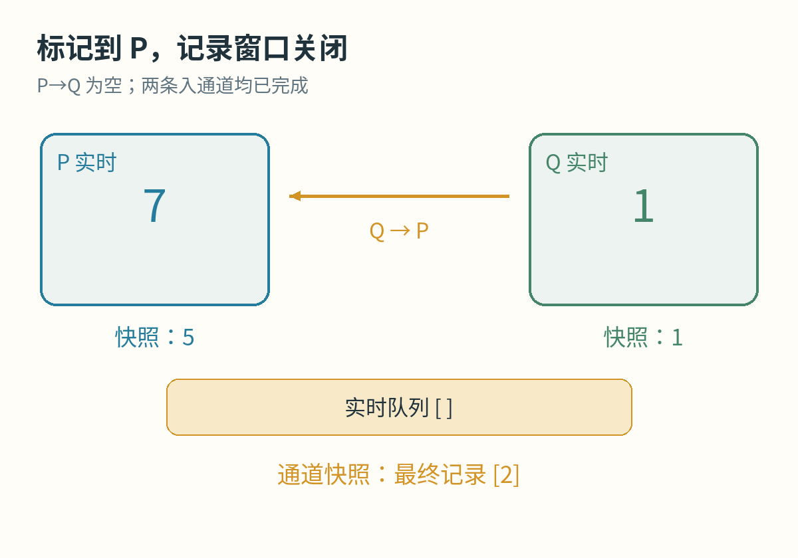

此时实时系统可能已经是 P=7、Q=1，消息也早就处理完了。这不妨碍快照仍保存着“P=5、Q=1、路上有2”的那一幅画面。快照不是不断更新的仪表盘。

## 4. 标记为什么能代表一道边界？

看一条从发送者 S 到接收者 R 的通道。S 先记录自己，再插入标记，然后继续发业务消息。FIFO 就把消息分成了不会越界的两批。

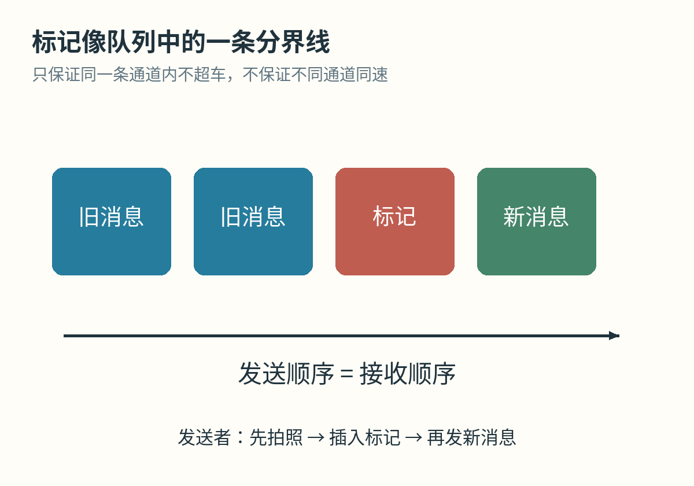

如果 R 已经记录了自己，它只需收集“我拍照之后、对方标记到达之前”收到的业务消息。这些消息在发送者拍照前已经发出，却没有赶上接收者的本地照片，恰好就是需要补上的在途部分。

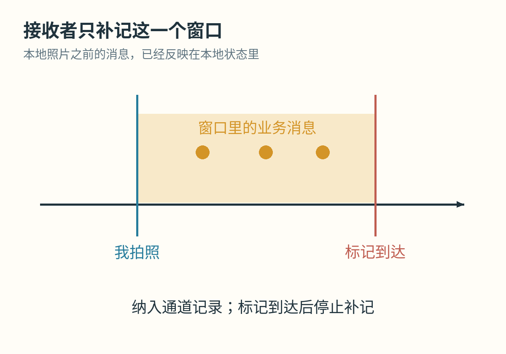

如果网络允许标记超车，P 可能先见到标记、关闭日志，之后才收到本该在日志里的 m。我们的 2 枚代币就又漏掉了。所以，不能把这份算法原封不动扔到任意乱序传输上。实际系统需要确保逻辑通道顺序，或者使用适用于另一种通信模型的算法。

把规则压缩成一张图，就只有两个分支：第一次看到这轮标记，先记录自己；已经记录过，则结束对应入通道的记录。

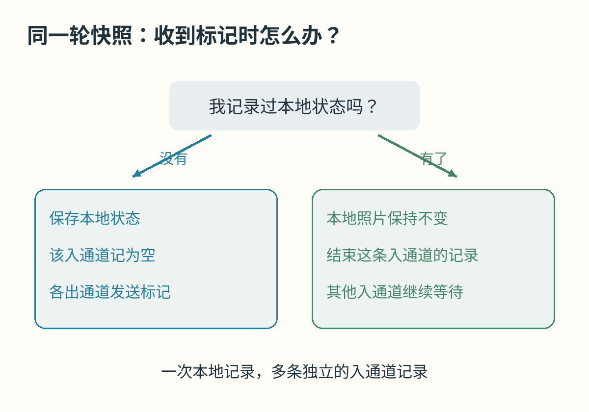

遇到多条入通道，每条都要有自己的结束标记。B 的标记来了，只能关闭 B→我 的日志，不能替 C→我 关门。“我已经拍过本地照片”和“我所有通道都拍完了”是两件事。

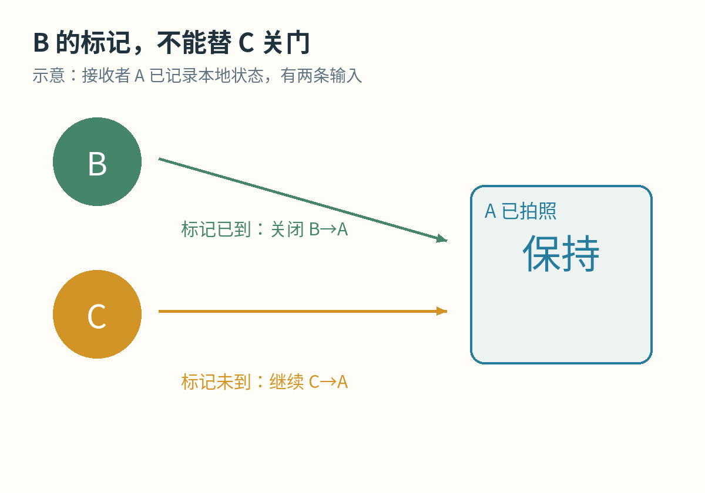

## 5. 写一个可以手动调度的微型实验

完整的[标准库实验代码](examples/simulate.py)把每条通道写成一个 FIFO 队列，用显式调用控制下一条消息何时到达。它没有线程、真实网络和磁盘恢复；这样你能把每一步停下来检查，而不是被并发日志淹没。

核心不是某个复杂数据结构，而是收到业务消息时同时维护两份东西：

```python
# channel 是 (发送者, 接收者)，amount 是代币数
if receiver in saved and channel not in closed:
    channel_log[channel].append(amount)
live[receiver] += amount
```

saved 存放已经拍好的本地状态；closed 表示本轮哪些入通道已收到标记；channel_log 保存应计入快照的在途消息。先后调度按照刚才的五步。程序实际执行后的结果是：

```text
live = {'P': 7, 'Q': 1}
saved = {'P': 5, 'Q': 1}
channels = {('P', 'Q'): [], ('Q', 'P'): [2]}
snapshot_total = 8
```

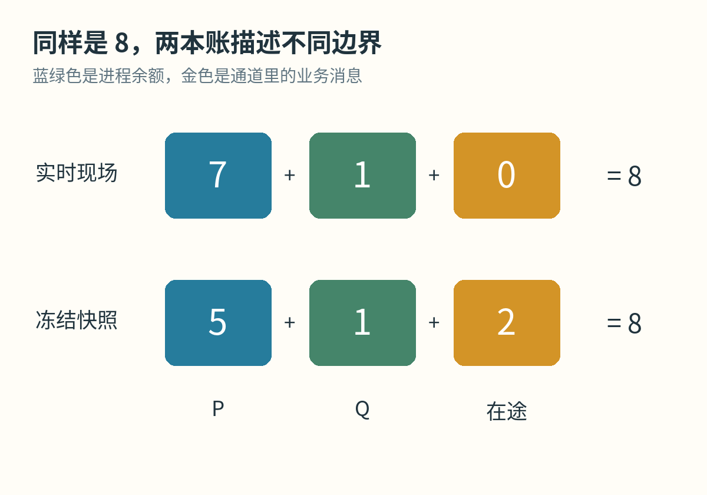

这个实验还检查两个重要不变量：实时余额加上仍在队列中的业务消息，始终等于 8；快照完成之后，冻结余额加通道日志，也等于 8。控制标记不是代币，不参与求和。

你可以先尝试调整调度：让 m 先到 P，P 再发起快照。此时 P 会记录 7，Q 记录 1，两个通道都为空。总数仍是 8，但这是一张不同的合法照片。完整代码也运行了这个变体并做了断言。

## 6. 一致，不等于真实出现过的同一瞬间

这里还有一个很容易被“拍照”比喻掩盖的细节：一般情况下，算法记录的组合未必等于原执行过程里某个真实墙钟瞬间的全局状态。

举个没有通信的小例子：P、Q 都从 0 变成 1。实际执行顺序是 P 先变、Q 后变，经过 (0,0)、(1,0)、(1,1)。如果 P 记录得早、Q 记录得晚，照片可能是 (0,1)。原时间顺序里没有它，但两次本地变化彼此没有因果依赖，交换顺序也是合法执行。

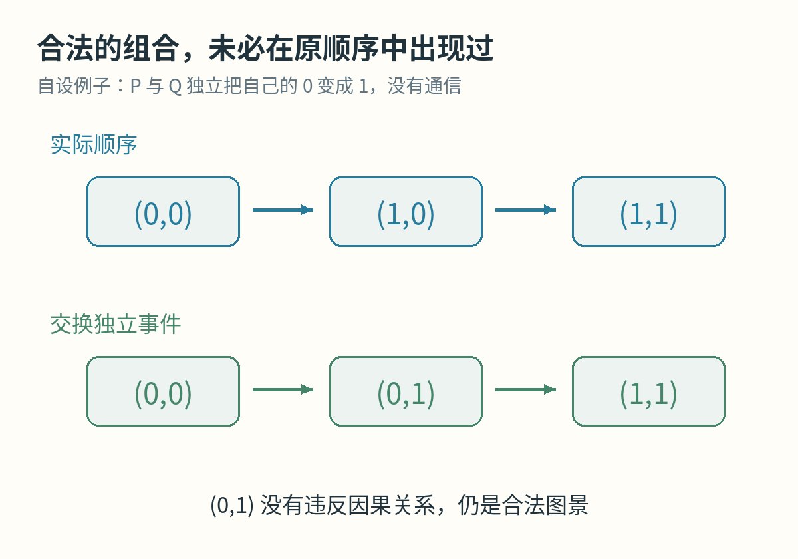

我们要的是一幅符合因果关系、能放进合法执行解释的全局图景，而不是证明宇宙里所有机器曾在某一纳秒恰好摆出这个姿势。原论文专门讨论了这种区别。反过来，前面那个“接收在照片里、发送不在”的状态无法靠重排独立事件救回来，因为收发本身就有因果联系。

## 7. 拍完以后，能回答什么问题？

原论文的重要动机之一，是判断“稳定性质”：一旦变成真，后续执行中就一直为真。比如，在不会再从外界注入新任务的计算阶段里，所有进程都不再工作，所有通道也没有可能唤醒它们的工作消息，才能说这一阶段真正结束了。

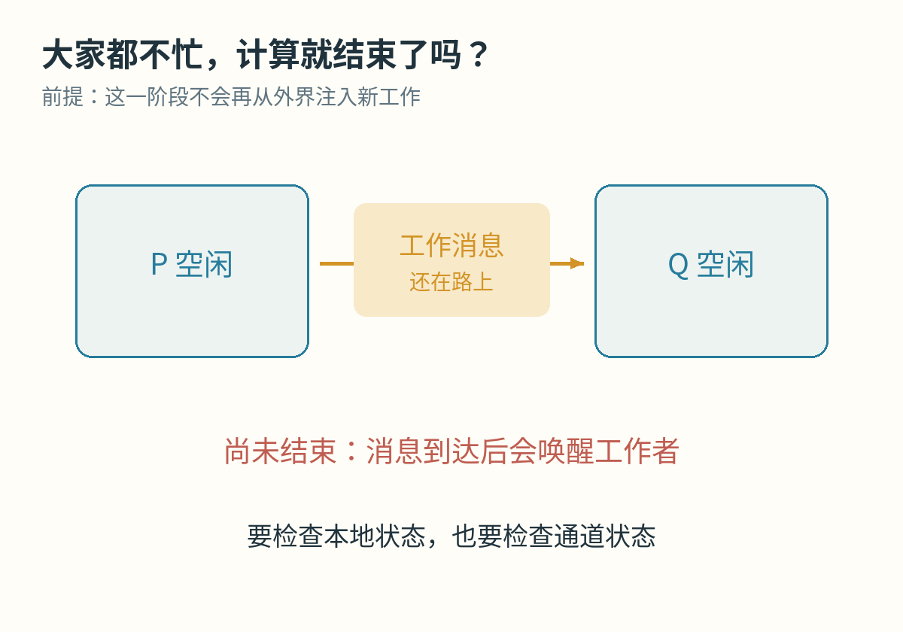

只问每台机器“你忙吗”很危险：它们可能都回答不忙，而一个工作消息正在路上。把通道也记录下来，才有机会对整个计算作判断。如果允许外部随时送来新任务，就需要先讲清楚判断的是哪个阶段，不能把“现在安静”说成“永远结束”。

同样，记录结束也不等于所有记录自动集中到了一处。工程上还要收集各进程的结果，识别快照轮次，处理失败和超时，并把需要恢复的状态可靠保存下来。

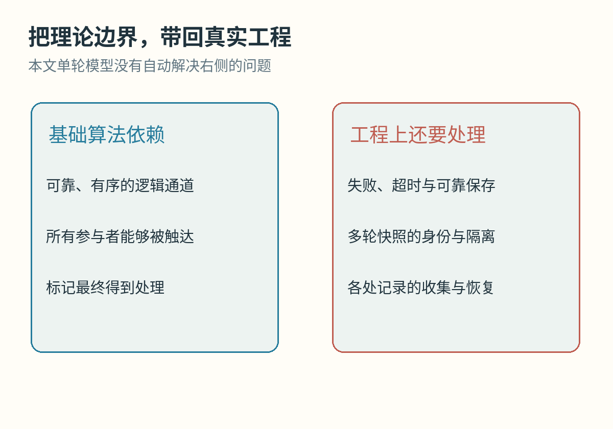

在有限网络里，要保证完成，标记必须能传播到所有参与者，各条通道上的标记最终被处理。进程崩溃、消息永久丢失、拓扑变化、并发多轮快照，都不是本文这个单轮小实验已经解决的事情。

## 8. 在真实系统里，看见“路上的状态”

Apache Flink 的 2020 年 1.11.0 发布公告介绍了当时处于 Beta 的非对齐检查点。它提供了一个很直观的工程对照：多输入的检查点屏障如何前进，以及等待慢通道会带来什么代价。

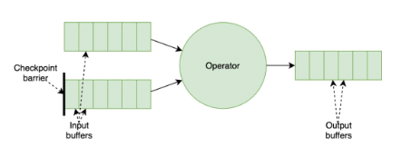

这是公告原始动画，453×173，保留原尺寸与全部帧；小字可以结合本段阅读。黑色短线是检查点屏障，绿色长条表示缓冲中的数据，圆形是算子。对齐方式在不同输入的屏障到齐之前会等待，让状态边界对上。

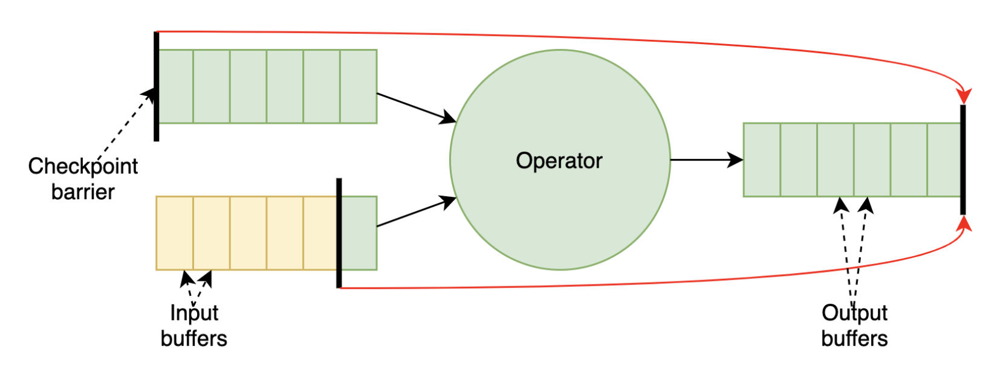

第二张是同一节的另一张原图：非对齐方式允许屏障更快地向前传播，同时把相应缓冲中的在途数据纳入检查点。这个工程机制允许屏障越过缓冲数据，所以不是照搬前文的 FIFO 标记规则；额外保存的数据承担了补回在途部分的责任。它以额外保存这些数据的代价，缓解反压严重时的等待问题。这里解释的是该历史版本公告的机制，不是对当前配置的建议，也不表示我们测过 Flink 性能。[官方公告](https://flink.apache.org/2020/07/06/apache-flink-1.11.0-release-announcement/)

Flink 的具体实现和我们的两进程玩具并非逐行相同，但你已经能读懂它们共享的难题：如果只保存工作者手里的东西，谁来负责那些正在传递中的东西？

最后给你一个纸笔挑战：在第三步 Q 记录完 1 并发出标记之后，再向 P 发送 1 枚。它应该计入这轮快照的 Q→P 日志吗？

答案是不应该。它排在 Q 的标记之后；Q 的快照余额 1 已经包含这枚代币，再把它加入通道记录就会重复。P 仍然照常接收它、更新实时余额，照片却要忠实保留自己的边界。

这就是分布式快照最迷人的地方：没有叫所有机器停下来摆姿势，也没有请一只全知的眼睛俯视网络，只是让每个参与者认真记下自己的边界，再给边界之间的消息留一个位置。

[资料、图像署名与复现实验说明](sources.md)
