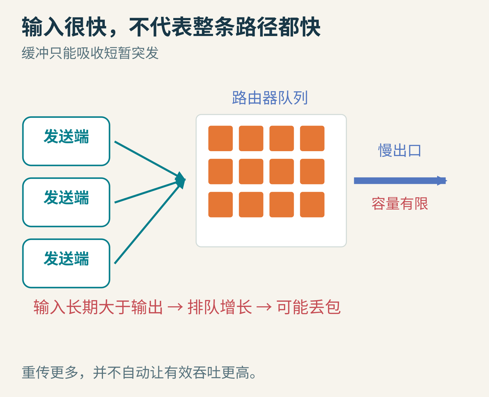
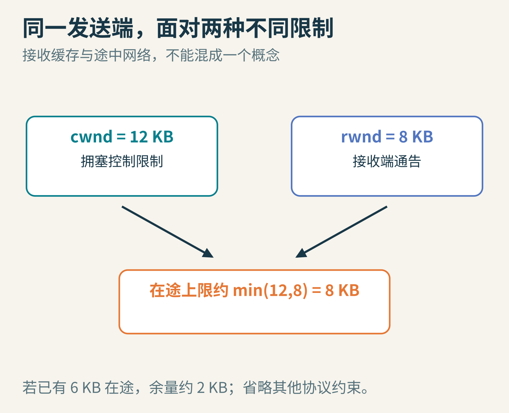
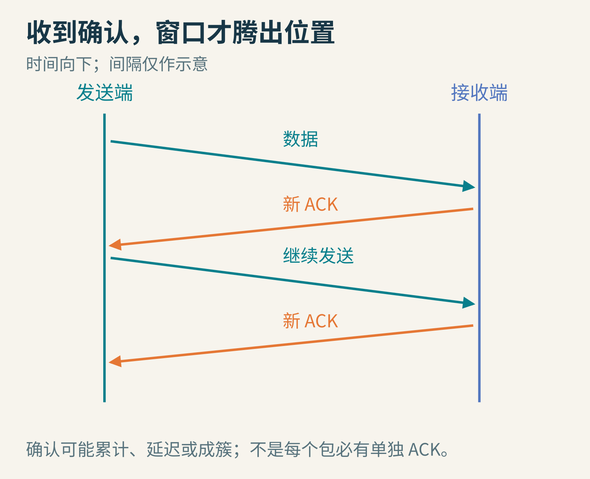
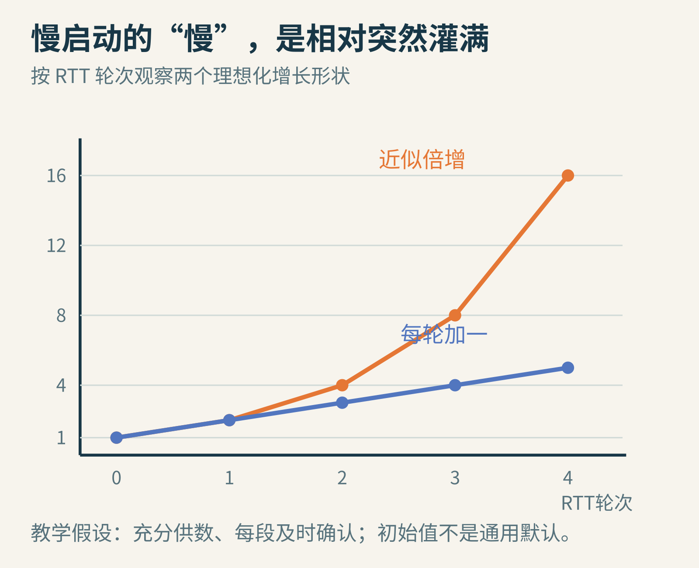
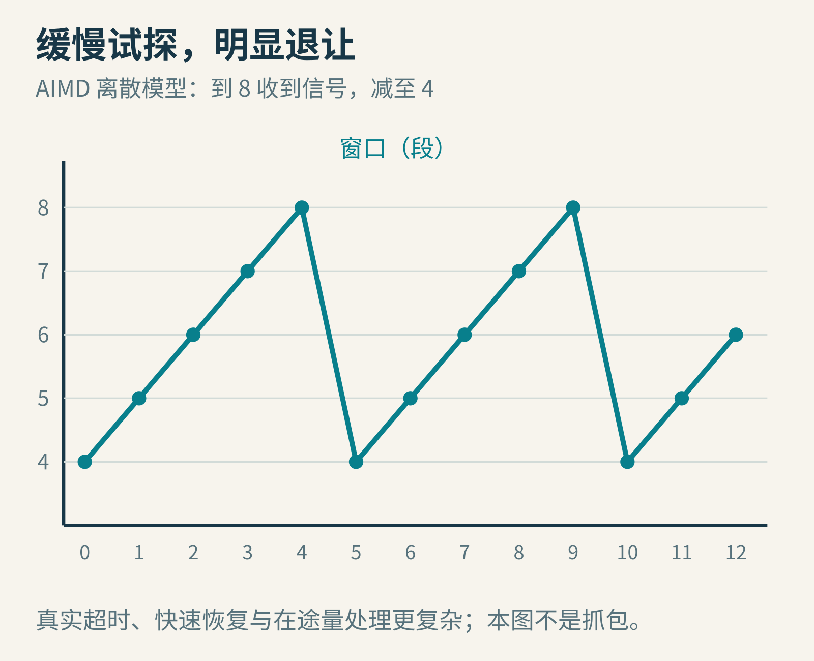
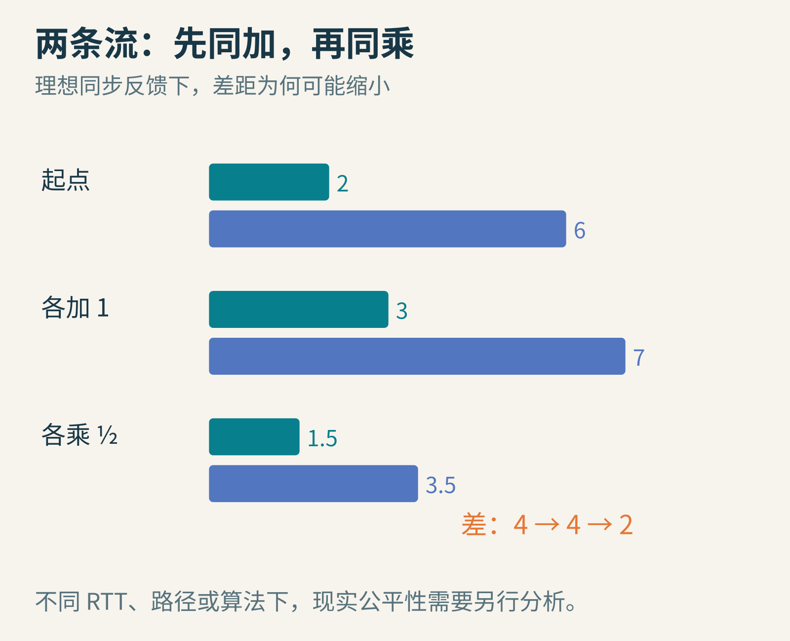

# 网线没有“还剩多少车道”的路牌，TCP 怎样决定发多快？

给朋友传一个大文件。电脑能把数据飞快地塞进网卡，可通往朋友的路径上，还有 Wi-Fi、路由器、运营商链路和其他人的流量。你不知道最窄的地方在哪儿，也不知道下一秒会不会有人开始下载。

如果“想发多少就发多少”，多出来的数据先排队，再可能被丢掉。发送者又重传，队列更满。努力发得更多，反而可能让真正送达的有效数据更少。

TCP 的经典拥塞控制像一位看不见全程路况的司机：根据抵达的确认和拥塞迹象，不断调整自己让多少数据留在路上。



图1：瓶颈每单位时间能送走的数据有限。缓冲区能吸收短暂突发，却不能永久弥补输入大于输出。

## 1. 先分清两种“装不下”

朋友电脑的接收缓存装不下，是接收端流量控制的问题；途中路由器的队列装不下，是网络拥塞的问题。它们不是同一个地方发生的限制。

TCP 接收端会通告接收窗口 rwnd。发送端另外维护拥塞窗口 cwnd。粗略理解，未确认的在途数据要受两者较小值约束；要判断还能新发多少，还要扣除已经在途的部分，并考虑实际协议状态。

若 `cwnd=12 KB，rwnd=8 KB`，允许在途的上限约为8 KB，而不是12 KB。若已有6 KB还未确认，当前新发送的余量约为2 KB。



图2：两个窗口都限制发送，但反馈的原因不同。这里只画核心关系，省略重传、窗口缩放和具体字节序号。

“窗口”不是一个固定的每秒速率。假如窗口始终填满，往返时间 RTT 为0.1秒，窗口10,000字节，理想化吞吐估计为 `10,000÷0.1=100,000字节/秒`。同样的窗口，RTT变成0.2秒，估计就减半。

这只是 `窗口/RTT` 的近似。应用供数不足、丢包、接收窗口、链路容量和发送节奏，都可能让实际吞吐更低。

## 2. 确认消息像节拍器

发送端发出一批数据，接收端陆续回确认 ACK。新的确认说明一部分旧数据已经离开在途集合，于是窗口腾出了位置，可以发送新数据。

这叫 ACK 时钟的直觉。反馈往返需要时间，所以发送端不能立刻知道“我刚才多发一点是不是太多”。控制一个存在延迟的系统，贸然大幅改变输入很容易过冲。



图3：时间向下。每条新确认释放一部分在途空间；图只展示节奏，不代表真实网络会按均匀间隔返回 ACK。

ACK 也并非“一个包恰好对应一个确认”：TCP 可以累计确认，接收端还可能延迟确认，ACK 自身也可能丢失、重排或成簇返回。因此，下面的按轮次模型是帮助理解的理想化工具。

## 3. “慢启动”为什么会越长越快？

开始时，发送端不知道路径承受能力。经典慢启动从较小窗口出发，随新数据被确认而扩大窗口。

假设每个数据段都得到及时的单独确认，每次确认让窗口增加一个段，并且一直有数据可发，那么窗口可能按往返轮次近似增长为：

`1 → 2 → 4 → 8 → 16`

它叫“慢启动”，是相对于一开始就把大窗口全部倾倒进网络，而不是说它永远线性慢慢增长。真实初始窗口不必是1，确认策略也会改变增长过程；这组数字不是当前所有系统的默认参数。



图4：为了比较形状，橙线画近似倍增，蓝线画每轮加一。纵轴以固定大小的数据段计；真实 cwnd 通常以字节表达。

窗口达到慢启动阈值附近后，经典算法进入更谨慎的拥塞避免阶段。一个常见近似是：每个 RTT 总共增加约一个最大报文段，而不是每个 ACK 都增加一整段。

如果当前窗口是 W 个段，每个 ACK 增加约 `1/W` 个段，约 W 个 ACK 后就累计增加一个段。这是把小步增长摊到一轮反馈中的办法。

## 4. 为什么“加一点，减一半”？

在经典 Reno 式直觉模型中，拥塞避免采用加法增加，遇到合适的拥塞信号时做乘法减小。常简称 AIMD。

设窗口依次为4、5、6、7、8。此时收到拥塞信号，缩到4，再爬到5、6……于是出现锯齿形。增加时小心试探，减少时迅速让出空间，给队列消退的机会。



图5：这是本文实际运行的离散教学模型，不是抓包曲线。它把一次拥塞事件放在窗口8处，并把减半简化成整数操作。

```python
window = 4
trace = [window]
for _ in range(12):
    if window >= 8:       # 教学模型人为设定的拥塞信号
        window //= 2
    else:
        window += 1
    trace.append(window)
print(trace)
# [4, 5, 6, 7, 8, 4, 5, 6, 7, 8, 4, 5, 6]
```

这段代码没有模拟包、队列、RTT 或重传，不能拿来测网络性能。

真实 TCP 对不同丢失迹象的反应并不完全相同。[RFC 5681](https://www.rfc-editor.org/rfc/rfc5681.html)分别规定慢启动、拥塞避免、快速重传和快速恢复：重复 ACK 触发的恢复与重传超时后的处理要区分。尤其不能把“任何丢包都把当前 cwnd 除以二”当作完整实现；阈值还涉及当时实际在途的数据量，超时后的窗口会更保守。

## 5. 两个人都试探，会不会永远争抢？

先看一个理想模型：甲窗口2，乙窗口6。两人都加1，变成3和7，差仍是4；总量到边界后都乘一半，变成1.5和3.5，差缩为2。反复过程能解释 AIMD 为什么具有朝公平分享靠近的趋势。



图6：两条流同时经历反馈的理想例子。把“差缩小”看作直觉，不把它当作现实网络公平性的无条件证明。

现实中，各连接的 RTT、算法、路径和起止时刻都可能不同。短 RTT 的流可能更频繁地获得反馈；同一用户开多条连接，也不等于只占一份。经典算法的公平性讨论有假设，不能据此保证每个人一定分到相同带宽。

## 6. 一段让网络学会克制的历史


图7：Van Jacobson，2006年 Linux.conf.au 期间。摄影 Simon Lyall，原图已置于公有领域，未修改。

Van Jacobson 的[1988年《Congestion Avoidance and Control》](https://sites.cs.ucsb.edu/~ravenben/classes/276/papers/jac88.pdf)是理解这条历史的重要原始文献；这里链接的1988年11月修订稿同时署名 Michael J. Karels。它把现实中的拥塞问题与反馈、定时器、窗口控制联系起来。TCP 拥塞控制也承接并发展了 Jain 等人的拥塞避免研究，以及 Karn、Karels 等人在计时与实现上的工作，不能浓缩成“一个人发明了所有规则”。

这篇文章解释的是经典算法的基本直觉，并不是所有现代 TCP 发送端的行为说明。CUBIC、基于带宽与时延模型的其他方案，以及显式拥塞通知 ECN，都在用不同方式改进反馈与决策。

丢包也不必然意味着拥塞，尤其在存在无线链路错误时；排队时延增加往往更早出现，但又不总能简单归因。拥塞控制难就难在：你必须根据不完整、延迟且有噪声的迹象，控制一个和许多人共享的系统。

## 留给你的小实验

1. 将教学模型的减小比例从一半改成九成。锯齿变浅了，为什么未必更容易排空队列？
2. 同样是100 KB窗口，RTT为20毫秒和100毫秒时，理想化吞吐各是多少？
3. 如果接收端很慢但路径并不拥塞，应由哪个窗口先限制发送？

下次看到下载速度上下波动，可以多问一句：是应用没数据、接收端吃不下、链路变化，还是拥塞控制正在根据反馈重新找位置？一条速度曲线，往往不只有一个原因。

图片来源：图1—6为本文原创教学示意；[Van Jacobson 原图](https://commons.wikimedia.org/wiki/File:Van_Jacobson2.jpg)，Simon Lyall，公有领域，未修改。
