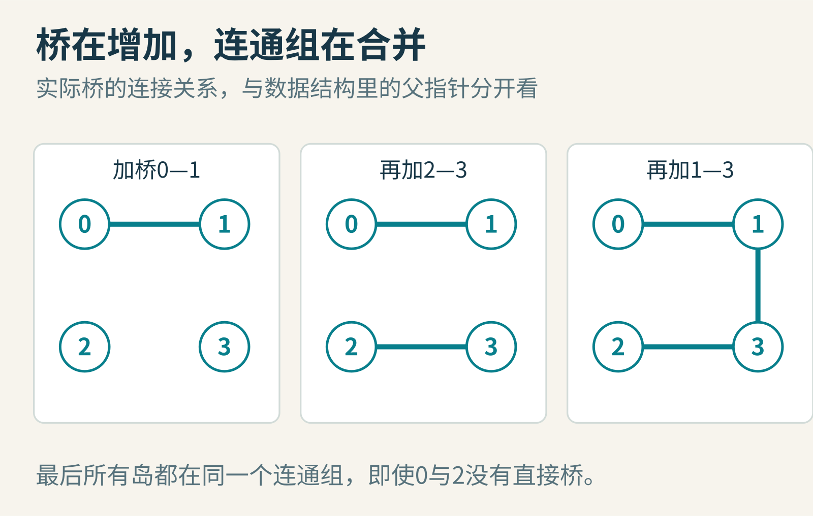
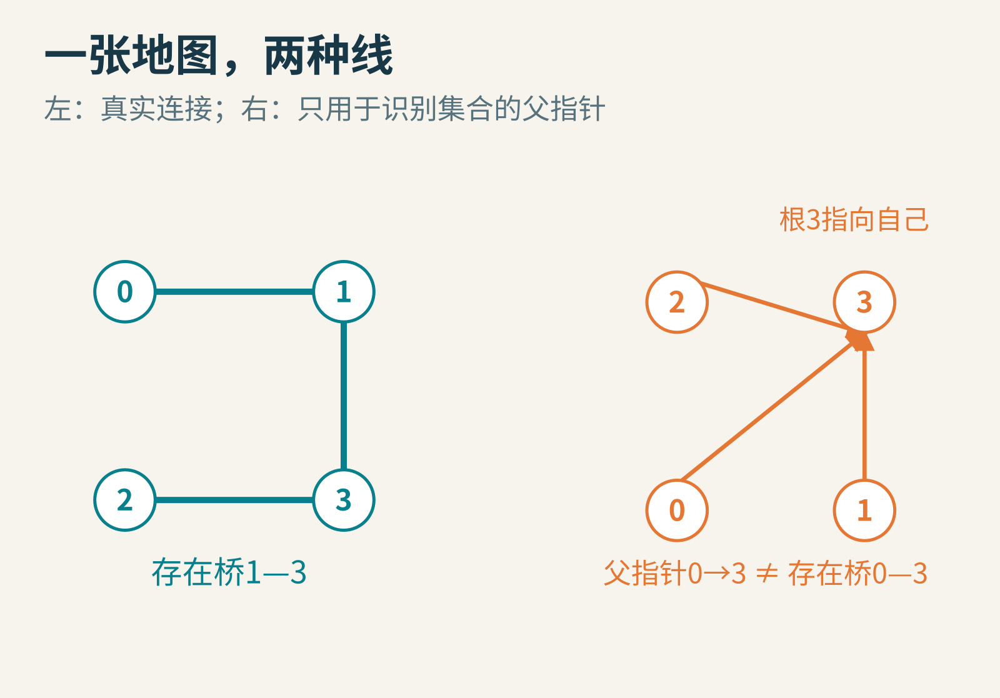
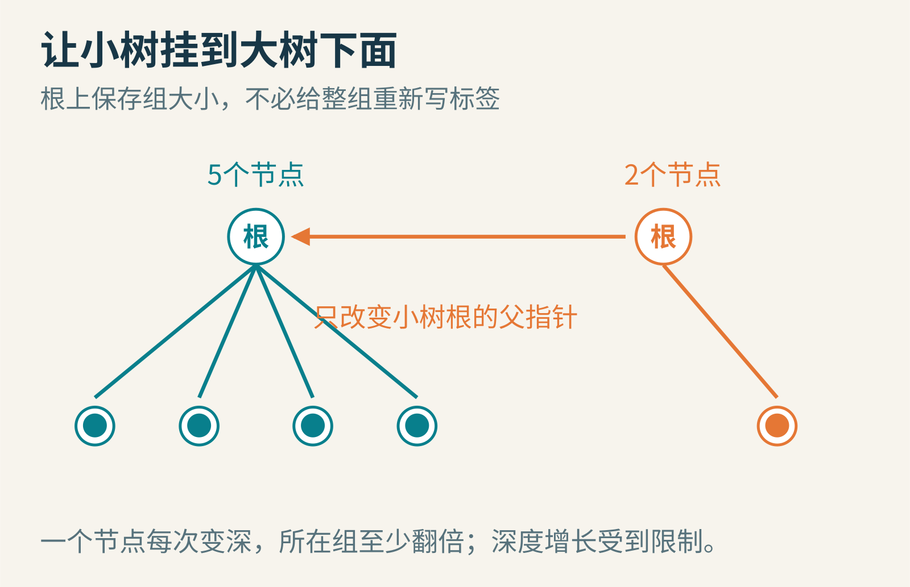
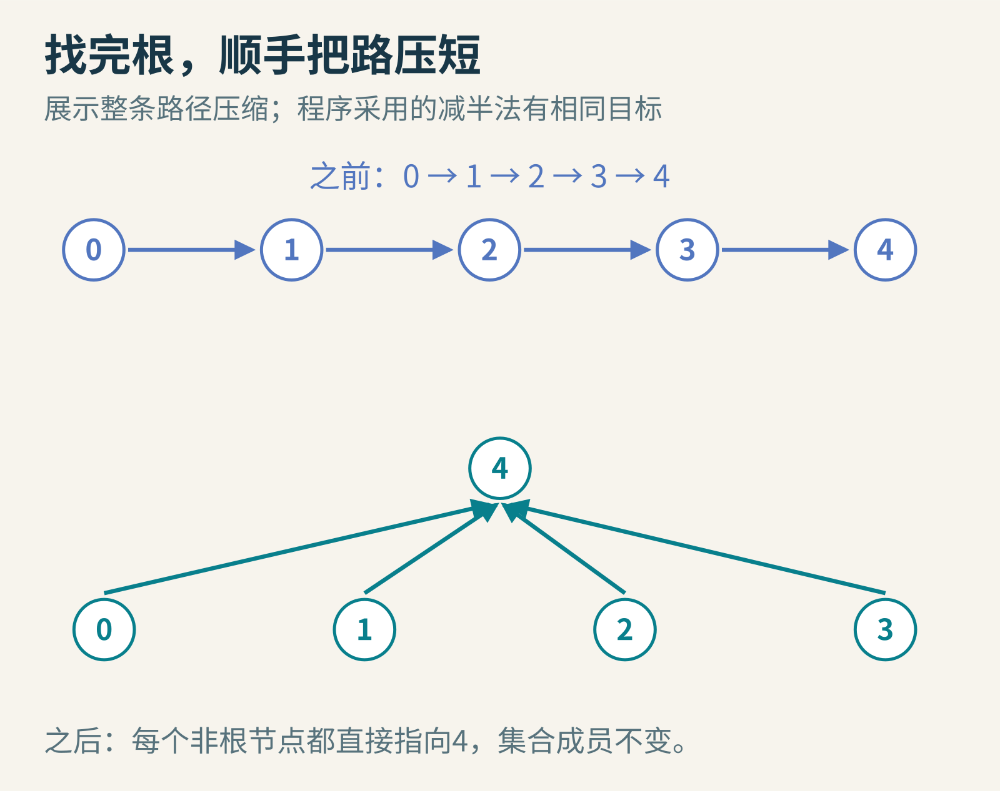
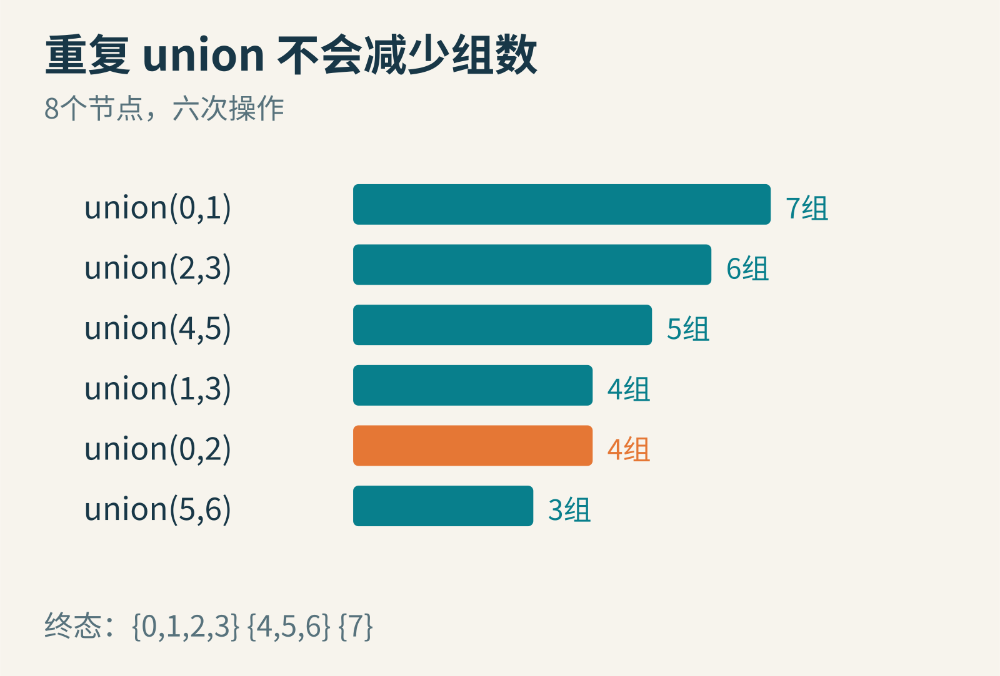
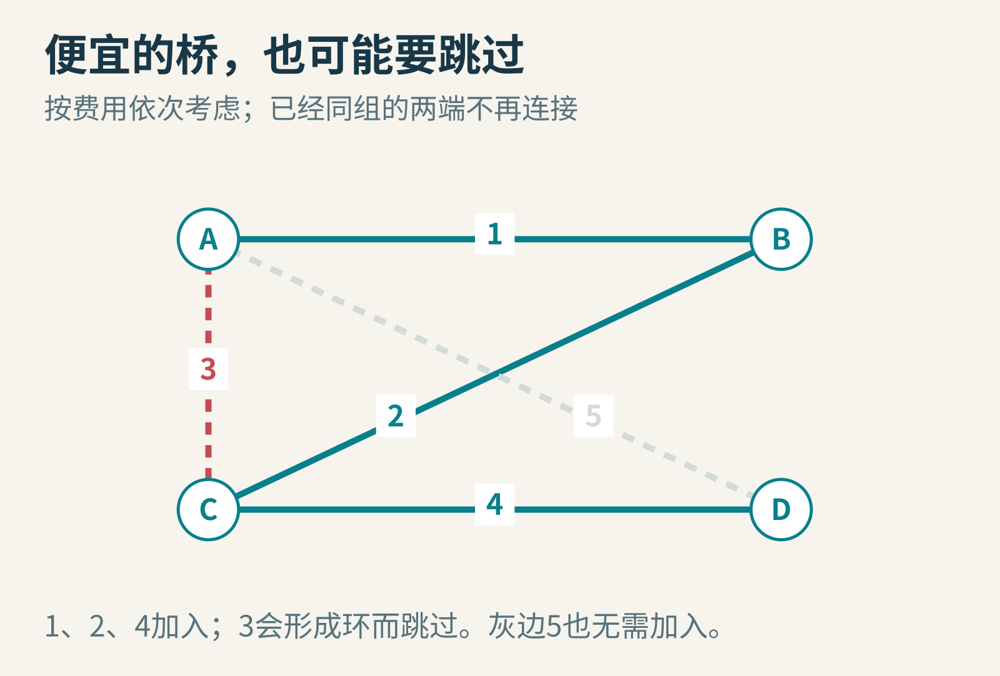
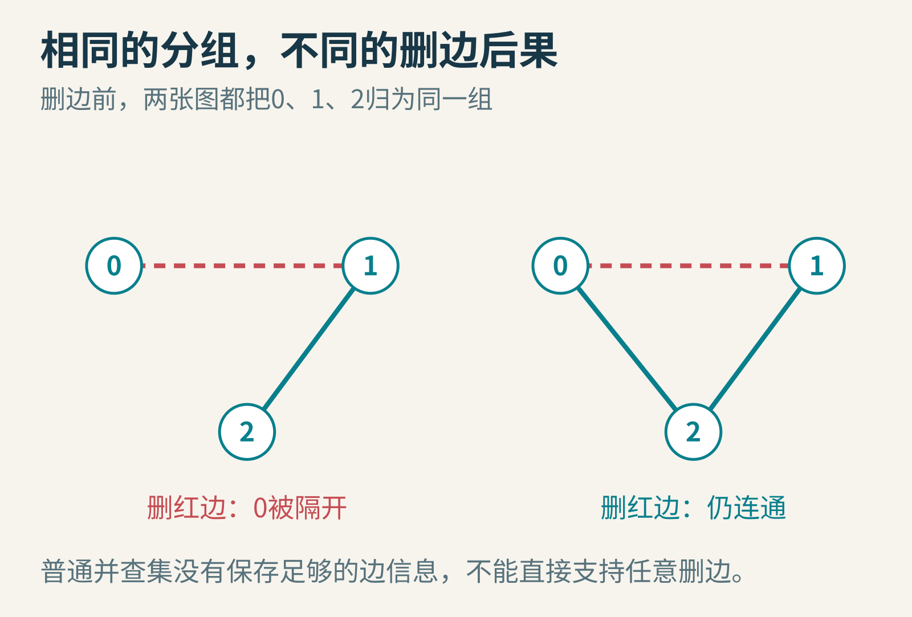

# 两个岛已经连通了吗？并查集为什么只记“你归谁管”

想象一张不断修桥的地图。今天岛0连上岛1，岛2连上岛3；明天岛1又连上岛3。有人立刻问：现在从岛0能到岛2吗？

可以从岛0出发，把所有能走的桥搜索一遍。不过，当修桥和询问交替发生几十万次时，每次都重新探索整张地图，就重复做了许多工作。

并查集专门保存一种更简洁的答案：哪些对象属于同一个连通组。它不保存旅行路线，甚至不必保存每一座桥。只要“组”的身份对得上，就知道两点已经连通。


图1：桥0—1、2—3、1—3修好后，四个岛属于同一个连通组。图中连线是教学地图里的实际连接。

## 最直接的办法：给整组换颜色

起初，每个岛自成一组。我们用一个数组记录颜色：0号岛记0，1号岛记1，以此类推。判断两个岛是否连通，只需比较它们的颜色。

现在修桥，把0所在组和2所在组合并。如果两组分别有一百个岛和一千个岛，就必须把其中一整组的标签改成另一组的标签。查询很方便，合并却可能要扫描许多对象。

我们可不可以不用给整组重新刷漆，只改一条指示牌？

## 一棵树，代表一个组

让每个岛记住一个“父节点”。沿着父节点不断走，最后到达一个把自己当作父节点的根。这个根就是整组的代表。

比如0指向1，1指向3，3指向自己。那么0、1、3都属于以3为代表的组。询问0和2是否连通，就分别找根，再比较。

合并两组也变简单了：先找到各自的根，让一个根指向另一个根即可。整组的其他节点没有改指示牌，却已经能沿着父链走到新的共同代表。


图2：右侧父指针树是数据结构。它只表达分组关系，不要求每条父指针对应左侧地图上的一座桥。

这点很容易被忽略。并查集里，0直接指向3，不代表现实中一定有一座0—3的桥。你不能把父指针串起来，交给游客当路线。

“查”通常叫 find：寻找代表；“并”通常叫 union：把两个集合合在一起。英文也常称它为 disjoint-set data structure，意思是保存一批互不重叠的集合，每个对象恰好属于其中一个。

## 少改标签之后，会不会走很长的路

会。如果每次都把旧树根接到一个新节点下面，父指针可能变成长链：0→1→2→3→4→5。找0的代表要一路爬到5。

这种坏情况提醒我们：少写数据，并不等于少花时间。成本只是从合并时的刷标签，转移到了查询时的爬树。

第一个修正是按大小合并。先数每棵树有多少节点，总把小树挂到大树下面。如果大小相同，任选一个确定的规则即可。


图3：让大树挂到小树下，会让许多节点一起变深。让小树挂到大树下，把受影响的节点控制在较小的一边。

为什么有效？盯住某个节点。每当它所在树因为合并而增加一层，必然是它原来的树不比另一棵大；因此新组的大小至少翻倍。

从1个节点变成2、4、8、16……含 n 个节点的世界，不可能无限翻倍。所以仅使用按大小合并，树高就能控制在对数级。这个证明比记住“大树接小树”更有用：它告诉我们，改善来自组规模增长与深度增长之间的联系。

## 既然已经走过，就顺手修一条近路

第二个修正叫路径压缩。找0的根时，已经路过0、1、2、3；既然知道根是谁，就把途中节点直接指向根。下次再查，它们不用重走长路。


图4：一次 find 可以同时完成查询和整理。这里画的是“整条路径直接接根”的版本；也有每次跳到祖父节点的路径减半版本。

注意，压缩没有改变哪些对象同组，只改变了组内的导航方式。这是一个重要的不变量：数据结构可以变形，用户关心的连通关系保持不变。

按大小或按秩合并，再结合路径压缩，能让一长串操作的平均成本低得惊人。理论分析里会出现反阿克曼函数 α(n)。在通常能想象的输入规模里它增长极慢，但这不是说每一次操作都严格只做一步，也不是不需要初始化和存储空间。

这里要区分“某一次可能有多慢”与“很长一串操作总共花多少工作”。后者叫摊还分析：一次查找花力气压平了树，后面的许多查找就会受益。Princeton 的[并查集接口说明](https://algs4.cs.princeton.edu/code/javadoc/edu/princeton/cs/algs4/UF.html)给出了具体实现与复杂度边界。

## 跟着八个节点实际走一遍

用0到7这八个编号，从每人一组开始。依次执行：

1. union(0,1)：组数由8变7
2. union(2,3)：变6
3. union(4,5)：变5
4. union(1,3)：把前两个两人组合并，变4
5. union(0,2)：它们早已同组，仍是4
6. union(5,6)：把6加入4、5那组，变3

最后三个组分别是 {0,1,2,3}、{4,5,6}、{7}。查询0和3得到真，查询0和6得到假。


图5：只有连接两个不同集合的 union 才减少组数。重复连接不会凭空产生新信息。

下面的短程序在 Python 3 中执行过。这里采用按大小合并和路径减半。数组里的父编号可能随查询变化，但集合划分不变。

```python
parent = list(range(8))
size = [1] * 8

def find(x):
    while x != parent[x]:
        parent[x] = parent[parent[x]]
        x = parent[x]
    return x

def union(a, b):
    a, b = find(a), find(b)
    if a == b:
        return False
    if size[a] < size[b]:
        a, b = b, a
    parent[b] = a
    size[a] += size[b]
    return True

for a, b in [(0, 1), (2, 3), (4, 5),
             (1, 3), (0, 2), (5, 6)]:
    union(a, b)
print(find(0) == find(3), find(0) == find(6))
```

输出为 True False。这个演示要求输入编号在0到7之间；真实接口还应检查边界。size 只在根节点上保存整组大小，不要把非根位置遗留的旧值误读成当前子树大小。

## 为什么修最便宜的桥，也会用到它

如果不仅要判断连通，还希望以最小总费用连接所有岛，可以把所有候选桥按费用从低到高排序。

依次考虑一座桥：若两端已经在同一个组，加入它会形成环，跳过；若两端不在同组，保留它，再合并两组。这就是 Kruskal 最小生成树算法的重要组成部分。并查集负责快速判断“是不是已经连上”，排序与最优性论证则是另外的工作。


图6：已连通的两点之间再加边，会形成环。并查集判断这一点，但不会独自完成整套最小生成树算法。

类似想法也出现在图像处理：把相邻的同类像素合为一组，就能识别一块块连通区域；在渗流模拟里，把开放的相邻格连接起来，可以研究从顶端到底端是否出现贯通路径。

这些应用都利用了同一个特征：连接逐步增加，集合不断合并。

## 那么拆掉一座桥呢

麻烦出现了。两岛同属一个组，可能是因为只有一条道路相连，也可能有十条备用路线。并查集只保留“同组”的结果，并没有保留足够多的道路细节来回答删除一条边后会发生什么。


图7：两张图在删边前都只有一个连通组；删除红边后，一张断开，另一张仍连通。只看分组无法区分。

因此，普通并查集不直接支持任意动态删边。离线处理、可回滚并查集和更复杂的动态连通性结构，是继续探索的方向。它们各自有适用前提，不能在普通实现里加一个“反向 union”就解决。

并查集也主要描述等价关系式的分组。如果道路有方向，“A能到B”未必意味着“B能到A”，直接用它处理有向可达性会丢掉关键区别。

## 一个小结构背后的漫长研究

并查集不是某个人某天突然写出的十行代码。集合合并方法经历了多位研究者的推进；Robert Tarjan 对高效集合合并算法的分析，是这段历史的重要节点。他1975年的论文题目就很有意味：[《一个高效但非线性的集合合并算法的效率》](https://doi.org/10.1145/321879.321884)。极慢增长的复杂度，恰恰需要精细的数学来描述。


图8：Robert Tarjan，2010年。摄影 Renatokeshet，原图未修改，依据 GNU FDL 1.2 或以后版本使用；该照片是后来的人像，并非1975年研究现场。

读懂并查集之后，可以试两件事：先手画一棵最坏长链，逐次执行路径减半，数清每次父指针如何变化；再给程序加入组数计数器，确认重复 union 不会错误地减一。

最值得带走的，不是某个根编号。是一个数据结构设计问题：为了回答眼前的查询，究竟可以安全地忘掉多少信息？

延伸阅读：[Princeton 并查集案例](https://algs4.cs.princeton.edu/15uf/)。图片来源：图1—7为原创教学示意；[Tarjan肖像原页](https://commons.wikimedia.org/wiki/File:Bob_Tarjan.jpg)，Renatokeshet，[GNU FDL](https://www.gnu.org/licenses/fdl-1.3.html)。本包另附该照片的完整许可文本。
