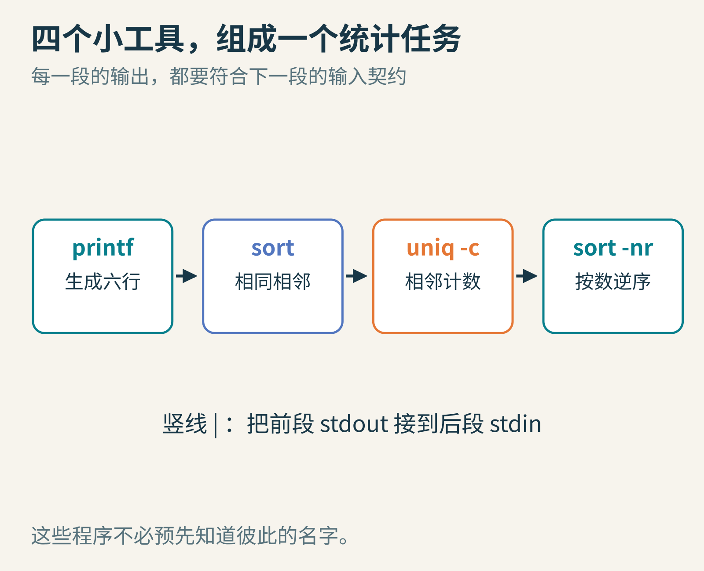
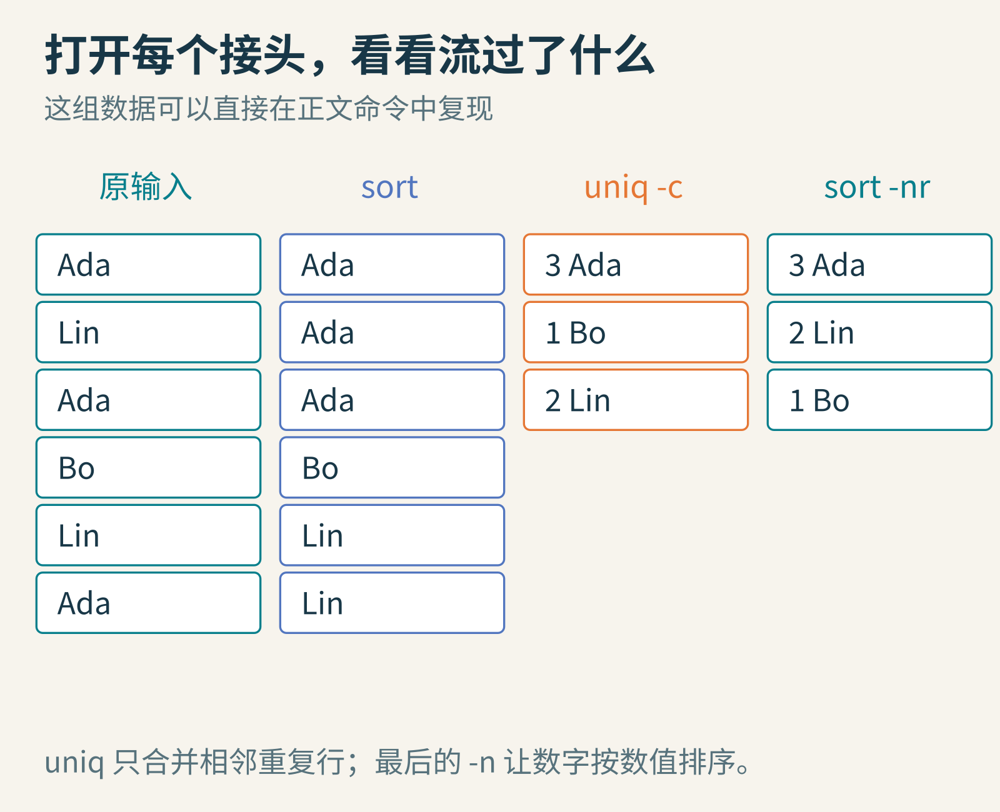
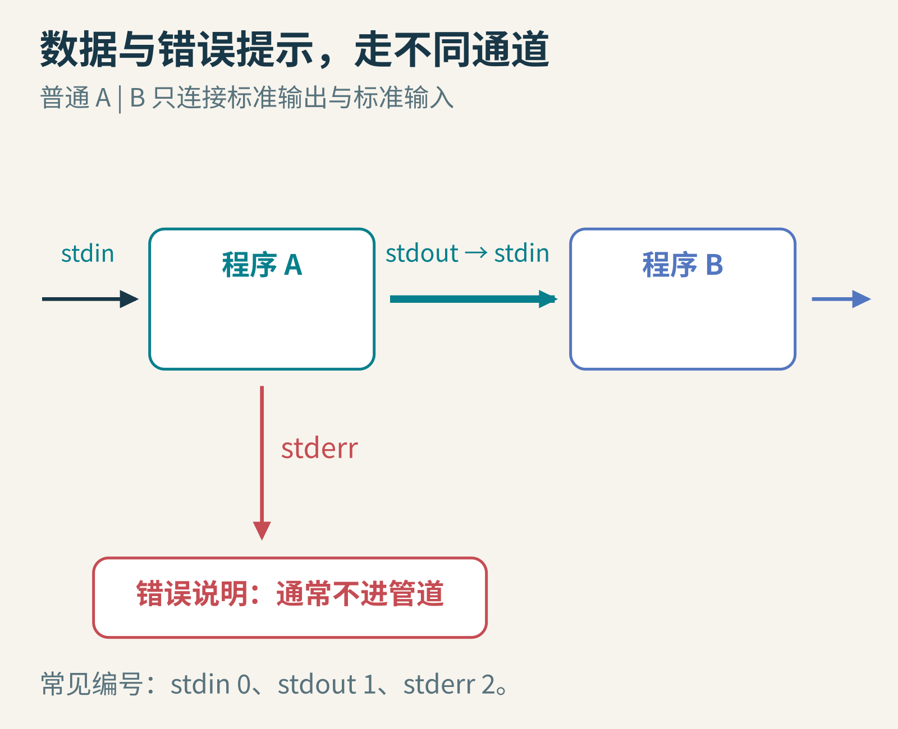
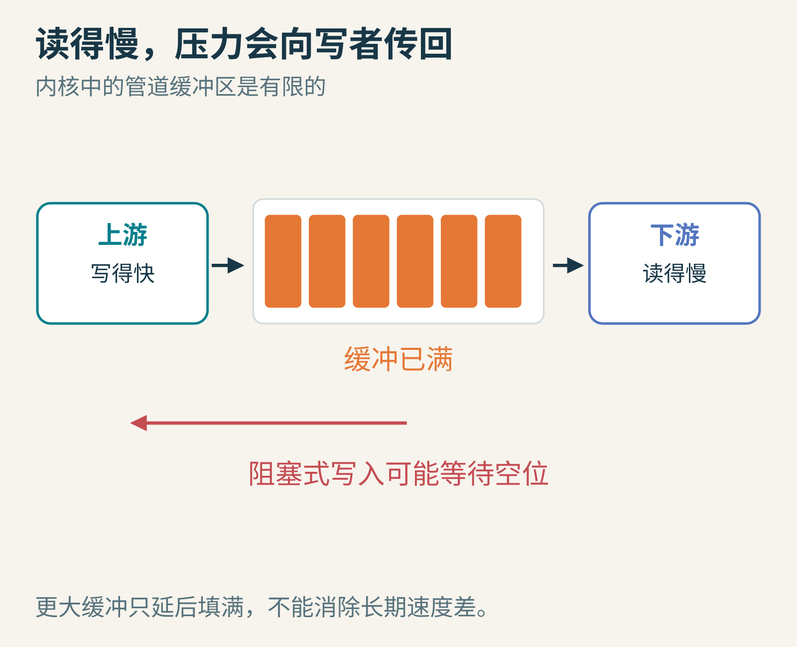
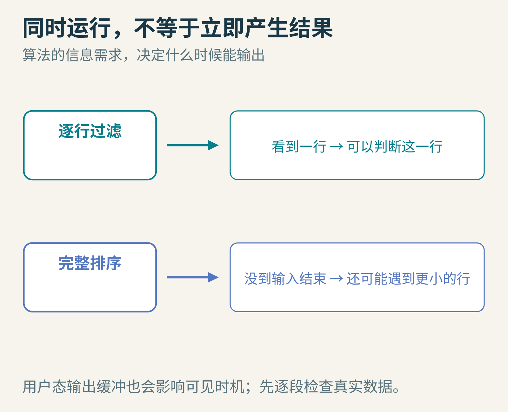
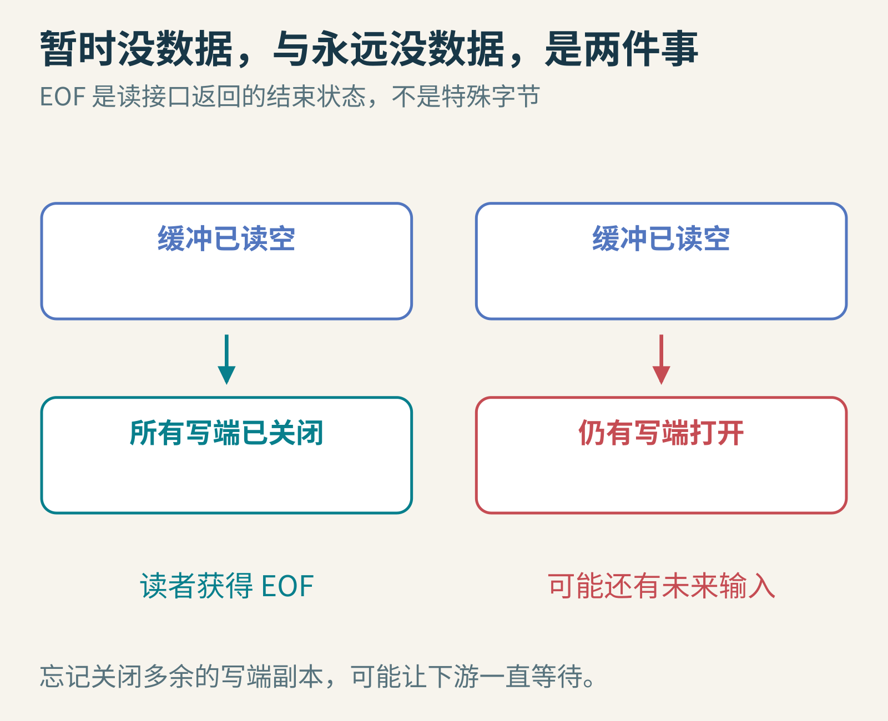

# 一根竖线，为什么能拼出新程序？Unix 管道的组合魔法

你有一份参加社团活动的签到名单，想知道哪个名字出现次数最多。可以写一个完整程序：读取、分组、计数、排序、输出。也可以把已经存在的小工具串起来。

`sort | uniq -c | sort -nr`

这串命令看上去像咒语。真正值得探索的，却不是记住参数，而是那根竖线：前一个程序的输出，怎么就变成了后一个程序的输入？它们需要提前认识彼此吗？



图1：每个工具只负责一步。连接后得到的功能，比单个工具更大；图中展示的是简单文本处理任务。

## 1. 先让六个名字真的流过去

下面的命令使用人工构造的六条记录，不读取你的私人文件。本文在 Linux 的 Bash 环境实际运行过，设置 C 排序区域以让示例顺序稳定。

```sh
printf '%s\n' Ada Lin Ada Bo Lin Ada |
  LC_ALL=C sort |
  uniq -c |
  LC_ALL=C sort -nr
```

结果是 Ada 3次、Lin 2次、Bo 1次。不同工具版本可能在左侧空格格式上略有区别。

第一步 `printf` 每行输出一个名字。第二步 `sort` 把相同名字排到一起。第三步 `uniq -c` 统计相邻重复行。最后一步 `sort -nr` 把行首数字按数值从大到小排序。

这里最容易忽略的是“相邻”。如果跳过第一个 `sort`，分散在不同位置的 Ada 不会自动汇总成一组。每个零件的契约，决定了组合能否正确。



图2：不要只盯着最终答案。查看每段管道之间的数据，最容易发现“上一段输出不符合下一段预期”的错误。

文本也不是万能交换格式。如果一个名字本身含换行，或者字段里包含分隔符，简单的“一行一条”规则就会失效。处理任意文件名、复杂记录时，要选择能表达边界的格式或相应工具，不能把所有输入都当成这六行干净文本。

## 2. 小工具为什么不用彼此约定电话号码？

Unix 进程通常有三个约定好的通道：标准输入 stdin、标准输出 stdout、标准错误 stderr。常见文件描述符编号分别是0、1、2。文件描述符可以理解成进程手里指向某个打开通道的小整数句柄。

一个程序可以从标准输入读数据，把结果写到标准输出，把错误说明写到标准错误。它不必知道输入来自键盘、文件，还是另一个程序。

shell 解析管道时，建立连接，把前一个程序的标准输出接到后一个程序的标准输入。程序仍调用同样的读写接口，只是通道另一端换了对象。



图3：普通 `A | B` 连接 A 的 stdout 与 B 的 stdin；A 的 stderr 通常仍朝原来的错误输出位置走，不会自动进入这根管道。

例如 `2>&1` 可以把标准错误重定向到当时的标准输出，但重定向的顺序会影响结果。初学时更值得养成的习惯，是先问：“这是给下一段程序消费的数据，还是给人看的提示？”混在一起，漂亮的提示语也可能破坏机器可读的输出。

## 3. 管道里究竟放着什么？

普通 Unix 管道提供字节流。内核维护有限容量的缓冲区，写端把字节送进去，读端取出来。它并不自动理解“名字”“行”“JSON对象”，也不承诺一次写入就对应对方的一次读取。

如果上游写得快、下游读得慢，缓冲区会逐渐填满。对常见的阻塞式 I/O，写者可能等待，直到出现空位。这种压力沿数据流往回传，叫背压。



图4：管道不是无限大的蓄水池。图中容量只是示意；程序不能依赖一个对所有系统都成立的固定容量。

反过来，管道空了但仍有写端打开，读者通常会等待更多数据。非阻塞模式有不同的返回行为，程序需要处理“现在还没有数据”而不是把它误判为永久结束。

这是一种很优雅的分工：工具负责处理，内核连接字节流并协调等待。可是缓冲并没有消灭速度差，只是让速度差以可管理的方式显现出来。

## 4. 程序同时运行，为什么有时迟迟没有结果？

管道中的进程通常可以并发推进，并不要求第一个完全结束才启动第二个。但是否能很快看到输出，取决于工具本身的算法与缓冲策略。

`grep` 可以在看到一行后判断是否匹配；而要把任意输入完整排序，`sort` 通常必须先知道后面还有什么。再加上程序自己的标准库输出缓冲，数据抵达下一段的时机未必和你的直觉一致。



图5：同样接在管道上，一类操作能逐条产生结果，另一类需要等到输入结束。管道提供连接，不替算法创造它尚未获得的信息。

这也解释了一个调试技巧：从最左边开始，逐段检查真实输出。如果第一段有结果、第二段没有，不一定是管道“断了”，也许第二段正在正常等待输入结束。

## 5. “输入结束”不是一颗特殊的字节

EOF 表示读不到未来的更多输入，是接口返回的状态，不是管道里传来某个神奇字符。对管道来说，所有指向写端的文件描述符都被关闭后，读者读完现有缓冲数据，才会看到结束。

如果父进程或另一个子进程忘了关闭多余的写端副本，读者就可能一直等：内核看见仍有写者存在，不能猜它永远不再写了。



图6：左边缓冲读空且所有写端关闭，可以结束；右边虽暂时没数据，但仍有打开的写端，读者可能继续等待。

另一边，如果所有读端都关闭，上游继续写入，通常会收到 SIGPIPE；若忽略该信号，写操作会以 EPIPE 错误失败。例如下游只要前几行就退出，上游并不一定需要把全部内容继续生成完。

还有一种更隐蔽的失败：管道最后一个工具成功了，不代表前面每个工具都成功。Bash 默认通常用最后一段的退出状态作为整个管道状态；`set -o pipefail` 可改变失败报告规则。它适合某些脚本，却不是所有 shell 的同一默认，也不会自动处理每种业务错误。

## 6. 竖线背后的历史，不只有一句名言


图7：Douglas McIlroy，2011年。摄影 Denise Panyik-Dale，[CC BY 2.0](https://creativecommons.org/licenses/by/2.0/)。采用来源页提供的407×564像素肖像文件，未再修改。

McIlroy 长期推动程序之间组合数据流的想法。[Dennis Ritchie 的 Unix 历史回顾](https://cm-bell-labs.github.io/who/dmr/hist.html)记述，管道在1972年进入 Unix，最初的命令记法还不是后来熟悉的竖线形式；许多工具也随之调整，让没有显式文件参数时可以处理标准输入。

资料常因“操作系统实现”“公开版本”和“语法定型”选取不同节点而提到相邻年份。理解这段历史，重要的是一连串改动共同成立：内核有连接机制，shell 有简洁表达，小工具愿意遵守输入输出约定。

Ritchie 也明确提醒，相关思想并非此前不存在。Dartmouth 分时系统的 communication files 是前史之一；McIlroy 后来的[DTSS 说明](https://www.cs.dartmouth.edu/doug/DTSS/commfiles.pdf)讨论了那种机制。Unix 的贡献尤其在于，把原本就经常单独使用的命令变成容易重组的零件，而不是宣称历史上第一次让两个程序交换数据。

## 留给你的小实验

1. 去掉示例中的第一个 `sort`，先预测输出，再执行。为什么同一个名字会出现多行？
2. 将最后的 `sort -nr` 改成 `sort -n`，哪一段契约发生了变化，其他段需要修改吗？
3. 设想上游一秒产生100条，下游一秒处理10条。缓冲区再大十倍，能永久解决问题吗？

管道最有启发性的地方，是它让“设计接口”成为一种创造力。只要输入输出契约足够简单、明确且稳定，新的功能不一定来自更大的单体程序，也可以来自已有能力的一次新组合。

延伸阅读：[Linux pipe(7)](https://man7.org/linux/man-pages/man7/pipe.7.html)、[Bash 管道说明](https://www.gnu.org/software/bash/manual/html_node/Pipelines.html)。图片来源：图1—6为本文原创教学示意；[McIlroy 原图](https://commons.wikimedia.org/wiki/File:Douglas_McIlroy.jpeg)，Denise Panyik-Dale，CC BY 2.0，未再修改。
