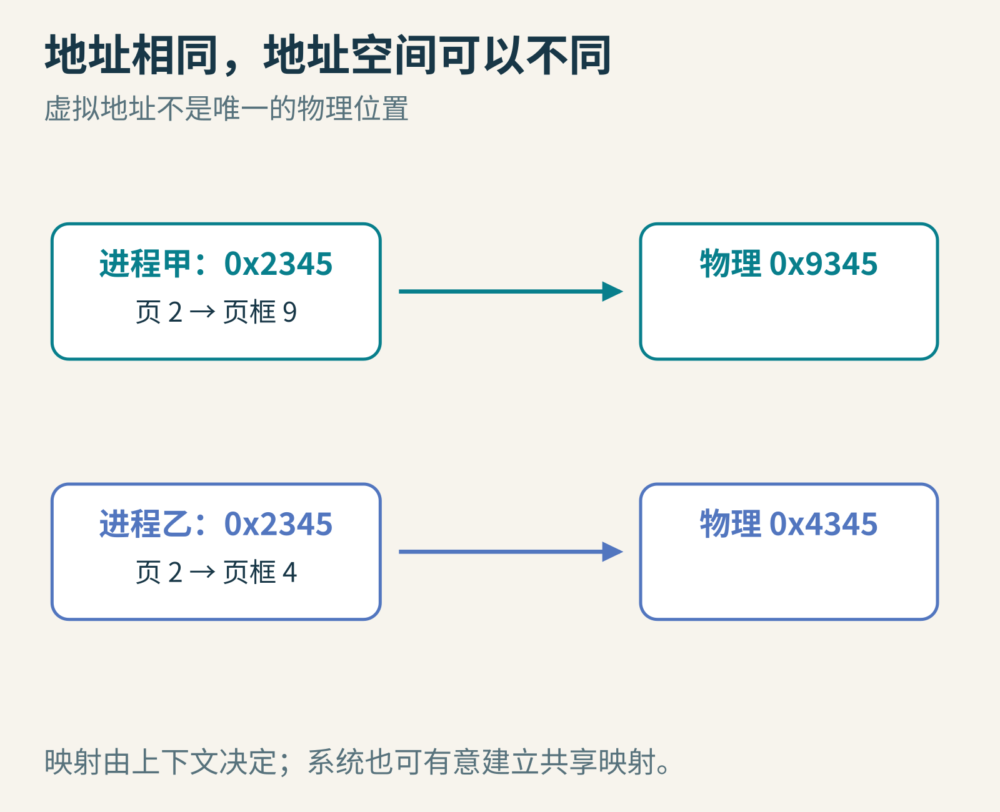
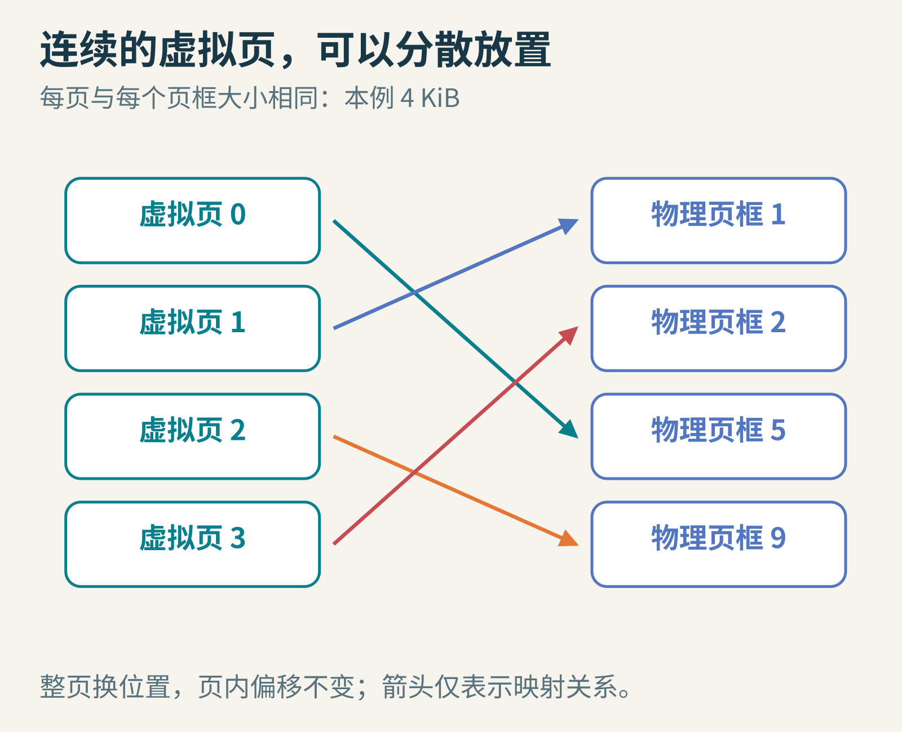
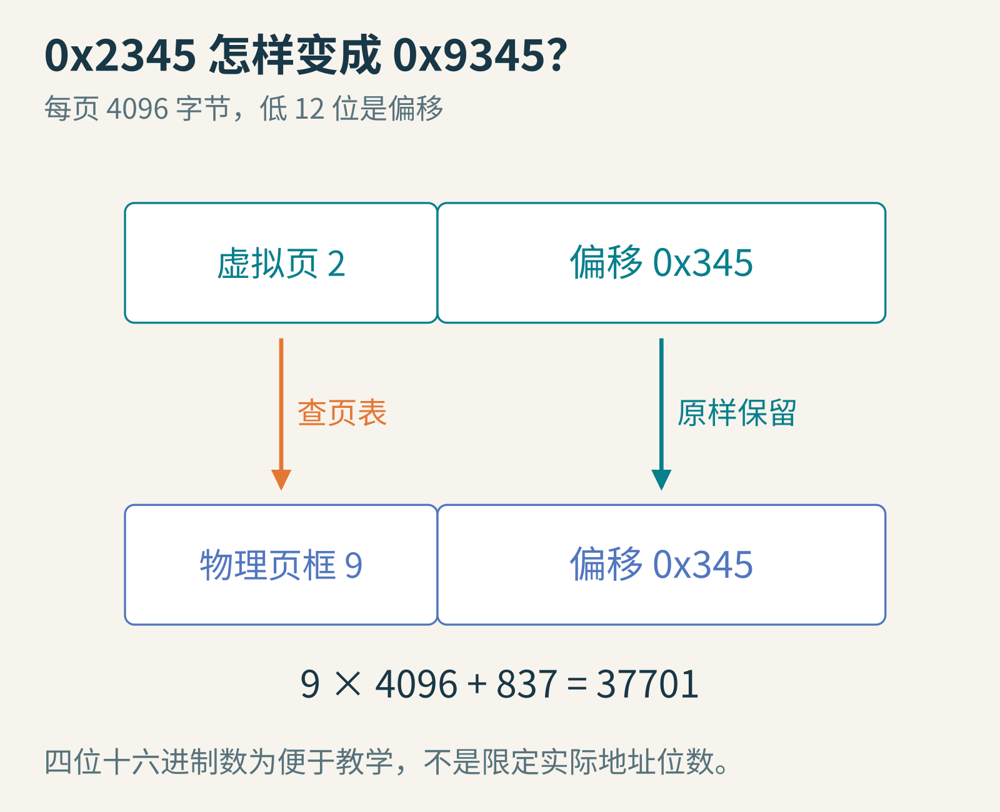
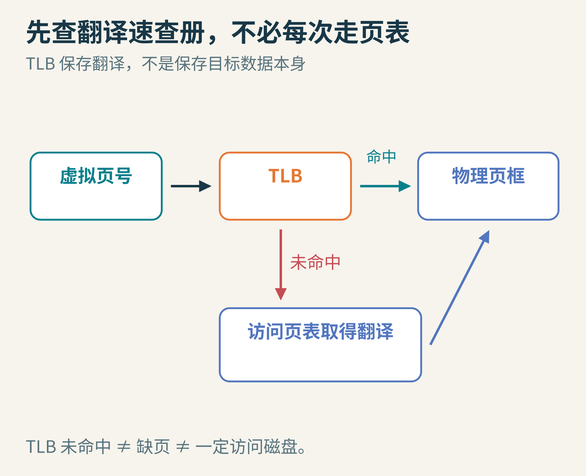
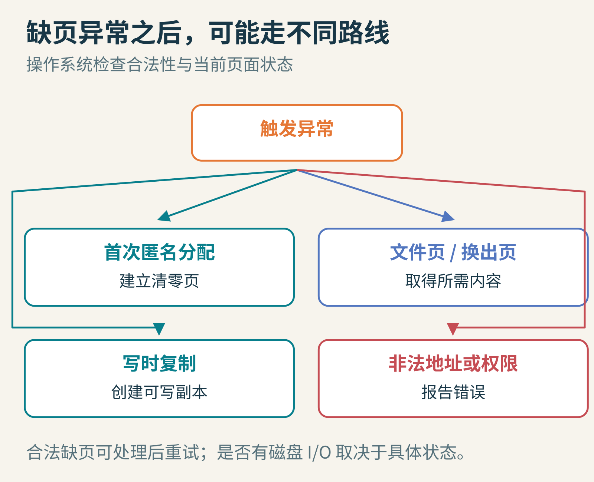
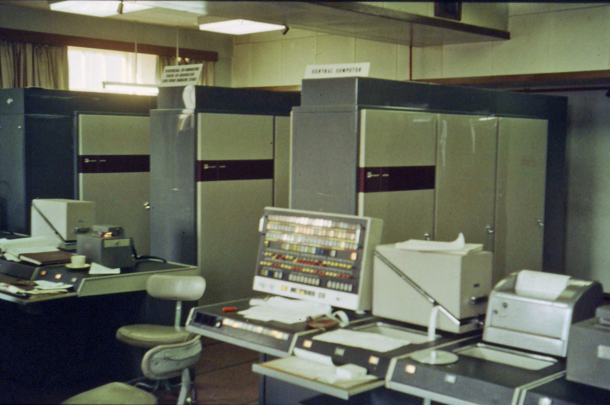

# 两个程序用了同一个地址，为什么没有打起来？虚拟内存的翻译术

设想两个程序都说：“我要读取地址 `0x2345`。”如果地址就是内存条上的唯一位置，它们岂不是在读同一份数据？可通常情况下，一个程序里的变量并不会因此与另一个程序混在一起。

秘密在于：程序说出的地址，往往不是最终交给物理内存的地址。每个进程拥有自己的地址空间，处理器和操作系统合作，把其中的虚拟地址翻译成物理地址，同时检查访问权限。

就像两座图书馆都有“3楼2号书架”，没有图书馆名称，这个位置并不完整。



图1：地址必须放在地址空间上下文里理解。同一个虚拟地址，可以映射到不同物理页，也可以按系统安排共享同一物理页。

## 1. 不逐字节建词典，而是整页搬运

如果为每个字节单独保存一个翻译结果，映射表会大得不划算。分页把虚拟地址空间切成固定大小的页，把物理内存切成同样大小的页框。

下面只用一个便于手算的模型：每页4 KiB，也就是4096字节。注意 KiB 按1024计，不是1000；真实系统支持的页大小因架构和配置而异。

一页内部的第几个字节，叫页内偏移。页可以被放到任何合适的页框里，但页内偏移不变。

虚拟页0、1、2、3看起来连续，物理页框却可能是5、1、9、2。程序获得连续地址的便利，操作系统不必真的找到同样长的一整块连续物理空间。



图2：只翻译“页号”，保留“页内偏移”。图里的页面数和编号都是教学构造。

## 2. 把一个地址真的拆开

十六进制 `0x2345` 等于十进制9029。页大小是4096，做一次除法：

`9029 = 2×4096 + 837`

所以虚拟页号是2，偏移是837，也就是十六进制 `0x345`。

如果页表说“虚拟页2放在物理页框9”，物理地址就是：

`9×4096+837 = 37701 = 0x9345`



图3：4 KiB等于2的12次方，所以低12位作为偏移，高位作为页号。图中用四位十六进制数简化展示，不是在规定真实计算机只有16位地址。

页表就是保存映射及相关属性的数据结构。除了页框号，页表项通常还包含是否存在、读写或执行权限，以及其他管理信息。不同处理器对位的名称与含义并不完全相同。

下面的 Python 算例已经实际运行；它只是翻译算术，没有访问真实操作系统页表。

```python
page_size = 4096
virtual_address = 0x2345
vpn, offset = divmod(virtual_address, page_size)
page_table = {0: 5, 1: 1, 2: 9, 3: 2}
physical_address = page_table[vpn] * page_size + offset
assert (vpn, offset) == (2, 837)
assert physical_address == 0x9345
print(hex(physical_address))  # 0x9345
```

若第二个进程的虚拟页2映射到页框4，相同虚拟地址就会变成 `0x4345`。决定答案的不只有地址数字，还有当前使用的映射。

## 3. 每读一次数据，还要先读一次页表？

听起来很慢。程序想取一个整数，处理器要先查页表，再取整数；页表本身又可能有好几级。

因此，处理器通常用 TLB 缓存常用的地址翻译。可以把它理解成一小本“最近常查页号对应哪个页框”的速查册。命中时，通常不必重新走完整页表；未命中时，再通过页表查到翻译并更新缓存。



图4：TLB 缓存地址翻译和相关权限信息，数据缓存保存数据内容。二者解决不同问题，实际硬件可以让部分工作重叠。

TLB 未命中不等于数据不在物理内存，更不等于一定要访问磁盘。可能只是翻译没在这本小册子里，页表和目标数据都好端端地留在内存中。

切换进程时，也不能错误地沿用另一个地址空间的翻译。系统可能借助地址空间标签或使部分翻译失效等机制来区分；这也是“相同虚拟地址不混淆”在硬件上的重要细节。

## 4. 缺页是故障，还是正常工作的一部分？

假如合法虚拟页目前没有对应的可直接访问物理页，访问可能触发缺页异常，交给操作系统处理。它不必然意味着程序写错。

几种情况值得分开：

- 第一次使用一块按需分配的匿名内存，系统可能分配清零页。
- 访问文件映射中尚未驻留的部分，可能需要从文件读取数据。
- 先前换出的页面，可能需要从后备存储调回。
- 写入共享的只读副本，可能触发写时复制机制，为当前进程建立可写副本。
- 地址根本无效，或访问权限不允许，则可能导致程序收到错误信号、无法继续这次访问。



图5：异常是一种受控地转交处理的机制。是否需要磁盘 I/O，要看具体原因以及数据是否已经在其他缓存中。

一次合法缺页处理完成后，系统通常可以让原来的指令重试。程序看起来仍在读那个地址，只是这次访问花了更长时间。

## 5. 既然地址空间可以很大，内存是不是无限了？

不。虚拟地址能表达的位置数量，不等于机器能同时保存的有效数据量。物理内存、后备存储、系统承诺策略和进程限制都是真实约束。

如果程序经常访问的那批页，也就是工作集，装不进可用内存，系统可能不断换出刚刚还要使用的页。处理器还没做多少有用计算，就忙着等待搬页，这种严重状态常称为抖动。


图6：教学模型只有3个页框，按 LRU 替换，访问序列为A、B、C、D反复循环。预热后依然每次缺页；换成A、B、C循环则能在装入后持续命中。

本文实际运行了这个小型 LRU 模型：长度12的 `ABCDABCDABCD` 有12次缺页，长度12的 `ABCABCABCABC` 只有最初3次。它说明局部性为什么重要，不是对某个真实操作系统置换算法的性能测试。

页表也占空间。若想用最朴素的数组覆盖巨大的地址空间，即使程序只用了少数位置，也会浪费很多表项。多级页表可以按需建立部分结构；大页能减少翻译数量，却又可能增加空间浪费或管理成本。这些都是“地址幻术”背后的真实账单。

## 6. 这不是今天才有的技巧



图7：曼彻斯特大学 Atlas，1963年1月。摄影 Iain MacCallum，[CC BY 3.0](https://creativecommons.org/licenses/by/3.0/)，原图未修改。

曼彻斯特大学、Ferranti 等参与研制的 Atlas，是早期自动分页虚拟存储的重要里程碑，1962年正式启用。它把主存与较慢存储组织成程序员更容易使用的存储系统。大学保存的[Atlas 历史资料](https://curation.cs.manchester.ac.uk/atlas/docs/The%20Atlas%20story.pdf)讲述了 Tom Kilburn 团队及合作人员的工作。

现代系统的保护、多级映射、共享页和缓存管理复杂得多。把 Atlas 看作重要历史节点，比把所有虚拟内存技术都归给单一机器或单一人物更准确。

## 留给你的小实验

1. 每页4 KiB，地址 `0x2FFF` 和 `0x3000` 是否在同一页？偏移分别是多少？
2. 把示例的虚拟页2从页框9改到页框6，页内偏移需要改变吗？
3. 两个进程共享只读代码页能省什么？为什么把它随意变成可写共享页又可能破坏隔离？

虚拟内存不是“用硬盘假装一条更大的内存条”这么简单。它首先给程序一种可管理、可保护、可共享的地址抽象；按需分配和换页，是建立在这套翻译机制上的进一步能力。

延伸阅读：[Linux 内存管理概念](https://docs.kernel.org/admin-guide/mm/concepts.html)、OSTEP 的[分页](https://pages.cs.wisc.edu/~remzi/OSTEP/vm-paging.pdf)、[TLB](https://pages.cs.wisc.edu/~remzi/OSTEP/vm-tlbs.pdf)和[超越物理内存](https://pages.cs.wisc.edu/~remzi/OSTEP/vm-beyondphys.pdf)章节。图片来源：图1—6为本文原创教学示意；[Atlas 原图](https://commons.wikimedia.org/wiki/File:University_of_Manchester_Atlas,_January_1963.JPG)，Iain MacCallum，CC BY 3.0，未修改。
