# 四座补给站，为什么会把地图切成多边形？

你在做一张游戏地图。地图上有四座补给站，玩家走到哪里，界面就亮起离他最近的那一座。

这个功能看上去只需要几次距离计算。可当你把地图上的每一个位置，都涂成“最近补给站”的颜色，奇怪的事出现了：地图没有长出四个圆，而是被切成了几块边缘笔直的区域。

补给站明明向四面八方提供服务，为什么分界线会是直的？如果再往地图里加一座站，哪些边界会移动？如果最近的站恰好在墙后面，这张图还可信吗？

我们就从四个点出发，把这张地图一点点画出来。这种按“离谁最近”切分空间的图，叫作 **Voronoi 图**，中文常译作沃罗诺伊图。它首先是一张回答距离问题的地图，之后才是一种数据结构、一类算法，或者游戏里好看的蜂窝纹理。

## 先替一个玩家算一次

假设地图是平坦的，暂时没有墙、河流或高低差。横向是 x，纵向是 y，每一格长度相同。四座站的位置是：

- A 在 (2, 2)
- B 在 (8, 2)
- C 在 (3, 7)
- D 在 (8, 8)

玩家 P 在 (4, 3)。这些坐标是本文构造的教学例子，后面的大部分图都会使用它们。

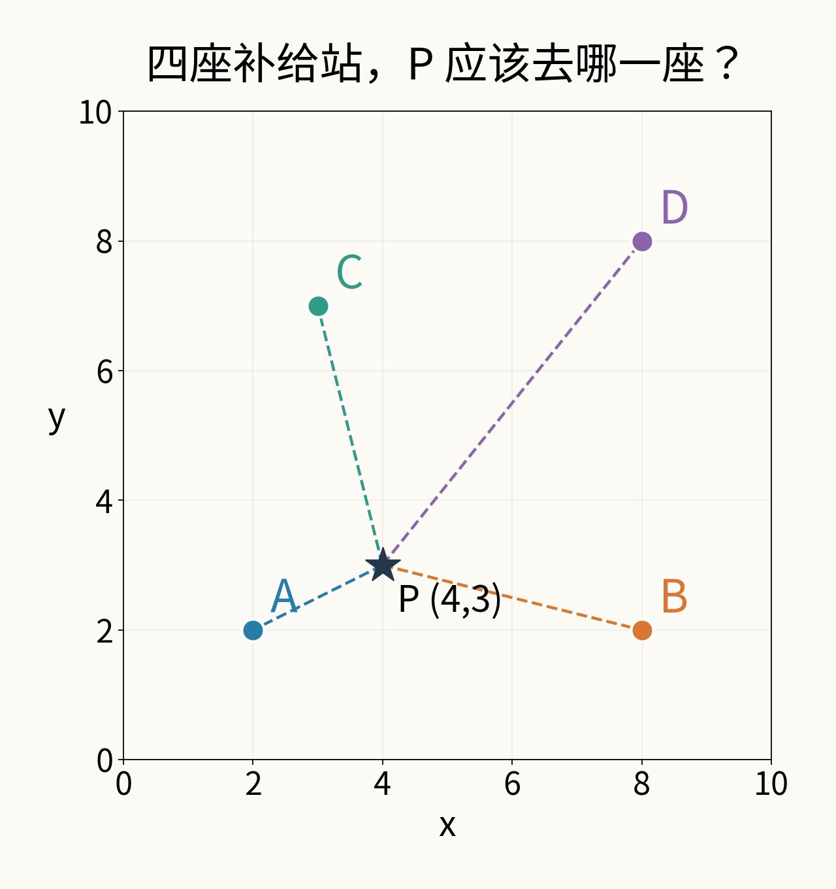

图中每条虚线都连接玩家和一座站。蓝、橙、青、紫始终对应 A、B、C、D；黑色星号是玩家。现在只是测量直线距离，还没有画服务范围。

从 P 到 A，横着差 2，竖着差 1。按照勾股定理，距离的平方是 2² + 1² = 5。

同样计算，到 B、C、D 的距离平方分别是 17、17、41。所以 A 最近。

为什么只算平方，不把根号开出来？因为距离不可能是负数，5 比 17 小，√5 也一定比 √17 小。我们只想比较谁更近，没必要多做一步。

这已经是一个完全能工作的办法：每来一个玩家，就计算他到每座站的距离，保留最小值。四座站时，这个办法短小、清楚，没理由急着换成复杂算法。

但假如你要给整张地图着色，问题就变了。你不再只问“这个玩家离谁最近”，而是在问：**所有离 A 最近的位置，合在一起是什么形状？**

只要这个形状画出来，站的位置又没有变，同一片区域内的许多查询就共享了一个答案。Voronoi 图把逐次比较的结果，变成了空间里的边界。

## 先忘掉另外两座站

我们只留下 A 和 B。

A 在 (2, 2)，B 在 (8, 2)，它们横向相隔 6 格。位于 (5, 2) 的玩家，离两边各 3 格，谁也没赢。

如果玩家从这里向北走到 (5, 6)，情况会变吗？到 A 和到 B，横向都差 3，纵向都差 4，距离都变成 5。仍然是平局。

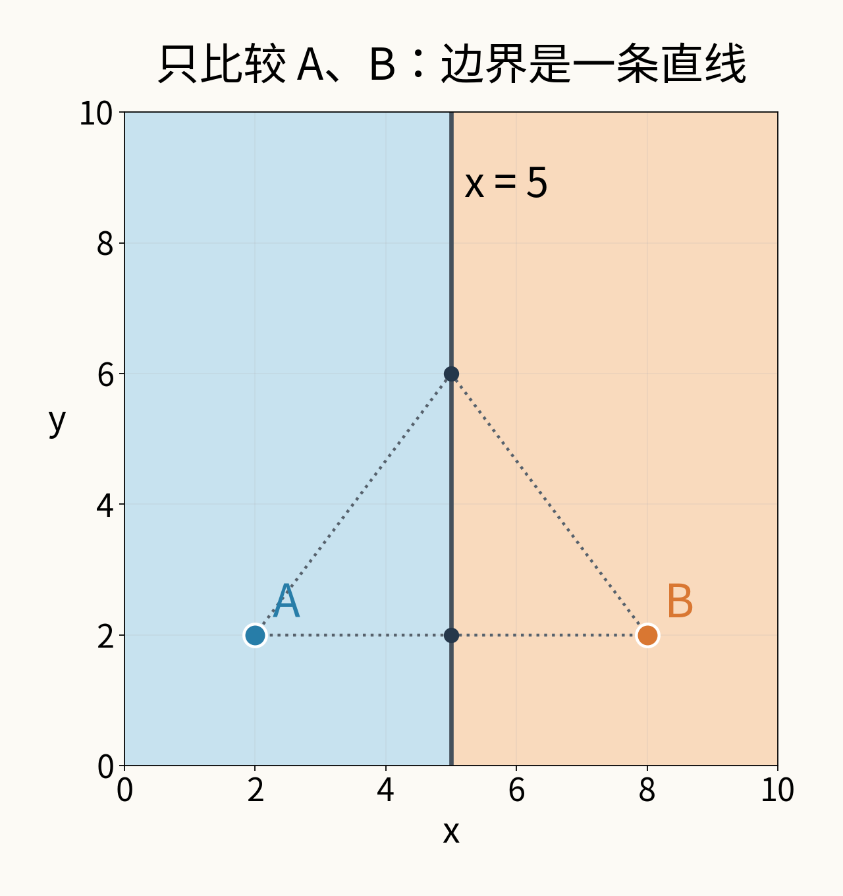

蓝色一侧离 A 更近，橙色一侧离 B 更近。中间的 x = 5 经过 AB 的中点，并且与 AB 垂直。在线上上下移动，两段距离始终相等。

这条线就是 AB 的**垂直平分线**。它不是人为划出的行政边界，而是“到两个点距离相等”的全部位置。

可以把它想成一场拉锯战：往 A 一侧挪一点，A 就获胜；往 B 一侧挪一点，B 就获胜。双方恰好打平的位置，连成了一条直线。

对于一般的两个站，不一定左右排齐，但道理不变。连起两站，找到中点，再画垂线。平面被切成两个半平面，各自属于比较近的那座站。

“半平面”听起来抽象，其实只表示一条无限长直线的一侧。在地图上我们只能画出其中一块，所以图里看起来像矩形或梯形；地图边框不是 Voronoi 图本身的一部分。

## 但“双方打平”还不能成为边界

把 C 和 D 放回来。刚才的整条 x = 5，还能全部留作 A、B 的分界吗？

看一个离它们很远的点 Q = (5, 8)。

到 A 和 B，距离平方都等于 45，它们确实打平。可 Q 到 C 的距离平方只有 5，到 D 是 9。最近的明明是 C。

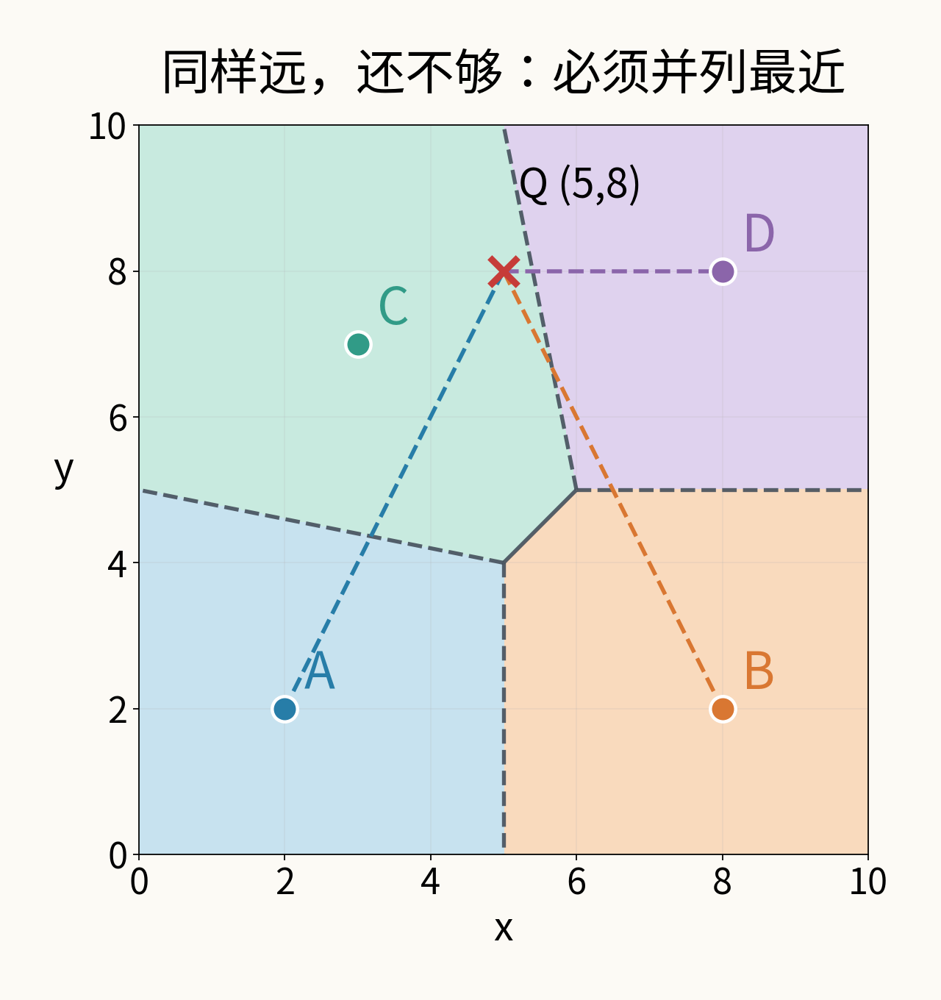

红叉是 Q。它落在青色区域内。A 和 B 争论谁更近，在这里已经没有意义，因为 C 比它们都近。

这一步很重要：**Voronoi 边界不是随便两座站的等距离线，而是两座或多座“并列最近”的站留下来的那一部分等距离线。**

其他站可以把原来的边界截断。这也解释了为什么最后看到的是线段、射线和多边形，而不是把每一对站的垂直平分线全部画上去的乱线团。

如果你自己写程序，先把所有等距离线画出来，再宣布那就是答案，就在这里漏掉了一个条件：这两个候选之外，是否有第三个更近的站？

## 给 A 的区域做三次筛选

我们换一种更稳妥的画法。不试着一口气画整张图，先只问 A 应该保留哪些位置。

第一关，不能比 B 更远。刚才已经知道，这要求 x ≤ 5。

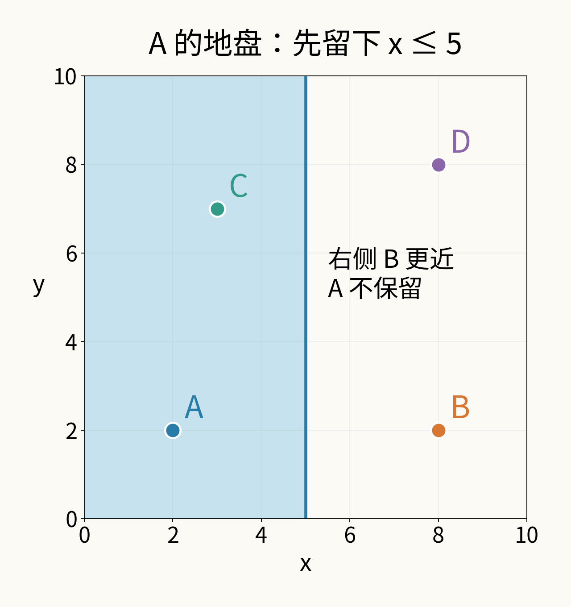

图中的蓝色还只是候选区域。C 和 D 尚未参与评判，所以它不能直接叫作 A 的最终地盘。

第二关，不能比 C 更远。设某个待判断的位置是 (x, y)，比较距离平方：

到 A： (x − 2)² + (y − 2)²

到 C： (x − 3)² + (y − 7)²

我们要保留前者不大于后者的位置。把两边展开，x² 和 y² 会互相抵消，整理后只剩：

**x + 5y ≤ 25。**

原来，距离公式里虽然有平方，但比较两个固定点的距离时，共同的平方项消失了。因此边界是一次方程，也就是直线，而不是曲线。

不用熟练掌握代数，也可以检查这条线。把 x = 0 代入，得到 y = 5；把 x = 5 代入，得到 y = 4。用这两个点就能画出分界线。A 本身位于线的下方，应该保留下方那一侧。

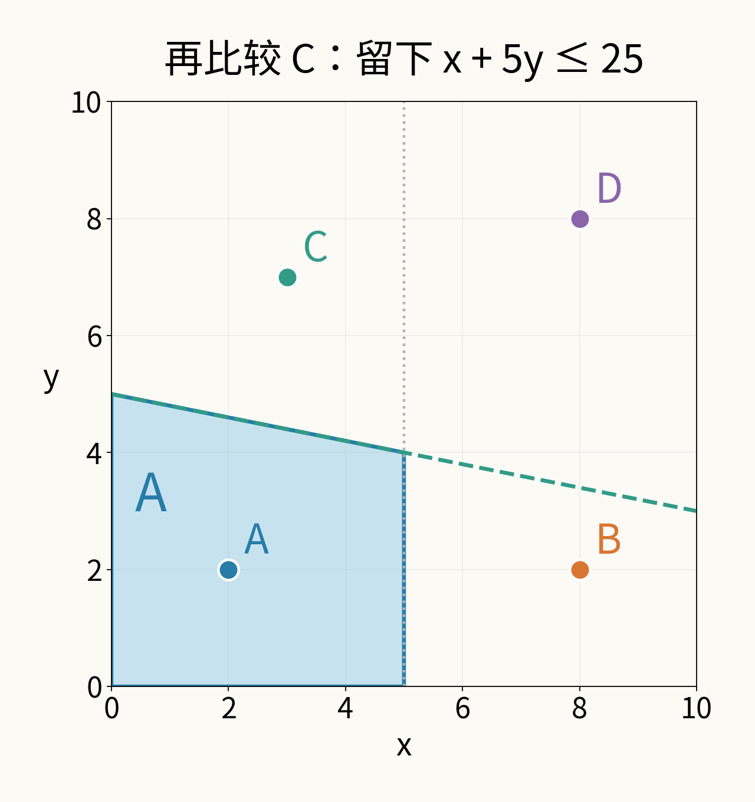

蓝色区域既在竖线左边，也在斜线下面。“既要满足这个，又要满足那个”，在几何上就是取两块区域的交集。

第三关，不能比 D 更远。用完全相同的办法，可以得到 x + y ≤ 10。

你可能准备再削掉一块蓝色区域，却发现没有东西可削：前两关留下的这块区域，本来就满足第三关。在这张地图里，D 没有进一步缩小 A 的区域。

这不是漏算。它告诉我们一件有用的事：**一个站的范围可能只由少数邻居决定，不是每一座站都会留下可见边界。**

我们把画布限制在 0 到 10 之间，A 的区域有四个顶点：(0,0)、(5,0)、(5,4)、(0,5)。左边和下边是画布裁剪出来的；真正的数学平面没有这些人为边框，A 的区域还会向左下方延伸。

对 B、C、D 各做一遍同样的筛选，就得到整张图。

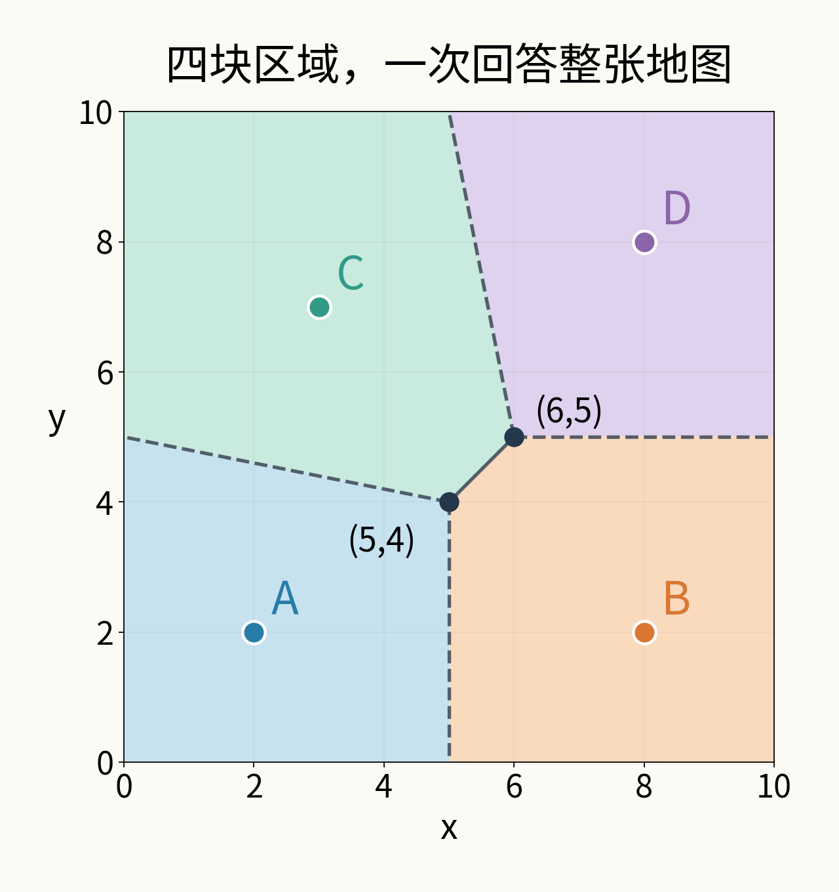

每种底色表示“最近的是哪座站”。分界线上存在平局，黑点是三座站并列最近的位置。图中外延的虚线段与内部实线段一样，都表示区域边界；虚线用于提醒它们在完整平面里还会继续延伸。

现在回头看开头的问题：为什么区域是多边形？因为一个站要赢过每个对手，就必须同时落在一组半平面中。这些半平面的交集，边缘自然由直线组成。

它还解释了另一个性质：普通的平面点集、直线距离 Voronoi 区域是**凸的**。在同一块区域里任取两个位置，用直线连接，整段线仍在区域内。因为每个半平面都具有这个性质，它们的交集也保留这个性质。

这里的“普通”很有分量：我们还没有加入路网距离、障碍物、不同站点权重或其他规则。换了距离定义，就不能原封不动搬用这个结论。

## 把颜色换成距离，会看见另一张图

刚才我们只记录谁赢了，也就是最近站的编号。但计算最小距离的时候，还有另一个结果可以留下：最近那座站究竟有多远。

把距离 0 涂成浅色，远处逐渐涂深色，就得到一张**距离场**。所谓“场”，在这里不神秘，只是每个位置都对应一个数值。

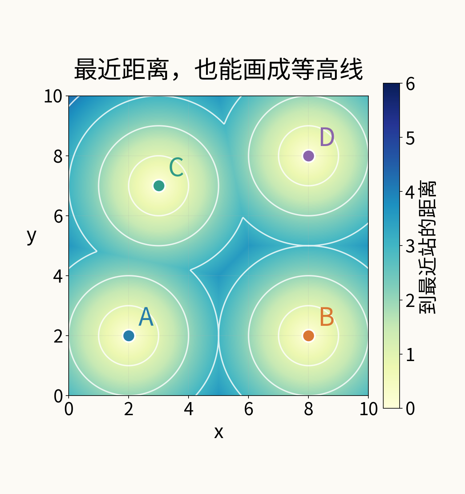

色条的单位与地图格子一致。白色曲线依次表示到最近站的距离为 1、2、3、4、5。越接近站点，颜色越浅；越远离所有站点，颜色越深。

这次，圆真的出现了。围绕某个固定站、到它距离相同的位置，本来就是圆。但当另一个站变得更近时，决定最小距离的对象会切换。因此白线不会永远围着同一座站长下去。

“最近的站是谁”和“到最近站有多远”，是同一次比较可以得到的两个不同输出。前者适合给地图分区；后者适合表达补给稀疏程度、生成渐变，或者帮助你发现离所有站都比较远的位置。

这不意味着距离场自动知道哪里该建新站。比如玩家可能几乎不去深色区域，或者那里根本无法通行。图只忠实回答你交给它的距离问题，需求仍要由设计者决定。

## 三块区域交会的地方，藏着一个空圆

看完整图里的第一个黑点 V = (5, 4)。它既在 A、B 的边界上，也在 A、C 的边界上，所以它到 A、B、C 的距离相等。

我们验算一下：三个距离平方都是 13。而到 D 的距离平方是 25，D 更远。

以 V 为圆心，√13 为半径画圆，A、B、C 恰好落在圆周上。圆内部没有别的站点。

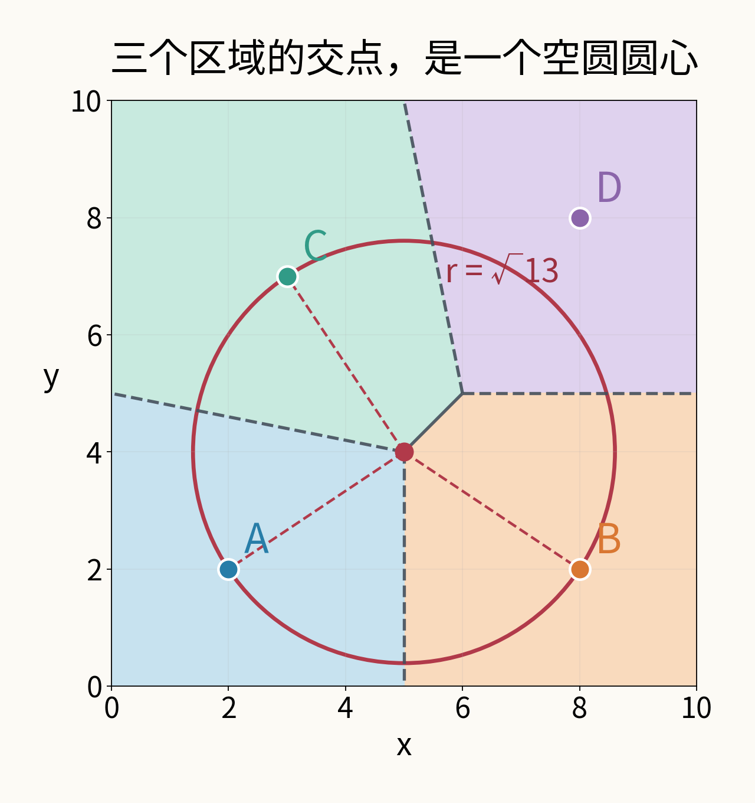

三条红色虚线长度相同。“空圆”中的空，指圆内部没有其他输入站点，不是说图上不能有道路、玩家或其他对象。

为什么一定不能有站点落在圆里？如果有，它到 V 的距离就比 A、B、C 更短。V 就不再是这三座站并列最近的位置，刚才的交点也就不能成立。

现在把共享一条 Voronoi 边界的站连起来。A 与 B 相邻，A 与 C 相邻，B 与 C 相邻；B、C、D 之间也形成一组连接。A 和 D 没有共享边界，所以不相连。

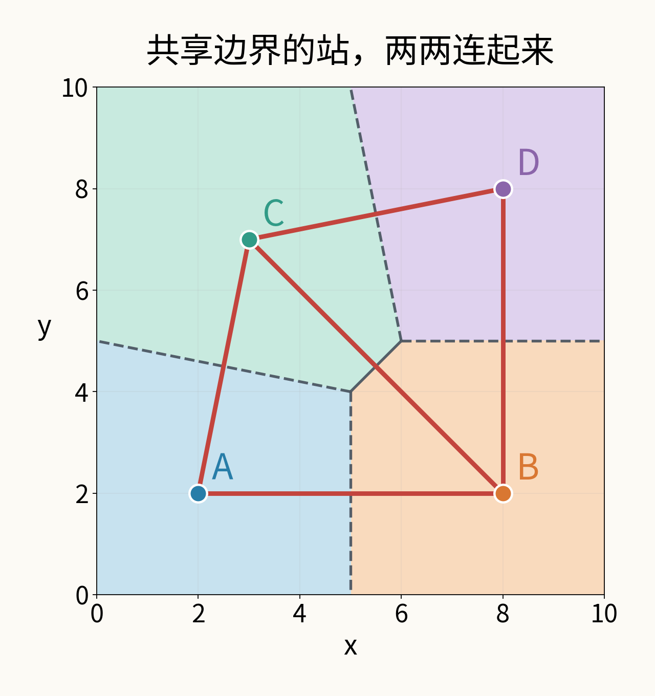

红线连的是站点，灰线分的是区域。两套图使用同一批点，回答的却是不同问题：一套告诉你空间属于谁，另一套告诉你哪些站在空间上相邻。

在本例这种没有四点共圆等退化情况的配置中，红线构成 **Delaunay 三角剖分**：它的每个三角形，其外接圆内部都没有其他输入点。这正是 [CGAL 几何库文档](https://doc.cgal.org/latest/Triangulation_2/index.html)描述的空圆性质。

“对偶”这个术语，就可以从图上理解：Voronoi 的一个区域，对应红色网络的一个站点；两个区域的一条公共边，对应连接这两个站的一条边；三个区域的一个交点，对应一个三角形。

但红线不是自动生成的道路，更不是最短通路。它只是空间邻接关系。要让玩家真的沿这些线行走，还得处理可通行性、坡度、建筑与游戏设计。

## 一座站搬家，地图会怎样改口？

假设 D 从 (8,8) 搬到了 (5.5,6.5)。它更靠近地图中心，原本由其他站服务的一部分位置，现在会改投 D。

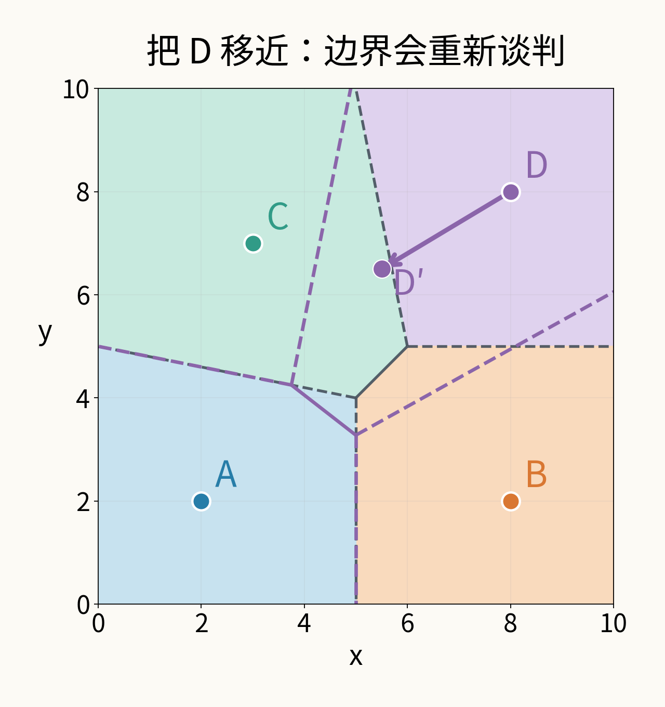

底色和灰色边界保留旧地图；紫色线表示 D 移动后的新边界，紫色箭头连接 D 与 D′。这是前后状态的叠加，不是两套同时生效的服务范围。

注意，A 的蓝色区域也被影响了。原来 A 与 D 不相邻，D 移近后却可以切走 A 附近的一块区域。不能因为“原先不是邻居”，就保证它永远影响不到我。

Voronoi 图适合把固定站点的比较结果预先整理起来，但站点移动会改变答案。工程里需要问清楚：你的站点多久变化一次，查询有多少，是否有现成的数据结构支持更新？

对于四个会不停移动的站，每次直接比较四个距离，很可能仍然是最合适的实现。理解一种漂亮结构，不等于每个项目都必须采用它。

## 数学里的平局，程序不能假装没看见

我们临时换成一个特殊配置：四座站分别放在正方形的四个角。

中心到四个站距离完全相同。Voronoi 图的四块区域可以交会在同一个点。但如果你想把四个站连成三角网，就要为正方形选择一条对角线。

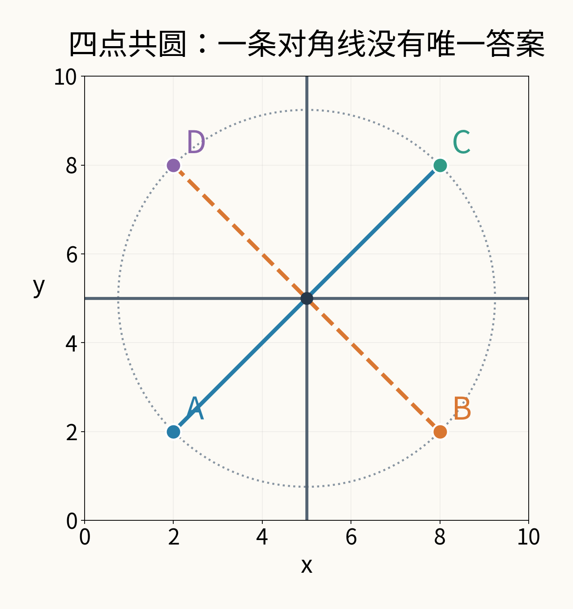

蓝色实线和橙色虚线代表两种可选对角线，不能把它们同时作为三角剖分中的交叉边。四个角位于同一个圆上，因此空圆条件不能替你唯一决定该选哪条。

这就是“退化情况”的一个例子。不是输入坏了，而是一般情况下成立的“恰好三个区域交会、三角网唯一”等说法，在特殊位置关系下不再成立。

真正写程序，还会遇到几个紧挨着的问题：两座站完全重合怎么办？所有站排成直线怎么办？一个点理论上在边界上，但浮点数算出了极小的偏差怎么办？

这些不是最后随手补三个 if 就一定能解决的细节。[Triangle 的 Voronoi 输出说明](https://www.cs.cmu.edu/~quake/triangle.voronoi.html)明确提示，其 Voronoi 顶点计算未使用精确算术，退化或接近退化的输入可能带来重复顶点、交叉边等问题。

几何算法的实现，除了纸上的公式，还要对“判断在这边还是那边”的数值可靠性负责。教学图里坐标干净整齐，生产数据未必会这么配合。

## 把原始点交给真实工具，会得到什么？

Triangle 文档给出了一个实际的输入点集，以及生成的 Voronoi 图。下面保留它的两张原图，先看散点，再看空间怎样被这些点瓜分。

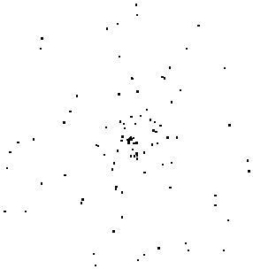

原图中的每个点都是一个输入位置。它们不是本文四站例子的扩充版，而是工具文档自己的例子。

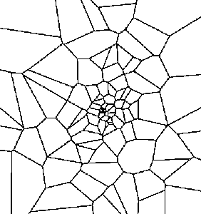

不规则的输入点，得到不规则的区域，但规则仍然相同：每一块区域收集离对应点最近的位置。有些边向远处伸去，它们在数学上可以是无限射线。

这里展示的是作者文档中的结果，没有把它称为本文运行 Triangle 的输出。本文用于讲解的彩色地图是另外构造、计算和绘制的示意图。

你还可以观察一个容易忽略的区别：彩色填满每个像素是一种展示方法，保存边、顶点和邻接关系是另一种表示。屏幕上看起来相似的图，内部未必保存了相同的数据。

## 如果中间有一堵墙呢？

回到原来的四座站。这一次，玩家位于 P = (4,2.5)，A 仍在 (2,2)。按直线距离，A 大约只有 2.06 格远，B 大约是 4.03 格远，所以普通 Voronoi 图仍会推荐 A。

现在在 x = 3 的位置放一堵墙，从地图下边界一直延伸到 y = 6。玩家不能穿墙，也不能离开地图从下方绕行。

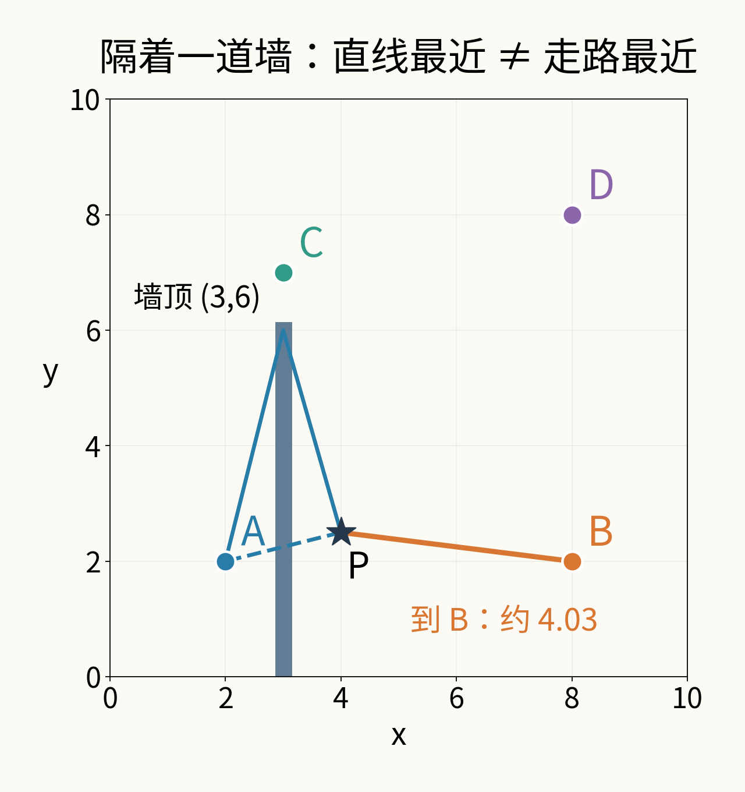

蓝色虚线是被墙挡住的直线。蓝色折线要先绕到墙顶，再走向 A，总长度约为 7.76。橙色线到 B 只需约 4.03，反而更近。

算法没有算错。它算的是你指定的**直线距离**，而你现在关心的是**可通行路径的长度**。

这是一个比“换哪个算法库”更早的问题：什么叫近？

- 飞行单位可以无视这堵墙，直线距离也许仍有意义。
- 地面单位需要绕路，应考虑实际路径。
- 快速道路、泥地和坡道会让“距离短”与“到达快”分开。
- 补给站有排队时间时，还可能需要比较“走过去加等待”的总成本。

依照路网或其他距离规则，同样可以定义“由哪个站服务”的区域，但它们未必仍是本文这些凸多边形。不要先爱上图的形状，再逼真正的问题迁就它。

## 用十几行代码，先画一个能检查的版本

要体验这个思想，不必第一天就实现复杂的几何构造算法。先写一个函数：输入位置，输出最近站的编号。

下面使用本文最初的四座站。代码在本地运行过，检查的是这组教学坐标的距离比较；它不是对 Triangle 或 CGAL 的测试。

```python
stations = {
    "A": (2, 2), "B": (8, 2),
    "C": (3, 7), "D": (8, 8),
}

def nearest(x, y):
    return min(
        stations,
        key=lambda name: (
            (x - stations[name][0]) ** 2
            + (y - stations[name][1]) ** 2,
            name,
        ),
    )

print(nearest(4, 3))  # A
print(nearest(5, 8))  # C
```

比较键的第一项是距离平方。第二项是名称，所以恰好平局时，选字母顺序靠前的站。这是本例明确规定的决胜规则，不是数学上说另一座站更远了。

再把地图分成小格，在每格中心调用这个函数，按结果上色，就能画出一个栅格版的 Voronoi 图。

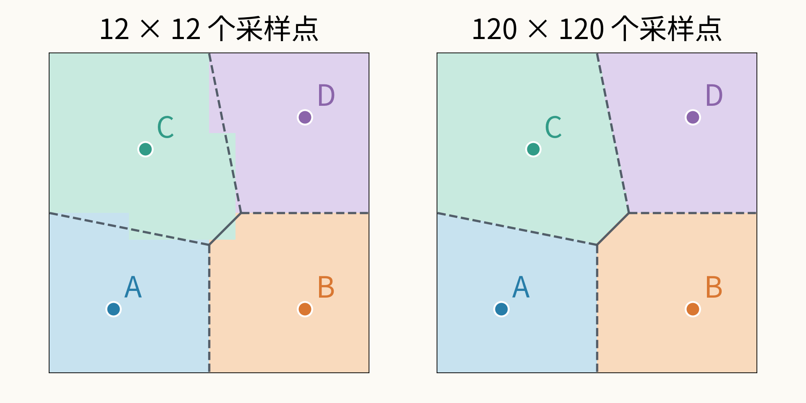

两张图的几何输入相同，叠加的灰线也相同。左图只取 12 × 12 个采样点，边界的颜色呈台阶；右图取 120 × 120 个采样点，台阶变细了。灰线是连续几何边界，不是像素计算额外变聪明了。

这个办法有两个好处。第一，你可以直接打印一个位置的四个距离，核对为什么涂成这种颜色。第二，增加采样密度，就能看见离散格子怎样逐渐逼近连续区域。

代价也很清楚：每个采样点都要与每座站比较。如果有 M 个采样点、N 座站，就要做大约 M × N 次距离比较。它并没有因为生成了漂亮图案，就自动获得高效的几何查询结构。

这是一个适合学习的起点：先做出容易核对的版本，再决定真正需要优化什么。

## 一个百年前的名字，为什么还留在地图里

这种图以数学家 Georgy Voronoy（沃罗诺伊，1868—1908）的名字命名。他研究的背景并不是游戏地图，而包括数论、格点和空间铺砌。

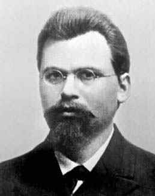

沃罗诺伊的历史肖像，来自圣安德鲁斯大学 MacTutor 图像页保存的原文件。它让我们认识被算法名称压缩成一个单词的人，不是本文虚构的研究现场。

MacTutor 对他 1907—1908 年相关工作的介绍，把问题放在“几何数论”的背景里：怎样用几何关系理解点与空间的排列。今天的程序员拿同样的结构回答最近站点、空间分区和网格邻接问题，使用场景已经变了，核心问题却仍然能够认出来。

名字也不意味着这类思想由一个人从无到有地独占发明。这里更值得带走的，是一种看问题的方法：不要只盯着每个点的单次答案，试着看看**答案什么时候会改变**。变化的地方，常常就是结构出现的地方。

## 留给你一张还没画完的地图

最后做一个小实验：在原图中加入 E = (5,4)。这恰好是 A、B、C 三块区域原来的交点。

先别运行程序，试着预测：

1. E 本身会属于哪一块区域？原来的三站平局点还存在吗？
2. A、B、C 中，哪些区域会被切走一部分？
3. D 的区域是否完全不受影响？怎样找一个位置检验你的判断？

验证不需要新的理论。把 E 加进代码，在几处候选位置比较五个距离平方，再画更细的栅格。你也可以沿用本文的半平面办法，逐个比较 E 与原来的四座站。

如果还能继续往前走，再问一步：假如补给站的位置固定，你却把“最近”的定义从直线距离改成绕墙距离，究竟是数据变了，还是整个问题变了？

一张几何图真正有用的时刻，不只是你记住它叫 Voronoi，而是你已经能指出：**它替你回答了什么，又有什么问题需要另画一张图。**

参考阅读：[CGAL：二维三角剖分](https://doc.cgal.org/latest/Triangulation_2/index.html)、[CGAL：Voronoi 图](https://doc.cgal.org/latest/Voronoi_diagram_2/index.html)、[Triangle：Voronoi 输出](https://www.cs.cmu.edu/~quake/triangle.voronoi.html)、[MacTutor：沃罗诺伊生平](https://mathshistory.st-andrews.ac.uk/Biographies/Voronoy/)。

图片来源：彩色地图与机制图为本文原创教学示意；两张黑白点集与分区图来自 Jonathan Richard Shewchuk 的 [Triangle 文档](https://www.cs.cmu.edu/~quake/triangle.voronoi.html)，保留原文件。沃罗诺伊肖像为作者不详的历史照片，采用 [MacTutor 原图](https://mathshistory.st-andrews.ac.uk/Biographies/Voronoy/pictdisplay/)，同一历史肖像的公有领域资料见 [Wikimedia Commons](https://commons.wikimedia.org/wiki/File:Georgy_Voronoy.jpg)；未进行生成或人像重绘。
