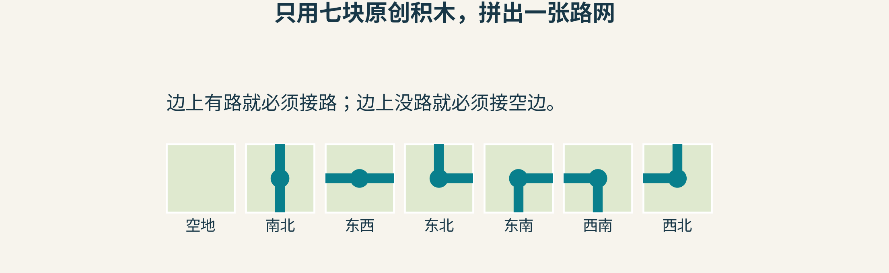
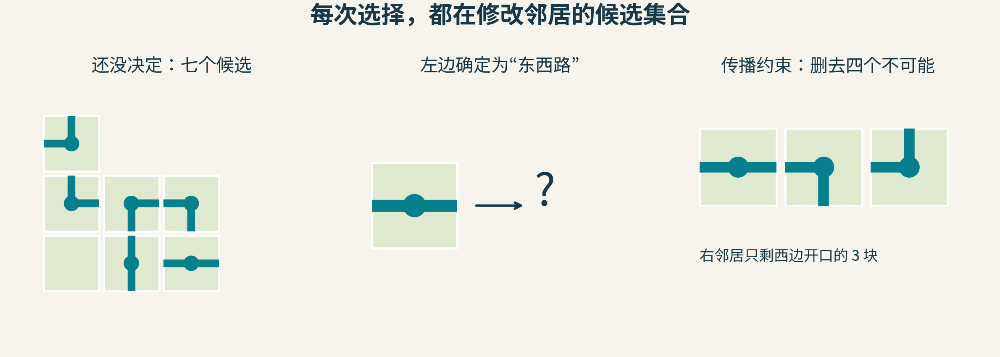
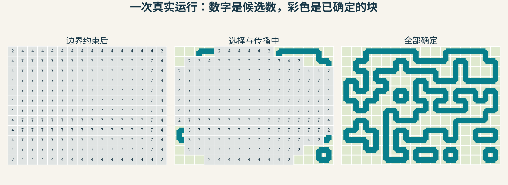
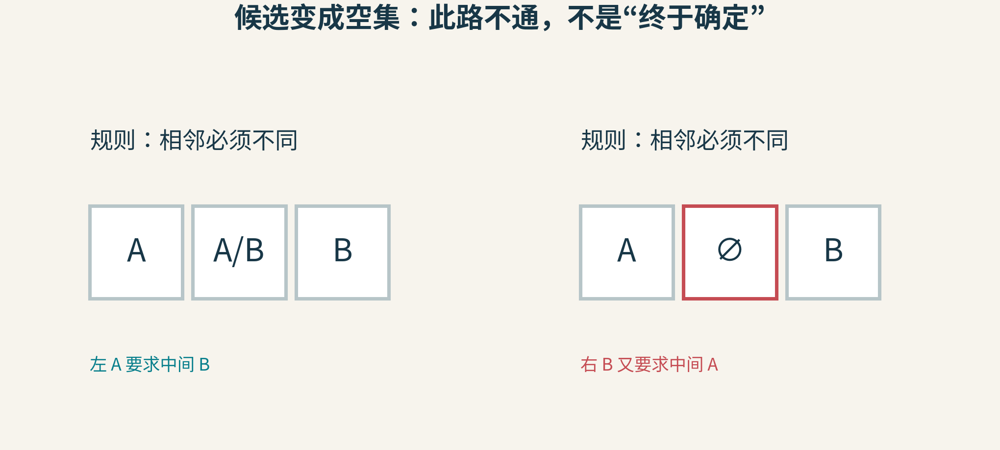
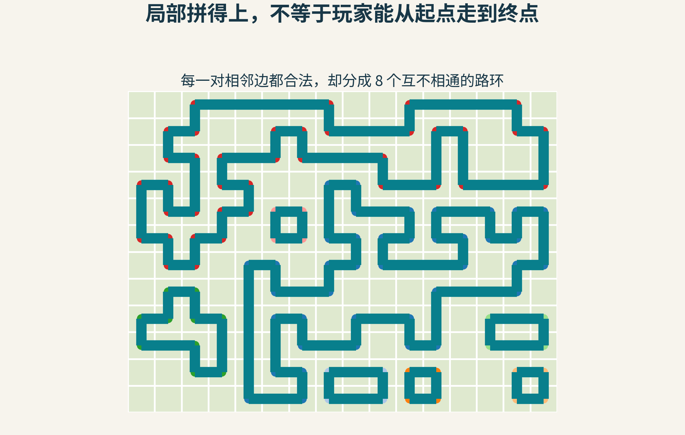
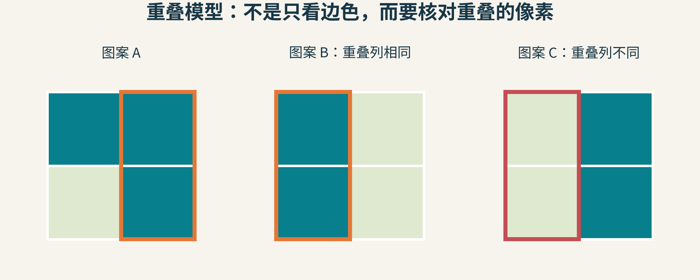

# 世界不是一格格乱填出来的：WFC怎样用“排除不可能”拼地图

假设你想生成一座小镇：道路应该接得上，墙不能突然少半截，水岸要与水面相邻。最直接的办法，是在每个格子里随机放一块素材。

但“随机”不会自动遵守常识。上一格的道路朝右，下一格可能是一堵完整的墙。即使每块素材都很好看，拼出来也未必像一个世界。

Wave Function Collapse，简称WFC，提供了一种不同的工作方式：每格先保留许多可能，决定一格以后，就把周围已经不可能的选项删掉。反复选择、传播，直到得到一致的结果，或者发现这条选择路线走不通。

## 先发明一个足够小的世界

我们不使用任何现成游戏素材，只画七块积木：空地、两种直路、四种弯路。每条路都从格子中心连到某些边的中点。

图1：本例使用的全部七块原创瓦片。南北东西指图上的方向，空地四边都不开口；没有十字路口，也没有尽头块。

规则也只用一句话：两块相邻时，相接的边要么都有道路开口，要么都没有。为了不让道路跑出地图，外边界统一要求不开口。

对电脑而言，不需要理解“路”的意义。可以给每块瓦片记四个比特，按北、东、南、西排列。有开口记1，没有记0：

空地=(0,0,0,0)

南北直路=(1,0,1,0)

东西直路=(0,1,0,1)

东北弯路=(1,1,0,0)

因此，检查左右相邻是否合法，只需要比较“左块的东边”和“右块的西边”。一幅有视觉意义的地图，先被翻译成了可以机械检查的关系。

这只是简单瓦片模型的一种设计。真实WFC规则可以直接列出哪些瓦片允许相邻，不一定能压缩成边缘标签。

## 一个尚未决定的格子，究竟存着什么？

它存着候选集合。

一开始，某个内部格子可能允许七种瓦片。不是七张图片真的叠在一起存在于游戏中，而是程序暂时没有决定它是哪一张。界面把候选图平均、半透明叠加，或者显示候选数量，都只是让人看见“不确定性”的方法。

现在，左邻居确定为东西直路。它的右边有一个道路开口，所以当前格子的左边必须也开口。

七种候选里，只有东西直路、西南弯路、西北弯路符合。剩下四种删掉。

图2：删候选不等于立即选中一块。当前格子还有三种选择，但这次删减已经可能影响它的其他邻居。

为什么还会继续影响？设一个格子的所有剩余候选在上边都没有开口，那么它上方的格子就再也不能选择“下边有路”的瓦片。即使这个格子本身还没唯一确定，它也能提供约束信息。

这就是传播：不是只看看刚刚决定的那一格，而是把由它引起的删减一层层传下去，直到没有候选再变化。

## 比“边必须一样”更通用的传播方式

实际实现常用这样一句检查：邻居的每个候选，是否还能在当前格子的候选中找到至少一个兼容搭档？找不到，就删除。

例如，当前格子只剩候选A和B。邻居候选X能与A搭配，Y能与B搭配，Z与A、B都不兼容，那么只删除Z，保留X、Y。

这比提前把当前格子猜成A更谨慎。传播只删除已经被规则排除的可能，不把“我比较喜欢某一块”冒充逻辑结论。

但这种局部支持检查也有边界：一个候选在每个方向都各自找到搭档，不表示这些搭档最终一定能同时相容。这也是为什么传播做完，仍可能需要继续选择、遇到矛盾、回退或重新开始。

可以把整个流程理解成两种动作轮流工作：

1. 选择：主动固定一个尚未确定的格子，承担一次分支决定
2. 传播：只依据现有规则，删除这个决定造成的不可能

随机性主要出现在第一类动作中；第二类动作应当忠实执行约束。

## 先决定哪一格？挑“最没得选”的地方

如果一个格子还剩七种选择，另一个只剩两种，先处理哪一个比较好？

WFC通常优先挑选不确定性较低、但尚未唯一确定的格子。直觉很像做数独：只剩两种可能的位置，通常比什么都能填的位置更值得先处理。

最简单的情况是所有瓦片权重相同。这时比较候选数量就够了。本例真实运行使用的就是这个规则；同样少的格子之间随机打破平局，再随机选其中一块。

如果不同瓦片权重不同，“有几种”就不够。一个格子有两个各占一半的候选，另一个有两个概率分别为99%与1%的候选，前者更难预测。于是可以用香农熵：

H=−Σpᵢlog₂pᵢ。

七个等权候选的熵为log₂7≈2.807比特；三个等权候选约1.585比特；只剩一个候选时是0。权重来自设计者或样本统计时，要先在当前仍允许的候选中重新归一化，得到pᵢ。

这个数字只是在衡量选择的不确定程度。它不是温度，也不意味着电脑正在运行量子物理。

## 看一遍真实的选择与传播

下面是本文程序实际生成的一张16×12地图。随机种子固定为0；边界不能出路；每次选择最少候选的格子，再传播到稳定。数值格子中的数字，是那一刻剩下的候选数量。

图3：同一次运行的连续状态。最初角落与边界已被边界条件删掉部分候选，所以不是每格都从7开始。彩色瓦片表示只剩一个候选，灰格表示仍未决定。

这张图说明了WFC最吸引人的地方：它没有一份事先手画好的完整答案，却能让局部决定互相约束，逐渐产生一幅一致图案。

不过，不要把最终图误读成算法“理解了道路交通”。程序这里只知道开口是否对齐。它并不知道哪里需要住宅、哪里是学校、居民怎样上班。

我们可以在生成前钉住几块瓦片，表达入口或河岸等设计意图；也可以设置权重，让空地更多。但某种瓦片权重翻倍，并不保证最终地图中它的占比恰好翻倍，因为边界与其他约束还会改变哪些选项可用。

## 空集合：最重要的失败信号

只剩一个候选，是确定；一个候选都不剩，是矛盾。这两个状态绝不能混淆。

换一个极小的例子：只有A、B两种瓦片，规则要求相邻不同。三个连续格子，左端被固定成A，右端被固定成B。

中间必须不同于左端，所以只能是B；又必须不同于右端，所以只能是A。两条约束合起来，中间没有任何选择。

图4：空集∅表示当前固定条件不可同时满足。不是随机数不够幸运，也不是再挑一次中间格就能解决。

如果矛盾来自之前一次可撤销的选择，可以回溯：撤销那次选择及其造成的删减，尝试另一个候选。更简单的实现会放弃这次生成、用新随机种子重来。如果矛盾来自用户同时钉住的两端，就需要修改条件，盲目重启没有意义。

原始WFC项目明确说明生成可能遇到矛盾；不同实现有的重启，有的回溯，有的增加更强的求解器或启发式。不能把“看过几个成功动画”变成“它总能快速完成”的保证。

同样，低熵优先是一种有用的搜索策略，不是正确性证明，也不是对所有瓦片集都最快的定理。

## 最漂亮的陷阱：每个接缝都对，整张图却不通

回头看我们的生成结果。逐一检查相邻瓦片，所有路口都对齐；检查外边界，道路也没有越界。

可是从某个小路环出发，能走到另一个路环吗？

图5：对同一结果再做连通性遍历，找到8个互不相通的道路分量。每个分量的点用不同颜色标示。这个数字来自本文教学程序，不是原WFC软件或商业游戏的测试结果。

不能。我们的瓦片没有岔路和尽头，在有限封闭边界下，有路的格子每个都有两个连接，因此会组成若干闭环。算法完全遵守了规则，却没有满足我们后来才说出口的“我要一个彼此连通的世界”。

这揭示一个很重要的设计原则：局部相邻合法，不自动保证全局目标。

如果要保证玩家能从入口走到出口，可以先规划一条骨架路线，再把它作为约束交给生成器补齐；也可以在生成后做寻路检查，失败时修复或重来；更复杂的实现会把连通性约束纳入求解。选择哪种方法，取决于你愿意怎样控制地图，以及能接受多少计算成本。

## 不只拼瓦片：还可以从小图案学习

原项目还提供重叠模型。它从一张输入图中提取N×N小图案，再用它们生成更大结果。

这里的兼容条件更细：把两个小图案放到相邻位置，它们重叠的部分必须逐像素相同。例如两个2×2图案左右相差一格，左图的右列必须和右图的左列一致。

图6：A可以与B按一列重叠，因为橙框内的两列一致；A不能这样接C，因为红框列不同。图案为本文原创，用来解释重叠约束。

这样一来，程序不只知道“砖块能接砖块”，还能保留小窗口内部的纹理组织。N越大，局部描述通常越丰富，但候选类型和兼容关系也可能增长，成功生成的难度随之改变。

原始目标是让输出中的局部图案来自输入，并使大量输出的图案分布与输入有一定相似性。它并不保证每张输出都完美复制原图统计，也不保证保留原图的大尺度语义。一张城堡截图里的“门通往大厅”，未必能被很小的像素窗口表达。

## 为什么叫“波函数坍缩”？

Maxim Gumin在2016年公开的项目借用了量子力学的语言：未决定的格子像有多个可能状态，选中一个后像“坍缩”，新的信息再传播。

这个名字非常容易记，但理解到这里，你已经能拆掉它的神秘外壳：程序保存候选与权重，作随机选择，执行约束传播。原作者也明确说明，它并没有进行真实量子力学计算。

它背后的思想还有更长历史：约束满足、纹理合成、模型合成，早就研究过“局部关系怎样限制整体”。WFC令人印象深刻的一点，是把这些思想组织成一种很直观、很好观看的生成过程。

## 试着当一次规则设计师

1. 在七块瓦片里加入一个十字路口。闭环结构会怎样变化？加了它是否就能保证整张路网连通？
2. 禁止空地。边界仍不允许开口时，哪些宽高尺寸可能使生成更困难？先画小图猜测，再运行验证。
3. 把地图中央钉成某一块，观察删减传播了多远。怎样的规则能让远处也受到明显影响？
4. 不再问“生成成功了吗”，而是列出三项验收：接缝合法、入口出口可达、路线长度合适。哪些能交给局部规则，哪些需要额外检查？

WFC没有替设计者决定什么叫好世界。它做的，是把你已经说清楚的局部规则认真执行下去。真正的创造力，一半在算法里，另一半在你怎样把想要的世界翻译成可检查的条件。

资料：[Maxim Gumin的原始项目与完整算法说明](https://github.com/mxgmn/WaveFunctionCollapse)。文中七块瓦片、数字推演、16×12生成实验、连通性检查与重叠示例均为本文独立教学设计。

图片来源：本文全部六图为原创示意或原创程序运行可视化，未使用原项目中的样本或游戏瓦片。
