# 方向明明是纠偏，控制器为什么越帮越忙？Bode 图里藏着一张时间账单

一台虚拟电机要把速度维持在1。程序的规则听上去很合理：慢了就加力，快了就减力。

可它看到的速度不是现在的速度，而是1.6秒前传来的旧数据。等它终于收到“太快了”，电机可能已经慢下来了；这时再减力，恰好把偏差推得更远。

负号没有写反，反馈却仍可能失控。问题不只在“往哪个方向推”，还在于：**这一下推力，到底赶上了运动的哪一拍？**

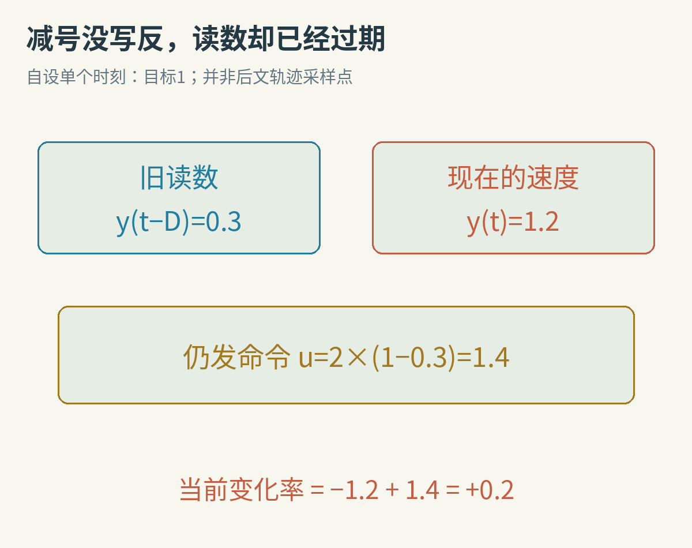

图里是假设的一个时刻，不是后文轨迹中的采样点。目标是1，旧读数0.3，现在却已经1.2。若按旧数据算两倍误差，命令仍是+1.4；在我们稍后规定的模型里，它还会让当前速度继续上升。

这一篇会从“声音有多大、晚了多少拍”走到Bode图，算出一套具体模型能容忍多少延迟。不用先学会拉普拉斯变换，也不用背一张控制器调参表。

## 1. 一篇讨论放大器的论文，为什么会谈到“唱起来”

1940年，Hendrik W. Bode在《Bell System Technical Journal》发表了讨论反馈放大器中衰减与相位关系的论文。开篇的难题很鲜明：反馈能改善放大器的表现，但如果绕回来的信号在幅度与相位上配合不当，放大器可能自行振荡，甚至发出持续声音。[原论文信息](https://onlinelibrary.wiley.com/doi/abs/10.1002/j.1538-7305.1940.tb00839.x)

他还描述了一种让工程师头疼的循环：这里改好了，麻烦又从那里冒出来。文章要寻找的，正是这些局部修改背后的约束。这是论文中的论述，不是替Bode编一段实验室对白。

这张照片摄于1958年5月26日的NACA Lewis会议。原图说明按从左到右的顺序列出Bode为第四位，当时职务为贝尔实验室物理科学研究负责人。它是较晚的历史照片，不是1940年放大器实验现场。图片：NACA/NASA，原文件未改；人物顺序见[原站图注](https://www.nasa.gov/people/robert-r-gilruth/)。

今天所说的Bode图，用两张共用频率横轴的图分别记录幅度比和相位。我们先不急着画它，先把两张图各自在问什么弄清楚。

## 2. 先造一台完全说清楚的虚拟电机

用y表示归一化速度：y=1就是目标速度。用u表示给虚拟对象的命令。我们规定，若命令固定，它会渐渐靠近这个命令值，一秒是它的响应时间尺度。

用一句微分方程写，就是：

**dy/dt = −y + u。**

这里t按秒计，系数已按一秒时间尺度归一化。dy/dt就是“此刻速度变化得多快”。不熟悉导数也可以先这样理解：每一小段时间，它朝u的方向挪一点，而不是瞬间跳过去。这是自设线性模型，不代表某款真实电机的完整物理特性。

控制器的命令则是：

**u(t) = k × [1 − y(t−D)]。**

k是纠偏力度，先固定为2；D是测量延迟，单位秒。y(t−D)就是D秒前的速度。目标1是当前目标，只有测量支路延迟。把这个位置说清楚很重要，否则“同样有延迟”的两个实验可能不是同一个实验。

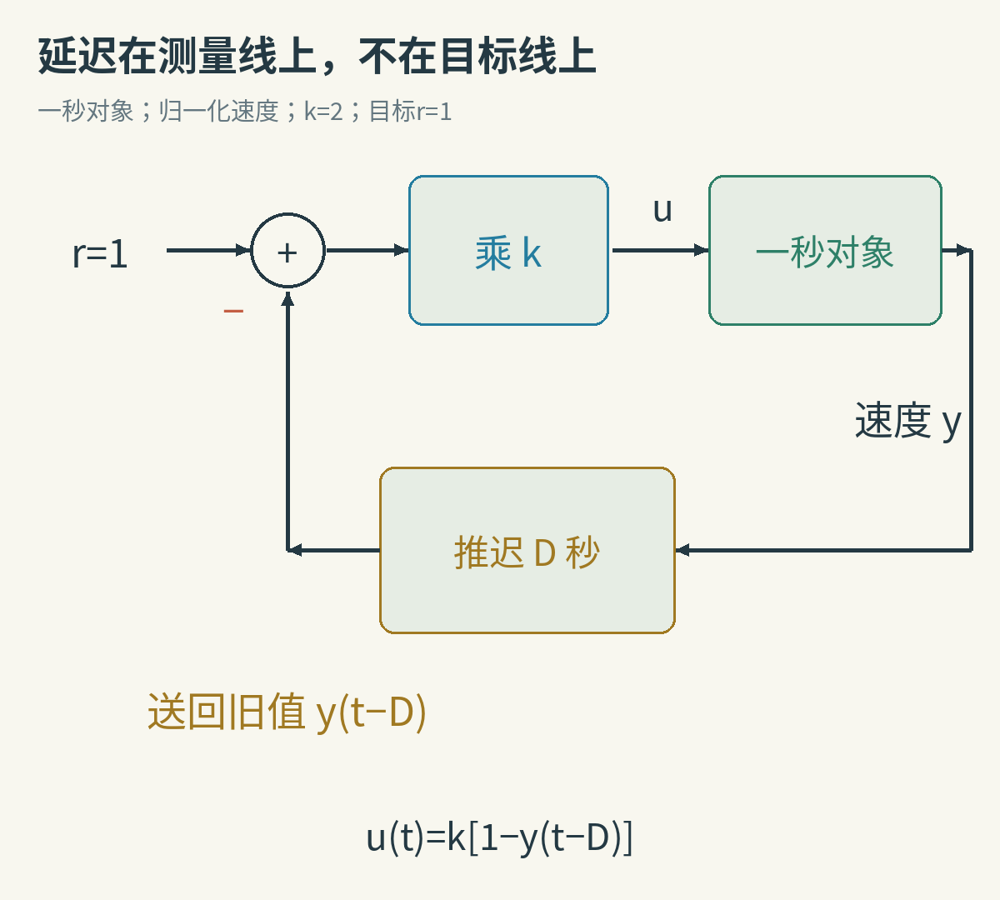

图里的小圆圈先做“目标减测量”，再把误差乘k，送进对象。这条接回去的测量线，使它成为闭环。

暂时拆掉控制器，直接给对象一个从0跳到1的命令，它在1秒时约走完63.2%的路程，之后继续接近1。

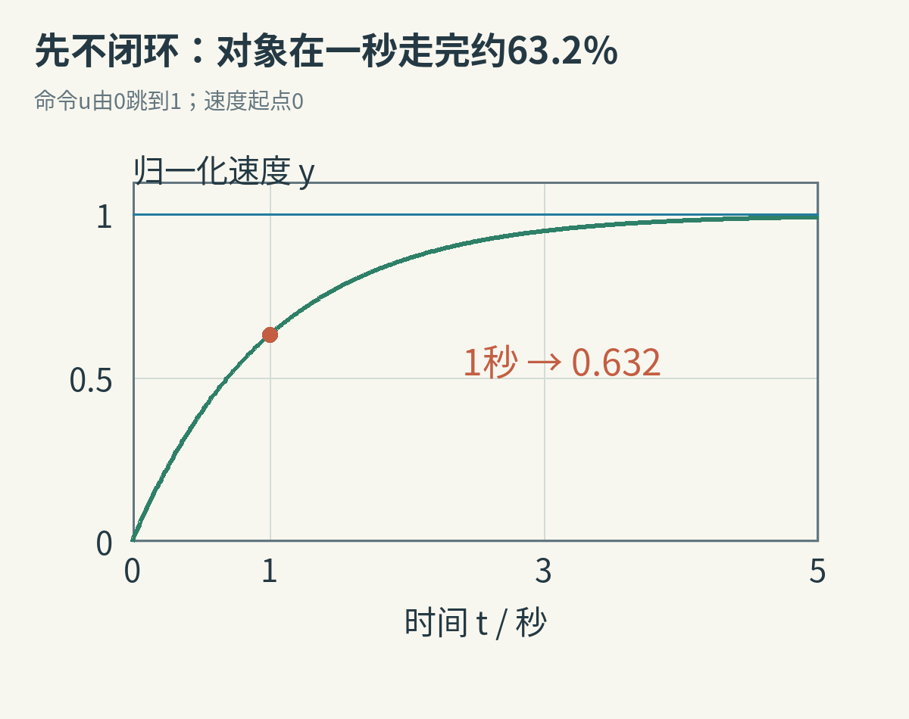

接下来，我们换一种试探方法：不要只给一次台阶，而是轻轻地、有节奏地来回摇它。

## 3. 用一根正弦波，问出两个问题

给对象输入一条平滑起伏的正弦波，等刚启动的过渡过去，输出仍然是一条同频率的正弦波，只是可能变矮、变晚。这是当前稳定线性模型的性质，不是所有设备都保证如此。

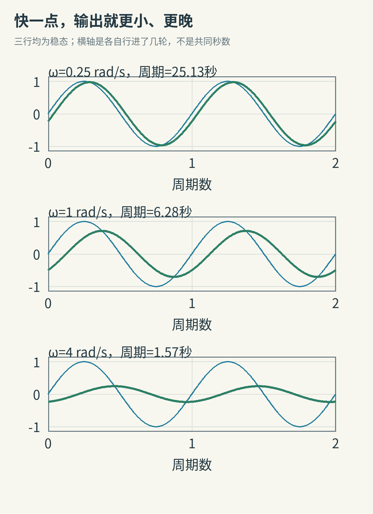

每一行的蓝线都是输入，绿线是稳态输出。图中时间已经换成“这一行的周期数”，所以要连同每行写出的周期一起看：三行并不代表相同的秒数。

第一问：**输出振幅是输入的几倍？** 这个比值叫幅值增益。输入从中线到波峰高1，输出只高0.707，增益就是0.707。不是把两条曲线在同一时刻的数值相除；正弦波经过零点时，那样除甚至没有意义。

第二问：**输出的这一轮起伏，比输入晚了多少？** 可以量秒，也可以量它占一个周期的多少。

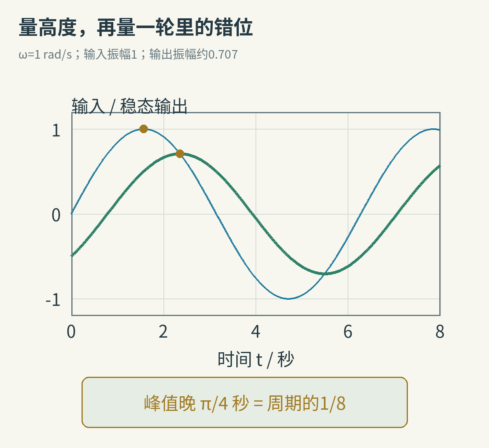

相位把完整一轮记作360°。晚了四分之一轮，是−90°；晚了半轮，是−180°。这里负号约定为滞后。

把频率写成f时，单位是Hz，表示每秒几轮；写成ω时，单位是rad/s，表示每秒走多少弧度。两者关系是ω=2πf。一整轮是2π弧度，也就是360°。后面的横轴用ω，别把1 rad/s误读为1 Hz。

## 4. 同样晚半秒，为什么后果可以不同

假设一条信息只被推迟0.5秒，形状和高度完全没变。

- 如果输入一轮要2秒，这次延迟占四分之一轮，滞后90°。
- 如果输入一轮只要1秒，同样的延迟已经占半轮，滞后180°。

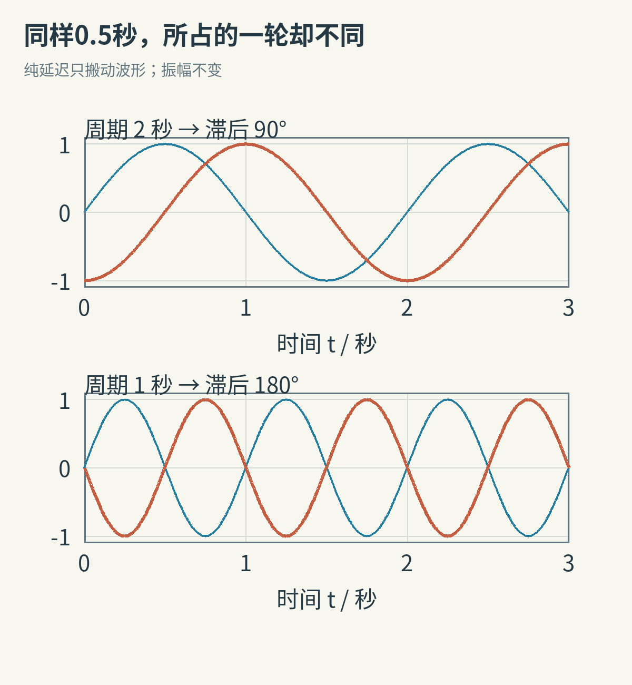

因此，纯延迟D带来的相位变化是：

**−360° × f × D，或用弧度写作 −ωD。**

这条式子只是在算“晚了几轮”。纯延迟不改变正弦波的振幅，却对快变化的信号扣掉更多相位。于是，单看幅值，很可能完全看不出它埋下的麻烦。

## 5. Bode图不是神秘仪表，只是两张账单

如果每个频率都测一次振幅比和相位，就能画出两条曲线。频率跨度很大时，人们常用对数横轴：0.1到1、1到10，都是增大十倍，在图上各走同样远。

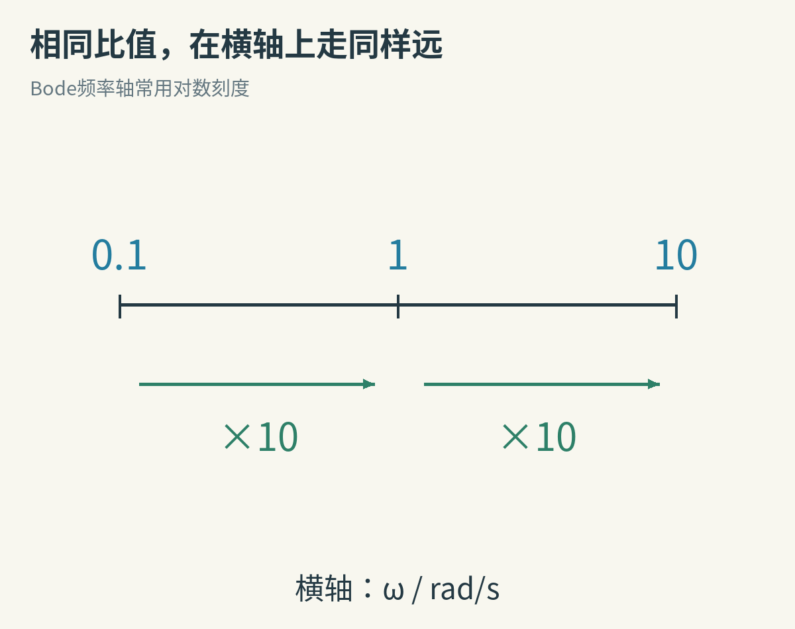

上面那张幅值图通常还会把倍数换成分贝dB。对本文的**幅值比**，换算是20×log10(幅值比)，不是功率比常见的10×log10。

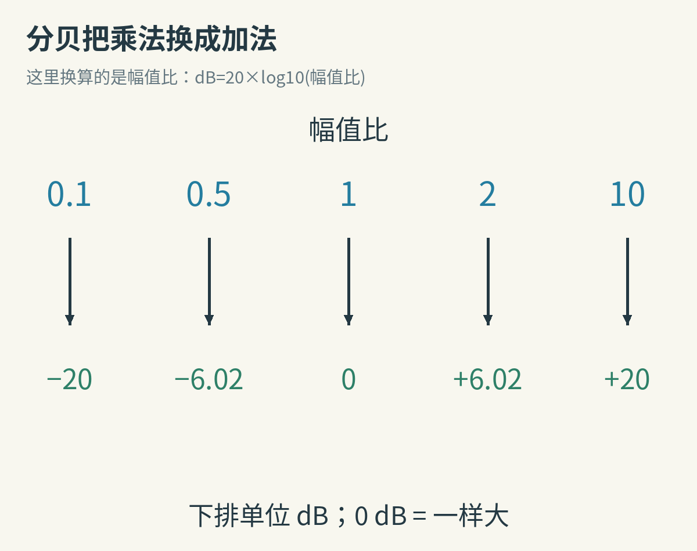

0 dB表示输出振幅等于输入振幅，不是“没有信号”。增益2约是+6.02 dB；增益0.5约是−6.02 dB。这样做有个很省事的好处：两级串联，倍数相乘，换成dB后就能相加。

对我们的单个虚拟对象，稳态计算给出：

**幅值比 = 1 / √(1+ω²)，相位 = −arctan(ω)。**

arctan是反正切。暂时只需记住几个可核对的值：arctan(1)=45°，arctan(√3)=60°。这里ω的数值按rad/s、时间尺度按一秒代入。

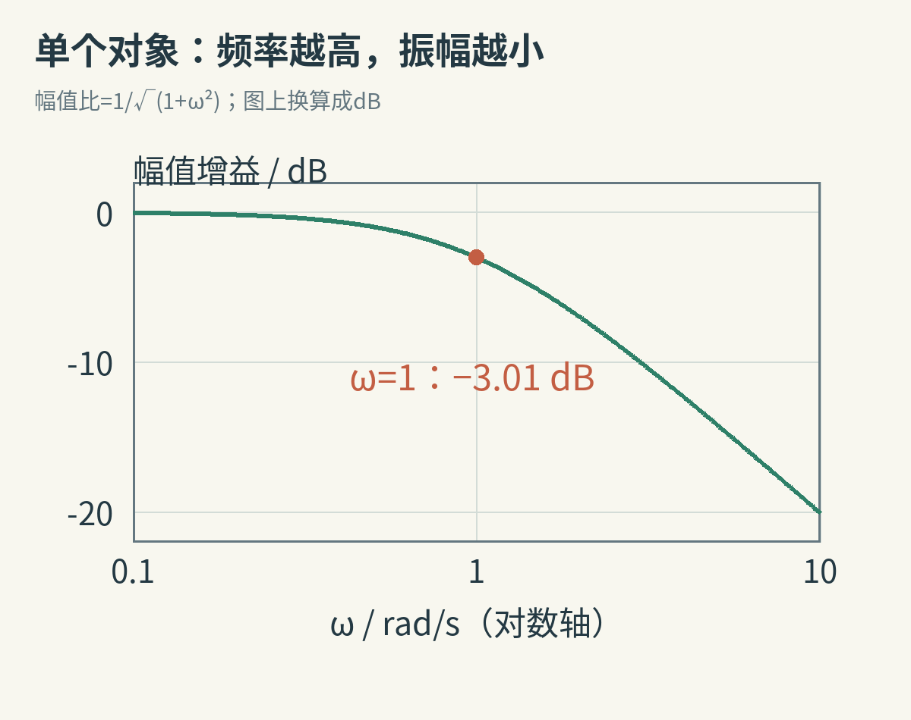

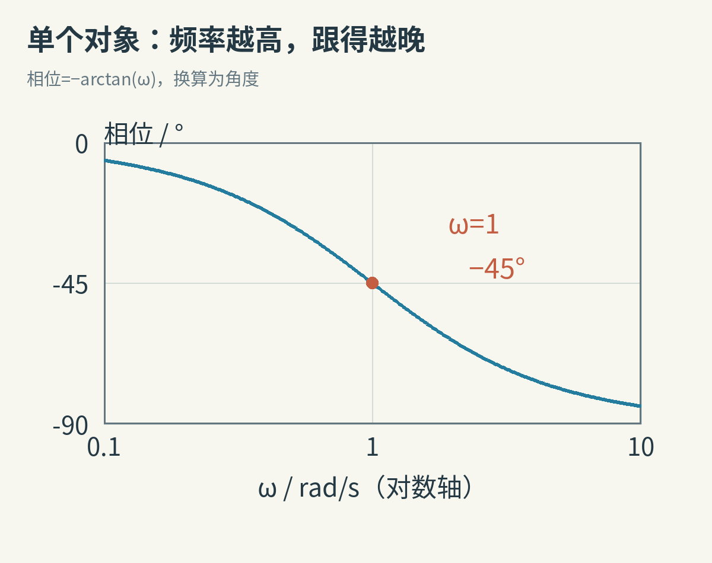

ω=1时，幅值约0.707，即−3.01 dB；相位−45°。频率越高，对象越来不及跟上，输出越小，相位逐渐靠近−90°。高频幅值渐近于每十倍频率下降20 dB；这是一条渐近趋势，不是说整个曲线从头到尾都是直线。

想知道公式为什么合理，可以把下面这个稳态输出代回dy/dt+y=sin(ωt)：

**y(t) = [sin(ωt) − ω cos(ωt)] / (1+ω²)。**

它满足原方程。正弦项和余弦项合起来，恰好对应上述高度和错位。配套实验实际检查了4004个这样的代入值。

## 6. 沿环路走一圈，暂时别把减号算两遍

把测量信号沿着“延迟、控制器、对象”走一遍，先不包含比较器上的减号。用L表示这一圈的响应，它也有幅值和相位。

对k=2的例子：

- 控制器把振幅乘2，不额外转相位。
- 对象把振幅乘1/√(1+ω²)，滞后arctan(ω)。
- 延迟不改振幅，额外滞后ωD弧度。

于是整圈的账单是：

**|L| = 2 / √(1+ω²)。**

**相位 = −arctan(ω) − ωD。**

第二条如果用度数画图，须把ωD乘180/π。不要把60°和0.8弧度直接相加。

注意我们分析的是**开环一圈的响应**，并不是“目标到速度”的闭环响应。两张图的对象不同，不能把前者的增益当成最终跟踪效果。

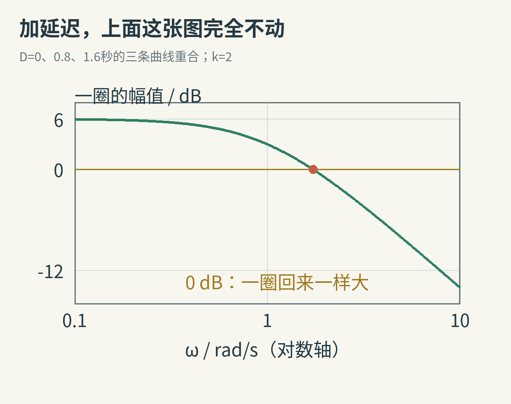

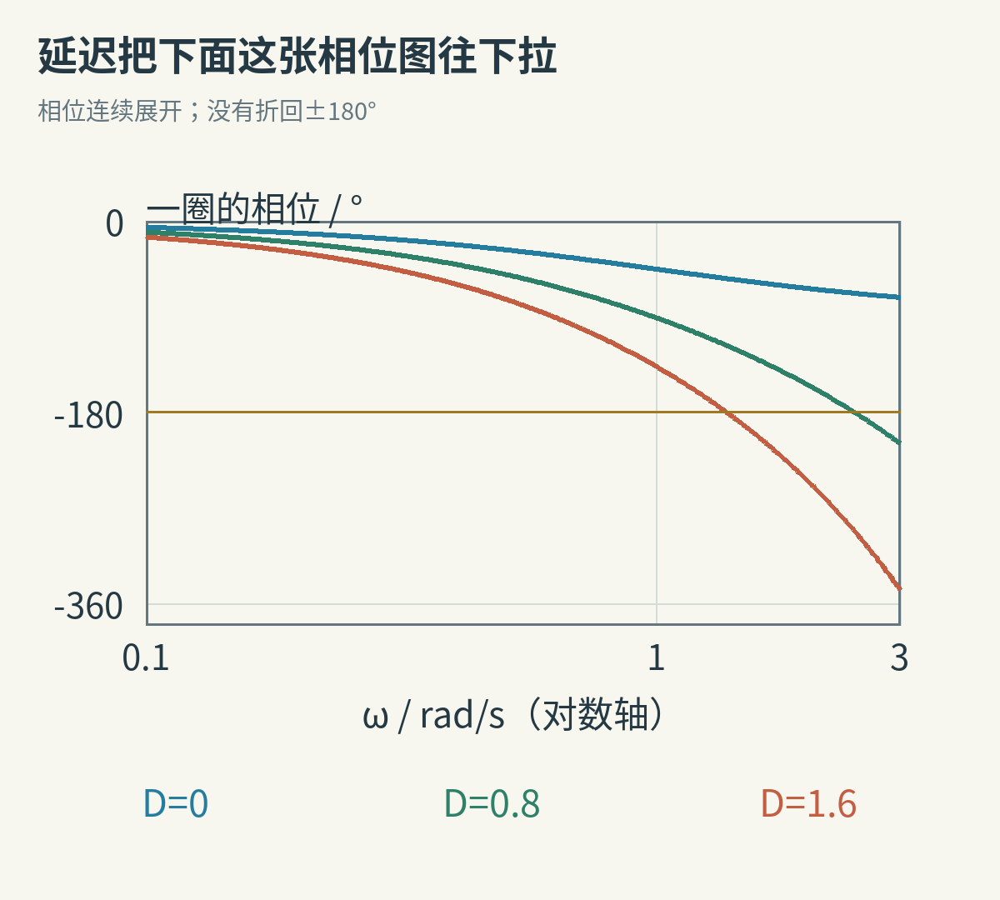

这就是延迟的隐蔽之处：D从0变成0.8，再变成1.6秒，上面那张幅值图不动，下面那张相位图却变了。图里相位连续展开，没有折回±180°，以免把整圈的滞后藏起来。

## 7. 找到“一圈回来一样大”的那个频率

先在幅值图里找增益1，也就是0 dB的地方。我们把这个频率叫增益交叉频率ωc。

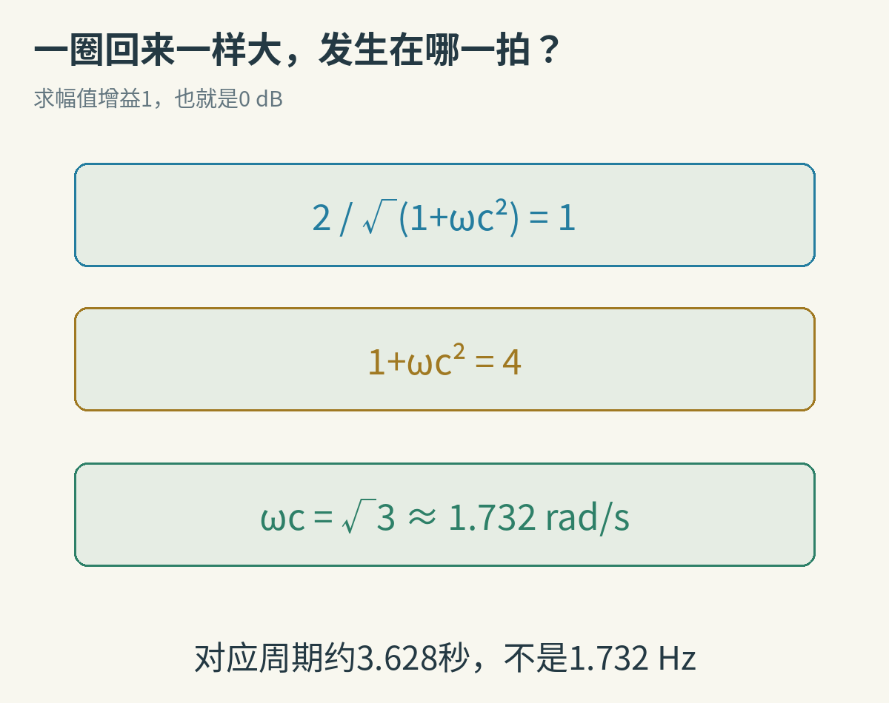

2/√(1+ωc²)=1，所以ωc=√3，约1.732 rad/s。它对应的周期约3.628秒，并不是每秒1.732轮。

为什么特别留意这里？可以先想一个临界情形：某个微小起伏绕一圈回来，大小没变，相位刚好落后180°，也就是翻了个面；比较器再做一次“减”，又把它翻回来。**两次翻面以后，原本要抵消的起伏回到了原来的方向。**

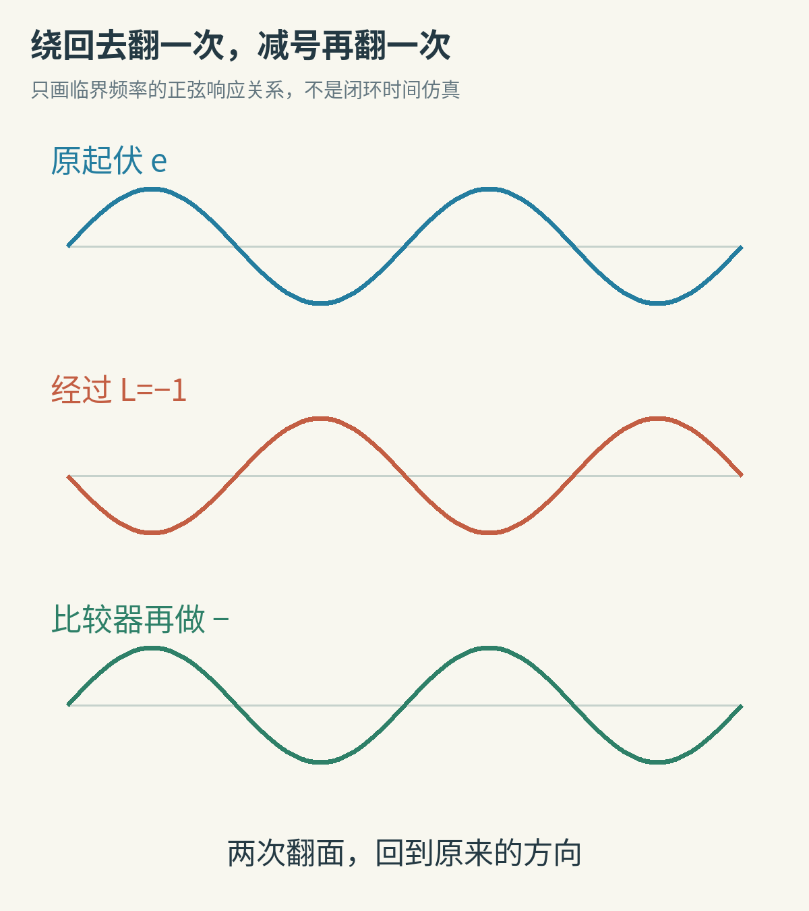

这是一种寻找临界振荡的频率解释，不是把真实闭环当成几段波形依次回放的动画，更不是“看到某个频率相位−180°就一定失稳”。还必须同时看大小和整个系统的结构。

用简短的代数也能看出同一件事。让e表示送入环路的误差扰动，q表示它绕过控制器、对象和测量延迟后回来的读数扰动。零目标时比较器给出e=−q，而一圈响应给出q=L·e。合起来是(1+L)e=0。L=−1，也就是“幅值1、相位−180°”，会让这个系数成为0。这里q包含测量延迟，不等同当前的速度y。

## 8. 相位裕度：离那半圈还剩多少

在ωc处，先看相位距离−180°还有多远。这个余量叫相位裕度。

没有测量延迟时，对象本身在ωc处滞后60°；距离180°还剩120°。D=0.8秒时，延迟再消耗约79.39°，剩下约40.61°。

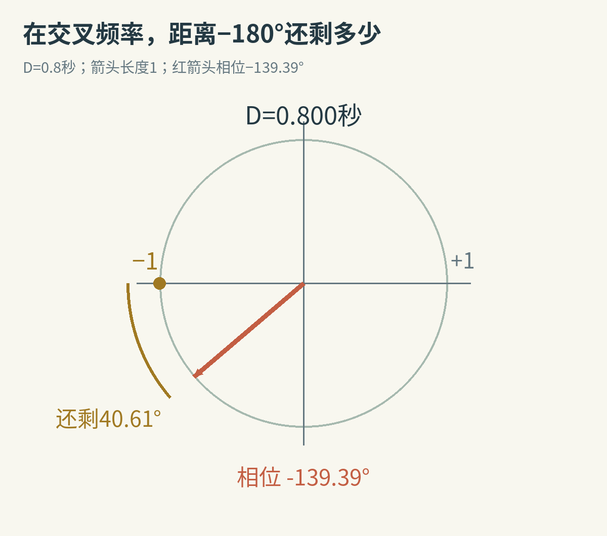

**相位裕度 = 180° + 交叉频率处的相位。**

这次正好可以写成120°−ωcD×180/π。三个延迟的结果如下。

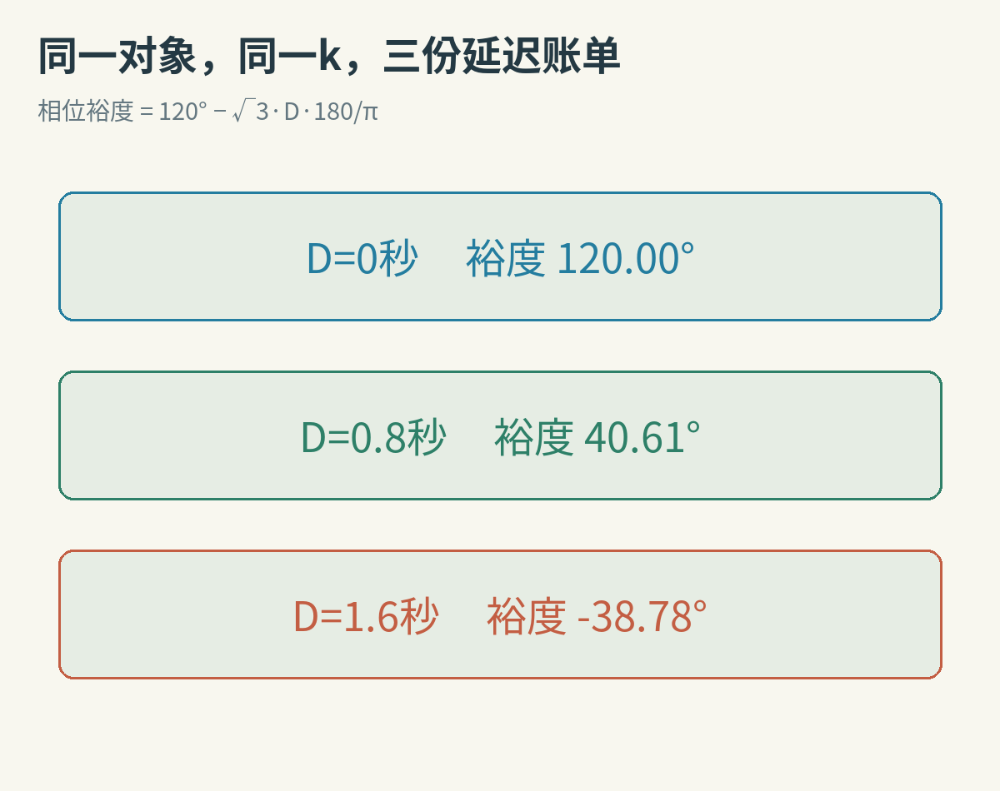

动画把频率固定在ωc，只改变D。箭头长度始终是1，但方向不断顺时针转动；左侧的−1点就是前面说的临界位置。

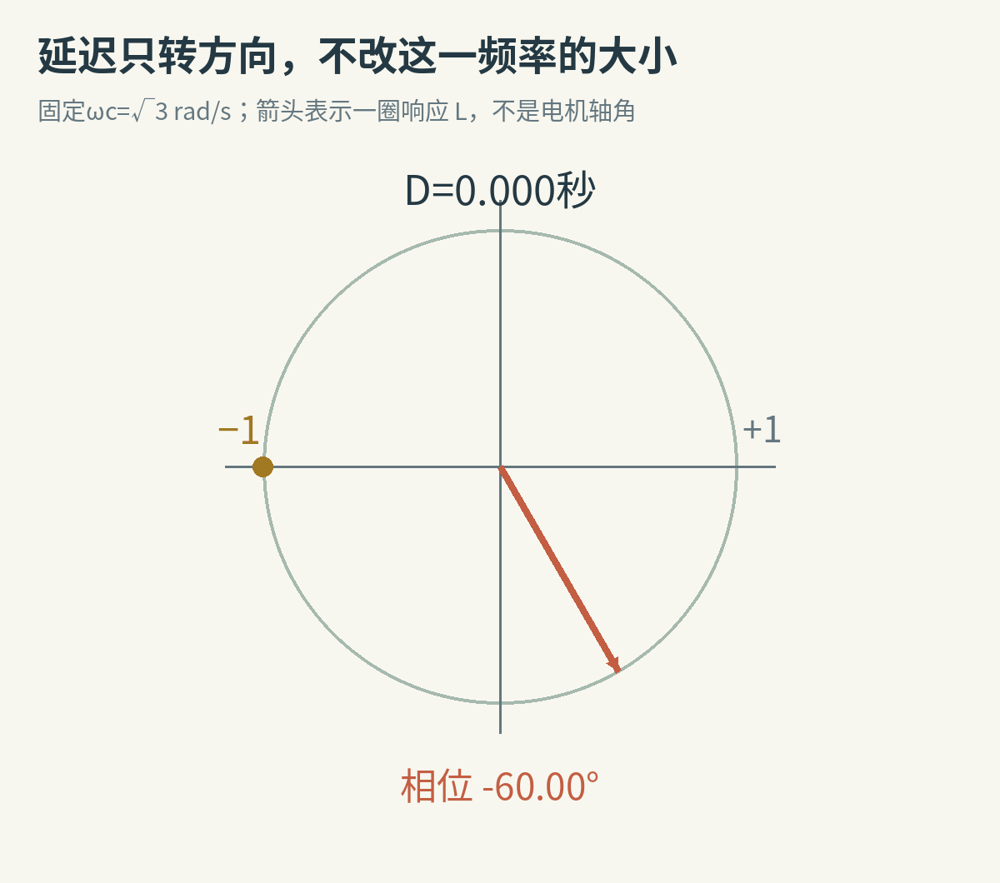

图中箭头是一个正弦响应的幅相表示，不是电机轴角度，也不是闭环随时间的运动轨迹。

## 9. 我们能算出多少秒的延迟预算

这套模型在第一次走到临界位置时，需要用完120°。120°是一整轮的三分之一，周期约3.628秒，所以延迟临界值约为1.209秒。

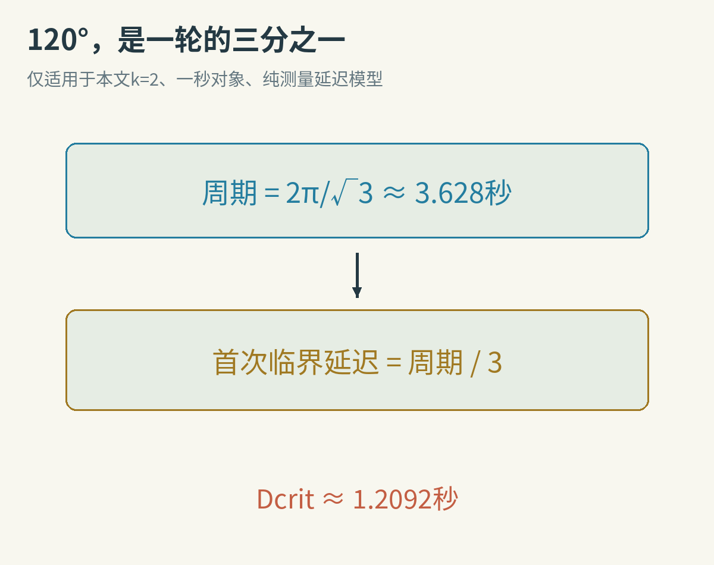

更精确地说，Dcrit=2π/(3√3)秒。这是**当前一秒对象、k=2、固定纯测量延迟、线性模型**的结论，不是“控制系统都能忍1.2秒”。换一台对象、改变k或换延迟位置对应的完整模型，就要重算。

对这一特定模型，D=0时闭环方程是y′=2−3y，稳定；随着D增大，第一次临界振荡出现在上面的Dcrit。D=0.8处于稳定侧，D=1.6已经越过第一次失稳边界。课程资料中同类一阶对象的延迟分析，可在[MIT原讲义](https://ocw.mit.edu/courses/16-30-feedback-control-systems-fall-2010/cb4fd48f2435b6d67fb6d3c3ecf9bc86_MIT16_30F10_rec11.pdf)中继续追下去。

但“相位裕度为正就万事大吉”不是普遍定理。开环本身不稳定、存在多个交叉频率、多输入多输出，或者强烈非线性时，需要更完整的稳定性分析，不能从一处读数直接下结论。这里刻意选了结构清楚的单输入单输出例子。

## 10. 把频率账单换回时间里的速度

现在实际运行模型：t≤0时速度为0；t=0把目标设为1，之后不动。控制器仍读D秒前的速度。数值程序按0.001秒步长推进。

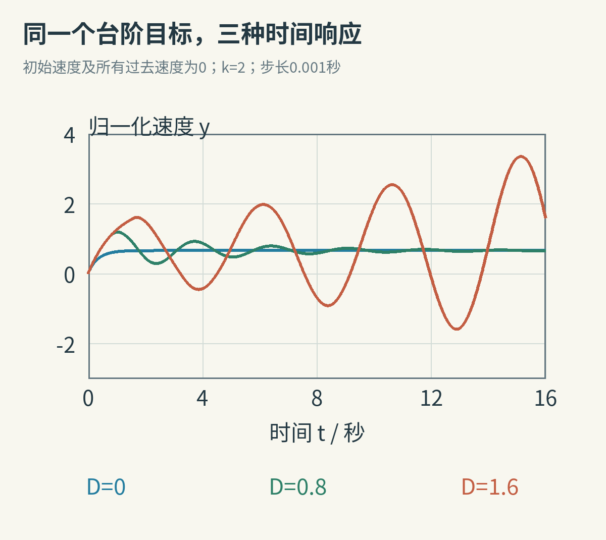

无延迟时速度平稳靠近某个值；0.8秒时先来回摆动，幅度逐渐缩小；1.6秒时起伏逐渐增大。把最后一种单独看到40秒，增长就更明显。

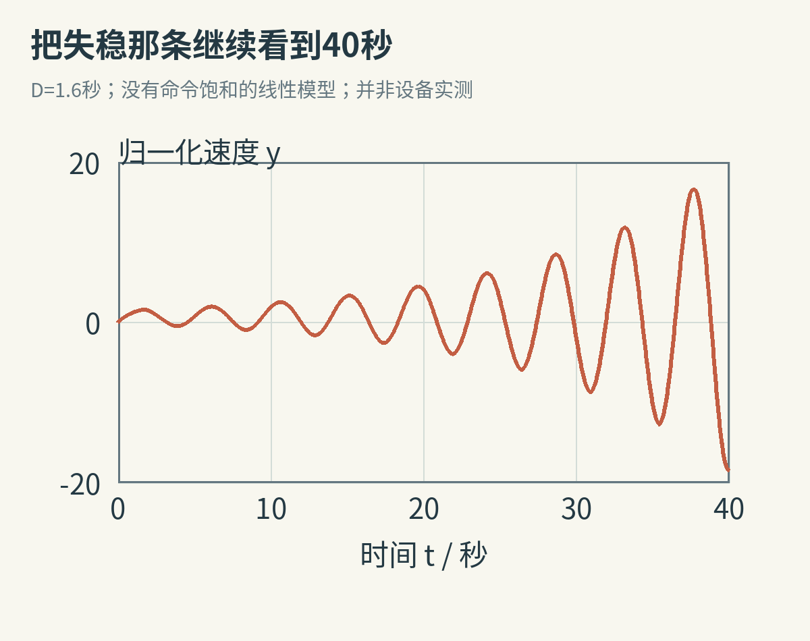

负速度和越来越大的数值，不是在预言真实电机一定倒转到这个速度。我们的模型允许命令无限大、无限小，没有饱和、摩擦变化或保护。真实设备到这种范围通常早就不符合这条简单方程了。图只展示该线性模型自身失去稳定性的结果。

还有一个容易漏掉的细节：稳定的曲线最终靠近2/3，而不是目标1。因为稳态必须满足y=u=2(1−y)，所以3y=2。**稳定意味着偏离不会持续越滚越大，不等于没有稳态误差。**

## 11. 把纠偏力度调小，为什么有用，又付出什么

固定D=1.6秒，把k从2降到1.2。新的交叉频率约0.663 rad/s，变慢了。相同1.6秒延迟在这个更慢频率里占的轮数更少，相位裕度约85.63°，这个模型回到了稳定侧。

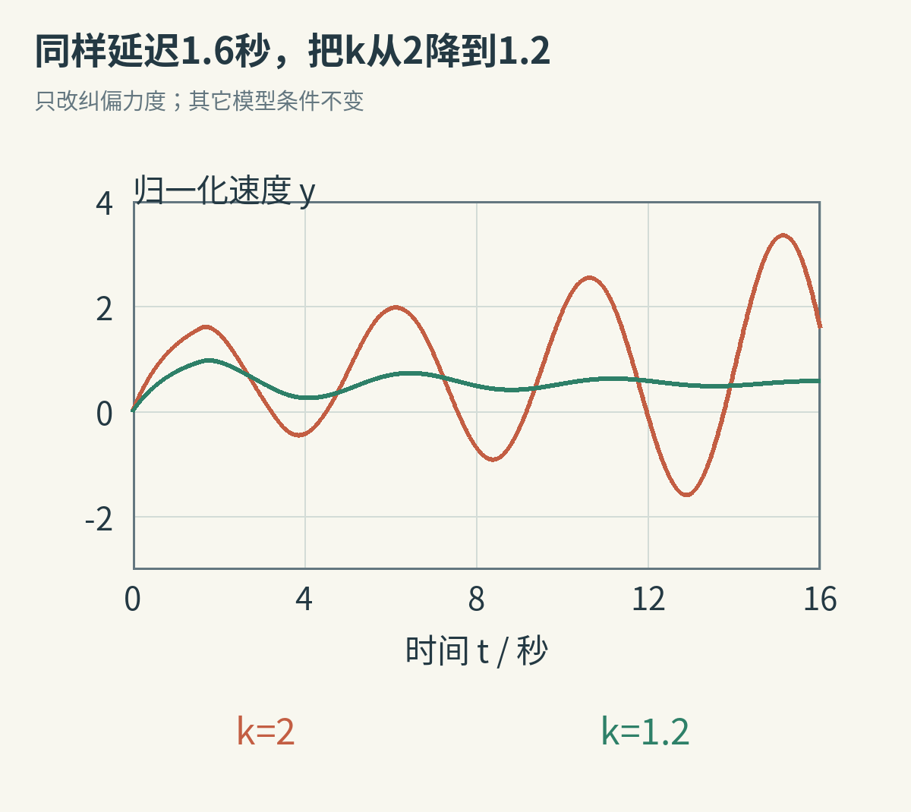

但新的稳态是1.2/(1+1.2)=6/11，约0.545，反而离目标1更远。

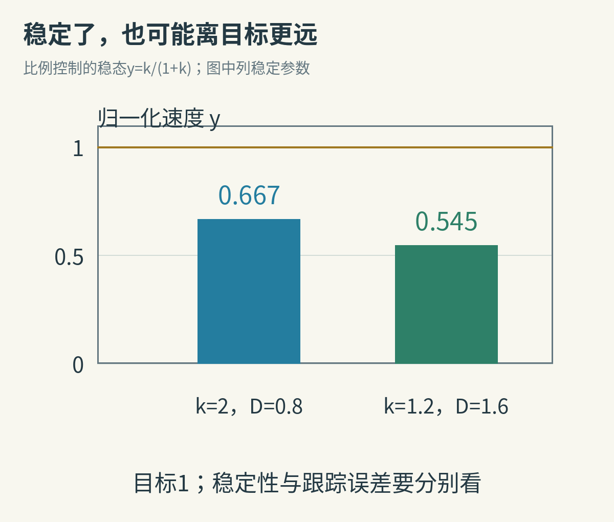

所以“调小一点”并不是免费的万能答案。它在这套比例控制模型里换来了稳定余量，却牺牲了稳态跟踪精度。更完整的控制器还会处理低频误差、噪声、响应速度与饱和；这些目标往往互相牵制。

Bode图的价值，不是自动给出唯一正确的旋钮位置，而是让每次修改付出的代价有迹可循。

## 12. 自己做一个不会冒烟的小实验

[配套Python程序](examples/delay_lab.py)只用标准库，不连接设备。它把模型、延迟位置、零历史和步长都写在开头。

你可以按这样的顺序探索：

1. 先画单个对象的正弦稳态输入和输出，亲手量振幅比、峰值的错位。
2. 固定k=2，改D。观察幅值曲线不动，而相位曲线和时间响应一起变。
3. 固定D=1.6，改k。找回稳定时，也看稳态误差是否变了。
4. 把数值步长减半。若曲线变化很大，先怀疑数值方法，不要急着宣布发现了物理现象。

本文实际做了两类检查。5005组频率组合核对“纯延迟不改幅值”；4004组值把稳态正弦代回原方程。时间轨迹则在4套参数各取161个时刻，用另一条高精度有限解析表达式核对，共644点。步长从0.002减为0.001秒后，误差减小；所查点最大绝对误差约0.000058。它说明这些图上的数值解得到了交叉检查，不是用有限测试替代稳定性理论证明。

最后留一道可以只按计算器的题：仍用k=2的一秒对象，如果在已有系统上再增加0.2秒纯测量延迟，交叉频率不变，它会额外吃掉多少相位裕度？

答案是√3×0.2×180/π，约19.85°。注意答案是一笔额外扣款；原来还剩多少，决定了扣完以后会站在哪里。

从“慢了就加力”走到这里，我们多看见了一层：纠偏的方向写在减号里，纠偏是否赶得上，写在频率与相位里。把这两本账放在一起，才有机会知道一份看似好心的反馈，什么时候会开始帮倒忙。
