# 一束光面对百万个三角形，怎样少问很多问题？

假如你走进一间有一百万件展品的博物馆，想知道：沿着眼前这条直线看过去，首先会撞到哪件展品？

一个诚实但很累的办法是，把每件展品都问一遍，再从所有交点里挑最近的。

计算机也会这样犯愁。游戏里的墙、人物和石头，常常由许多三角形拼成。一条射线可以分别与这些三角形求交。可是，即便“问一个三角形”的程序已经很快，问一百万次仍然是一大笔工作；一幅图还可能需要大量这样的查询。

今天要认识的办法，不是把这百万次询问统统算得更快，而是先寻找一种证据：**哪些问题根本不必问？**

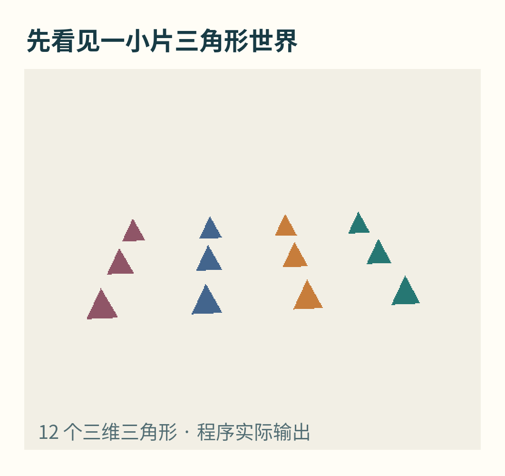

*图1　这张小图由附带的 CPU 射线程序实际生成。它只做首个表面的简单着色，没有多次反弹，也不是游戏帧率测试。我们先把百万个缩成12个，所有账都能亲手查。*

这篇文章的主角叫 **BVH，Bounding Volume Hierarchy，包围体层次结构**。名字很长，核心动作很短：给一组对象套一个外盒；没碰到外盒，就整组跳过；有可能碰到，再往里面问。

如果你读过本系列的路径追踪，那里追问的是“许多随机光路怎样估计亮度”；如果读过 sphere tracing，那里追问的是“距离信息能保证光线安全走多远”。本篇的问题更靠近查找：**给定一条射线和一堆几何对象，怎样少做求交测试，还不丢掉真正的答案？**

你只需要会比较大小、看坐标、理解“并且”。读到代码时还不熟悉 Python 也没关系，前面的纸笔实验可以独立完成。

## 1. 先约定一个可以反复复查的小世界

我们放12个三角形，编号 A 到 L，排成四行三列。

- 三列的起始 x 坐标是 3、6、9
- 四行的中心 y 坐标是 0、4、8、12
- 每个三角形从 z = −0.5 延伸到 z = 0.5

坐标单位暂且叫“模型单位”，不指定米或厘米。

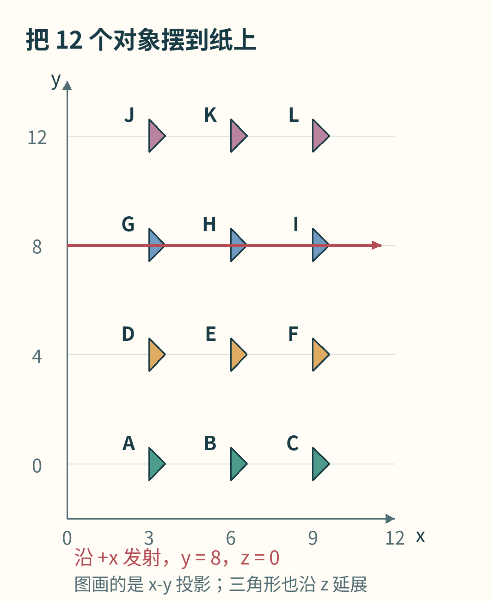

*图2　从 z 方向看下去的投影。真正的三角形在三维空间里倾斜，并不是把射线放在平面三角形内部来凑交点。主射线从 (0, 8, 0) 朝 +x 前进。*

三角形 G 的三个顶点是：

- (3, 7.4, −0.5)
- (3, 8.6, −0.5)
- (3.6, 8, 0.5)

H、I 的形状一样，只向 +x 方向分别平移3和6。其他三行也只是平移。

主射线的起点是 O = (0, 8, 0)，方向是 D = (1, 0, 0)。当参数 t 增加1，它就在 x 方向前进1个模型单位。

暂时不要算所有交点。先猜猜：A 到 F 在 y = 0 或 4 附近，J 到 L 在 y = 12 附近；我们的射线始终保持 y = 8。它们是不是看起来根本不值得逐个问？

“看起来”还不够。程序需要的是一个能够检验的理由。

## 2. 外盒给出的，是一种不会轻易漏人的否定

把一组对象全部装进一个盒子。要求只有一个：**盒子必须包含组里每个对象的全部几何部分。**

现在，一条射线连盒子都没有碰到。

假设它还能碰到里面某个三角形，那么那个交点既属于三角形，也必然属于包含三角形的盒子。这就与“射线没碰到盒子”矛盾了。

所以可以放心地说：盒子没碰到，里面全都没碰到。

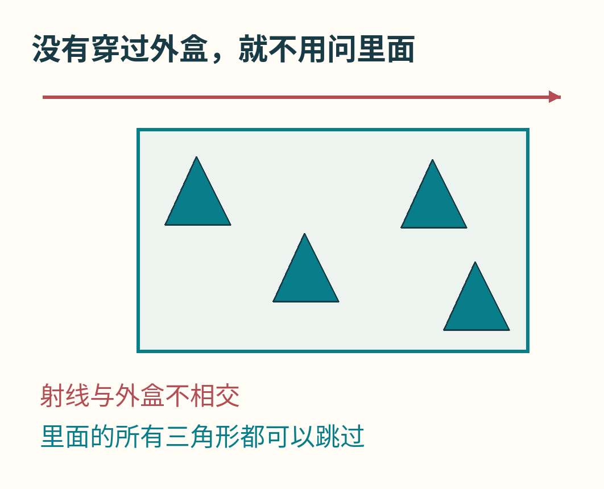

*图3　一次盒子测试，可以替一整组对象作出否定。这是集合包含关系带来的保证，与三角形长得好不好看无关。*

但反过来不成立。

射线碰到了盒子，可能只是穿过盒子内部的空隙。盒子通常比真正对象更“胖”。它只负责说“值得继续看看”，不能直接宣布“撞到了表面”。

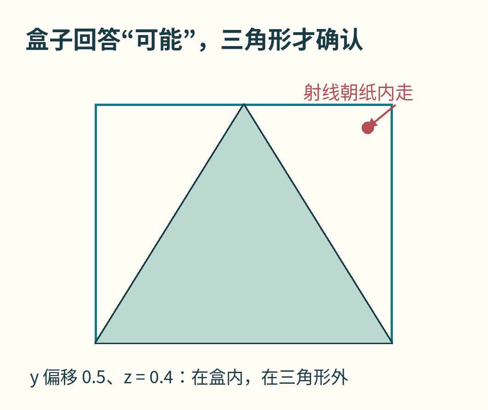

*图4　还是 G：让另一条射线从 (0, 8.5, 0.4) 朝 +x 前进。图画的是 y-z 投影，射线朝纸内走。它会通过 G 的盒子，却不会通过三角形。这是程序也会验证的反例。*

这两种结果很不对称：

- 多放进来几个候选对象，只会让后面的工作变多
- 把真正可能命中的对象排除掉，就会算错

因此，包围体是一道**保守筛选**。这里的“保守”不是速度慢，而是不凭不足的证据删掉候选。

## 3. 最容易计算的盒子：每个方向各记两个数

我们先选一种边始终平行于 x、y、z 坐标轴的盒子，叫 **轴对齐包围盒，AABB**。

对三角形的三个顶点，分别找：

- 最小和最大的 x
- 最小和最大的 y
- 最小和最大的 z

六个数就把盒子确定了。

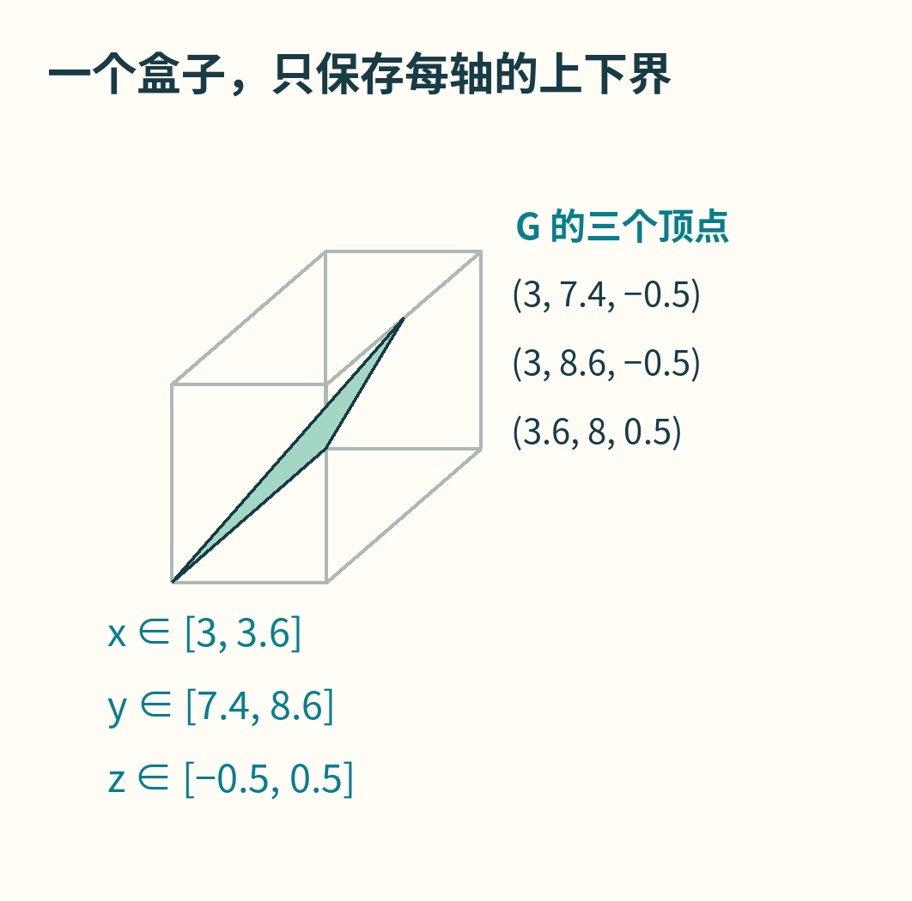

*图5　G 的外盒是 x ∈ [3, 3.6]、y ∈ [7.4, 8.6]、z ∈ [−0.5, 0.5]。轴对齐不表示三角形也必须轴对齐。*

为什么只看顶点就够了？

三角形内部的任一点，都是三个顶点的加权平均：权重不为负，且总和为1。任何一个坐标，都不可能小于三个顶点中的最小值，也不可能大于最大值。

因此，这六个极值确实包住了整个三角形，而不只是三个角。

如果要给 G、H、I 再套一个共同外盒，不必重新问它们的所有顶点。直接把三个小盒合起来就行：下界取更小，上界取更大。

这一行的共同盒子是：

x ∈ [3, 9.6]，y ∈ [7.4, 8.6]，z ∈ [−0.5, 0.5]。

这件事很适合递归：父亲只要包住孩子们的盒子，就包住了孩子们负责的所有对象。

## 4. 如果只套一个大盒子，效果还是不够

假如我们只给全场12个三角形套一个总盒子，主射线碰到了它，后面仍然可能要问12个三角形。

所以，盒子里面还得有盒子。

先把四行分成上下两组；每组分成两行；每行再把三个三角形分成“一份单个、一份两个”；最后拆到单个三角形。

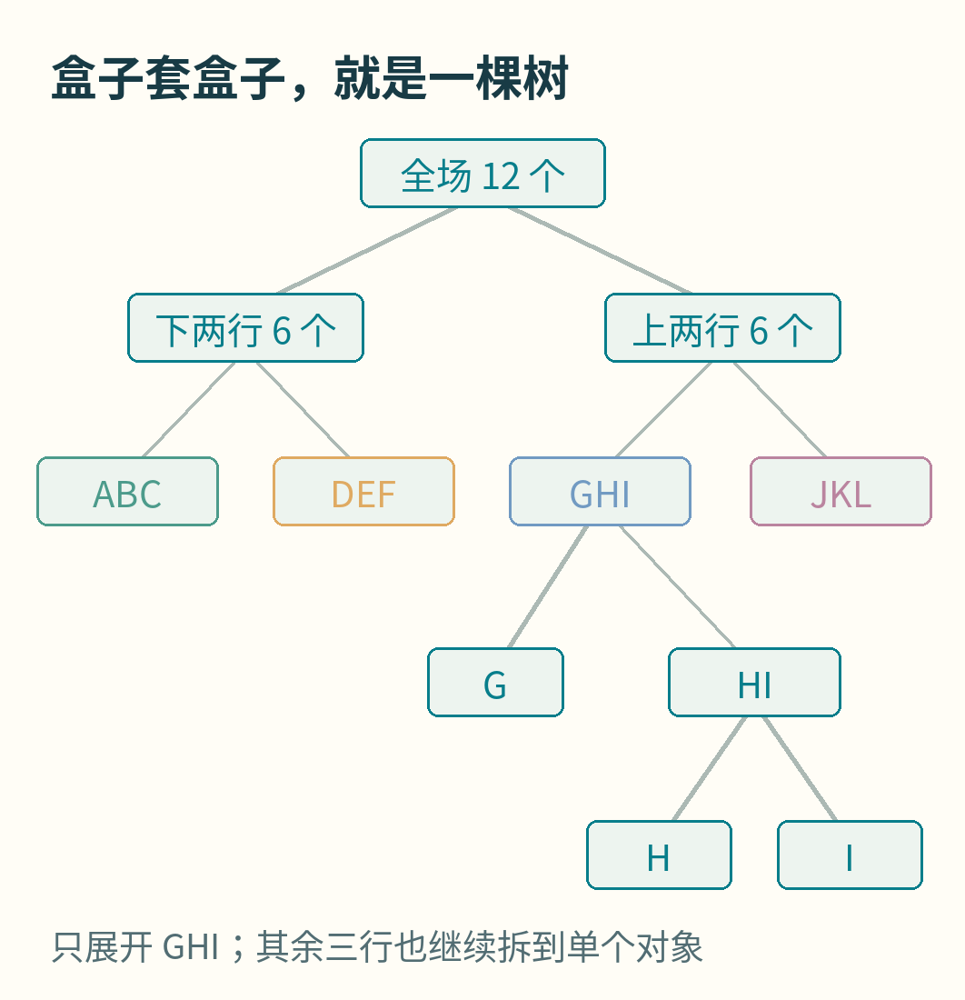

*图6　上半部分展示对象分组，下面只展开 GHI 这一行。其余三行有同样的细分。完整二叉树有12片叶子、11个内部节点，共23个盒子。*

“根节点”就是最外层的总盒子。“叶子”是不用继续分组的末端。这里为了看清原理，每片叶子只放一个三角形；后面会试着多放几个。

树里的一条连线，表示包含关系，不表示空间中的线段。

现在可以把查询写成三句话：

1. 当前盒子没碰到：退回去，这整个分支结束
2. 当前盒子碰到了，而且还有子盒：继续查子盒
3. 当前盒子碰到了，已经到叶子：这才做真正的三角形求交

这里还藏着一个容易混淆的区别。

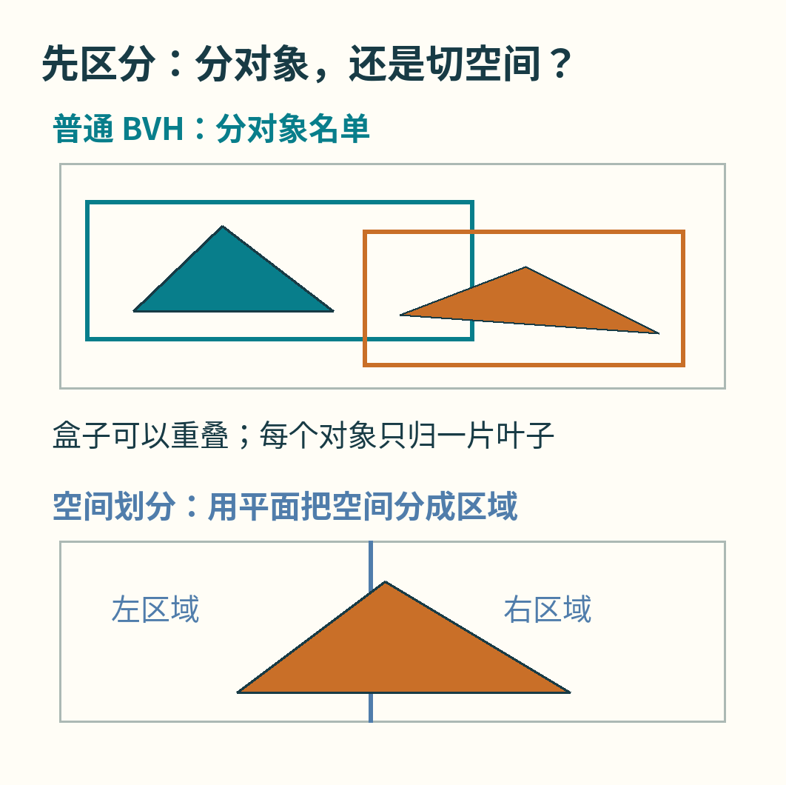

*图7　普通对象划分 BVH 把“对象名单”分组，兄弟盒子允许重叠；空间划分则把空间分成区域。图中只是概念示意，不是 Doom 的具体数据布局。*

我们这棵普通 BVH 中，一个三角形只属于一片叶子。但是，两组的包围盒仍然可能重叠，因为盒子里有空白。

BSP、kd-tree 等空间划分方法，核心组织方式则是用平面把空间切开。跨过分界的对象如何表示，需要另行处理，可能切分对象或保留多个引用。

别把两者归结成“都是树，所以一样”。树只是外形，**每个节点到底负责一组对象，还是一块空间**，才是关键。也确实存在带空间切分的 BVH 变体；“对象只出现一次”是本篇普通对象 BVH 的约定，不是所有名字里有 BVH 的算法都必须如此。[PBRT 第四版的对应章节](https://pbr-book.org/4ed/Primitives_and_Intersection_Acceleration/Bounding_Volume_Hierarchies)给出了这一基本区分。

## 5. 一条射线怎么知道自己碰没碰到盒子？

现在来到整篇最值得动笔的一步。

射线可以写成：

P(t) = O + tD，且 t ≥ 0。

O 是起点，D 是方向向量，t 是沿着这条路线调节位置的参数。

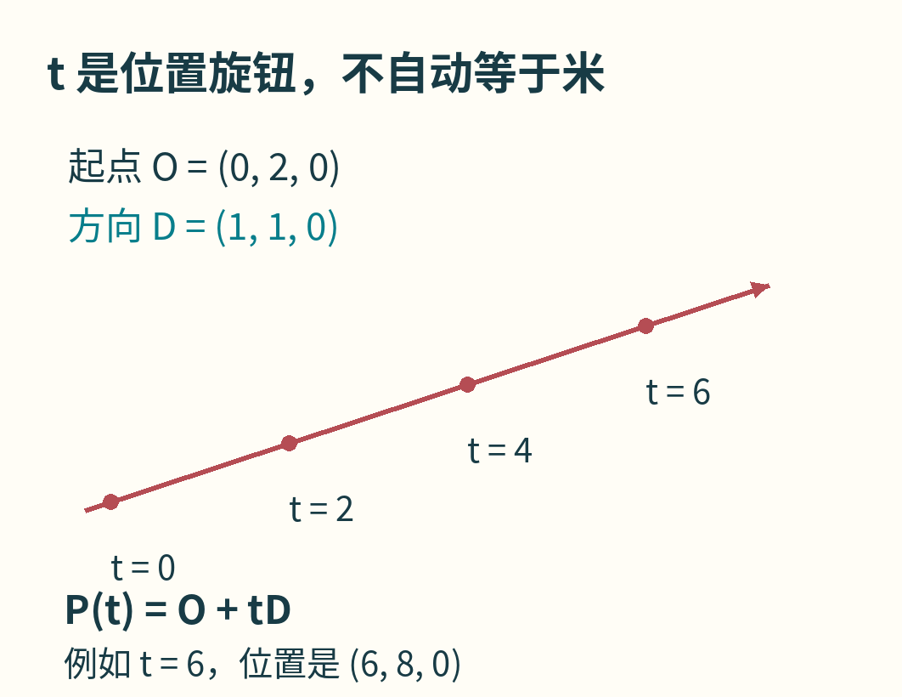

*图8　临时把主射线改成 O = (0, 2, 0)、D = (1, 1, 0)，观察它怎样穿过 GHI 行盒。此时 D 的长度是 √2，所以 t 不是实际走过的距离；距离等于 t√2。*

先只看 x。

这条射线的 x(t) = 0 + t。GHI 行盒要求 3 ≤ x ≤ 9.6，所以：

**只有 t ∈ [3, 9.6] 时，x 这一关才通过。**

再看 y。

y(t) = 2 + t。盒子要求 7.4 ≤ y ≤ 8.6，因此：

7.4 ≤ 2 + t ≤ 8.6。

两端都减去2，得到：

**只有 t ∈ [5.4, 6.6] 时，y 这一关才通过。**

最后看 z。

z(t) 始终是0，而盒子的 z 范围是 [−0.5, 0.5]。这一关一直通过。

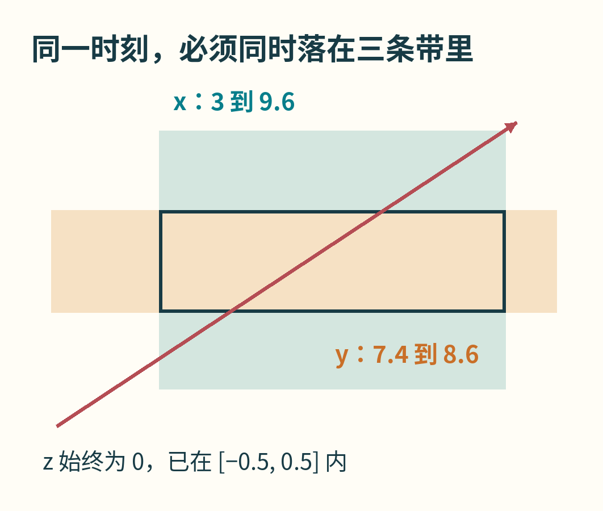

*图9　两张平行平面夹出的空间叫一条 slab，可以理解成无限延伸的“厚板”。三维轴对齐盒是三条厚板的共同部分。此图为结构示意，不按坐标等比例绘制。*

注意，不能说：“x 在某个时候通过了，y 在另一个时候通过了，所以碰到了盒子。”

必须是**同一个 t，三个坐标都在各自范围内**。

因此，把这三个允许区间取交集。

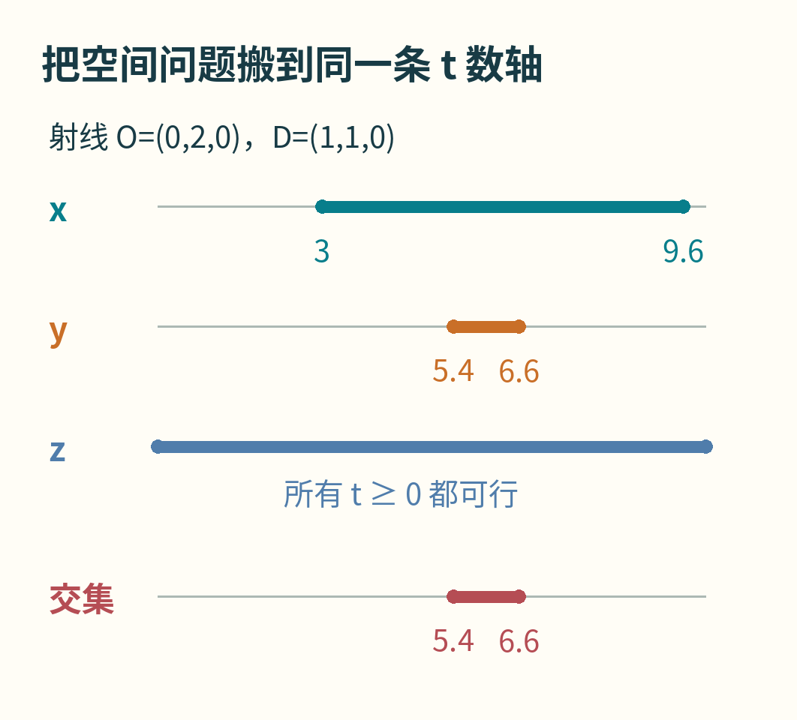

*图10　[3, 9.6] 与 [5.4, 6.6] 的共同部分是 [5.4, 6.6]。所以这条斜射线从 t = 5.4 进入该盒，在 t = 6.6 离开。通过盒子仍不保证通过三角形。*

现在，三维几何题变成了小学生也能操作的区间题：

- 进入时间，取各轴进入时间里最晚的那个
- 离开时间，取各轴离开时间里最早的那个
- 如果最晚进入已经晚于最早离开，就根本没有共同停留时间

这就是常见的 slab 射线—盒相交思路。[《Ray Tracing: The Next Week》的 BVH 章节](https://raytracing.github.io/books/RayTracingTheNextWeek.html#boundingvolumehierarchies)也从这一组区间出发；本篇的坐标、手算与实现边界另行明确如下。

## 6. 最短的公式，往往把边界藏了起来

如果某一轴的方向分量不是0，可以求出射线穿过两张边界平面时的参数：

t0 = (下界 − 起点坐标) / 方向分量。

t1 = (上界 − 起点坐标) / 方向分量。

可是，直接把这两行扔进程序，还缺几件事。

### 方向是负的，要先排顺序

让射线从 (12, 8, 0) 朝 −x 走。对于 GHI 的 x 范围 [3, 9.6]，两张边界算出来的参数是9与2.4。

较小的2.4才是进入，较大的9才是离开。不要把“坐标较小的一面”误当成“先碰到的一面”。

### 方向是0，要单独判断

主射线一直保持 y = 8。它的 y 方向分量是0。

- 如果8在当前盒子的 y 范围内，y 这一轴不会阻拦它
- 如果8在范围外，怎么向 +x 前进都没用，可以直接排除这个盒子

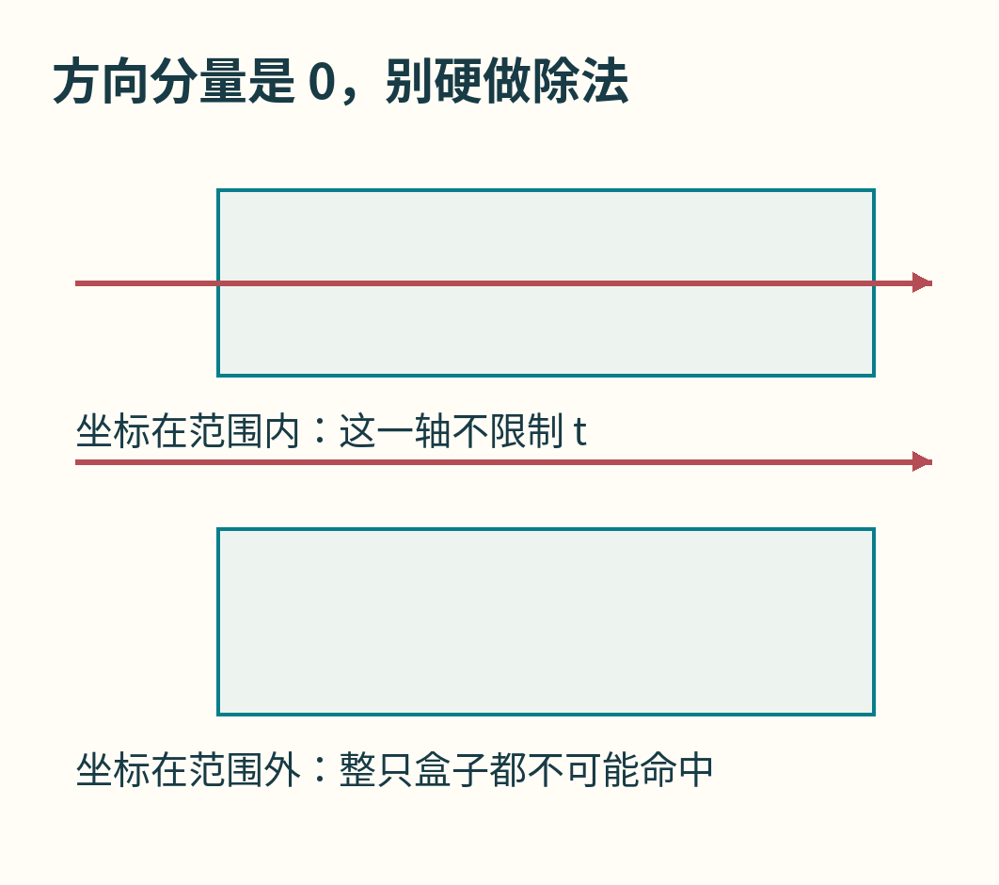

*图11　不必让程序计算 0/0 再期待它自己变聪明。这个教学实现明确写出平行分支，也把 −0.0 当作0处理。*

### 起点在盒子里面，不用退回过去

如果数学上得到区间 [−2, 5]，而我们只允许 t ≥ 0，就保留 [0, 5]。负 t 是射线背后的延长线，不是这次查询的前方。

### 只擦到边界，要统一约定

两个区间恰好只在一个点相接，比如 [0, 1] 与 [1, 2]，共同部分是 [1, 1]。

本篇把包围盒当作闭集，允许这样的单点接触。因此，只在“进入参数 > 离开参数”时拒绝，不能随手改成“≥”。

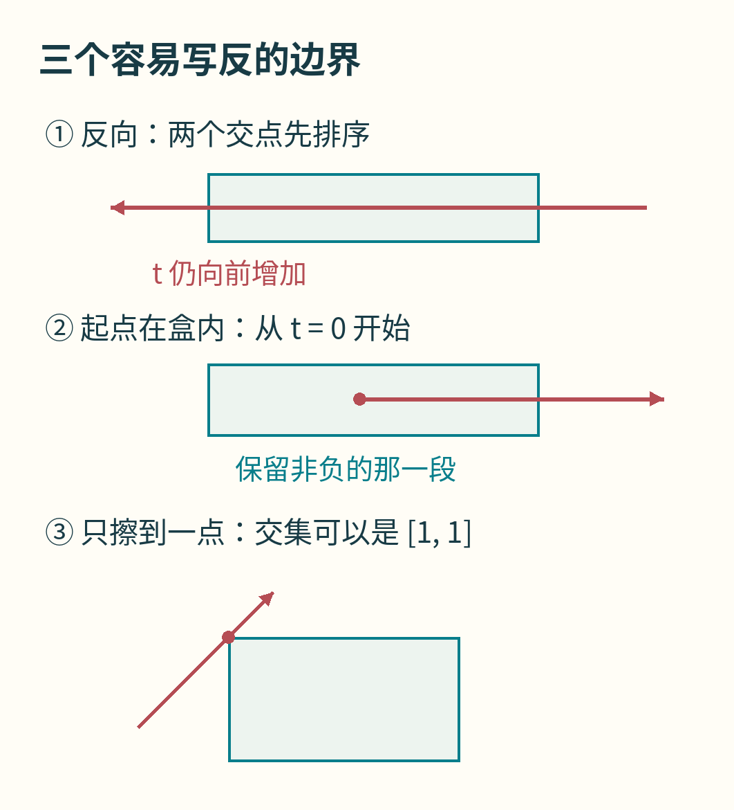

*图12　第三种图里，线只接触矩形的一个角。是否承认三角形上的最终边界命中，也必须和真正的求交程序配合。*

下面是一份可以直接运行的盒子测试。输入用有限数值，方向向量至少有一个非零分量；输出是仍然允许的参数区间，或表示没碰到的 None。

```python
from math import inf

def hit_box(o, d, lower, upper,
            near=0.0, far=inf):
    for k in range(3):
        low, high = lower[k], upper[k]
        if d[k] == 0.0:
            if o[k] < low or o[k] > high:
                return None
            continue
        a = (low - o[k]) / d[k]
        b = (high - o[k]) / d[k]
        near = max(near, min(a, b))
        far = min(far, max(a, b))
        if near > far:
            return None
    return near, far
```

试试 `hit_box((0, 2, 0), (1, 1, 0), (3, 7.4, -0.5), (9.6, 8.6, 0.5))`，它应返回 (5.4, 6.6)。

这段代码是为了让边界规则清楚。它不是对所有坐标尺度都已证明可靠的工业几何内核；浮点舍入的影响，后面还会单独说。

## 7. 跟着主射线，把账一本一本勾掉

回到 O = (0, 8, 0)、D = (1, 0, 0)。

先不使用“已经找到近处交点”的额外优化。只用“盒子没碰到，整组排除”。

- 总盒子通过，继续
- 下两行盒子的 y 范围最高只到4.6，射线保持 y = 8，所以 A 到 F 一起排除
- 上两行盒子通过，继续
- GHI 行盒通过，JKL 行盒排除
- 往 GHI 里面走，G 的盒、HI 的盒，以及 H、I 的盒都通过
- 到叶子，才真正问 G、H、I

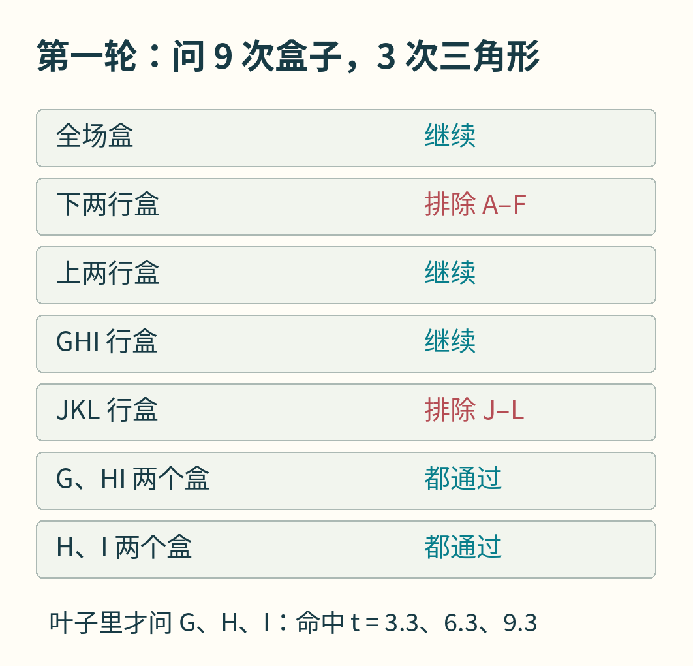

*图13　每行是一组测试动作，不是每行恰好一次测试。总盒1次，上下两组2次，两行2次，G与HI共2次，H与I共2次：合计9次盒测试。*

真正的三角形交点也可以手算。

G 的两个底部顶点都在 z = −0.5，顶部顶点在 z = 0.5。当 z = 0 时，正好走到上下的一半，截出一条短线段：x = 3.3，y 从7.7到8.3。

主射线的 y = 8 落在线段内部，所以确实命中 G，参数 t = 3.3。同理，H 与 I 的交点是6.3和9.3。

结果和逐个问12个三角形相同；不过，精细的三角形求交从12次变成3次。

是不是已经快了4倍？**还不能这么说。**

因为它额外付了9次盒测试。盒测试与三角形测试的成本不同；还要算访问节点、维护待查列表等工作。我们现在证明的是“问的问题变少了”，还不是“整机运行时间恰好缩成四分之一”。

## 8. 已经碰到近处的东西，远处就更容易排除了

如果目标是“最近命中”，还可以再省一次大步。

一开始，把当前最近参数记成无穷大。每次找到真正的三角形交点，就把这个记录缩小。

主射线先碰到 G，得到 t = 3.3。此时 HI 盒子的入口最早也是 t = 6。

无论 H、I 的三角形在盒子内部怎样摆，都不可能在进入盒子之前被碰到。因此，它们不可能比3.3更近。

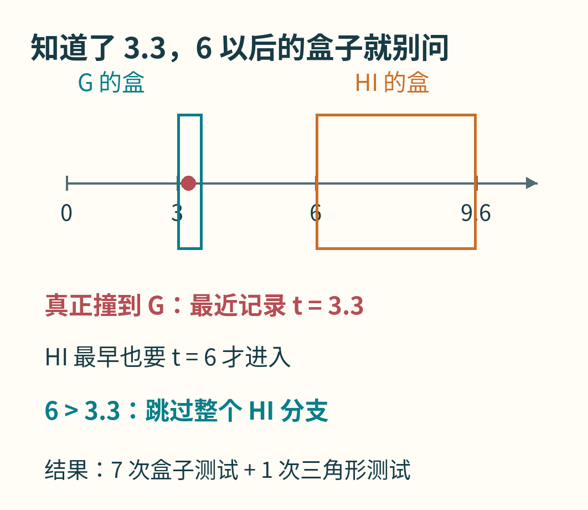

*图14　比较的是“盒子的最早可能入口”和“已经确认的三角形交点”。盒子的入口本身不是表面命中。*

于是，访问顺序就值得讲究了：如果两个子盒都通过，通常优先访问入口参数较小的一个。先找到近处答案，便更早获得剪掉远处分支的机会。

附带程序用一个栈保存待查子树。可以把栈想成一摞待办便签：要先看的放在最上面；拿出便签时，再看它保存的入口是不是已经晚于最新的最近交点。

这次实验的账单是：**7次盒测试、1次三角形测试**。最终仍然命中 G，t ≈ 3.3。

这里计数很严格：为了排列孩子顺序做的盒测试，也记入账单；已经存好的入口拿来比较，不再算一次盒求交。没有把“排序时偷偷问过的盒子”从统计里抹掉。

那么，是不是只要碰到任何三角形就能停止？

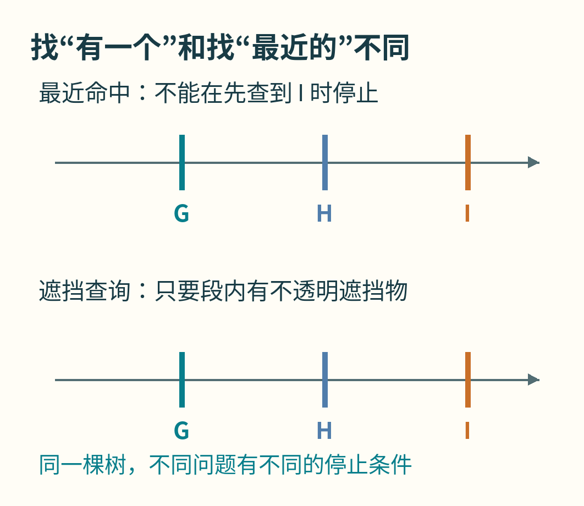

*图15　如果遍历顺序先查到远处的 I，最近命中查询仍不能结束；但只问一段路上“有没有不透明遮挡”，可能已经有了足够答案。*

这里有两种不同问题：

- **Closest hit：最近命中是谁？** 需要维护最小参数，并继续排除所有可能更近的候选
- **Any hit：指定范围内有没有命中？** 找到一个符合条件的交点，就可以结束

在简单的硬阴影判断里，若我们只关心着色点到光源之间有没有不透明遮挡，任意一个有效遮挡物就足够。但光源后面的东西不算，透明或需要过滤的表面也不能一概当作最终遮挡。

实验把三角形列表倒过来遍历时，“任意命中”先找到 I，t ≈ 9.3；“最近命中”最后仍返回 G。两个答案都可以正确，只是回答的问题不同。

## 9. 谁来决定，哪些三角形装进同一个盒子？

手工画12个三角形还行。百万个对象当然不能一组一组凭感觉挑。

一个容易实现的自动办法是：

1. 取每个对象的中心位置
2. 选一根坐标轴
3. 按这一轴的位置排序
4. 从中间把名单分成两半
5. 对每一半重复，直到满足叶容量要求

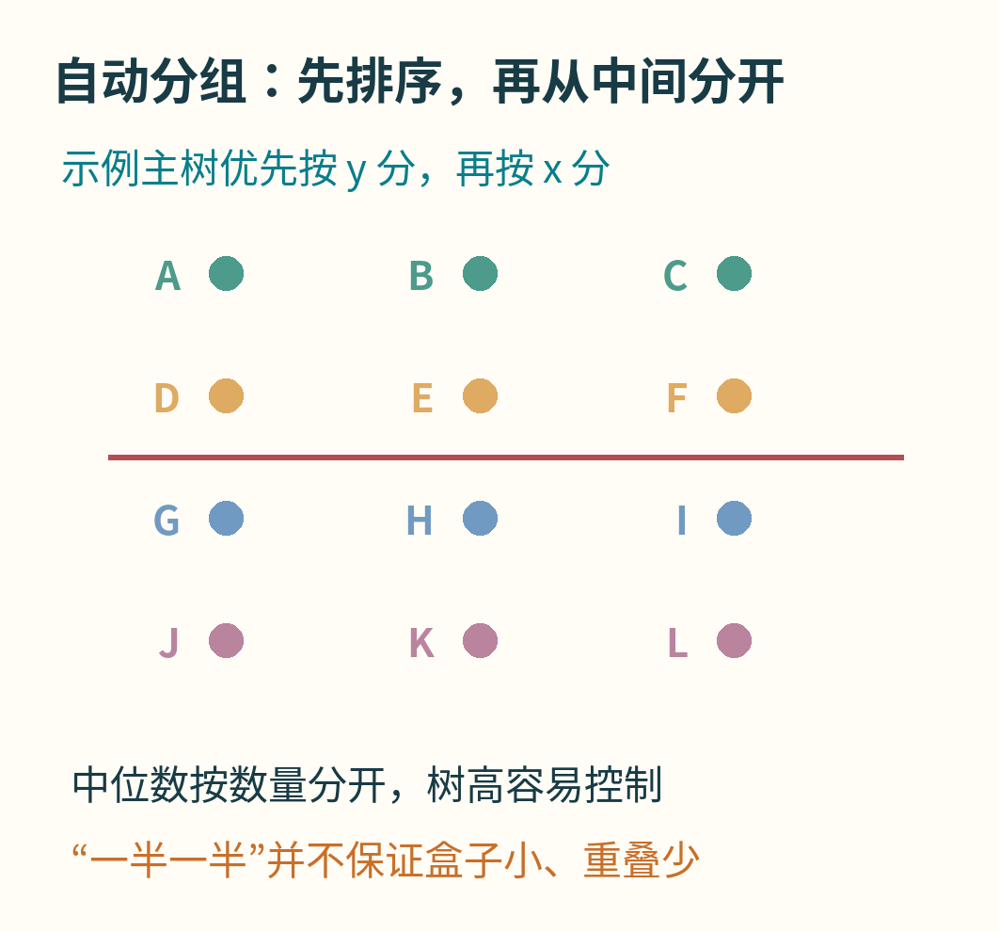

*图16　本篇主例为了与纸笔树一致，优先按 y 分；同一行再按 x 分。更一般的实验默认选中心分布跨度最大的轴。两种规则都写在程序里，没有拿一棵树的图去解释另一棵树的计数。*

按数量平分，树不容易变成“一根很长的链子”。但“树高不大”并不等于“查询一定省事”。

来做一个有点坏心眼的反例：把12个相同三角形重叠在同一位置。无论怎样分名单，左右两边的盒子都一样大。

再把射线放在图4那个位置：穿过盒子，却落在三角形外。

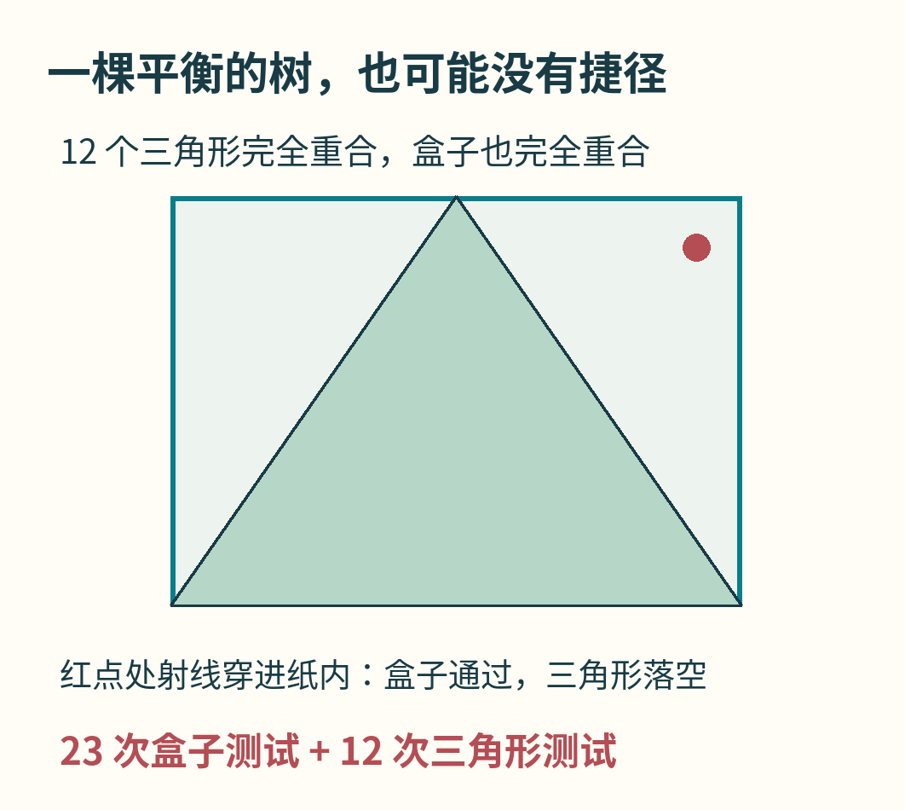

*图17　每层都无法排除候选，又始终找不到可缩短查询范围的真命中。实验访问了全部23个盒子，最后仍问完12个三角形。*

这棵树完全可以很平衡，却比直接问12个三角形多了一堆工作。

所以，不要背下“BVH 查询就是 O(log N)”然后结束。树高可以是对数级，而一条射线仍然可能进入许多分支。**普通 BVH 查询在坏例中可以退化到线性数量的对象测试；遍历整棵树也可能发生。**

还有一个实现细节：如果所有对象中心相同，按“中心是否小于某个阈值”分组，可能一边为空，递归永远不变小。附带程序即便中心相同，也通过稳定排序后的数量中点把名单分开。

## 10. 不只看人数：能不能提前估计一次划分值不值？

人数一样多的两组，有的盒子紧凑，有的横跨整个场景。后一种大盒子更容易被射线碰到。

于是可以给划分算一笔**预测成本**。

设父盒为 P，两个子盒为 L、R。用 A 表示表面积，N 表示各组对象数。一个常用形式是：

预计成本 ≈ 访问内部节点的成本

＋ A(L)/A(P) × 左边对象数 × 测一个对象的成本

＋ A(R)/A(P) × 右边对象数 × 测一个对象的成本。

这叫 **表面积启发式，SAH**。名称中的“启发式”很重要：它不是预知所有未来射线的水晶球。

为什么会出现表面积？对方向与位置满足特定均匀假设的射线模型，凸包围体被穿过的相对机会与表面积有关。于是表面积比可以拿来估计“已经到父盒的射线，还会走进这个子盒多少次”。实际相机射线、从表面发出的反射射线，都可能偏离这些假设。

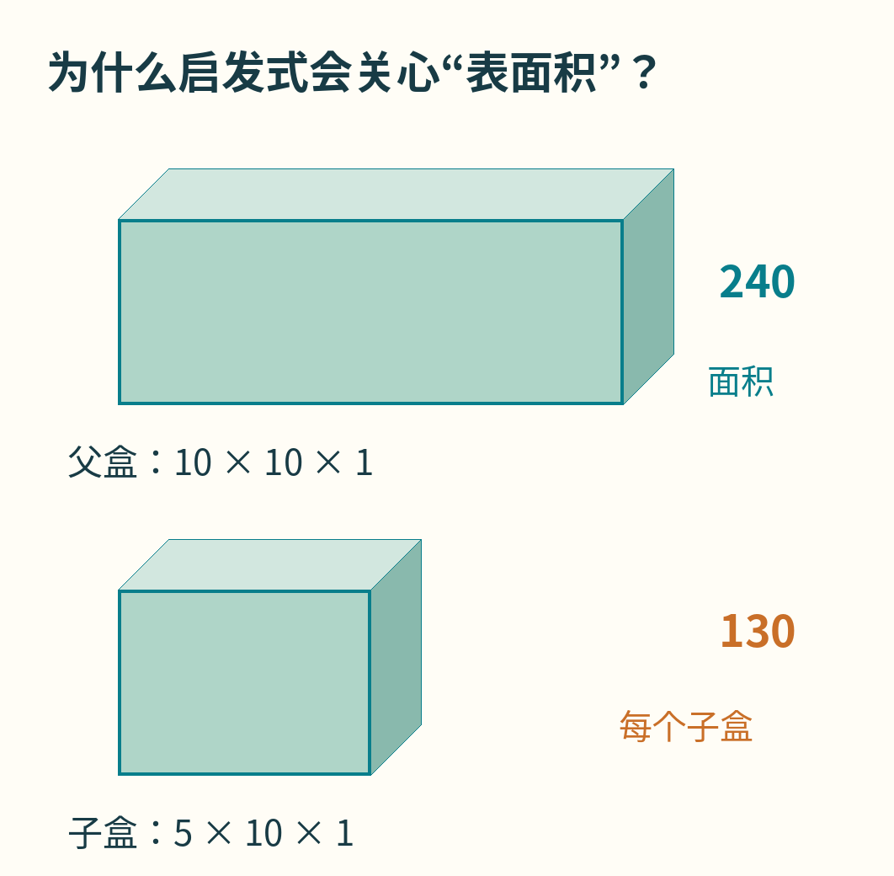

*图18　换一个专为心算设计的盒子：父盒尺寸10×10×1，表面积为 2×(100+10+10)=240。沿第一轴对半切，每个子盒5×10×1，表面积为 2×(50+5+10)=130。这不是主例的真实分组；盒子示意不按等比例绘制。*

假设父盒里有12个对象，切开后每边6个。为了方便演算，暂把“访问内部节点”的成本与“测一个三角形”的成本都设为1。

- 不切：直接问12个对象，成本估计为12
- 两个小盒：1 + (130/240)×6 + (130/240)×6 = 7.5
- 两个盒子都与父盒一样大：1 + 6 + 6 = 13

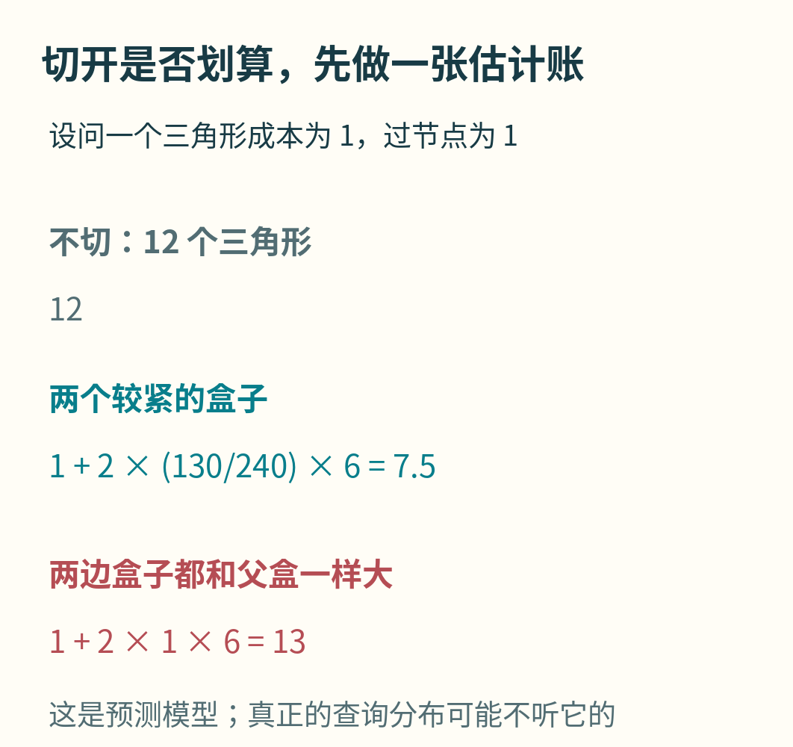

*图19　这个简化模型会偏向7.5的划分，拒绝成本13的划分。这里的1是人为设定的成本单位，不是本机测得的纳秒。*

你可能注意到，130/240 + 130/240 大于1。

这不矛盾：一条射线可以先穿过左盒，再穿过右盒，“走进左边”和“走进右边”不是互斥事件。不能把这两个数当成抛硬币的正反面概率。

真正实现 SAH 时，还得决定尝试哪些划分位置、怎样快速算各侧边界、何时停止细分。可以把对象中心放进若干桶，累计桶内数量与包围盒，再比较桶边界处的候选划分。[Ingo Wald 的2007年论文](https://www.sci.utah.edu/~wald/Publications/2007///FastBuild/download//fastbuild.pdf)讨论了快速构建这一问题。

本篇附带程序没有冒充 SAH 构建器：它实现的是更容易检查的中位数划分，SAH 数字只是这一节的独立心算模型。

## 11. 叶子里到底放一个，还是放几个？

拆得很细，可以让包围盒更贴近各个对象；但节点也会变多，查询需要做更多盒测试。

拆得很粗，问盒子的次数少了；但一旦进入叶子，又得逐个问里面较多的三角形。

这是一种真实的交换，不存在一个对所有机器、对象、射线都最好的固定叶容量。

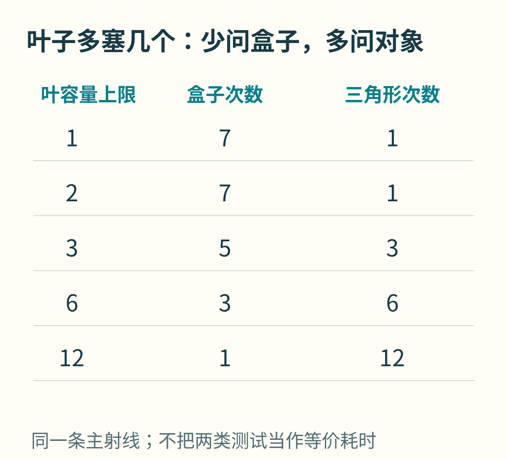

*图20　实际运行主例，并保留最近命中优化。容量上限2不表示每片叶子恰好装2个；所以这一条射线的结果可以与容量1相同。*

在这个极小例子里：

- 容量1：7次盒子、1次三角形
- 容量3：5次盒子、3次三角形
- 容量6：3次盒子、6次三角形
- 容量12：1次盒子、12次三角形

哪一个最省实际时间，需要看两类测试成本以及内存访问等因素。只把“7+1”和“5+3”加起来，宣布两者一样快，也是不严谨的。

进一步实现时，节点是一个个指针连接的对象，还是压成连续数组？一批射线能否一起处理？分支是否整齐？这些都会影响硬件执行。但它们并不改变最初那个正确性条件：每个父盒必须包住自己的全部后代。

## 12. 把实验扩大一些，观察省下的问题往哪里去了

附带程序把相同形状的三角形扩展成更大的网格，分别得到12、192和3072个三角形。

每个场景都发射256条朝 +x 的射线，y 对准某一行的中心，z = 0。行数不够256时按行循环取样。这是一组**刻意规整、容易命中前排**的查询，不是假装代表任意游戏场景。

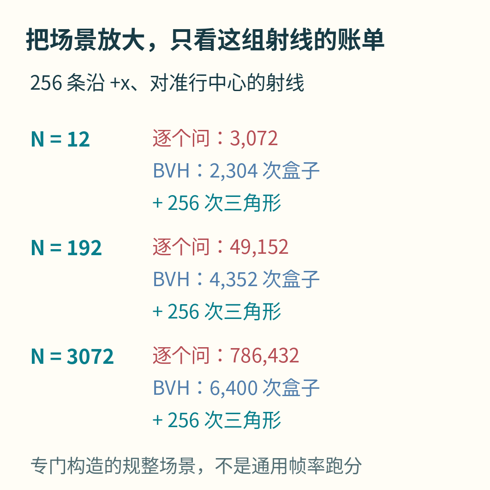

*图21　这里换用“中心跨度最大轴”的自动中位数构建规则，因此12个三角形时的盒测试也不等于主树的7×256。完整输入与结果由实验脚本生成。*

实际计数如下：

- 12个三角形：暴力方案共3072次三角形测试；BVH 为2304次盒测试、256次三角形测试
- 192个三角形：暴力方案共49152次三角形测试；BVH 为4352次盒测试、256次三角形测试
- 3072个三角形：暴力方案共786432次三角形测试；BVH 为6400次盒测试、256次三角形测试

在这组场景和射线中，物体变多以后，BVH 多付出一些沿树找路的工作，却仍然能在每条射线上很早找到最前排的那个三角形。

这里没有报告“加速了多少倍”。测试次数可以复算，运行时间还受到语言、实现、机器、缓存与负载影响。这个纯 Python 教学程序也没有模拟某块 GPU 的专用单元。

一个好实验应该让你更准确地描述现象，而不是给你一个可以到处宣传的巨大倍数。

## 13. 三角形动起来以后，树必须全部重建吗？

设想三角形各自移动，但对象数量与分组关系暂时不变。

最便宜的修补方法似乎很自然：先重新计算叶子包围盒，再从下往上，令每个父盒重新包住子盒。这个过程叫 **refit，重新贴合边界**。

只要新的盒子正确包含对象，这棵树仍然能够回答查询。

可是，原先的好邻居可能搬到很远；原先互不交错的两组，可能现在混在一起。

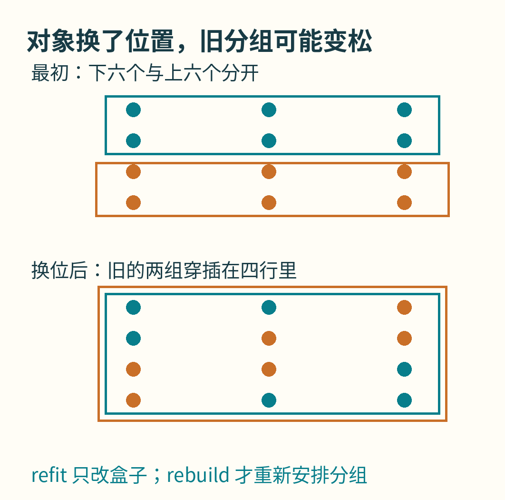

*图22　青色、橙色表示“旧树中属于哪一组”，不是物体材质。实验把12个对象置换到原来的12个位置，因此场景占据的位置集合不变，变化的是对象身份与旧树分组的对应关系。*

为了单独暴露分组问题，我们让12个对象按固定置换交换位置。所有新位置仍来自原来的那12个位置。

然后比较：

1. 原始场景与原始树
2. 换位后的场景，保留旧树结构，只 refit
3. 换位后的场景，重新按位置建树

三种情况都使用同一组113条射线：从 x = 0、z = 0 出发，y 从 −1 到13，每隔0.125取一条，统一朝 +x。

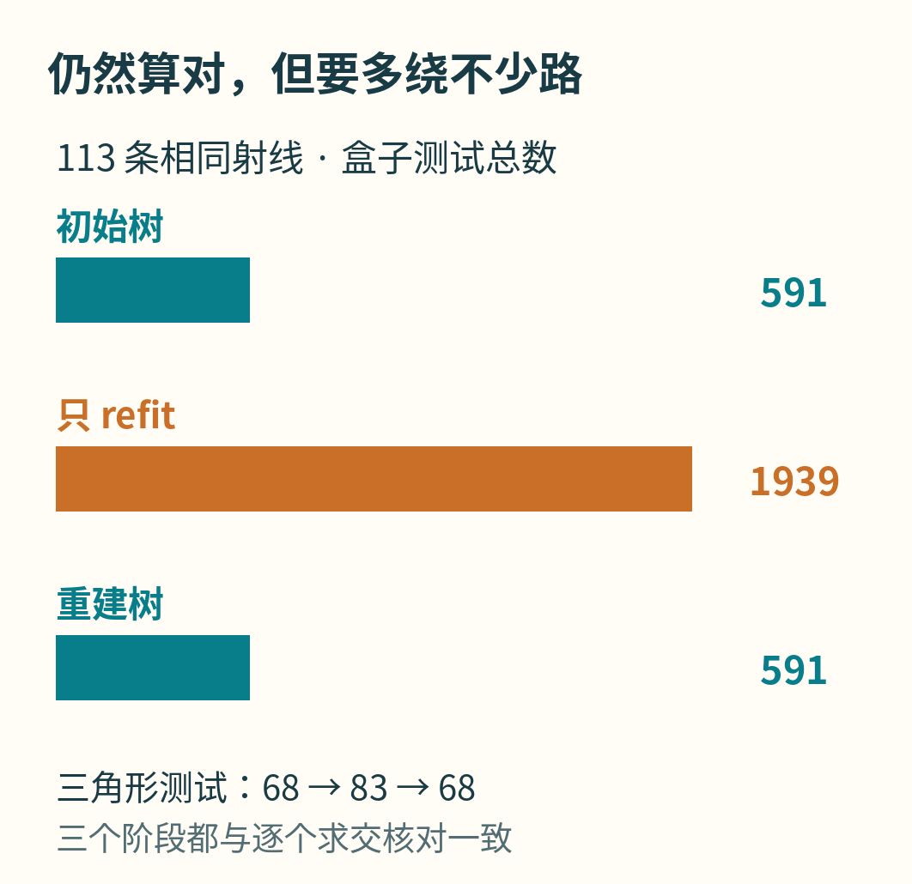

*图23　初始591次盒测试；只 refit 后1939次；重建后回到591次。三角形测试分别为68、83、68次。三种情况下都只有20条射线真正命中，并逐条与暴力查询核对。*

refit 没有“坏掉”：它没有漏掉答案。变差的是筛选能力。

这也解释了为什么运动场景经常需要在更新和重建之间取舍：小幅运动时保留树可能很划算；长时间、大范围或破坏原邻近关系的变化，可能让旧树越来越松。

这里的实验没有测量构建时间，所以不能直接从591与1939算出“多少帧以后就一定该重建”。那还缺一笔账。

## 14. 别只盯着查询时间，树也不是天上掉下来的

把总工作粗略拆开：

**总工作 = 构建工作 + 射线数 × 每条射线的查询工作。**

如果一个场景要接受数百万次查询，花更多时间造一棵质量好的树可能值得。若对象每一小步都变化、每次变化后只查询几次，昂贵的构建可能来不及赚回成本。

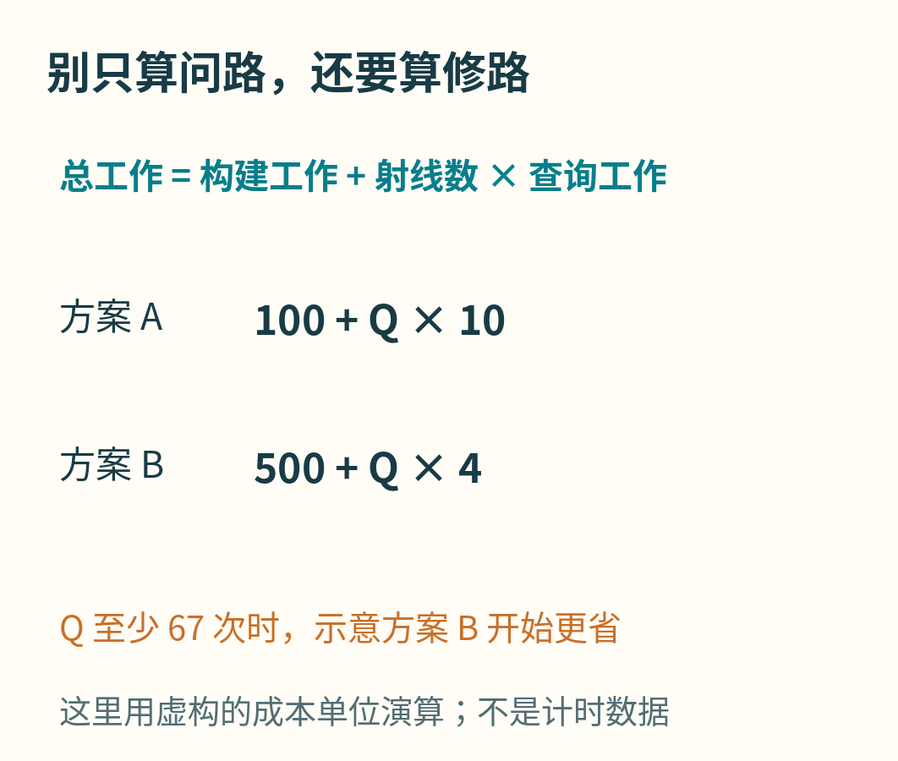

*图24　这是人为设定的成本模型：A 为100+10Q，B 为500+4Q。解不等式可得 Q > 400/6，因此整数查询数至少为67时，B 才更省。它不是实测时间。*

“先造一棵好树”与“快速造一棵还不错的树”，都是合理目标。哪一个更重要，取决于你接下来要做多少查询，以及场景多久变化一次。

顺便核对一个经常被简写掉的复杂度：附带的中位数构建器在每一层重新排序子列表。平衡情况下，这个参考实现的构建工作上界是 O(N log²N)，不应因为树高为 O(log N)，就把构建也直接写成 O(N log N)。更好的选择、划分与排序复用，可以改变构建成本；本实验没有实现它们。

## 15. 一个会漏交的“快算法”，通常不算成功

到这里，我们一直在减少工作。现在暂时把速度放到一边。

最值得害怕的错误，是盒子由于实现问题比真实对象小了一点。哪怕只小一点，也可能把本来擦到边界的真命中提前删掉。

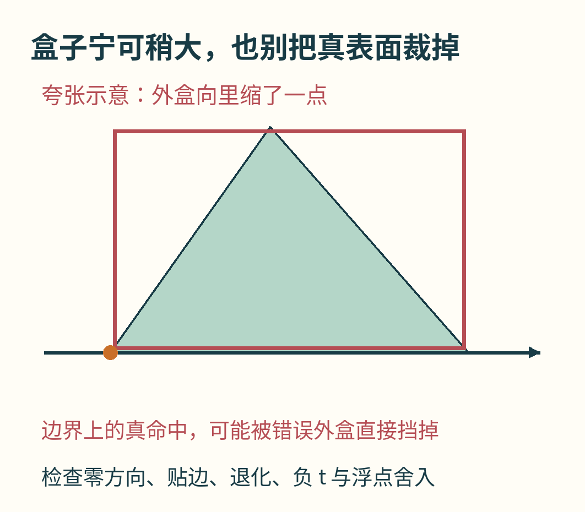

*图25　为便于看清，向内收缩被夸张画出。盒子大的主要代价是多问；盒子小到不再包含对象，代价可能是错误的答案。*

实际工程还要考虑：

- 浮点运算会舍入，算出的进入与离开参数可能略有偏差
- 三角形可以很薄、很大、很小，甚至退化成线段或点
- 变换后的包围盒，要包含变换后的全部对象，不能只变换原来的“最小角”和“最大角”就想当然地结束
- 如果对象在快门时间内移动，某一时刻的盒子不一定包住整个时间段的位置
- 从表面发射的新射线，怎样避免把出发面误当成新的遮挡，也需要明确定义

正文的盒子函数明确处理了零方向、反向、盒内起点与闭区间。附带三角形函数用双精度浮点和一个固定的近平行阈值，采用双面求交，不剔除背面；共面射线和退化三角形不会被它当作普通的孤立交点报告。

这些是教学实现的定义与限制，**不是“已经对一切病态输入防漏”的证明**。特别是固定阈值会受尺度影响；生产环境需要更严格的保守边界与数值分析。也不要把“BVH 与暴力结果一致”误读成“它们共用的三角形求交函数绝不可能同时出错”。

因此，验证必须不止一种。


*图26　随机种子为20261012。20,000条射线分别测试三种遍历设置，共60,000次与暴力结果比较；另有10,000次使用不同三角形算法的核对。这些已实际运行，仍只覆盖规定输入范围。*

这里把测试分成了三个层次：

1. **树的不变量检查。** 每个节点的边界与它负责的全部对象重新计算后的并包一致；每个对象恰好出现在一片叶子
2. **遍历检查。** 随机射线分别运行“近处优先并缩短范围”“固定顺序并缩短范围”“近处优先但不缩短范围”，结果都与暴力查询一致
3. **独立几何检查。** 对普通随机案例，另外用“先求射线与平面的交点，再用点积算重心坐标”的算法，与主要三角形函数核对

另有平行、负零、贴面、起点在盒内、盒子在身后、恰好角接触、同距离命中、空树与退化三角形等专项检查。

要注意：随机案例中多数射线会落空，随机测试也很难替你主动制造最刁钻的浮点边界。专项测试和数值论证仍然不可少。

## 16. 这不是为今天的显卡临时发明的技巧

把候选对象组织成层次，是一条很早就开始的路线。

1980年，Steven M. Rubin 与 Turner Whitted 的论文《A 3-Dimensional Representation for Fast Rendering of Complex Scenes》讨论了用层次包围体组织场景的表示方法。原文的包围体可以旋转；其终端表示也不是本篇“叶子里放一个三角形”的简单版本。论文还描述了辅助建立层次的编辑器，以及建好层次与后续显示成本之间的交换。这篇论文自身也讨论了更早的相关工作，因此不宜把整条研究路线缩成“某人在某年突然发明了今天所有 BVH”。[原论文的作者上传全文](https://www.researchgate.net/publication/215506194_A_3-dimensional_representation_for_fast_rendering_of_complex_scenes)

2007年，Ingo Wald、Solomon Boulos、Peter Shirley 的《Ray Tracing Deformable Scenes Using Dynamic Bounding Volume Hierarchies》把问题推进到可变形场景：保持层次拓扑、更新包围体，是其中的重要组成部分；论文还包括成组射线遍历等技术。不能把它的全部效果都归给“改几个盒子”。[作者机构的论文记录与原文入口](https://www.sci.utah.edu/~wald/Publications/2007/#BVH)

2012年，Tero Karras 研究了如何更充分地并行构造 BVH、八叉树与 kd-tree 所需的树结构。如果只有树底下很多任务能并行，树顶只有一两个任务，GPU 的许多执行资源仍会闲着。论文针对这种构建并行性提出了二进制基数树方法。[NVIDIA Research 原论文](https://research.nvidia.com/sites/default/files/pubs/2012-06_Maximizing-Parallelism-in/karras2012hpg_paper.pdf)


*图27　这是依据论文制作的原创时间线，不是历史照片。这里只挑三个与本篇问题相关的节点，不表示完整历史，也不声称三项工作都在解决完全相同的问题。*

这些研究的有趣之处，是问题在不断变化：

最初要问，复杂对象怎样装进计算机能处理的层次？

后来要问，对象动起来，这个层次还能保留多久？

再后来要问，查询已经很快了，能不能让“造树”本身也充分并行？

一个好想法很少只有一句公式。它通常会随着对象规模、运动方式、机器结构，一次又一次被重新安排。

## 17. 留一扇门：把三维附近关系变成一条队伍

如果你对“GPU 怎么造树”很好奇，可以先抓住一个入口：**排序**。

二维坐标 x、y 写成二进制后，可以把两者的位交错起来，得到一个整数。例如，本图约定最低位先放 x，再放 y。4×4格子便得到0到15的编号。

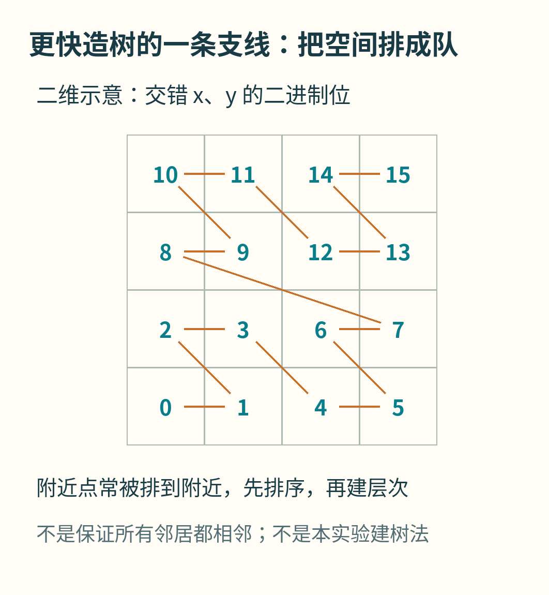

*图28　这叫 Morton 顺序，也常被称作 Z-order。图是独立生成的二维入门示意；实际三维再加入 z 的位。*

先按这些编号排序，很多空间上靠近的对象就会在列表中相邻或接近。再根据编号的共同前缀组织层次，便可以把“空间分组”连接到“整数排序与前缀树”。

这也有局限：编号相邻不意味着空间距离一定小，空间最近邻也未必在列表里紧挨着；对象的中心接近，更不保证完整包围盒紧凑。重复编号还需要规则处理。

Karras 的论文给出了一条并行构造路径，但不应把“用了 Morton 编码”“用了 GPU”“树一定最好”画成三个等号。本篇没有实现这一构建器，图28只负责告诉你下一扇门开在哪里。

## 18. 现在轮到你：让程序回答你自己的怀疑

完整的 [实验程序 bvh_lab.py](examples/bvh_lab.py)只依赖 Python 标准库；运行说明、输入范围与预期结果见[实验说明](examples/README.md)。代码单独使用 MIT 许可。

在实验目录运行：

`python bvh_lab.py --output results.json`

如果还想生成图1的原始图像，再加：

`python bvh_lab.py --output results.json --render scene.ppm`

输出会写出全部12个三角形的坐标、主射线的访问记录、边界检查、坏例、换位实验和规模实验。PPM 是简单的图像文件格式，宽480、高400；渲染使用192000条相机射线，没有随机采样。

下面几个问题，值得先猜，再改，再运行：

**第一题：把主射线的 y 从8改成10，会怎样？**

提示：它仍会穿过某些高层盒子的空白，但不必进入所有叶子。不要只盯着总盒是否命中。

**第二题：把所有盒子人为放大10倍，会不会算错？**

在扩大仍正确包含对象、有限范围处理无误的前提下，几何答案不该因此改变。但剪枝可能大幅变差。反过来缩小盒子，可就不能保证正确了。

**第三题：保留同一棵树，交换左右孩子，会不会改变最近答案？**

正确遍历应仍得到同一个最近距离；测试次数可能变化。如果有等距离对象，还需要明确稳定的选择规则。本程序用对象名字打破参数完全相等的平局。

**第四题：为何坏例选“盒子通过、三角形落空”，而不让射线穿过重叠三角形中央？**

如果很快找到近处真交点，最近命中优化仍可能帮忙。要暴露重叠盒带来的浪费，落空射线能避免这个额外帮助。

**第五题：把叶容量从1改成3，在哪一组射线里变得划算？**

先分别记录盒测试与三角形测试，再考虑是否需要计时。不要提前把你想得到的答案塞进成本权重。

最后，把今天的核心压成三句话：

**外盒提供排除证据；层次让一次排除影响许多对象；已经确认的近处交点，让远处候选也能整组退出。**

BVH 没有让光改变路线，也没有让三角形消失。

它做的是，把“我还不知道答案”逐步变成“至少，这一大群已经不必再问”。

---

原创正文与本篇原创教学图按 CC BY 4.0 提供；实验代码另按 MIT 许可。第三方资料保留各自权利，未获得的原图不冒充已收录。完整出处、事实范围、素材处理与 AI 辅助说明见 [sources.md](sources.md)。
