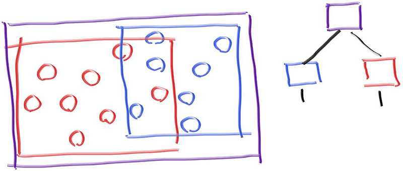
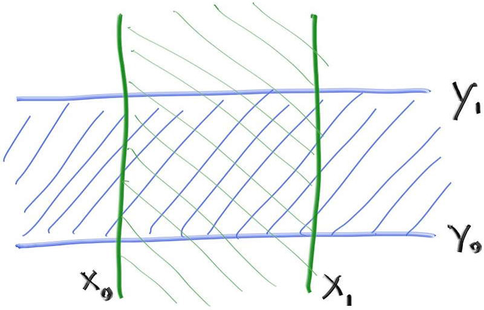
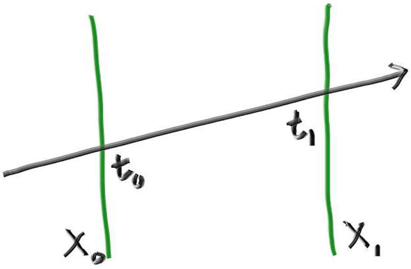
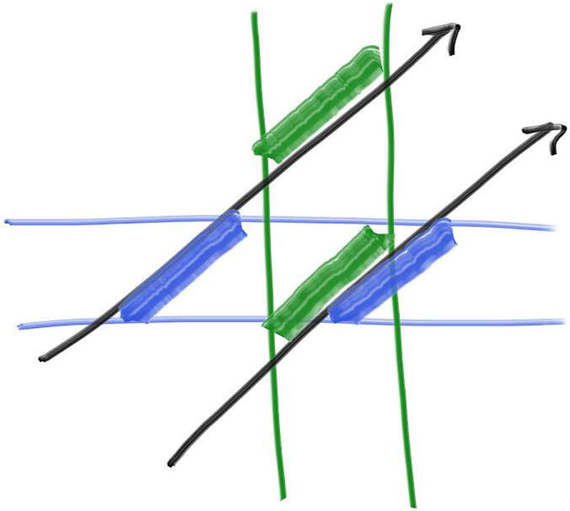

# 官方BVH原图附册

本页收录《Ray Tracing: The Next Week》BVH章节中全部4幅相关正文信息图。书籍作者：Peter Shirley、Trevor David Black、Steve Hollasch。出处为[官方原章](https://raytracing.github.io/books/RayTracingTheNextWeek.html#boundingvolumehierarchies)；[官方系列首页](https://raytracing.github.io/)明确将书籍按CC0提供，完整原许可见[rt-COPYING.txt](assets/source/rt-COPYING.txt)。

以下是官方原URL取得的原始JPEG字节，没有裁剪、重绘、改色、压缩或放大；不是本篇原创图，也不另行改成CC BY 4.0。页面上的中文解释是为方便对照另写的图注。正文28幅原创教学图保持独立。

## 1. 两层包围关系

紫色外框包住两个子组，右侧小树表达同样的层次关系。红、蓝包围体可以重叠；层次包围不要求把空间切成互不相交的区域。这与正文“对象分组不等于切开整个空间”的区别对应。

原图800×340像素。[官方原文件](https://raytracing.github.io/images/fig-2.01-bvol-hierarchy.jpg)。

## 2. 二维盒子是两个方向条带的交集

绿色竖线之间约束x坐标，蓝色横线之间约束y坐标。同时满足两项条件，才在二维矩形中。原图手写标记保持原样；蓝色上下线的下标只是两个边界的名称，不要从手绘上下顺序推断本文数值轴的大小方向。

原图800×512像素。[官方原文件](https://raytracing.github.io/images/fig-2.02-2d-aabb.jpg)。

## 3. 把空间中的两次穿越换成射线参数

从空间的两条边界，得到射线上进入和离开的两个参数。正文另行讨论负方向交换、方向分量为0和闭区间接触，不能把这张非平行示意图当成已经覆盖全部边界情况的代码。

原图800×523像素。[官方原文件](https://raytracing.github.io/images/fig-2.03-ray-slab.jpg)。

## 4. 两个条带区间是否有共同部分？

上方那条射线分别经过两条带，却没有同时位于两条带中的参数段，所以错过矩形。下方那条射线的蓝、绿参数段存在共同部分，才通过二维盒子。这正是“每个方向分别通过”仍不够，还要取区间交集的原因。

原图800×717像素。[官方原文件](https://raytracing.github.io/images/fig-2.04-ray-slab-interval.jpg)。

[回到正文](read.md) · [全部来源与实验边界](sources.md)
