# 两个线程改不同变量，为什么还会互相拖慢？

假设一款游戏有两个工作线程。线程A统计这一帧处理了多少颗子弹，线程B统计处理了多少个粒子。

A只改自己的计数器x，B只改自己的计数器y。它们没有争着给同一个数字加一，统计结束后才把结果交给主线程。看起来，最该避免的冲突已经避开了。

可是，“程序里不同的变量”不一定等于“硬件里互不干扰的东西”。

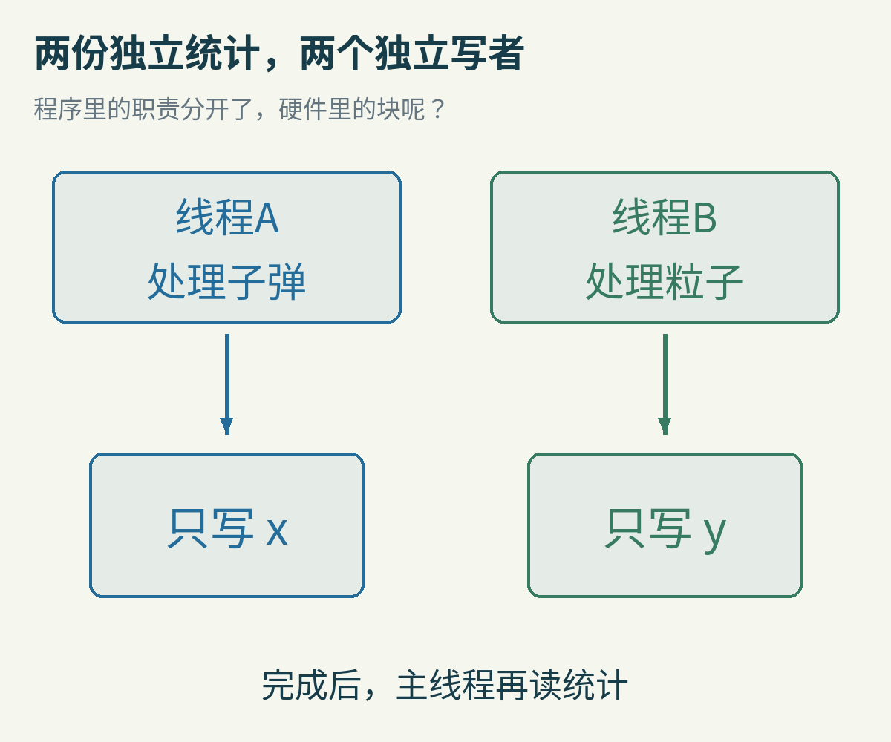

这不是某款游戏的真实跑分，而是我们接下来要逐步搭建的模型。我们会算出：同样八次写入，为什么一种安排要申请八次写权限，另一种只要两次。

这里真正来回交接的，也许不是你关心的那个数字，而是装着它的一整块数据。

## 1. 先看看，两个变量到底住在哪里

CPU核心执行程序，缓存则保存近期用过的数据副本。访问近处已有的副本，通常比向更远的存储层取数据更便利。

今天只看两个核心，各有自己的私有缓存。线程A固定在核心A，线程B固定在核心B。先不考虑线程迁移、预取、缓存容量不足、同时发生的请求和其他缓存层。

这些限定很重要：它们让我们先看懂一件事，而不是假装一张简图已经画出了整颗现代处理器。

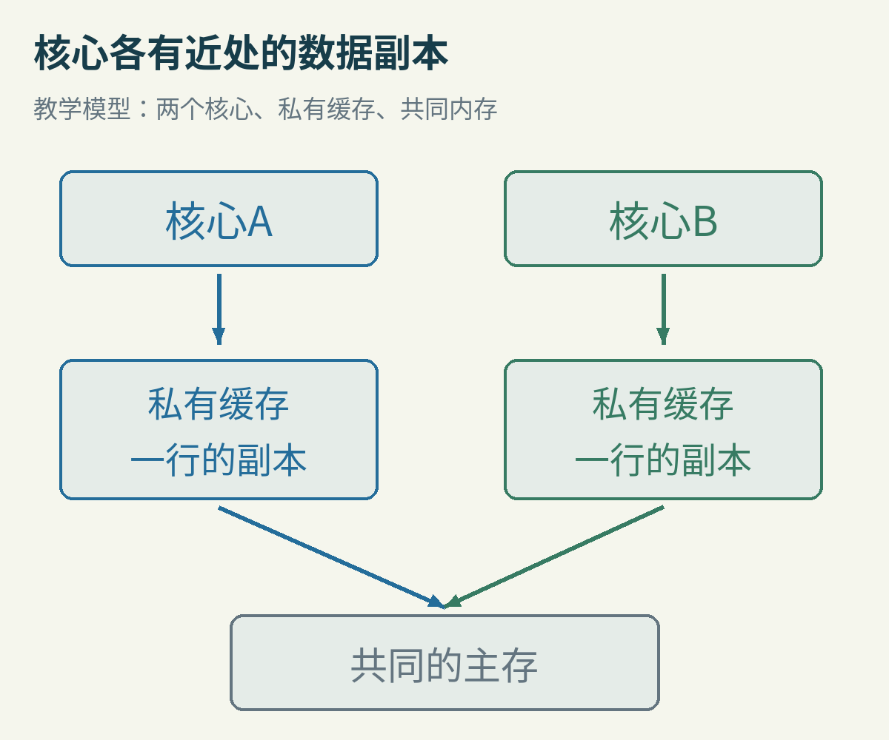

缓存往往按固定大小的块管理数据。这样的块叫缓存行，英文是cache line。

本稿规定一行64字节，x、y各占8字节。64是这个实验的设定，不是所有处理器永久不变的常数。

再给它们安排具体的物理字节地址：x放在1024至1031，y放在1032至1039。地址1024恰好能被64整除，因此这一整行覆盖1024至1087。

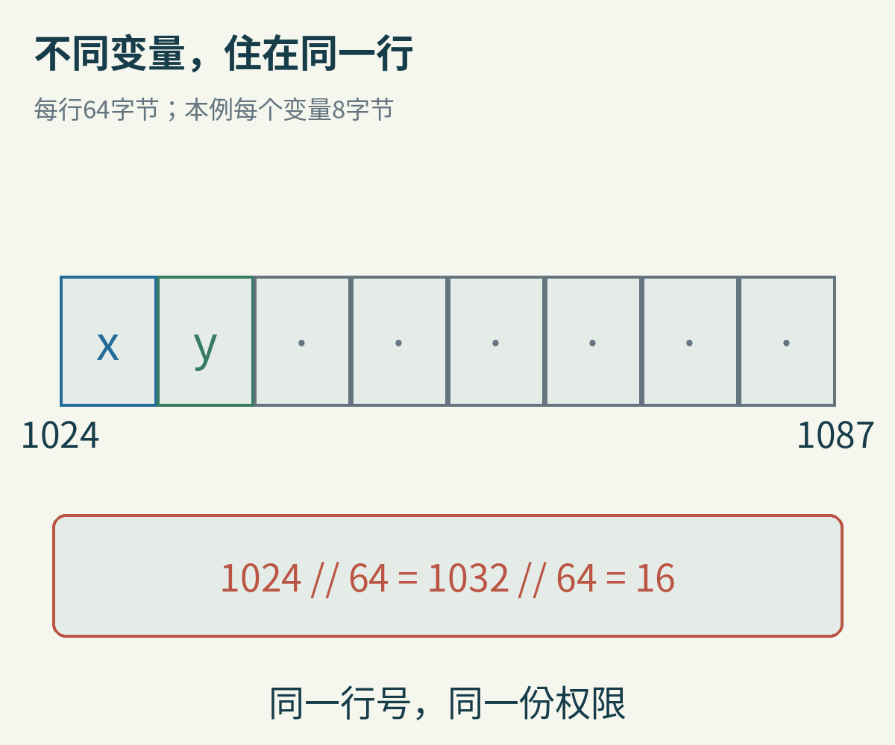

判断某个字节属于哪行，只需做向下取整的整数除法：行号=地址//64。

1024//64=16，1032//64也等于16。不同的变量，确实住在同一行。

注意我们说的是物理地址上的这个模型。Python变量在内存中的实际位置没有由这些数字决定；此前虚拟内存文章里的地址翻译，也是另一个层面的问题。

## 2. 有了副本，就得回答“谁还能写”

假如两个缓存各自保存了一份x=0。A把自己的副本改成1，B仍拿旧副本当最新值，程序就可能出错。

一种解决思路是：允许许多人同时保留可读副本；但当某个核心要修改这一行时，先让其他副本失去使用资格，再由它独占写权限。

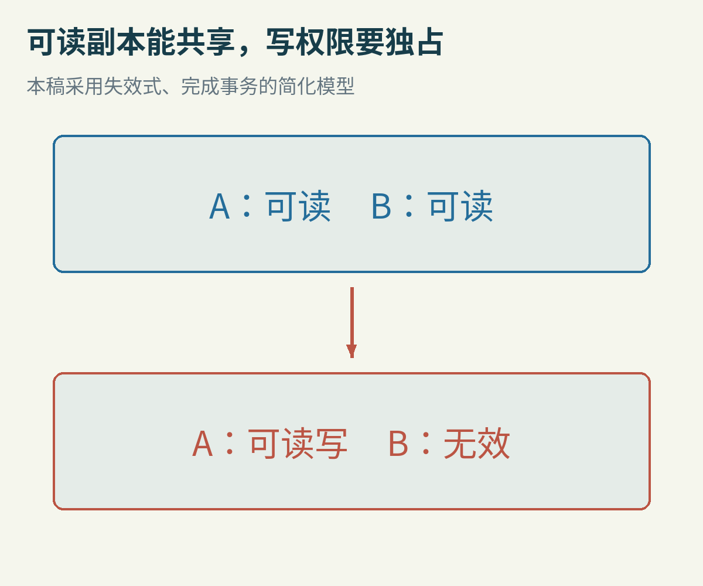

这里的“失去资格”，不一定意味着把缓存里的每个比特擦成零。硬件可以给那份副本标一个无效状态：那些旧比特就算还在，也不能直接拿来回答下一次读取。

同时，交接权限时还必须交接正确的数据。只做到“没有两个写者”，却把上一个写者刚算出的结果丢了，一样不正确。

可以先把缓存一致性理解成两件配合的事：管住副本的使用权限，并让最新的数据沿交接过程传下去。这个解释针对本文的失效式协议模型；真实系统还存在其他设计。

## 3. 1984年的问题，也不只是“有没有缓存”

1984年，伊利诺伊大学的Mark S. Papamarcos和Janak H. Patel发表了一篇研究多处理器私有缓存的论文。

他们面对的是共享一条分时总线的系统：多个处理器要经过同一条通路通信。缓存能让处理器少去挤这条通路；如果维护缓存副本又产生大量额外通信，省下的好处就会被吃掉。

论文的一个关键区分是：这一块数据是否还被其他缓存持有？如果本来就只有自己有，后续修改还有没有必要一次次通知别人？[1984年原论文](https://web.csl.cornell.edu/courses/ece5750/papamarcos.isca84.pdf)

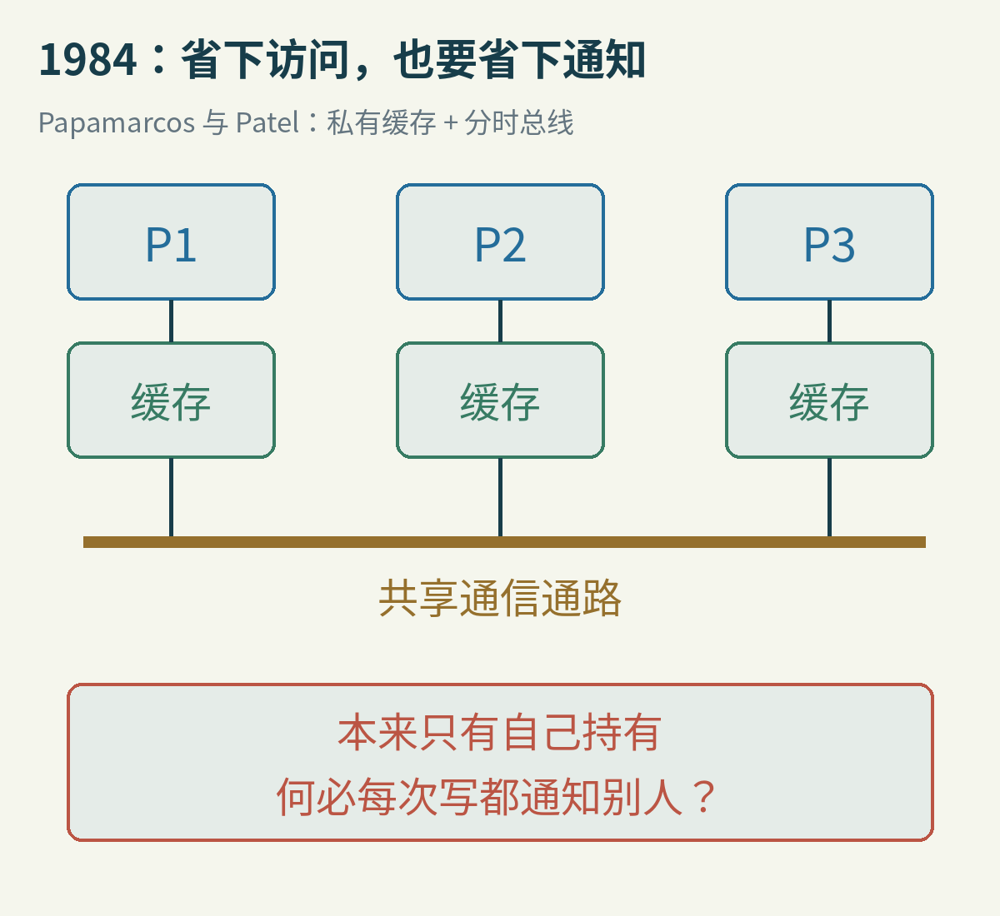

这是依据问题重新绘制的教学图，不是历史机器照片，也不是原论文图的复制。论文使用的四种状态名称是无效、独占未修改、共享未修改、独占已修改。我们接下来使用今天常见的简写I、E、S、M来解释相应的稳定状态。

不要把这段历史误读成“现代多核都接在1984年的同一条总线上”。今天的互连、目录和协议变体复杂得多。保留下来的重要想法，是别让不必要的通知淹没了真正的计算。

## 4. 四个字母，记录四种情况

MESI这个名字来自Modified、Exclusive、Shared、Invalid四个词的首字母。与其先背英文，不如给每个状态配一句能用的话。

I，无效：我没有可直接使用的这一行副本。

S，共享：我有可读的干净副本，可能还有别的缓存也有；要写，得先取得独占权限。

E，独占且干净：只有我持有有效副本，内容与本模型的主存一致；我可以在本地转为写入状态。

M，独占且已修改：只有我持有有效副本，最新内容由我负责；主存可能尚未更新，不能贸然从旧主存拿数据覆盖它。


“干净”不是数据好不好看，而是尚无需要由这个缓存负责写回的修改。“已修改”也不要求每个比特都与主存不同：即使写入了相同数值，协议仍可能把它标成M。

还有个小细节：S里的“可能”不是笔误。其他缓存把副本悄悄丢掉后，剩下的一份S不一定自动知道自己已经成为唯一副本。

以下例子只画一次操作完全结束后的稳定状态。真实协议还要处理等待响应、请求交叉等中间情况，不能只靠四个字母实现一颗CPU。

## 5. 只有自己读，再自己写，会发生什么？

开始时，两个缓存对这一行都是I，主存里x=0、y=0。

A第一次读取x。没有其他缓存持有有效副本，于是A取得整行，处于E；B仍是I。

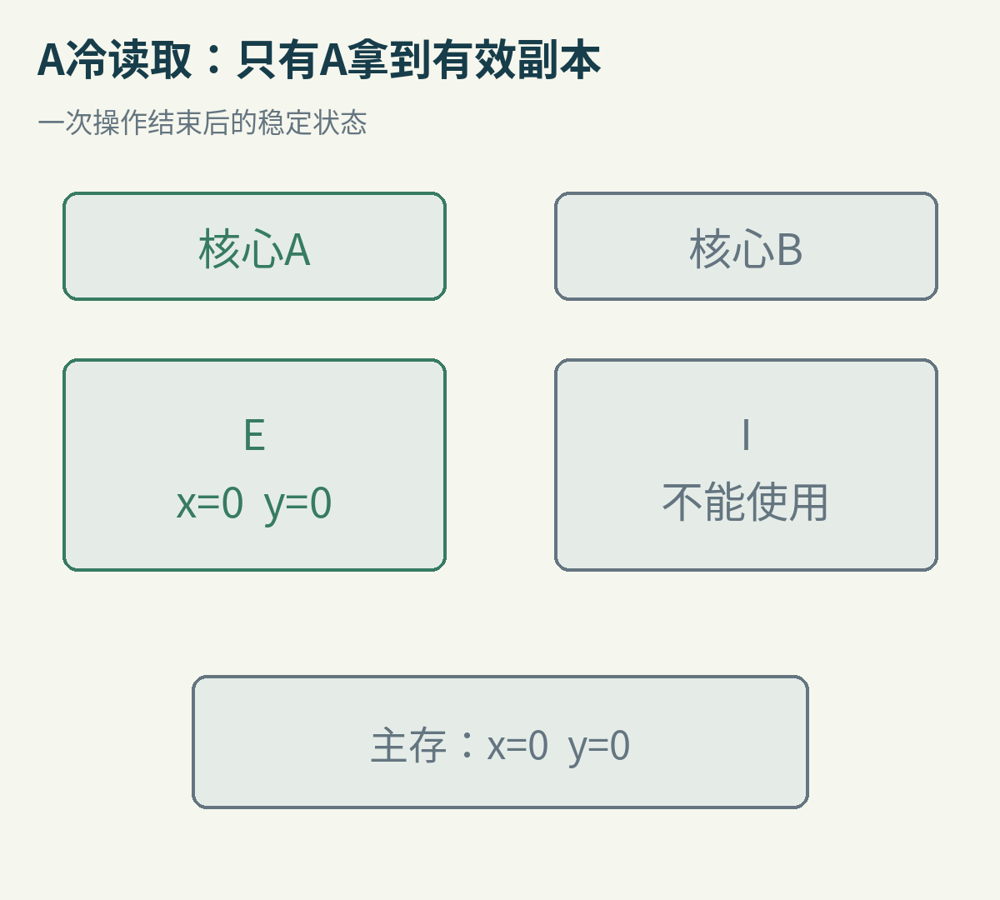

接着A把x写成1。因为它已经独占这一行，不必再让别人失效，直接从E变成M即可。

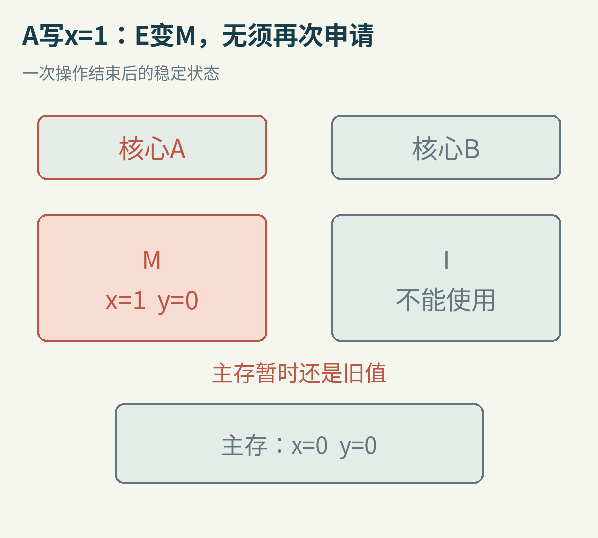

再写x=2、x=3，也可以继续留在M。

这解释了一个很实用的现象：频繁写入本身，不必然意味着每次都在核心之间传递一整行。还要看这一行的权限是否一直握在同一个核心手里。

## 6. 另一个核心来读，谁给它最新值？

换一个短例子：A刚把x写成1，主存仍可能是x=0。现在B要读取y，而y恰好与x在同一行。

B不能只从旧主存拿回x=0、y=0，再装作自己获得了最新整行。必须让持有最新版本的A参与。

在本文的MESI模型中，A提供最新整行，主存也更新；A、B最终都变成S。

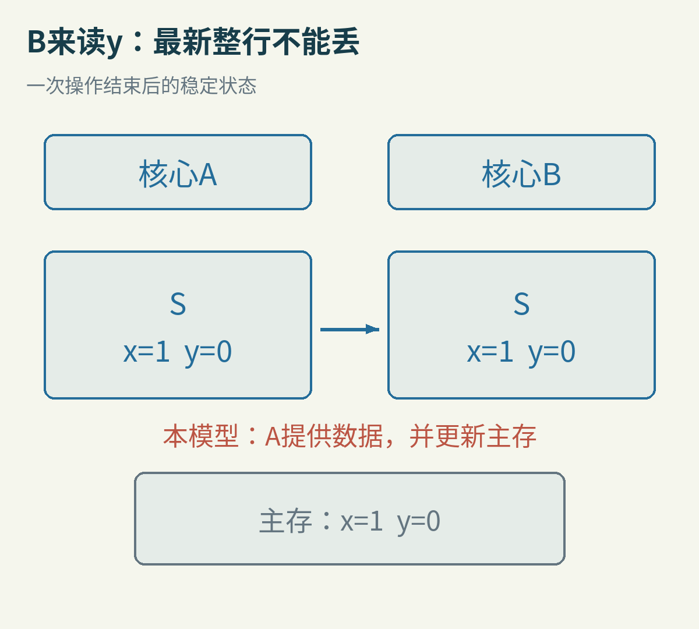

B这次关心的是y，但它得到的副本同时包含x=1。整行作为一个单位维护，邻居的内容不能在交接时丢掉。

接下来若A再写x，它的S不能直接当独占使用。A需要申请写权限，让B的整行副本变为I，再把自己转为M。

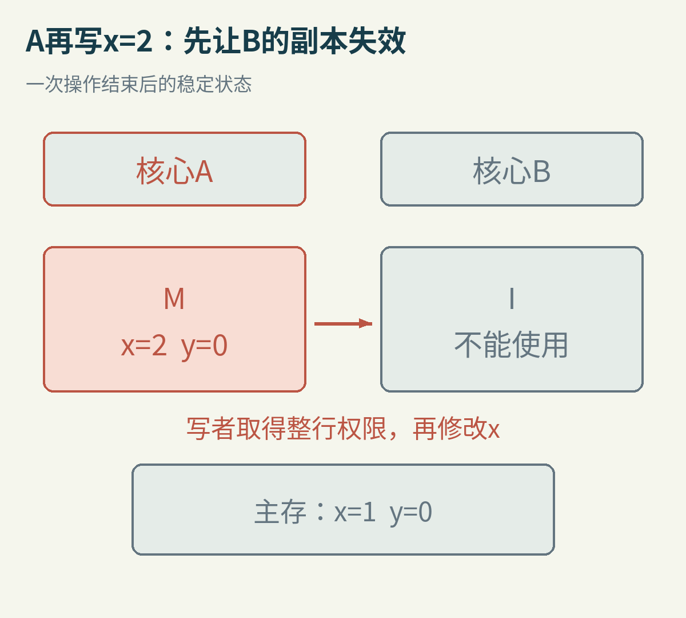

其他协议变体可能允许脏数据共享，或者采用不同的数据传输路径。本稿不把“每次核心交接都必须经过DRAM”当作普遍规则。

## 7. 回到两个计数器：明明不争同一个数

现在重新开始：x=y=0，两个缓存都为空。我们把每次加一后的结果先算好，然后让模型依次执行八次写入：

A写x=1，B写y=1，A写x=2，B写y=2，直到两者都写到4。

这里每一次都是已经结束的存储事件，不把“读取、加一、写回”三个动作偷偷假设成真实机器上的原子操作。

第一步，A取得这一行的独占写权限，写入x=1。最新整行是(x=1，y=0)。

第二步，B想写y。它需要的仍是同一行，必须取得最新内容，让A失效。B写完后，最新整行变成(x=1，y=1)。

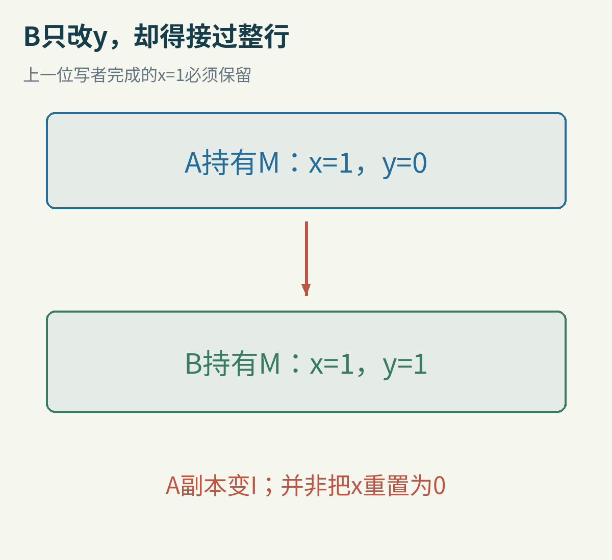

第三步，A又要写x=2。上次它的副本已经失效，因此还得向B取得最新一行，再使B失效。完成后是(x=2，y=1)。

接下来的过程就像轮流拿走同一本登记册。每个人只填写自己的栏目，却不能同时持有那本允许修改的册子。

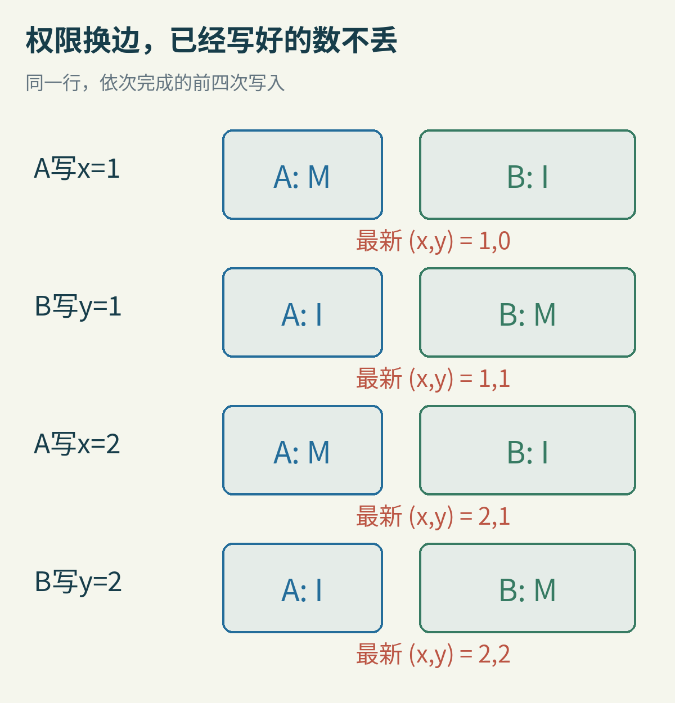

这里的比喻有边界：数据不是一册物理纸，而是副本与权限在协议下变化。B交出权限后，缓存里可能还保留旧比特，只是不再有效。

程序没有真的共享同一个计数器，但缓存行被共享了。这种由存放位置引起的干扰，就叫伪共享，false sharing。

“伪”说的是两个程序数据在逻辑上无关，不是说通信开销是假的。

## 8. 八次写入，究竟数出了什么？

按刚才的交替顺序，第一次A从空缓存取得写权限，随后每一步都换了写者。

总共八次写权限请求；后七次各使另一份有效副本失效，因此有七次副本失效事件。

如果顺序改为AAAA、BBBB呢？A连续写四次，再由B连续写四次。A第一次申请，后面三次本地写；B第一次接手，后面三次也本地写。


结果变成两次写权限请求、一次副本失效。写入的总次数仍是八次，最终x=y=4也没变。

对这个特别简单的模型，还能得到一条手算规则：缓存开始为空、没有其他读者、没有逐出，且所有写入都针对同一行时，非空写序列的申请次数=1+写者切换次数。

不要漏掉前提。中途插入读取、缓存逐出或其他核心的访问，这条短公式就不再能直接套用。


这些数是模型里的事件数，不是纳秒、时钟周期或网络包数量。一次权限请求可能涉及多条真实消息，也可能与别的工作重叠。八除以二等于四，并不等于程序一定提速四倍。

## 9. 只有一个人写，也可能拖到另一个人

伪共享不要求两个核心都写。

设A经常更新x，B只反复读y，而且y一直等于0。二者仍在同一行。

A写完后拥有M。B读取y，需要得到可读副本，双方变为S。A下次写x，又让B失效。B明明一次也没有改y，却可能不得不一遍遍重新取得它所在的行。


Linux内核文档就用引用计数和名称字符串说明这种情形：一方频繁修改计数，另一方读取同一行中的名称。它还提醒，真实热点需要结合具体数据布局来定位。[内核文档](https://www.kernel.org/doc/html/latest/kernel-hacking/false-sharing.html)

如果双方都只读呢？在我们的空缓存模型中，最初需要取得副本，之后可以共享读取，不会因写者交接而不断失效。

所以，“两个线程访问相邻数据”只是线索，不能直接判定有严重伪共享。

## 10. 真共享、伪共享、数据竞争，不是一回事

两个核心都要更新同一个计数器x，是实际共享同一个程序数据。

两个核心分别更新x、y，只因它们处在同一缓存行而互相影响，是本稿的伪共享。

两个核心只有读取，没有任何写者，又是另一种情况。


数据竞争则涉及程序语言的规则：哪些访问冲突，有没有所需的同步关系。它是正确性问题，不能用“缓存会保持一致”一笔带过。

例如，两个线程都给同一个普通变量做“读、加一、写回”，缓存一致并不替你把整个复合动作变成不可分割的一步。在C++里，不满足同步规则的冲突访问还可能直接构成未定义行为。[C++工作草案](https://eel.is/c++draft/intro.races)

反过来，就算用了适当的原子操作，让程序在语言层面正确，也不表示同一行的权限交接免费。原子性回答“操作怎样才算正确”，伪共享分析回答“布局为什么会带来额外干扰”。

开头的计数例只让每个线程写自己的独立对象，并假定主线程在合适的完成同步之后才读取结果；本文没有借这个模型证明任何缺少同步的真实程序正确。

## 11. 第一种改变：让两个热变量分住两行

把x仍放在1024，y移到1088。现在x在第16行，y在第17行。

仍按ABABABAB写入：A第一次取得x那行，B第一次取得y那行，随后都能在自己持有的行里继续写。

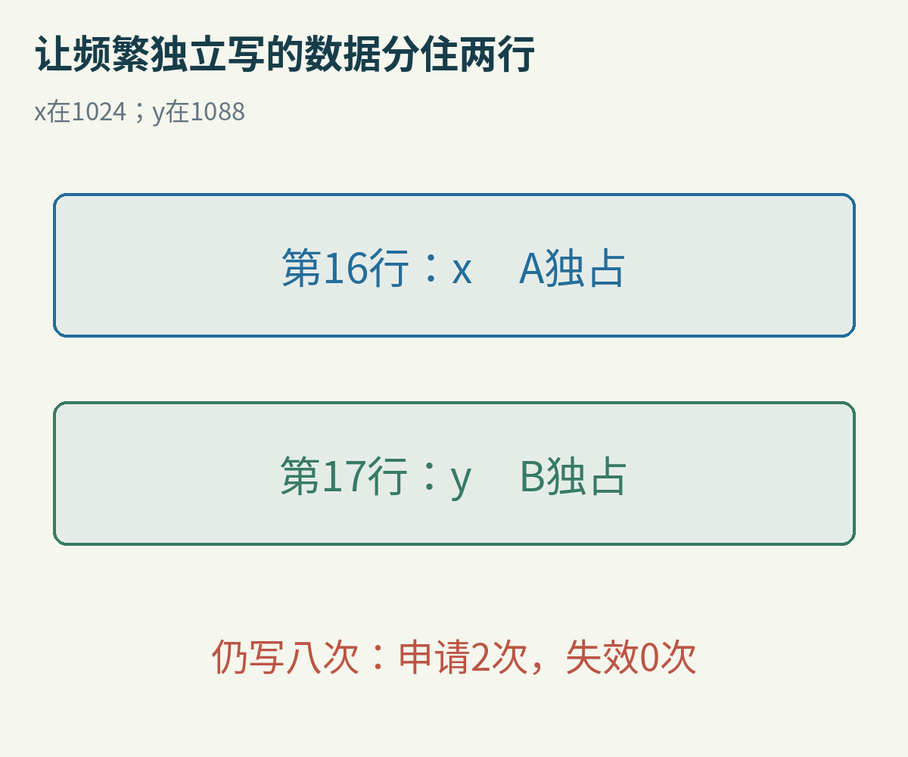

本模型得到两次写权限请求，没有对方副本失效。这里省掉的是由相邻布局引起的权限冲突，而不是省掉加法。

不过代价也很明确：原来两个8字节计数器可以放在一行，现在各占一行的布局预算。若把成千上万个冷数据都粗暴分开，空间、缓存容量和遍历局部性可能变差。

布局不是越松越好。要分开的是会互相干扰的访问责任，而不是见到字段就加一大块空白。

## 12. 一个陷阱：结构体64字节，就一定没事吗？

假设每个工作线程有一个64字节记录，记录0紧挨记录1。你可能以为，每个记录正好一行。

但记录数组的起点如果是16，而不是64的整数倍呢？记录0覆盖16至79，记录1覆盖80至143。它们都碰到了64至127这一行。

让A频繁写记录0最后8字节，即72至79；让B频繁写记录1最前8字节，即80至87。这两个热字段又成为邻居了。

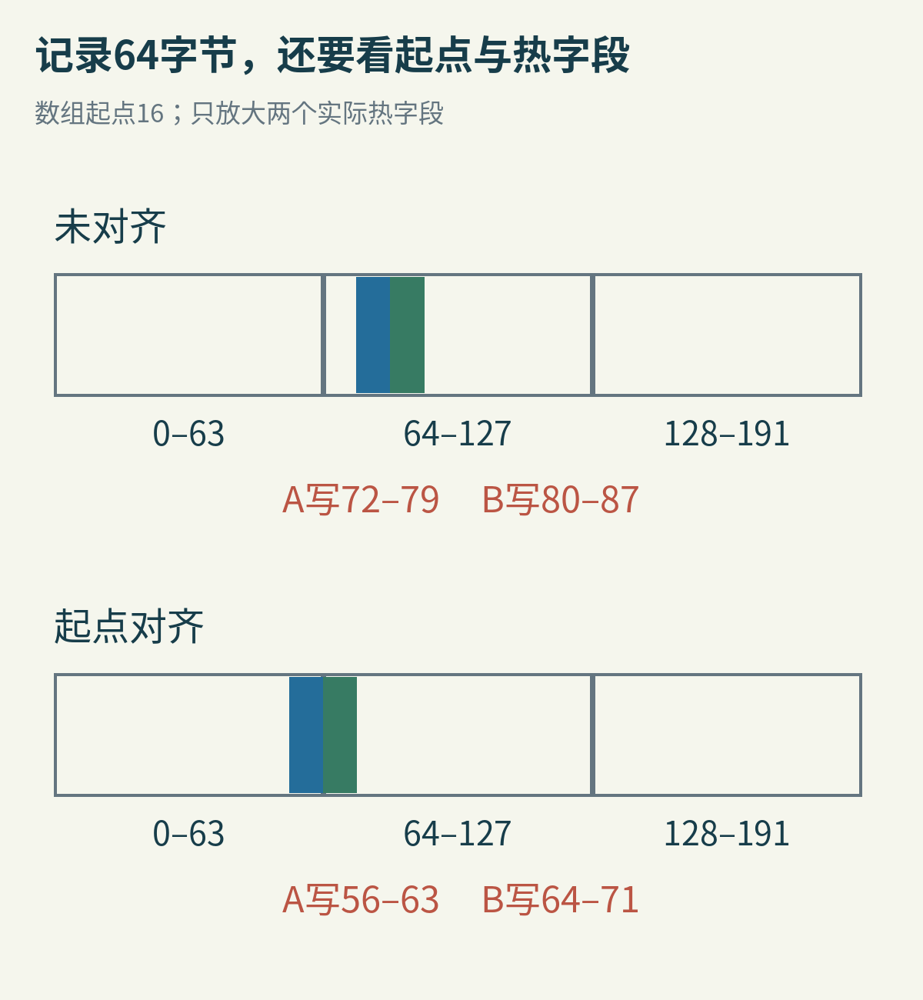

如果把整个数组起点对齐到0，记录0最后字段在56至63，记录1最前字段在64至71，它们才落在不同行。

这里特意说清“实际访问哪个字段”。若两个线程都只写各自记录的第一个8字节字段，那么在这个16起点的例子里，16与80本来就不在同一行；不能光看到记录跨行就宣布每次访问必然冲突。

Intel的一份VTune官方案例讨论了64字节记录与数组起点未对齐的问题。案例有明确的处理器、操作系统和工具环境，它展示的是那套程序的分析过程，不是我们在这里跑出的结果。[官方案例与原始截图](https://www.intel.com/content/www/us/en/docs/vtune-profiler/cookbook/2024-0/false-sharing.html)

## 13. 第二种改变：少把临时结果送出去

有时，与其调整字节位置，更直接的办法是改变数据流。

例如，每个工作线程先在自己控制的本地数据中累积，完成一批后再汇总。一个需要频繁共享更新的全局统计量，可能因此减少更新频率。

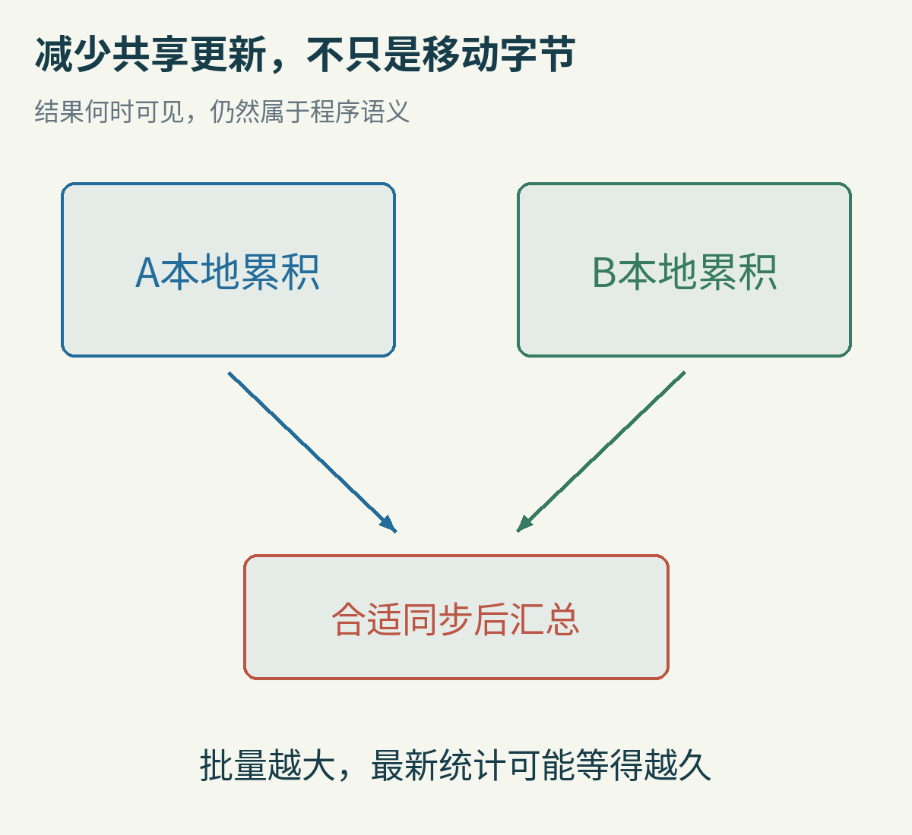

这并不是无条件替换。若其他线程必须实时看到精确值，批量汇总会改变可见时机；结束汇总也仍然需要合适的同步。线程私有只是逻辑属性，最终存储布局和编译器生成的代码仍要看实际实现。

我们的AAAA、BBBB顺序例，只证明成批访问可以减少这个模型中的权限切换，不是要求操作系统把两个真正并行的工作串行执行。

可以把它当作一个提示：优化有时不是让消息跑得更快，而是让某些消息根本不用发生。

## 14. 缓存一致，不等于所有操作排成一条直线

还有一个容易被中文词语掩盖的区别。

Cache coherence关心缓存副本如何协调；memory consistency model规定程序可观察到的读写行为，包括不同内存位置之间的顺序约束。中文资料中它们都可能被称作“一致性”，于是很容易混在一起。

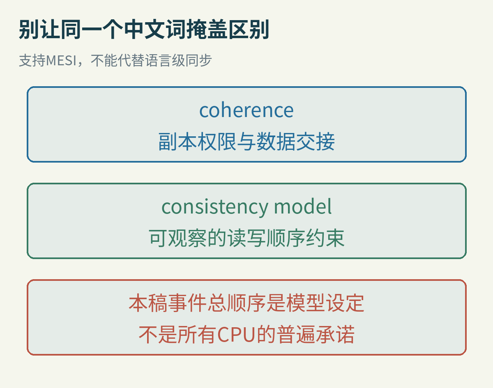

例如，A先写数据，再写“准备好了”标志。B看到标志之后，是否一定能读到对应数据，要看语言、原子操作及同步规则，而不能仅凭“CPU支持MESI”下结论。

本文模型人为规定每次事件完全结束再处理下一次。这个方便教学的总顺序，是模型的设定；它没有证明所有真实处理器都采用同样强的顺序规则。[作者版教材的区分](https://pages.cs.wisc.edu/~markhill/papers/primer2020_2nd_edition.pdf)

## 15. 可以自己运行的小实验

随文提供[完整Python模型](examples/coherence_lab.py)和[运行说明](examples/README.md)。只用标准库，不需要安装性能分析工具。

你可以先只运行下面这个很短的调用，查看八次交替写入：

```python
from coherence_lab import run_stores

machine, trace = run_stores([0, 1] * 4)
print(machine.stats['write_requests'])
print(machine.stats['invalidations'])
```

在脚本同目录运行，结果分别是8和7。将第二个参数设为True，会把y移到1088，使两个变量分住两行；结果变为2和0。

模型还会检查：存在M或E时，不能同时有另一个有效副本；每份有效副本的数据必须与此前完成的写入相符；没有脏持有者时，主存也必须是当前值。


本稿实际运行了三类有限核查：长度0至12的8191种二进制写者序列；65536种四事件序列，覆盖读取、写0、写1和逐出；固定种子1984348的100000次四核心随机事件。

结果通过不表示硬件协议已经得到形式化证明。尤其是，本模型故意没有同时在途消息、暂态、写缓冲、死锁和活锁；那些正是真实协议难做的部分。


试着改几个地方：把y放到1040，看看它是否仍在同一行；把顺序改成AABBAABB，先手算再运行；在一次写入后加入另一个核心的读取，观察下一次写入是否还“安静”。

## 16. 真要分析程序，该找哪些证据？

首先确认程序正确，再确认究竟慢在哪里。不要仅凭两根计数器靠得近，就把所有性能问题归给伪共享。

至少要连接起三类信息：哪些核心在访问，具体访问哪些字节，以及这些访问如何落在缓存行里。真实测量还应记录处理器、线程放置、编译选项、工作量和重复试验情况。


Linux文档介绍的perf c2c与pahole，分别可帮助观察有争用的缓存行和数据结构布局。具体事件支持、权限和输出解释依平台而定；本稿没有运行它们，也没有把模拟器计数伪装成硬件事件。

可以用保留语义的对照来缩小问题：仅改变对齐或字段布局，是否降低了相关争用？总耗时是否也改善？如果热点转移到别处，通信事件变少也未必让整个程序明显变快。

## 17. “放得近”与“分得开”，为什么都可能是好建议？

以前的ECS文章讨论过：同一轮批量更新需要的字段放在一起，可以减少带入无关数据。那主要是在问，一次取来的数据有多少真正派得上用场。

这里多问了一件事：这些相邻数据由谁写，什么时候写？

同一核心一起读取的数据，靠近可能有利。不同核心频繁独立更新的数据，挤在同一行可能添麻烦。没有一种排列能脱离工作负载永远获胜。


下面的动画重放开头四轮交替写入。请盯住两件事：M的位置不断换边，而x、y已经完成的结果一直被保留下来。

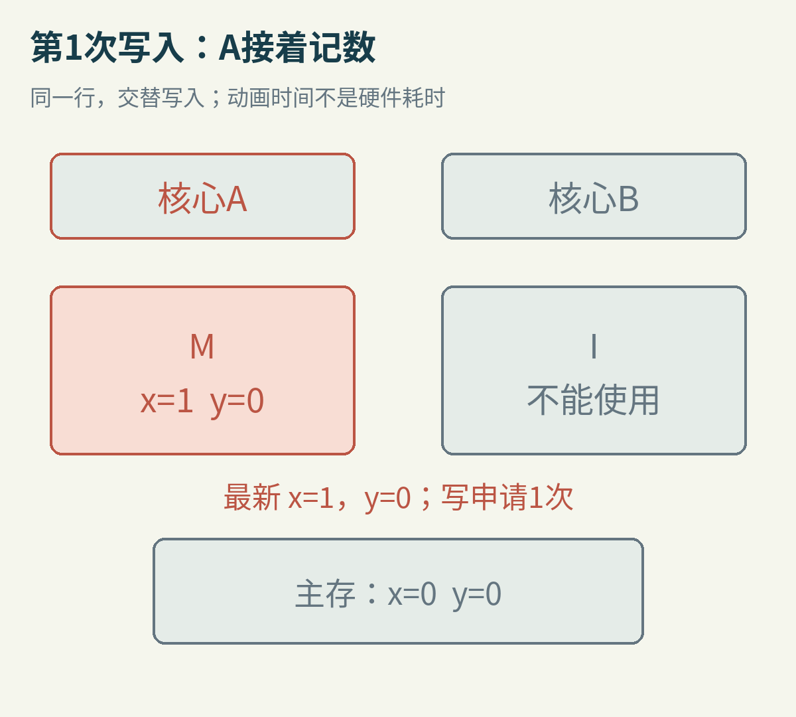

两个线程改的是不同数字，硬件协调的却是同一行。这就是问题的缝隙。

理解它以后，“并行”就不再只是多开几个工作线程。我们还得问：工作的边界，是否恰好撞上了数据搬运与权限管理的边界？
