# 一只方盒子，反复切几刀为什么会变圆？

把一只方盒子交给三维软件，按下“细分”，棱角就开始变软。再按几次，六张平面像是变成了一块圆润的鹅卵石。

可是，事情有一点不对劲。

拿真正的纸盒做实验，哪怕在每张面上画一万个小方格，盒子的外形也不会改变。面变多了，直角还是直角。电脑里的盒子究竟偷偷多做了哪一步？

答案是：**它既重新安排“谁和谁相连”，也重新计算“每个点站在哪里”。只切，不搬，盒子不会变圆。**

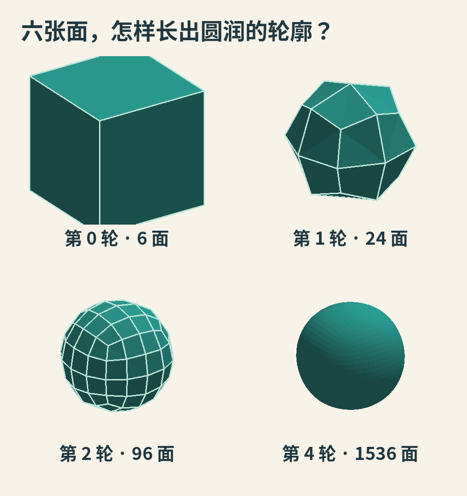

*本次自写程序的实际几何结果，相机、坐标尺度和光照保持一致。第0、1、2轮叠加了边线；第4轮为1536个四边形的有限网格，仍不是精确极限曲面。没有使用商业建模软件，也没有把点投到球面上。*

我们要研究的方法叫 **Catmull–Clark 细分**。可以把中文名字读作“卡特穆尔—克拉克”，但接下来真正需要记住的只有三个词：面点、边点、旧顶点的新位置。

不必先学会矩阵。准备好加法、平均数，以及一点想亲手拆开魔术的好奇心，就能算出上图的第一轮。

## 一　1978年的问题：表面一定要像一张方格纸吗？

一张规则控制网格很方便：横着一排、竖着一排，计算可以整整齐齐地重复。但如果想做一只手、一个有把手的杯子，或者一个分叉的形状，就很难始终保持这种整齐的排列。你需要的不只是一块弯曲的“方格纸”，还需要网格能够以不同方式连接。

1978年，Ed Catmull 和 Jim Clark 在《Computer-Aided Design》发表了《Recursively generated B-spline surfaces on arbitrary topological meshes》。他们把规则双三次B样条网格上的细分关系，推广到更一般的网格连接结构。论文署名单位是纽约理工学院的计算机图形实验室。[1978年原论文](https://people.eecs.berkeley.edu/~sequin/CS284/PAPERS/CatmullClark_SDSurf.pdf)

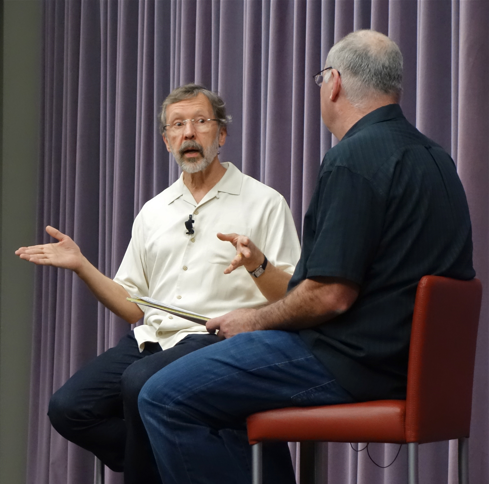

*Ed Catmull，2014年4月30日在斯坦福的演讲。摄影：Steve Jurvetson；[原图与署名](https://commons.wikimedia.org/wiki/File:Ed_Catmull,_ETL_2014.jpg)，[CC BY 2.0](https://creativecommons.org/licenses/by/2.0/)。保留3050×3011像素原文件，未裁切。这是后来的照片，不是1978年研发现场。*

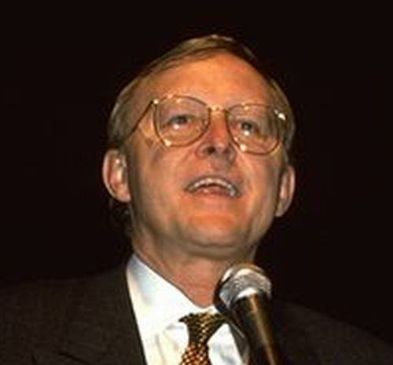

*Jim Clark。摄影：Knnkanda；[原图与署名](https://commons.wikimedia.org/wiki/File:James_H._Clark.jpg)，[CC BY-SA 3.0](https://creativecommons.org/licenses/by-sa/3.0/)。保留500×465像素原文件，未改动。文件页的日期不在这里推断成拍摄事件日期。*

这篇论文还有一个很值得学生学习的细节：作者没有把“图片看起来光滑”写成“所有问题已经证明完毕”。他们明确说，当时没有给出特殊点处连续性的证明，文中还展示了表现不理想的鞍形例子。

所以，历史不能简化成“两个人写下一条平均公式，从此所有模型都完美了”。局部规则、数值实验、连续性分析，以及后来面对实际制作需求的扩展，是不同层次的工作。

1998年，Tony DeRose、Michael Kass 和 Tien Truong 的论文记录了细分曲面在角色制作中的应用，涉及《Geri’s Game》以及折痕等制作问题。那是算法走进生产流程的一条具体证据，而不是说本文的小盒子已经包含动画电影的全部技术。[作者论文的出版记录与摘要](https://doi.org/10.1145/280814.280826)

下面先把历史的大问题缩小到一个可以彻底算清的小盒子。

## 二　给盒子编号，先别急着按按钮

把盒子中心放在原点，每条棱长2。八个顶点的每个坐标只能取−1或+1，例如：

- 右前上角 P＝(1,1,1)
- 沿其中一条棱走到 B＝(1,−1,1)
- 沿另外两条棱走到 (−1,1,1) 和 (1,1,−1)

这里的“前”和“右”只是帮助想象，真正固定方向的是坐标。程序使用明确的顶点表、面表和一致的朝外绕序，数据随文附上。

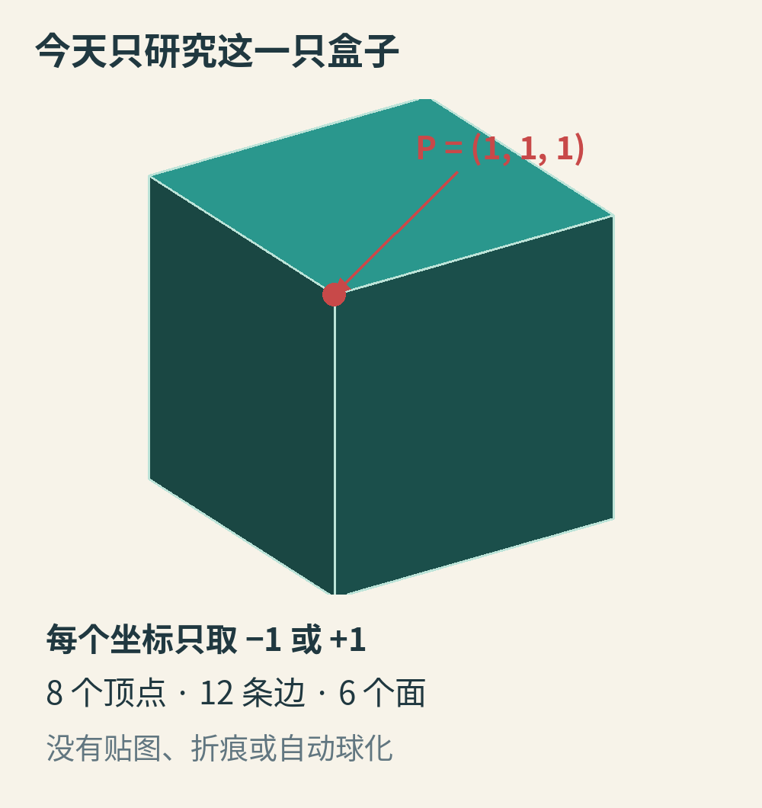

*原创示意叠加在实际初始网格上。红点是P=(1,1,1)。本文所有主例都从这8点、6面出发；开口与折痕实验会明确说明改了什么。*

**控制网格**，就是这些点和它们的连接关系。它也常被称为控制笼：你调这个粗笼子，算法据此定义更圆滑的表面。控制笼不是一层套在真实物体外面的实体铁丝，也不要求最终表面穿过所有控制点。

现在暂时不管位置，只看连接方式。

对每一张旧面，放入一个面点；对每一条旧边，放入一个边点；给每个旧角保留一个“下一轮的后继点”。一个旧角附近的新四边形，依次由以下四个点围成：

**旧角后继点 → 这一侧的边点 → 面点 → 另一侧的边点。**

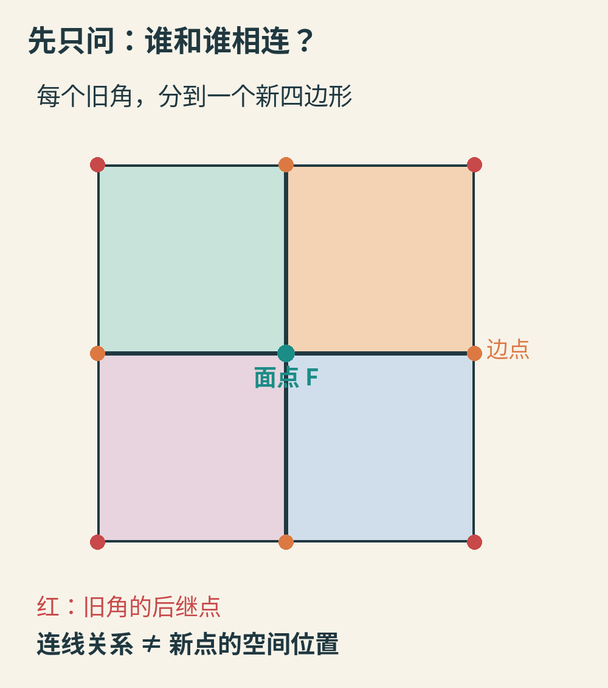

*这是拓扑示意，故意画在平面里。红点代表旧角的后继身份，不表示真实细分后仍停在旧位置。绿色面点、橙色边点和红色后继点共同组成新网格。*

一个旧四边形有四个角，所以产生四个新四边形。旧三角形有三个角，就产生三个四边形；旧五边形则产生五个。

这就是一个很漂亮的统一办法：输入不必全是四边形，但完成一轮后，新面都成为四边形。不过，“面都一样有四条边”，与“整个网格处处是规则方格”，仍然是两回事。我们稍后会抓到这个区别。

连接关系解决了。接下来才轮到让盒子变圆的关键：算坐标。

## 三　面点：四个角先凑一个平均数

先处理盒子的顶面 z＝1。四个顶点是：

(−1,−1,1)、(1,−1,1)、(1,1,1)、(−1,1,1)。

把四个位置相加，再除以4，得到顶面的面点：

**F顶＝(0,0,1)。**

三维点取平均，并不是一种新的复杂运算。分别平均所有x、所有y、所有z就行。这里x正负抵消，y也正负抵消；四个z都是1，平均之后当然仍是1。

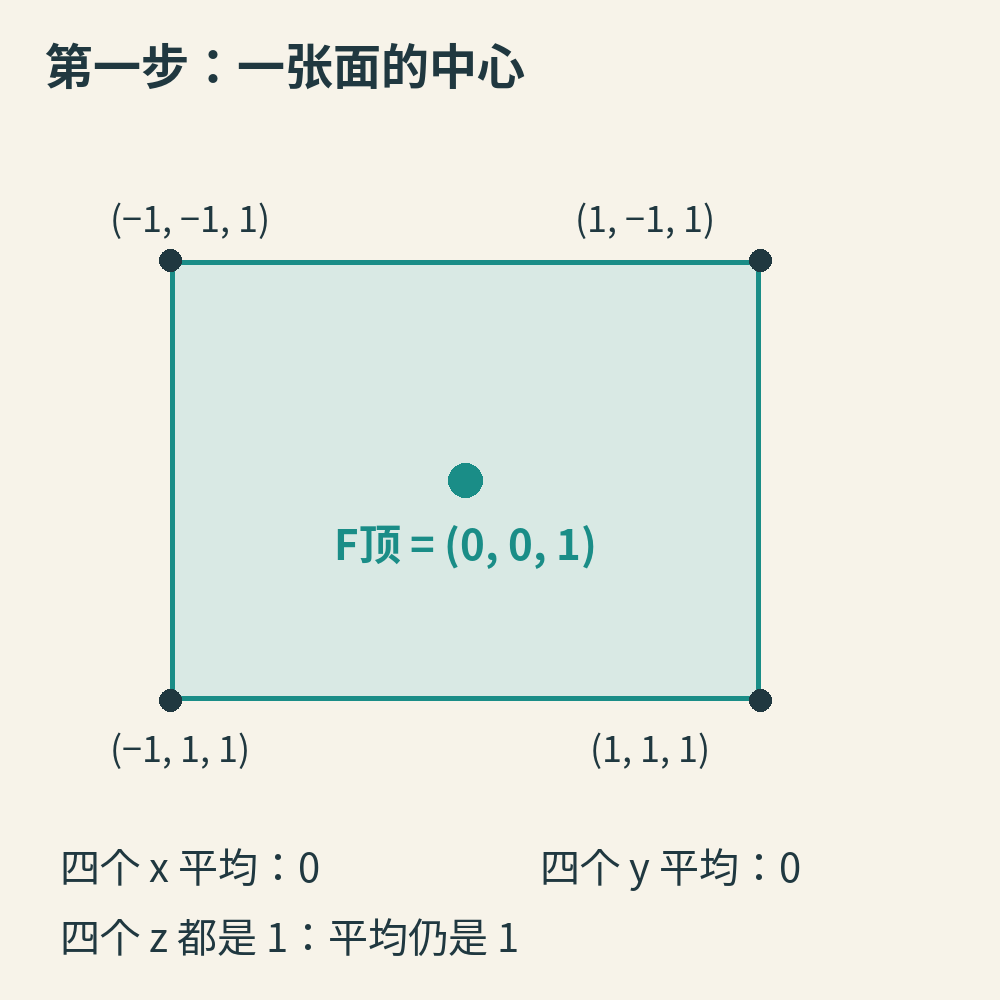

*原创手算图。图中正方形是顶面自身的二维展开，不是另一个不同的控制网格。*

同理，x＝1的右侧面得到 F右＝(1,0,0)，y＝1的侧面得到 F前＝(0,1,0)。其余三张面的面点也很容易写出：只需把对应轴的1改为−1。

一般的面点规则是：

**一张面的面点＝围成这张面的所有旧顶点的算术平均。**

有五个角就除以5，不是无论什么面都除以4。这个平均也不是按多边形内部面积分布计算的“面积重心”；对一般不规则多边形，两者可能不一样。规则要说准确，才能把别人写的代码复算出来。

先把所有面点存好。下一步会用到它们。

## 四　边点：为什么新点会离开原来的棱？

选中我们刚才的P与B：

P＝(1,1,1)，B＝(1,−1,1)。

这条棱同时属于顶面与右侧面。它的普通中点是：

**M＝(P+B)/2＝(1,0,1)。**

如果只把新点放到M，棱就仍在原来的直线上。Catmull–Clark 对光滑内部边做的事更多一些：把两端点和两侧的新面点一起平均。

**E＝(P+B+F顶+F右)/4。**

代入数值：

- x：(1+1+0+1)/4＝3/4
- y：(1−1+0+0)/4＝0
- z：(1+1+1+0)/4＝3/4

所以新边点是 **E＝(3/4,0,3/4)**。

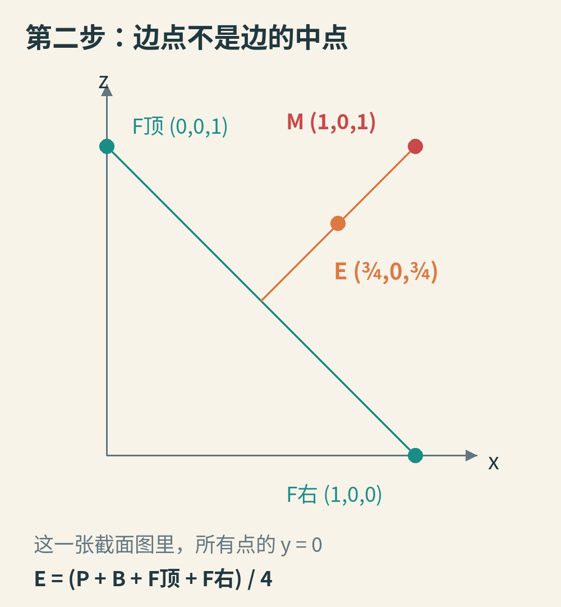

*原创截面图。P与B在y方向分开，本图只画y=0截面里的M、两侧面点和E。E是橙色线段的中点；图中没有把P与B错误地压成同一个空间点。*

还可以用另一种心算方式理解：

1. 先算旧边中点M。
2. 再算两侧面点的中点，得到(1/2,0,1/2)。
3. 最后对这两个中点再取一次平均，就到E。

它没有“朝球心走”的命令。它只看这条边周围的局部数据。盒子的棱变软，是因为这些局部数据恰好把E从原棱上拉向了里面。

注意限定词：**光滑、内部边**。开口边界只有一侧有面，不能硬凑第二个面点。先把这个问题放在口袋里，后面再打开。

## 五　旧顶点：只加新点，还不够

面点有了，边点也有了。要是八个旧角永远保持(±1,±1,±1)，尖角就会继续撑住整个形状。

因此旧顶点也要计算下一轮的位置。这里有三个局部信息：

- P：这个旧顶点的位置
- Q：接到P的所有面的“新面点”的平均
- R：接到P的所有“旧边中点”的平均

再记n为接到P的边数。对于本文先研究的内部流形点，接到它的面数也等于n。

标准光滑顶点规则写成：

**P′＝[Q+2R+(n−3)P]/n。**

别让字母挤走直觉。它只是把三个局部位置按规定的权重合起来。P′读作“P的新位置”。现在就算一遍。

我们选中的盒角P=(1,1,1)，接着顶、右、前三张面，所以n=3。

三个面点为(0,0,1)、(1,0,0)、(0,1,0)，于是：

**Q＝(1/3,1/3,1/3)。**

三条旧边的中点是(1,0,1)、(0,1,1)、(1,1,0)，于是：

**R＝(2/3,2/3,2/3)。**

n−3恰好为0，公式化为P′=(Q+2R)/3。三个坐标完全相同，只算一个就行：

**[1/3+2×(2/3)]/3＝5/9。**

因此：

**P′＝(5/9,5/9,5/9)。**

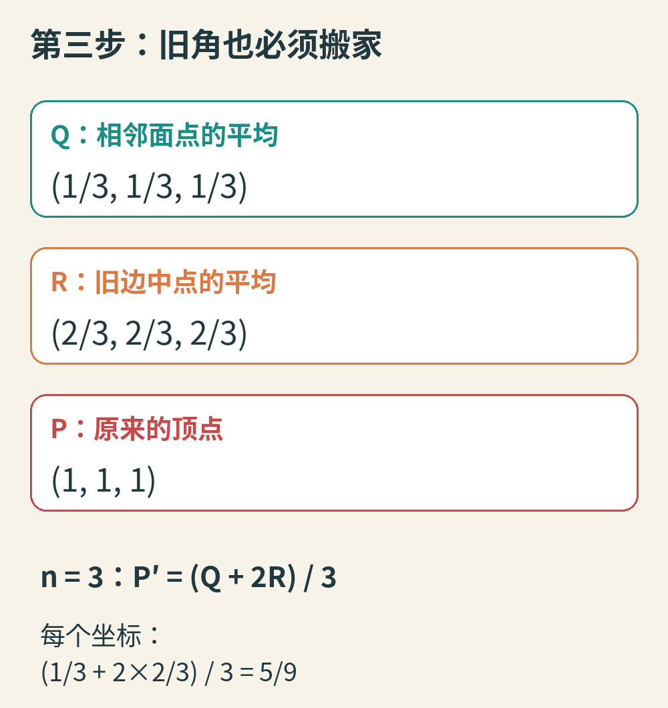

*原创手算卡。R平均的是旧边的中点M，不是上一节得到的新边点E。这两个对象混用，是最容易让第一版程序算错的地方。*

这里还有一个容易被式子骗到的问题：“n=3时，P前面的系数是0，是否说明P完全不影响自己的新位置？”

不是。P已经参与了三个面点和三个边中点的计算。因此P的影响藏在Q、R里面。不要只盯着最后一行那个显眼的0。

再问一句：如果先改了P，再用改过的P计算旁边的边点，会怎样？答案会依赖遍历顺序。同样的盒子，从左到右更新，与从右到左更新，可能得到不同结果。

正确做法是“整轮读旧账，整轮写新账”：旧顶点表保持不动；由旧表算全部面点、边点和顶点后继；全部算完，再整体换成下一轮。新面点是本轮统一生成的辅助量，可以使用，但不能混入已经更新的旧顶点后继。

## 六　把新点接起来，第一轮就结束了

现在回到第二节的连接规则，把点按身份接起来。

例如，在顶面靠近P的那个角，新四边形包含：

- P′＝(5/9,5/9,5/9)
- 顶面上一侧的新边点 (3/4,0,3/4)
- 顶面面点 (0,0,1)
- 顶面另一侧的新边点 (0,3/4,3/4)

这一张四边形未必严格共面。此处“有四条边”讲的是网格拓扑，不保证四个空间点能平放在一张纸上。屏幕显示有限网格时，还需要采用明确的三角化或曲面求值办法。

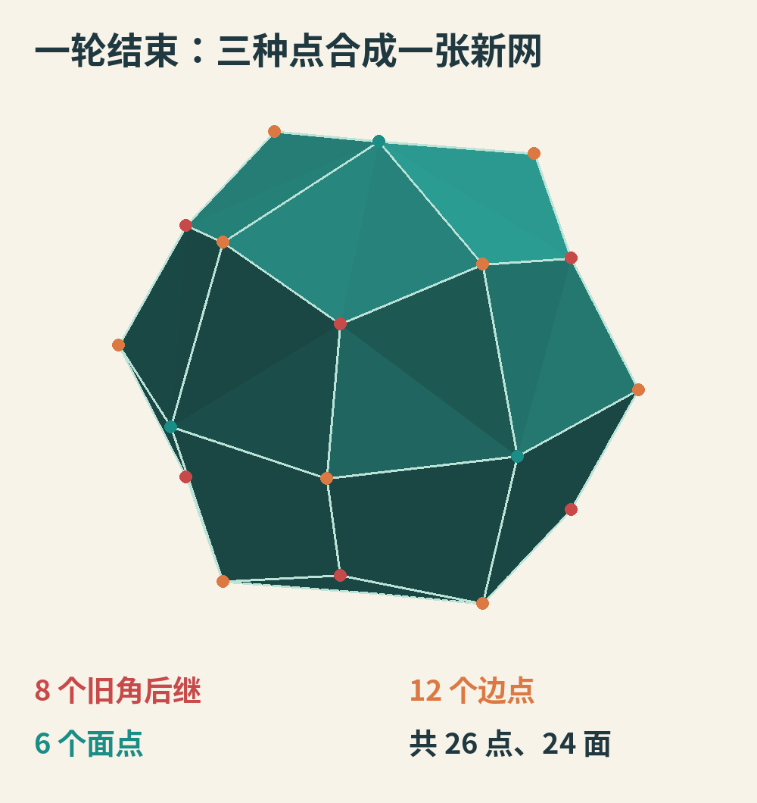

*本次实际第一轮网格，颜色按点的来源分类。背面的点仍存在，只是被遮挡。用于着色的三角化不会改变这里按四边形统计的控制网格。*

数一数，很适合拿来检查程序：

- 8个旧顶点，各产生1个后继点
- 12条旧边，各产生1个边点
- 6张旧面，各产生1个面点

所以新顶点数是8+12+6＝**26**。

六张旧四边形，各产生四张新四边形，所以新面数是6×4＝**24**。

新边呢？旧边分成两段，贡献12×2＝24条；六个面点各向四个边点连线，再贡献6×4＝24条。总共**48**条。

26−48+24＝2，与原来的8−12+6＝2一致。这是闭合球面拓扑的欧拉计数检查。不过，计数对了不代表网格一定正确：重复面、面翻向、边上挤了三张面，都可能需要另外检查。附带脚本还检查了边的共享数、面绕序和每个顶点周围是否连成一个完整的扇区。

最重要的实验，是把“加点连线”和“移动位置”分开开关。

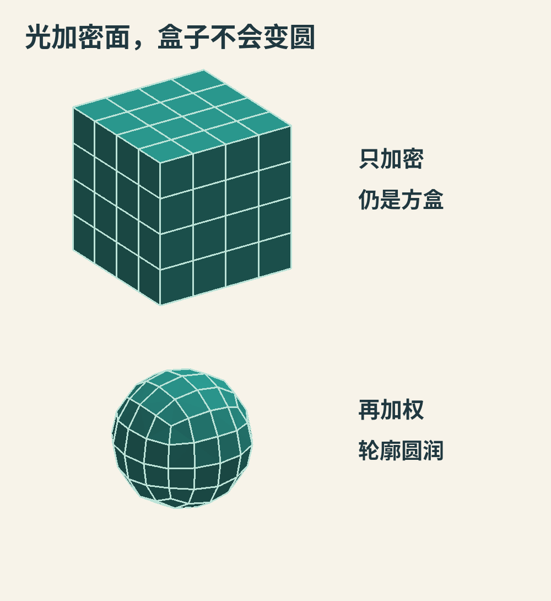

*上方：旧点不动，边取中点、面取平均；下方：使用本文三类几何更新。两者都是第2轮、96个四边形。这是同拓扑、不同坐标的对照实验。*

这就回答了开篇的纸盒问题：**更多的面让我们有能力描述变化；坐标更新才真正改变有限网格的外形。**

## 七　重复下去，为什么不会每轮都冒出一堆新例外？

把第一轮的结果当作下一轮的旧网格，继续做同样三件事。

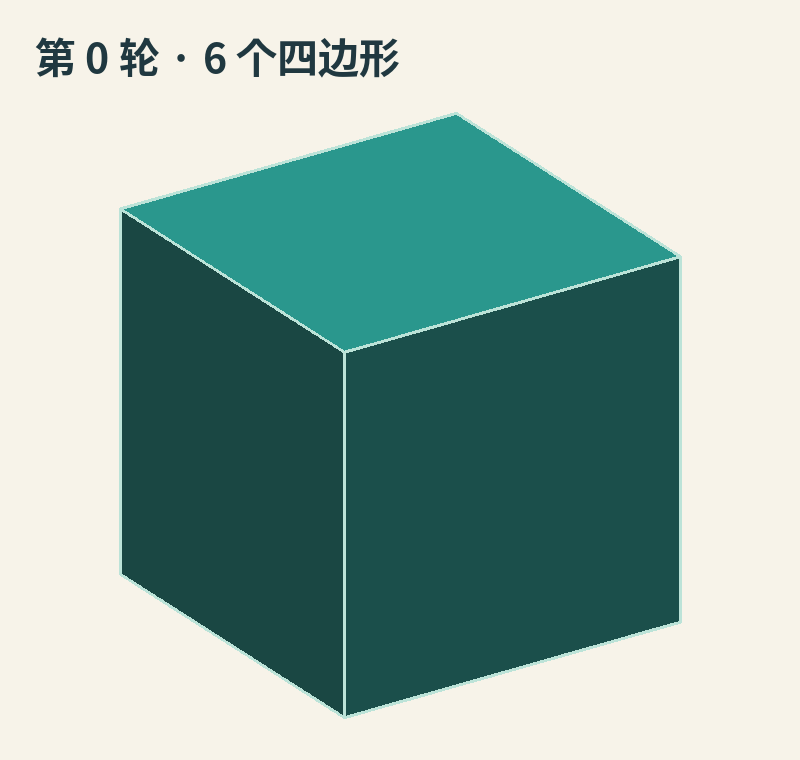

*GIF共有6帧，分别是0、1、2、3、4、5轮的实际输出，没有插入形变补间。每帧1.3秒，相机与尺度固定；第3轮起隐藏边线以便看轮廓。若动画不播放，可对照开头静态图与下文的精确计数。*

面数每轮乘4：6、24、96、384、1536、6144。

但有一种“特别”并没有消失。看P原来的位置：第一轮以后，P的后继点依然只连接三条边。再来一轮，新的后继仍只连接三条边。

把连接到一个顶点的边数叫作**价数**。这里研究的内部规则四边形网格，一个普通点的价数是4。价数不等于4的内部点，叫**特殊顶点**，也常见“非规则顶点”或extraordinary vertex的叫法。

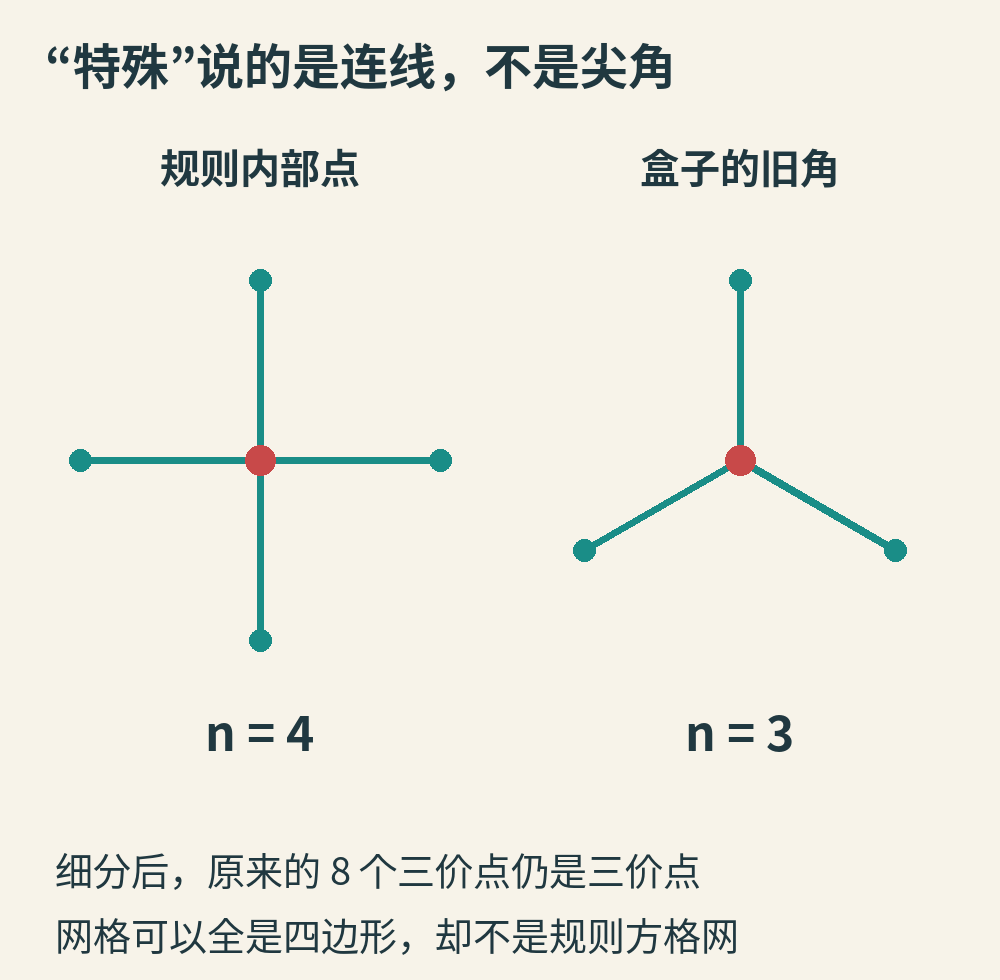

*原创局部连接图，不按三维距离绘制。红点的特殊性来自邻接关系；它可以处在一个看上去很圆滑的位置，并不意味着那里一定有肉眼可见的尖刺。*

在我们的立方体中：

- 八个旧角的后继始终是三价点。
- 原来每条边产生的新边点是四价点。
- 原来每张四边形产生的面点也是四价点。

于是，第1轮的26个点里，有8个三价点、18个四价点。第5轮的6146个点里，仍只有那8个三价点，其余6138个是四价点。

原来如此：**分辨率不断增加，但非规则连接的位置没有铺满整个表面。**规则区域越来越多，特殊点周围仍需特别处理。这是细分曲面兼顾“灵活连接”和“规则计算”的关键。

如果初始网格含有三角形，它的面点在第一轮也会成为三价点。不能把“特殊点永远只有原来的旧顶点”推广到任意输入；我们的8个结论，特指这个六面立方体。

在规则区域，Catmull–Clark 与双三次B样条曲面相接；通常所说的光滑区域、特殊点处的光滑性，需要各自的条件。尤其不能把“看不出折线”理解成“到处都有相同等级的曲率连续性”。在建模时，特殊点的位置、周围面的疏密与控制点摆放，仍会影响高光和形状。[固定版本的规则与非规则区域说明](https://github.com/PixarAnimationStudios/OpenSubdiv/blob/v3_6_0/documentation/subdivision_surfaces.rst#regular-versus-irregular-features)

## 八　边界：没有第二张面时，公式向谁借数？

现在只做一个改动：把盒子的顶面拿掉，变成一只没有厚度的开口容器表面。四条盒口边各只有一张相邻面。

原来E=(两端点+两侧面点)/4的式子，不能直接照抄。并不是“缺的那张面填零”就行；填零会凭空把坐标原点引进来，平移一下整个模型，结果就可能变了。

本文采用一种常见的光滑边界规则：

**边界边的新边点＝两端点的中点。**

对于沿边界有两个相邻点L、R的顶点P：

**P′边界＝(6P+L+R)/8。**

它只沿边界这条点链计算。六份P加左右各一份，总权重是8；P保留3/4的影响，左右邻居各1/8。

注意这里L、R是边界上的两个相邻顶点，“R”不是前面内部点公式中的“旧边中点平均”。为避免混淆，代码里使用完整名字或不同变量。

仍追踪P=(1,1,1)。它在盒口的两位邻居是(−1,1,1)、(1,−1,1)，所以：

**P′边界＝(3/4,3/4,1)。**

x、y往里收，z仍然等于1。盒口留在原来的平面里，边缘逐渐变圆。

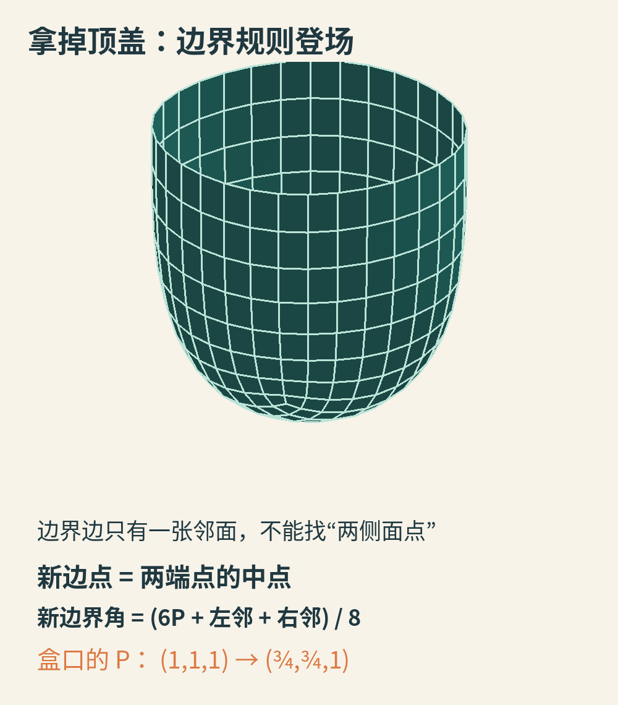

*本次自写实现的第3轮开口网格。内外两侧均参与显示，薄表面没有物理厚度。它不是把闭合盒子的计算结果随便裁掉一块，而是从一开始就改变了面表和边界规则。*

“边界规则”不是所有软件唯一不变的约定。OpenSubdiv v3_6_0提供边界选项，其中“只处理边”和“同时处理边与角”的差别，涉及只接一张面的角点是否被固定。[边界选项的固定版本说明](https://github.com/PixarAnimationStudios/OpenSubdiv/blob/v3_6_0/documentation/subdivision_surfaces.rst#boundary-interpolation-rules)

为了真正看见这个差别，我们暂时另取一张单独的正方形面。它的每个角只接一张面。如果只使用上面的平滑点链规则，角会内缩；如果明确固定这种角点，它们就留下。

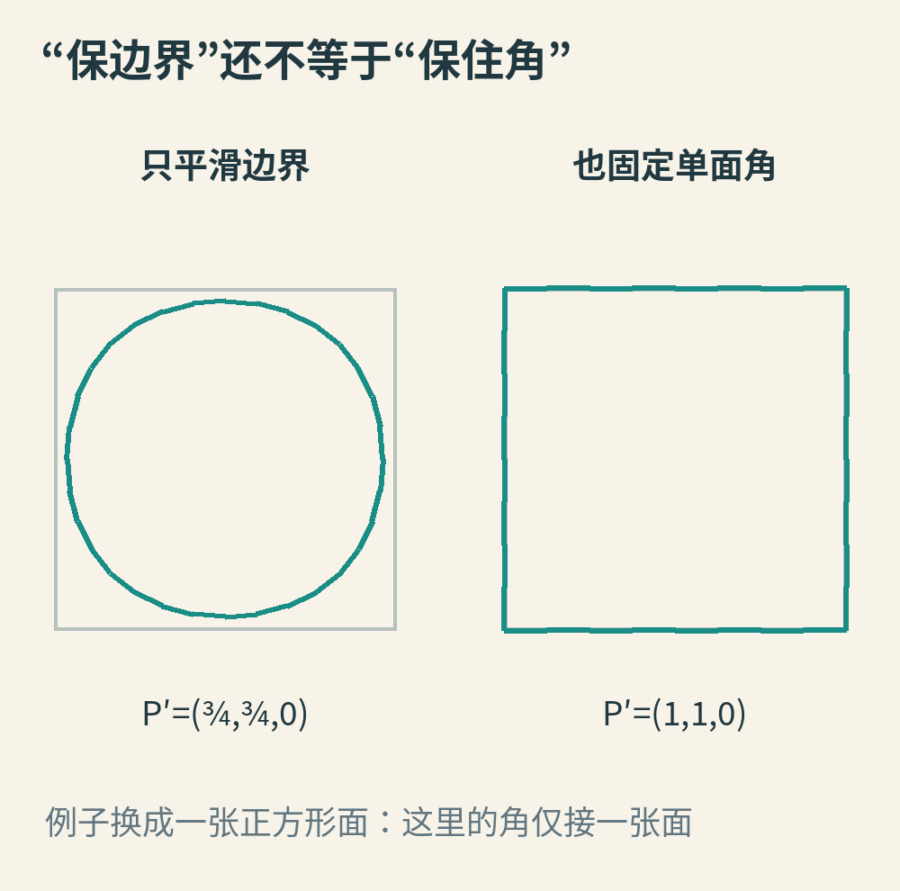

*独立小反例：灰线是原正方形，绿线是3轮后的边界。下方坐标标的是第一轮角点位置。这个例子专门解释边界选项，不替换主线的立方体。*

所以，交换模型时只说“我用了Catmull–Clark”还不够。边界怎么解释，也可能需要写进模型的约定。

## 九　折痕：我想要圆润的瓶身，却想保留瓶口怎么办？

回到完整六面的原盒子。这次不删除顶面，而是给顶圈的四条边标记“硬折痕”。

标记不等于增加一条细线贴图。它会改变参与计算的规则：硬折痕上的新边点取两端中点；某个顶点如果沿着两条硬折痕延续，就使用类似边界点链的6:1:1权重。三个或更多硬折痕在一个顶点相交时，本次采用固定该角点的规则。

于是同一个P可以有不同命运：

- 全光滑时：P′=(5/9,5/9,5/9)
- 只有顶圈为硬折痕时：P′=(3/4,3/4,1)
- 三条相接的棱全硬时：P′=(1,1,1)

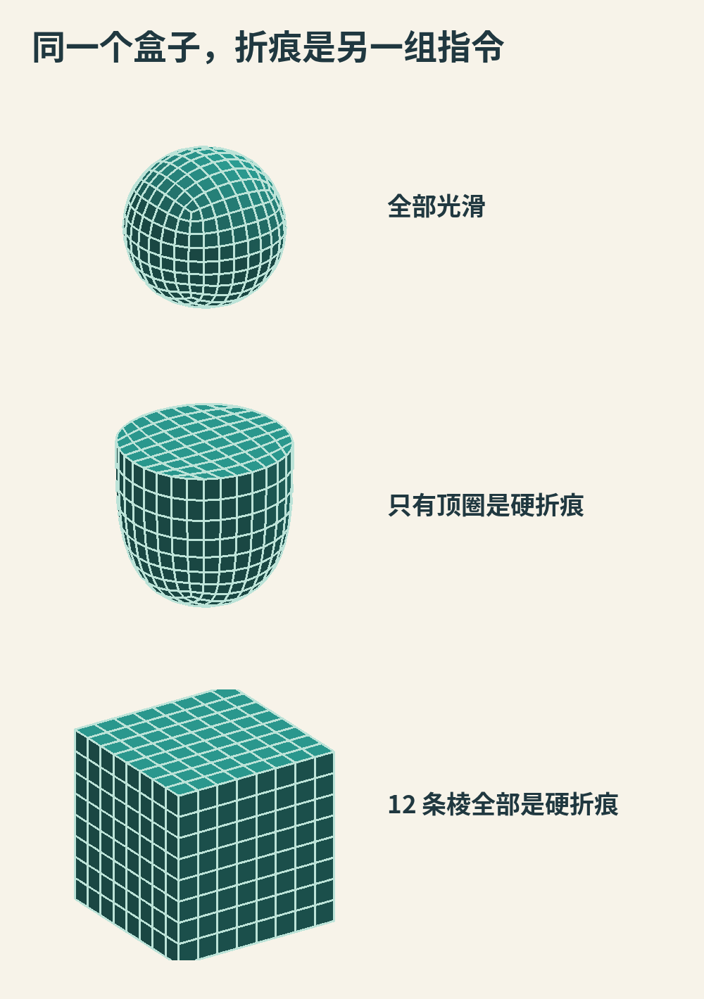

*三个都是第3轮、384个四边形的实际输出。中间顶盖仍存在；它与开口盒子的区别不能只靠轮廓猜。硬折痕在后续轮次传给对应子边。本文没有实现半锐折痕。*

现代工具还常有**半锐折痕**：它不是“永远完全尖锐”，也不等于“从第一轮起完全光滑”。细分级别中的锐度递减与过渡规则，会形成可控制的圆角效果。OpenSubdiv还有不同的锐度传播约定；一个软件界面里的“1”，不应不经核对就当成另一个软件里的同一程度。[OpenSubdiv折痕说明](https://github.com/PixarAnimationStudios/OpenSubdiv/blob/v3_6_0/documentation/subdivision_surfaces.rst#semi-sharp-creases)

另一种常用做法是添加**支撑线圈**：在想保住的棱附近再布置一圈控制边，让局部平均时更近的控制点留住形状。这与折痕标记的机制不同，也各有编辑成本。不要把“再加一条线”当成无代价：额外拓扑会沿着模型传播，影响后续布线、变形和维护。[OpenSubdiv建模建议](https://github.com/PixarAnimationStudios/OpenSubdiv/blob/v3_6_0/documentation/mod_notes.rst)

这里没有通用的“多细分几次就修好”按钮。预期的圆角、边界行为、网格连接和控制点位置，要一起设计。

## 十　变圆的同时，为什么也变小了？

第一轮算完P′=(5/9,5/9,5/9)，已经给出了线索：原本伸到外面的角，被周围的平均位置拉回来了。

在本例这些标准光滑规则下，新点由局部旧数据按非负权重组合；它们不会随意跑到局部控制点凸包外。凸包可以想成用一层拉紧的薄膜包住那些点形成的范围。对于原来的凸盒子，这种平均明显削弱了最外面的棱角。

但**收缩不是每个点都朝原点移动，也不是保持体积的一种操作**。顶面面点第一轮还在z=1；后来它作为新一轮的旧顶点，也会继续调整。整个网格的包围范围和体积怎样变化，要看形状与规则。

附带程序按固定对角线把每个四边形三角化，计算这一有限封闭三角网格所围的体积。初始盒子是8；第一轮约3.333333；第二轮约2.800938；第五轮约2.623163。这里没有单位，因为我们只指定了无量纲坐标。

这些数字是**本次有限网格及指定三角化的计算量**，不冒充精确极限曲面的解析体积，也不是橡胶、黏土或真实材料的体积实验。换成非共面的四边形时，显示与测量采用哪一种三角化本身也需要说明。

想设计一个指定尺寸的物件，通常要调控制笼，使最终表面达到目标；不能把粗笼子的外尺寸直接当成成品尺寸。更不能用细分操作代替物理上保持体积的变形模型。

## 十一　第五轮看着已经光滑，为什么还不叫“那个曲面”？

让我们继续追踪最初的P。因为对称性，它的x、y、z始终相等。

第一轮是5/9≈0.555556；第二轮约0.509259；第三轮约0.501543；第五轮约0.500043。

它正在靠近1/2，但第五轮没有恰好等于1/2。

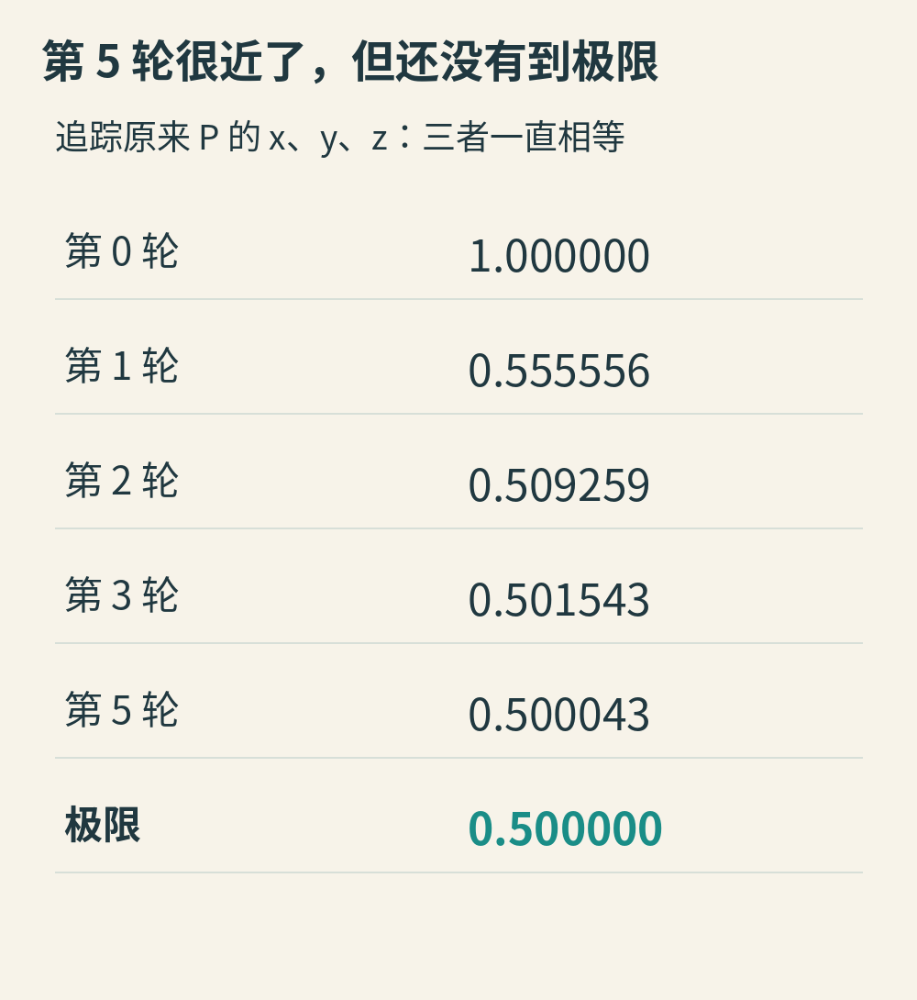

*数值由附带脚本实际计算，显示到小数点后6位。极限1/2另由全四边形内部点的极限权重核对，不是把第五轮四舍五入以后宣布“已经到达”。*

这引出了三种不同对象：

1. **最初的控制网格**：设计者方便编辑的粗笼子。
2. **有限轮细分网格**：点更多、形状更接近目标的新笼子。
3. **极限曲面**：把这个规则无限细分时所趋向的数学表面。

第一张变圆图片显示的是第2类。许多点已经很靠近第3类，但“很近”不是“就在上面”。给有限网格加平滑法线，只是让明暗变化更柔和；它不会自动把顶点移动到精确曲面上，也不会自动改变折线轮廓。

这还有一个初看有点反直觉的结论：如果我们从一开始就把“控制网格加细分规则”视为极限曲面的定义，那么按同一规则继续细化、保留对应的边界与折痕信息，并没有把那个已经定义好的极限表面一次次改成别的表面。**不断变化的是有限控制笼；它们指向同一个极限对象。**

OpenSubdiv的文档特别区分“细分”和“曲面离散化”：前者生成更细的笼子，后者在表面上求出采样点，再连接成可显示的网格。真正的实现可以直接求值或只细化需要的区域，不必真的把整个模型无限分下去。[固定版本的细分与离散化说明](https://github.com/PixarAnimationStudios/OpenSubdiv/blob/v3_6_0/documentation/subdivision_surfaces.rst#subdivision-versus-tessellation)

这一区分会影响游戏和引擎：屏幕远处只占十几个像素的小物件，没有必要用与近距离特写一样密的三角网格。计算成本取决于你怎样取得可显示的近似，而不是数学曲面有没有被完整“展开”。

## 十二　一个很诱人的错误：它最后会成为完美球体吗？

不一定。我们这个最对称的立方体，按本规则得到的极限表面也不是精确球面。

不用拿放大镜找视觉差异，算两条半径就够了。

全四边形内部点有一个可独立计算极限位置的权重公式：

**L＝[n²P+4Σ相邻顶点+Σ对角顶点]/[n(n+5)]。**

其中“对角顶点”，是与P同属一个四边形、却不与P直接连边的那个角；每张相邻面各取一个。这里要求周围全是四边形，并且使用本文的光滑内部规则，不能拿去直接算边界或硬折痕。[OpenSubdiv v3_6_0中的光滑极限权重实现](https://github.com/PixarAnimationStudios/OpenSubdiv/blob/v3_6_0/opensubdiv/sdc/catmarkScheme.h)

对最初的P=(1,1,1)，n=3：三个相邻顶点相加是(1,1,1)，三个对角顶点相加是(−1,−1,−1)。于是每个坐标都是：

**(9+4−1)/24＝1/2。**

这个极限点到中心的距离为√3/2≈**0.866025**。

再看顶面中心。它在第一轮被创建，位置(0,0,1)，价数4。它的四位邻居是顶面的四个边点，z都为3/4；同一圈四边形里的四个对角点是旧盒角的后继，z都为5/9。代入极限公式：

**z极限＝[16×1+4×(4×3/4)+4×5/9]/36＝68/81。**

x、y因对称性为0。所以这个点到中心的距离是68/81≈**0.839506**。

两个半径不相等。证据已经足够。

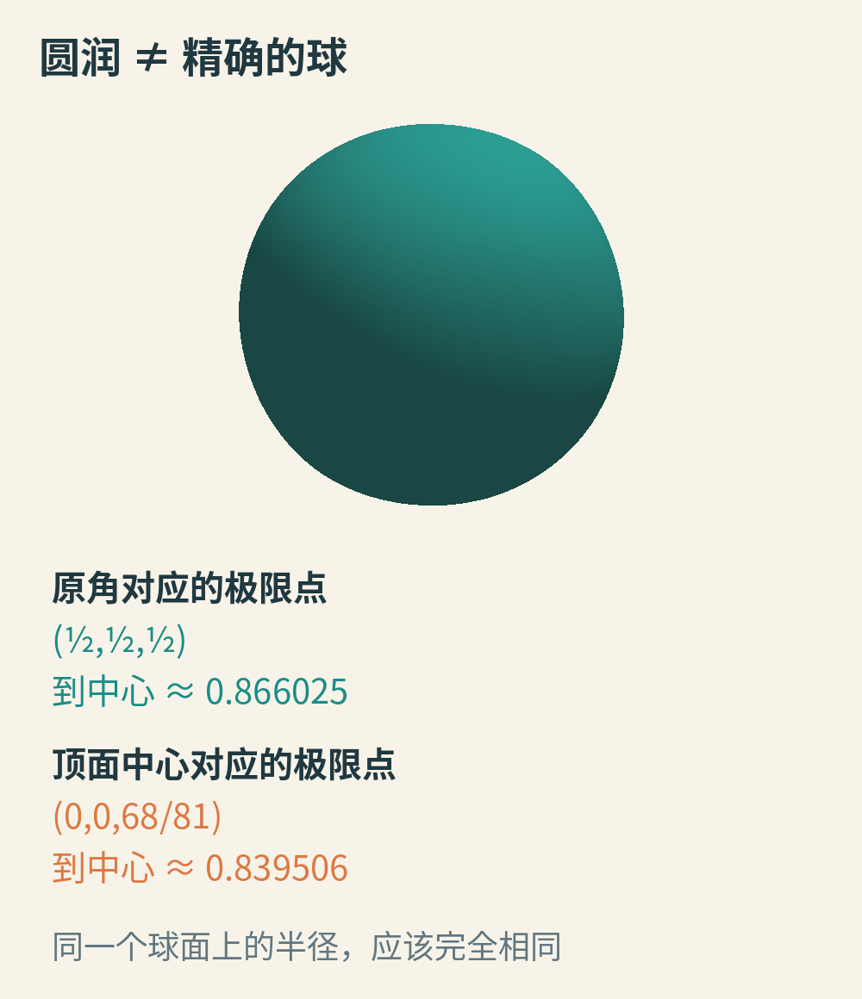

*上方为第5轮有限网格加插值法线的辅助显示，下面才是解析极限权重给出的判别。图片的圆滑外观不作为球面的证明。*

当然，你可以另加一步，把每个顶点沿径向投到指定球面上。但那是额外的几何操作，不能偷偷加入程序后，再用结果证明“Catmull–Clark本身会造出精确球”。

这也解释了本题与贝塞尔曲线文章的区别：我们不再只问四个控制点如何定义一段曲线，而是在问，一个带有任意连接结构的曲面控制网格，如何被递归处理。它同体素表面合并也不是同一个问题：体素网格优化通常希望保留原有方块边界，本文的光滑更新恰恰在改变有限笼子的形状。

## 十三　对称的盒子太容易“蒙对”，再做一个不对称检查

假如程序把左右两个点写反，立方体可能仍显得完全正常。漂亮的对称输入，既是教学的朋友，也可能是测试的盲区。

所以附带实验另建了一小片四边形网格：中心点的平面坐标是(0,0)，四个直接邻居位于(±2,0)、(0,±2)，四个对角点位于(±2,±2)。让中心高度z=2，只把其中一个对角点抬到z=4，其余点的z都为0。

对于这样的规则内部四价点，把Q、R展开，可以得到另一套等价权重：

- 中心点：9/16
- 四个直接邻居：每个3/32
- 四个对角点：每个1/64

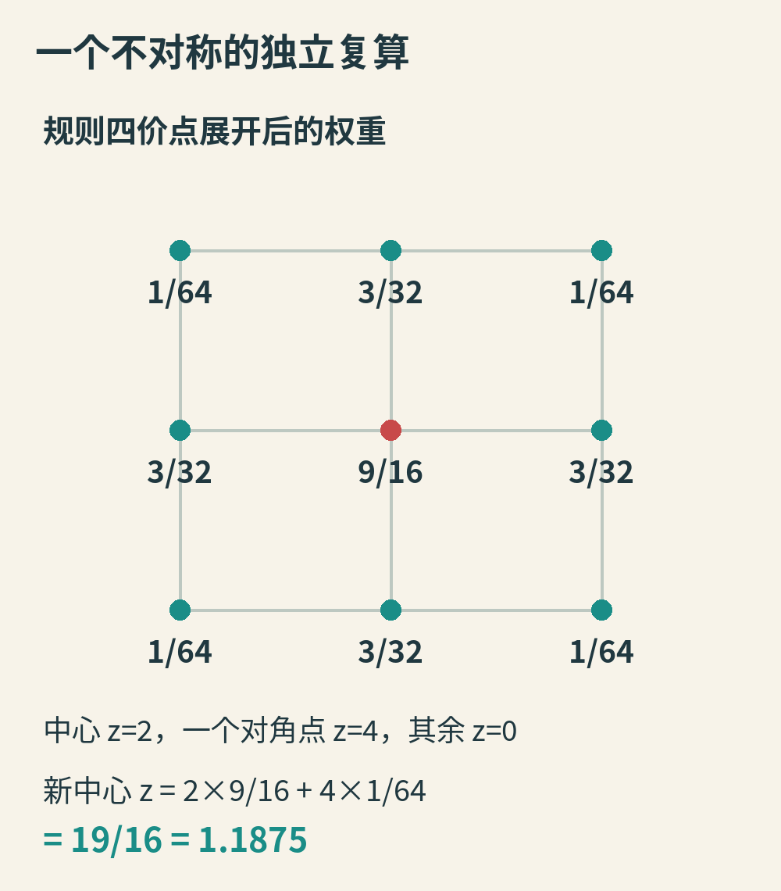

*原创独立验证图。这里是二维邻接排列，数字表示几何更新权重，不表示高度。高度条件写在图下方。九个权重加起来为1。*

因此新中心的高度应是：

**2×9/16+4×1/64＝19/16＝1.1875。**

程序分别用“面点—边中点—顶点规则”和这张九点权重模板算一次，二者必须一致。它还验证：把全部点先做非均匀缩放和平移，再细分，与先细分再做同样变换，得到的结果一致。

为什么值得检查平移？因为本来纯粹依赖相邻位置的算法，不应该因为模型从房间左边搬到右边，就把鼻子变成另一种形状。漏除一个系数、把缺失面点擅自填零，都可能破坏这种性质。

附带代码的范围刻意保持小：普通可定向二维流形网格、上述平滑边界、硬折痕。它不实现半锐折痕、纹理坐标规则、自适应细分或OpenSubdiv的完整接口；对于三张面共用同一条边、顶点周围裂成两片的“蝴蝶结”网格，会明确拒绝，而不是假装任意数据都能变好看。

## 十四　给想自己动手的你

[下载或阅读实验脚本](experiment/catmull_clark.py)，在它所在目录运行：

```sh
python catmull_clark.py
```

脚本只使用Python标准库。它会运行精确分数断言、独立权重例子、开口与折痕规则测试，以及0至5轮的拓扑检查，并输出[本次实际结果](experiment/results.json)。绘图另用NumPy与Pillow；没有网络输入，没有随机数，也没有调用商业软件。

可以按这个顺序继续探索：

1. 只改P的z坐标，把一个角向上拉。先猜哪些点在第一轮会变，再比较结果。第二轮，影响范围又如何传播？
2. 给盒子的顶面再加控制点，但不要补齐邻面连接。观察为什么“视觉上差不多接上了”并不等于拓扑正确。不要用一个会制造悬空边的网格来测试光滑度。
3. 把顶圈标成硬折痕，再与“删掉顶面”的版本比较。两者盒口顶点的第一轮位置相同，为什么整个表面仍不是同一个物体？
4. 每轮面数乘4。若从一个2万面的模型开始，统一细分五轮会到多少面？答案是2048万面。接着想：哪些区域真的值得分到这么细？
5. 把第5轮的平滑着色关掉，或者放大轮廓。分别观察“法线看着平滑”和“几何真的够细”之间的差别。

最后再看最初那只盒子。

电脑没有发现一把神奇的圆角刀，也没有认出“这是盒子，所以请变成球”。它只维护连接关系，反复用局部数据计算新位置。

但这组规则设计得足够巧：在规则区域，它能延续熟悉的样条结构；在不规则连接处，它仍给我们一条可操作的路。少量控制点负责表达意图，更细的网格或曲面求值负责呈现细节。

**真正值得带走的不是那三个公式，而是一种看待模型的方式：粗网格是你写下的形状说明，极限曲面是这份说明定义的对象，屏幕上的小面片则是你这一次选择怎样把它展示出来。**

## 来源、图像与复算说明

- 历史与原始规则：[Catmull、Clark，1978年论文](https://people.eecs.berkeley.edu/~sequin/CS284/PAPERS/CatmullClark_SDSurf.pdf)，尤其第350—354页；原文图片没有开放复用标识，本文不复制其图版。可以直接在原论文看历史细分结果。
- 实际制作背景：[DeRose、Kass、Truong，1998年论文出版记录](https://doi.org/10.1145/280814.280826)。本文仅据摘要说明其应用范围，不复用电影剧照。
- 固定版本规范：[OpenSubdiv v3_6_0官方文档](https://github.com/PixarAnimationStudios/OpenSubdiv/blob/v3_6_0/documentation/subdivision_surfaces.rst)、[建模建议](https://github.com/PixarAnimationStudios/OpenSubdiv/blob/v3_6_0/documentation/mod_notes.rst)与[权重代码](https://github.com/PixarAnimationStudios/OpenSubdiv/blob/v3_6_0/opensubdiv/sdc/catmarkScheme.h)。文中“参考此版本”不代表实验调用了OpenSubdiv。
- 完整出处、材料权利与图像清单见[sources.md](sources.md)。两张人物照片分别保持其原许可；原创正文与原创教学图采用[CC BY 4.0](https://creativecommons.org/licenses/by/4.0/)，原创实验代码另用MIT许可。

本文由AI辅助研究、推导整理、撰写和绘图。三维图来自本次公开输入与自写数值实验，不能据此声称在真实建模设备、电影制作管线或商业引擎中做过性能测试。
