# 函数已经返回，它为什么还记得那个变量？闭包把代码和来处装在一起

假设你在做一个小游戏。普通关卡结算时多加10分，挑战关卡多加100分。你不想写两份几乎一样的计分程序，于是写了一个“制造计分函数的函数”。

制造过程结束了，函数已经返回。过了很久，玩家才通关。

奇怪的是，普通关卡的计分函数仍然记得10，挑战关卡的仍然记得100。它们都只收到一个参数7，却分别算出17和107。

**那次已经结束的调用，是怎样把一条信息留给未来的？**

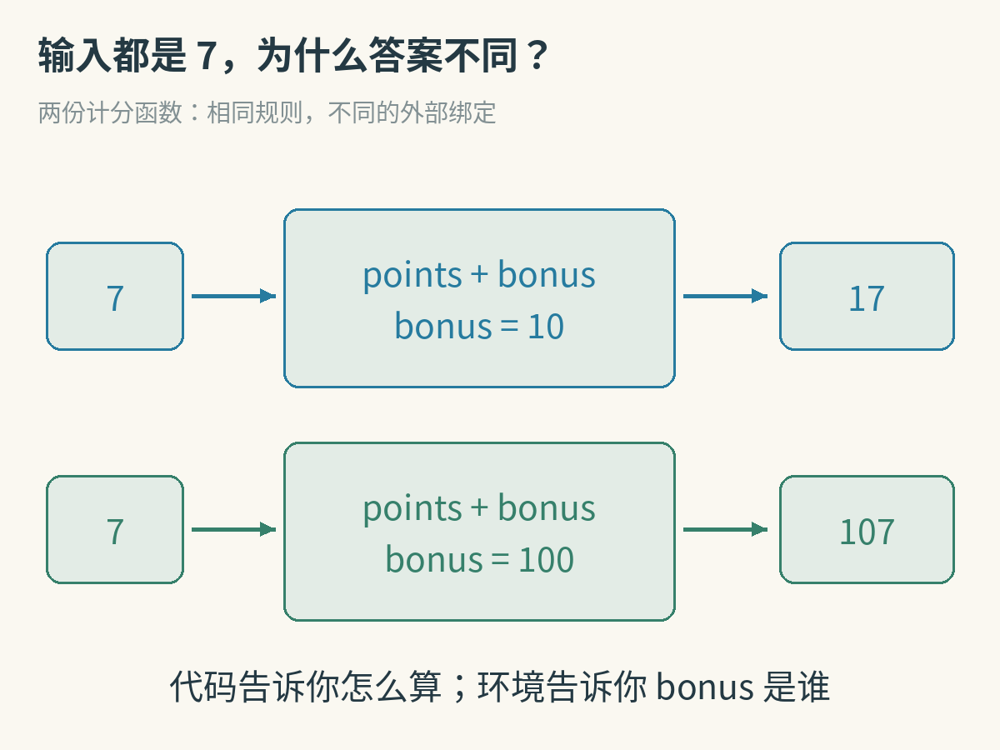

这是本文自设的计分模型。全部程序都在CPython 3.12.14里实际执行过，不是某个游戏引擎的截图或性能测评。你只需要认识变量、加法和函数调用；接下来我们会把容易混淆的词一层层拆开。

## 先分清：交出一道答案，还是交出一台小机器

代码只有几行：

```python
def make_score(bonus):
    def score(points):
        return points + bonus
    return score

normal = make_score(10)
challenge = make_score(100)
print(normal(7), challenge(7))
```

最后输出17和107。

`make_score(10)`先执行外层函数，把这次调用的bonus设成10。执行到里面的def时，创建一个函数对象；它要等到以后被调用，才会去算points + bonus。外层最后交出的score，就是这个函数对象。

请留意最后一行是return score，没有括号。它交出的是计算办法，不是此刻就执行score。normal随后指向这份办法；等到normal(7)，才把7交给里面的points。

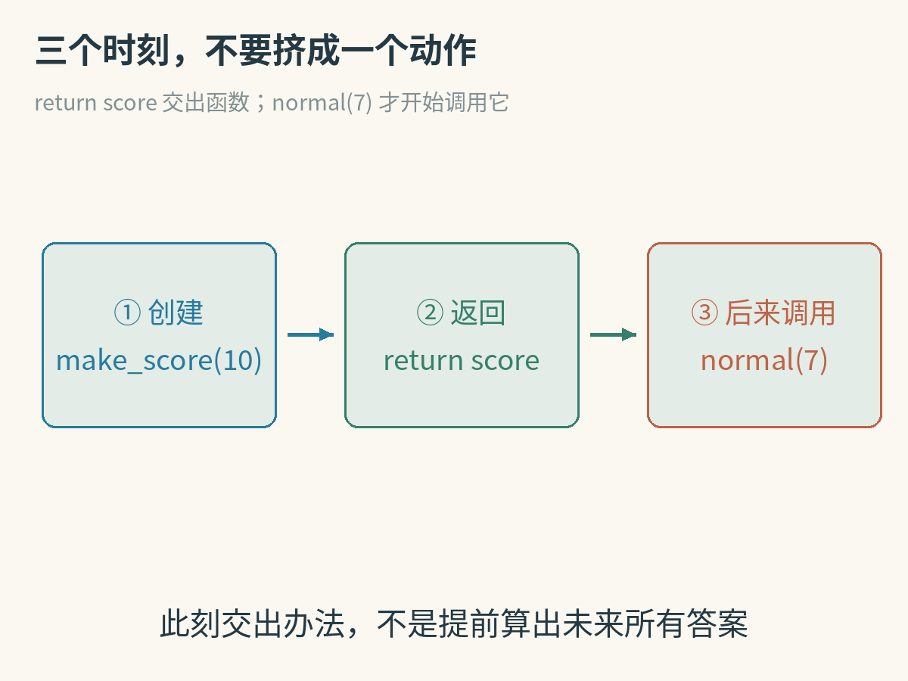

函数可以像别的值一样被保存、传给别的函数、作为结果返回，这通常叫函数是**一等值**。这不是说它比别的功能更高级，只是说它不必永远钉在某个调用位置上。

但光把“points + bonus”这行代码带走，还不够。

## points带了行李，bonus从哪里来？

调用normal(7)时，points从本次参数拿到7。可bonus不是score的参数，也没在score内部赋过值。

相对于这个内层函数，bonus是一个**自由变量**：它的绑定得到函数外部的环境里去找。“自由”并不意味着没有规则，更不是想取几就取几。

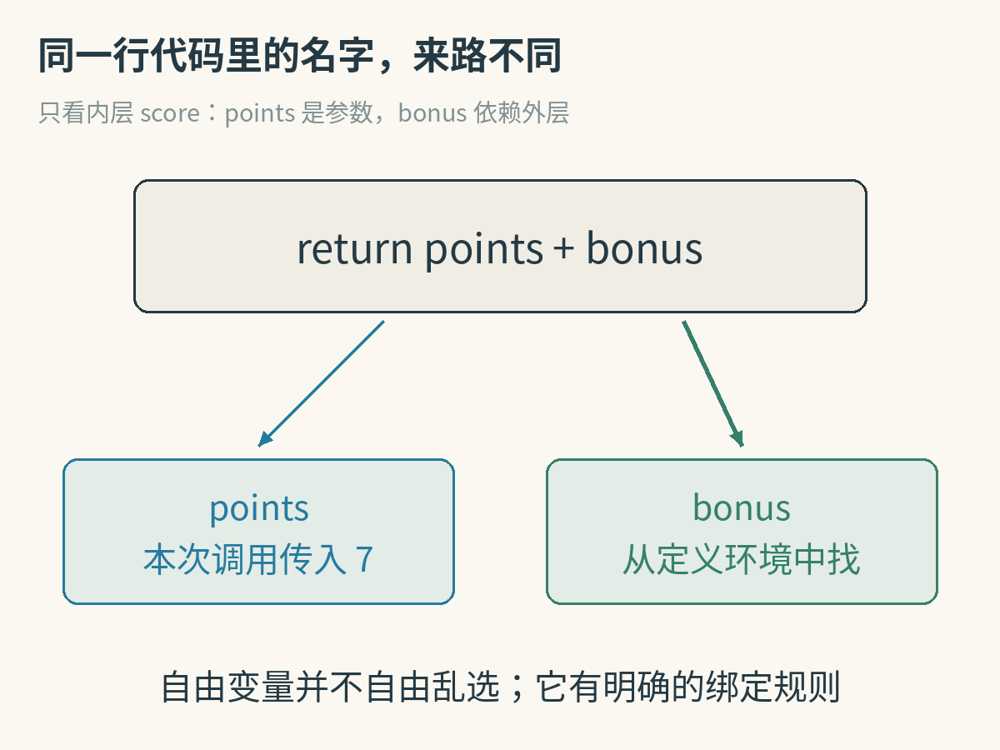

所谓**绑定**，先理解成“这个名字在这里指向哪个对象”。环境则是解释这些名字所需的信息。名字看上去一样，未必是同一次绑定；调用两次make_score，就会有各自的bonus。

把一份函数代码和它解释外部名字所需的环境绑在一起，就得到这里要讨论的**闭包**。

可以把它想成“操作说明加上配套的地址簿”。这比“函数把所有变量拍了一张合照”更准确，因为有些地址以后仍然会指向变化中的状态。

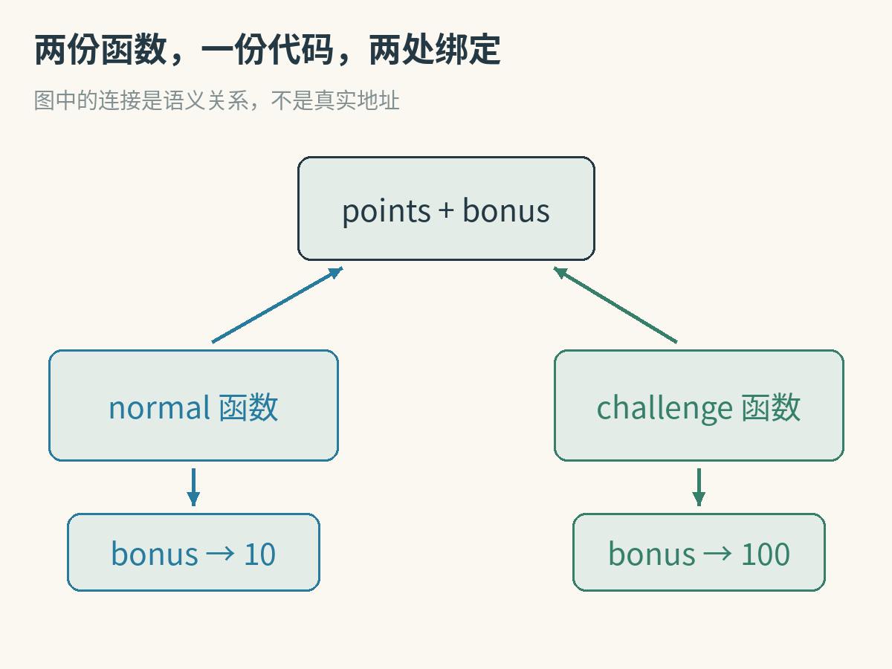

这个模型的重点不在于盒子该画在内存的哪个角落，而在于两条关系：去哪里找代码，去哪里解释代码里的外部名字。

## 返回结束的是调用，不一定是所有关联信息的寿命

初学函数时，经常会学到调用栈：函数开始执行时建立一份执行记录，返回后离开这次调用。

这很容易让人推出一个过强的结论：外层一返回，里面所有相关信息都必须立刻消失。

闭包要求运行时把两件事分开处理：**这次调用还在不在执行**，以及**返回的函数今后还需不需要某个绑定**。

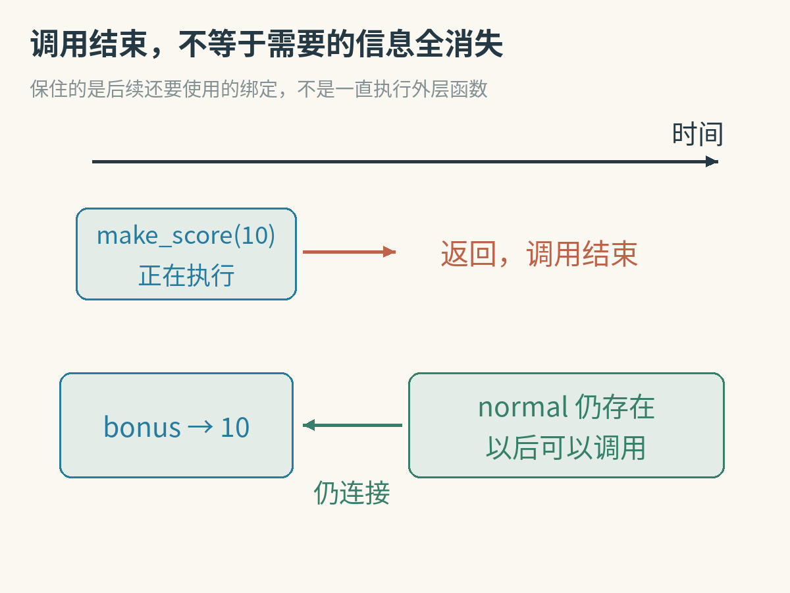

上图是语义关系示意，不是CPython真实内存地址的截图。实现完全可以把需要继续存活的信息单独保存，而不必把整个调用现场、所有临时变量和执行位置原样背走。

所以，闭包不是一个没有真正返回的函数，也不是偷偷暂停着的协程。score并没有在后台继续干活；直到你调用它，它才开始执行自己的函数体。

## 它记住的是定义处，还是谁来叫它？

再来一个容易暴露直觉漏洞的小实验：

```python
def use_score(fn):
    bonus = 1000
    return fn(7)

print(use_score(normal))
```

结果仍然是17，不是1007。

为什么？normal需要的bonus来自它的定义环境，不会因为调用者恰好也有一个同名变量，就临时换过去。

这种主要依据程序的嵌套结构来决定名字归属的规则，叫**词法作用域**。可以先把“词法”读成“看代码写在哪里”，而不是“沿着这次是谁调用谁的路线去猜”。

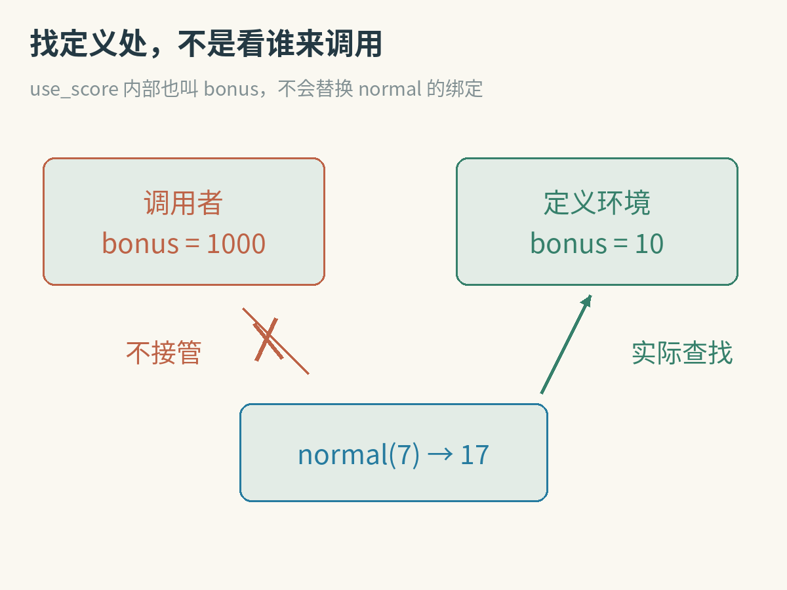

这里有个细微但重要的区分：一个名字属于哪一个外层绑定，可以由代码结构确定；而那个绑定当前关联什么值，仍然可能在运行时改变。**词法作用域并不等于所有值都在定义函数时被冻结。**

下面马上就会看到一个会变的例子。

## 1964年，Landin给“函数连着环境”一个清楚的位置

在1964年的《The Mechanical Evaluation of Expressions》里，Peter J. Landin讨论了怎样机械地求表达式的值。论文316—317页把一组包含表达式及其求值环境的信息称为closure，并接着描述怎样应用它。[原论文](https://www.cs.tufts.edu/comp/150FP/archive/peter-landin/mechanical-eval.pdf)


Peter Landin肖像；Queen Mary University of London通过EurekAlert公开提供，图片署名Daniel Landin，作品页标注Public Domain及No restrictions。此处保留原站公开提供的603×700版本，拍摄年份未核，不把它说成1964年现场照片。

论文还用四个部分描述求值状态：S保存中间结果，E保存名字的环境，C表示待处理的表达式，D保存之后需要恢复的状态。四个首字母组成SECD。

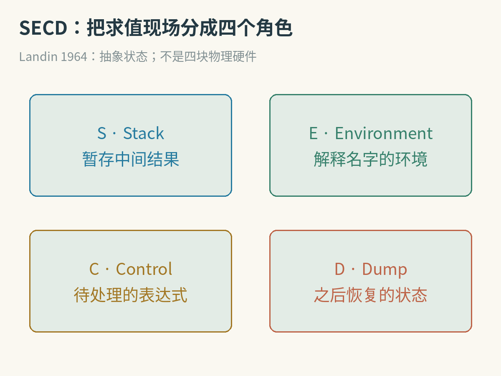

它是一台**抽象机器**：一组能逐步执行的状态和转换规则，不是照片里该出现的那台古董计算机。本文这张图也不是在复原某块历史电路板。

这里最值得带走的思想很小：函数的行为不只是那几行字，还取决于它解释名字的环境。本文没有把1964年的形式系统直接等同于Python 3的全部语法、可变状态或存储布局；几十年后的语言实现有它自己的规则。

## 打开Python的小窗口，看见它到底留下什么

Python提供了一些检查函数属性的办法。在我们的例子里，可以这样看：

```python
print(normal.__code__.co_freevars)
print(normal.__closure__[0].cell_contents)
```

输出分别是`('bonus',)`和10。

第一行是这份代码需要从闭包读取的自由变量名。第二行取出对应cell的内容。cell可以先理解成一个供函数共同访问的绑定位置；它并不是“把10写死进加法指令”的同义词。[Python3.12数据模型](https://docs.python.org/3.12/reference/datamodel.html#user-defined-functions)

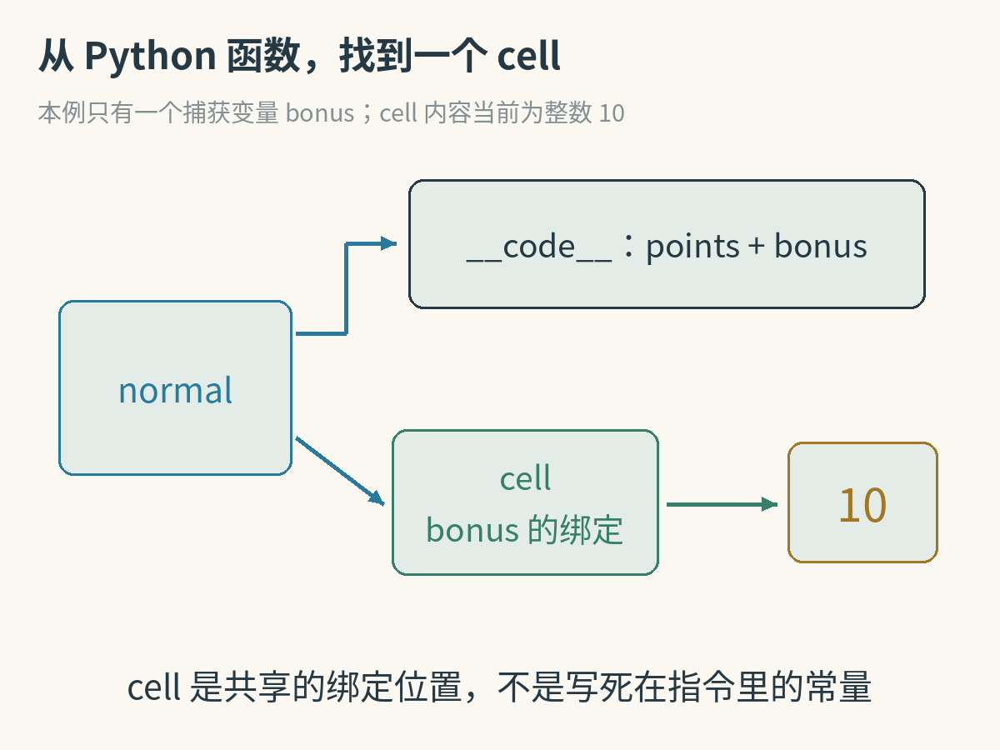

这次CPython运行还核出了一件事：normal与challenge使用同一个代码对象，但bonus所在的cell不是同一个，内容分别是10和100。

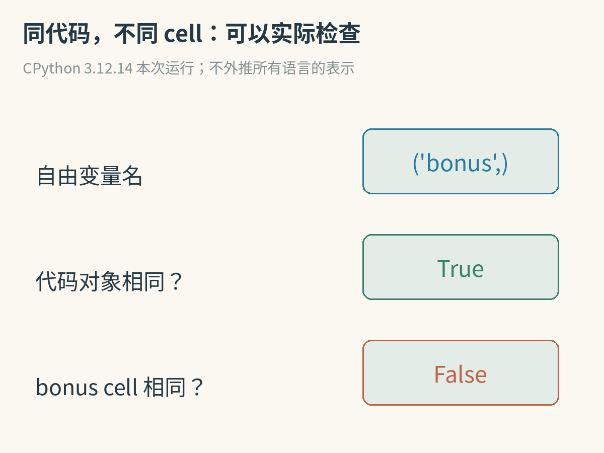

这是特定实现里能看见的证据，并不要求每种语言都采用名叫cell的对象。也别把`__closure__`当成函数携带的一切：Python函数还有指向模块全局命名空间的`__globals__`等等。本文只沿着“外层函数的局部绑定”这一条线往下看。

## 同一个“记忆位置”，可以让两个函数合作

如果闭包只能记住常量，它也已经很有用了。但我们还想造一个会记数的小装置：一个按钮加一，一个窗口读出当前的数。

```python
def make_counter(start=0):
    count = start
    def add():
        nonlocal count
        count += 1
        return count
    def read():
        return count
    return add, read
```

这里一次返回两个函数。add和read都在同一次make_counter调用里定义，所以它们访问的是同一个count绑定。

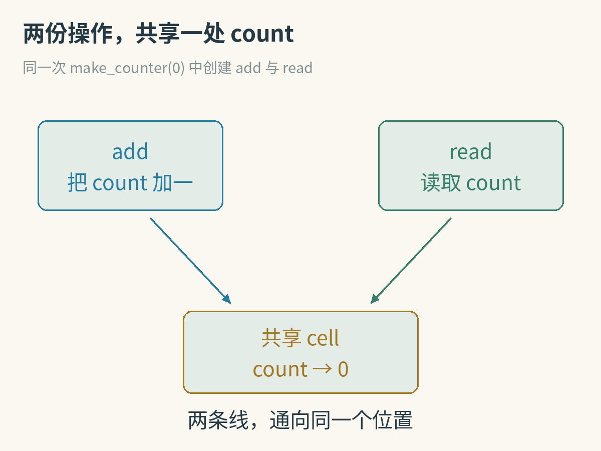

执行`add_a, read_a = make_counter(0)`，第一次add_a()得到1，第二次得到2，然后read_a()也读到2。

如果它们各自拍了一张“创建时count等于0”的照片，read_a就只能一直读0。实际结果说明，它们共享的是一处可更新的绑定。

对这里的整数来说，count += 1会让绑定关联到新的整数结果，而不是把不可变的整数对象0本身改成1。图里改动的是那个格子当前指向哪个值。

为了把两套装置放进同一张账本，我们重新创建A和B：`add_a, read_a = make_counter(0)`，`add_b, read_b = make_counter(100)`。现在按顺序调用A加、A加、B加、A读、B读，结果是1、2、101、2、101。

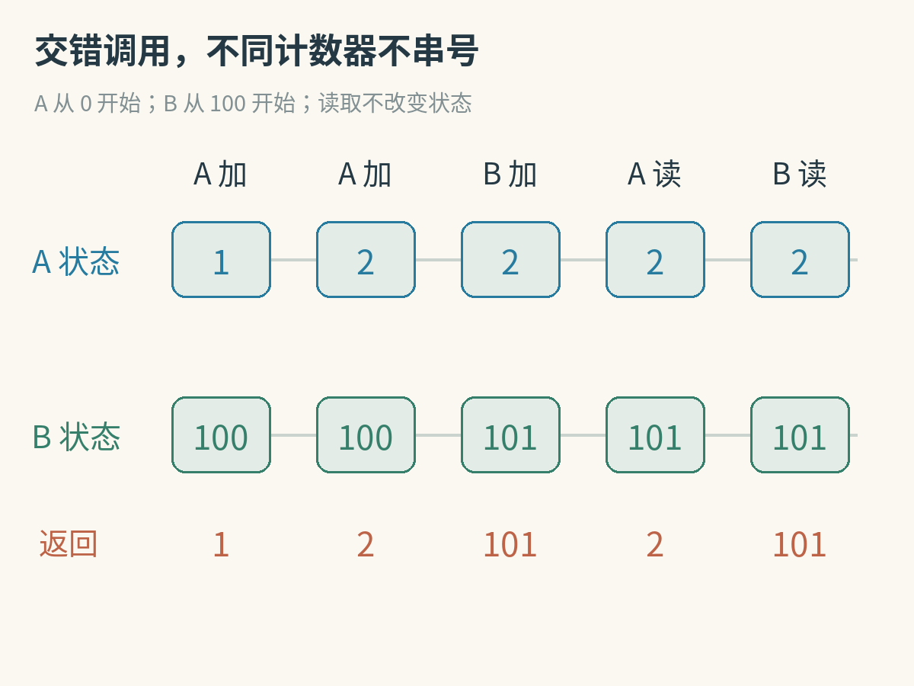

同样一份源代码、同样一个变量名count，并不意味着全世界只有一个计数器。区分它们的是不同调用产生的绑定。

## 多一个名字，不等于多造一份记忆

那如果写`also_add = add_a`，会得到另一套独立计数器吗？不会。

also_add和add_a指向同一个函数对象。上面的A已经到2，此时also_add()得到3，read_a()也读到3。

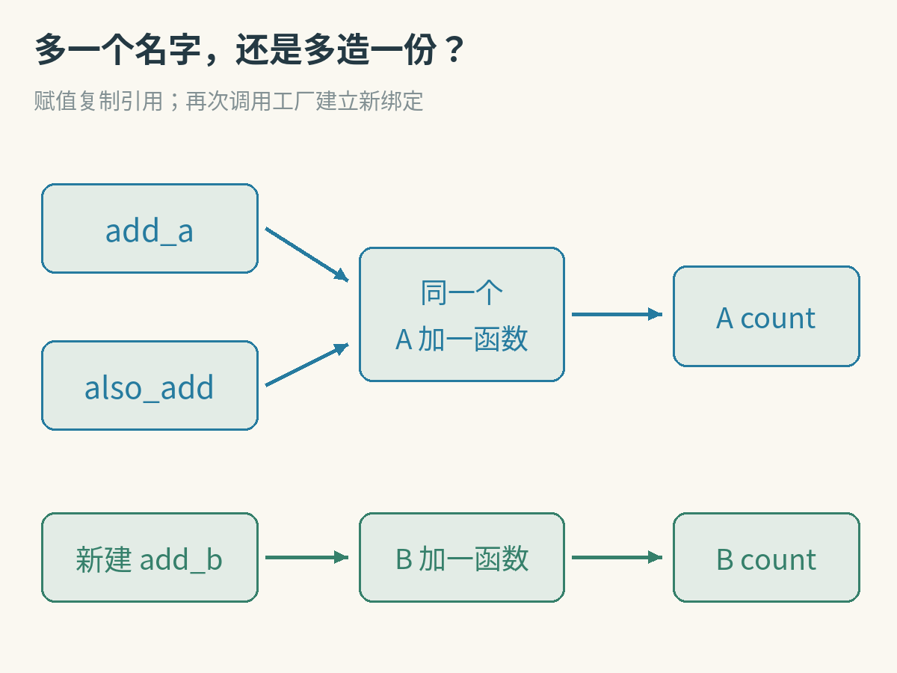

所以调试的时候不能只数变量名。你得问：这些名字指向几份函数对象？这些函数又连着几份环境？其中哪些绑定是被共享的？

## nonlocal为什么不是可有可无的一行？

在add里删掉nonlocal count，然后直接执行count += 1，会得到UnboundLocalError。

Python看到函数体里对count有赋值，就会按规则把它当成这个函数的局部名字，除非有相应的声明。可这句加一又需要先读取旧的count；局部count还没绑定到值，于是出错。

nonlocal的意思是：这里要重新绑定的count，来自最近的、已经存在该绑定的外层函数作用域。[当前语言规则](https://docs.python.org/3.12/reference/simple_stmts.html#the-nonlocal-statement)

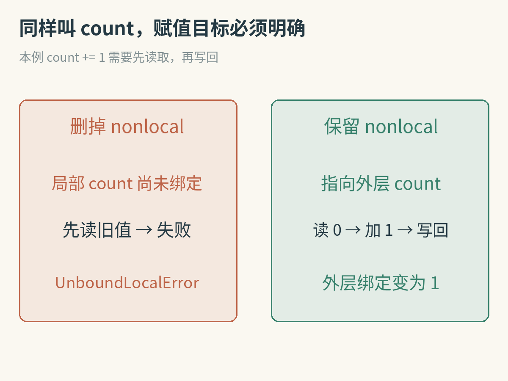

read只是读取count，没有对这个名字赋值，所以不需要同样的声明。对列表执行append又是另一类操作：改变对象内容和重新绑定名字不是一回事。别把nonlocal概括成“只要修改任何东西都必须写”。

## 三个按钮为什么全说自己是C？

现在给游戏界面准备三个回调。回调就是先交给别人保存、等事件发生时再调用的函数；我们用普通函数调用模拟点击，不启动真实界面。

```python
def make_buttons():
    buttons = []
    for label in ["A", "B", "C"]:
        def click():
            return label
        buttons.append(click)
    return buttons

buttons = make_buttons()
print([fn() for fn in buttons])
```

输出`['C', 'C', 'C']`。

for在同一次外层函数调用里，反复更新同一个label绑定。创建了三个click函数，并不代表创建了三份独立的label绑定。

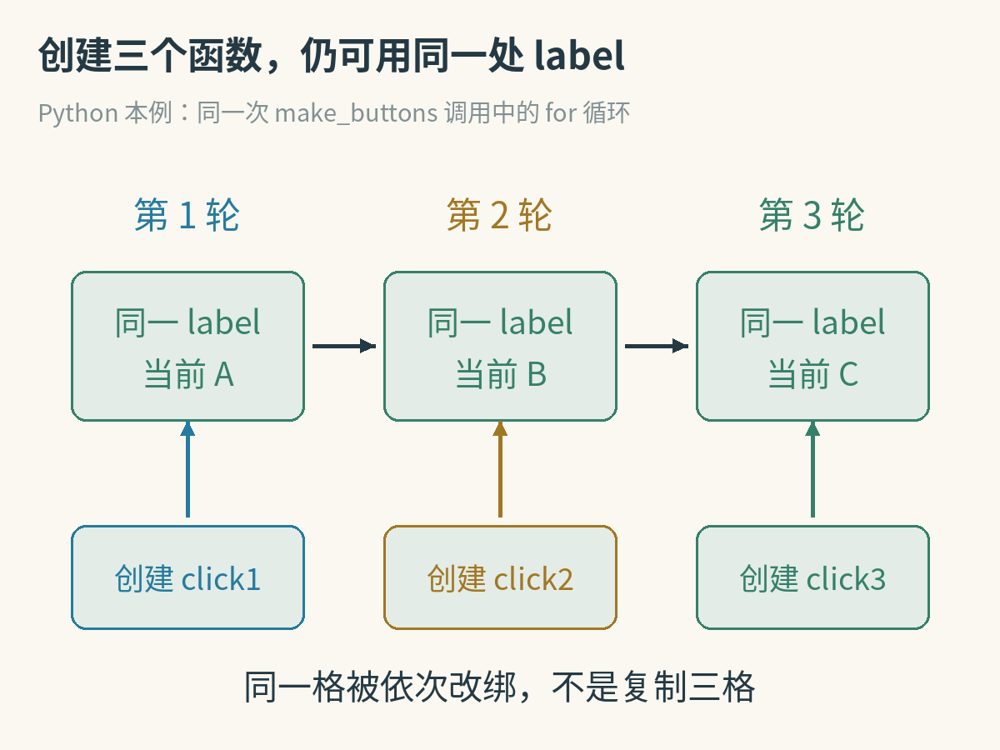

等循环结束再调用时，label当前关联的是C。三个函数都沿着自己的连接去找它，于是得到相同的答案。

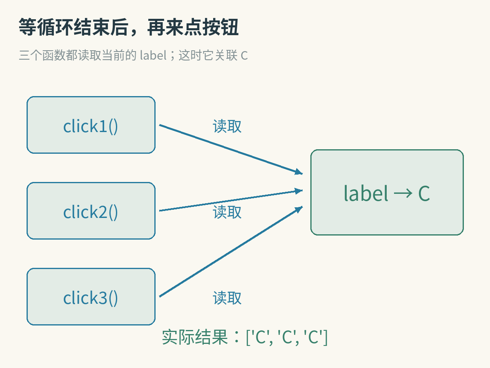

这不是匿名函数lambda独有的毛病；我们整个例子用的都是def。也不是“Python闭包总是错的”，而是程序保存下来的关系，和我们期望的三份快照不一样。

这一段说的是Python的这段循环。其他语言、其他声明方式可能为每次迭代建立不同的绑定，不能把这个结果抄成跨语言的定律。

## 真想要三份，就明确制造三份

第一种办法是再放一个小工厂：

```python
def make_button(label):
    def click():
        return label
    return click

buttons = [make_button(x) for x in ["A", "B", "C"]]
```

三次调用make_button，建立三次label绑定。后来逐个调用，便得到A、B、C。

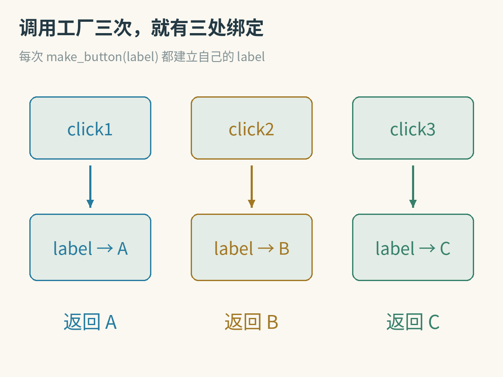

第二种常见写法是在原循环里用默认参数：`def click(saved=label): return saved`。

默认参数表达式在执行这次def时求值，结果保存在该函数的默认参数里。后来不传参数调用click，局部参数saved就取到对应的默认值。这时函数体不再读取外层label。

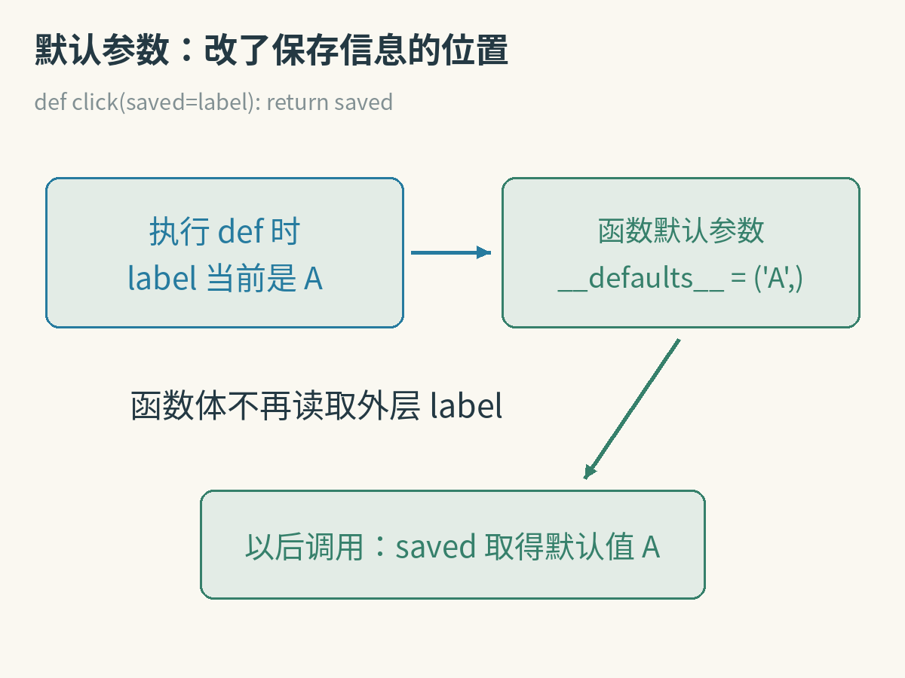

这个版本确实得到A、B、C，但机制和“又创建一个捕获label的闭包”并不相同。在本例里检查`__closure__`会是None，相应字符串保存在`__defaults__`里。

而且，保存默认值并不意味着深复制任意对象。如果默认参数保存的是一个列表，别的代码往同一个列表里加东西，函数以后也能看见。

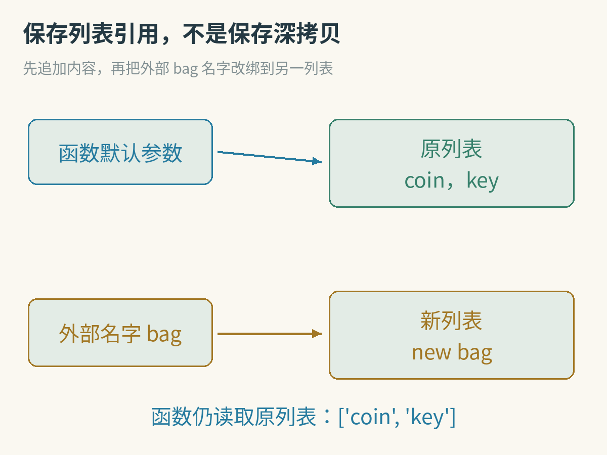

配套实验用`['coin']`起步，随后向同一个列表追加`'key'`，函数读到了两项。再把外部bag这个名字改绑到新列表，不会自动替换函数已经保存的旧列表。

**什么时候取值、保存的是哪种关系、后面改的是关系还是对象**——这是三个要分开问的问题。

## 从语言魔法，走到编译器能处理的材料

闭包听起来抽象，其实可以手动把它拆成一份普通数据加一个普通函数：

```python
def score_code(env, points):
    return points + env["bonus"]

normal_pair = (score_code, {"bonus": 10})
code, env = normal_pair
print(code(env, 7))
```

仍然输出17。

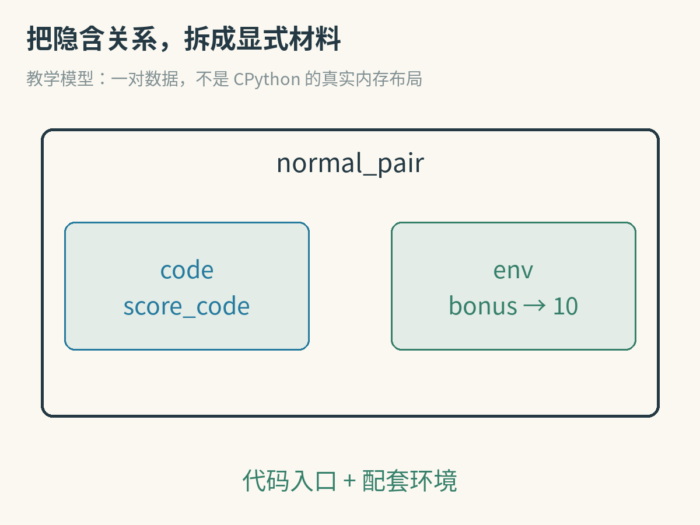

原来藏在函数外面的依赖，变成了显式传入的env。调用者取出代码，再把这份环境和普通参数一起交进去。

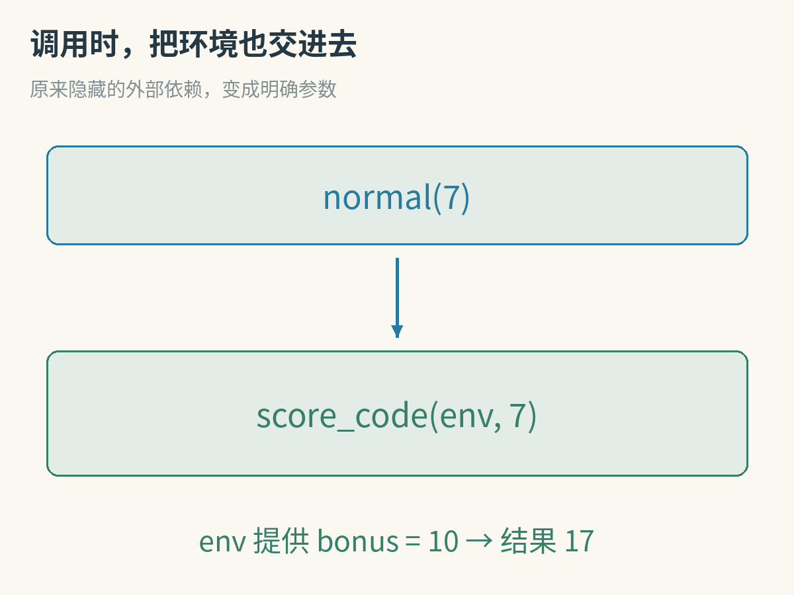

这种把环境依赖变成明确数据和参数的方向，和编译器里的**闭包转换**有关。上面这个只是帮助理解的手写模型，不是CPython逐行生成的真实机器代码。真正的编译器还要考虑类型、布局、共享、逃逸和优化。

尤其是可变计数器：如果add和read原本共享count，转换之后也必须共享对应的存储。把环境随手复制成两份独立整数，会悄悄改变程序的含义。

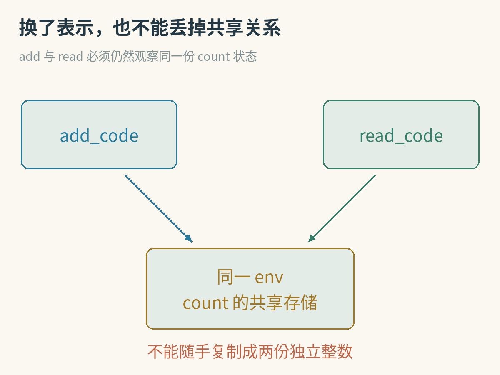

反过来，实现也不必机械地保留每一个从定义处“看得见”的临时对象。只要程序语义允许，环境可以只保存真正需要的绑定；某些环境还可能被优化掉。图上那些整齐的方框是关系模型，不是“每个闭包固定占多少字节”的承诺。

## 留一个能用纸笔推完的小实验

重新创建A，从5开始；再让alias指向A的加一函数。另行调用工厂创建B，也从5开始。

依次调用A加一、alias加一、B加一、A读取，结果应该是什么？

先画箭头，再看答案：6、7、6、7。前两个名字通往同一个计数状态，B来自另一次调用。

你还可以把三个按钮的实验改成“创建一个就立即调用一次”，再和“全部创建完之后才调用”比较。差别不在于函数有没有名字，而在于读取label的时刻。


[完整实验](examples/closure_lab.py)保留了所有这些例子。在这次CPython运行中，2501组整数输入核对了闭包与显式代码—环境模型的一致性；另外用固定随机种子1964，对五个计数器的10000次交错操作，与独立的整数记录逐项比较。它们检查的是本文的例子，不是在证明所有语言的所有闭包实现。

回到那个迟迟才通关的玩家。计分函数并没有把已经结束的调用“复活”。它只是仍然握着解释自身代码所需的那条线。

理解闭包，最重要的也不是背出一句“函数加环境”。而是在遇到一个外部名字时，能具体指出：**它属于哪次定义与调用留下的绑定，谁还连着它，什么时候去读取它。**

图片来源：22幅原创程序关系教学示意；Landin肖像为原站公开提供版本，署名与权利声明见[sources.md](sources.md)。所有图示均不宣称是真实内存地址、编译器截图或游戏界面实测。
