# 只有一个油门，为什么能同时管位置和速度？从小车停车认识可控性

游戏里有一辆在直线上滑行的小车。你让它到右边1米处停下。

第一次，它经过了1米标记，速度却还很快，下一瞬间就冲了出去。第二次，它同样到了1米处，轮子终于不再前进。

两个画面里，小车的位置一模一样，任务却只有第二次完成。因为“停在1米处”其实藏着两个要求：**位置是1米，速度是0。**

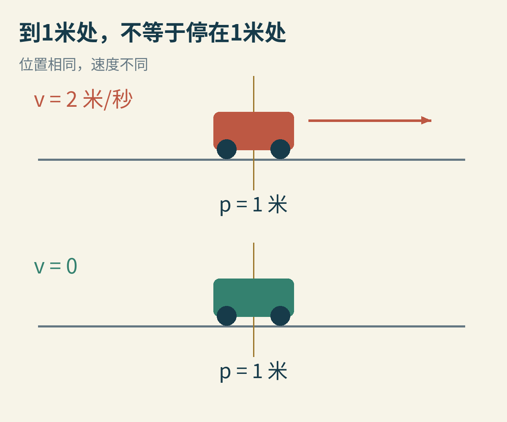

现在再加一条限制：你手上没有“瞬移到指定位置”的按钮，也没有单独设置速度的按钮。你只有一条命令，决定接下来向右加速、向左加速，还是不加速。

一条命令，真能同时管好两个要求吗？如果再多放一辆车，让两辆车共用这条命令，又会怎样？

这正是可控性要先回答的问题：**在规定的运动规律和输入方式下，有没有办法把系统送到想要的状态？** 至于哪种办法更省力、更稳健，得稍后再问。

## 1. “状态”是让未来接得下去的信息

只拍一张位置照片，不足以预测小车下一秒在哪里。你还得知道它正往哪边走、走得多快。

我们把位置记作p，单位米；速度记作v，单位米每秒。正号表示向右，负号表示向左。用一对数(p, v)表示小车的状态。


这里说的状态，指的是对选定模型而言、配合后续输入就足以确定后续运动的那点信息。它不要求囊括所有能测到的东西。车轮温度、电池电量、空气阻力，我们暂时都不管——因为稍后会明确把它们排除在模型之外。

同样要紧的是，状态和输入不是一回事。位置、速度描述小车现在怎样；输入u描述我们接下来让它以多大的加速度运动，单位是米每二次方秒。

一个系统有两个状态，并不自动要求有两个独立按钮。关键还在于：**今天按下的按钮，明天会留下什么影响。**

## 2. Kalman 的问题，比“怎样调大反馈”更早一步

1960年，Rudolf E. Kalman在《Contributions to the Theory of Optimal Control》里，把可控性和可观测性放到了理论的核心位置。他在开篇说明，论文采用状态与微分方程这条路径来处理调节问题，并把引入和运用这两个概念列为主要贡献。[原论文重印扫描](https://liberzon.csl.illinois.edu/teaching/kalman_paper.pdf)


图：ETH-Bibliothek Zürich, Bildarchiv / Fotograf: Unbekannt / HK_04-01925 / CC BY-SA 4.0。档案日期为2007年12月27日；这是较晚的肖像，并非1960年写论文的现场。原文件未改，来源及许可见[图片档案](https://commons.wikimedia.org/wiki/File:ETH-BIB-Kalman,_Rudolf_E._%281930-2016%29-HK_04-01925.jpg)与[CC BY-SA 4.0](https://creativecommons.org/licenses/by-sa/4.0/)。

论文第5节先精确定义了“能不能用输入把状态送到零”，然后对常系数线性系统给出一个秩条件，并讨论从一个状态转移到另一个状态。它检查的是一件很基本的事：**控制输入有没有触及我们需要改变的全部方向。**

接下来我们用一台每秒更新一次的小车模型，把这种想法重新走一遍。它是本文自设的教学例子，不是原论文里的实验装置；所用的离散时间表达，可以和Stephen Boyd的[状态转移讲义](https://ee263.stanford.edu/archive/contr.pdf)对照着看。

如果你读过卡尔曼滤波，那里主要问的是“带噪声时怎样估计状态”。这篇换了个问题：即使状态知道得一清二楚，执行器是不是真的能把它改成目标？

## 3. 先把小车的世界规定清楚

我们只研究一维、无摩擦的小车。它没有障碍物，没有速度上限；加速度可以正，也可以负。负加速度并不意味着“速度立刻变负”，它只是让速度往更小的方向变化。

命令每隔1秒更新一次，并在这一秒内保持不变。把第k秒开始时的状态写成(p_k, v_k)，把接下来一秒的加速度写成u_k。

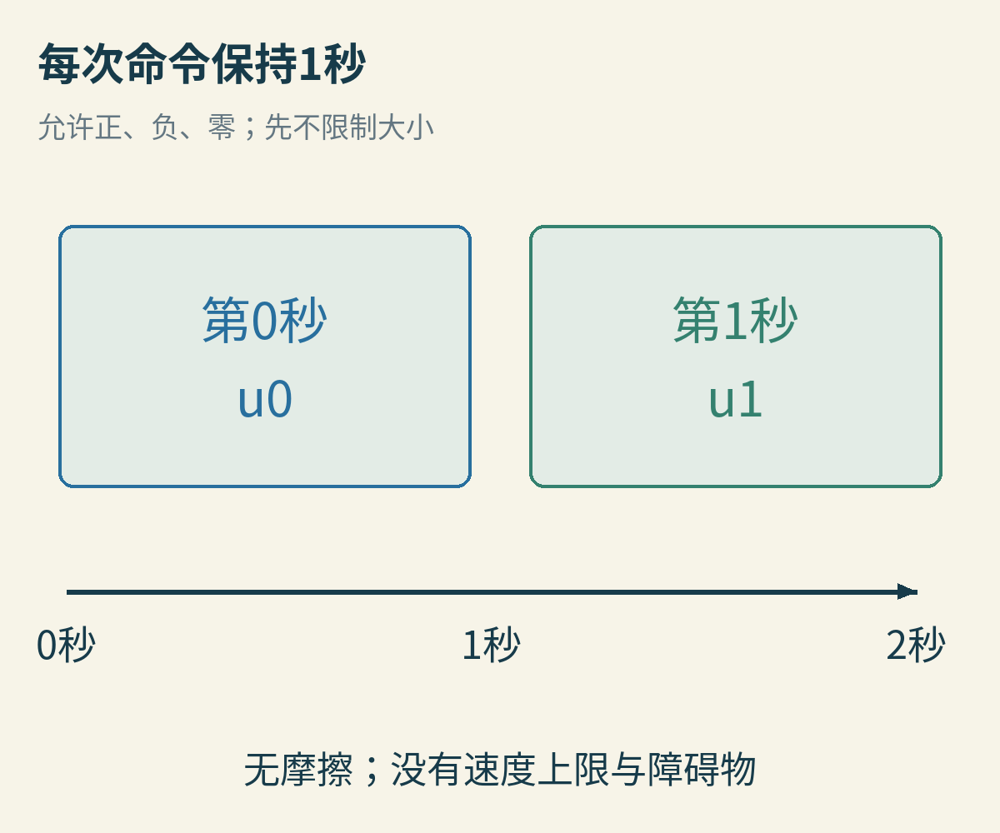

初中物理的匀加速公式就够用了。如果一个区间长度是h秒：

**下一个位置 = 当前位置 + 当前速度 × h + 加速度 × h² / 2。**

**下一个速度 = 当前速度 + 加速度 × h。**

本文把h固定为1秒。于是当p、v、u分别用米、米每秒、米每二次方秒记录数值时，更新式就简写成：

**p_(k+1) = p_k + v_k + u_k / 2**

**v_(k+1) = v_k + u_k**

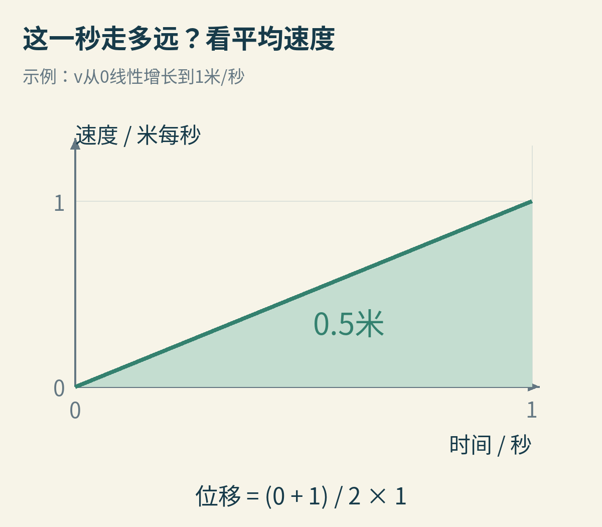

位置里为什么有一个u/2？因为加速度把速度从v匀速改到v+u，这一秒的平均速度就是v+u/2。

这两条式子对上面那个“每段恒定加速度”的理想模型是精确成立的，并不是随手拿一阶近似去替代真实运动。以后要是把时间间隔改成0.1秒，h和h²就得一起改回来，不能还照抄数字系数1和1/2。

## 4. 只给一秒，两个目标确实绑在一起

从静止的原点出发，状态是(0, 0)。给一个加速度u，一秒后便是：

**(p_1, v_1) = (u/2, u)。**

让u=2，能到1米处，可速度是2米每秒。让u=0，速度能保持为0，但位置也还是0。

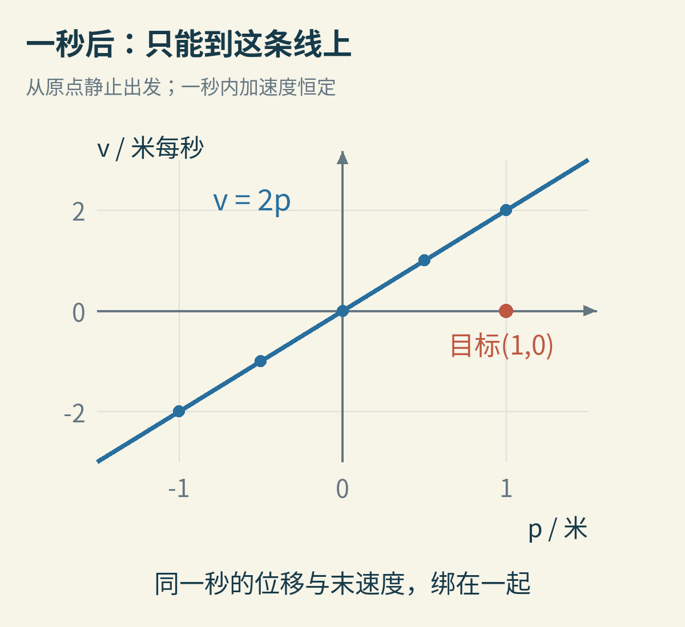

这张图的横轴是位置p，纵轴是速度v。它画的是另一回事——一张“状态地图”：一个点同时记下位置和速度。

不管u取多少，终点都只能落在这条v=2p的线上。目标(1, 0)不在线上，所以在“一秒一条恒定命令”这个规则下，**一秒完成不了这次停车。**

注意这里的范围。我们没有证明连续变化的任意加速度也不行；我们讨论的只是已经约定的控制更新时间和输入形状。

## 5. 多给一秒，事情突然变了

试试第一秒u_0=+1，第二秒u_1=−1。

第一秒结束：位置0.5米，速度1米每秒。

第二秒开始时，小车已经在往右走。向左的加速度让它减速，但这一秒里速度还没反向；它又向右走了0.5米，最后速度降到0。

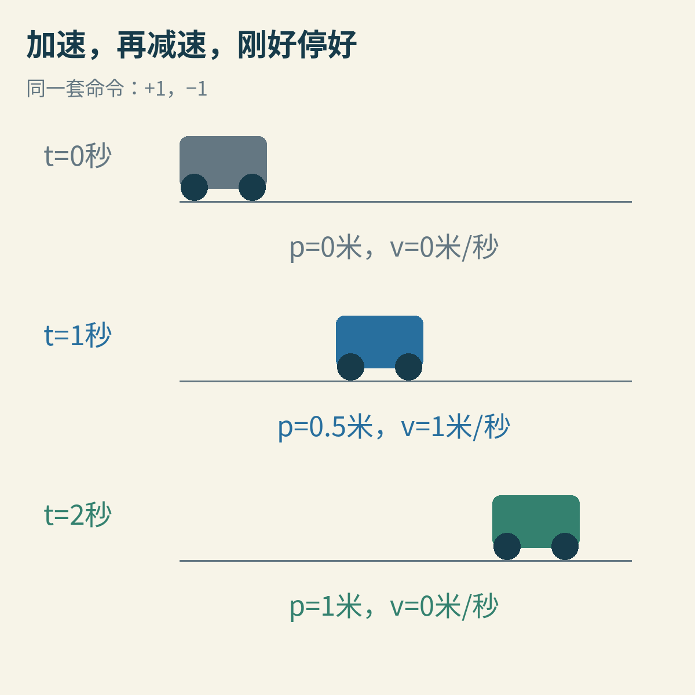

两秒后的状态正好是(1, 0)。

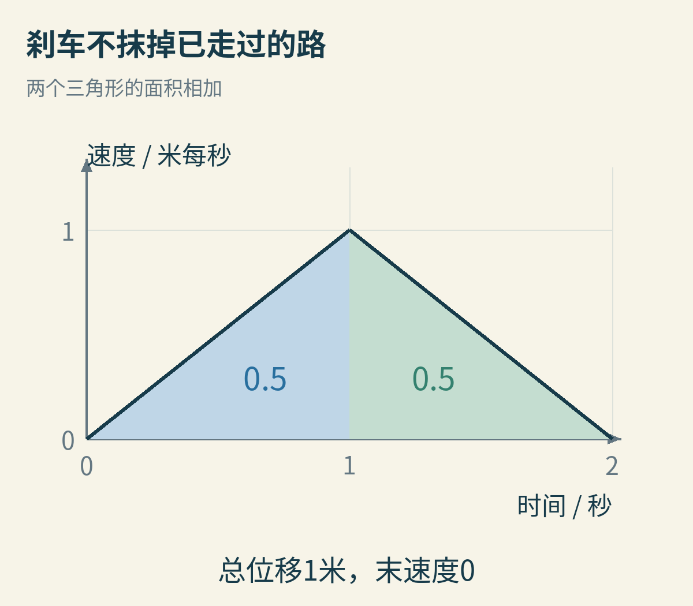

用速度图再看一次：第一个三角形面积是0.5米，第二个也是0.5米。两次加速度在最终速度上互相抵消了，可已经走过的距离并不会消失。

**刹车能消掉速度，却抹不掉此前发生的位移。** 这就是一个输入能够控制两个状态的线索。

下面的动画按同一模型计算，时间从0到2秒，每帧相隔0.1秒。车的位置、速度和加速度都来自上面那两条公式；轨道是示意，不是实物拍摄。1秒处命令切换为−1，2秒后改为0以保持停车。

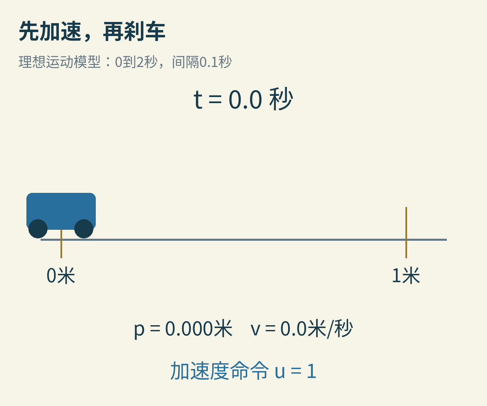

## 6. 同样推一下，早推和晚推不是同一个方向

先把两秒后的状态完整展开。

第一秒后是(u_0/2, u_0)。第二秒继续更新，得到：

**p_2 = 1.5u_0 + 0.5u_1**

**v_2 = u_0 + u_1**

最终速度对两次命令一视同仁；最终位置却给第一次命令留了更大的系数。为什么？因为第一次加速留下的速度，还会在第二秒里继续搬运小车。

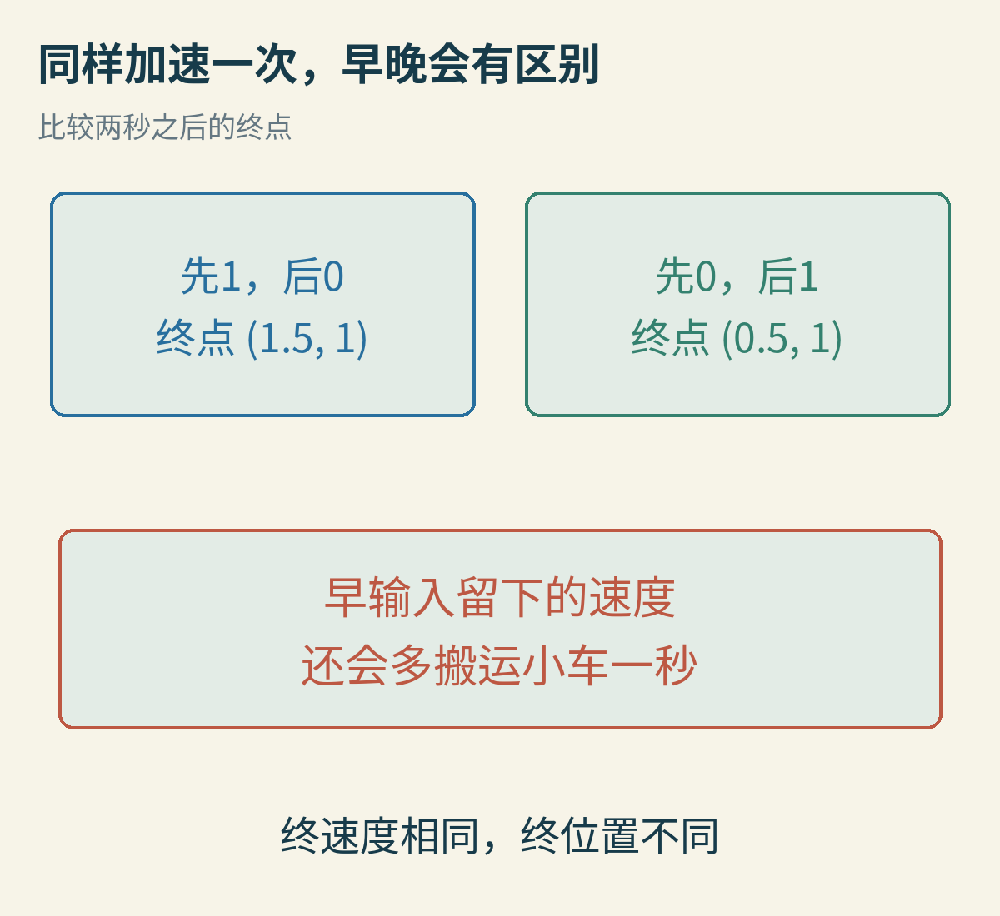

做两个单独的试验：

- 只在第一秒加速1，第二秒为0，最后到(1.5, 1)。
- 第一秒为0，只在第二秒加速1，最后到(0.5, 1)。

把这两种影响画成状态地图上的箭头。它们不平行。沿着第一支走一份，再沿着第二支反方向走一份，正好得到(1, 0)。

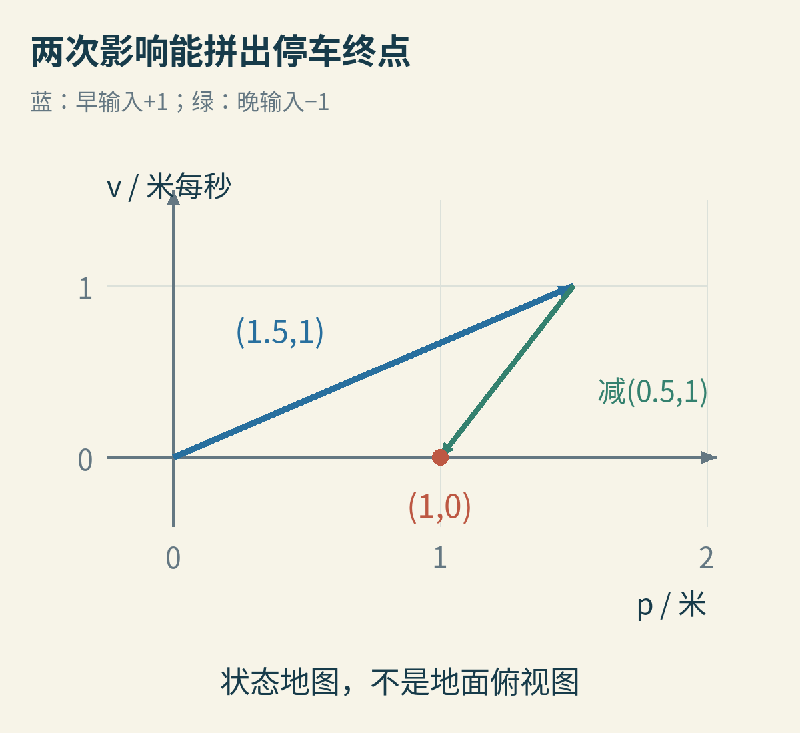

这里箭头的方向表示位置和速度的数值搭配，不是现实里两股空间方向不同的推力。两次推力都沿着同一条轨道，只是作用的时间不同。

这正是可控性里最容易被“按钮数量”掩盖的一点：**系统自身的运动，会把不同时刻输入的影响变成不同的状态方向。**

## 7. 矩阵只是把这张影响账单排整齐

走到这里再看矩阵，它就没那么神秘了。把状态两项竖着排成z，把更新写成：

**z_(k+1) = A z_k + B u_k。**

A负责“没有新输入时，已有状态怎样继续发展”；B负责“当前输入立刻加上多少影响”。我们的小车对应：

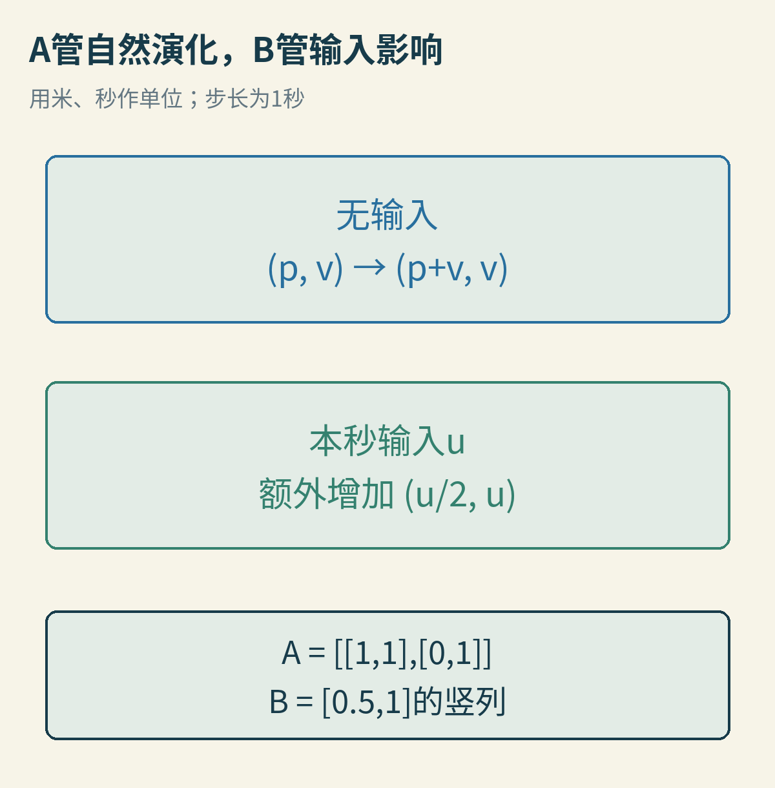

图中A的第一行是[1, 1]，第二行是[0, 1]；B是[0.5, 1]的竖列。仍然按前面固定的单位和1秒步长来理解这些系数。

从零状态开始，第一步z_1=Bu_0；第二步再把这一步的结果送进更新式：

**z_2 = A B u_0 + B u_1。**

AB就是“第一秒的输入，又经历了一秒自然演化”。算出来它是[1.5, 1]；B是[0.5, 1]，正好是刚才那两支箭头。

推广到有n个状态的常系数线性离散系统，研究者把这些输入影响排成：

**C = [B, AB, A²B, …, A^(n−1)B]。**

它叫可控性矩阵。这里按从晚到早的影响排列，配套的输入也要倒过来排；如果改用从早到晚的列顺序，秩不会变，但不能把列和输入错配。

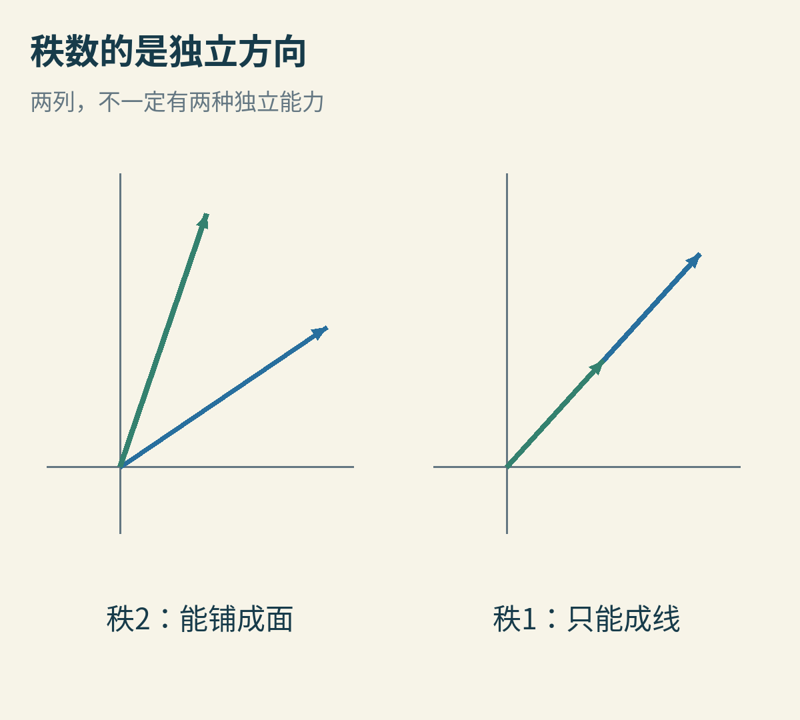

“秩”在这里可以先理解成：这些列一共提供了多少个独立的状态方向。它和列数无关，也和非零数字的个数无关。

对于一个有n个状态的系统，若C的秩为n，就能从零状态出发，通过输入到达任意目标状态。这个结论用到了几个前提：**系统线性、系数不随时间改变、输入可以取任意实数、没有额外的状态约束。**[Boyd讲义18–3至18–8](https://ee263.stanford.edu/archive/contr.pdf)

为什么只需要检查到A^(n−1)B？线性代数里的Cayley–Hamilton定理保证，再高次的A都能由前面的幂组合出来；更晚时刻的影响，不会凭空增加一个前面完全没有的方向。这条定理我们先接受，不把它的证明塞进停车故事里。

我们的小车只有两个状态，C的两列[0.5, 1]和[1.5, 1]不平行，所以秩为2。**一个输入通道，两个独立的时间作用方向，足够了。**

## 8. 任意目标，也可以手算出两条命令

假设从静止原点出发，要在两秒后到达位置P、速度V。

由刚才的两条式子，先用V=u_0+u_1得到u_1=V−u_0，再代回位置式：

**u_0 = P − V/2**

**u_1 = 1.5V − P**

这仍然是用约定单位记录的数值关系。目标(1, 0)给出(+1, −1)；目标(2, 1)给出(+1.5, −0.5)。


第二个例子里，第一秒后是(0.75, 1.5)，第二秒后是(2, 1)。每一步都能代回运动公式核对，不必先相信“满秩”这两个字。

那如果起点不是静止原点呢？先算不输入时它两秒后会自然漂到哪里。比如起点(2, 1)，不输入，两秒后是(4, 1)。要停在(3, 0)，输入就得额外贡献(−1, −1)。

把这个差值代进上面的公式，得到u_0=−0.5、u_1=−0.5，恰好两秒减速停在3米处。


一般形式就是这样：先从目标里减去无输入的终点A^N z_0，再检查这个差值能不能由输入的影响组合出来。所以可控性不只关心从原点出发；在上述模型前提下，满秩也让任意两个状态之间的转移成为可能。

## 9. 两辆车都有电机，为什么仍可能不可控

现在做一个反例。两辆完全相同的小车，分别放在两条平行轨道上，初始位置和速度都是0。每辆都有电机，但它们共用同一条加速度命令：给+1，两辆都加速+1；给−1，两辆都加速−1。

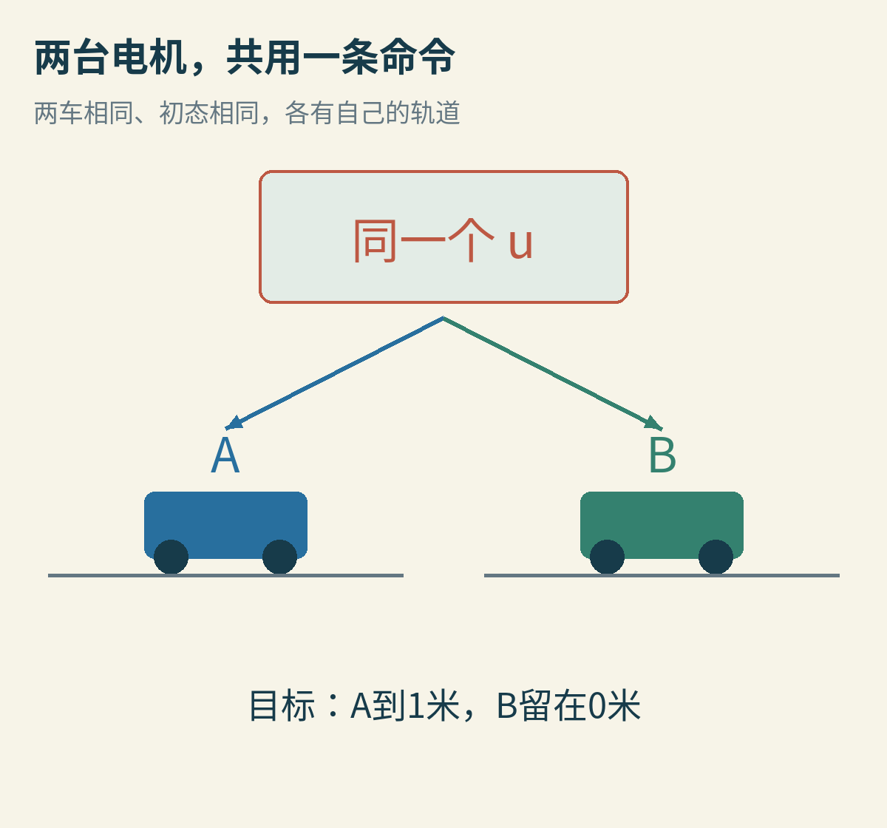

你想让A停在1米处，B留在0米处。能不能写一套更聪明的控制程序？

在这个模型里，不能。因为两辆车每一步受到的更新完全相同，从相同状态出发，它们会永远保持相同状态。

还可以直接做减法。把两辆车的速度差记作Δv、位置差记作Δp，同一条命令在相减时就被消掉了：

**Δv_(k+1) = Δv_k**

**Δp_(k+1) = Δp_k + Δv_k**

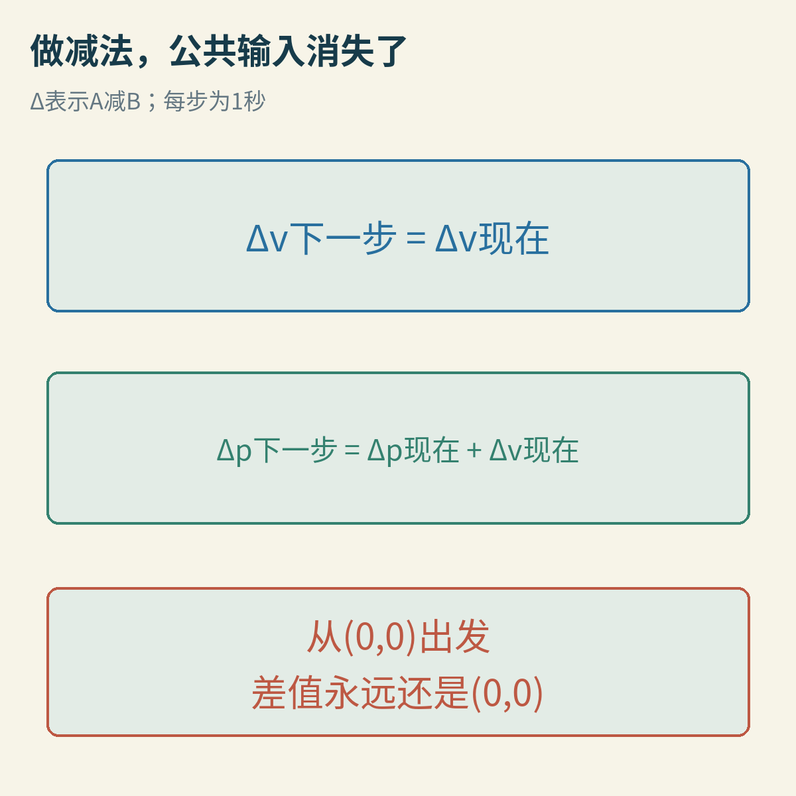

从Δp=0、Δv=0出发，无论命令多复杂，它们都还是0。而你的目标要求Δp=1，所以这个目标在可达范围之外。

两辆车总共有四个状态，可共用的输入只提供了两个独立方向。程序写得再快，也不能把不存在的独立执行能力算出来。

加两只更精确的位置传感器，可以更准确地知道它们走到了哪里；**它不会自动制造出“只推A、不推B”的输入。** 如果把两台电机改成能独立接收命令，问题的输入结构就变了，两辆车才可能各自执行自己的停车方案。


这里并没有宣称“一个输入永远只能控制两辆车的两个方向”。如果两车的动力学不同，结论就可能改变；本例之所以不可控，来自明确写出的相同动力学、同一输入和相同初态。

## 10. 满秩仍不是一张现实通行证

回到一辆车。刚才说它能两秒到达任意目标，背后允许了任意大的加速度。

现在加上一条现实点的限制：**每秒的命令都必须落在−1到+1之间。**

(u_0, u_1)可选的范围，是输入平面里的一个正方形。每个点代表一整套两秒命令，而不是小车的位置。

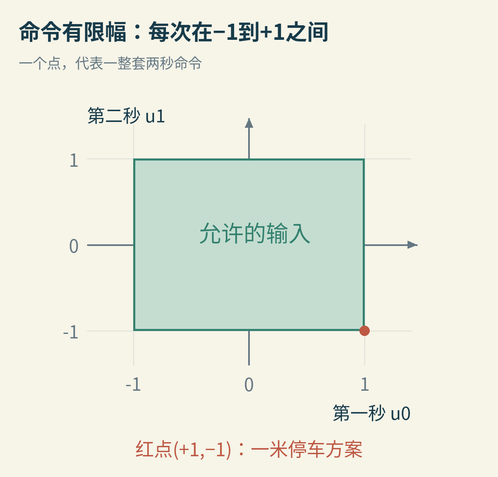

再把每一套命令变成终点(p_2, v_2)。四个角映射为：

- (−1, −1) → (−2, −2)
- (−1, +1) → (−1, 0)
- (+1, −1) → (+1, 0)
- (+1, +1) → (+2, +2)

输入正方形变成了状态平面里的一个平行四边形。它内部的每个点，都对应一套满足限幅的两秒命令。

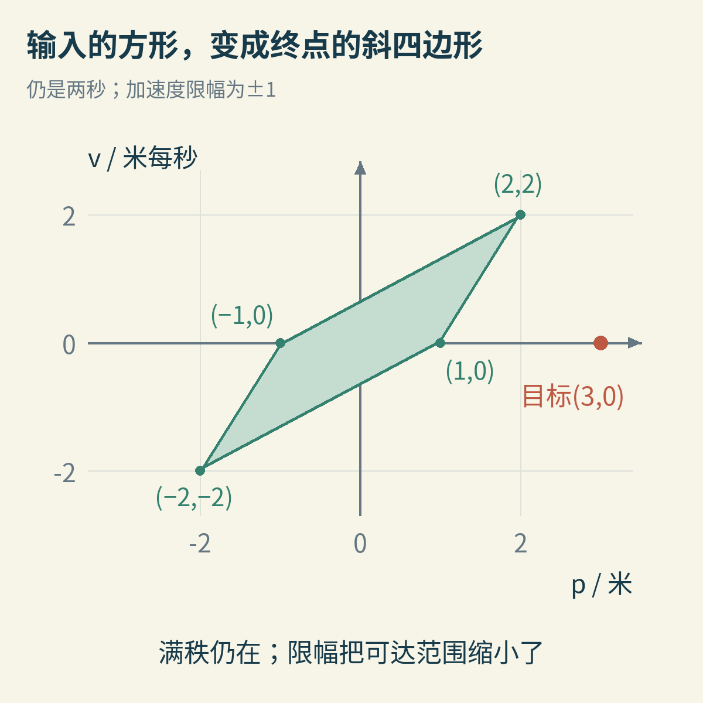

目标(3, 0)落在外面。反求命令也会得到(+3, −3)，超出限幅。

小车的可控性矩阵没有变，秩仍然是2。变的是允许使用的输入集合。所以，“结构上可控”和“在指定时间、指定推力限制内能完成”，是两个层次的问题。

多给两秒，就能换一套命令：(+0.75, +0.75, −0.75, −0.75)。四秒后恰好停在3米处，每一次都没有超限。

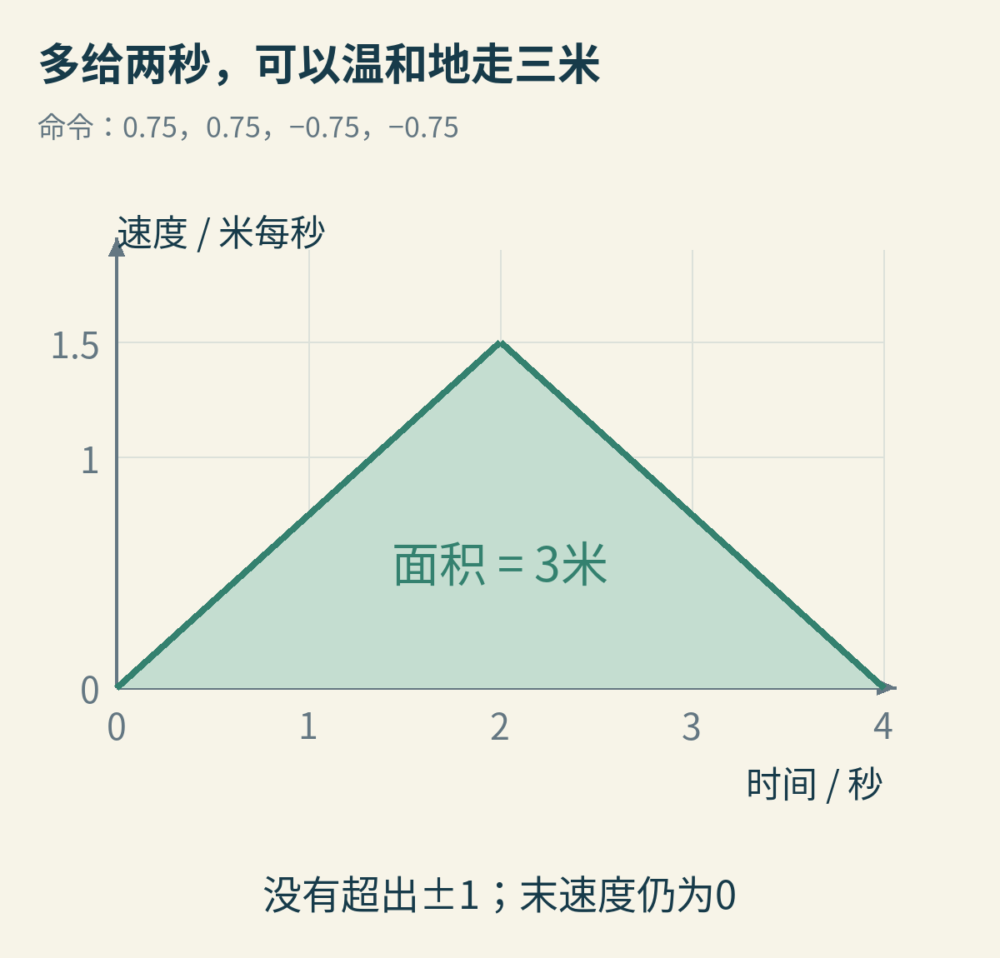

这也不是说“只要多等一会儿，什么限制都能克服”。那两辆共用输入的小车，即使再等很久，也不能从相同状态生出不同状态。**时间可以扩大某些受限的可达范围，却不能替你创造缺失的独立方向。**

## 11. 到得了之后，才轮到“哪条路更好”

只要求两秒从(0, 0)到(1, 0)，两条命令就被唯一确定了：(+1, −1)。

如果给四秒，符合目标的命令就不止一套了。比如：

- (+0.25, +0.25, −0.25, −0.25)
- (+0.3, +0.1, −0.1, −0.3)

两套都停在1米处，但它们有不同的速度过程，也有不同的命令分布。

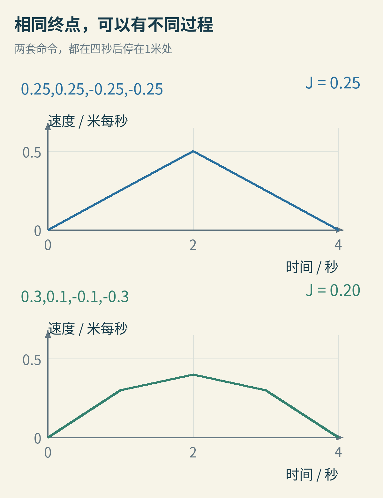

为了比较，先自定一个简单代价：把每秒加速度的数值平方后相加，记作J。

第一套J=0.25；第二套J=0.20。第二套恰好是这个固定四秒、无额外约束的小车问题里，让该平方和最小的解。附带程序用精确分数求解，并检查终点以及可行扰动之后的代价。

这个J是教学里定义的“命令用力程度”指标，**不能直接叫成电池消耗或者多少焦耳**。真实能耗还取决于质量、电机、电流、效率等等模型，也不能随意把不同采样间隔下、未加时间权重的平方和拿来比较。

先确定可达，再选择代价，最后处理约束与扰动，这几步可以一层层加上去。最优控制并没有凭空变出一条不存在的路，它只是在已经允许的路里挑选。

## 12. 一张预定时间表，不等于一个可靠控制器

本文大多提前算好每秒的命令，然后照着表执行。这叫开环方案。

如果现实中小车第一秒被人轻轻推了一下，原来计划的第二秒刹车可能就不再恰好。反馈控制会重新读取或估计当前状态，再根据偏差调整后续输入。

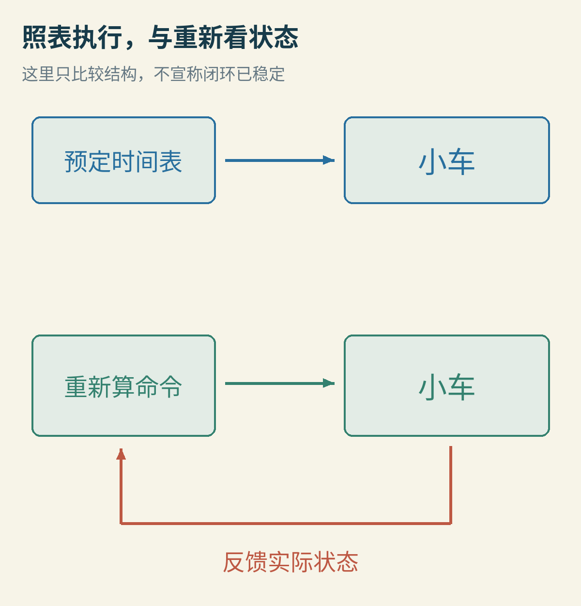

可控性回答的是“这个输入结构有没有改变全部状态方向的能力”。它没有替我们完成传感器设计、噪声处理、延迟分析、稳定性证明或者安全限位。

反过来，也不是每一个不可控系统都一定会发散。有些不能被输入影响的运动，本来就会自己衰减。能不能稳定下来，还得看那些不可控部分自身的规律；别把“不可控”和“不稳定”当成同义词。


还有一个术语边界要交代：本文沿用讲义的用法，把“从零状态能到任意状态”称为可达或可控。某些资料单独把“任意状态能回零”也叫可控；对一般的离散系统，尤其当A不可逆时，这两种问法需要区分。读到结论之前，先看作者的定义。我们的小车A可逆，而且已经直接给出了任意起终点的两步解，没有靠这个术语差异偷换目标。

## 13. 用十来行代码亲自改目标

下面全部使用Python标准库里的Fraction做有理数运算，避免0.1这类小数的二进制表示误差。数值单位与前面一致，每一步仍然是1秒。

```python
from fractions import Fraction as F

def step(p, v, u):
    return p + v + u / 2, v + u

P, V = F(2), F(1)
u0 = P - V / 2
u1 = 3 * V / 2 - P
p, v = F(0), F(0)
for u in (u0, u1):
    p, v = step(p, v, u)
    print(p, v)
```

输出是第一步3/4、3/2；第二步2、1。

注意这里是同时赋值：等号右边用的都是更新前的p和v。要是先把v改了，再拿新v去算p，那就不再是我们推导的那个精确区间更新式了。

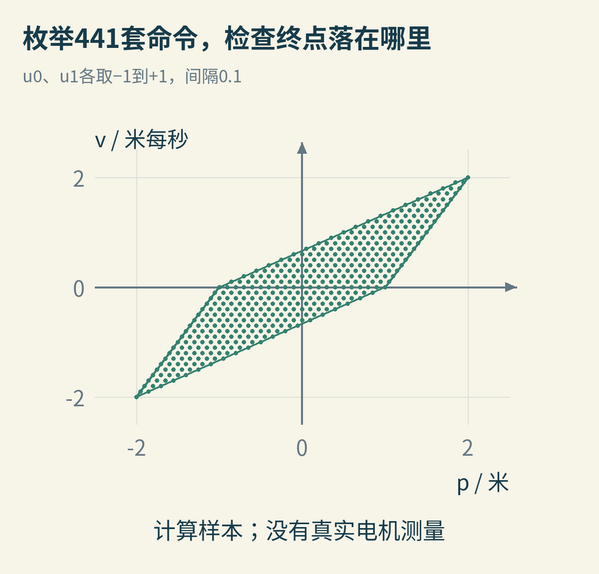

[完整实验程序](examples/reachability_lab.py)还做了这些检查：

- 6561个目标位置/速度组合，反求输入后精确回到目标。
- 2401个起终点组合（含非零初态），检验先扣自然漂移的处理。
- 长度0至8、命令取−1/0/+1的9841条序列，对比逐步更新与独立的终点加权公式，并检查两辆同控小车是否保持同态。
- 441组限幅输入映射与反求，检查平行四边形内的样本。
- 1089个固定步数与目标组合，检查最小平方输入的终点；步数至少为3时，再加入不改变终点的特定扰动，核对代价增加。

这些是本文实际运行的**精确模型检验**，不是电机实测，也没有穷尽所有真实控制系统。实验说明和运行方法见[实验说明](examples/README.md)。

## 14. 留下一个能画出来的小问题

仍然从(0, 0)出发，每条命令限制在−1到+1之间。

两秒后，你希望小车在0.5米处，速度是1米每秒。它在受限可达区域里吗？先在状态地图上找点，再反求两条输入，最后用一步一步的运动公式验证。

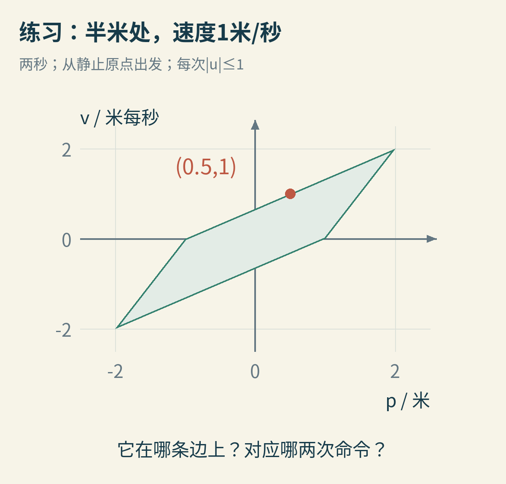

答案是u_0=0、u_1=1：第一秒不动，第二秒加速，最后恰好(0.5, 1)。它落在平行四边形的边界上。

如果只记住一句话，就记住这句：**按钮有几个，不能直接告诉你能控制几个状态；还要看每次输入经过系统的运动之后，留下了哪些独立影响。**

可控性不是教我们把油门踩得更猛，而是让我们在写控制程序之前，先画清楚路究竟通不通。

---

原创正文、原创教学图和示例代码采用CC BY 4.0。Kalman肖像单独按CC BY-SA 4.0使用，保留原署名与许可，不由正文许可覆盖。[全部来源与素材说明](sources.md)
