# 函数停在半路，下次怎么接着跑？协程保存的不只是一个数字

游戏里有一台充能装置。它先亮出“10”，等玩家投来3单位能量，更新成“13”；再等下一次输入，最后结算。

同时，角色还要走路，界面还要响应。你不能为了等待下一次投币，就让整段游戏逻辑在原地空转。也不想把“第一次等待”“第二次等待”“结算”写成散落各处、互相传纸条的函数。

有没有办法把过程按自然顺序写下来，却允许它中途交还执行权，等下次再沿原处继续？

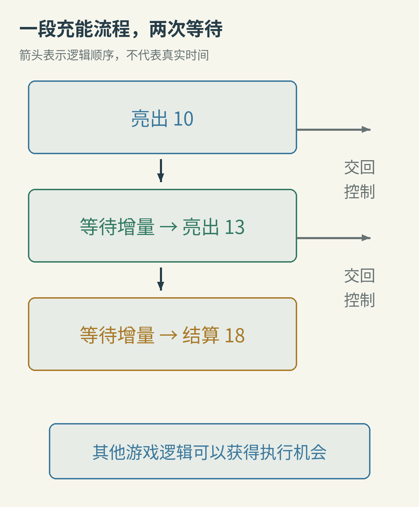

图中是自设的教学流程，没有真实游戏引擎或帧率测试。本文将用能直接运行的小程序，拆开“停在半路”这件事。

## 1. 再调用一次，不等于接着上一次

先看普通函数：

```python
def ordinary():
    energy = 10
    energy += 3
    return energy
```

它每次被调用，都从函数入口建立这一轮计算。连续调用两次，得到的是13、13，不会自动变成13、16。

当然，我们可以把数值存到对象里。可是**记住数值，还不够记住进度**。如果一个流程有两次等待，两个等待点恰好都出现数值13，下一次该走哪一段代码？单看13回答不了。

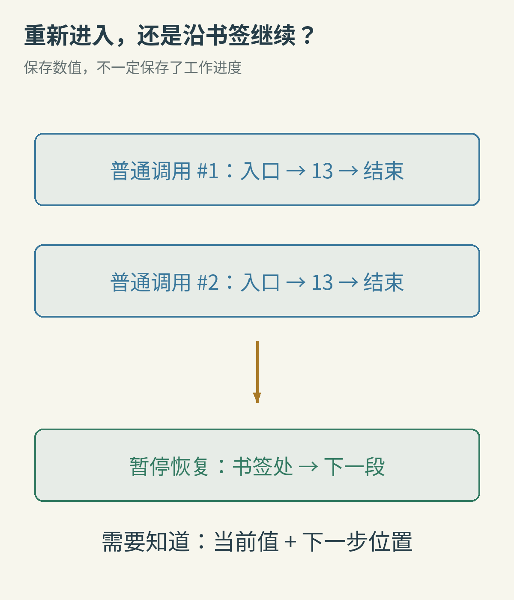

这就是本文要保留的两类信息：

- 算到哪里了，例如当前能量是多少；
- 接下来从哪里继续，例如正在等待第一次输入，还是第二次输入。

更复杂的语言实现还得保留表达式求值进度、异常处理上下文等。先不用把所有内部结构都背下来，我们会从一个只有两个等待点的例子开始。

## 2. 这并不是网络时代才出现的问题

1963年7月，Melvin E. Conway发表了一篇关于可分离编译器的论文。论文首页脚注说明，相关工作在1961年于Case Institute of Technology进行。他讨论的设备是Burroughs 220，而不是今天的浏览器或游戏主机。

论文面对的问题之一，是怎样把处理输入、转换字符、继续分析的模块组织起来。一个模块可能要多读几个字符，才能给下游一个结果；下一次又可能直接交出已有结果。输入次数和输出次数不总是一一对应，过程的进度便需要留下来。[原论文第396—398页](https://melconway.com/Home/pdf/compiler.pdf)


Conway在论文脚注中谨慎地把协程思想描述为：据他所知，自己与Joel Erdwinn同时发展了这一思路。这里不把历史写成一个人的独自顿悟，也不虚构当年的谈话。

原文举过把相邻星号成对压缩的例子。理解它的关键，不是那几个字符，而是模块说“给我一个输入”或“我交出一个输出”时，怎样让对方接着干，并保留自己的下一个位置。

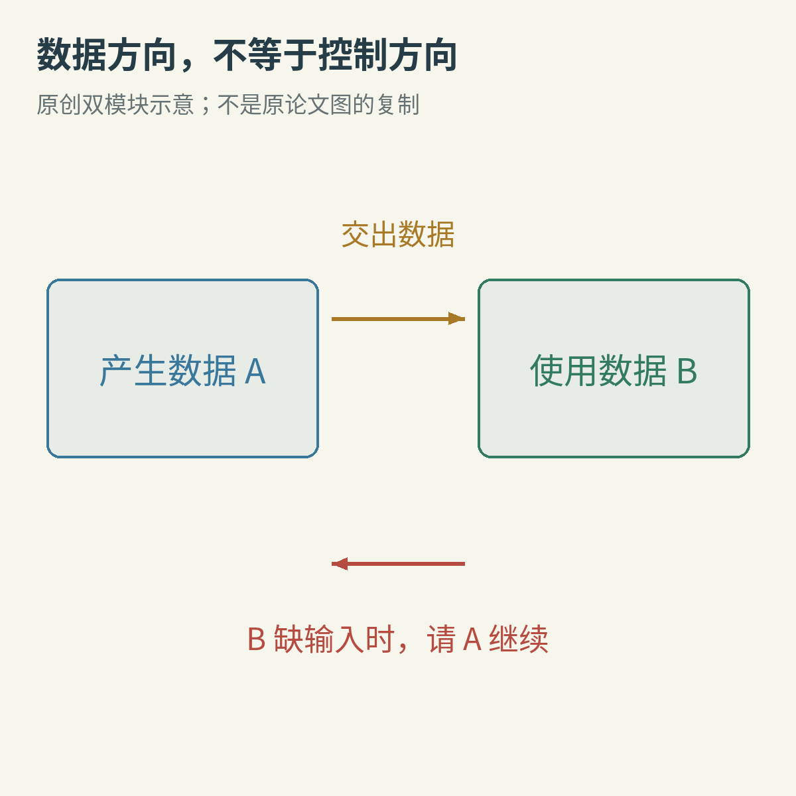

论文还说明了一种组织上的好处：保持处理逻辑基本不变，可以让相邻模块交替传递数据，也可以先把前一阶段结果写到磁带，再交给后一阶段读取。协程在这里服务于模块之间的衔接，并不天然等于“同时在多个处理器上计算”。

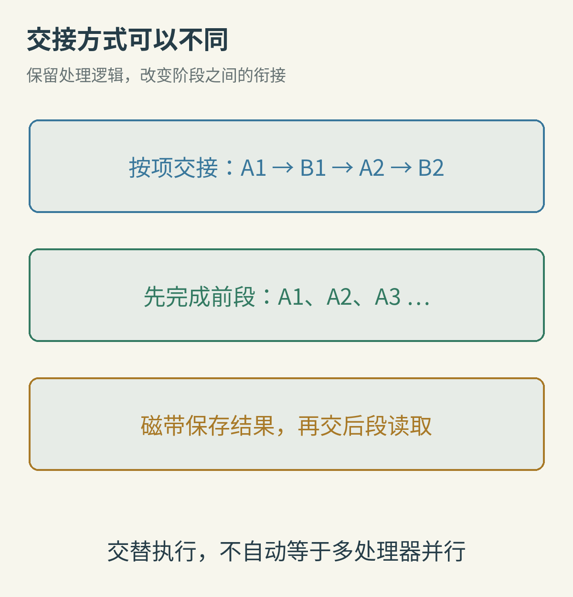

这些图是根据问题重新设计的教学示意，不是原论文扫描图，也不是Burroughs机器照片。原图可在链接中的第397—398页查看；本次没有取得其公开转载许可，未收入本文素材包。

## 3. 从一个能双向递纸条的小函数开始

我们用Python 3.12的生成器作入口。它是一种适合观察暂停与恢复的机制；本文并不把所有语言里的协程都等同于Python生成器。

先只看主程序：

```python
def charge(log):
    log.append("进入")
    try:
        energy = 10
        gain = yield energy
        energy += gain
        gain = yield energy
        energy += gain
        return energy
    finally:
        log.append("清理")
```

`log`是一张记录执行过程的清单。`try`和`finally`先放在这里，后面会用它们观察流程结束时发生什么。

最陌生的一行应该是：

```python
gain = yield energy
```

请先把它当成一扇双向窗口：这一次先把`energy`交出去，自己停住；下一次恢复时，才接过送进来的值，把它交给`gain`。

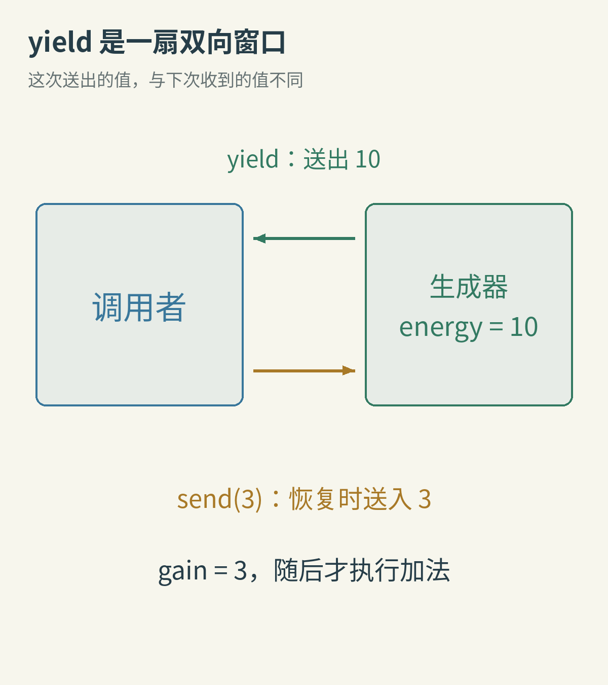

它不是“把energy立即赋给gain”。窗口向外送出的内容，与下次从外面收到的内容，是两份不同的信息。

## 4. 创建它，还没有开始充能

运行：

```python
log = []
g = charge(log)
print(log)       # []
```

`g`是生成器对象。此时函数体还没有开始执行，连“进入”都没有记录。

接着：

```python
print(next(g))   # 10
print(log)       # ['进入']
```

这一次从入口运行，`energy`被设置成10；遇见第一个`yield`，10被交给调用者，函数暂停。

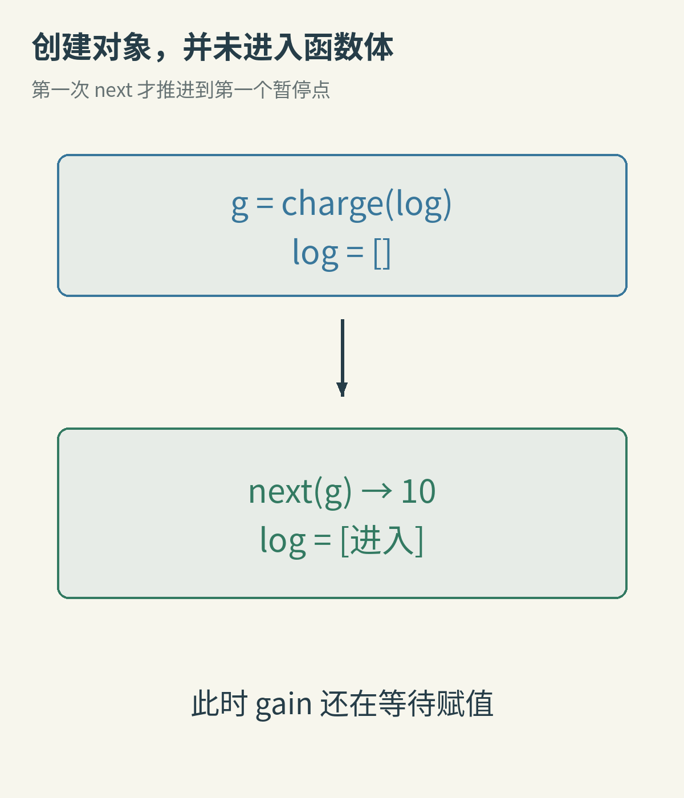

这里有个很重要的小细节：第一次停住时，`gain = yield energy`还没有完成赋值。它还在等待窗口另一边送来的值。

因此，“代码执行到了这一行”和“这一行的所有动作都完成了”不是同一回事。这种细节，正是暂停机制需要记住的进度。

## 5. send(3)到底把3放到了哪里？

现在执行：

```python
print(g.send(3)) # 13
```

从第一个`yield`恢复时，`yield energy`这个表达式得到值3，因而`gain`变成3。接着执行`energy += gain`，能量变成13。然后来到第二个`yield`，把13交给外面，再停下。

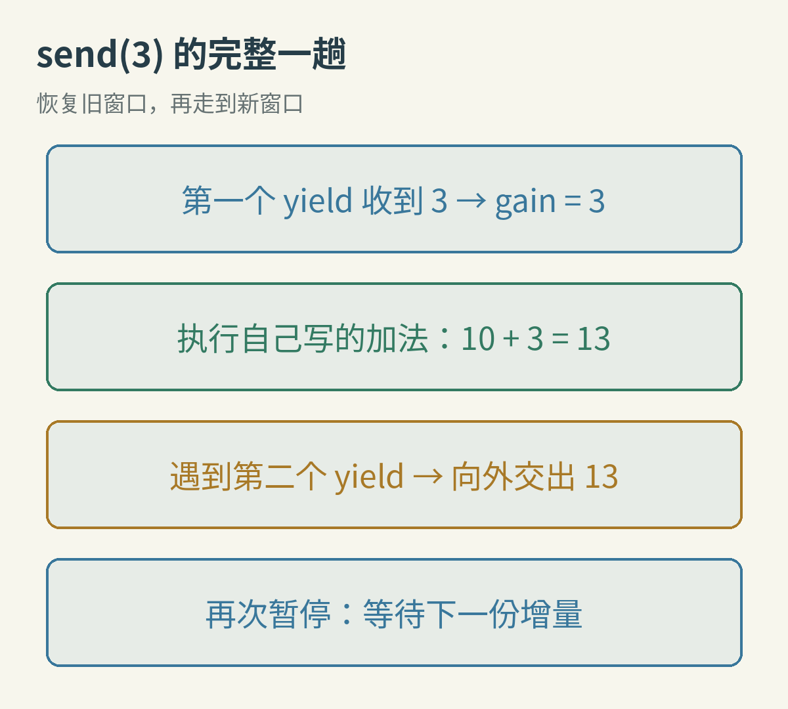

请注意，`g.send(3)`返回13，并不是“3被系统自动加进了某个神秘容器”。真正执行加法的，仍是我们自己写的`energy += gain`。

如果恢复后的代码选择把3乘以10，或者忽略它，结果就会不同。`send`只负责恢复并递送，业务含义由函数体决定。

接下来再送5：

```python
try:
    g.send(5)
except StopIteration as end:
    print(end.value)  # 18
print(log)           # ['进入', '清理']
```

第二个等待点收到5，13加5得到18；这次后面没有新的`yield`，而是`return energy`。

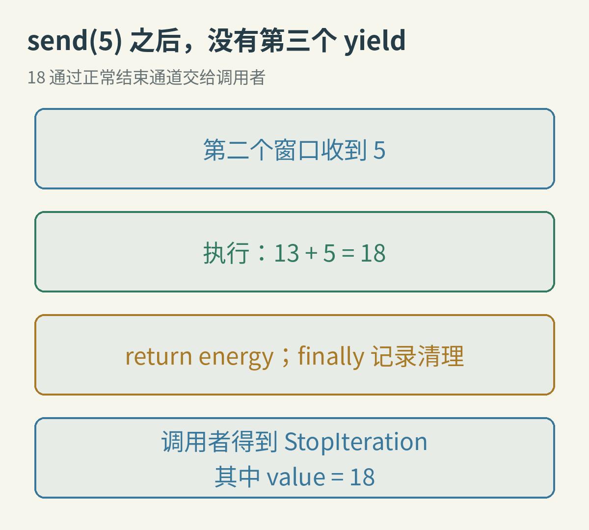

对于调用生成器方法的人，正常结束表现为`StopIteration`。这个名字可以理解为“迭代已经结束”；本例的最终返回值放在异常对象的`value`里。

所以这里存在两条出口：`yield`交出一个阶段结果，保留以后继续的机会；`return`交出终局结果并结束。不能用普通函数“调用一次便拿到return”的习惯，把它们混为一谈。

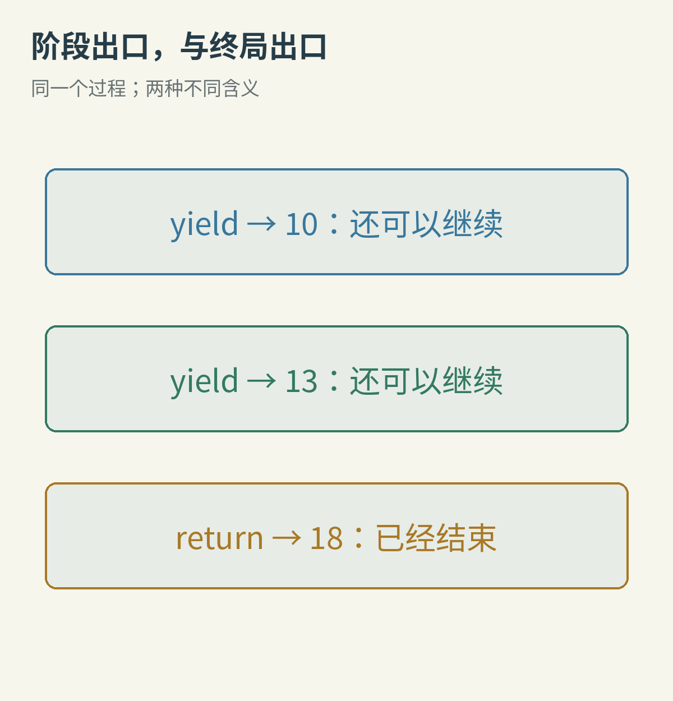

## 6. 暂停后，东西藏在哪里？

可以把生成器对象想成一张附着在流程上的工作卡：上面有局部数值，也有一个指向后续工作的书签。

在第一次暂停时：能量10，书签指向第一个等待点之后。第二次暂停时：能量13，书签指向第二个等待点之后。

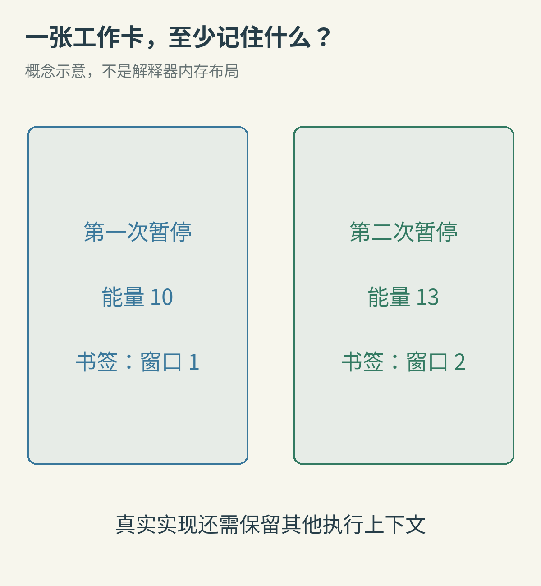

“工作卡”只是理解模型，并不等于解释器内部只有两个字段。Python语言参考还列出了求值栈和异常处理状态等需要保留的局部执行状态。[Python 3.12：yield表达式](https://docs.python.org/3.12/reference/expressions.html#yield-expressions)

同一个函数创建出的两个生成器，也各有自己的执行过程：

```python
left = charge([])
right = charge([])
print(next(left), next(right))  # 10 10
print(left.send(3))            # 13
print(right.send(-4))          # 6
left.close()
right.close()
```

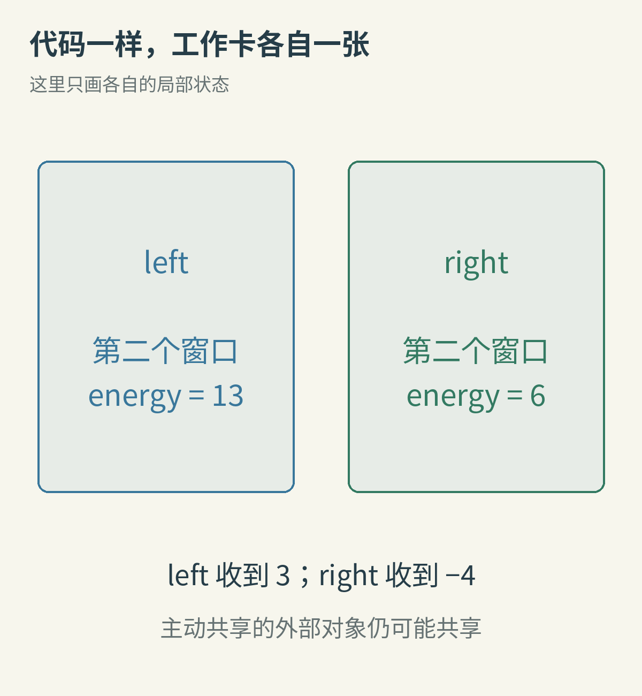

共享函数代码，不代表共享同一轮局部计算。当然，如果你主动把同一个可变列表或对象传给它们，那份外部对象仍可能共享。协程不会自动帮你复制整个世界。

## 7. 三种静止状态，以及两种不同的错误

为了观察本例，可以用`inspect.getgeneratorstate(g)`：

- `GEN_CREATED`：对象已建，还未启动；
- `GEN_SUSPENDED`：在某个`yield`处暂停；
- `GEN_CLOSED`：已经结束。

执行期间还有`GEN_RUNNING`。本文的记录是在每次调用返回或抛出后读取的，所以记录到的是上面三种静止状态。

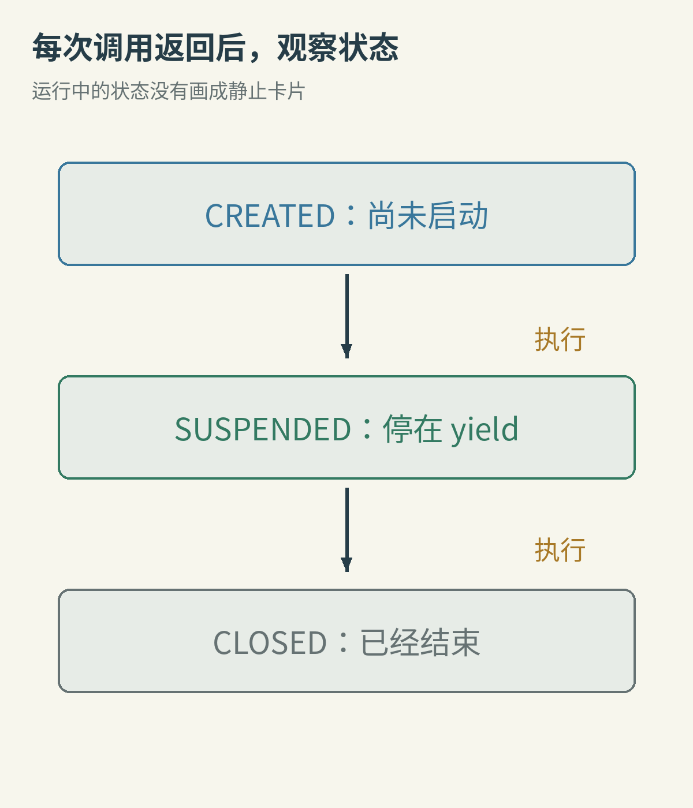

如果刚创建就`send(3)`，会怎么样？

此时根本没有一个已经暂停的`yield`来接收3。Python会报`TypeError`，函数体没有启动，状态仍是`GEN_CREATED`。之后仍可用`next(g)`，或等价地用`g.send(None)`，把它带到第一个暂停点。

另一个更隐蔽的错误，是在本例第一次暂停后再次调用`next(g)`。恢复时它给`yield`的结果是`None`，不是0；于是代码试图计算`10 + None`，报`TypeError`并退出，状态成为`GEN_CLOSED`，清理也执行了。

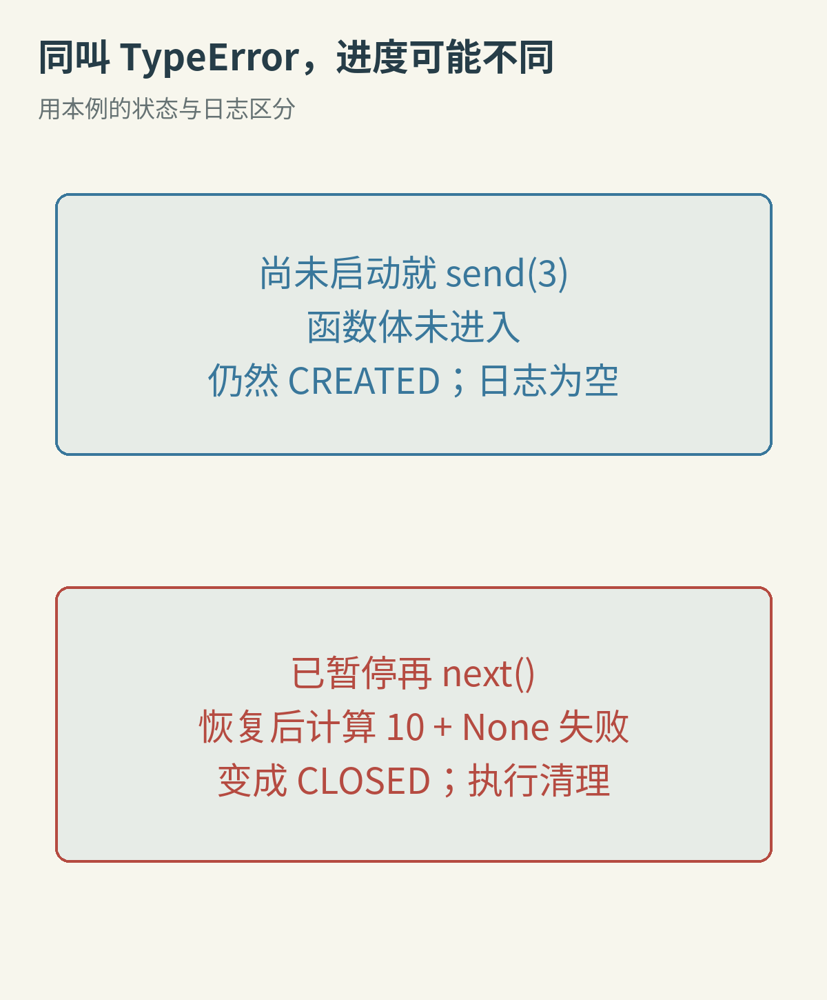

同样的异常名称，背后的执行进度可能完全不同。调试暂停流程时，除了看“报什么错”，还要问“错误发生在恢复之前，还是恢复之后？”

## 8. 自己写出那张工作卡

现在把魔法去掉：不用生成器语法，手工维护一个阶段编号。

- 阶段0：尚未开始；
- 阶段1：等第一次增量；
- 阶段2：等第二次增量；
- 阶段3：已经关闭。

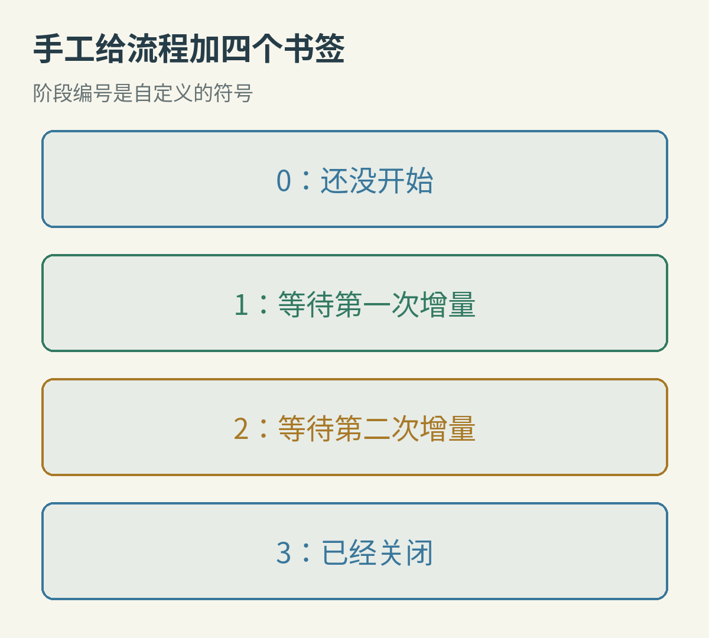

先忽略清理和错误分支，只看正确输入如何推进：

```python
class TinyCharge:
    def __init__(self):
        self.phase = 0
        self.energy = 0

    def resume(self, value=None):
        if self.phase == 0:
            if value is not None:
                raise TypeError("先启动，再发送数值")
            self.energy = 10
            self.phase = 1
            return ("yield", self.energy)
        if self.phase == 1:
            self.energy += value
            self.phase = 2
            return ("yield", self.energy)
        if self.phase == 2:
            self.energy += value
            self.phase = 3
            return ("return", self.energy)
        raise RuntimeError("流程已经结束")
```

依次调用`resume()`、`resume(3)`、`resume(5)`，便得到`('yield', 10)`、`('yield', 13)`、`('return', 18)`。

这份短代码故意采用更直观的二元组接口，只演示正确路径，**不是完整的Python生成器替代品**。例如错误输入导致退出、异常注入和清理，仍需要额外处理。完整实验里的`ChargeMachine`才实现本文限定操作集合所需要的分支。

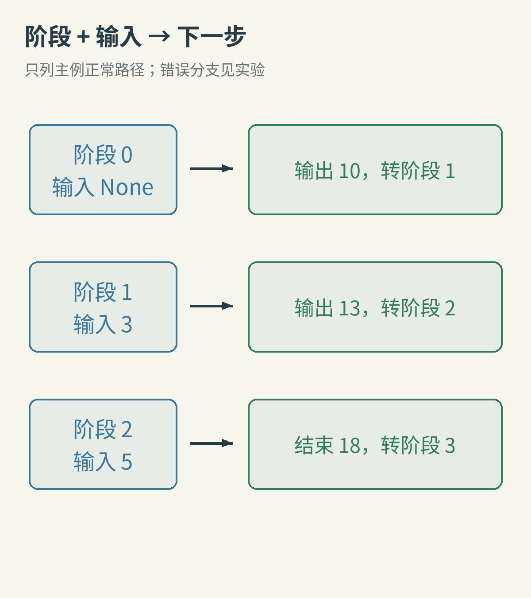

从这个角度看，协程语法的重要帮助是：你可以按“先做这个，等一下，再做那个”的顺序写代码，由语言运行机制保存继续所需的信息；不用亲手把每一段拆成阶段编号。

但这并不意味着所有实现都按上面的类来存储。有的实现保存调用栈，有的把局部状态放进专门对象。我们这张卡解释的是共同需要保留的信息，不是所有编译器的固定内存布局。

## 9. 让小模型接受不友好的输入

只测10、13、18这一条好走的路，很容易漏掉边界。配套实验给原生成器和手工状态机喂入相同的动作：

`next`、`send(-2)`、`send(0)`、`send(3)`、`close`、`throw(ValueError(...))`。

把这些动作组成长度0到5的所有序列，共9331条，合计44790次动作比较。每一步比较交出或抛出的结果、结束值、静止状态，以及“进入”“清理”日志。

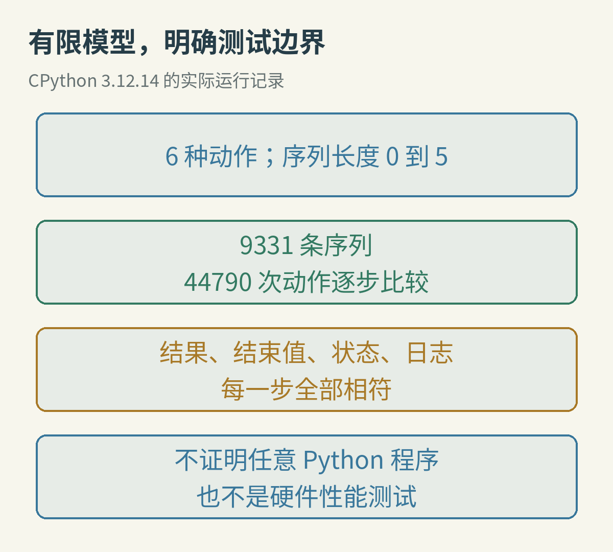

本文编写时在CPython 3.12.14实际执行，全部通过。另对包含`send(5)`的主例单独核对；它不属于上面六种动作的枚举字母表，不能偷偷算进那9331条。

这仍只说明：对于这段程序和限定的操作范围，我们写的小模型与实际运行一致。它没有证明任意Python程序都能被这个四阶段类解释，更没有证明所有协程实现等价。

完整程序只用标准库，见[可运行实验](examples/coroutine_lab.py)及[运行说明](examples/README.md)。

## 10. 谁决定下一次让谁继续？

有两个会暂停的过程，还不等于它们已经自动轮流执行。必须有人调用它们。

设A和B各走三步，每走一步便`yield`。用一只队列管理它们：取出队首，推进到下次暂停；如果还没结束，就放回队尾。

```python
tasks = [walk("A", 3, events), walk("B", 3, events)]
while tasks:
    current = tasks.pop(0)
    try:
        next(current)
    except StopIteration:
        pass
    else:
        tasks.append(current)
```

这里的`walk`定义在配套实验中。用两项列表是为了看清动作；大量任务时，可以换成适合队首操作的队列结构。

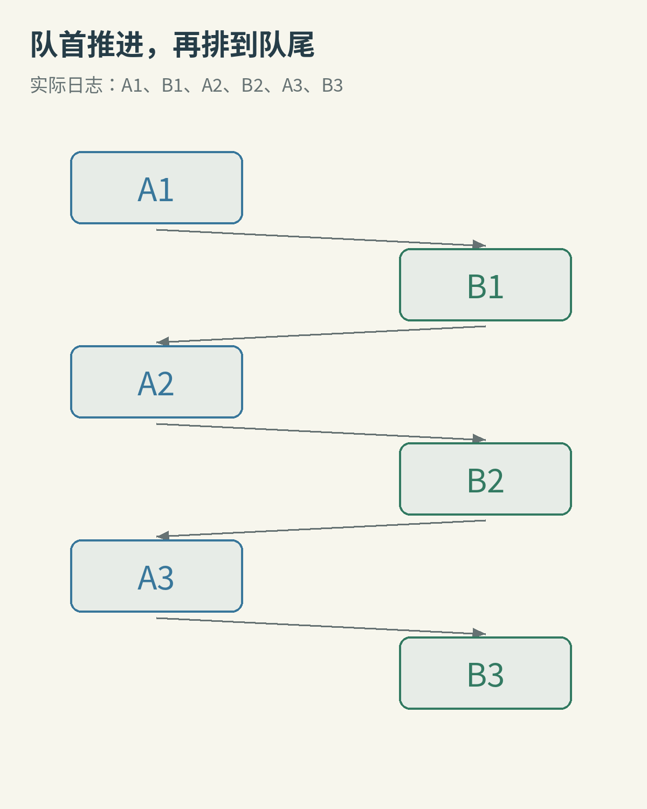

实际日志按顺序得到A1、B1、A2、B2、A3、B3。轮流安排的规则来自这个循环，不是来自`yield`这个单词本身。

现在改一下A：它连续记下四步，直到第四步之后才`yield`。同一个调度方式下，日志便先出现A1、A2、A3、A4，然后才轮到B1。

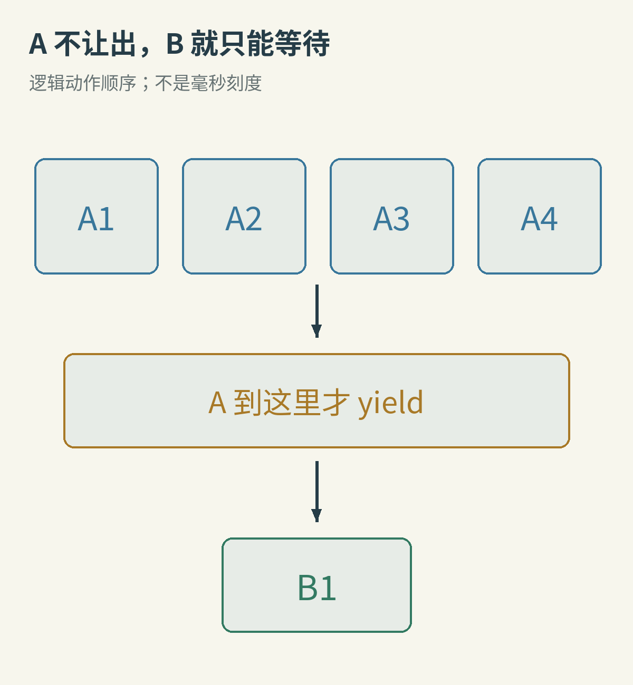

这个小实验没有测秒数，也没有创建线程。它展示的是协作式推进的边界：调度器要等本次调用把执行权交回来，才能取队列里的下一项。

把耗时计算或阻塞操作放进这一次调用，仍可能让其他任务等很久。写了协程，并不会自动把长工作分成短工作。

## 11. 轮流、并发、并行，不是同一个问题

在A1、B1、A2、B2的日志里，两个流程都在取得进展，可以用并发组织来描述。但我们的Python实验在单一执行路径上依次推进，不能据此宣称“两段计算在同一时刻占用两个CPU核心”。

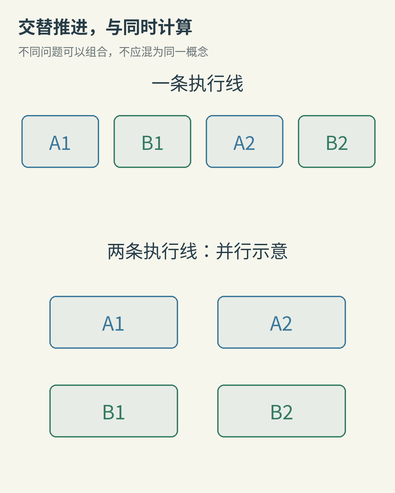

协程主要描述暂停、恢复及交接方式；线程、进程和处理器安排属于另一组机制。实际系统可以把多种机制组合起来，因此也不必反过来断言“用了协程就永远不能并行”。

阅读性能宣传时，可以追问：测的是等待重叠、上下文切换成本、内存占用，还是多核计算速度？本篇只验证了执行顺序和状态，不把它包装成性能对比。

## 12. 停在半路，也要知道怎样收尾

如果玩家关闭界面，不再继续充能，怎么办？

对于已经暂停的`g`，调用`g.close()`会在暂停处引入`GeneratorExit`。本例没有吞掉这个结束信号；控制流经过`finally`，写入“清理”，随后关闭。

如果用`g.throw(ValueError("取消"))`，则相当于在暂停位置抛出这个异常。本例不捕获它，因此仍会先执行`finally`，再把`ValueError`传到调用者。

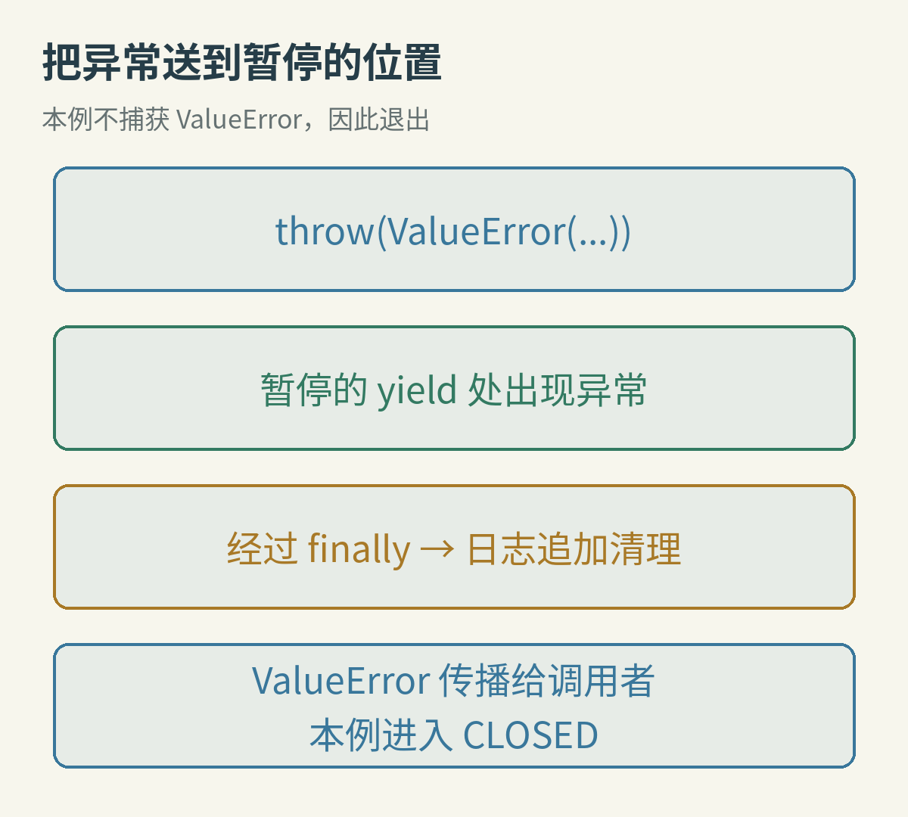

`throw`并不保证把生成器关闭。如果函数自己捕获异常、继续运行并再次`yield`，它还可以暂停着留在那儿。本例关闭，是因为这份函数体没有捕获该异常。

还有一个很容易背错的边界：刚创建`g`，一次也没启动就直接`close()`，本例日志仍是空的。因为函数体尚未进入，`try`那块区域也还没有开始，不能想象它一定执行了一遍“清理”。

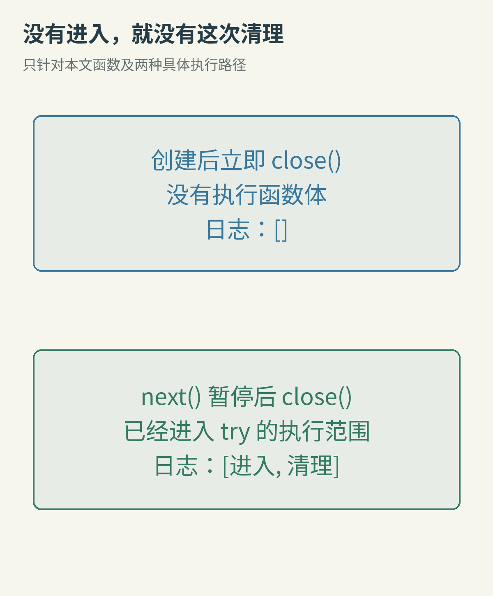

因此，资源的获取与释放要按实际进入的范围来设计。本文用列表记日志，没有真的打开文件或网络连接；在真实程序里，不要把垃圾回收会“迟早处理”当作可靠的及时释放方案。

## 13. 那async和await又在哪里？

2005年的PEP 342把向生成器送值、送异常以及清理等能力组织成一项Python语言提案，作者是Guido van Rossum和Phillip J. Eby，目标版本是Python 2.5。这个历史节点帮助理解为什么`yield`能成为双向窗口。[PEP 342](https://peps.python.org/pep-0342/)

今天Python还存在原生`async def`协程、异步生成器、事件循环等机制。它们有各自的接口，不能把本篇普通生成器的每个方法原样套过去。

先保留一幅最小地图：

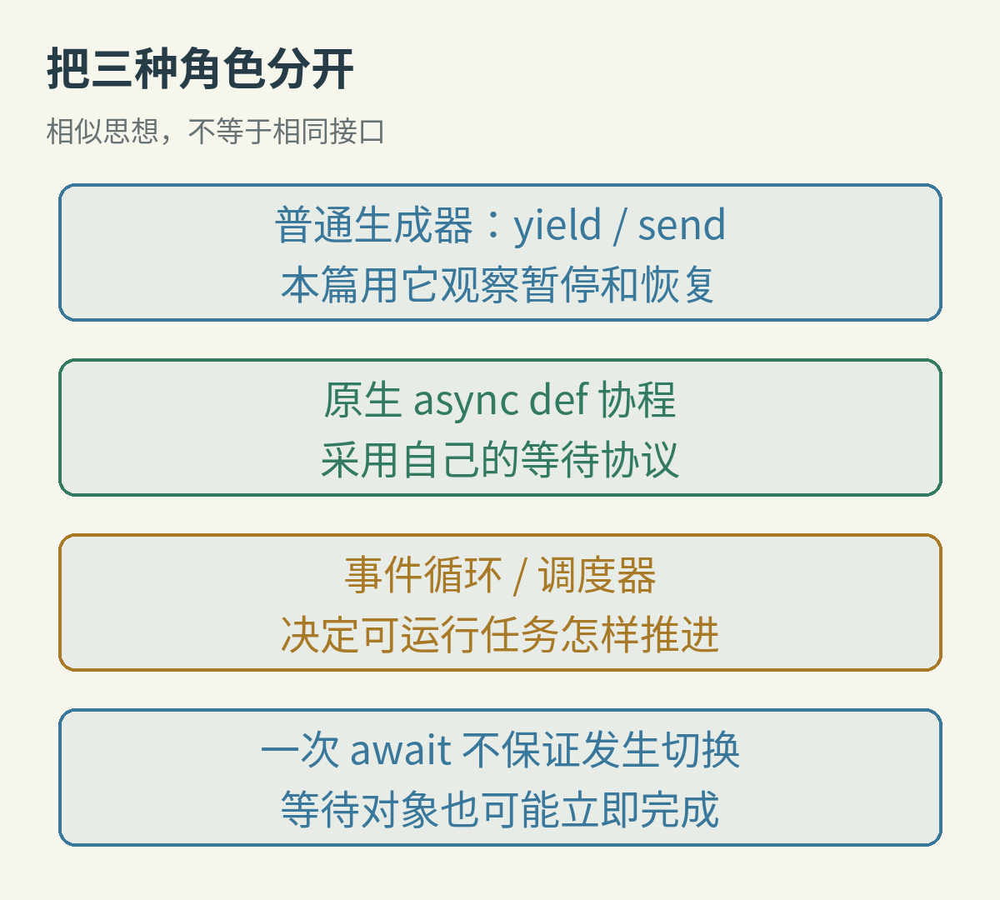

`async def`函数在调用后产生协程对象；要让它真正运行，仍需要被等待或由相应调度机制驱动。`await`表达等待另一个可等待对象的完成，但并不保证每遇到一次`await`，就一定切换给别的任务：被等待的工作可能已经可以立即完成。

本文不再展开网络事件循环。等你能独立回答“谁保存位置、谁恢复它、恢复时送进什么、结束时谁清理”，再读异步库，许多看似神秘的接口就会有可以落脚的位置。[Python 3.12：协程与任务](https://docs.python.org/3.12/library/asyncio-task.html)

## 14. 最后做一道不靠背术语的小题

重新创建充能过程，先启动，然后送入−4，再送入9。别急着运行，写下：

1. 两次`yield`分别交出什么？
2. 最终`return`的数值是多少？
3. “进入”和“清理”各出现几次？

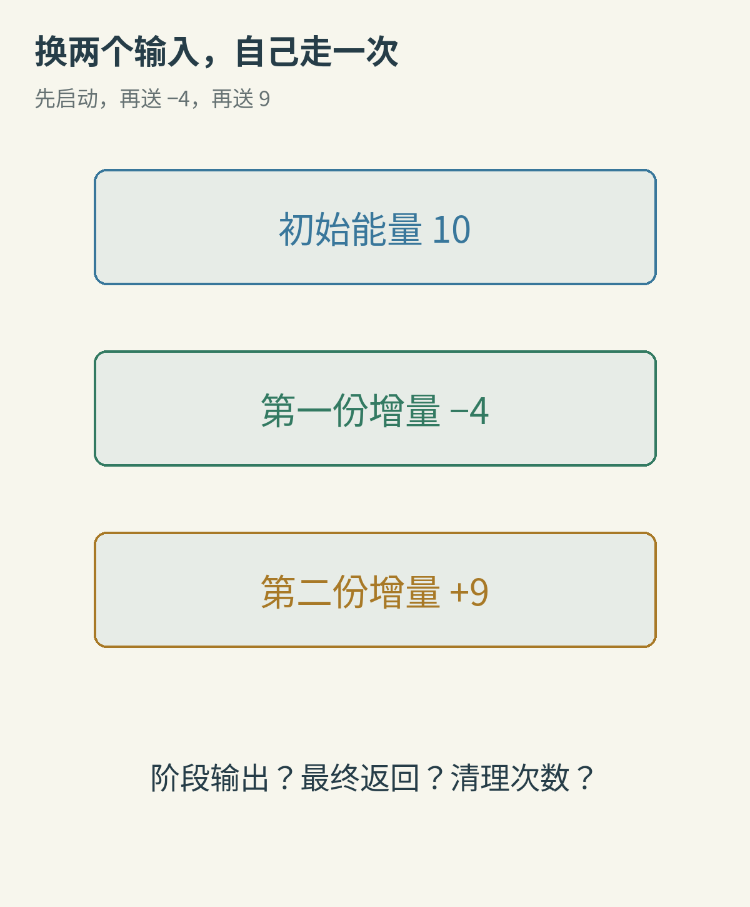

答案是10、6；最终返回15；进入一次、清理一次。第一份−4不是“回到入口重新建立能量”，而是交给第一次暂停着的窗口；第二份9交给第二个窗口。

再问自己：如果在交出6之后直接关闭，15还会被计算出来吗？不会。流程会在那个暂停位置走向退出和清理，不会假装完成尚未执行的加法。

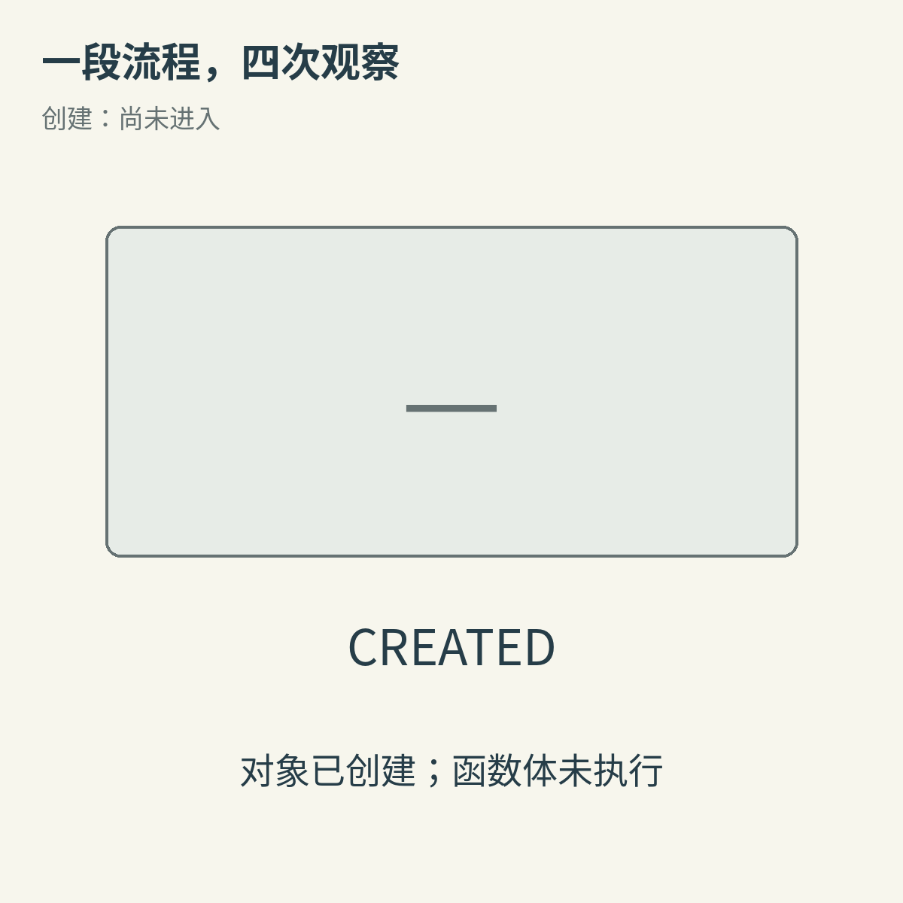

动画依据配套程序的实际主例轨迹绘制，四帧表示四次观察，并不表示真实执行耗时。第一帧是创建后的状态，最后一帧18是结束值，不是第三次`yield`。

协程留住的，原来不仅是一串数值。它还留住了一个尚未完成的过程：哪些事已经做了，哪些事正在等，下一次应该从哪儿继续。
