# 让轮子压在圆盘上，怎么就开始解微分方程？

假设有一支笔，它现在画得越高，接下来上升得就越快。

你没有提前告诉它最终曲线，也没有把曲线刻在一块凸轮上。你只给它一条局部规则：**当前位置越高，上升速度越大。**

如果今天写程序，可以让计算机一步步更新位置。可是在电子数字计算机普及以前，有人真的把这样的规则接进一套转轴、圆盘和小轮子，让机器自己画出曲线。

这类机器叫**微分分析机，differential analyzer**。

它最迷人的地方不是“齿轮很多”，而是你可以一路追踪：一个数学符号，究竟落在机器的哪个位置；一个积分，究竟藏在什么运动里。

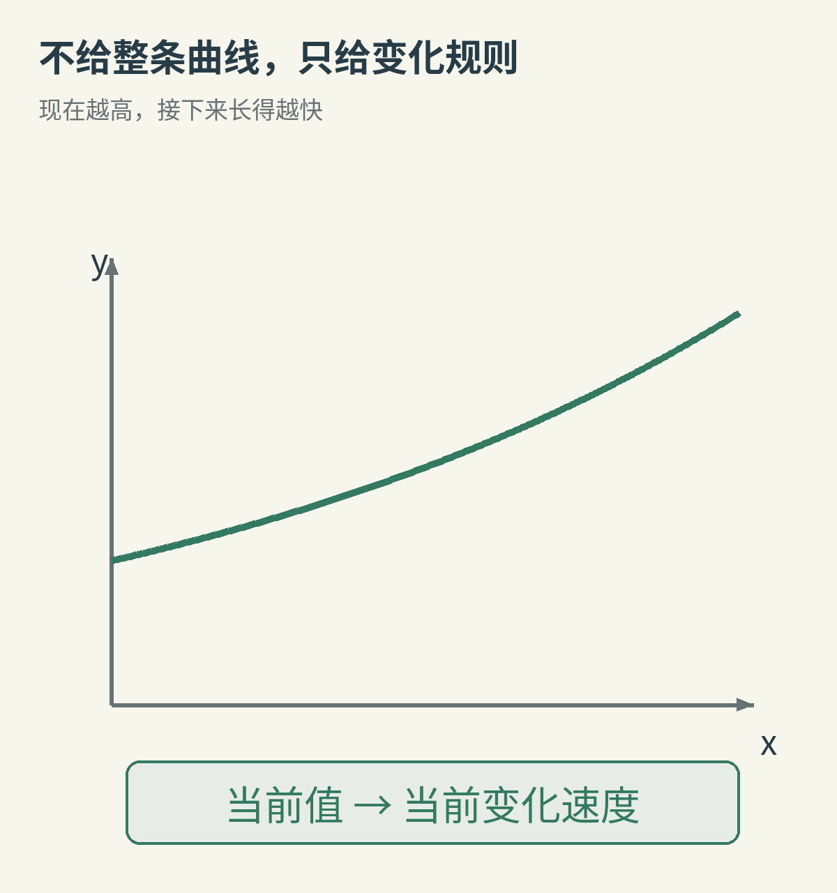

## 1. 先把“微分方程”翻成一句能听懂的话

你大概见过这样的关系：

距离 = 速度 × 时间。

但如果速度不断变化，不能随手抓一个速度，乘上全部时间。可以先把时间切成很多小段：每一段用当时的速度乘那一点时间，再把小段距离加起来。

这叫累计，也就是积分最直观的意思。

反过来，如果知道位置曲线，想问“现在变化得有多快”，问的就是导数。

微分方程把这些东西联系起来：**它不是直接告诉你位置，而是给出位置与变化速度之间的约束。**

比如“高度每增加一点，增长速度也按比例增加”。它给了运动规则，却没有直接给整条曲线。

还有一件事不能省：从哪里开始。

“每秒上升速度等于当前高度”这句话，没有规定初始高度是1还是2。初始位置不同，画出的曲线当然不同。机械装置也必须有一个设置初值的动作。

## 2. Bush的机器，把方程拆成可连接的部件

1931年，Vannevar Bush发表了题为《The Differential Analyzer. A New Machine for Solving Differential Equations》的论文。[出版记录](https://www.sciencedirect.com/science/article/abs/pii/S0016003231906169)显示它刊于当年10月的《Journal of the Franklin Institute》。

本文实际读到的另一份本人资料，是他1936年的《Instrumental Analysis》。其中第658–659页解释轮盘积分器与扭矩放大器，第663–664页解释怎样把积分器的输出接回输入，以及怎样设置初始条件。[本人原文](https://web.njit.edu/~evank/download/bush_1936.pdf)

关键转折是：一台积分器，只会做一个累计动作；把它与其他部件接成恰当的回路，才会约束整台机器按一个方程运动。

这很像搭积木，但积木之间传递的是角度、位移和转动。

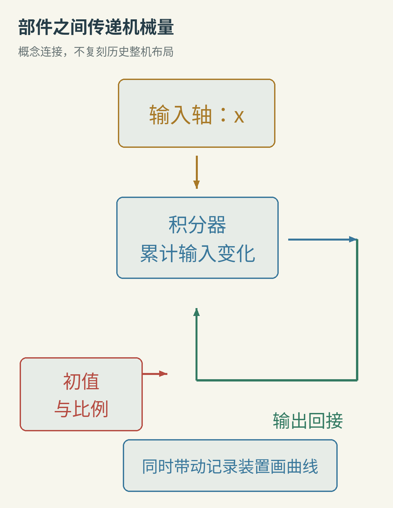

上图是本文的原创概念结构，不是某台历史机器的布局复刻。想看真实整机，可从[计算机历史博物馆的微分分析机专题](https://www.computerhistory.org/revolution/story/143)查看馆藏照片。这里的differential analyzer译作“微分分析机”；它和巴贝奇的difference engine“差分机”不是同一种装置。

## 3. 核心部件：把一只小轮子放到转盘上

先不管整台机器，想象一块水平放置、能绕中心转动的圆盘。

一只竖着的小轮子压在盘面上。轮轴沿圆盘的一条直径布置，小轮子可以沿这条直径左右移动。

圆盘转起来时，盘面会通过接触带动小轮子转动。

**接触点离盘心多远，决定小轮子转得多快。**

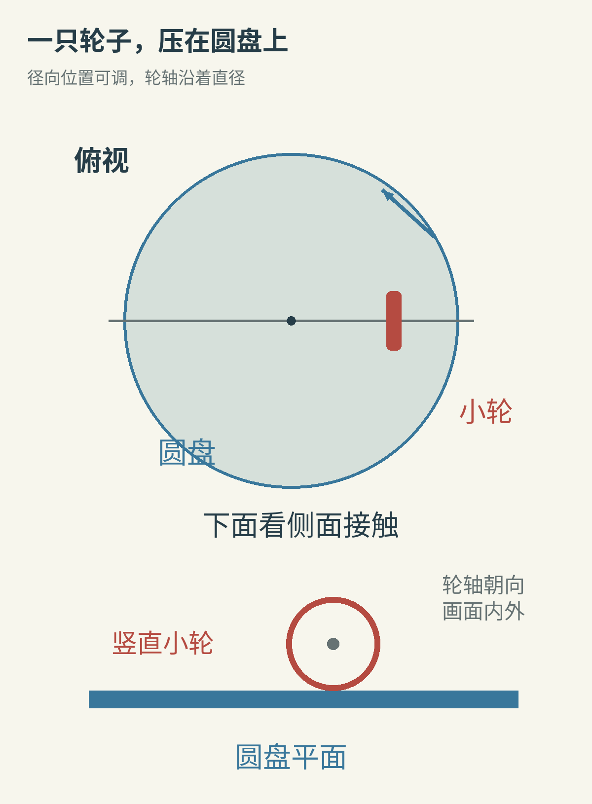

下面的原书页来自Shaw1886年的《Mechanical Integrators》。大圆盘M和小测轮m已经出现在较早的机械积分讨论里。原图包含沿导轨滚动的盘，其完整装置与本文固定盘心的教学模型不同；共用的核心是接触处的位移关系。

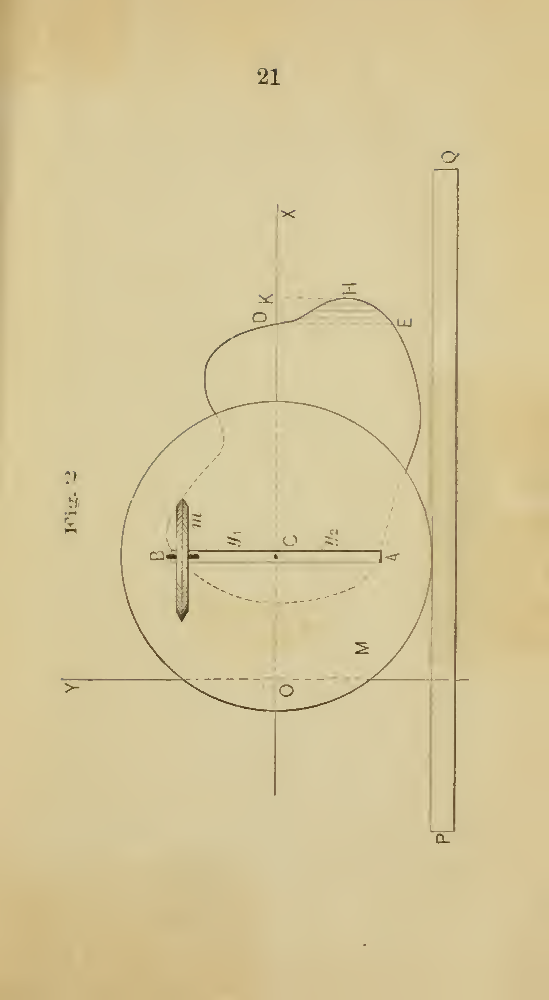

图源：H. S. H. Shaw，1886年纽约出版《Mechanical Integrators》，第21页图2；University of California Libraries / Internet Archive扫描。原著为美国公有领域，馆藏标记NOT_IN_COPYRIGHT。按扫描标称500dpi整页呈现，原排版方向保留；[完整原PDF](examples/shaw-1886-original.pdf)原字节随附，[权利与来源说明](sources.md)。这不是1931年MIT整机照片。

## 4. 为什么靠近边缘，轮子就转得更多？

在圆盘上画两条同心圆，半径分别为1厘米和2厘米。

圆盘转过同一个角度时，外圈走过的弧长是内圈的两倍。若都转过1弧度，内圈经过1厘米，外圈经过2厘米。

弧度只是另一种记角度的方法：整圈是2π弧度，而不是360度。用它的方便之处，是弧长直接等于半径乘角度。

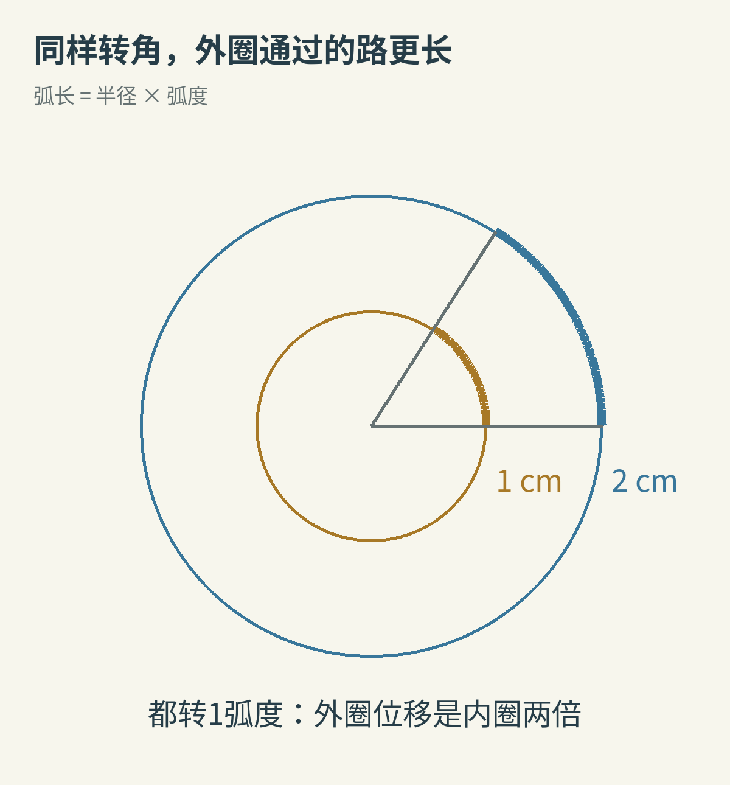

因此，同一只小轮子放得远一些，就会被更长的盘面路程推着转动；放到盘心，理想接触点的速度是零，轮子不转。

如果跨过盘心，到同一直径的另一边呢？接触处的运动方向反过来，小轮子也反着转。

于是，这个位置不只是“距离”，还可以表达正负。

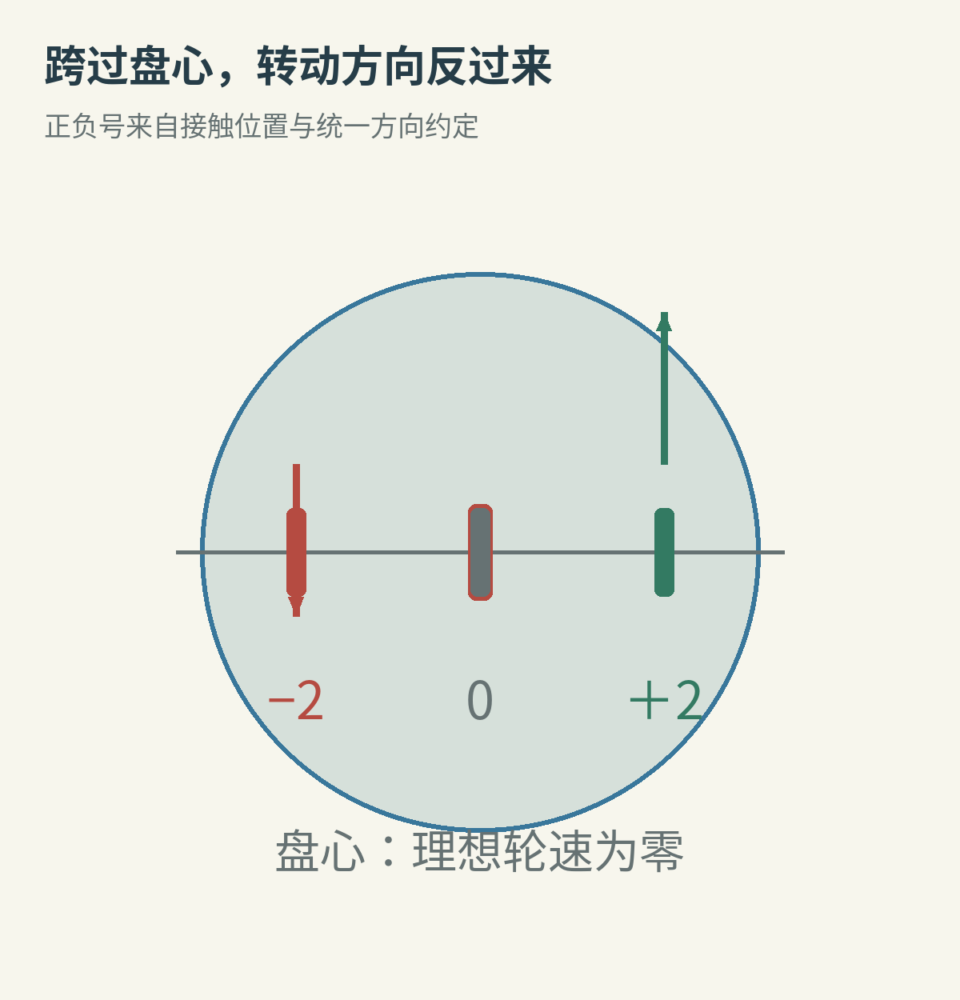

## 5. 用三个量，把这一步真正算出来

给三个可见的量起名字：

- ρ：小轮接触点到盘心的有符号偏移，单位厘米。
- θ：圆盘转角，单位弧度。
- φ：小轮输出转角，单位弧度。

再把小轮本身的半径叫r，单位厘米。

圆盘转过一小点角度dθ，接触点经过的切向距离是ρ × dθ；小轮不沿滚动方向打滑时，轮缘通过的距离也是这一点。

所以：

**r × dφ = ρ × dθ。**

把两边除以r：

**dφ = (ρ / r) × dθ。**

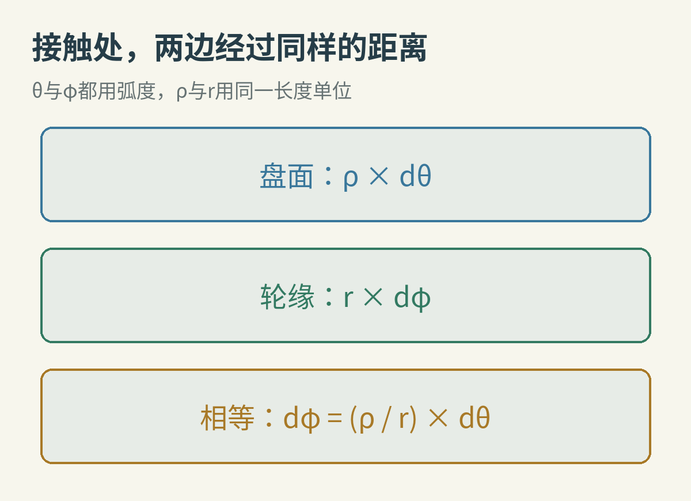

这里的正方向由我们统一约定。换一侧安装或加一个反向齿轮，读数符号会变，但位移比的原理不变。

不要把ρ和r混淆：ρ是可以左右调的位置，r是小轮自身的大小。

## 6. 一个不用微积分也能完成的三段实验

设小轮半径r = 1厘米。

先把轮子放在ρ = 2厘米的位置，让盘转0.5弧度。输出增加1弧度。

再把轮子移到盘心，让盘转1弧度。输出增加0。

最后把轮子放到ρ = −1厘米的位置，让盘再转0.5弧度。输出减少0.5弧度。

三段合起来：1 + 0 − 0.5 = 0.5弧度。

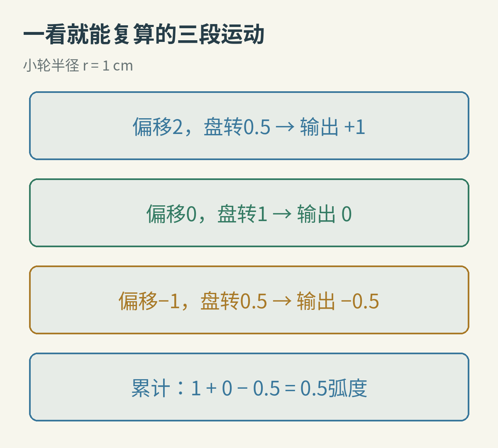

每一段，机器做的是“当前位置比例 × 这一段输入转角”；走完整段运动，输出轴把所有贡献保存在自己的累计转角里。

把小段切得越来越细，让ρ平滑地变化，就得到：

**输出角度变化 = 沿输入转角累计 ρ/r。**

这就是一个积分器。

它不是先把ρ变成十进制数字，再做乘法加法。理想的接触运动直接满足所需关系。

实物还需要适当的计圈与读数机构；只看轴端朝哪个方向，会丢掉已经转过多少整圈的信息。

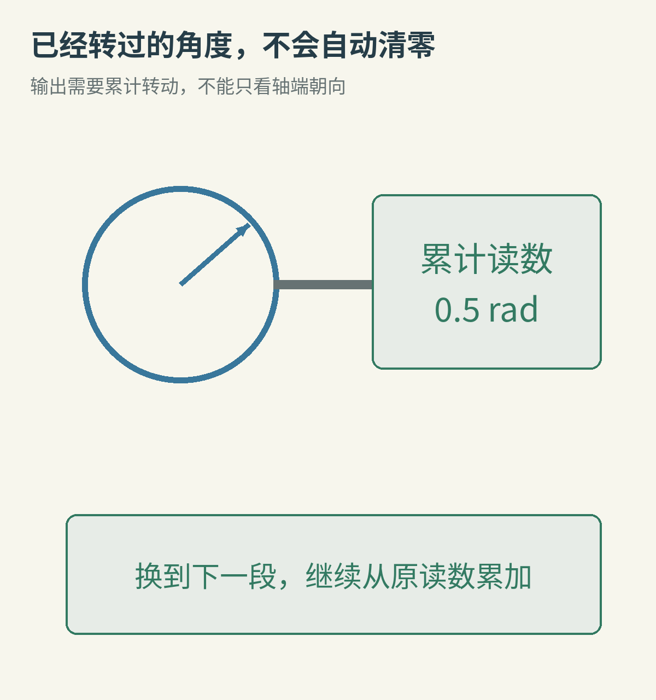

## 7. 把输入位置排成斜坡，就会得到抛物线

先做一个没有反馈的练习。

选好比例，让圆盘角度θ代表变量x，小轮偏移ρ代表x本身，并把r取为1个长度单位。x从0增加到2时，ρ也从0增加到2。

这相当于不断累计“x × 一小段x”。在坐标纸上，它就是直线y=x下面的面积。

走到x=2，面积是底2、高2的三角形：结果为2。

一般地，输出角度变化是x²/2，画出来是一条抛物线。

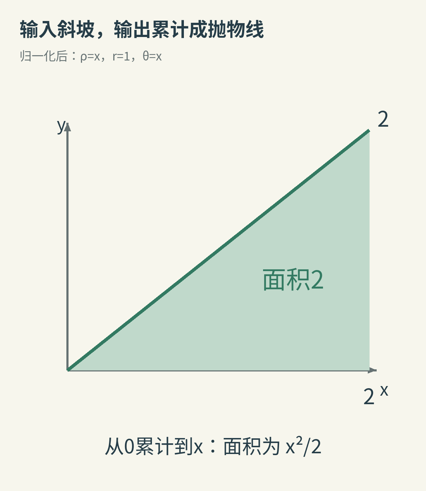

下面这张1886年原页把轮盘运动和面积累计写在一起。这里无需逐个读懂原书符号，观察“位移乘偏移，再除以固定几何常数”的结构就够了。

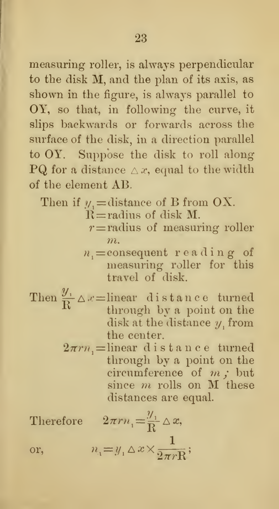

图源、美国公有领域范围和500dpi整页呈现方式同上；这是同一原书第23页，完整原PDF随附。原书用转数等符号，不应把它的n直接误当本文采用弧度的φ。

但请注意：这个例子里，是我们从外面指定了ρ随x怎样变化。它还只是“算一个已知函数的积分”，并没有开始解未知函数的方程。

## 8. 最精彩的一步：把输出接回去

现在不再提前规定ρ的完整变化曲线。

通过齿轮和把旋转变成直线位移的机构，让**当前输出值y，控制小轮子的偏移位置**。选好比例后，ρ/r就等于y，而圆盘转角θ仍代表x。

接触关系于是变成：

**dy = y × dx。**

用导数的记法，就是dy/dx = y。

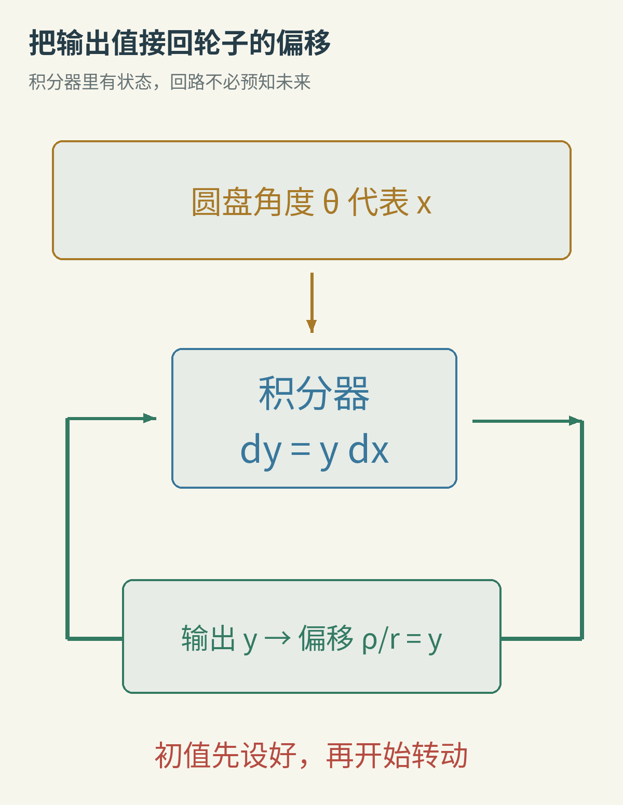

把它读回开头的中文：当前y越大，x再增加一点时，y增加得就越快。

这里没有偷放一条指数曲线。回路里只有“输出控制增长率”这条关系。

选初值y(0)=0.5，理想数学解是y=0.5e^x。x走到1时，y约为1.35914。

如果你还没有学过e，这也不妨碍理解机器。暂时把e看成那条“增长速度始终等于自身”曲线在x=1时，从初值1长到的约2.71828。我们现在是从0.5开始，所以得到它的一半。

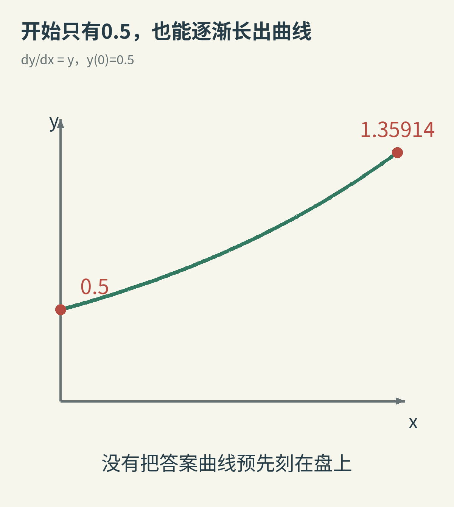

## 9. 这会不会是一个没有先后的死循环？

程序员看到“输出马上又成为输入”，可能会担心：必须先知道答案，才能计算答案？

关键在于，回路里有一个积分器。它保留当前状态。

在x=0时，先设置y=0.5。这个已有值决定刚开始的变化率；x随后移动，积分器的输出连续改变，新输出又连续改变接触位置。

不需要预知x=1时的结果，才能开始运动。

为了手算，我们可以暂时用小步近似。每步Δx=0.1，先按当前值决定这一小步的增量：

- 从0.5开始，第一步增加0.05，变成0.55。
- 第二步增加0.055，变成0.605。
- 第三步增加0.0605，变成0.6655。

这就是显式欧拉近似。它帮助我们理解局部规则如何长成整条曲线。

**真实模拟机的理想模型是连续运动，不是暗中每隔0.1做一次欧拉迭代。**两者不能混成同一实现。

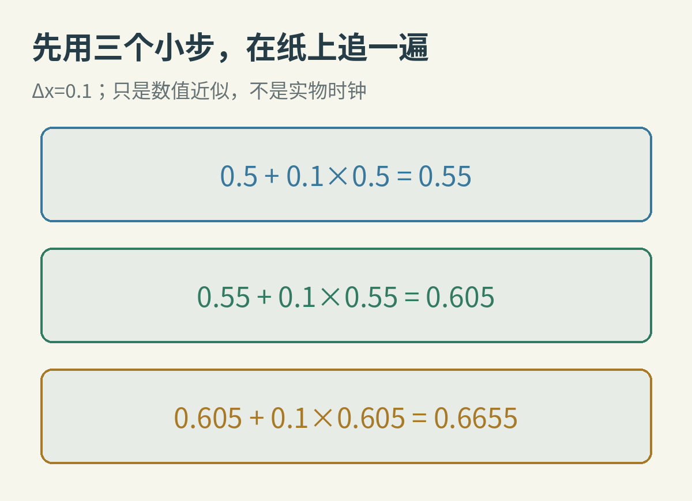

## 10. 初值、比例和范围，都会改变你读到的答案

如果初值改成1，仍接同样的关系dy/dx=y，整条曲线会是刚才的两倍。

如果把反馈比例改成2，就得到dy/dx=2y，增长更快；反馈反向，便可以得到dy/dx=−y，逐渐衰减。

机器并不“认识”1厘米代表什么。使用者必须设置比例，把一个数学量和一个机械量对应起来。

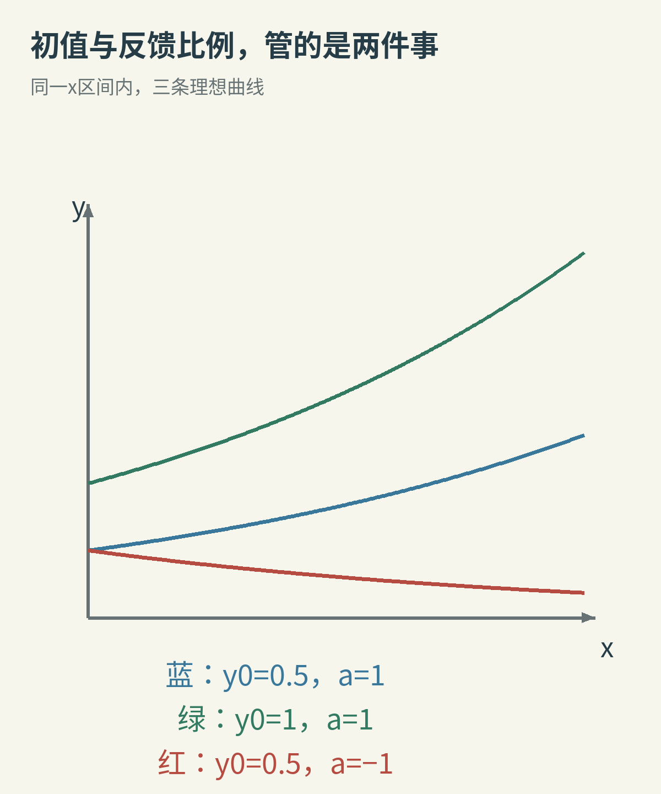

例如，圆盘每转2弧度代表x增加1；输出轴每转4弧度代表y增加1；小轮偏移2厘米代表y=1，小轮半径1厘米。

代入接触关系：

4dy = (2y / 1) × 2dx，化简仍是dy = ydx。

如果只改一个刻度，却忘了其他比例，机器仍会遵守它自己的运动规律，求解的却可能已经是另一个方程。

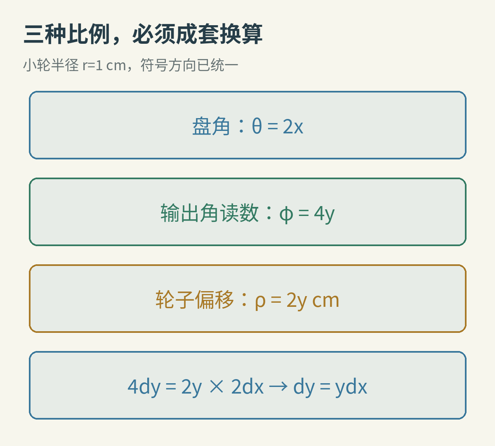

盘的尺寸还给出硬边界。小轮的位置不能跑到盘外。

若盘面允许的偏移只有−3至3厘米，映射又是ρ=y厘米，就不能让y无限指数增长而仍声称装置在正确求解。顶到边界后的卡住、滑脱或其他真实行为，都不属于那条理想公式。

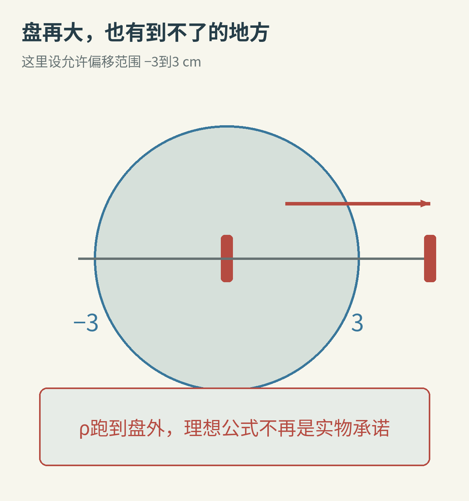

## 11. 轮子会算，却未必有力气带动下一台

到这里，纸面上的逻辑已经接通。工程上却还有一个麻烦：精细的小轮接触，适合读出转动，不一定适合拖动一长串沉重转轴。

如果下游负载太大，接触处就可能打滑。你读到的角度比不再满足刚才的等式。

Bush在1936年原文中明确区分了这两件事：积分器负责控制转动关系，做功需要来自另一处。他描述的扭矩放大器使用缠绕带与连续转动的鼓，让输入轴控制一个更有力的输出；两个鼓可服务于两个方向。

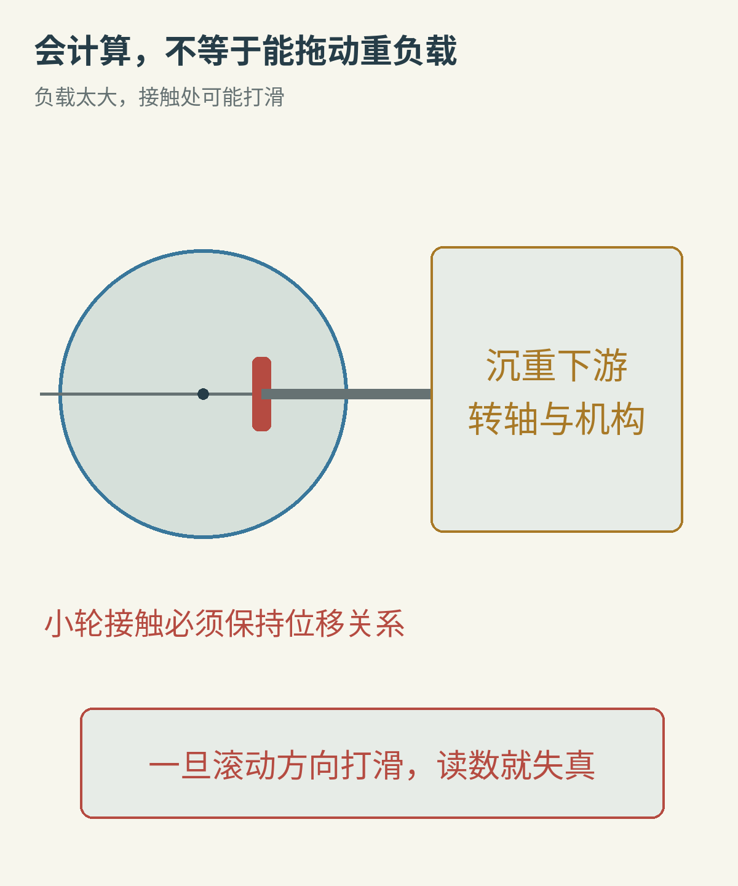

可以把它理解成卷扬机绳索的控制思路：手里的小作用控制绳带与动力鼓的接合，由外部动力源承担主要工作。

这里放大的是可提供的扭矩，也就是带动负载的本领；目标仍是让输出跟随输入的转角。并不是把数学上的积分值偷偷乘一万。

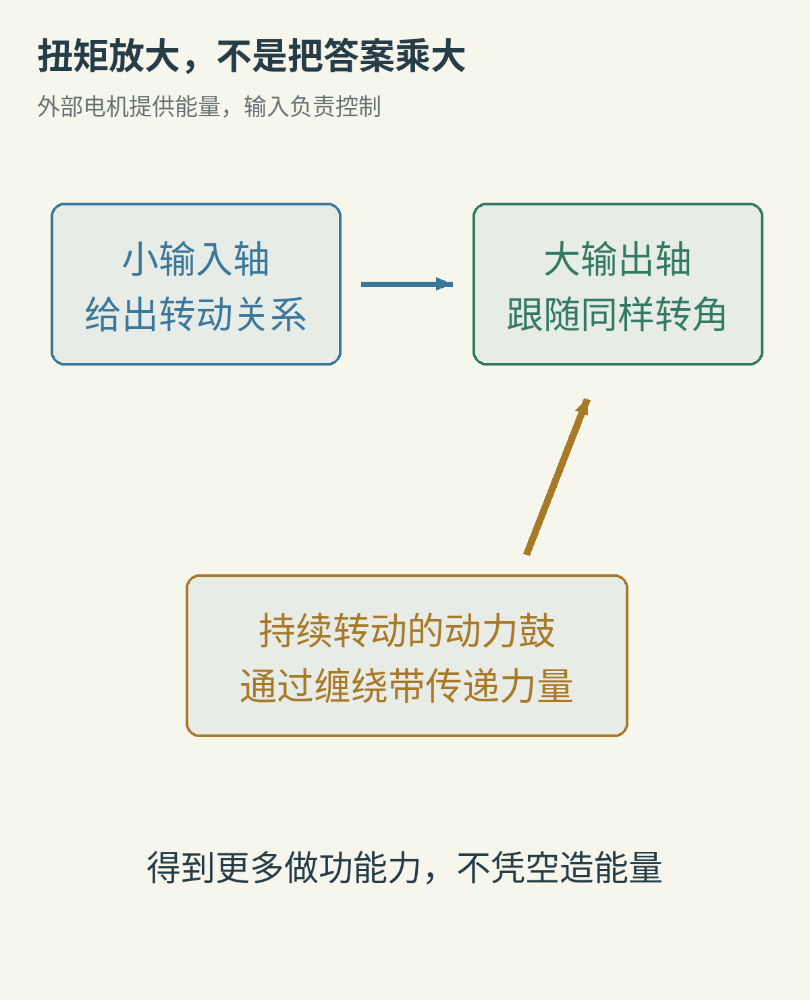

这也不是无中生有的能量放大器。电机提供能量，控制部分决定如何把能量用于跟随。

## 12. 两个积分器接起来，就能描述来回摆动

一个积分器能把变化率累计成变量。两个积分器，便可以从“变化率的变化率”一步步回到原变量。

用一个简单模型：

du/dx = v，dv/dx = −u。

先让积分器一接收v，输出u；再让积分器二接收−u，输出v。两者使用同一个x输入。

设u(0)=1、v(0)=0。开始时u不马上变化，但v开始向负方向变化；随后负的v又让u下降。它们互相牵引，理想解会沿余弦和负正弦变化。

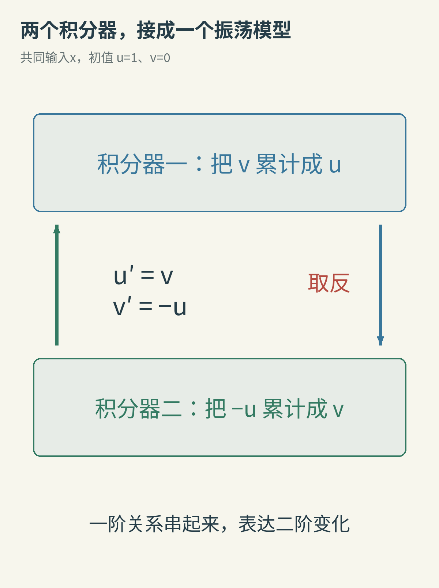

这正是把一个二阶关系u的二阶导数=−u，拆成两个一阶关系。

我们只是在讨论这个特定、良定的例子。不能据此声称“任何方程随便接一个环，就一定有唯一稳定答案”。元件数量、允许的运算、初值、方程本身和真实机械动态，都限制了可解的问题。

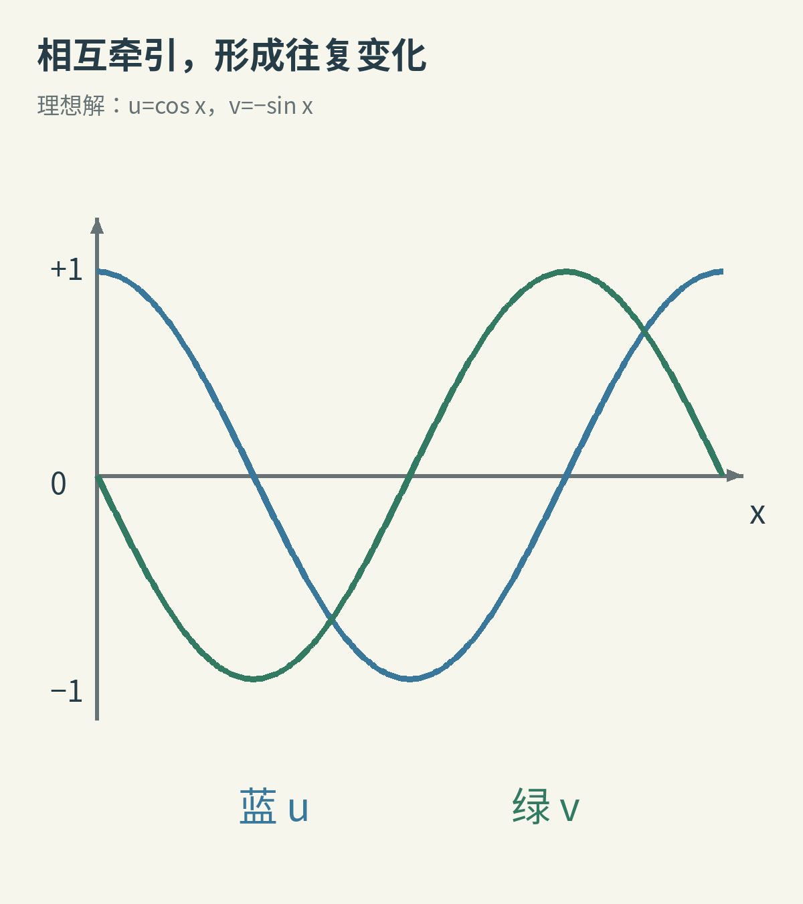

## 13. 可以动手核对，但别把代码当成实物性能报告

[配套实验](examples/analyzer_lab.py)只用Python标准库。

第一部分使用精确分数：4116组三段偏移与转角组合，核对位移关系、把一段拆成两段后总输出不变、反转输入后输出反号。还核对了84个斜坡累计例子。

第二部分才是数值近似。对y(0)=0.5、dy/dx=y、x从0到1：

- 欧拉法10步得到约1.296871。
- 欧拉法80步得到约1.350742。
- 理想解析解约为1.359141。

步子变小后更接近目标，但依然不是同一个数。程序还用四阶Runge–Kutta方法作另一份数值核对；它在这组平滑例子中更精确，不代表真实1930年代设备采用这种算法。

代码另外检查357个指数解案例、49个双积分器振荡案例和135组比例换算恒等式。所有输入范围和误差记录都在[实验说明](sources.md)中。

下面的动画用解析解生成9个位置：x从0到1，y从0.5长到约1.359。蓝色标记表示盘的转角；接触位置、输出累计转角和曲线上的红点来自同一组数值。它是原理动画，不是历史机器运行录像。

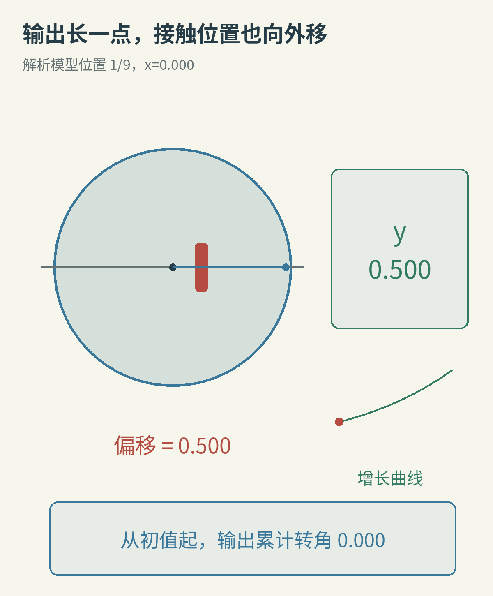

## 14. 这台机器最值得带走的，不是齿轮数量

换一道题，模拟机可能需要重新安排连接、齿轮比例与初始位置。记录的曲线还要按设定比例解释。

这与给现代数字计算机换一段程序，在使用体验上差别很大。不过，两者都有同一个重要要求：你得明确告诉工具，哪些量代表什么，怎样更新，什么范围内可信。

机械积分器很适合拆穿一种误解：只有把数字写出来，再执行四则运算，才算“在计算”。

圆盘外圈比内圈走得远，轮缘必须追上接触处的位移，输出轴累计已经发生的转动。把这些关系适当地连接起来，就能让一台物理系统替另一条数学关系展开结果。

留一道小题：如果把反馈断开，把偏移固定在ρ=2厘米，小轮半径仍为1厘米，圆盘每转1弧度，输出增加多少？曲线还会指数增长吗？

输出每次增加2弧度；它随输入角度线性增长。只有当“输出继续决定偏移”这条连接存在时，刚才那个特定指数反馈关系才成立。

一个看似不起眼的连接，决定了它是在计算已知函数的积分，还是在求一个未知函数的演化。

[完整来源、素材范围与实验记录](sources.md)
