# 把大数换成余数，为什么答案没有变？欧几里得的一本小账

拿一张长1071毫米、宽462毫米的纸，想把它切成一样大的正方形。边都平行于纸边，不能留缝，也不能切掉边角。

一毫米的小方格肯定能铺满，但要剪太多次。我们想找的是：**正方形的边长，最多能有多少毫米？**

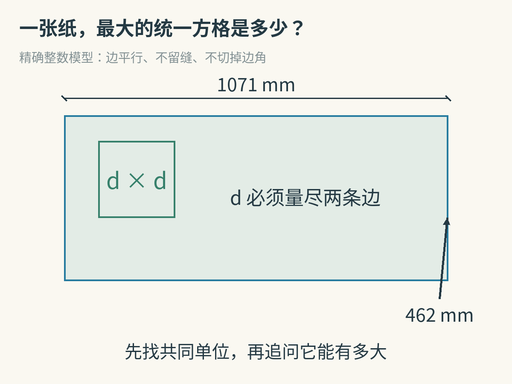

你可能想到，把1071和462分别分解成质因数，再找共同部分。这是一条路。今天走另一条：不先知道任何质因数，只做几次带余数的除法。

最后，1071会消失，462也会消失。留下一小段21，而它竟能替我们回答原来的大问题。

更有意思的是，这几步除法留下的“商”，还会变成一串分数；把账倒着看，又能写出两个原数怎样拼出21。一个小学除法，会同时打开三扇门。

## 先把“最大公约数”从名词变成一把尺

假设正方形边长是d毫米，而且d是正整数。横着铺必须刚好铺满1071，竖着铺必须刚好铺满462。因此d要同时整除这两个数。

整除的意思是除完没有余数。这样的d叫公约数；其中最大的一个，叫**最大公约数**，英文常缩写成gcd。

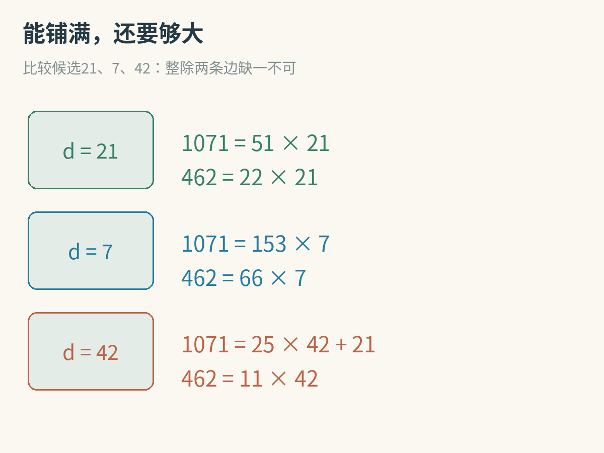

21能用：1071=51×21，462=22×21。7也能用，但方格更小。42就不行，462=11×42，虽然这一边恰好够；1071=25×42+21，另一边剩下一截。

先把答案告诉你，不算破坏悬念。真正值得学的是：**为什么不必把1到462全试一遍，还能保证没有漏掉更大的答案？**

本文纸张是自设的精确整数模型，不是实际测量实验。后面会专门说，现实中的误差为什么不能忽略。

## 第一次：切走两个大正方形

从1071毫米的长边上，每次切走一个边长462毫米的正方形。

能切两个，不能切第三个：

1071 = 2×462 + 147。

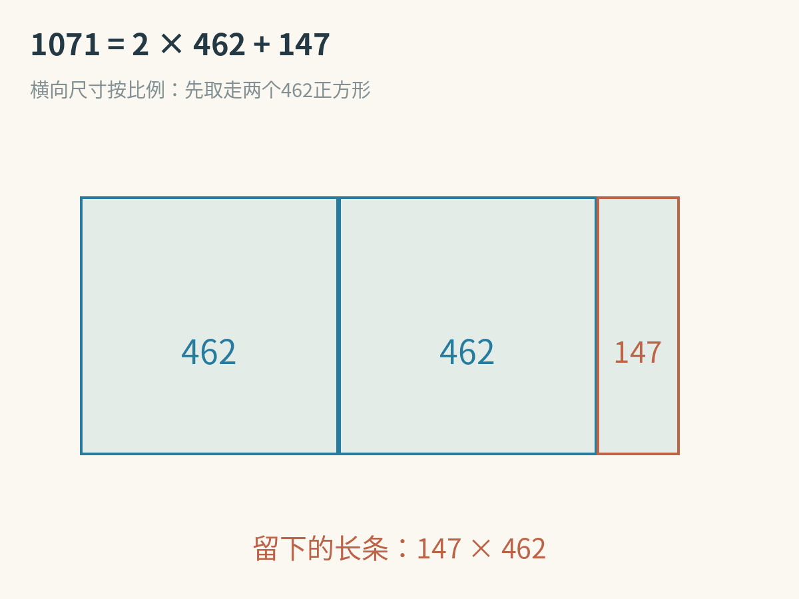

剩下的是147×462的长条。

这里有一个关键问题：如果某个小边长d能够同时量尽1071和462，那么它能量尽剩下的147吗？

能。原来的长边由若干个d组成；被拿走的两个462，也都由若干个d组成。拿走整份，剩下的仍是整份，不会凭空生出半份。

反过来也一样：若d能量尽462和147，把两个462和一个147拼起来，就能量尽1071。

**原问题与剩余问题，允许的公约数完全相同。**

## 第二次、第三次：把同一件事继续做小

现在面对462和147。让147去量462：

462 = 3×147 + 21。

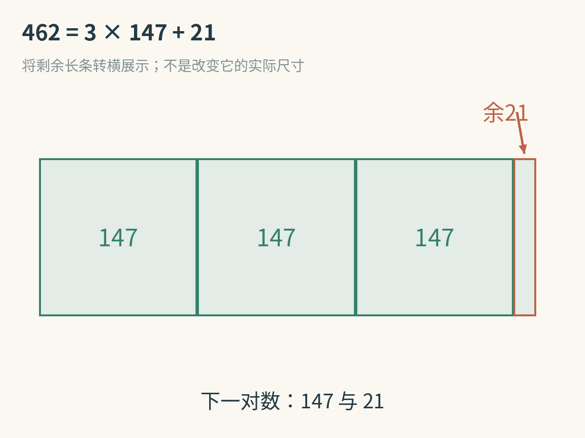

又剩下一条，这次只有21那么窄。

最后让21去量147：

147 = 7×21 + 0。

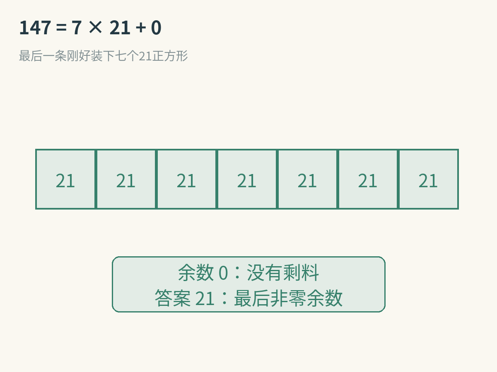

这一次，没有余数了。

为什么答案是21，而不是最后的0？因为0告诉我们“已经没有剩料”，它不是可以拿来铺纸的正方形边长。在最后一对147和21里，21能整除两个数，而且公约数不可能大于较小的正数21。

回想前两次换题都没有改变公约数，21自然也是最初那对数的最大公约数。

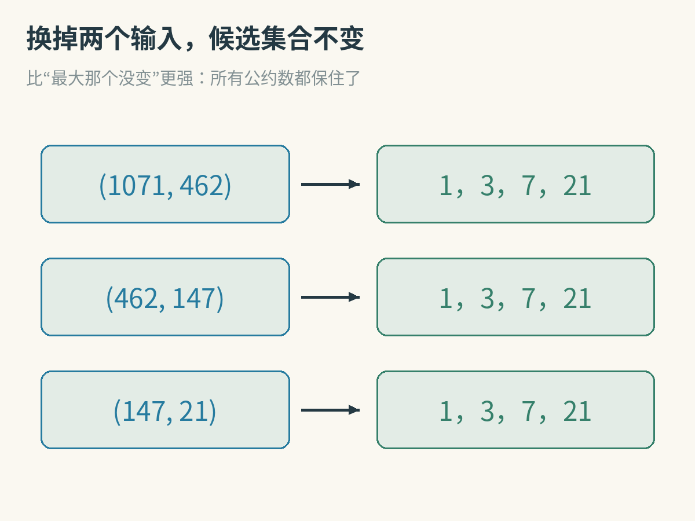

这不是碰巧从余数堆里捡到了答案。我们一直保留着它可能出现的完整范围。

## 把图里的理由写成一条可以反复用的规则

以后数字再大，也不需要每次重新画纸张。

把较大的数叫a，较小的正数叫b。一次带余除法可以写成：

a = q×b + r，其中0≤r<b。

a是被除数，b是除数，q是完整装下了多少份，r是装不下的那一小段。

若d同时整除a和b，那么r=a−q×b也由整份d组成。若d同时整除b和r，那么a=q×b+r也由整份d组成。

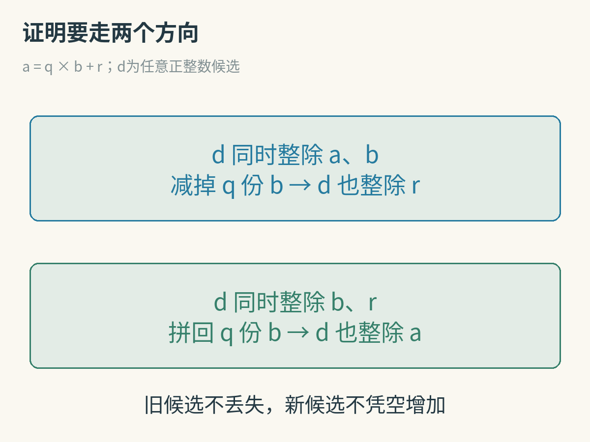

两个方向都需要。只证明“旧答案还能用”，可能悄悄多放进一些原来不合法的答案；只证明“新答案原来也合法”，又可能漏掉旧的候选。

因此可以放心写：

**gcd(a,b) = gcd(b,r)。**

每轮都变的是两个输入；一直不变的是它们的最大公约数。程序员把这种在循环中持续成立的事实叫**循环不变量**。名字很正式，直觉却就是“账本换了一页，欠的那笔账没变”。

## 古书里的“量尽”，怎样走到今天的取余运算

在欧几里得《几何原本》第VII卷第2命题里，问题正是寻找两个不互质的数的最大公共量度。证明讨论反复从较大者中减去较小者，并说明最后留下的量为什么能够量尽原来的两个数。[原典英译及图](https://mathcs.clarku.edu/~djoyce/elements/bookVII/propVII2.html)

第VII卷第1命题另行处理过程到达单位的情况。古书对“单位”和“数”的安排，与今天把gcd等于1的情况统一写进一个函数，并不完全相同。

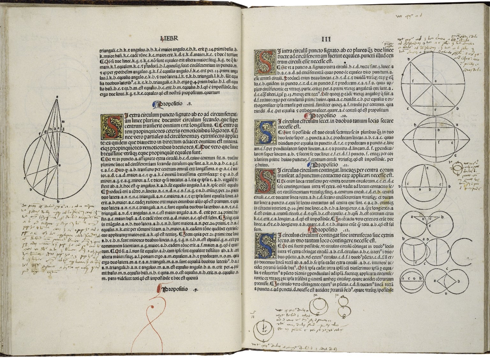

这是Folger Shakespeare Library收藏的1482年Ratdolt版《几何原本》，馆藏号INC E86。照片展开的是第III卷相关页面，用来观察这部书作为印刷实物的样子，并非第VII卷第2命题截图。图像由该馆提供，CC BY-SA 4.0，保持原文件不变。

看着页边的图和手写批注，很容易发现：读数学从来不只是在脑子里默念一句结论。需要画，拆，来回核对。本文的小纸片不是古希腊课堂的真实故事，也不据此猜测欧几里得的生活或相貌。

今天的a % b把“一次又一次减去b，直到不够减”为止的工作合在一起。这是算法的现代带余除法写法；不是说古书里已经写着Python符号。

## 它为什么一定能停？“越来越小”还不够

每轮的余数r都满足0≤r<b。下一轮的除数，就是这个更小的余数。

在本例里，除数依次为462、147、21，然后0。

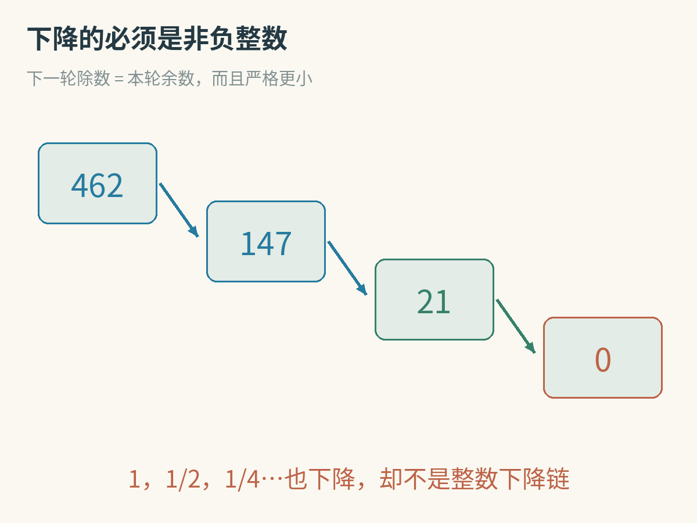

不会有无穷多个严格下降的非负整数，全部挤在最初的462以下。因此算法一定结束。

要特别留意“整数”。1、1/2、1/4、1/8……也越来越小，却永远不会在有限步里等于0。只说“每次变小所以必停”，理由还缺半截。

如果输入的是任意两段真实几何长度，问题还可能变成不可公度：找不到一段正长度，能同时用整数份数拼成二者。《几何原本》第X卷另有专门讨论。我们刚才的停止证明，不能一字不改地覆盖所有实数长度。

回到精确整数纸张。边长21的方格横51个、竖22个，总共1122个，恰好铺满。

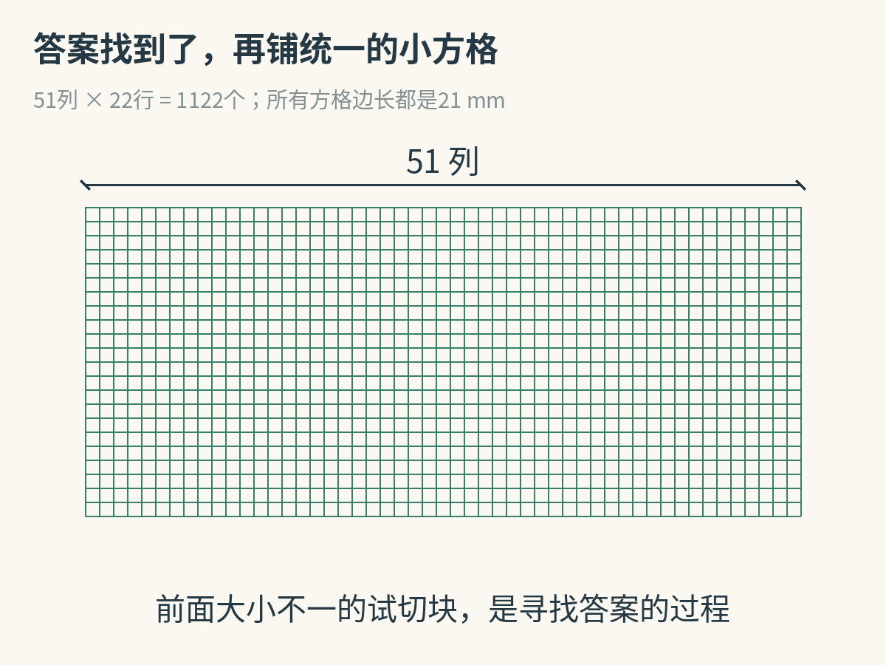

前面那几个大小不同的方块，是帮助寻找公共边长的中间过程；最后实际切纸时，用的仍是同一种21毫米正方形。不要把这两种图当成同一个切法。

## 短短一段代码，背后有两份证明

下面的教学函数只接受Python整数；先取绝对值，使负号不影响公约数。

```python
def gcd_by_remainder(a, b):
    if type(a) is not int or type(b) is not int:
        raise TypeError("需要整数")
    a, b = abs(a), abs(b)
    while b != 0:
        a, b = b, a % b
    return a

print(gcd_by_remainder(1071, 462))
```

输出21。第一次读代码，可以把a、b写在纸上，沿着下图走一圈。

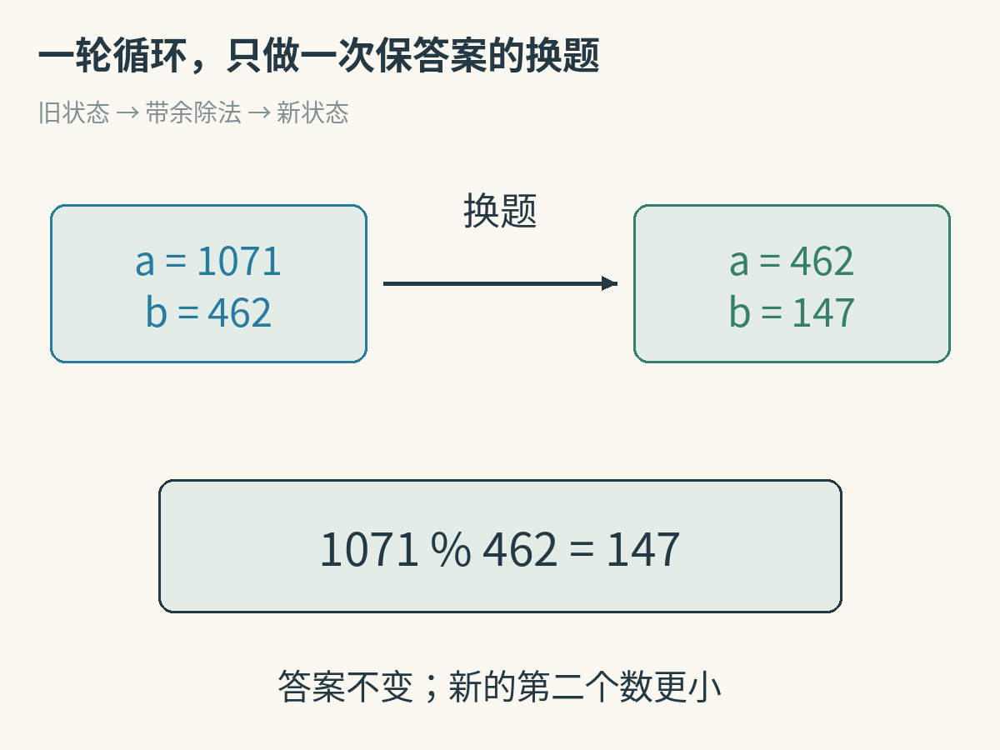

这里同时有两份证明在工作：不变量保证停下来时答案仍对应原问题；严格下降的非负整数保证真的会停。只有前者，可能永远等不到答案；只有后者，也可能很快结束却返回错误结果。

还有一个特别容易抄错的细节。Python多目标赋值先计算右边，再给左边赋值。若拆成先a=b，再b=a%b，第二句看到的a已经变了。在1071、462上，它会计算462%462，直接把b弄成0，错误返回462。

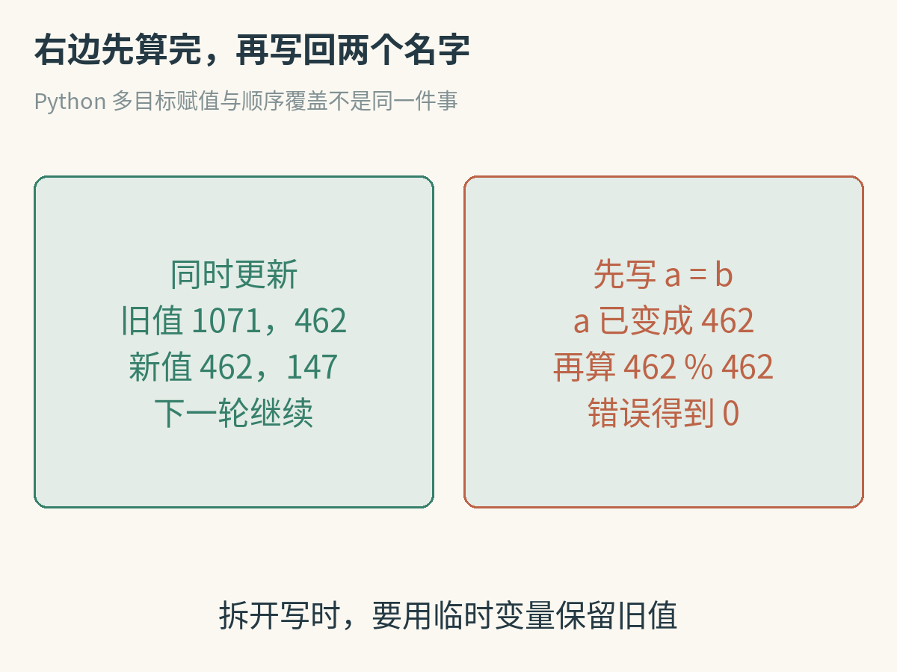

本函数约定gcd(a,0)=|a|，并返回gcd(0,0)=0，与Python标准库math.gcd的接口约定一致。数学上“0和0的最大正公约数”并不存在，所有正整数都能整除0；这里的0是方便统一程序接口的约定，不是最大正整数。

## 倒着翻账，能把21写回原数

刚才每一步都在把数变小。现在从最后一个非零余数21往回找：

21 = 462 − 3×147。

上一行账本告诉我们，147 = 1071 − 2×462。代进去：

21 = 462 − 3×(1071 − 2×462)

= −3×1071 + 7×462。

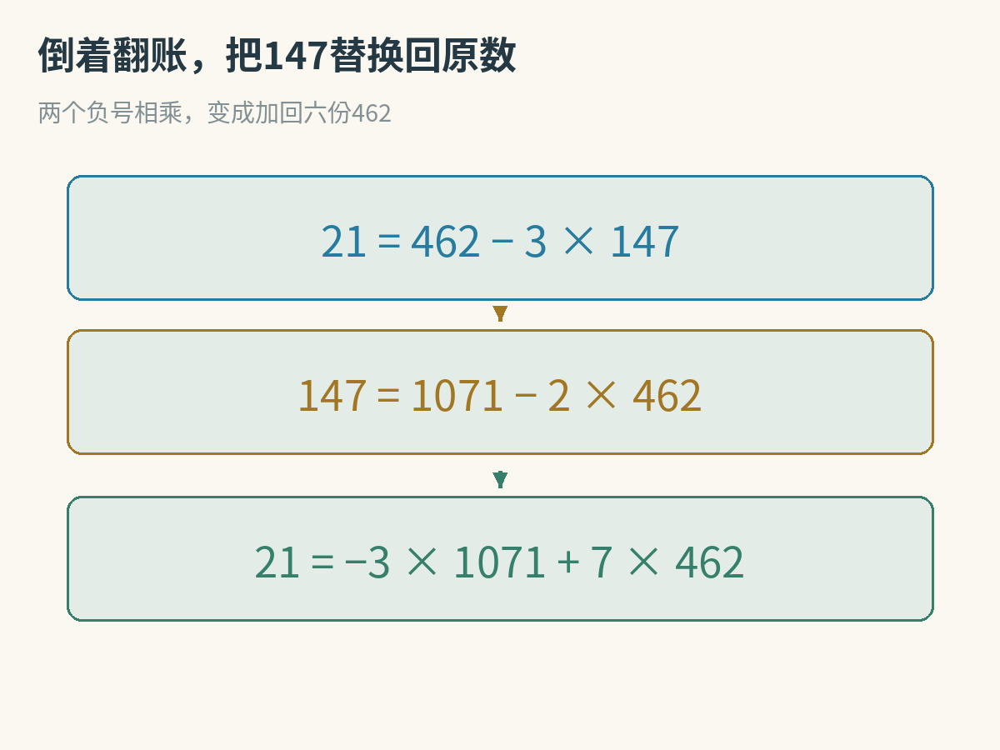

不妨真的算一下：3×1071=3213，7×462=3234。后者减前者，正好多21。

这类把最大公约数写成两个输入的**整数线性组合**的等式，通常叫贝祖等式。线性组合在这里就是“各乘一个整数，再加起来”；整数允许负数。

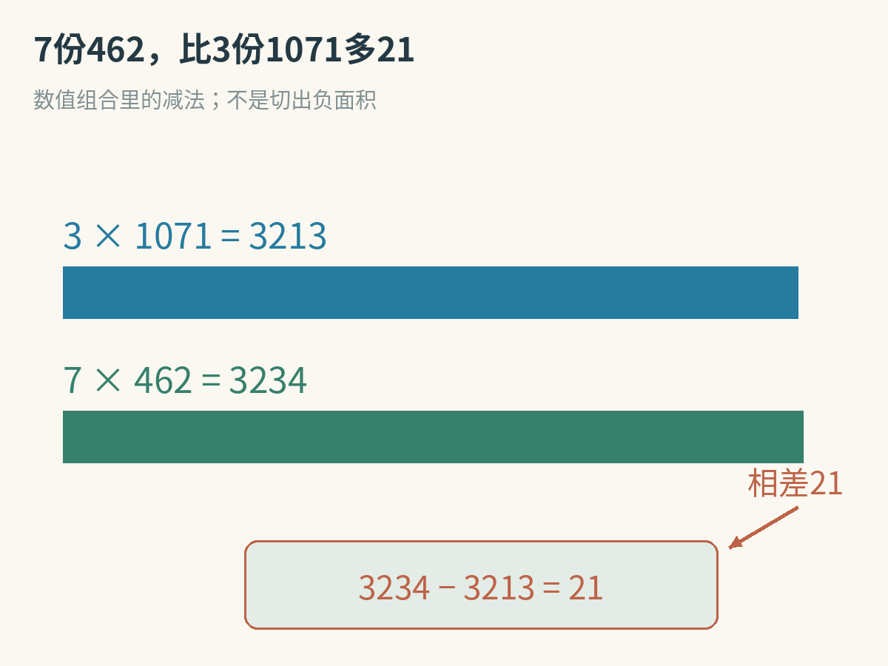

负号不表示要剪一张“负面积纸片”。它表示算术上的减去；如果把两种长度当作可向左右移动的步长，负系数就是往相反方向走。

也可以不等最后再倒推，而是每一行顺手记录：当前余数相当于多少份原a、多少份原b。

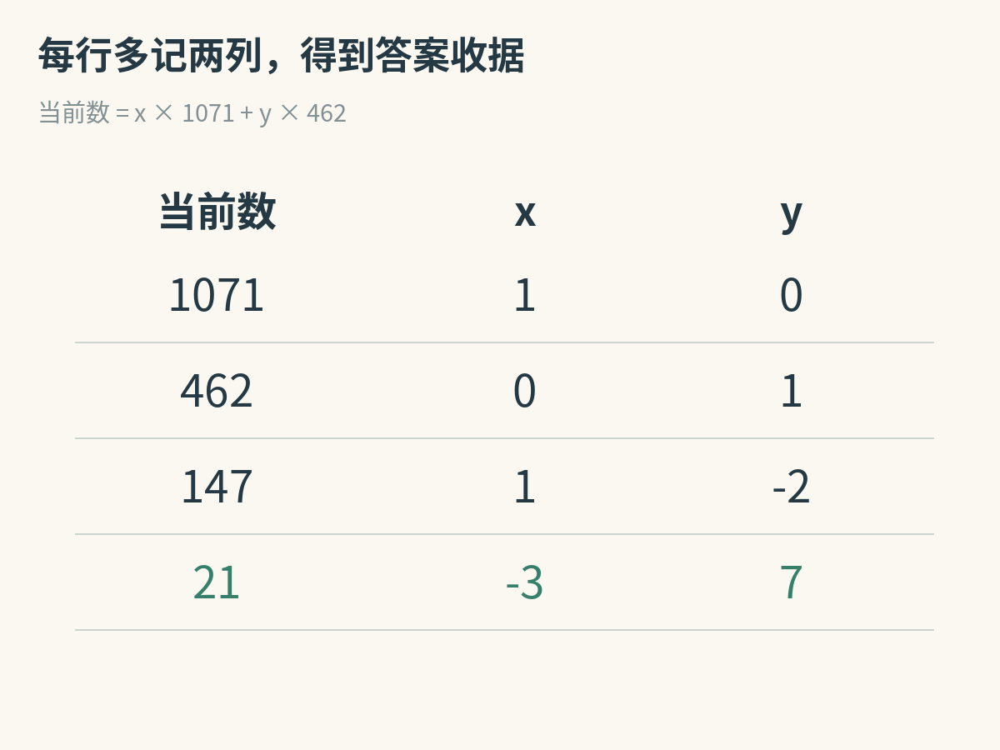

例如147那行是(1,−2)，因为147=1×1071−2×462；21那行是(−3,7)。这种增加两列账目的做法，就是扩展欧几里得算法的核心。

本文不把它继续扩写成另一篇RSA教程。这里只留下一个好用的检查方式：别人给出一组系数时，直接乘回原数相加，就能核对这张“答案收据”。

## 别把商扔掉：2、3、7里面藏着一个比例

求最大公约数时，我们一直盯着余数。现在把三次除法的商捡起来：2、3、7。

第一行1071=2×462+147，两边除以462：

1071/462 = 2 + 147/462。

而147/462可以写成1/(462/147)。第二行告诉我们462/147=3+21/147；第三行又告诉我们147/21=7。

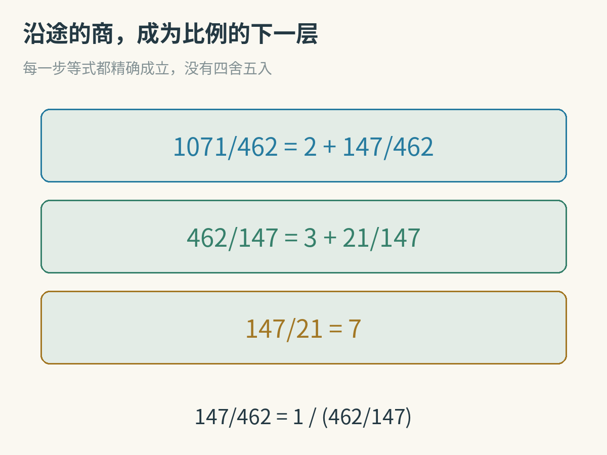

串起来便得到：

1071/462 = 2 + 1/(3 + 1/7)。

这种分母里面还嵌着分数的形式，叫**连分数**。我们把这一个有限的连分数简写成[2;3,7]：分号前是最外层整数2，后面依次是3和7。

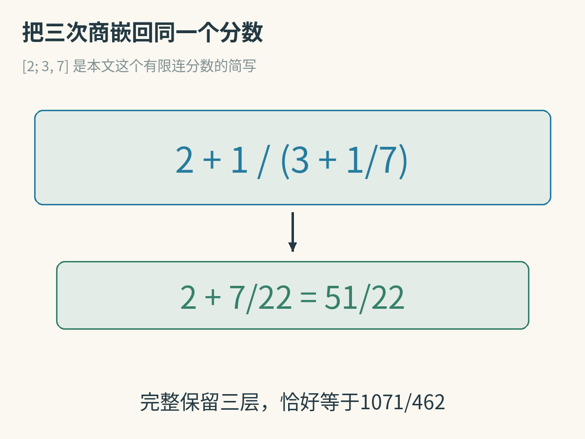

这里不是新造了一个近似值。完整算完，2+1/(3+1/7)=2+7/22=51/22；恰好就是1071/462约去21后的结果。

同一趟算法留下两种信息：最后的非零余数告诉我们怎样约分，沿途的商告诉我们这个比例怎样逐层组成。

## 只保留前几层，能不能得到一个更好记的比例？

如果只留下2，是2/1；保留2和3，是2+1/3=7/3；保留全部三层，就是51/22。这些逐层截断得到的分数，叫收敛分数。

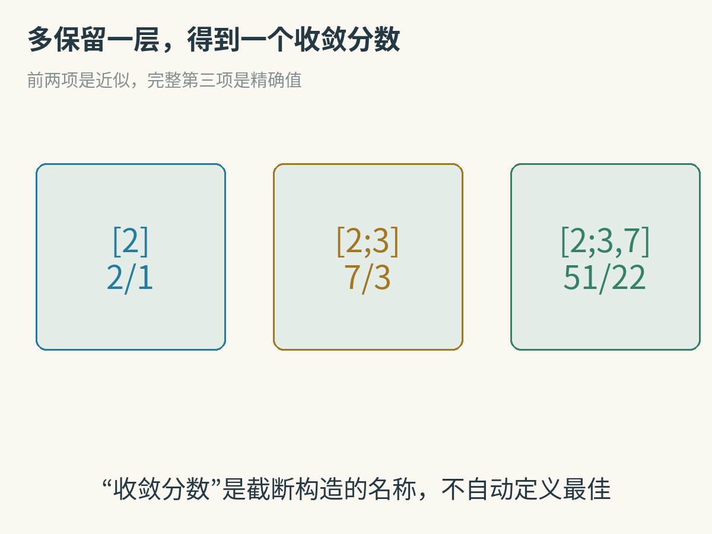

假设我们想在一张很小的草图上，用不太大的整数表示原纸张的长宽比例。7比3容易记，51比22更准确。怎么比较“差多少”？

选一种明确标准：比较比例数值的绝对误差，也就是|近似分数−51/22|。

7/3的误差是1/66，约0.01515。把小数保留一位得到2.3，也就是23/10，误差反而是1/55，约0.01818。

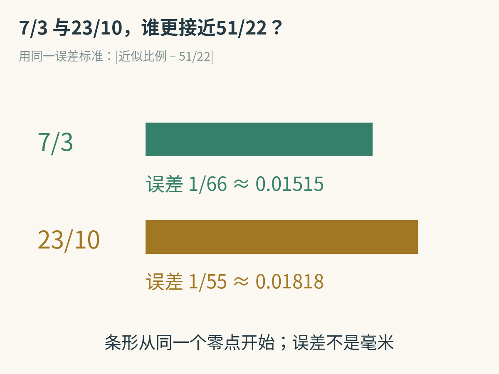

分母更小，不一定更差。十进制保留一位很方便，但不是所有限制下的最佳分数表示。

配套实验还逐个检查了分母1到10。每个分母q，只需比较51q/22上下相邻的两个整数分子，因为更远的整数一定更差。在这个明确范围与误差标准下，最佳分数值确实是7/3；14/6与21/9只是它未约分的写法。

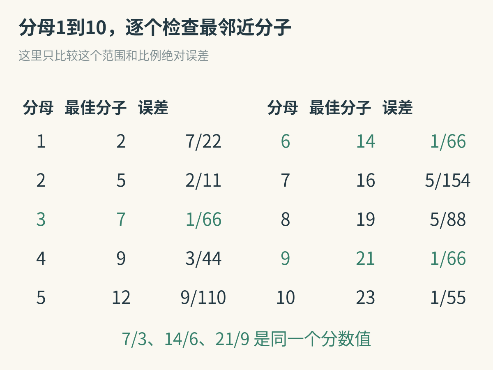

这只是我们具体问题的完整小枚举。它没有证明“随便截断任何连分数，在任意分母限制、任意误差定义下都最佳”。连分数有更深入的近似定理，但需要把约束和“最好”的含义说清楚。也不要把差0.01515直接读成“0.01515毫米”：这是比例误差，若拿来制作实物，还要乘上选定尺度。

## 什么样的输入，最让这本小账磨蹭？

大数不一定步数多。10的12次方与1，只需一次带余除法，余数就到0。

反过来，一些不算大的数，却让算法一点一点往下走。例如1597与987。

1597=1×987+610，987=1×610+377，610=1×377+233……每轮只拿走一份，剩下的还是相当大的一段。

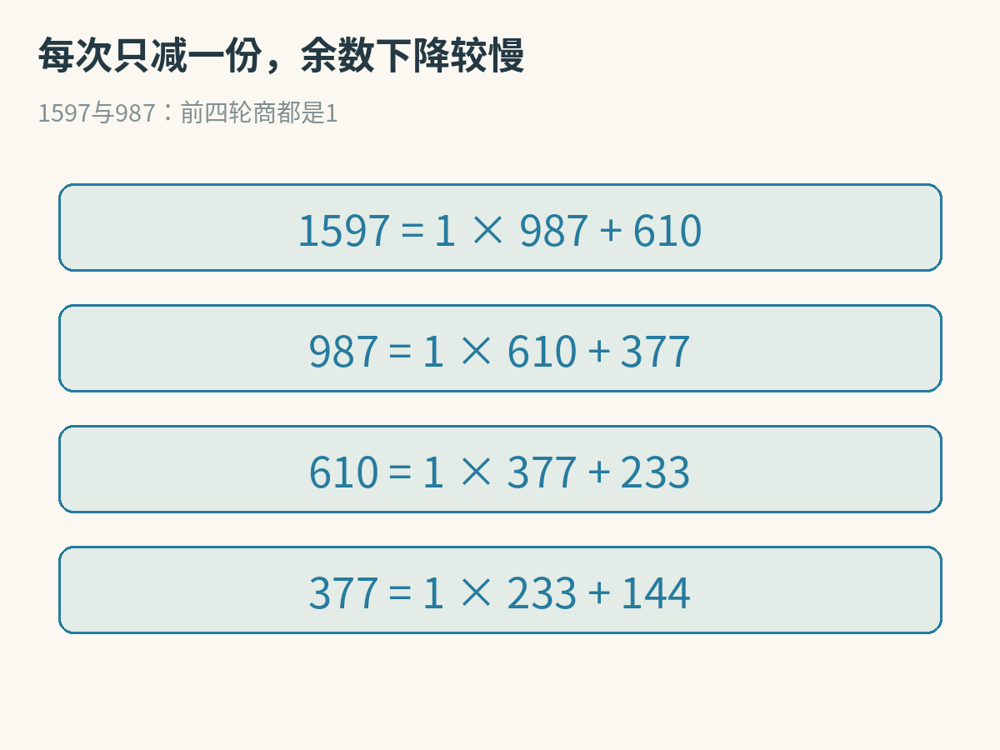

987、610、377、233这些数，来自一个每项等于前两项之和的序列，也就是Fibonacci数列。向前是加法生长，反过来恰好适合一次次“减去一份”。

为什么这不是只靠凑例子发现的巧合？可以倒过来想：若希望算法拖很多轮，而输入又尽量小，那么每轮的商应该尽量小；在大于小的正整数情形，商至少是1。最后一轮整除时，较大数至少是较小数的2倍。于是从尾部往回构造最小可能输入，就出现1、2、3、5、8、13……

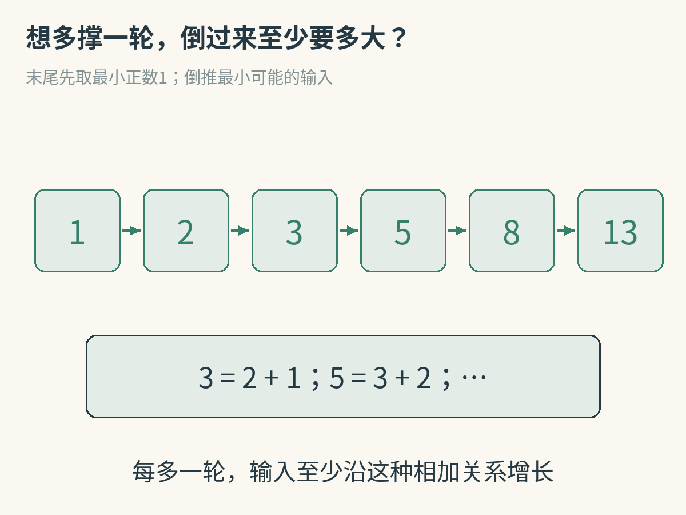

因此，要让除法轮数持续增加，输入本身得长得很快；最坏情况下，除法轮数只随较小输入的数值按对数量级增长，并非每对输入都要这么多轮。这里数的是除法步骤，不是把每次大整数除法都假定为相同纳秒数。几百位数的一次除法，与两位数的一次除法，成本当然可能不同。

1844年，Gabriel Lamé发表了关于寻找最大公约数时除法次数上界的短文。可核的原文片段讨论了次数与较小输入十进制位数之间的联系，而不是只说“总会结束”。这是一个很自然、也很现代的问题转变：**算得对之后，还要问最多要算多久。**[原文片段所在ETH课程资料，第47页](https://vs.inf.ethz.ch/edu/HS2019/I2/slides/Info2-ITET-05.pdf)

本文程序把最后一次余数为0的除法也计入。1597与987共15次；若只数产生非零余数的除法，就是14次。谈步数时，连“最后一下算不算”也必须先对齐，不能拿两个计数口径不同的数字比较谁算错。

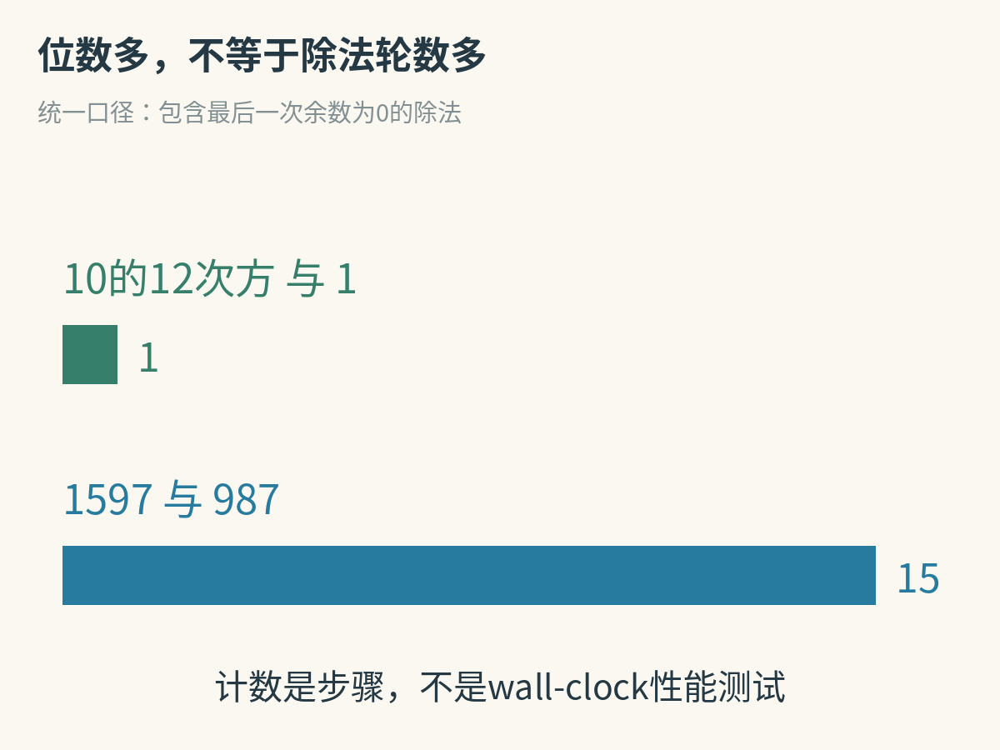

## 最后一个边界：现实尺子，不是精确整数

假如测得两条边都是1000毫米，模型的最大公约数是1000；其中一条改成1001毫米，最大公约数立刻变成1。

输入只差一毫米，结果却发生巨变。公约数不是一个面对测量噪声总能平滑变化的量。

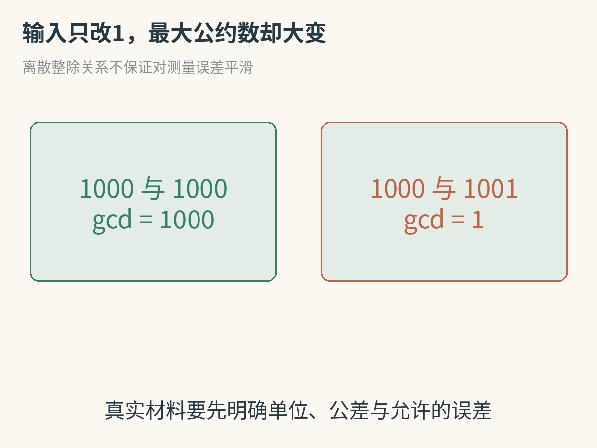

如果把米单位的小数直接丢进取余循环，计算机保存的浮点数未必就是纸面上那个精确十进制数。即使循环停了，也可能只找到了二进制近似值的某种关系，不等于找到了真实材料可用的公共尺寸。

有确定最小单位的离散问题，先用那个单位表示成整数；有测量误差的物理问题，需要先说清公差、允许切掉多少、怎样定义“足够接近”。这属于建模，不能靠在循环尾巴加一句“误差小就算0”替所有场景做决定。

想自己试一次，可以把纸边改成252和105。先写每一轮的商与余数，再倒推一组能拼出最大公约数的整数系数。答案中的最大公约数仍是21，但经过的账目不同。

[完整Python实验](examples/euclid_lab.py)保留本文输入、迹线、连分数和误差枚举。实际运行还核对了−150到150之间的90601对整数、1到100之间10000对正整数的连分数往返，并逐步比较小范围中的公约数集合。这些有限检查可以抓住符号、边界和实现错误；一般正确性仍由前面的双向证明与停止证明承担。

欧几里得算法给程序员的一件礼物，不只是一个gcd函数。它示范了一种思考方法：**先找出什么必须保持，再让问题不断变小。**

大数可以离场，答案不必跟着丢失。
