# 改一个数，为什么不用重算后面的总和？Fenwick树把账本折成二进制

校园活动有16个摊位。每个摊位不断收到新的票数，主持人又常常来问：“前13个摊位一共多少票？”

如果每次都从第1个加到第13个，查询有点累。那提前把“前1个”“前2个”直到“前16个”的总数全写好，怎么样？

查询是舒服了。可第11个摊位又收到4票，从“前11个”到“前16个”的总数就全都要改一遍。

我们想找一本折中的账：查询时不用逐项相加，改票时也不用重写一长排总数。


接下来用自设的16个整数做实验。它们只是教学票数，不涉及真实投票或个人信息。到最后你会发现，这本账里藏着的“树”，甚至不需要画出指针。

## 1. 先看两种笨办法，谁也不算笨

把第i个数记成`a[i]`。为了让区间边界直观，本文所有有效位置从1开始编号。

第一种账只存原始值。改`a[11]`很容易，可要问前13个的总和，就得读13项。

第二种账存**前缀和**：`s[i]`表示从第1项到第i项的总和。查询只读`s[13]`就够了；但`a[11]`一变，所有包含它的后续前缀都得跟着改。

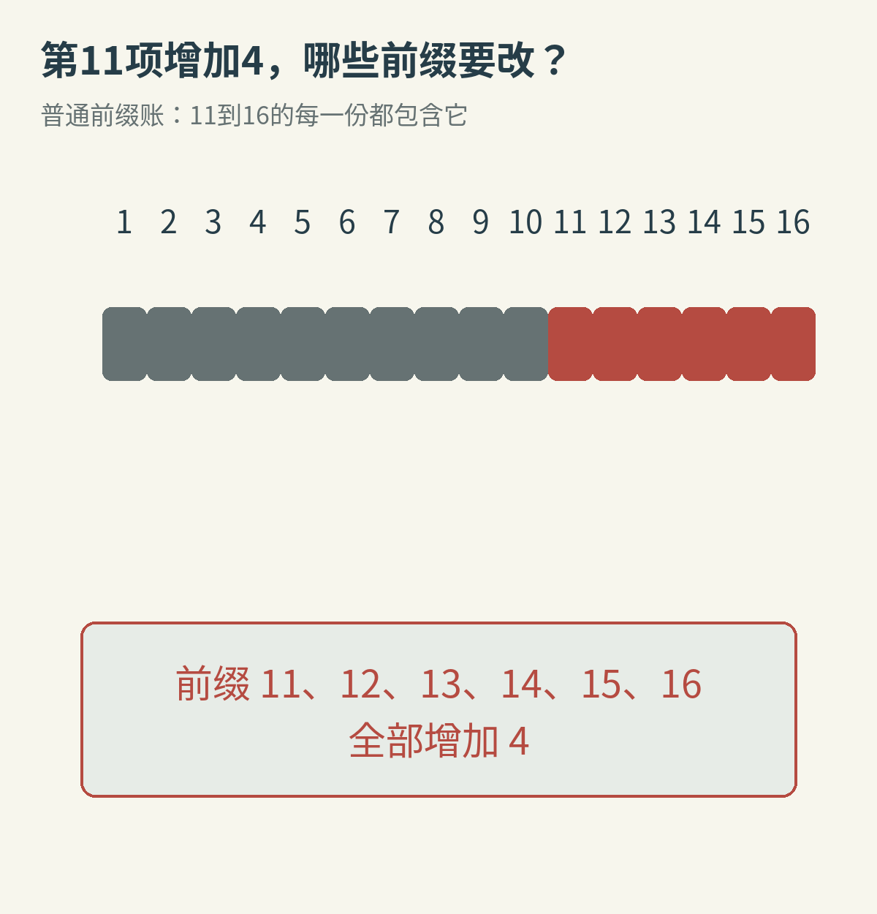

这并不是说前缀和过时了。如果数据基本不变、查询却要回答很多次，提前算一次前缀和仍然非常合适。我们今天要解决的是另一种任务：**查询和单点修改交错发生**。

## 2. 从数据压缩走来的小账本

1994年，Peter M. Fenwick在《Software: Practice and Experience》发表了关于累积频率表的新数据结构论文。出版社摘要写得很明确：它服务于动态算术数据压缩中的频率维护，并用索引的二进制表示来组织计算。[出版社原记录与摘要](https://onlinelibrary.wiley.com/doi/abs/10.1002/spe.4380240306)

这里不需要先学完整的压缩算法。只要知道一件事：压缩器可能一边读入新符号，一边调整各符号出现的计数；同时它又需要知道某个符号之前累计了多少计数。更新与累计查询，恰好就是我们刚遇见的两种工作。

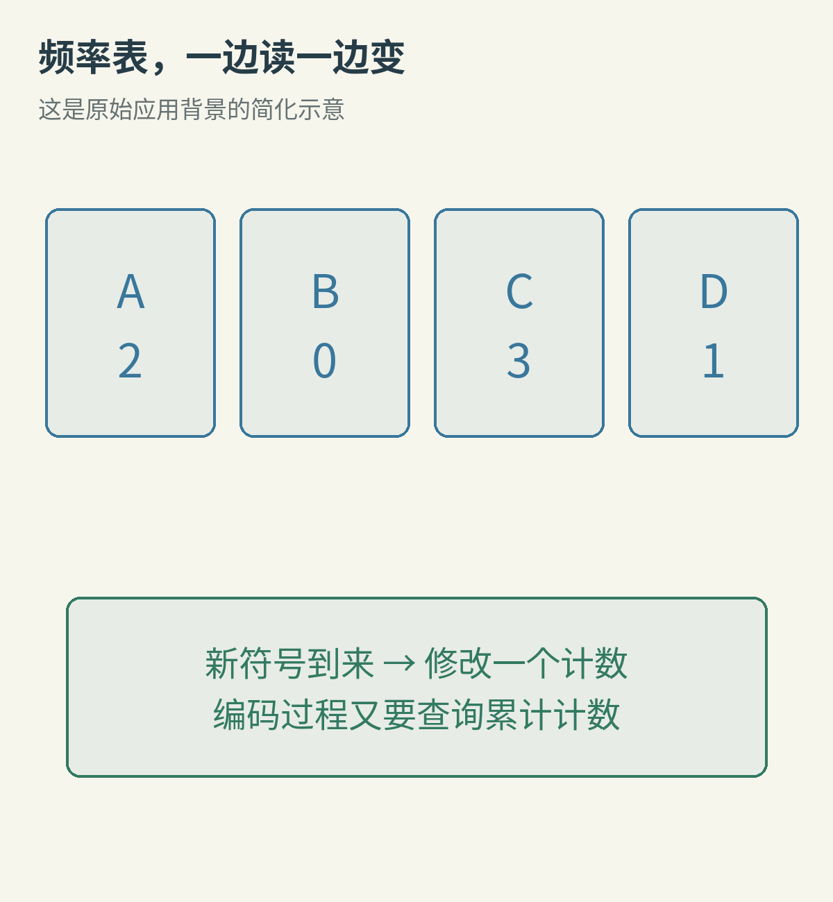

作者在奥克兰大学保存了一份技术报告88：封面日期是1993年5月28日，当前文件内页带1996年6月17日页脚。这些日期不能混成“1996年才提出”，也不能把当前文件的所有修订都说成1993年的原样内容。[作者保存的报告88](https://www.cs.auckland.ac.nz/~peter-f/FTPfiles/TechRep88.pdf)

本文从这些一手材料核对原理与历史，再用自己的数值、代码和图示逐步重建，不照搬报告里的示例表。

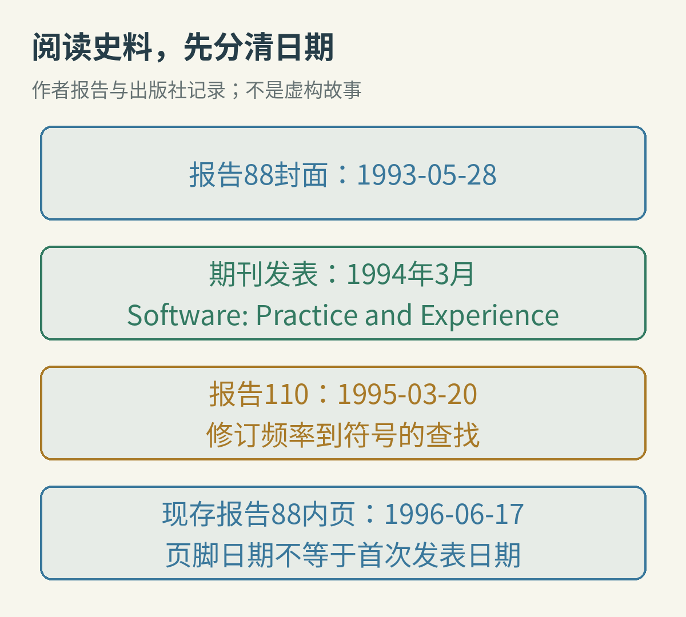

## 3. 每一格只管一段，不管从头到尾

新账本用一个数组`tree`。但`tree[i]`既不总是第i项本身，也不总是前i项之和。

它负责的是一段**以i为右端点的连续区间**。负责多长？先观察几个位置：

- 位置7，只管第7项；
- 位置6，管第5到第6项；
- 位置12，管第9到第12项；
- 位置8，管第1到第8项。

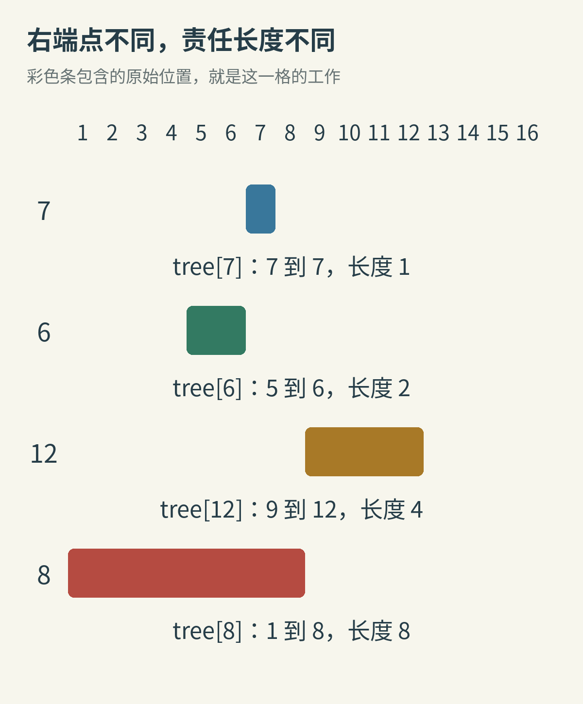

这些长度不是随便挑的。把位置写成二进制，找到最右边那个1，它代表的数值就是区间长度。

比如12是二进制`1100`。最右边的1代表4，所以位置12负责最后4项，也就是9、10、11、12。

6是`110`，最右边的1代表2；7是`111`，最右边的1代表1；8是`1000`，唯一的那个1代表8。

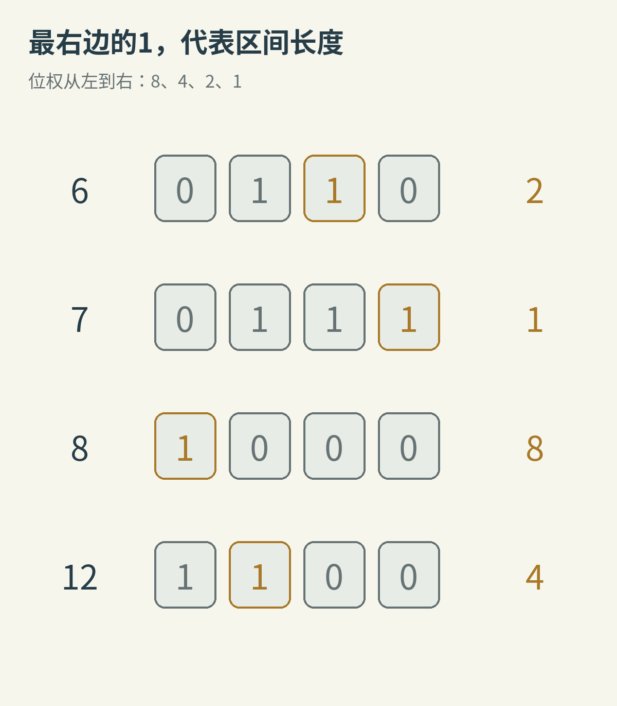

把这个长度叫`lowbit(i)`。这名字听上去像个窍门，其实它首先是一个有明确用途的量：**这一格账本管多少项**。

规则于是可以写成：

`tree[i] = a[i-lowbit(i)+1] + ... + a[i]`

读法是：从“右端点减去长度再加1”开始，一直加到右端点。那个加1，来自我们这里使用的两端都包含的整数区间。

## 4. 用自己的16个数填一页账

这次用的数是：

`3, 1, 4, 1, 5, 9, 2, 6, 5, 3, 5, 8, 9, 7, 9, 3`

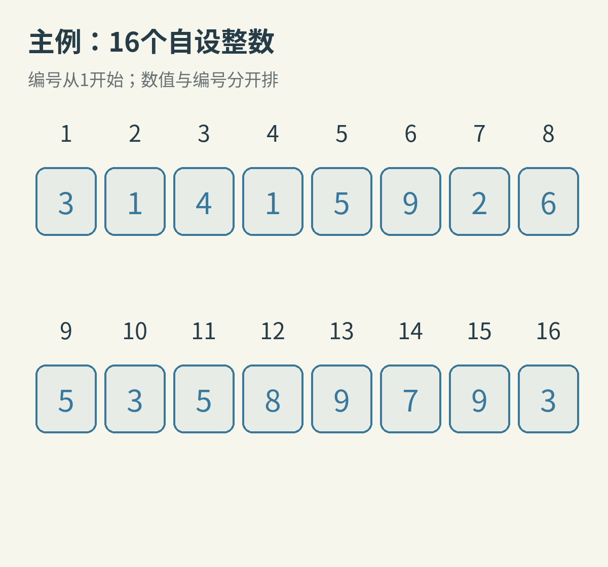

先不用算法，按责任区间直接相加：

- `tree[8]`管1到8，得到31；
- `tree[12]`管9到12，得到21；
- `tree[13]`只管13，得到9；
- `tree[16]`管1到16，得到80。

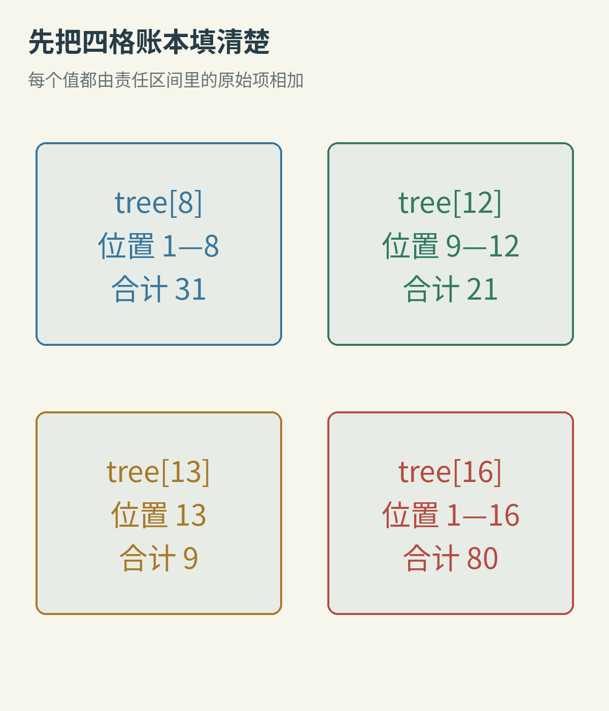

同一个原始值会出现在不同格的责任区间里。这不是重复计票，因为查询时不会把所有格都加起来。我们会挑出一组彼此不重叠、合起来恰好覆盖目标的区间。

这一步很值得停一下：**存储时允许重叠，回答一次查询时避免重叠**。把这两件事分开，后面的路径就不神秘了。

## 5. 前13项，先取最靠右的一块

问前13项之和时，先读`tree[13]`。它负责第13项，值是9。

剩下的任务是前12项。接着读`tree[12]`，它覆盖9到12，值是21。

剩下前8项。读`tree[8]`，它覆盖1到8，值是31。

这三块连起来，正好是1到13：

`9 + 21 + 31 = 61`

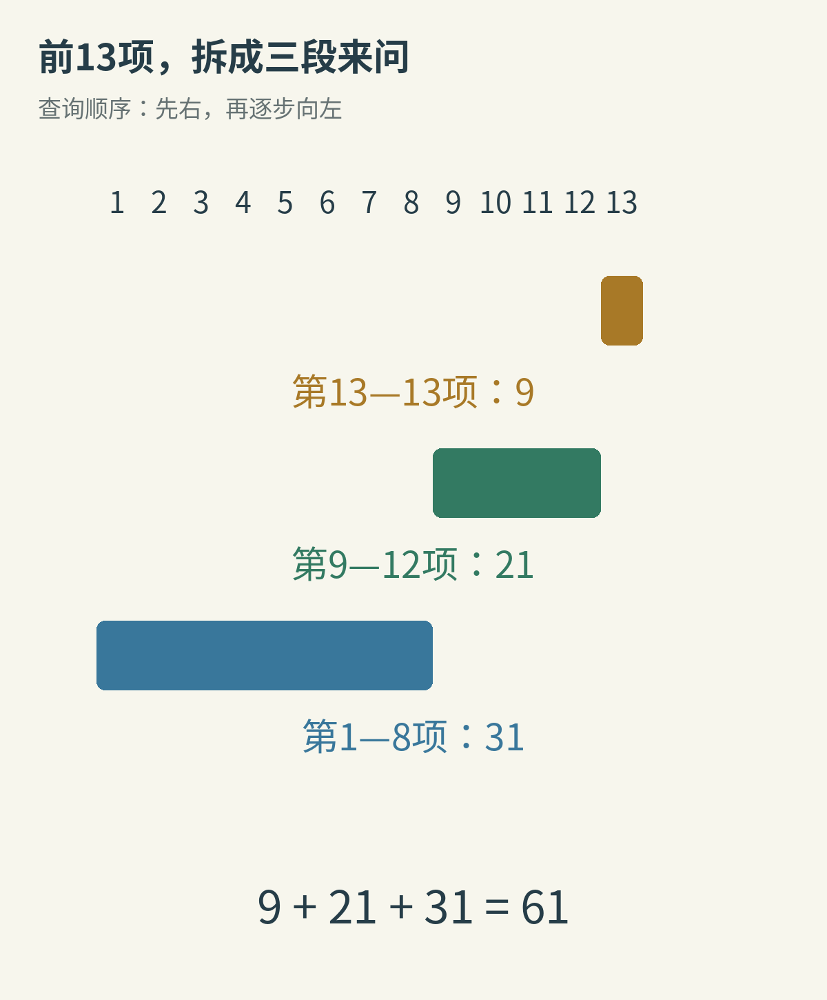

每次取走的，是“当前剩余前缀”最右边那块已经存好的。所以下一步的右端点就是：

`i = i - lowbit(i)`

13减1得到12，12减4得到8，8减8得到0。0表示已经没有剩余项了，不是还要去读一个真实摊位。

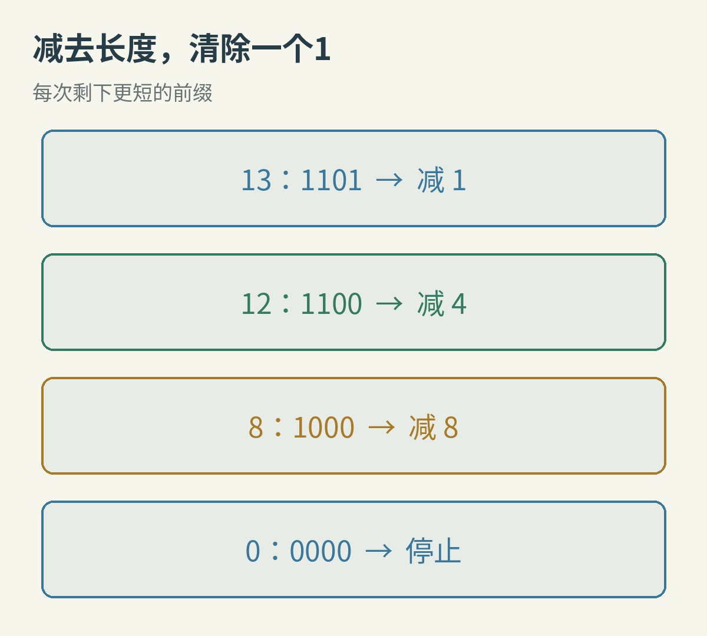

二进制也在解释这件事：13是`1101`，可以拆成8+4+1。查询依次拿走的区间长度是1、4、8，正好对应把最右边的1逐个清除。

## 6. 为什么不会漏，也不会算两遍？

假设目前还剩前i项没有加入答案。`tree[i]`负责的区间是：

`[i-lowbit(i)+1, i]`

取走它之后，恰好剩下：

`[1, i-lowbit(i)]`

两段边界紧挨着，没有交叠，也没有缝。把新的右端点再交给同一条规则，就能继续切下一块，直到剩余前缀为空。

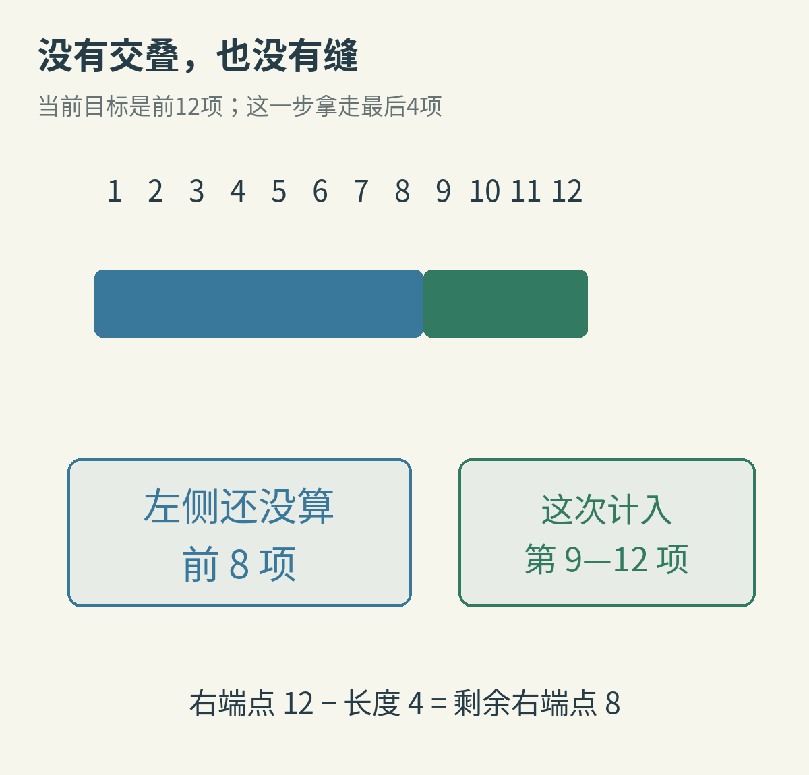

这比背下“查询要减lowbit”可靠得多。将来忘了该加还是该减，就回到这幅图：查询是在剥掉最右边的一块，剩余范围当然要变短。

## 7. 第11项增加4，该通知谁？

原来的第11项是5，现在变成9。不能只改`tree[11]`，因为还有更大的责任区间也包含它。

在16项的主例里，需要改三格：

- `tree[11]`管11，5变9；
- `tree[12]`管9到12，21变25；
- `tree[16]`管1到16，80变84。

其他格不包含第11项，就不该收到这4票。

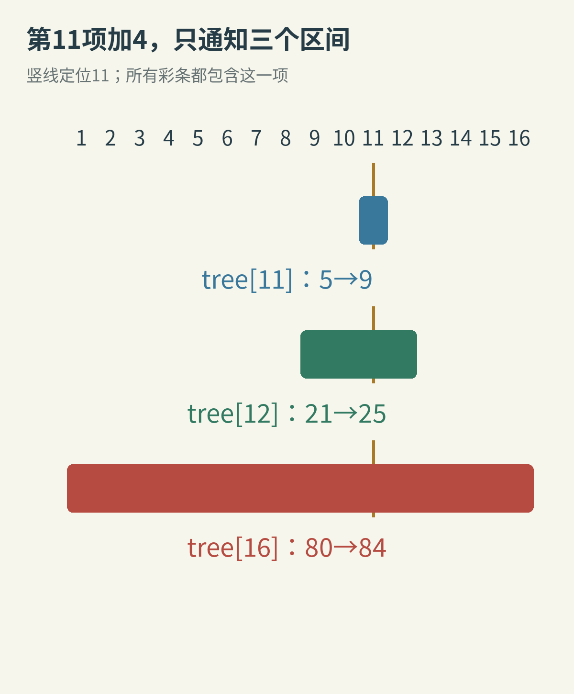

下一格用相反方向的索引动作去找：

`i = i + lowbit(i)`

11加1得到12，12加4得到16，16加16得到32。32超出本表范围，停下。

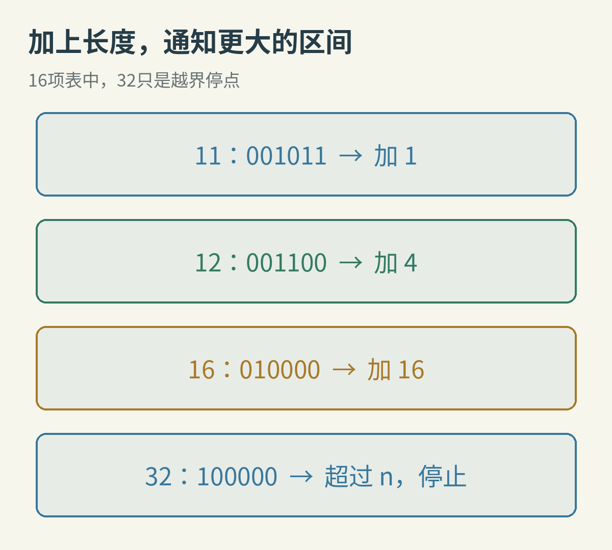

这里的加法不是“随便往后跳”。比如从12跳到16，中间的13只管13，14管13到14，15只管15，它们全都不含原来那一项11。16才是下一格需要通知的账。

更新路径上的区间越来越大，并且仍然包含被修改的那个位置。一般地，从当前右端点到下一个边界之间的那些小区间，都从当前右端点之后才开始，不会包含已经在左侧的修改位置，所以可以直接跳过。

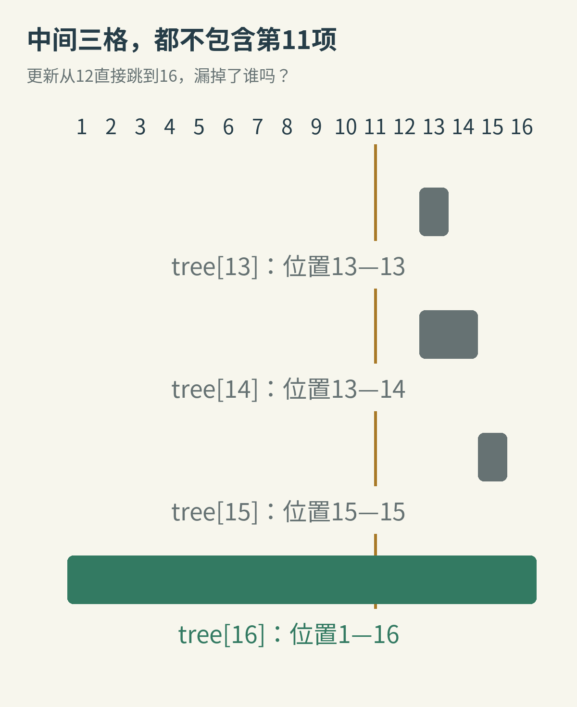

## 8. 更新以后，原来的查询怎么变？

再问前13项，路径仍然是13、12、8。结构没变，只是其中一个账本值更新了：

`tree[13] + tree[12] + tree[8] = 9 + 25 + 31 = 65`

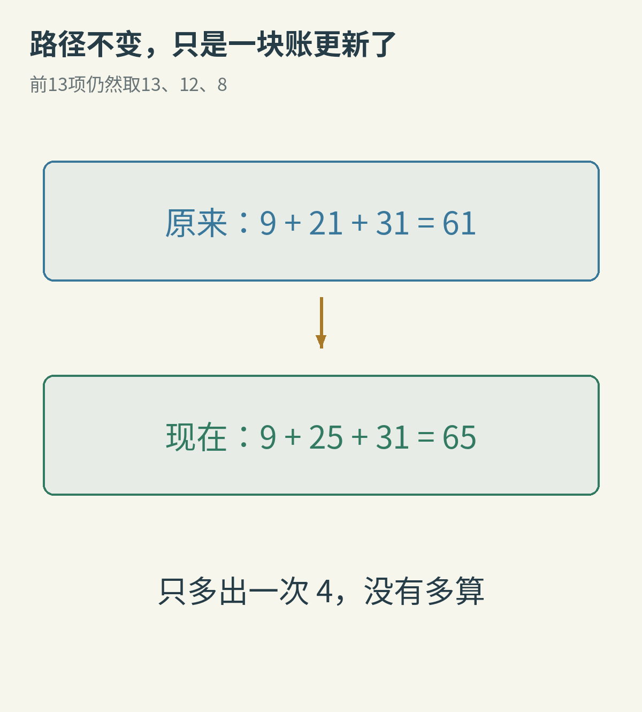

为什么这里只有`tree[12]`增加4，而不是三格都增加？因为一次查询挑出的区间互不重叠。那一项11在这份答案里只会被其中一个区间覆盖。

它确实同时出现在`tree[11]`和`tree[16]`里，但本次查询没有取那两格。记账时的重叠，并没有变成回答时的重复。

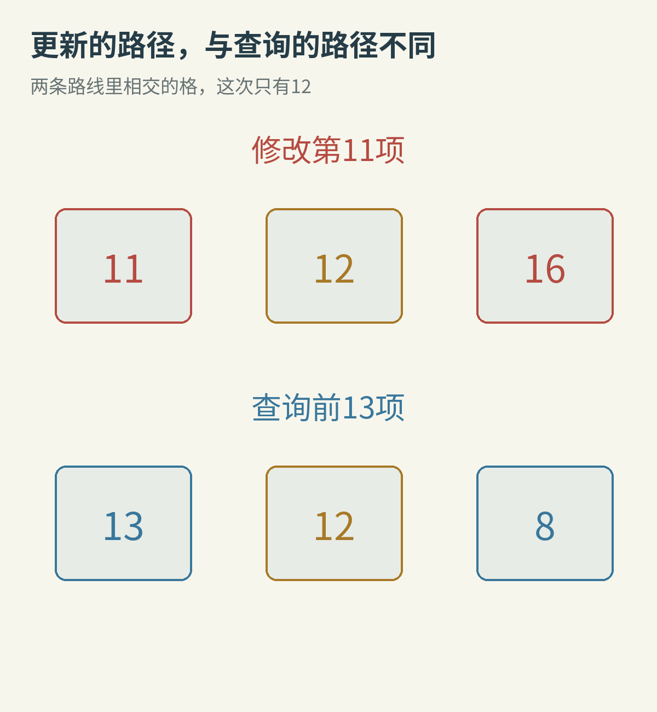

## 9. i & -i不是咒语，是一种算长度的方法

现在才来解释常见代码里的`i & -i`。`&`按位比较两个整数：同一位上两边都是1，结果那一位才是1。

拿8位补码画一下12：

- 12：`00001100`
- −12：`11110100`
- 按位与：`00000100`，也就是4。

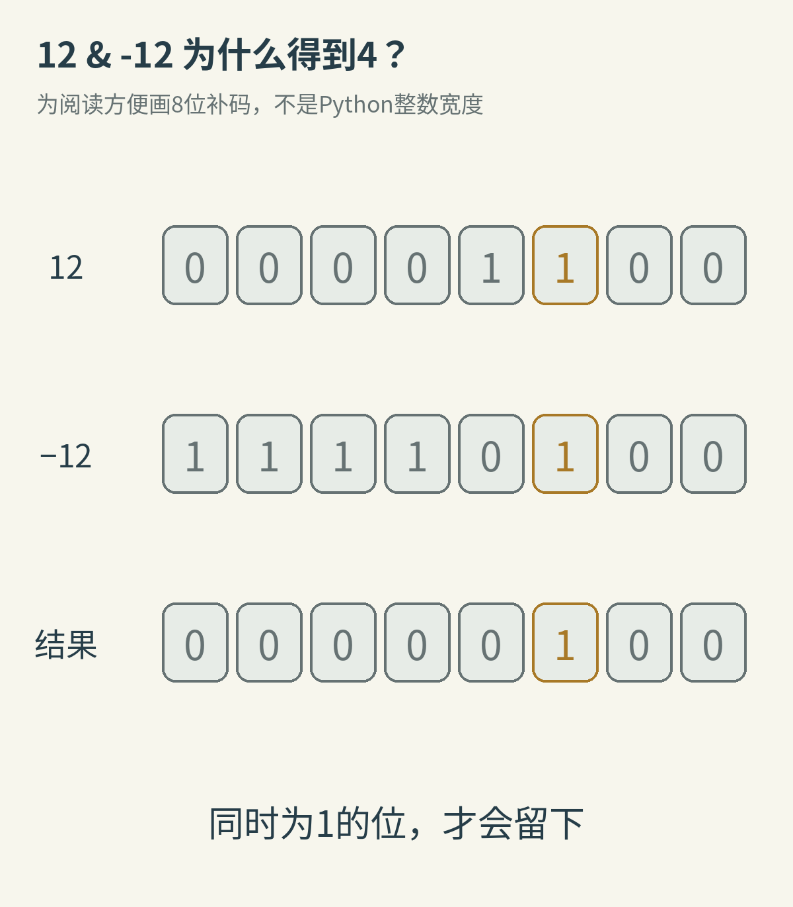

负数的补码可以逐位取反再加1得到。最右侧原有的0和第一个1经过这个过程，恰好让那个最低有效的1在两边都留下；更高的位则至少有一边是0。

这幅图为了看清用了8位。本文的Python程序并不要求把索引塞进8位：Python整数的位运算按带无限符号位的补码效果定义，所以正整数上的同一个表达式仍然给出这个长度。[Python整数位运算说明](https://docs.python.org/3.12/library/stdtypes.html#bitwise-operations-on-integer-types)

也可以用`i & (i-1)`直接清除最右侧的1，作为查询下一步的写法。本文统一保留“减去长度”，让查询规则和责任区间对应起来。

## 10. 一段可以直接跑的核心实现

```python
class Fenwick:
    def __init__(self, values):
        self.n = len(values)
        self.tree = [0] * (self.n + 1)
        for i, value in enumerate(values, 1):
            self.add(i, value)

    def add(self, i, delta):
        if not 1 <= i <= self.n:
            raise IndexError("更新位置必须在1到n之间")
        while i <= self.n:
            self.tree[i] += delta
            i += i & -i

    def prefix(self, i):
        if not 0 <= i <= self.n:
            raise IndexError("前缀右端点必须在0到n之间")
        total = 0
        while i:
            total += self.tree[i]
            i -= i & -i
        return total
```

构造时从全零账本开始，把每个原始值通过`add`加进去。这个直观版本的构造需要O(n log n)数量级的树格操作；存在更快的线性构造，但它不是本篇推导的必要前提。

`add(i, delta)`表示**增加多少**，不是“设置成多少”。想把第11项从5设置成9，就加差值4。如果没有另存原始数组，旧值也可以由相邻两个前缀之差取得。

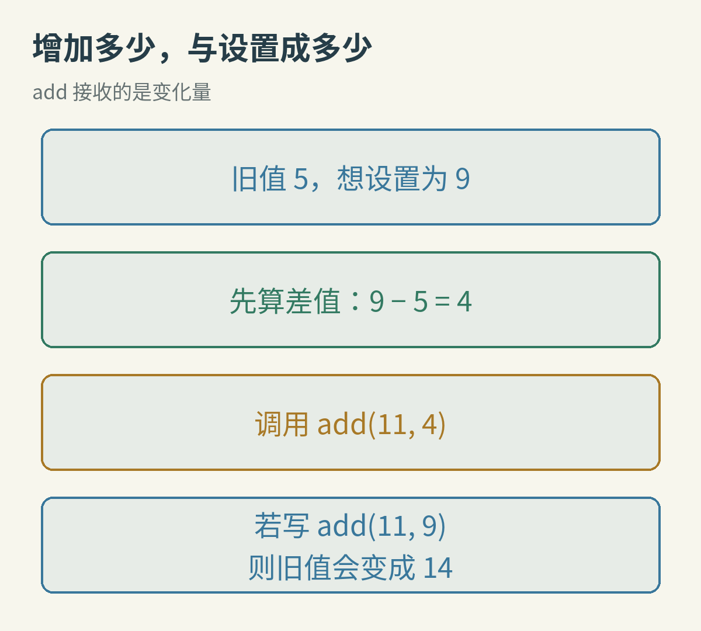

更新为什么不能传0？因为`lowbit(0)=0`。如果没有入口检查，循环里的`i += 0`永远不会前进。查询允许0，更新拒绝0——这不是任性的不对称，而是两种操作对边界的不同含义。

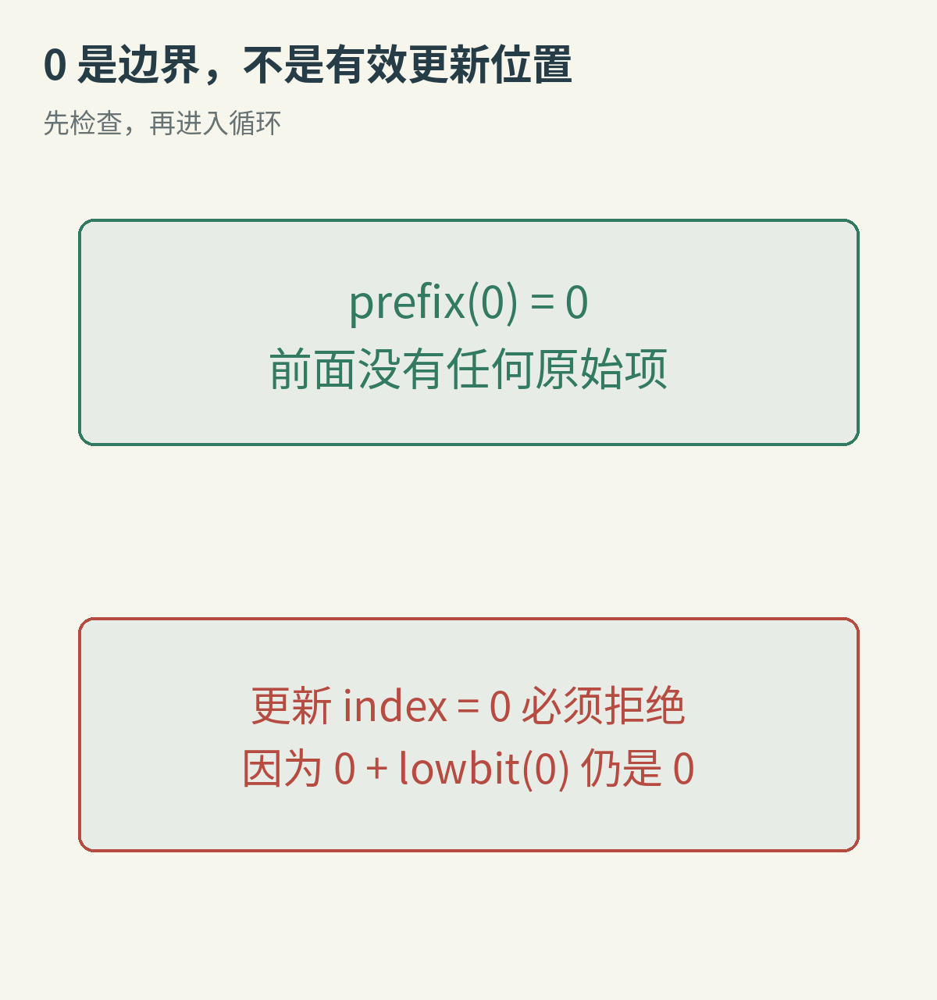

表长也不必是2的幂。比如只有13项时，修改11仍然先到11、12；下一步16超出范围，就结束。数组的最后一格不一定存着全表总和；想知道全表和，应该调用`prefix(n)`。

## 11. 只会前缀和，怎样回答中间一段？

第9到13项，可以用“前13项”减去“前8项”。前面已经计入但不属于目标的那一段，正好被减掉。

在更新后的主例里：

`65 - 31 = 34`

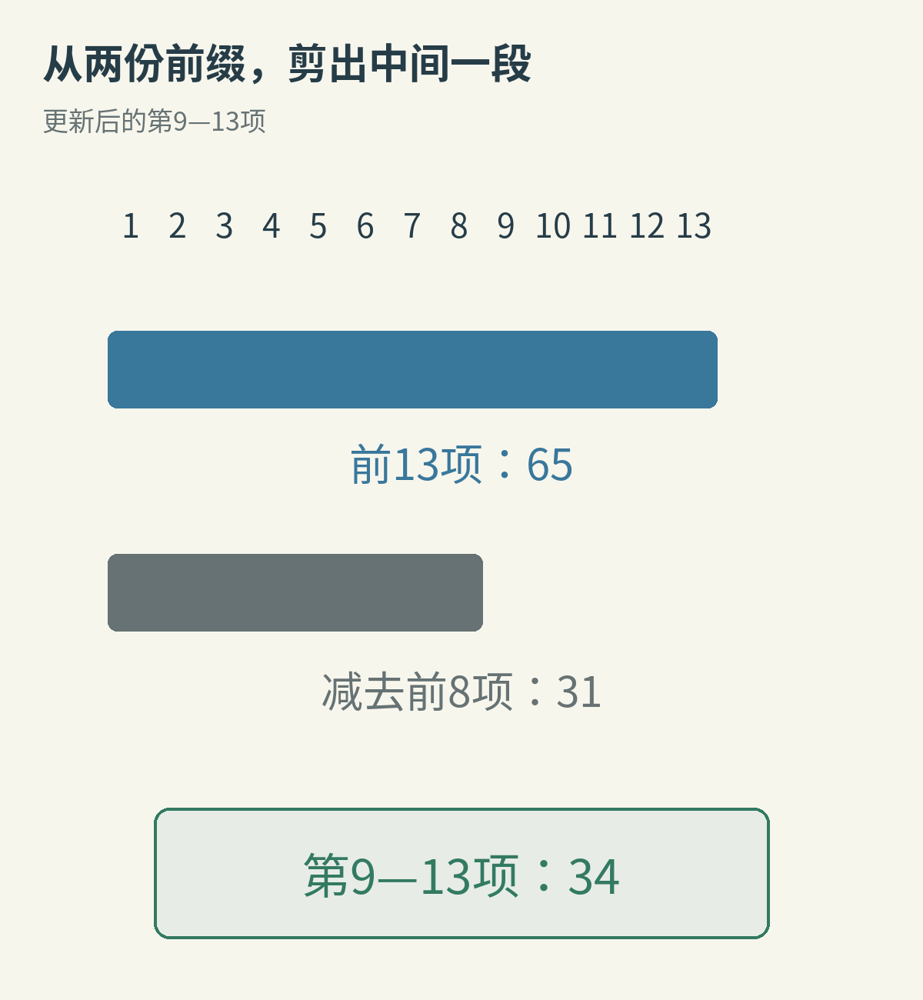

一般地，两端都包含的区间`[l,r]`之和是：

`prefix(r) - prefix(l-1)`

这里依靠的是加法与减法之间的关系。别把“求和”随手换成“最小值”，再期待两份前缀最小值一减也能回答区间最小值。索引技巧很漂亮，但运算本身需要满足相应条件。

## 12. 真的只需要很少几步吗？

查询每次都清除索引里的一个1，所以读取的树格数恰好等于索引二进制中1的个数。13的`1101`有3个1，刚才确实读了3格。

更新每次都产生进位，向负责更大区间的格移动，直到越界；步数同样是O(log n)数量级。树本身只用n+1个数组格，不需要为每条连接另外放一个指针。

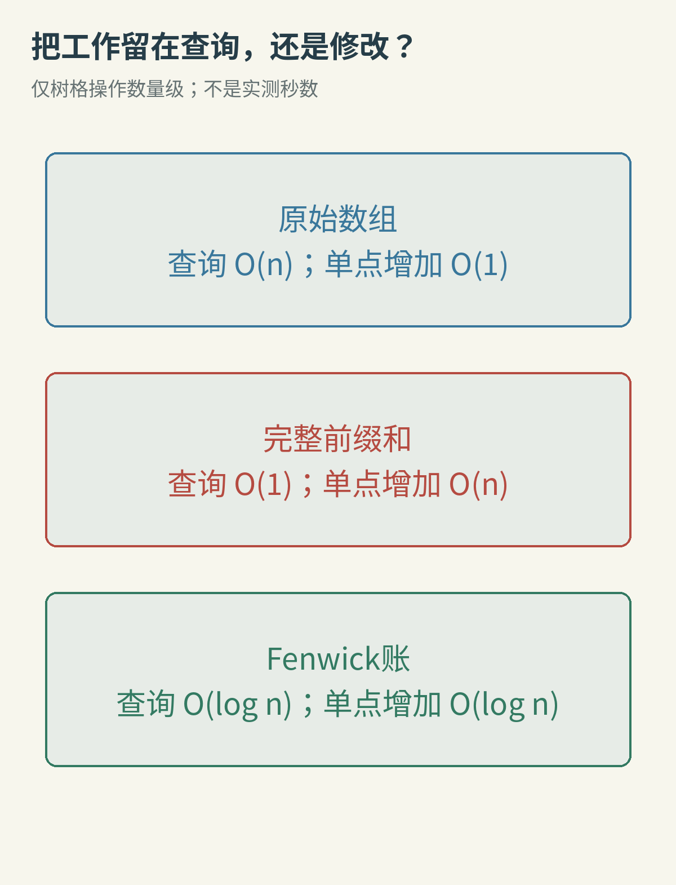

这里数的是树格访问和基本算术操作。在常见的固定字长成本模型下，可以说查询和单点增加是O(log n)。如果整数大到需要很多机器字，算术本身也有成本；不能把这个符号当成任何机器、任何数值下的实测秒数。

配套程序做了几组精确整数检查：3279个长度1—7、取值−1/0/1的数组；106620个修改案例；修改后811920次前缀比较，以及81192次初始区间和比较。对表长1—257的全部位置，另核对33153个查询区间分解，以及33153个“更新路径是否恰好等于所有包含该位置的责任区间”。全部实际通过。

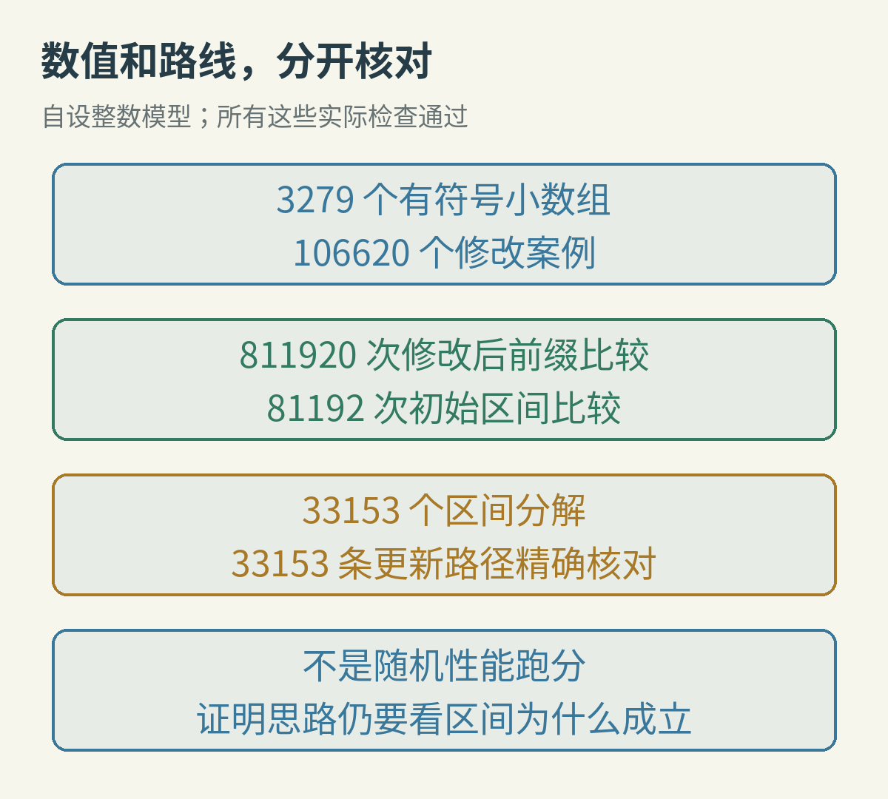

这些有限检验帮忙发现实现错误；前面“不重叠、不遗漏”的推理，则解释了规则为什么成立。两者互相补充，不能只靠一大串测试数字替代原理。

## 13. 如果反过来问：第几张票属于谁？

回到频率表的用途。假设四类符号的计数是`[2,0,3,1]`，总共6份。把票号从0编号到5：前两份属于第1类，中间三份属于第3类，最后一份属于第4类。第2类计数为0，没有任何票号属于它。

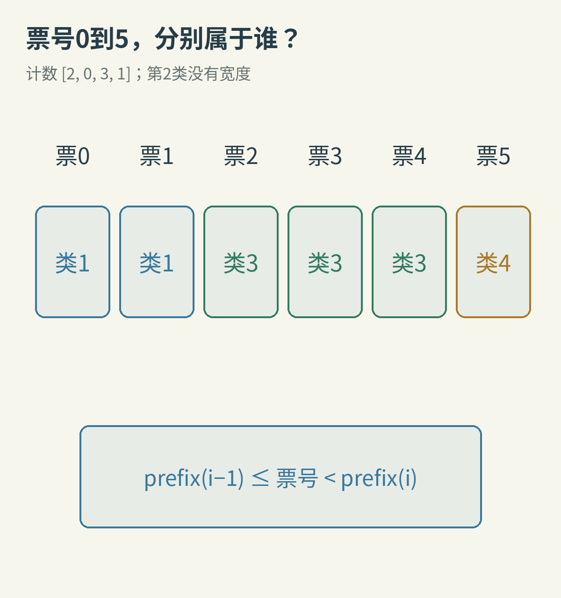

形式上，要找的是满足下面条件的位置i：

`prefix(i-1) <= ticket < prefix(i)`

这和“给定位置求累计值”方向相反。它可以利用同一组树格做按位试探：从大步长开始，看看能不能跳过一整块尚未达到目标的累计计数，再逐步缩小步长。配套代码里的`select_nonnegative`给出了这种查找，并对另外3279个取值0/1/2的数组、21324个合法票号做了实际核对，包括零计数的情况。

历史上，这个反向问题并不是一开始就处理圆满的。Fenwick的1995年报告明确讨论了旧方法要求符号频率非零的限制，并给出了改进；它不是在宣布普通前缀和或单点更新全部失效。[作者保存的技术报告110](https://www.cs.auckland.ac.nz/~peter-f/FTPfiles/TechRep110.pdf)


还有一个边界必须带走：普通求和可以有负数；按累计值找票号，则需要底层计数非负，让前缀和不会下降。如果数组是`[2,-2,3]`，前缀就变成2、0、3，不再是一条单调铺开的票带。

配套的紧凑查找函数没有再保存一份原始数组来逐项验证非负性，调用者必须自己维护这个前提。它会检查票号是否在总范围内，但那个检查不能代替“每项非负”。

## 14. 再改一次，确认你看懂了账本

仍然从第11项已经增加4的主例继续。现在第12项减少2。先写下会改变哪些`tree`格，再算前13项是多少。

答案：位置12的更新路径是12、16，所以对应两格各减2；`tree[8]`和`tree[13]`不变。前13项变成`9 + 23 + 31 = 63`。

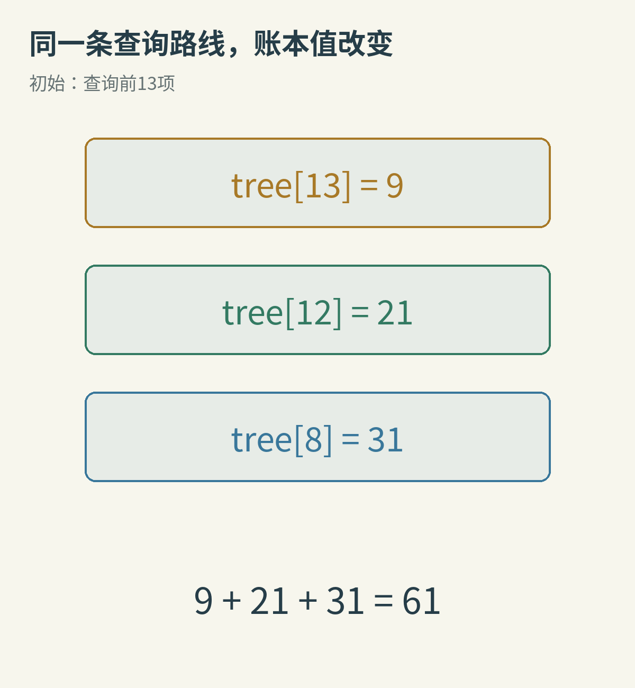

动画是根据自设整数实验绘制的教学轨迹，不代表真实执行速度。完整实验见[可运行代码](examples/fenwick_lab.py)与[运行说明](examples/README.md)。

等你再看见`i += i & -i`，可以先不去想那串符号。想一排分工清楚的小账本：每格负责一段，查询挑不重叠的几段，修改只通知真正包含它的那几段。

二进制没有替我们算出总和。它替我们安排了谁该记什么，以及下一次该去问谁。
