# 每次只取最小的，为什么没必要把全班排好队？

你正在做一个小型地牢游戏。

宝箱会在第 3 秒打开，脚步声在第 4 秒响起，落石在第 6 秒掉下来。敌人、陷阱、门和烟雾也各有自己的触发时刻。游戏并不需要一口气展示全部未来；眼前只需要回答：**下一件该发生的事是什么？**

麻烦在于，事件还会制造新事件。宝箱打开以后，可能安排两秒后的闪光；一声脚步，又可能安排稍后的回声。这个清单一边被消耗，一边在长大。

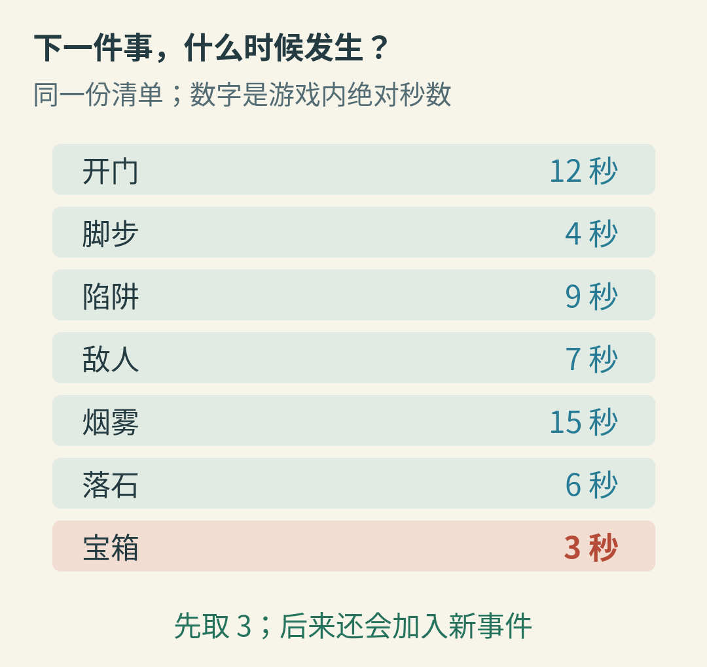

*自设教学清单。数字是从游戏开始算起的整数秒，不是等待时长，也不是某款游戏的实测数据。按清单原顺序，七个数是 12、4、9、7、15、6、3。*

最直接的办法，是每次扫一遍清单，找出最小值。另一个办法，是把全部事件排好序。

这两种办法都有合适的场合。只找一次最小值，扫描就很好；数据不再变化，而且最终全部都要按序读出，直接排序也很合理。**已经排好序的静态清单，取走一个最小值后不必重新排序。** 如果把最小值放在数组末端，删除它甚至很方便。

真正值得研究的是这个动态版本：不断加入新事件，又不断拿走当前最小的事件。如果每次变化都重新排序，我们维护了许多暂时用不上的先后关系；若一直保持有序数组，虽然可以用二分查找确定插入位置，但挪动一段元素仍可能很费事。

有没有一种结构，只整理到“足够回答下一问”的程度？

有。它叫二叉堆。这一篇，我们不先背复杂度表，而是让同一组七个数在数组和树之间来回切换，亲手把这个“足够”找出来。

## 一、树顶知道最小值，树下不必全体排队

先看一份已经整理好的数组：

`[3, 4, 6, 7, 15, 12, 9]`

把第一个数放在顶上，接下来两个放在第二层，再接下来四个放在第三层，就得到下面这棵树。

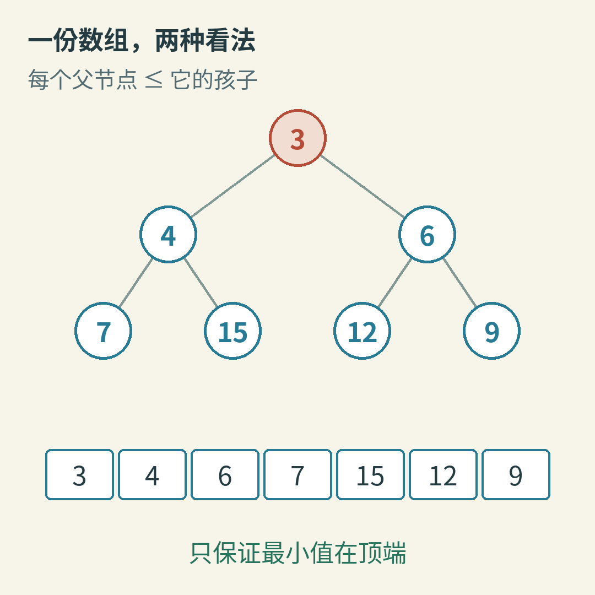

*原创教学图。图上的树和下方数组保存的是同样七个值；连线表示父子位置关系，不是额外存储了七份数据。*

这棵树只承诺一件关于大小的事：**每个父节点，都不大于自己的孩子。**

这里“父亲”“孩子”只是树结构的名字。3 是 4 和 6 的父节点；4 又是 7 和 15 的父节点。最下面没有孩子的节点，叫叶子。

为什么只检查邻居，就能保证树顶最小？沿任何一个节点向上找父亲，会一路走到根。每走一步，值都不会变大。于是根不大于路径上的任何节点，也就不大于整棵树里的任何节点。局部的父子关系，沿路径连成了全局保证。

满足这条大小规则的结构叫最小堆。若把规则反过来，让父节点不小于孩子，就是最大堆，顶端会露出最大值。本文一直使用最小堆，别在中途悄悄换了方向。

但只谈大小还不够。二叉堆还要求树形紧凑：除最后一层以外，上面的层都填满；最后一层从左往右填。这个形状叫**完全二叉树**。

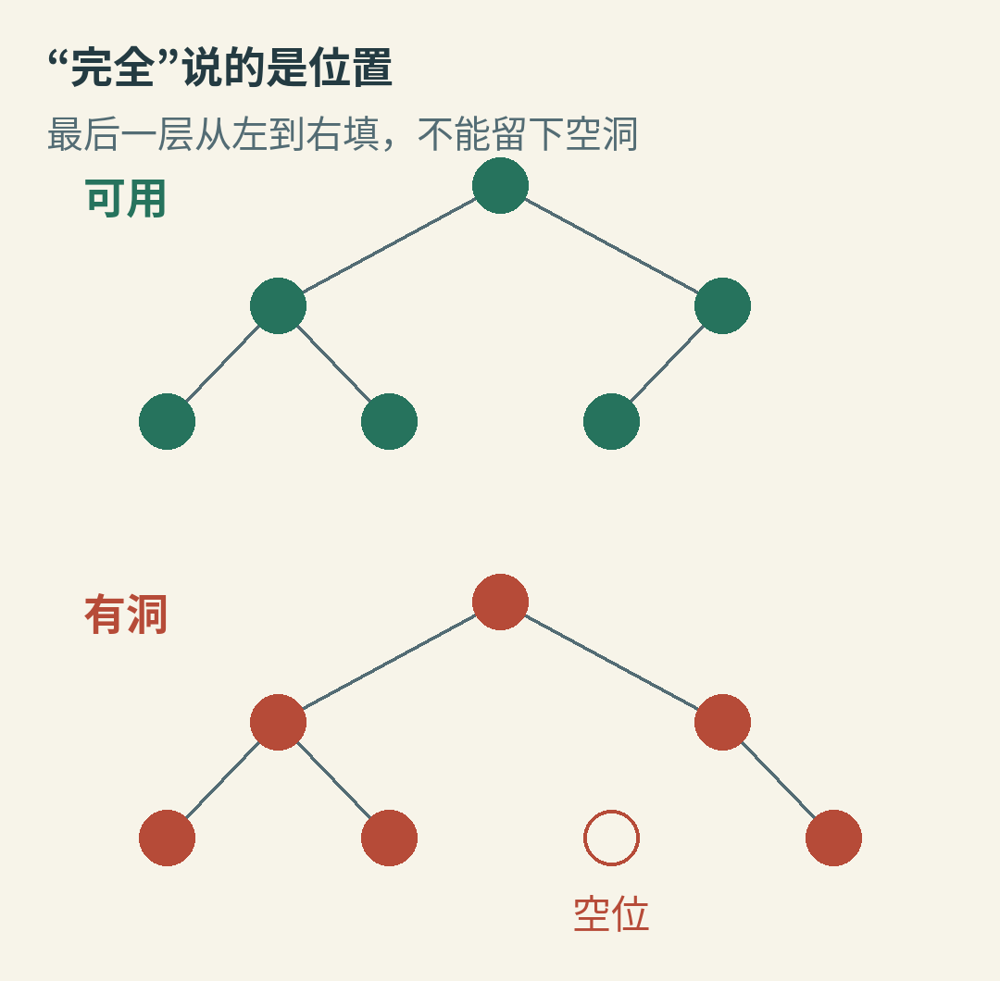

*原创形状示意。圆点没有优先值；下图右下位置虽有节点，却空着它左边应该先填的位置，因此不符合本文二叉堆的形状要求。*

形状规则负责把树压矮，大小规则负责把最小值送到根。两件事一起工作。

## 二、明明画着一棵树，为什么代码里只需要数组？

给数组位置编号，从 0 开始：

- 下标 0 对应根
- 下标 1、2 是根的孩子
- 下标 3、4 是下标 1 的孩子
- 下标 5、6 是下标 2 的孩子

这组关系特别整齐。位置为 i 的节点，左孩子在 `2*i+1`，右孩子在 `2*i+2`；非根节点的父亲在 `(i-1)//2`。这里 `//` 表示整数除法，舍去小数部分。算出来的孩子下标还必须小于数组长度，那个孩子才存在。

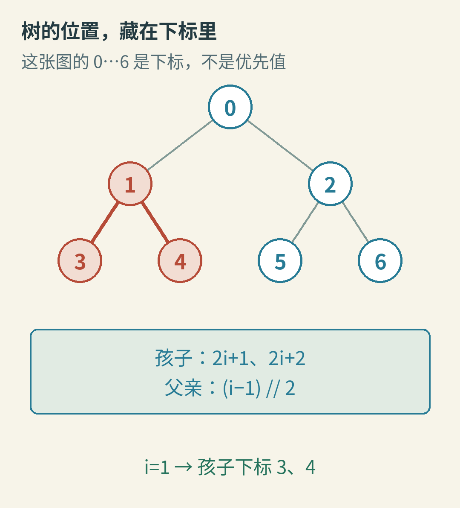

*本图圆圈里的 0 到 6 全是下标，不是前一图的事件时间。比如 i=1 的两个孩子位于 3、4；这并不是说优先值 1 的孩子必须是数值 3 和 4。*

树形没有空洞，数组也不需要给空位置留洞。只要知道数组长度，就能知道树画到哪里；只要知道当前下标，就能计算父子位置。通常不必给每个节点另存左右孩子指针。

这是“画图帮助思考”和“真正怎样存储”可以不同的一个好例子。我们用树看出关系，程序用数组保存值。

也要留意这里的 heap 是一种数据结构。程序员在讨论“栈内存与堆内存”时说的堆，指的是另一类内存管理概念。名字相同，不等于动态内存分配器内部必然使用本文的二叉堆。

## 三、堆究竟故意没有整理什么？

回头再读数组：3、4、6、7、15、12、9。走到 15 后，又看到 12、9，显然不是从小到大排好的。

这不算失败。因为 15、12、9 之间，根本没有我们承诺过的父子约束。

下面这份数组也合法：

`[3, 6, 4, 12, 9, 7, 15]`

根仍是 3；6 不大于它的孩子 12、9；4 不大于它的孩子 7、15。

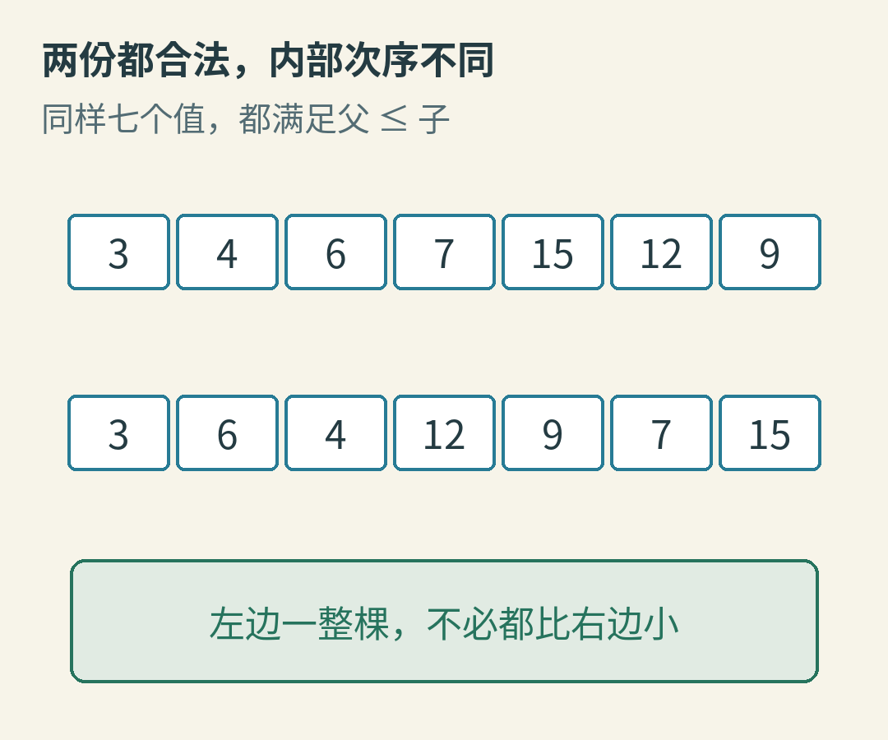

*两行都能回答“最小值是谁”，但都无需把所有兄弟、堂兄弟逐一排好。堆的合法排列通常不止一种。*

如果你学过二叉搜索树，请暂时把它的规则放到一旁。二叉搜索树用左右子树划分键的范围；二叉堆没有“左边整棵都比右边整棵小”的保证。要在普通堆里找一个任意指定的值，不能看根以后就像二分查找那样，放心舍弃一半数据。

**堆省下来的，正是那些不必维护的顺序。** 它用较弱的承诺，换来便宜的局部调整。

## 四、新来的 2，为什么只需要沿一条路往上走？

现在给七元素堆插入一个新值 2。你可以把它理解为一个新加入、应该更早处理的任务。

先不要考虑大小。为了不破坏树形，把 2 追加到数组末尾，也就是下标 7。它成为值为 7 的节点的左孩子。

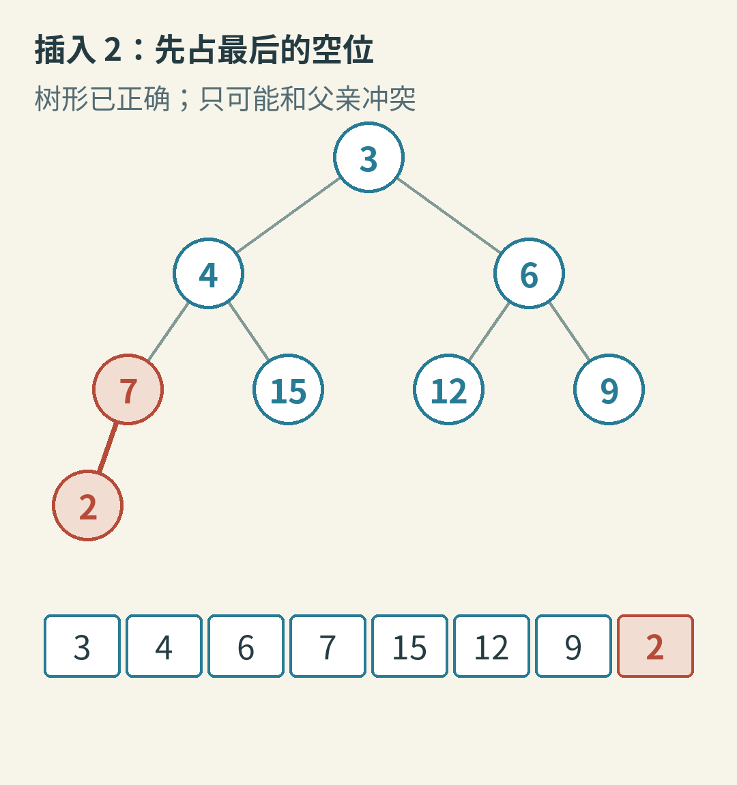

*此时数组为 [3,4,6,7,15,12,9,2]。形状仍合法；新出现的直接冲突是父亲 7 大于孩子 2。*

原来的七个节点都没动，原来的父子关系也没坏。新节点又没有孩子，所以眼下只需要检查它和父亲。

2 小于 7，交换它们。2 上到下标 3，继续看父亲 4；2 又小于 4，再交换。接着与根 3 比较，再交换一次。2 到了根，已经没有父亲，停止。

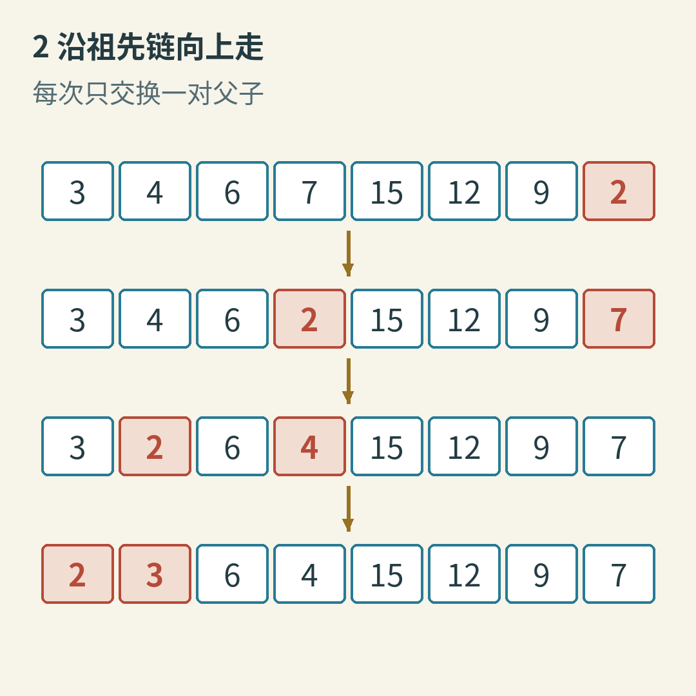

*从第一行到第四行，2 经过下标 7→3→1→0；红框指出本步涉及的位置。所有状态来自随文程序的实际运行记录。*

这里有个值得追问的小细节：把一个较大的父节点换下来，会不会破坏它和下方孩子的关系？

不会。这个父节点原先位于这些节点的祖先位置，原先就不大于它们。换下去以后，这些本来成立的大小关系仍足够使用。真正还可能出问题的，是新值 2 与更上面的父亲，所以检查只沿祖先链继续。

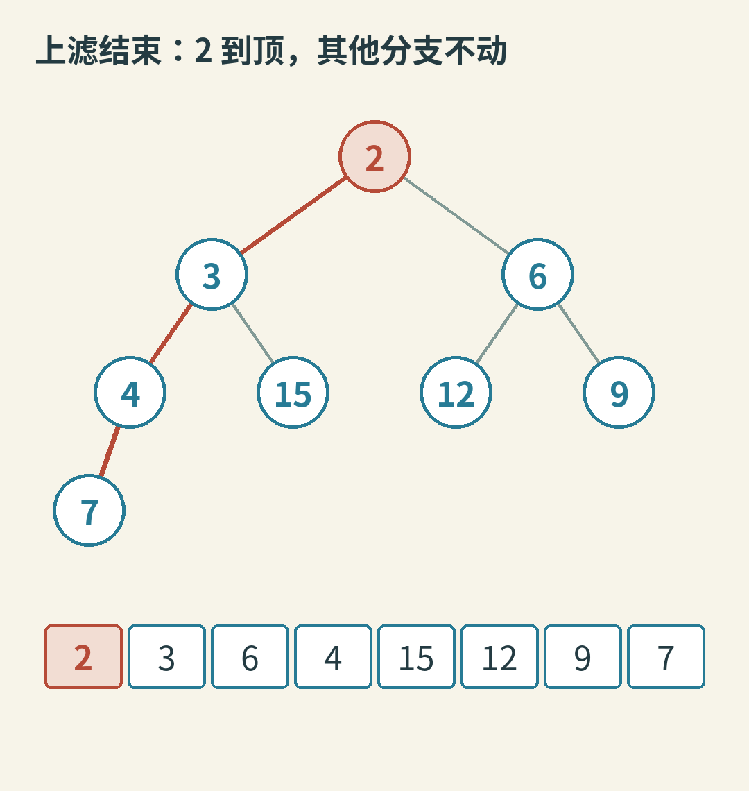

*结果为 [2,3,6,4,15,12,9,7]。红色路径显示这次影响的祖先链；右侧分支没有必要跟着重排。*

这个沿父亲方向修复的过程，通常叫**上滤**，英文常见 sift up 或 swim。

为什么它快？一棵有 n 个节点的完全二叉树，高度约为 log2(n)。每往下一层，可容纳的位置数量就翻倍：1、2、4、8……因此从末尾到根，只需经过对数数量的层，而不是经过全部节点。

这里说的是堆的比较与修复成本。动态数组偶尔扩容，可能需要复制很多元素；若连分配一起计费，通常还要说明追加操作的摊还成本。大整数、字符串或自定义比较器的比较，也未必是一条固定时间的机器指令。

## 五、拿走根以后，为什么不能随便挑一个孩子接班？

现在从刚才的八元素堆取走最小值 2。

我们得同时修两件事：补上根的空位，删掉一个节点后仍保持紧凑树形。一个干脆的做法是，把末尾的 7 搬到根，再删除末尾位置。

这相当于先把“形状账”结清，暂时留下“大小账”。

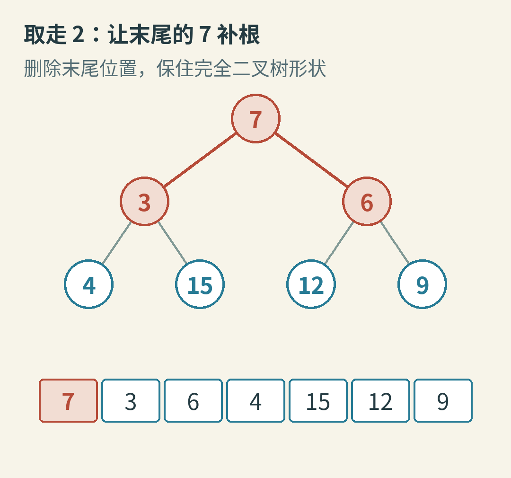

*此时剩余数组为 [7,3,6,4,15,12,9]。两棵孩子子树内部仍是堆，新的问题集中在根。*

7 的两个孩子是 3 和 6。应该先和谁交换？

必须选较小的 3。如果先和 6 换，根变成 6，旁边却还站着 3，根马上就违反了“不大于孩子”的承诺。

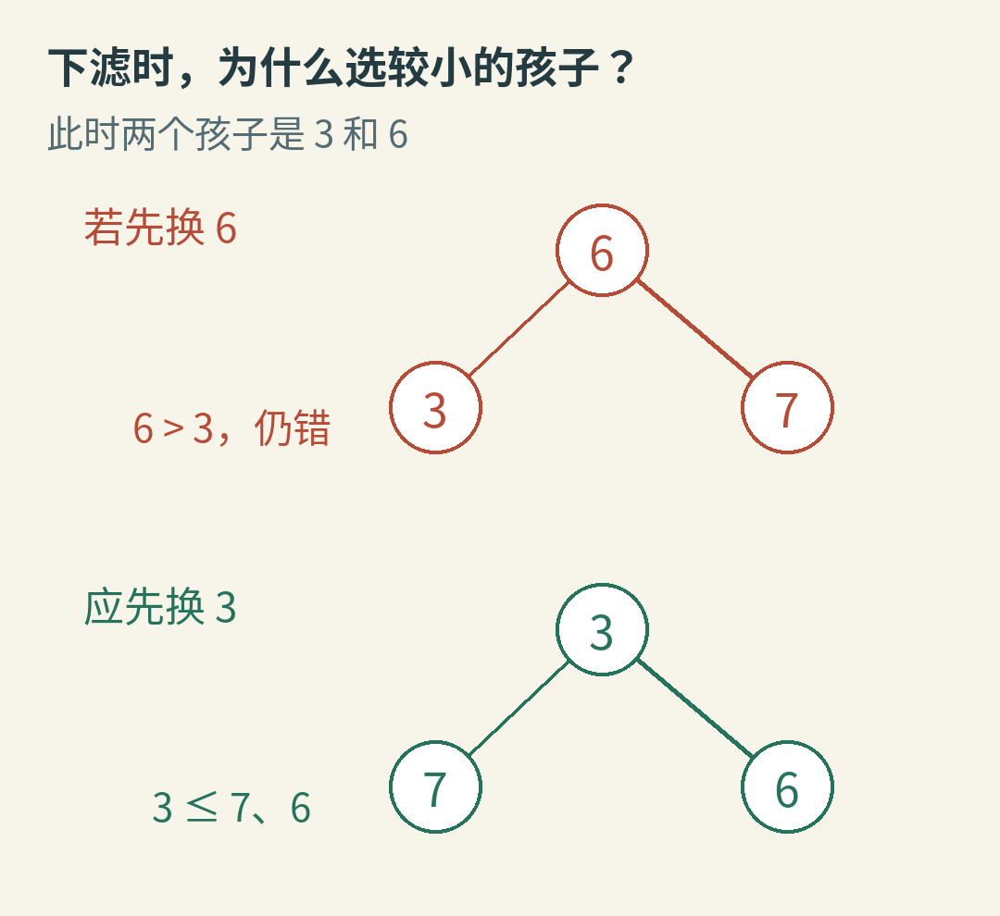

*这是同一临时状态的两种选择，只画根及其两个孩子。选 3 后，新的根同时不大于 7 和 6；接下来只需修复 7 所在的分支。*

和 3 交换后，7 来到下标 1。它的新孩子是 4 和 15，于是选择较小的 4，再交换。7 来到叶子，没有孩子，停止。

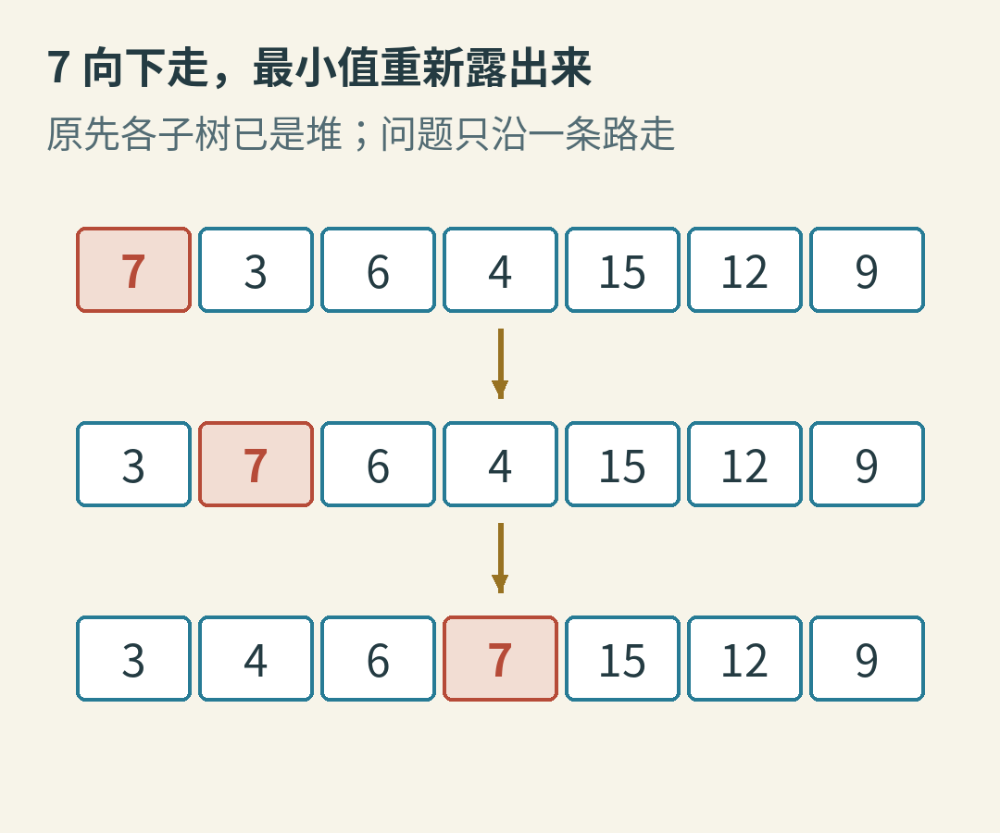

*依次得到 [7,3,6,4,15,12,9]、[3,7,6,4,15,12,9]、[3,4,6,7,15,12,9]。这次恰好回到了插入 2 以前的布局；一般而言，删除一个后来插入的值，并不承诺恢复原布局。*

这个沿孩子方向修复的过程叫**下滤**，常见英文 sift down 或 sink。

它同样只走一条路径。每一层至多比较两个孩子，再比较较小孩子与当前值；换好以后，已经修过的上方就可以放心留下。若当前值已经不大于较小孩子，就可以提前停止，甚至不必走到叶子。

也别忘了只有左孩子的情况。右孩子下标超出数组长度时，就只考虑左孩子，不能读不存在的位置。空堆取值要报告错误；只剩一个节点时，拿走它就结束，没有“最后一个值补根”之后的修复工作。

## 六、堆里没排序，取出来却能有序

堆顶永远是当前剩余元素的最小值。所以反复取出堆顶，可以依次得到：

3、4、6、7、9、12、15。

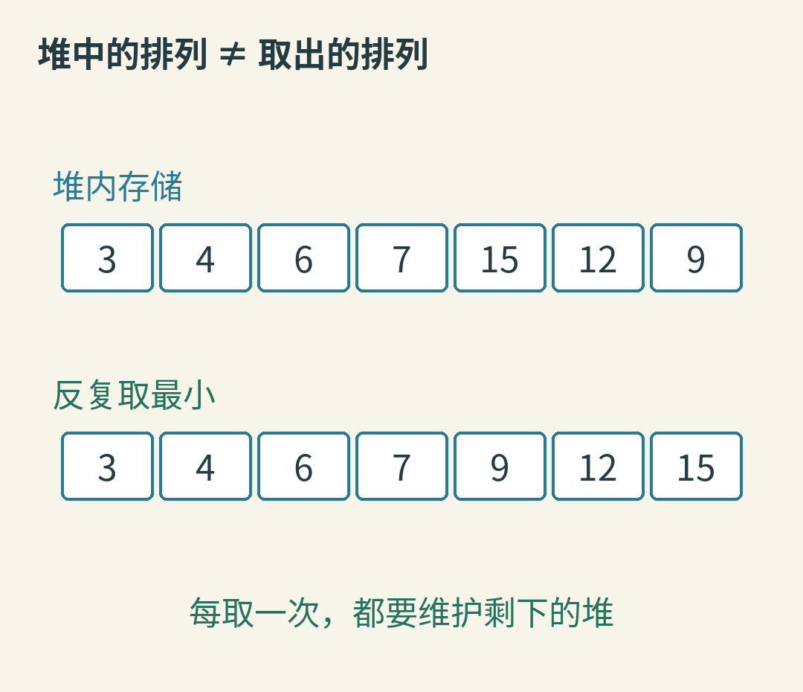

*上行是内存中的堆布局；下行是逐次弹出并完成修复后得到的输出序列。不能直接遍历上行，就声称已经完成排序。*

这把一个容易混淆的词拆开了：**堆有顺序约束，但堆数组不一定已经排序。**

维护一份堆以后，一次只看最小值而不删除，只需读取根，通常记为 O(1)；插入与取走最小值的堆修复，最坏需要 O(log n)。如果最终把全部 n 项都逐个取出，总工作量仍是 O(n log n) 量级。

因此，堆没有凭空打破比较排序的常见下界。它把工作推迟到需要答案的时候做，而且允许中途继续加入新数据。

随文实验把弹出的结果收进另一个清单，所以它不是原地排序示范。经典升序原地堆排序常改用最大堆：把最大值与当前堆的末尾交换，缩小堆的有效范围，再下滤新根。已经放好的大值在数组右端积累，最后整段有序；那时读图一定要把“剩余堆”和“已排好部分”分开。

## 七、1964 年，为什么“省掉指针”值得专门写出来？

这套想法有很具体的历史出处。1964 年 6 月，J. W. J. Williams 的《Algorithm 232: Heapsort》发表于《Communications of the ACM》7 卷 6 期，第 347–348 页。原文署名机构是 Elliott Bros. (London)。这里的作者是 J. W. J. Williams，不能与图形学中研究 Mipmap 的 Lance Williams 混为一人。[论文记录](https://doi.org/10.1145/512274.3734138)

在可读的原文索引片段中，Williams 明确把根位置写成最小元素，并列出建堆、入堆、取出最小元素等过程。他还特别指出，通过避免使用指针来节省存储。这不是后来教材才补上的故事：**数组里的位置关系，本身就是这项设计的组成部分。**

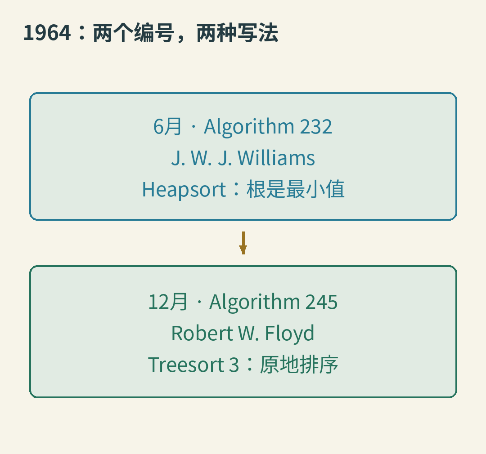

*原创文献关系图，依据可读的一手原文索引片段及书目信息制作；不是论文扫描、历史手稿或人物照片。原件的实际可核范围见文末来源说明。*

同年 12 月，Robert W. Floyd 发表《Algorithm 245: Treesort 3》，刊于同刊 7 卷 12 期第 701 页。可读原文片段把它称为受到 Heapsort 启发的 Treesort 修订，并明确强调原地排序。它使用较大孩子向上填位的写法，与本文最小堆的比较方向不同。[论文记录](https://doi.org/10.1145/355588.365103)

读旧程序还会遇到一个小陷阱：Floyd 把一个向孩子方向推进位置、让较大孩子向上填位的过程命名为 siftup。不能只见到这个名字，就把它认作本文插入新值时的“沿父亲上滤”。读算法，变量怎么走、比较号朝哪边，比过程名更可靠。

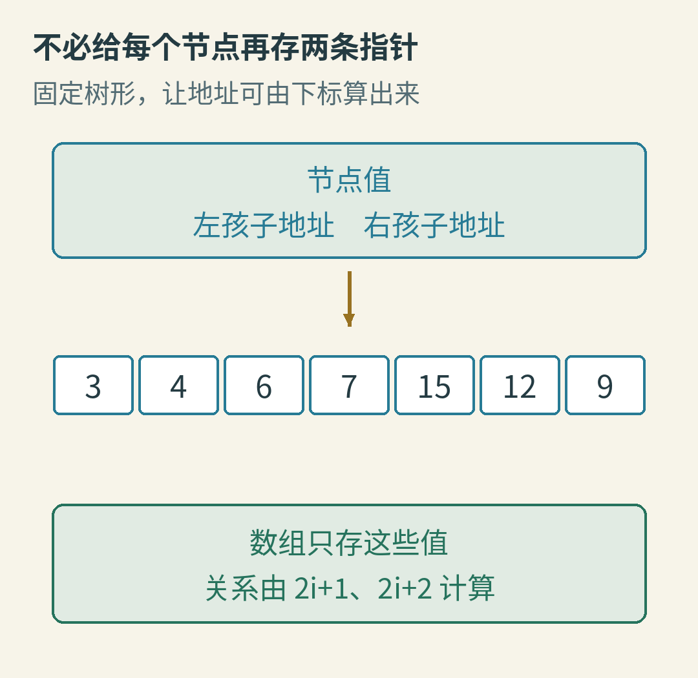

*原创机制说明，只比较表示方法，不是某台历史机器的内存布局或字节实测。原文强调的存储动机，可以通过这个现代化示意理解。*

这段历史最适合留下的问题是：如果七个数已经一次性摆在数组里，我们真的还要把它们一个个重新插入吗？

## 八、整批建堆，为什么可以从下面开始？

重新拿回最初那份未整理数组：

`[12, 4, 9, 7, 15, 6, 3]`

一种办法是开一份空堆，依次插入这七个数。一定能做成，但如果数据已经整批到齐，还有更省工作的办法：**先把小子树变成堆，再用下滤把它们接成大堆。**

叶子没有孩子，因此无条件满足“父不大于孩子”。它们从一开始就是一节点的小堆，不需要修。

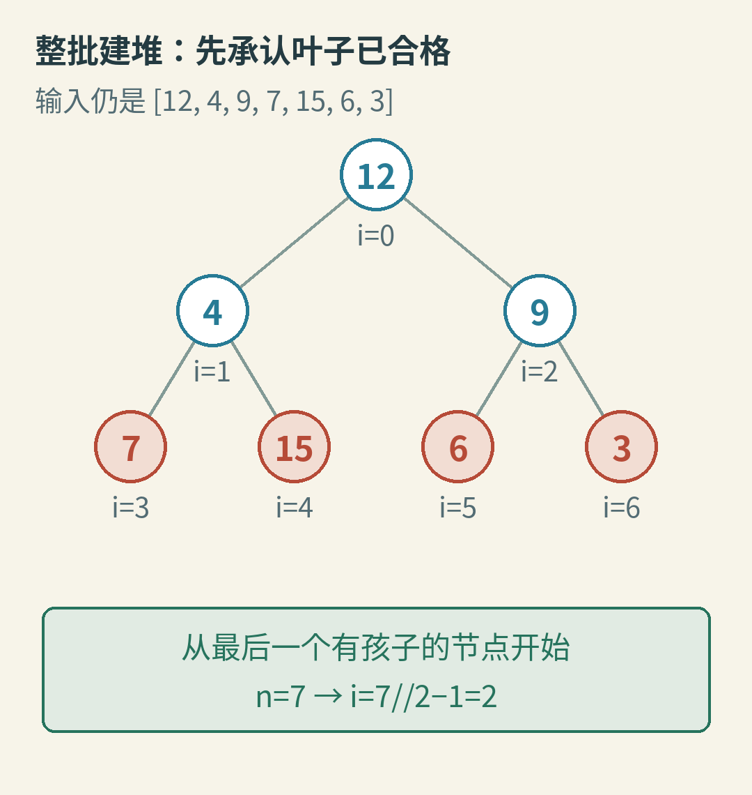

*下标 3、4、5、6 都是叶子。最后一个有孩子的节点位于 n//2−1；n=7 时，起点就是下标 2。*

从下标 2 往前，依次处理 2、1、0。

先看下标 2，它的值是 9，两个孩子是 6、3。孩子自身已经是堆，所以下滤 9 即可。9 与较小的 3 交换，得到：

`[12, 4, 3, 7, 15, 6, 9]`

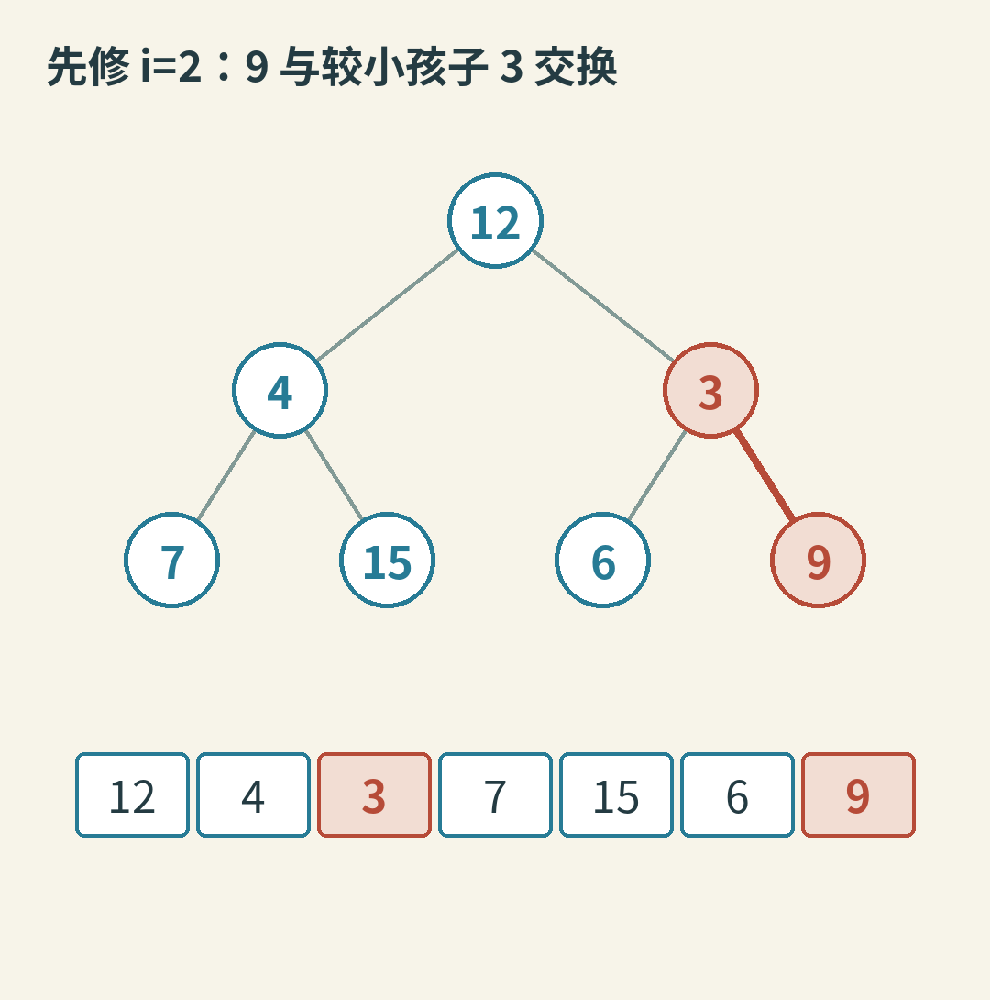

*现在以该位置为根的三节点子树满足堆性质。上面的 12 还可能有问题，但暂时不用急着处理它。*

接着看下标 1，值为 4，孩子是 7、15。4 已经不大于两个孩子，不需要交换。

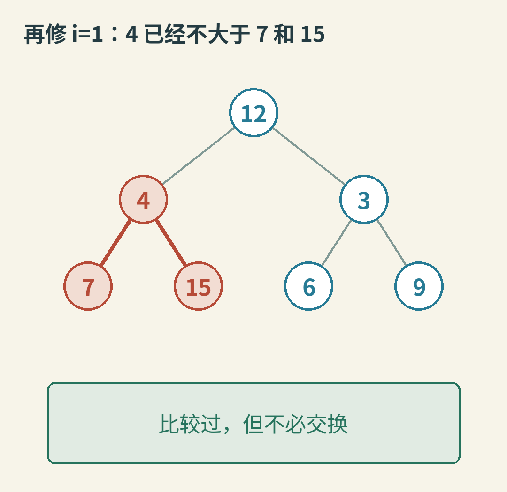

*“检查一个节点”不意味着一定移动它。我们需要建立保证，不是为了显得忙碌而交换。*

最后处理根 12。此时它的两棵孩子子树都已成为堆，这正好满足下滤的前提。12 先与 3 交换，再与 6 交换，最终得到：

`[3, 4, 6, 7, 15, 12, 9]`

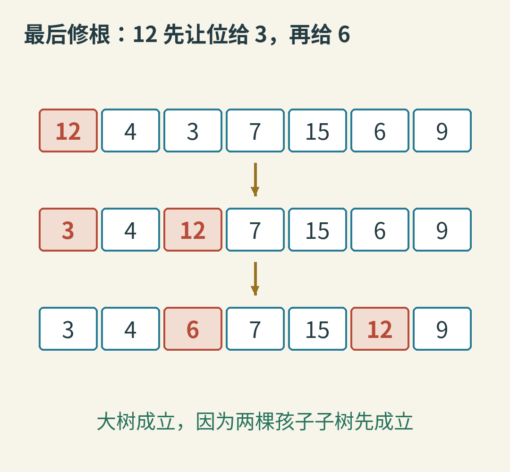

*与本篇开头完全相同的七元素堆。实际程序记录：这次整批建堆共做 8 次键比较、3 次交换；不把循环判断、下标运算或检查程序的比较算入其中。*

为什么必须先下面、再上面？因为下滤只会修复一条路径，前提是它面对的孩子子树原来就合法。如果先处理一棵乱树的根，可能把根暂时放对，却把不合法的小子树留在下面。由后向前遍历父节点，保证每次轮到一个节点时，它下面的工作已经做好。

这就是常说的自底向上建堆，也常与 Floyd 的名字联系起来。历史写法可能把初次根修复合入第一次取最大值；现代 `heapify` 常把完整建堆单独封装。本文使用后者，不把教学代码冒称 1964 年原程序的逐行翻译。

## 九、每个节点都可能下滤，怎么总共只需线性时间？

一个很自然的估计是：有 n 个节点，每次下滤最坏 log2(n) 层，因此总共 O(n log n)。

这个上界并非假话，却把所有节点都当成根来计费了。实际情况恰恰相反：**能够走很远的节点很少，数量很多的节点根本走不了几步。**

看一棵刚好装满 31 个节点的树。把“高度”定义为从这个节点往下到最深叶子还能走几条边：

- 16 个叶子，高度为 0
- 8 个节点，高度为 1
- 4 个节点，高度为 2
- 2 个节点，高度为 3
- 1 个根，高度为 4

把每个节点能够下走的最大层数加起来，是 16×0+8×1+4×2+2×3+1×4=26。

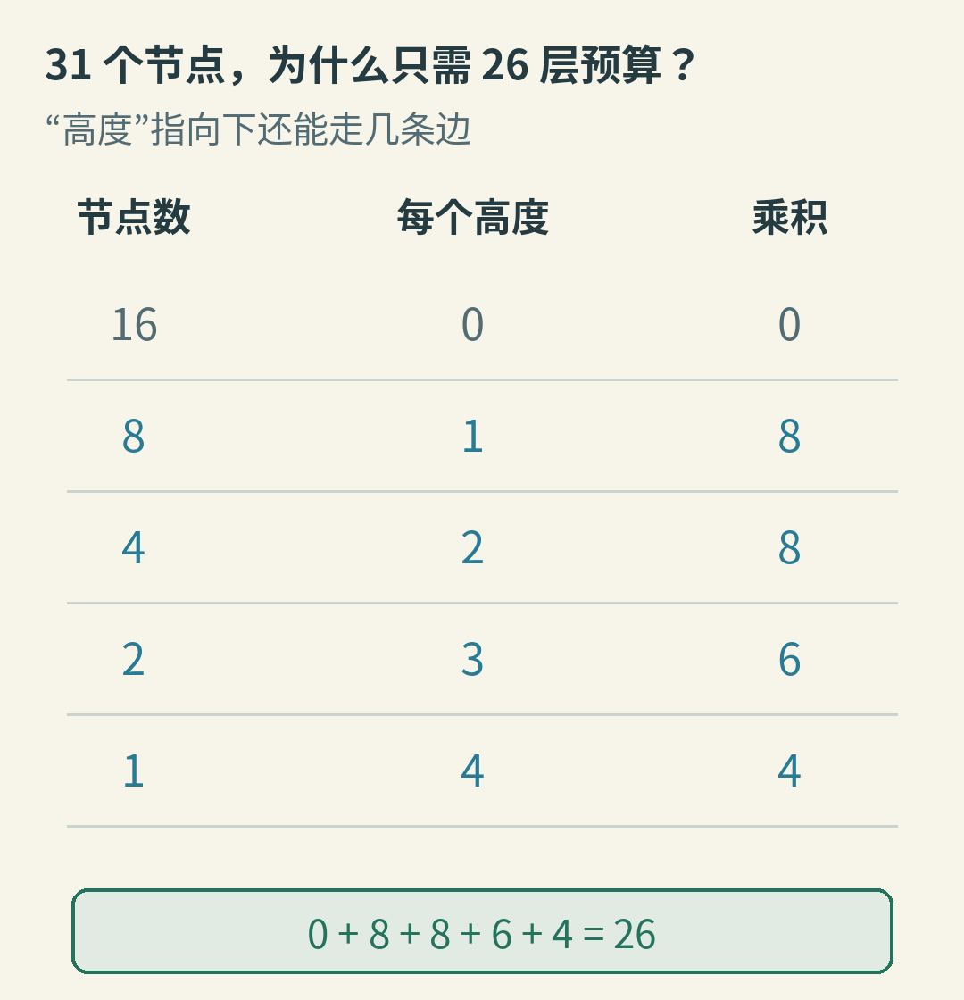

*26 是这份树形中所有节点高度之和，属于下滤最多能走多少层的预算，不是每份 31 元素输入都会发生的交换次数。*

不满最后一层，也可以用一个更稳妥的数法。

第一层步数：最多有 n//2 个节点，具备向下走至少一步的空间。

第二层步数：最多有 n//4 个节点，具备向下走至少两步的空间。

第三层步数：最多有 n//8 个节点，具备向下走至少三步的空间。

把每个节点的第一步、第二步、第三步分别收一次，总预算就是这串数相加。它小于 n/2+n/4+n/8+……，而右边的无穷等比和等于 n。

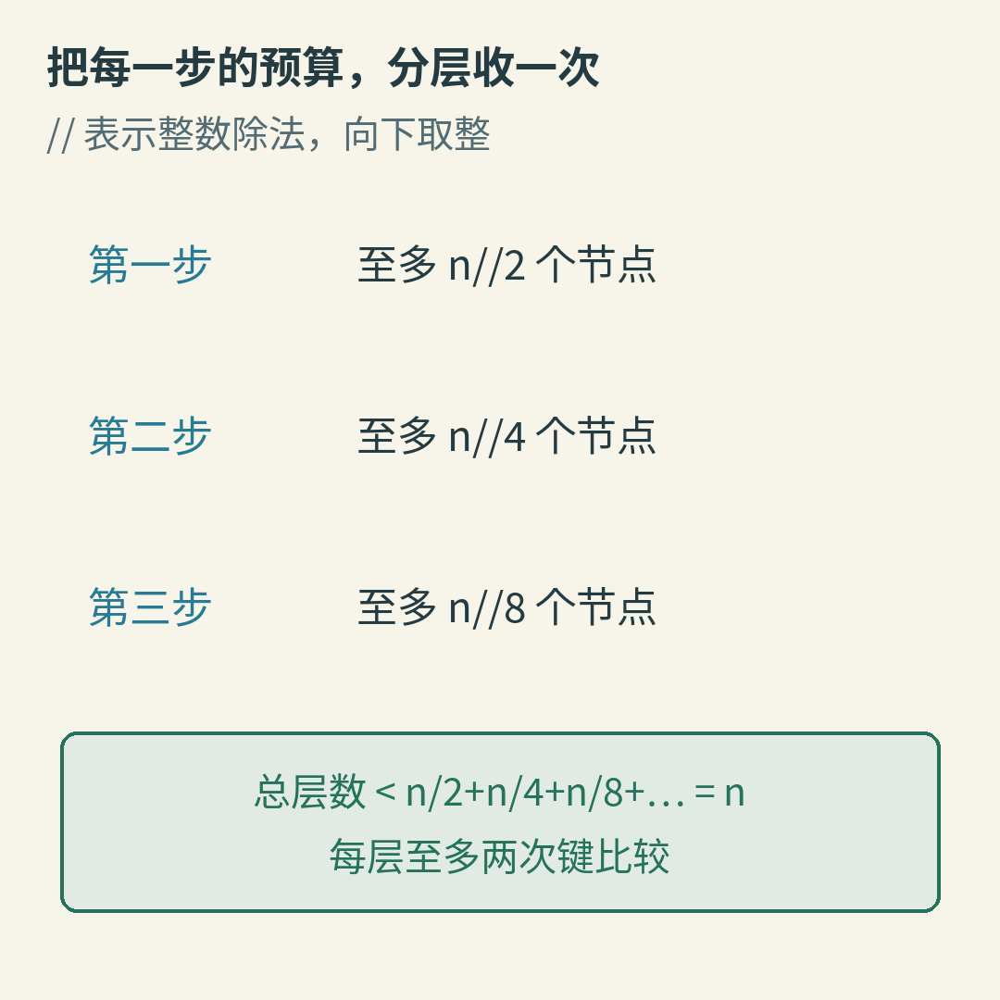

*// 表示整数除法，向下取整；n>0。对完全二叉树，至少有 h 层向下空间的节点数，等于 n 除以 2 的 h 次方再向下取整。这个按树形计费的证明，不依赖输入是不是随机数。*

每一层至多做两次键比较，外层循环还只访问线性数量的位置，所以整体是 O(n)。常见实现的完整建堆工作量是 Θ(n)，即上下界都与 n 同阶；复制输入数组也只是另一个线性成本。

相反，反复插入时，新值总从底部出发。如果向最小堆依次插入越来越小的数，许多新值都得一路爬到根，最坏确实可以累积到 Θ(n log n)。

我们用随文这份明确实现，给降序整数输入实际计数：

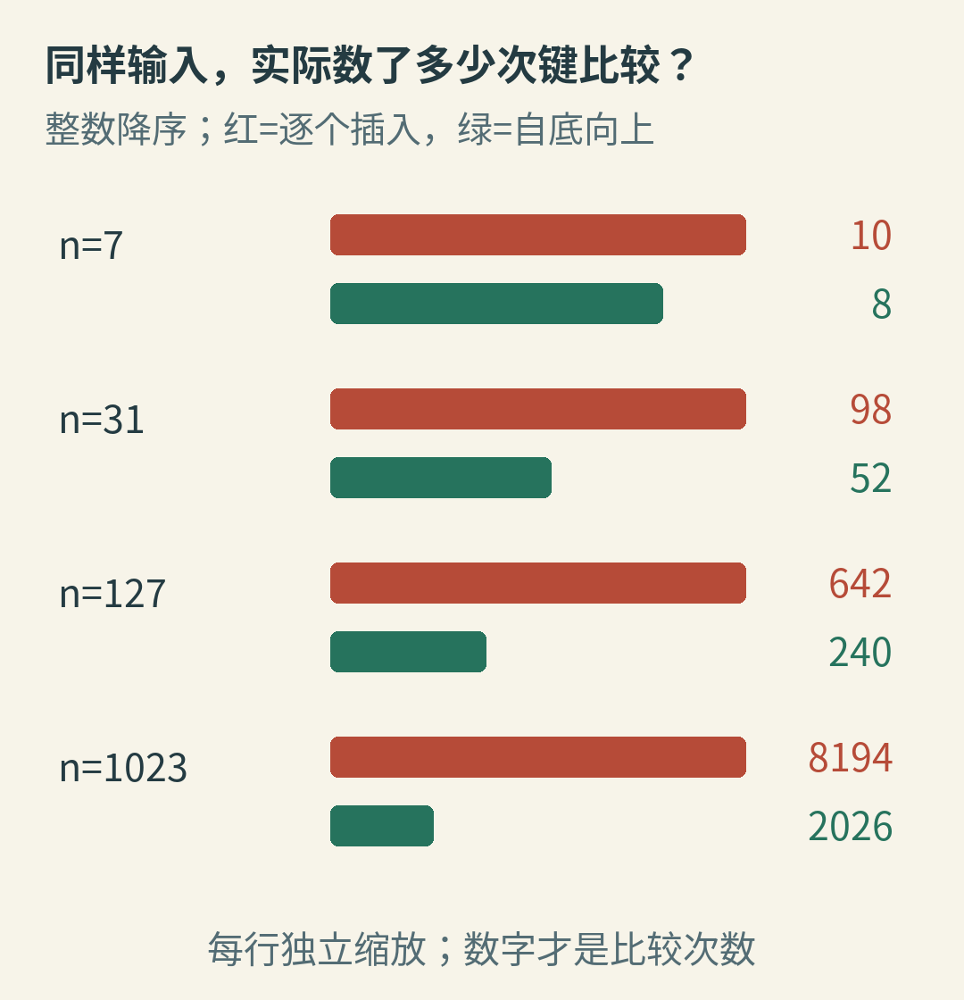

*Python 3.12.14 实际运行；输入分别为 n、n−1、…、1。每行条形单独缩放，不能跨行凭条长读增长率；右侧数字是键比较次数。未测试设备耗时，不代表 Python 标准库或所有实现的基准排名。*

比如 n=1023 时，逐个插入做了 8194 次键比较；自底向上做了 2026 次。这组数据与上面的解释相符，但**有限输入上的计数不是线性复杂度的证明**。证明来自树形预算，实验负责检查具体程序是不是按设想工作。

也别由此反推“每次新来一个数都应重建”。整批到齐时用线性建堆；只新来一个数时，用一次上滤。输入方式不同，合算的动作也不同。

## 十、把图里的下滤写成代码

下面是随文程序实际使用的下滤方法，`self.a` 是堆数组。为了对照前面的计数，`less` 负责比较并记账，`swap` 负责交换并记录状态。

```python
def down(self, i):
    n = len(self.a)
    while 2 * i + 1 < n:
        child = 2 * i + 1
        right = child + 1
        if right < n and self.less(
            self.a[right], self.a[child]
        ):
            child = right
        if not self.less(
            self.a[child], self.a[i]
        ):
            break
        self.swap(i, child)
        i = child
```

第一层判断保证左孩子存在；第二层判断防止读取不存在的右孩子；最后一个比较决定是否还需要下走。`not child < parent` 让相等时也可以停止。

只要这个过程可信，整批建堆就很短：

```python
def heapify(self):
    start = len(self.a) // 2 - 1
    for i in range(start, -1, -1):
        self.down(i)
```

`range` 的结束位置不包含在内，因此这里从最后一个父节点一路处理到 0。数组长度为 0 或 1 时，这个循环不会执行，正符合“没有父子关系需要修”的含义。

完整的上滤、插入、取出、测试和模拟代码见[可运行实验](examples/heap_lab.py)，运行说明见[实验说明](examples/README.md)。这些代码为教学而写，保留比较计数与小例子的状态记录；不是生产级容器或标准库实现的复制。

## 十一、三个任务一样急，谁先出队？

假定 A、B、C 依次加入，优先值都为 4。若比较规则只看这个 4，三个任务在堆看来一样大。

这不意味着它们会按 A、B、C 的加入顺序出来。

在本文实现中，三者插入后放成 [A,B,C]；取走 A 后，末尾的 C 补到根。C 与 B 的优先值相等，不需要交换，于是接下来先出 C，再出 B。

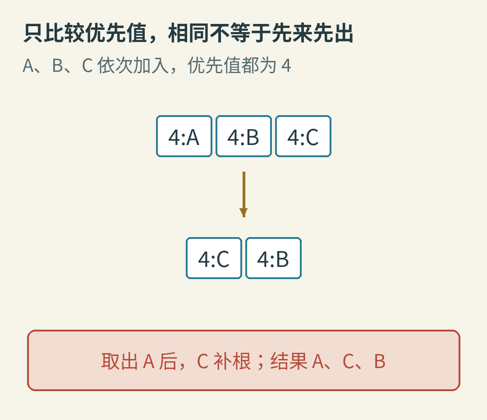

*实际运行的反例。字母只是任务身份，比较器故意只比较优先值，不比较字母。它说明普通堆不自动保证稳定性；不是说每份实现、每组平局都会以这个顺序输出。*

排序里说的“稳定”，就是相同排序键的项目保持原先相对顺序。优先队列若希望平局时先来先出，必须把这件事写进比较规则。

一个常见做法是存三项：`(优先值, 唯一递增序号, 任务内容)`。先比较优先值，平局时比较序号。A、B、C 可以分别拿到序号 0、1、2。

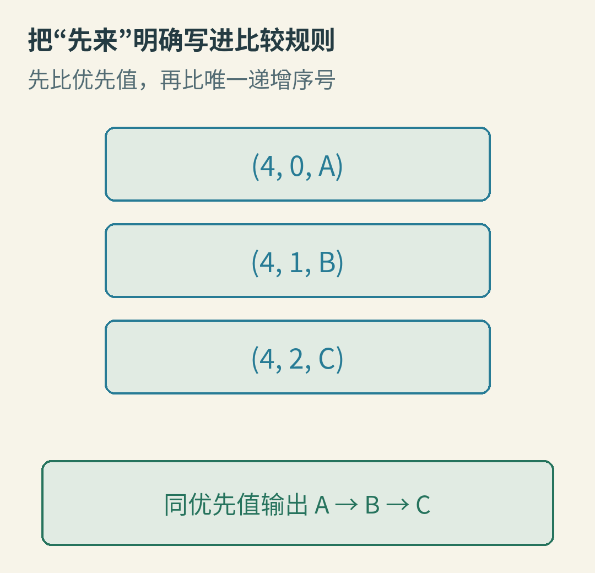

*这里的序号在入队时分配，在队列内保持不变且不重复；这样任务内容即使是不能相互比较的对象，也不会成为平局比较的对象。*

[Python 官方 heapq 文档](https://docs.python.org/3/library/heapq.html#priority-queue-implementation-notes)也明确讨论了这个办法，以及删除、改优先值时的困难。

一个任务更新以后，该保留最初的序号，还是像重新报名一样领取新序号？两种政策都可能合理，但语义不同。随文的懒更新实验选择“更新获得新序号”，并没有替所有任务系统规定唯一答案。

## 十二、“删除任意任务也是 O(log n)”少说了哪一步？

取根很容易，因为根的位置永远是 0。可是现在你说：“把任务 Q 取消。”

Q 在哪儿？

普通二叉堆只维护父子优先级关系，没有顺便维护任务 ID 的地址簿。若你只拿到一个 ID，寻找对应位置最坏可能扫描整个堆，花 O(n)。找到以后用末尾元素补位，再选择上滤或下滤，修复本身才是 O(log n)。

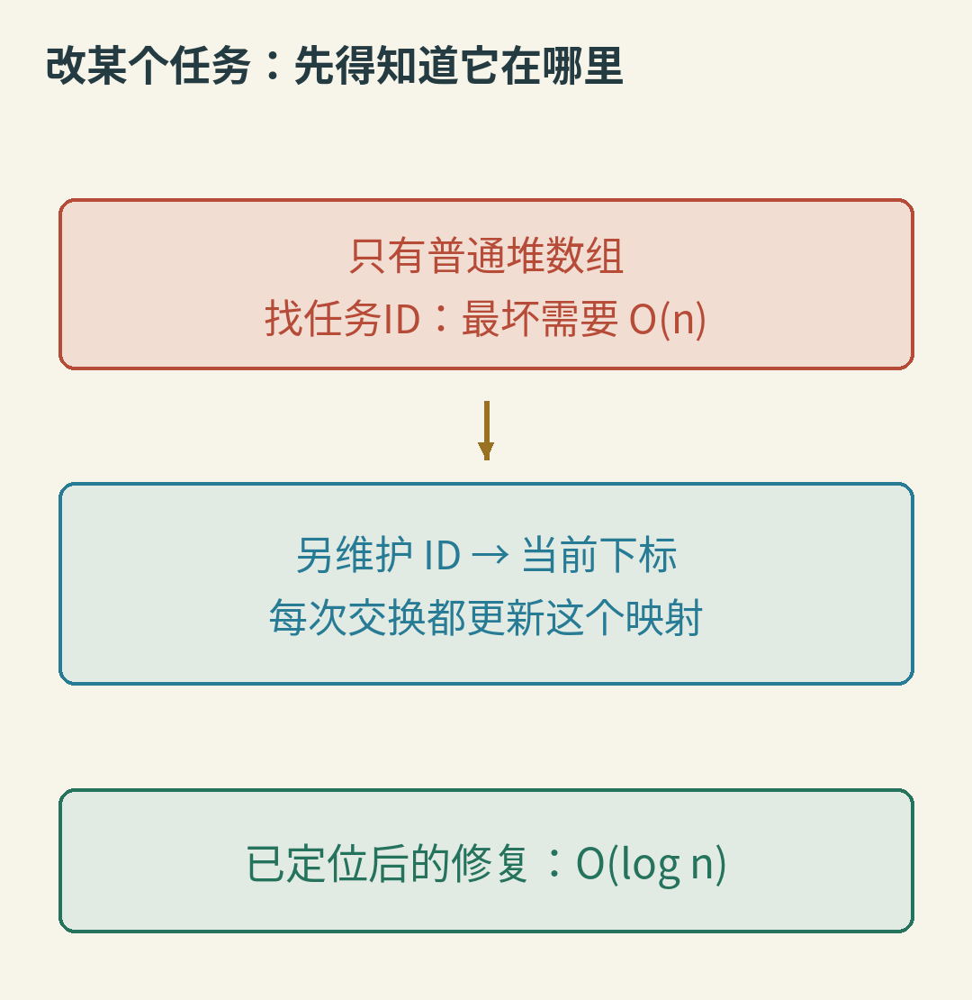

*“已知位置后的修复成本”与“从任务 ID 找到位置的成本”必须分开。只写后半句，容易把普通堆说成它并没有提供的索引。*

若经常按 ID 更新，可以额外维护一张 `ID → 当前数组下标` 的映射。交换两个位置时，映射里的两个下标也必须同步更新。这样就得到一种索引堆。

这里还隐含了映射自己的成本：若使用哈希表，定位通常按期望或摊还 O(1) 讨论；不能把普通哈希表的这个结论，无条件包装成所有输入下的严格最坏 O(1)。随文附有小型索引堆，并测试了升降优先值、删除根、中间项和末尾项之后的映射一致性。

另一条路叫懒删除或懒更新：让旧条目继续留在堆里，但在旁边记录它已经过期；更新时插入一个新版本，弹出时再检查版本是否有效。

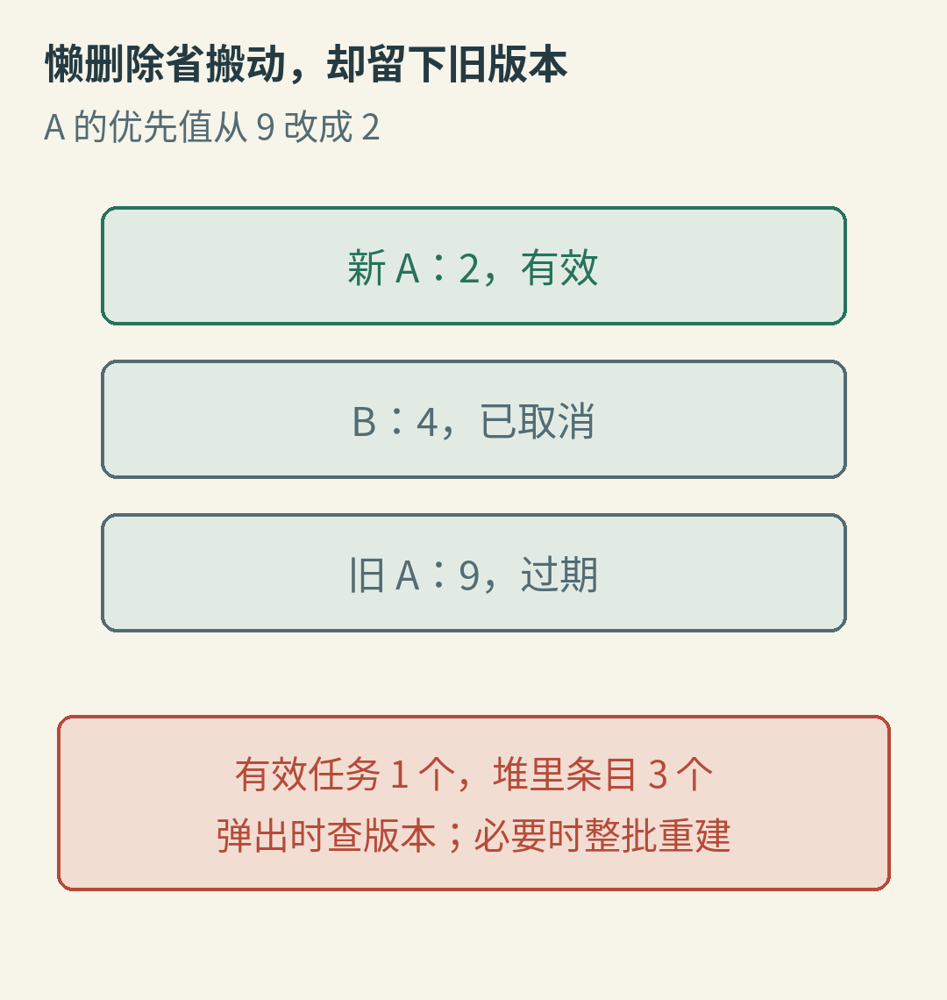

*本例先入 A:9、B:4，再把 A 更新为 2，并取消 B。有效任务只剩 A 一个，但物理堆里暂时有三个条目。随文实验实际核查了跳过旧版本和取消项的过程。*

这很方便，却不是免费午餐。若一次有效弹出之前遇到很多废条目，这一次调用可能要连续弹出很多次。若物理条目数是 M，堆操作的对数要按 M 算，而不是只按活跃任务数算。过期条目还会占内存，必要时可把有效条目收集出来重新建堆。

最后，千万不要绕开这些机制，直接改一个已经入堆对象的优先值，然后希望堆自动察觉。数组不会自己长出观察能力。不触发修复或重新入队，根就可能不再是实际最小值。

## 十三、回到游戏：下一件事不必提前全部写好

把最初七个事件放进队列。每次取出最早的事件，把模拟时间推进到它的时刻，处理它，再把它产生的新事件加入队列。

这次设定：第 3 秒打开宝箱，安排第 5 秒的闪光；第 4 秒出现脚步声，安排第 6 秒的回声。

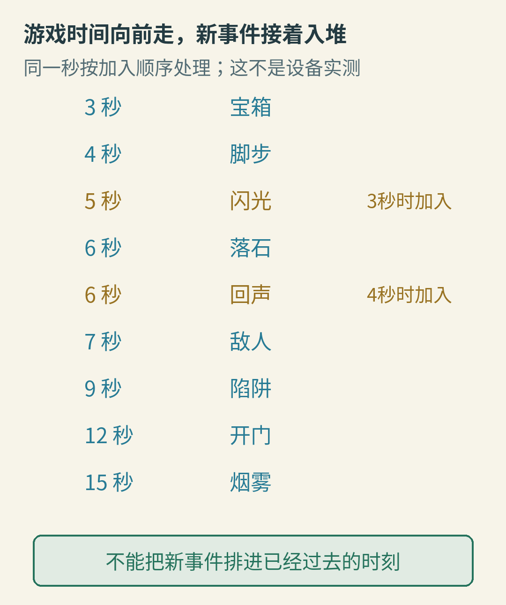

*随文程序实际输出，共九个事件。第 6 秒的落石较早入队，因此先于同秒的回声；序号是人为约定的平局规则，不代表两个事件存在物理因果关系。*

这里处理的是离散事件模拟，不是让真实电脑睡眠到某一秒，也不是对实时游戏引擎作性能保证。它把注意力集中在“下一次状态变化”上；没有事件的间隔，可以直接跳过去。

为了让模拟时间不倒退，新安排的事件不能早于当前时刻，代码会拒绝这种输入。同一时刻可以加入新事件，但应用必须防止事件无限地互相产生，否则时间可能永远停在这一刻。优先队列负责取最小，不负责保证你的游戏规则终止。

同样，任务优先级若偏爱某些任务，也可能让低优先级任务长期得不到处理。公平、限流、超时和并发安全，都需要额外设计。堆给你的是一把可靠的小工具，而不是整个调度系统。

## 十四、怎样知道我们不只是画对了七个圆圈？

随文实验不只运行这一组数，还实际做了以下检查：

- 长度 0 到 7 的全部不同整数排列，共 5914 组；每次弹出后都检查父子不变量与输出
- 值来自 −1、0、1，长度 0 到 6 的全部向量，共 1093 组，专门覆盖负数、重复值和平局
- 20 个固定随机种子下，共 40000 次混合插入/弹出；与 Python `heapq` 交叉核对
- 10 个固定随机种子下，共 20000 次索引堆插入、更新、删除或弹出；每步检查 ID 映射和参照字典
- 对 n=0 到 1024 的 1025 种完全二叉树形状，逐节点实际数高度，再与向下取整的求和比较
- 单独检查空堆、单元素、仅一个孩子、相同优先级的非稳定反例、唯一序号、懒删除与重建，以及禁止把事件排进过去

这些都是这份教学实现的有限运行结果。它们提高我们对程序与图的一致性的信心，却不替代前面对不变量和复杂度的推理，也不证明任何自定义比较器都正确。

本文输入假定大小关系一致，可以沿路径传递。浮点 NaN 不满足这里习惯使用的全序关系，不能像普通时间值一样悄悄混进来。让比较器随着外部时钟改变、让相同对象前后比较结果相互矛盾，同样会破坏这套推理的前提。

## 十五、留三个值得自己试的岔路

第一，给开头的七元素堆插入 5。它从哪里开始，在哪一层停止？先画，再运行程序。你会发现，不是每次插入都要跑到根。

第二，找出一组“根已经是最小，但下面不是堆”的数。提示：[1,9,2,3,4,5,6]。为什么只检查根与两个孩子不足以验证整棵堆？

第三，如果只想保留持续到来的成绩中最高的 k 个，该在大小为 k 的容器顶端放“其中最高”还是“其中最低”？思考当新成绩到来时，最需要迅速决定替换的，究竟是哪一个。想通以后，再比较“每次完整排序”与“只维护筛选边界”的差别。

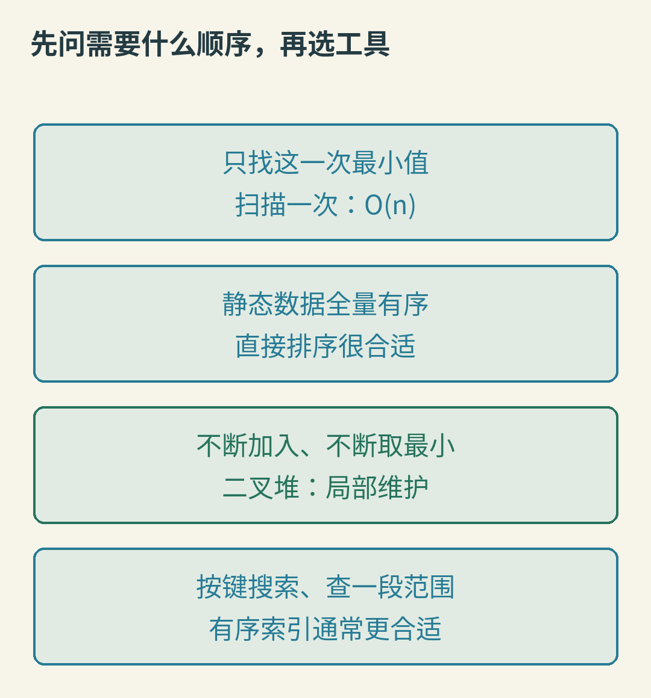

*这是应用选择的示意，不是忽略缓存、分配、键比较和数据规模后的绝对性能排名。优先队列是一种操作接口，二叉堆只是它的一种实现。*

二叉堆最漂亮的地方，并不是它把每个人都安排得井井有条。恰恰是它先问清楚：**下一次真的需要知道什么？**

如果答案只是“谁最小”，就没有必要提前确定所有人的完整座次。把必须一直成立的那条规则维护好，其余秩序，可以等用到的时候再付钱。

---

本文使用 AI 辅助资料检索、中文写作、原创实验和教学图制作。正文 27 幅图均为原创机制、反例或程序输出示意；没有生成历史人物照片或虚构 1964 年工作场景。历史原文可核范围、第三方原尺寸结构图、各项许可与复现实验见[来源说明](sources.md)。原创正文、原创教学图及原创实验程序采用 [CC BY 4.0](https://creativecommons.org/licenses/by/4.0/)；第三方原图单独遵守其许可。
