# 已经看过的字，为什么还要重看？KMP 把失败变成下一步的线索

你正在一长串日志里找一个词。

程序从左往右比：第一个字相同，第二个相同，第三个也相同。快成功时，突然遇到了不同的字。

接下来怎么办？

最直接的做法，是把搜索起点向右挪一格，从目标词的第一个字重新比。但刚才那些已经确认过的相同，真的一点用也没有吗？

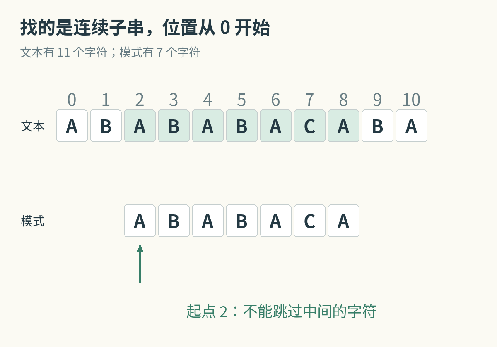

我们用一个小例子贯穿全文：在ABABABACABA中找ABABACA。前者叫**文本**，后者叫**模式**，也就是要寻找的那串字符。这里找的是连续子串，不能跳过中间的字。

把第一格编号为0，答案从第2格开始。你很快就能用眼睛确认。真正有意思的是：程序怎样在不漏掉答案的前提下，少做重复劳动？

这就是KMP字符串匹配算法要解决的问题。先别急着背“next数组”，我们从一次失败中，找出还能保留下来的信息。

## 1. 最朴素的搜索，浪费在哪里？

想象一个模式AAAAB，和一段全是A的文本。

每换一个起点，程序都会连着确认四次“A等于A”，然后在第五个位置发现：“这里还是A，不是B。”接着从下一个起点再来一遍。

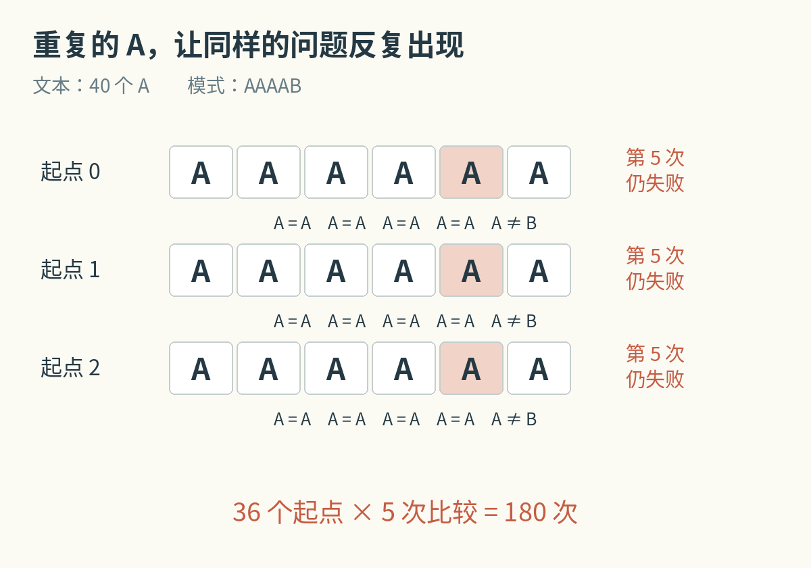

如果文本有40个A，模式长5，就有36个放得下整个模式的起点。这个明确的朴素实现，每次做5次字符比较，一共180次。

没有找到答案，却做了很多重复确认。

这还不是说朴素方法毫无价值。短模式、很快就失配的数据，都可能让它表现很好。我们现在关心的是：**能不能让最坏情况也有一个可靠的上限？**

## 2. 一次失败，实际上带着一张证据单

回到ABABABACABA与ABABACA。

从文本第0格开始，前五个字符ABABA都匹配了。轮到文本第5格时，文本是B，模式期待的却是C。

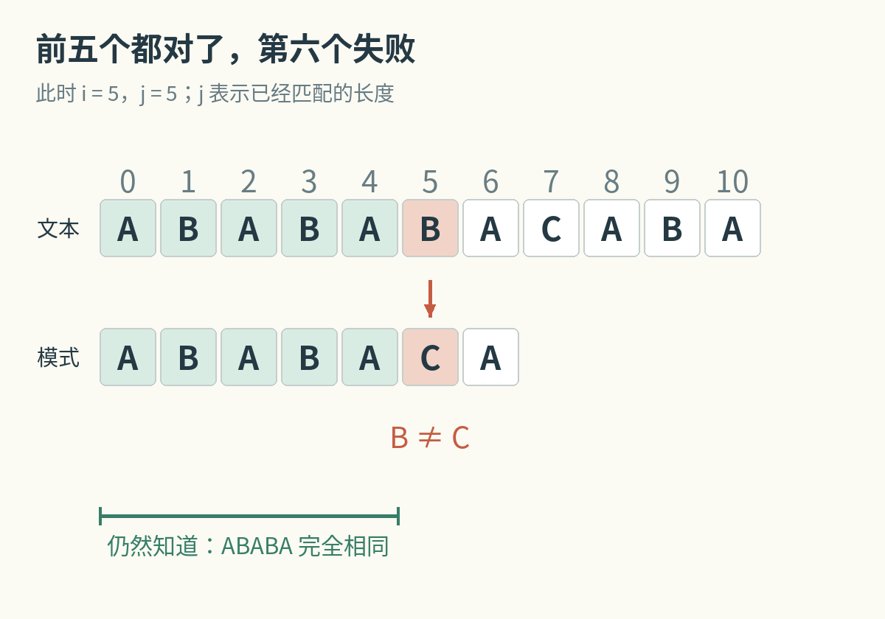

这一刻，“失败”并不意味着我们一无所知。

我们已经知道，刚刚走过的五个文本字符，确实就是ABABA。不需要再读一次文件，也不需要再挨个询问它们。

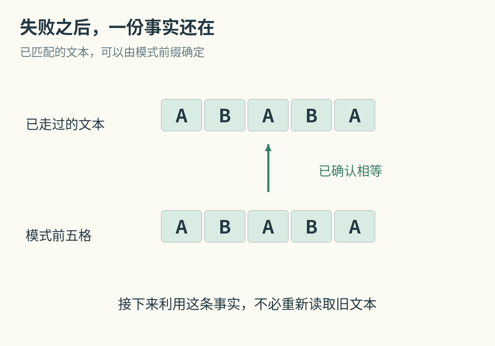

给当前状态起两个简单的名字：

- i：这次准备比较的文本位置；
- j：已经连续匹配了模式开头的多少个字符。

此刻i=5，j=5。因为下标从0开始，下一个要比的是模式第5格，也就是C。

注意，j首先是一个**长度**。恰好因为从0编号，它也能当作“模式中下一个待比字符的下标”。这两个身份一致，后面的代码才会简洁。

## 3. 哪一截旧结果，可以当作新开头？

把ABABA写在一张纸条上。

它的开头是ABA，结尾也是ABA。于是，当我们把模式向右移动两格时，旧匹配末尾的ABA，恰好可以接住模式新开头的ABA。

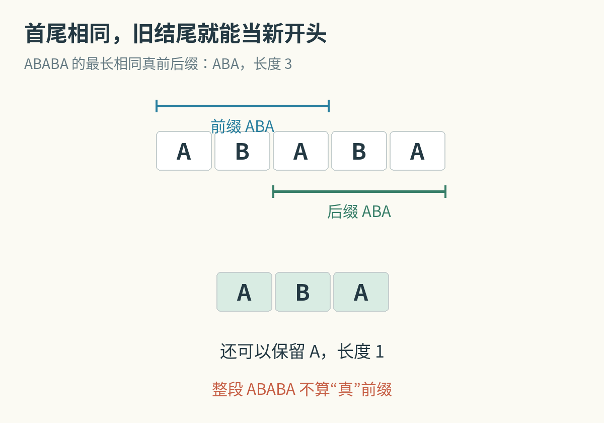

这里需要三个词，但它们都很普通。

**前缀**是从开头截取的一段。ABABA的前缀可以是A、AB、ABA等。

**后缀**是贴着结尾截取的一段，比如A、BA、ABA等。

**真前缀**不能把整个字符串都拿走。我们正在寻找一次向右移动后的新起点，若允许“整段ABABA与自己相同”，就等于根本没有移动。

既是前缀又是后缀的同一串字符，有时叫border，中文可以理解为“首尾相同的边”。它不一定只有一个：ABABA还可以保留一个A，只是长度3的ABA更长。

为什么优先选最长的？因为它对应最小的、仍有希望的右移。先查最近的候选起点，才不会越过可能的答案。

## 4. 为什么跳过第1格，不会漏掉结果？

听起来像一条危险的捷径：从起点0直接跳到起点2。

第1格怎么了？

我们已经知道，文本第1格是B。而模式的第一个字符是A。它们不相同，第1格不可能是答案的开头。

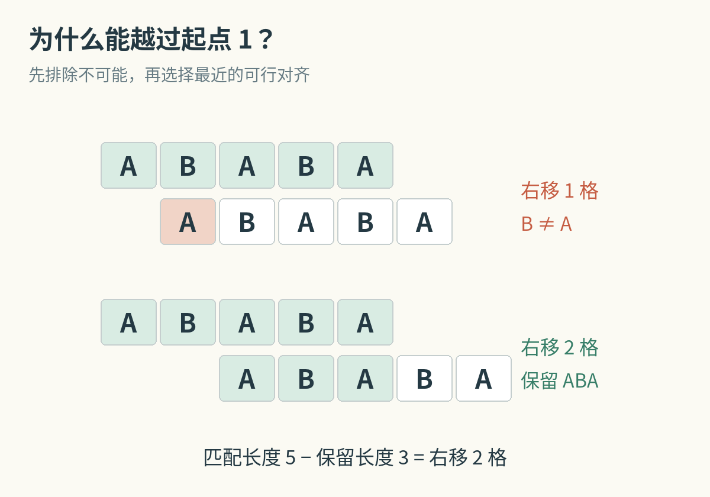

用更一般的说法：假设要保留旧匹配末尾的一段，那么这段文本必须等于模式的新开头。旧文本又等于刚匹配过的模式前缀，所以问题变成了“模式自身的前缀和后缀能否对上”。

**移动距离不是靠猜出来的，而是被已经知道的相等关系约束出来的。**

在这个例子里，原先匹配5个字符，现在保留3个。起点向右移动5−3=2格。

## 5. 回退的是模式状态，文本这一格先别走

接下来最容易写错。

把j从5变成3以后，文本第5格的B，还没有被新的对齐关系解释。不能立刻把i加一。

我们仍然拿同一个B，去比较模式第3格。这一次，模式第3格也是B。

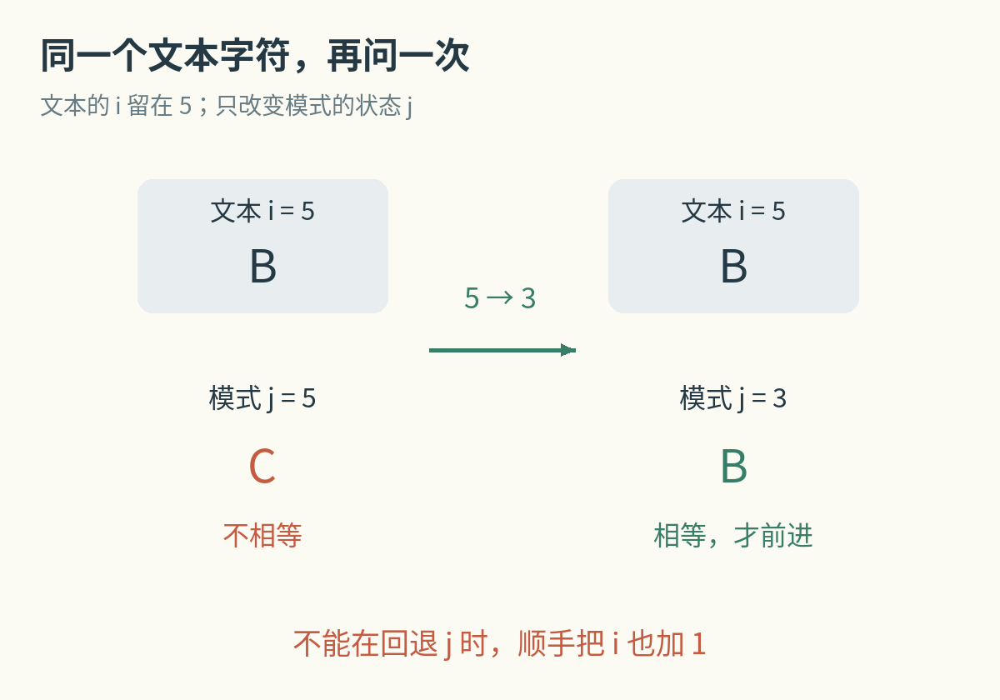

于是j从3增加到4，然后才读取下一个文本字符。

再往后，文本的A、C、A陆续匹配。到文本第8格时，完整的7字符模式终于出现。结束位置是8，长度是7，起点就是8−7+1=2。

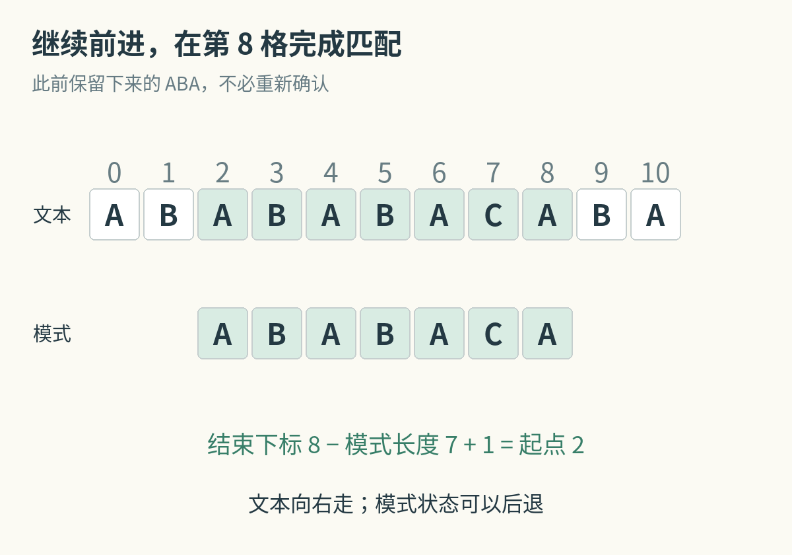

你可以用手指在图上走一次：文本的手指只向右走，模式的状态可以后退。一次失配，可能让同一个文本字符比较不止一次；“文本不回头”并不等于“每个字符只比较一次”。

## 6. 先给模式做一份简短的备忘录

搜索中若每次失败都重新寻找最长相同前后缀，省下来的工作又会被花回去。

所以，我们先只研究模式自己。

对模式的每一个结尾位置r，记下“到这里为止的这一段，最长相同真前缀与后缀有多长”。把这个长度写成pi[r]。pi只是这张表的名字，不是在计算圆周率。

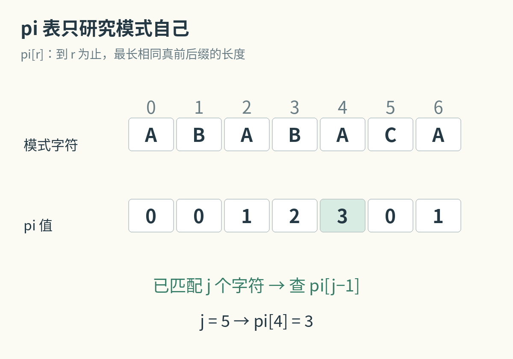

例如：

- A：没有非空的相同真前后缀，所以是0；
- AB：也没有，所以是0；
- ABA：两头都有A，所以是1；
- ABAB：两头都有AB，所以是2；
- ABABA：两头都有ABA，所以是3；
- ABABAC：最后是C，找不到能贴住结尾的非空前缀，所以是0；
- ABABACA：两头有A，所以是1。

于是，刚才“已经匹配j=5个字符”的失败，就可以直接查最后一个已匹配字符的表项：

j = pi[j−1] = pi[4] = 3

为什么是j−1，不是j？因为已经匹配的是模式第0到第j−1格。第j格正是刚才没有匹配成功的那个字符，不能把它算进证据里。

不同教材会使用next、failure、prefix等名字，并采用不同下标或优化方式。**先看表项的定义，再看数值。** 本文的零起点pi表，不应与1977年论文的一起点、经过优化的next表逐格硬对。

## 7. 表怎么建？让模式和自己做同样的事

一眼看出这七个数字不难。模式很长时，能不能也避免从头检查？

可以，而且用的还是刚才的办法。

假设已经处理了ABAB。它的最长相同前后缀是AB，长度2。现在读到下一个A，只需问：开头的AB后面，下一个字符是不是A？

是。两边一起接上A，长度2就增长成3。

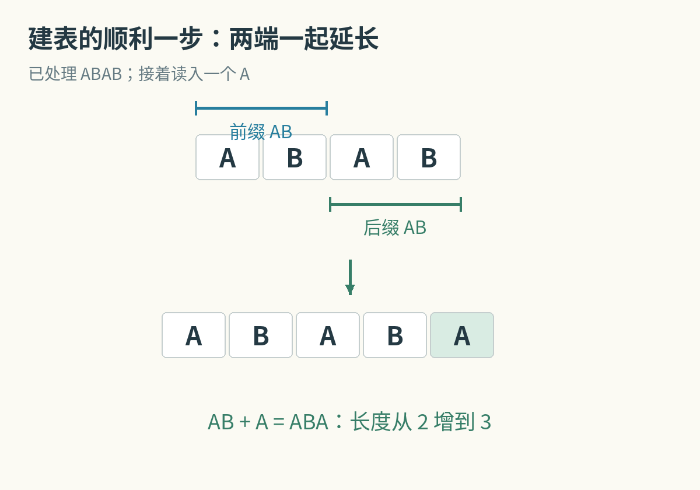

接下来遇到C，就不一样了。当前候选边是ABA，长度3；模式第3格是B，与C不相同。

不能强行把长度3加成4。但也不用把所有更短的长度都试一遍。

ABA自己还有一个长度1的边A。查已经算好的表，把候选长度从3退到pi[2]=1。现在模式第1格还是B，仍不等于C。继续退到pi[0]=0，模式第0格A也不等于C，所以这一格最终写0。

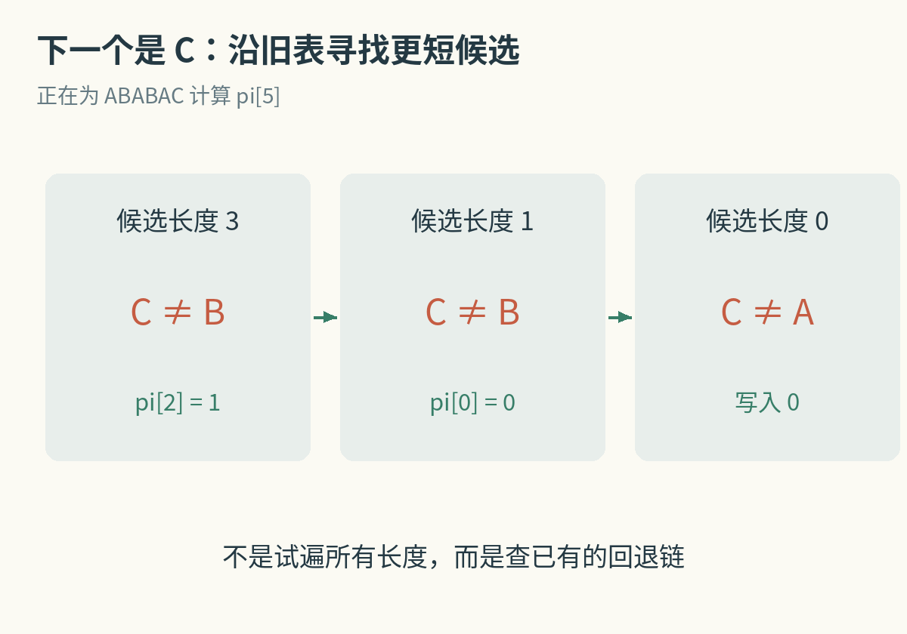

这些回退不是另发明一套算法。我们只是在用同一种证据：“长的接不上，就看看它还能保留哪个更短的首尾相同部分。”

这样的长度会形成一条严格下降的链。例如ABABABA的可保留长度，可以沿5、3、1、0逐级退下去。

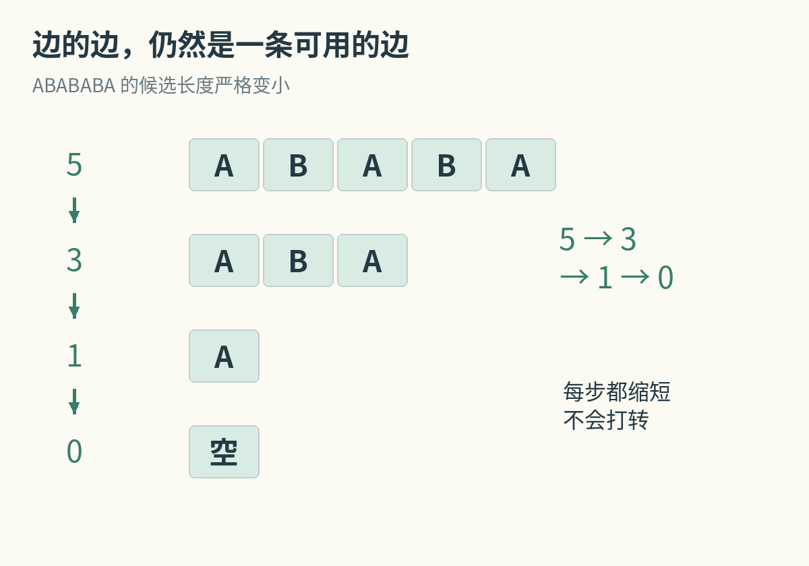

它不会原地打转，因为每次都转向更短的真前缀。

## 8. 代码里有嵌套循环，为什么仍然是线性的？

先不数代码行，看两种动作。

一种动作是读下一个文本字符。长度为n的文本，只能这样向右走n次。

另一种动作，是把已经匹配的长度j调小。j从0开始，每当一个新字符成功匹配，最多增加1；它永远不能变成负数。

因此，整个搜索过程中，能够退掉的长度，不会超过此前累计涨上去的长度。一次回退有时会掉好几级，这只会让以后还能回退的次数更少。

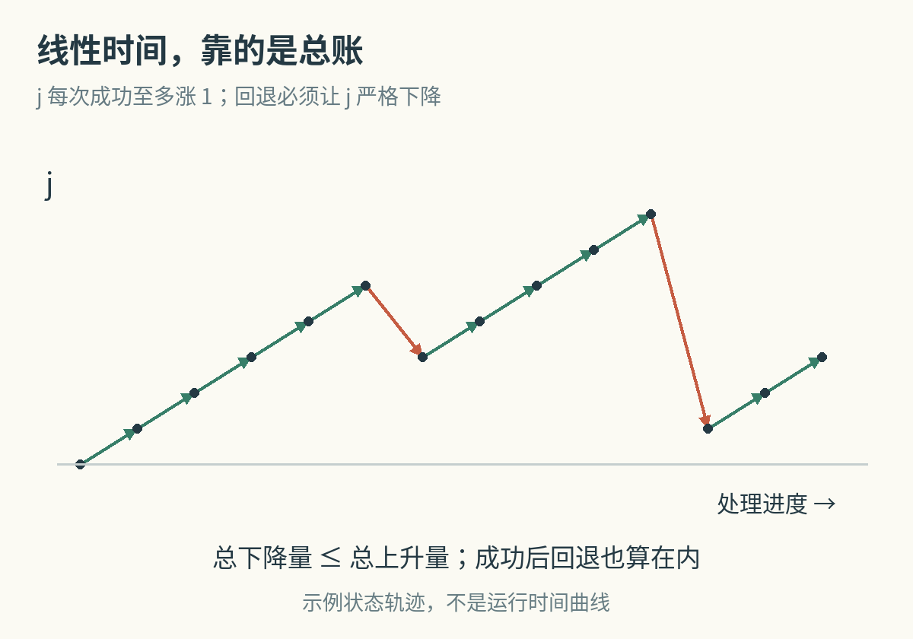

这叫**摊还分析**：不保证每一步花的钱一样多，而是把整段过程的总账算清楚。

建表也一样。扫描模式时，每读一个新字符，候选长度最多加1；回退严格减小它。因此，长度m的模式可以在线性时间内建表，文本搜索也是线性的，总共O(m+n)。

O(m+n)的意思是：在字符比较与表访问都能视为常数时间的模型里，工作量的上界随两个长度之和增长。它不是“任意机器上每个字符恰好耗时多少微秒”。

还有一个重要边界：本文这个易读的pi版本，不保证每个新字符都在固定次数内处理完。

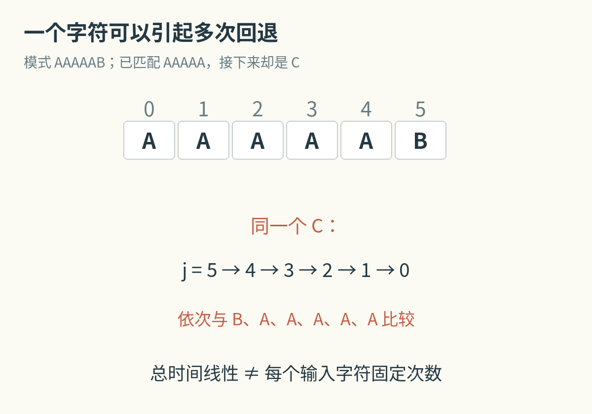

例如模式AAAAAB，在已经匹配五个A之后来了C，这一个C就可能连续撞到多个候选位置。每步最坏延迟与整段总时间，是两个问题。原论文还讨论了更强的优化；我们不能把那些优化的逐字符保证，自动贴到这份教学代码上。

## 9. 把手算翻成可以运行的小程序

下面先建pi表，再找出所有匹配起点。空模式暂时作一个明确约定：它匹配文本前后及字符之间的全部n+1个边界。

```python
def prefix(pattern):
    pi = [0] * len(pattern)
    for i in range(1, len(pattern)):
        j = pi[i - 1]
        while j and pattern[i] != pattern[j]:
            j = pi[j - 1]
        if pattern[i] == pattern[j]:
            j += 1
        pi[i] = j
    return pi


def find_all(text, pattern):
    if not pattern:
        return list(range(len(text) + 1))
    pi = prefix(pattern)
    hits = []
    j = 0
    for i, char in enumerate(text):
        while True:
            if char == pattern[j]:
                j += 1
                if j == len(pattern):
                    hits.append(i - len(pattern) + 1)
                    j = pi[j - 1]
                break
            if j == 0:
                break
            j = pi[j - 1]
    return hits
```

[配套实验](examples/kmp_experiment.py)保留同样的搜索步骤，并记录每次字符比较。主例得到起点[2]，搜索阶段比较12次；相应朴素实现比较19次。40个A与AAAAB那一例，分别是76次和180次。

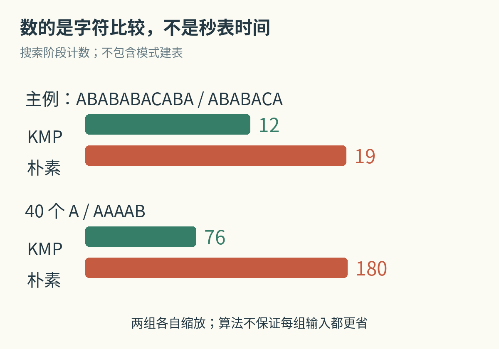

这里没有测墙钟时间，计数也不包含建表。更不能据此宣布“自己写的Python KMP一定比语言内置搜索快”：内置实现、常数开销、数据分布、是否重复使用同一模式，都会影响实际结果。

事实上，在配套的AAAAAC与AAAAAB例子中，KMP搜索比较11次，朴素方法只比较6次。可靠的最坏情况保证，并不意味着每一小组输入都赢。

## 10. 找到一次以后，为什么也不能随手清零？

看AAAAA里有多少个AAA。

从第0、1、2格出发，都有一个。它们彼此重叠。

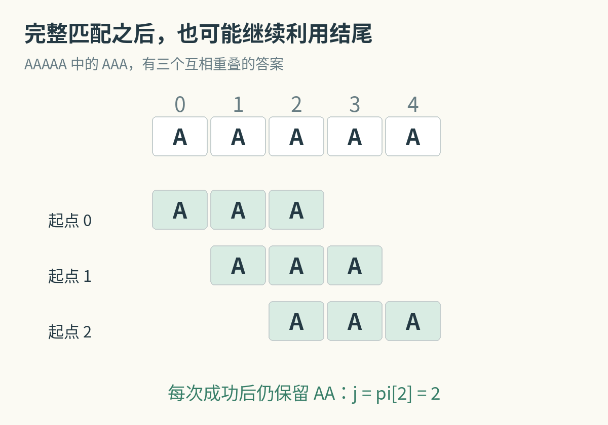

当我们找到第一个AAA时，它的末尾AA，仍然可以当作下一次匹配的开头。所以代码记录答案后，又做了一次j = pi[j−1]。

若此时简单把j重设成0，就会丢掉本来已经知道的两个A，也会漏掉这些重叠答案。

当然，有些应用只想要互不重叠的结果。那是另一份明确的接口约定，需要另外说明，不能悄悄改变含义。

空模式也是接口约定。

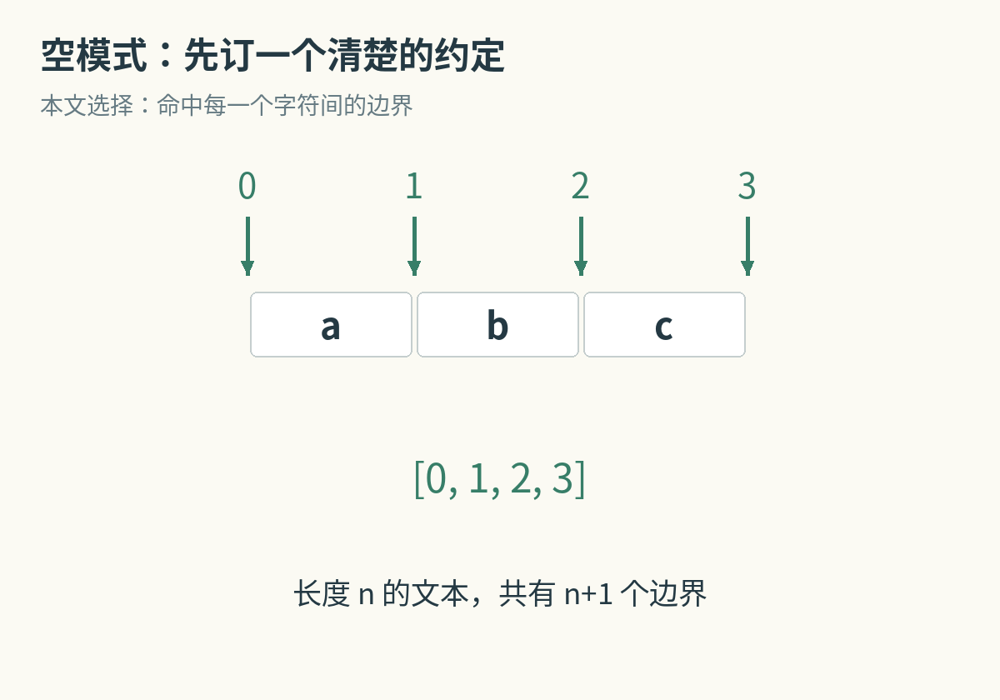

本文约定abc中的空模式命中[0,1,2,3]。有人会选择禁止空模式，或只返回第一个位置，都可以设计；但调用者必须知道是哪一种。空文本配非空模式，结果则为空列表。

## 11. 日志分成几块到来，算法还认得接缝吗？

现在把主例分成三块：ABABA、BAC、ABA。

单独搜索每块，完整模式可能从一块末尾跨进下一块。若块与块之间把状态扔掉，就会错过这种答案。

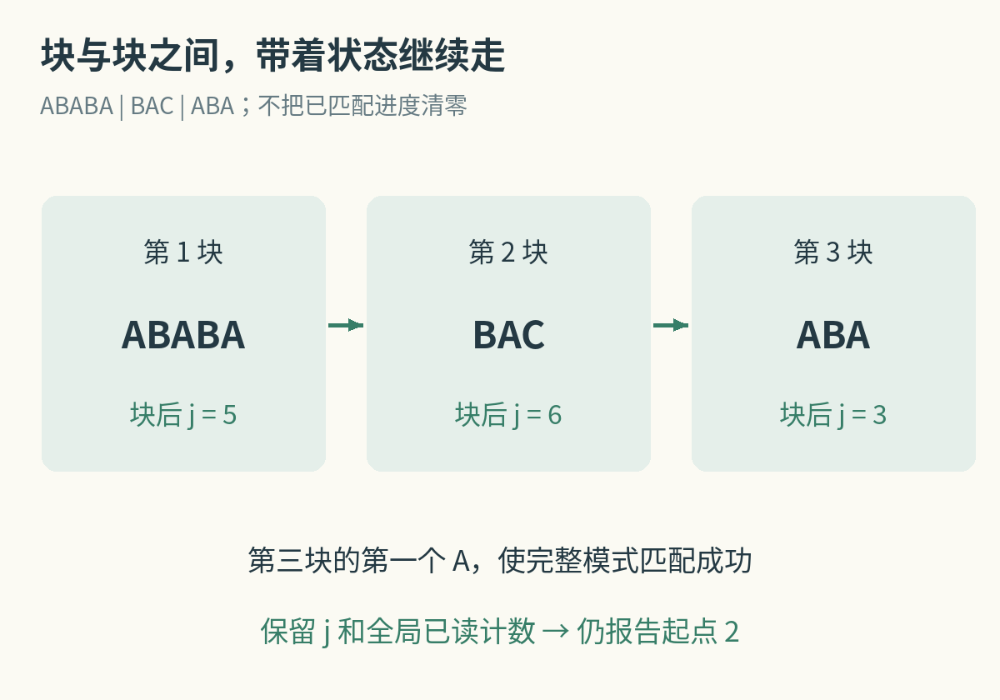

KMP适合保留一个很小的进度状态：模式本身、pi表、当前已匹配长度j，以及已经读过多少字符。新块到来，接着处理即可；不需要把整份历史文本重新拼起来再扫。

配套StreamMatcher对非空模式演示了这种做法。我们实际试了主例全部78种三块切分方式，包括空块，结果都保留了起点2。

这是算法状态如何跨块延续的实验，不是一个已经部署的日志系统。编码解码、网络乱序、文件轮转等问题，仍然属于外层系统。

## 12. “字符相同”，也要先说清楚

上面的Python字符串按Unicode码点逐个比较。

“看起来相同”不一定意味着“码点序列相同”。例如é可以是一个U+00E9，也可以由e和一个组合重音符号构成。

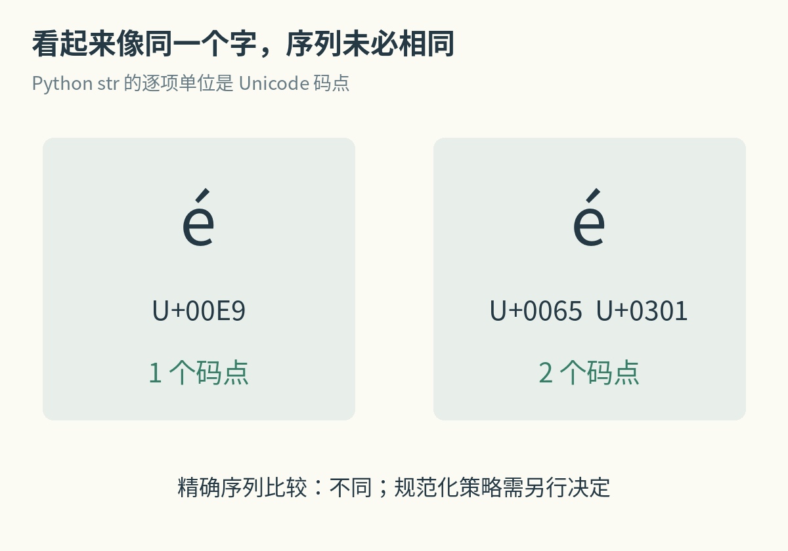

如果要求这些写法也算同一种文字，通常需要先选定规范化策略。规范化会改变序列与位置映射；结果下标如何对应原文本，也需要另外设计。[Python Unicode说明](https://docs.python.org/3/howto/unicode.html)与[Unicode规范化标准](https://www.unicode.org/reports/tr15/)详细区分了这些问题。

字节、码点、用户眼里的一个字形，是不同的搜索单位。忽略大小写、允许通配符、找相似拼写，也不是把本文代码照抄过去就自动具备的能力。


同样，前面O(m+n)的讨论默认基本单位的相等比较有常数代价。如果每个“字符”其实是一棵巨大对象树，一次相等判断本身就很贵，应把那份成本也算进去。

## 13. 三个名字背后，是两条相遇的路

KMP来自Donald Knuth、James H. Morris Jr.和Vaughan R. Pratt的姓氏。

1977年论文的历史章节回顾：1969年夏天，Morris为CDC 6400编写文本编辑器，想避免让输入文件向后回退，以简化缓冲处理。另一条独立的路径上，Knuth在1970年研究Cook关于自动机的理论结果，从推导中提炼出实用的匹配方法。Pratt修改了相关数据结构，使运行时间界不再依赖字母表大小；他与Morris交流后，两条路径连接起来。

这是作者在论文中的回顾，我们没有给这个故事补造现场对白或心理活动。[三位作者的1977年论文，历史章节338—339页](https://www.cs.jhu.edu/~misha/Spring23/Knuth77.pdf)


图：Donald Knuth，Alex Handy摄，2011-01-11，Computer History Museum活动；[原文件](https://commons.wikimedia.org/wiki/File:Donald_Ervin_Knuth.jpg)，[CC BY-SA 2.0](https://creativecommons.org/licenses/by-sa/2.0/)，保留原尺寸、未修改。这不是算法产生年代的照片。

这个转折很值得注意：一个需求来自“文件不要倒着读”，另一个来自理论推导。最后落到程序里，却都变成了很具体的状态和表。


图：Vaughan Pratt自摄，文件历史标明替换照片摄于2009-07-31，当前版本由Bubba73于2016年作色彩调整；本稿保存该文件原字节，未再次修改。[文件页与历史](https://commons.wikimedia.org/wiki/File:VaughanPratt.JPG)，[CC BY-SA 3.0](https://creativecommons.org/licenses/by-sa/3.0/)。

Morris的身份与工作可从[卡内基梅隆大学的本人讲座报道](https://www.cmu.edu/news/stories/archives/2018/may/morris-computing-pioneers.html)继续了解；该页肖像未核到适用于本稿的开放复用许可，因此给出原站查看链接，不拿同名者照片替代。

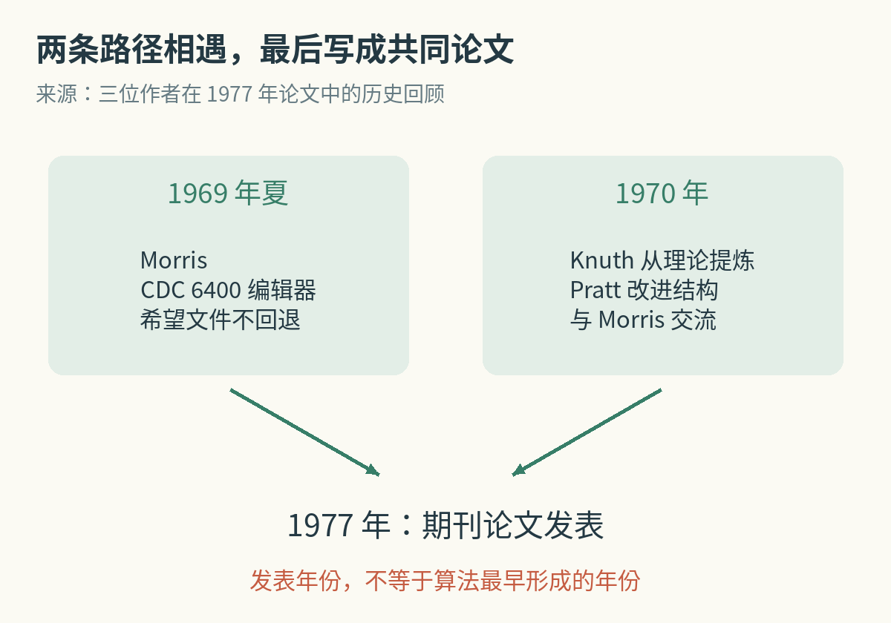

1977是这篇期刊论文的发表年份，不能说成算法直到那一年才突然诞生。也不能把这段共同工作的历史，压成某一个人独自想出一张神奇的表。

## 14. 最后留一道可以用手指做的题

把模式换成ABABCAB。

先不运行程序，试着写出pi表。然后在ABABCABABCAB中寻找全部出现位置。

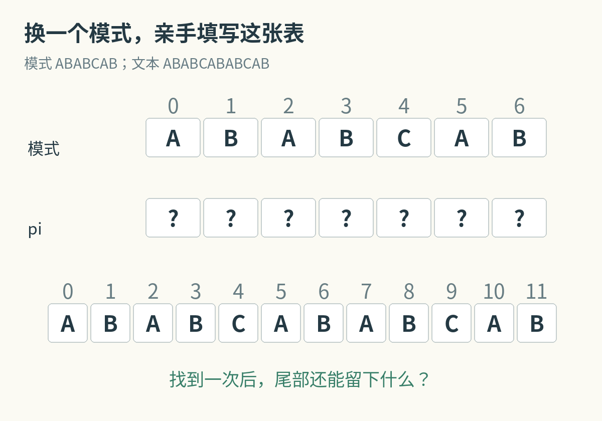

可以按三个问题逐步检查：

1. 看到第五个字符C时，为什么此前的AB结构不能继续延长？
2. 找到整个ABABCAB后，尾部还能保留哪一段？
3. 第二个答案有没有和第一个重叠？

核对答案：pi是[0,0,1,2,0,1,2]，匹配起点是[0,5]。完整模式的首尾都有AB，因此一次成功之后，可以保留长度2，而不是忘掉全部进度。

配套程序还实际穷举了长度0—9的二进制文本、长度0—6的二进制模式，共129921对输入，与朴素搜索逐项核对。有限测试能帮助发现实现错误，不能代替对所有输入的证明；正确性仍来自“保留的后缀确实等于新的前缀”，效率则来自严格下降的回退与单向前进的总账。

现在再看那次失败。

B没有匹配C，确实排除了一个起点。但此前匹配的ABABA并没有白费。算法把它整理成一份可继续使用的证据，让下一次尝试站在已经知道的事情上。

KMP最值得带走的，不是一串要背熟的数组，而是这个问题：**当一次尝试失败时，哪些信息仍然成立？**
