# 锁已经过期，旧程序醒来为什么还能写坏数据？让资源认得“第几任管理员”

一场校园游戏刚结束，记分程序准备把总分从100加到110。

程序A先拿到一张“现在由你修改”的许可，读出100，算好110。就在写回前，它停住了。可能在等系统调度，也可能发生了很长的运行时暂停。

系统不能永远等它。许可过期，程序B接班。B读到100，加上另一项活动的20分，写回120。

随后，A醒了，把手里早就算好的110写回去。

屏幕没有报错。分数却从120退到了110。

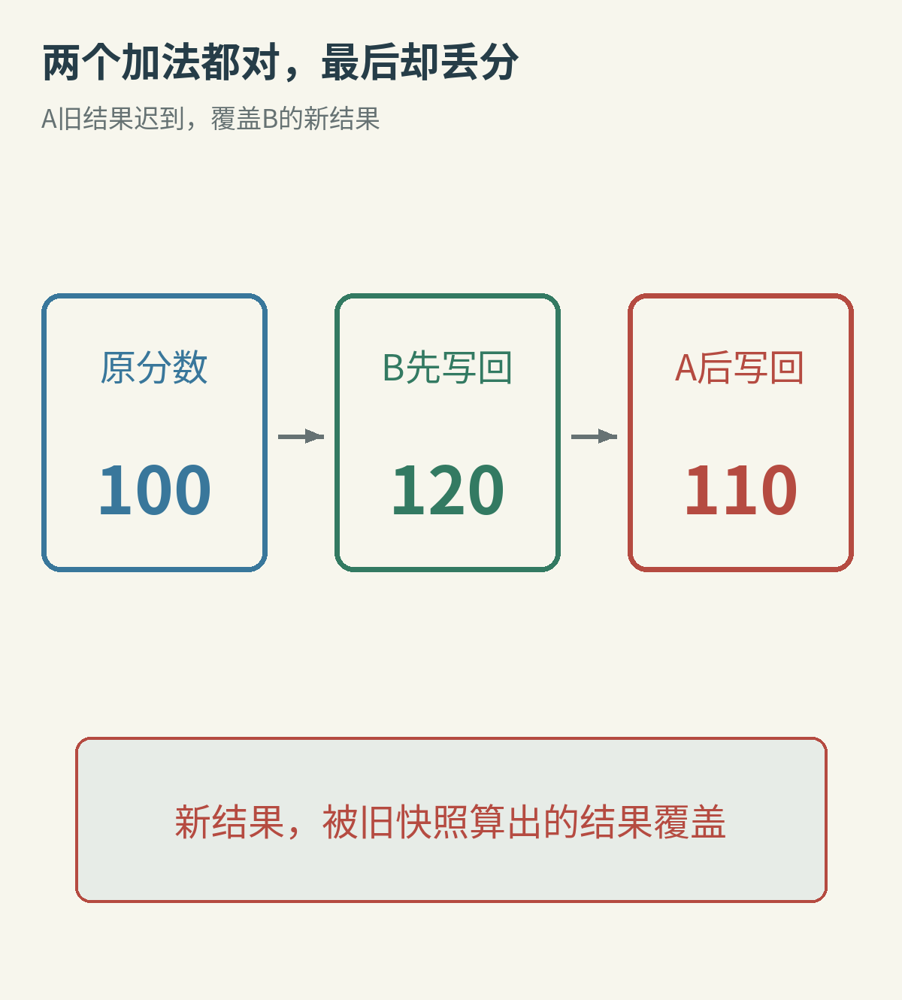

问题不是加法。两次计算都对。问题是：**“我曾经获准修改”，不等于“我的这次修改现在仍应生效”。**

本文用一份虚构的游戏记分表，把租约、迟到请求与fencing token串成一个可运行的小实验。先不搭集群，也不背一长串协议名。我们要找到的，是那扇真正能把旧请求挡住的门。

## 1. 先找清楚：谁发许可，谁真正改数据？

故事里其实有三类角色。

A和B是工作程序。锁服务负责决定谁当前获得许可。存储服务保管记分表，负责真正修改100、110或120这些值。

如果锁服务和存储服务是两个系统，锁服务把A的名字划掉，并不会自动把A已经发出去的请求从网络里擦掉，也不会让A的处理器永远停止。

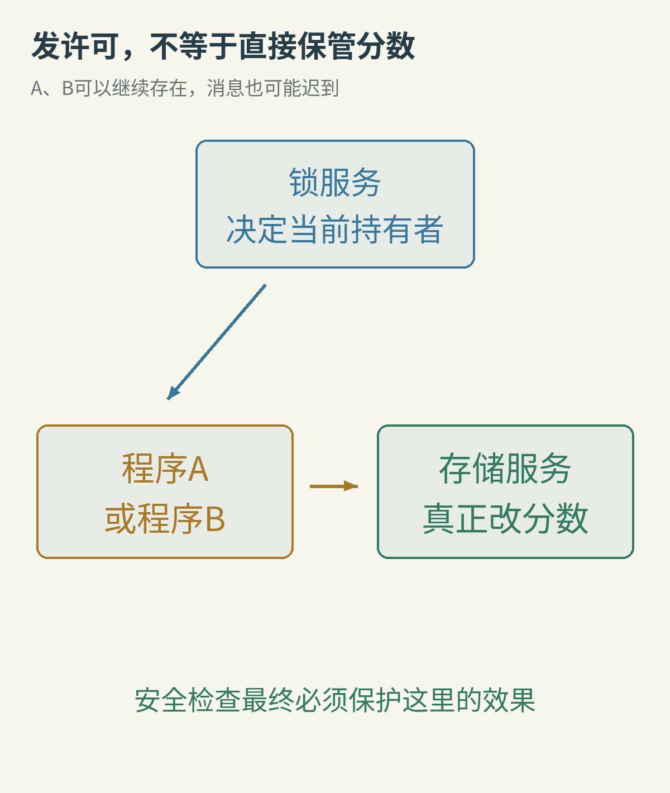

我们把有到期时间的许可叫作**租约，lease**。它不是一把会遥控所有机器的物理钥匙，而是一项按协议维护、有期限的约定。

租约很有用：如果持有者真的崩溃，别的程序最终还有机会接班。代价是需要面对另一种情况：旧程序只是很慢，后来又回来了。

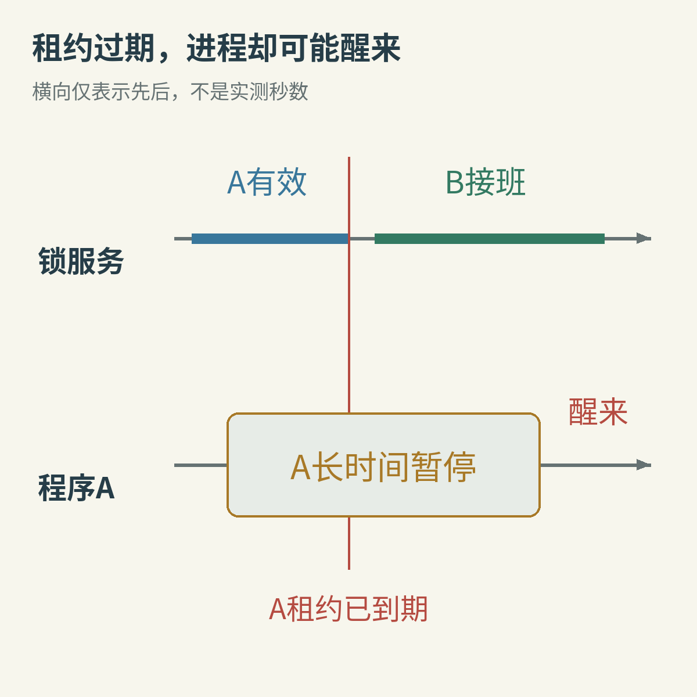

先做一个小预测：把租约从10秒改成一分钟，会彻底消除开头的错误吗？

不会。它可能降低某些暂停触发错误的机会，却没有改变“旧程序仍能恢复、请求仍能迟到”这一结构。本文不给暂停和网络延迟设一个可靠的最大值。

## 2. 这个坑，早就出现在真实系统设计里

2006年，Mike Burrows发表介绍Google Chubby的论文。它讨论的不是一把神奇的大锁，而是一个为系统协调提供粗粒度锁与少量可靠存储的工程服务。

论文第2.4节直接面对一种麻烦：进程在持锁时发出请求，后来失效；另一进程接过锁并完成工作，旧请求却最后才到。接收方如果照单全收，数据仍可能出错。

Chubby提供的**sequencer**包含锁名、获取模式和锁代号，客户端把它交给受保护的服务，由接收者检查。这个历史细节值得记住：保护没有在“拿到锁”那里结束，还要走到真正执行操作的系统。本文稍后的整数模型只提炼这个思想，并不实现Chubby的完整sequencer。[原论文第2.4节](https://research.google.com/archive/chubby-osdi06.pdf)

十年后，Martin Kleppmann在2016年2月8日的技术文章中，用暂停后恢复的工作程序把同类问题画得很直观。下面保留作者网站的完整原图；它也是本篇原创中文步骤图所要帮助你读懂的对象。

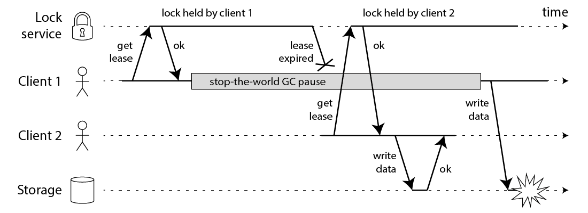

原图：Martin Kleppmann，*Unsafe access to a resource protected by a distributed lock*，2016，[CC BY 3.0](https://creativecommons.org/licenses/by/3.0/)；原文件未修改。[文章与许可说明](https://martin.kleppmann.com/2016/02/08/how-to-do-distributed-locking.html)

从上往下看，分别是锁服务、旧客户端、新客户端和存储；横向是事件先后。灰条表示旧客户端暂停。它醒来时，上面的锁早已换人，下面的存储却仍收到它的写入。

这不是说“所有分布式锁都没用”。它是在提醒我们：要明确锁保护的对象，以及谁负责拒绝过期工作。本文不重演当年的具体产品争论，也不把那篇文章对2016年实现的描述当成今天的软件评测。

## 3. 为什么“写之前再看一眼时间”仍不够？

给A加一个检查，似乎很合理：

先确认租约还有效，再把110写回去。

但这两个动作之间，仍然有一个缝。A刚检查完就暂停；等它醒来，租约已经过期。或者A及时发出了请求，请求却在网络里等了很久。

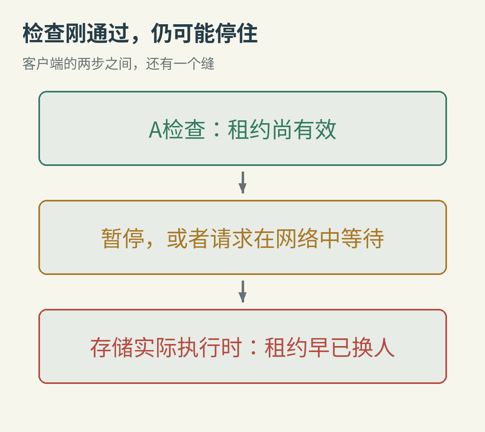

重要的不是“我调用写入函数时觉得几点了”，而是**这次写入在资源端真正生效时，是否仍应被接受**。

如果没有额外的可靠时间上界、协议约束和资源端配合，客户端检查不能独自填平这个缝。把检查挪近一点，并没有把两个分开的动作变成一个动作。

## 4. 给每次交接一张不会倒退的号码牌

现在修改许可的样子。

A获得第41号许可。下一任B获得第42号。再下一任必须更大，比如43。数字不一定连续，但在同一个受保护范围内，每次新的所有权授予，都要得到比过去更大的代号。

这个代号通常称为**fencing token**。fence有围栏的意思：我们想让旧持有者的请求跨不过新一任已经建立的边界。


号码不是“当前时间”的别名，也不是随便抽一个很难撞上的字符串。

两张牌内容不同，只能说明它们不相等；接收方还需要知道哪张更晚。把随机字符串按字母排序，并不会凭空得到交接顺序。

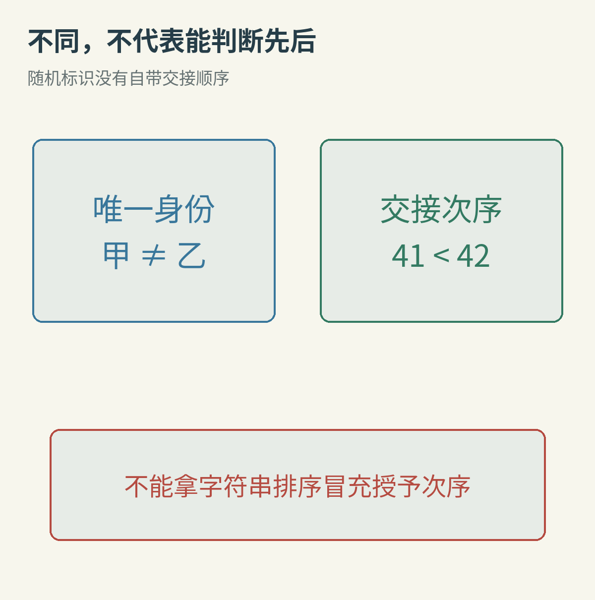

代号也不是密码。本文假设请求身份可信，客户端不会伪造一个任意大的号来冒充接班者；身份认证与授权要由真实系统另外保证。

本篇把“可靠发号”作为前提，不用一行内存加一冒充完成了它。发号服务发生故障、恢复或更换主节点后，代号仍不能倒退、不能给不同的持有者重用同一个号码；这本身就是需要认真设计的系统问题。

## 5. 围栏要放在存储那里

只把41或42写进A、B自己的日志，没有效果。存储必须知道它已经接受了哪一代。

为记分表增加一个字段，叫epoch，可以先理解成“当前已经登记的管理员代号”。

在我们的教学协议中，B拿到42以后，先到存储登记42。存储把当前代号从41提升到42，并确认登记完成。随后，B才读取最新分数、计算和写回。A以后带着41来写，存储当场拒绝。

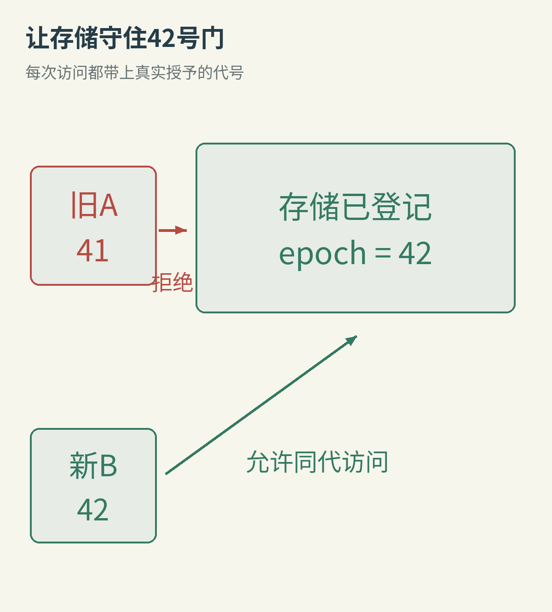

为什么专门把“登记”拆出来？因为我们想明确交接完成的位置。

锁服务发出了42，不代表存储已经知道42。**资源端完成登记，才是本例的保护边界。**

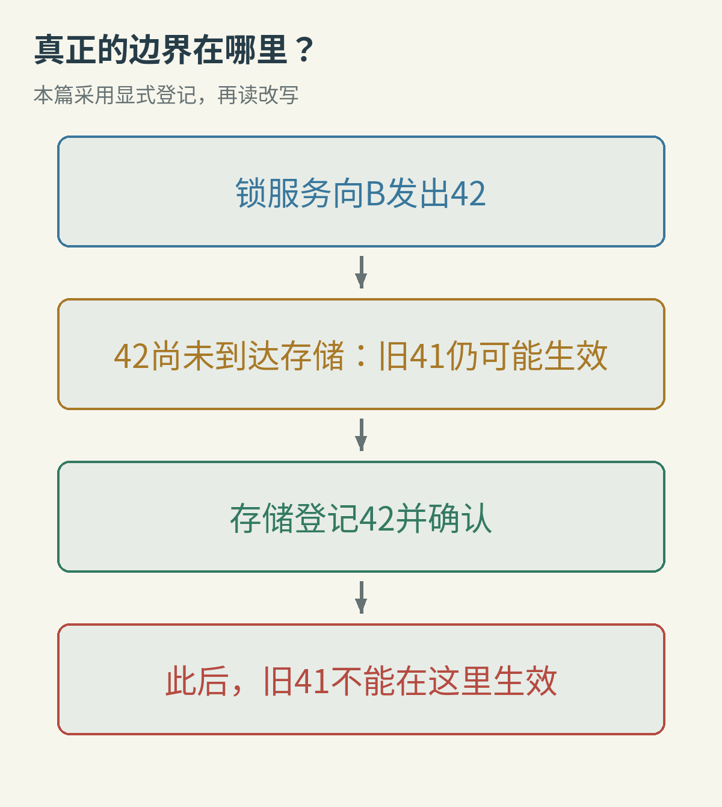

在42尚未到达存储之前，41的操作仍可能被存储接受。本例的围栏并不声称“租约到期的那个瞬间，世界上所有旧请求立刻失效”。它保证的是：一旦资源登记了42，后续操作不能再以41的身份在这里生效。

如果业务要求严格按真实时间撤销权限，那还需要额外的机制与假设，不能从一个递增整数里自动得到。

## 6. 重走那次记分事故

初始分数100。A已经登记41，读到100，准备加10。

A暂停。锁服务后来把新一任42交给B。

B先在存储登记42，再读100，加20，写120。A醒来后递交“41号，把分数写成110”。存储发现自己已经进入42，拒绝这次写入，分数保持120。

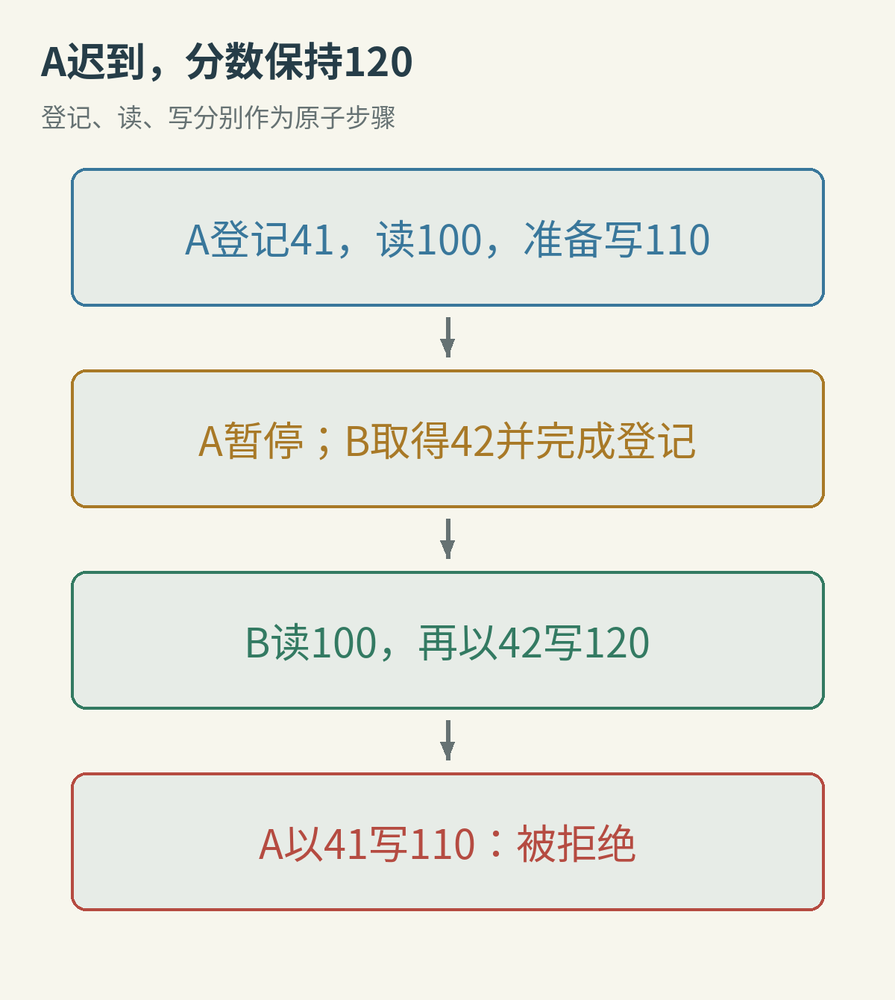

注意，我们没有神奇地把两项活动都计入130。A的那次工作被拒绝了，它需要按业务规则重新取得有效许可、重新读取、重新执行或报告失败。

围栏保护的是不让旧结果破坏已经完成的交接。它不自动保证每一份工作最终都完成，也不自动决定失败工作应该怎样补做。

Kleppmann给出的另一张原图展示了相同的核心：存储见过更高代号后，拒绝后来到达的低代号写入。


原图：Martin Kleppmann，*Using fencing tokens to make resource access safe*，2016，[CC BY 3.0](https://creativecommons.org/licenses/by/3.0/)；原文件未修改。图中使用33与34，本篇自设例子使用41与42；两者不是同一次实测。[原图所在文章](https://martin.kleppmann.com/2016/02/08/how-to-do-distributed-locking.html)

## 7. 为什么要先登记，再读取？

一个很容易漏掉的细节：B拿到42后，如果先偷偷读100，却还没让存储登记42，会怎样？

A可能在这个间隙合法地以41写入110。接着B登记42，把依据旧的100算出的120写入。

这时没有低代号越过围栏。最后仍丢掉了A已经成功写入的10分。

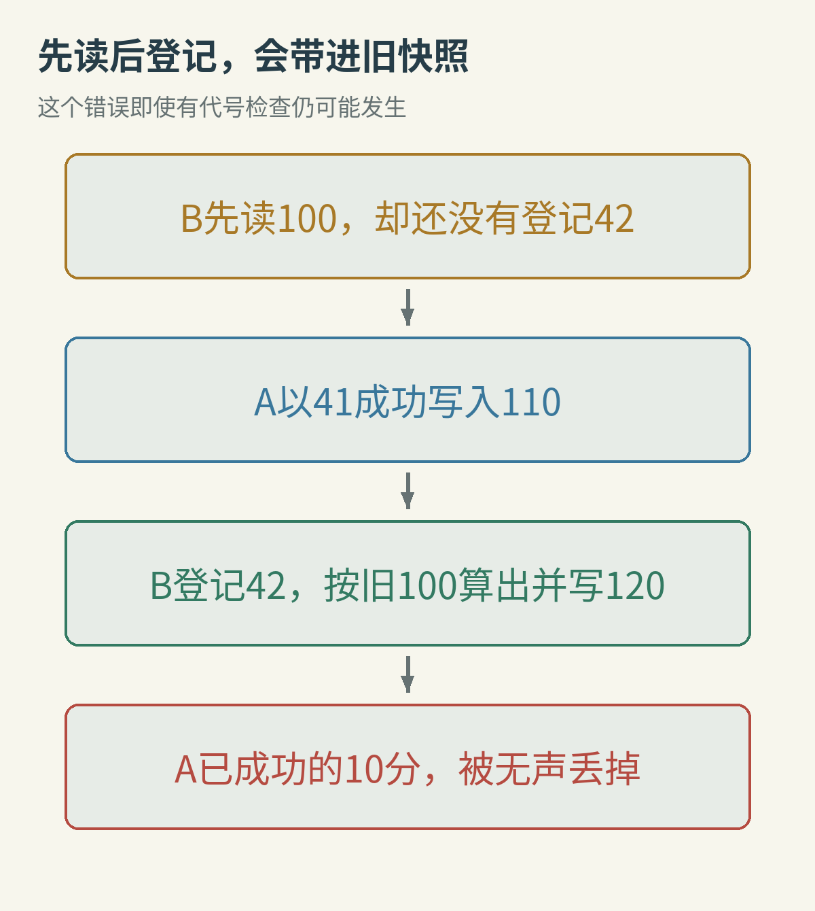

所以，针对这里的“读出数值，加一个数，再整体写回”协议，我们要求：**新持有者先让资源确认新代号，再读取要依赖的数据。**

如果A先于登记42完成了110，B随后读取110，算出130。若A晚于登记42才写，A被拒绝，B读100并写120。两种先后都能讲清楚，不能让一次本该成功保留的修改无声消失。

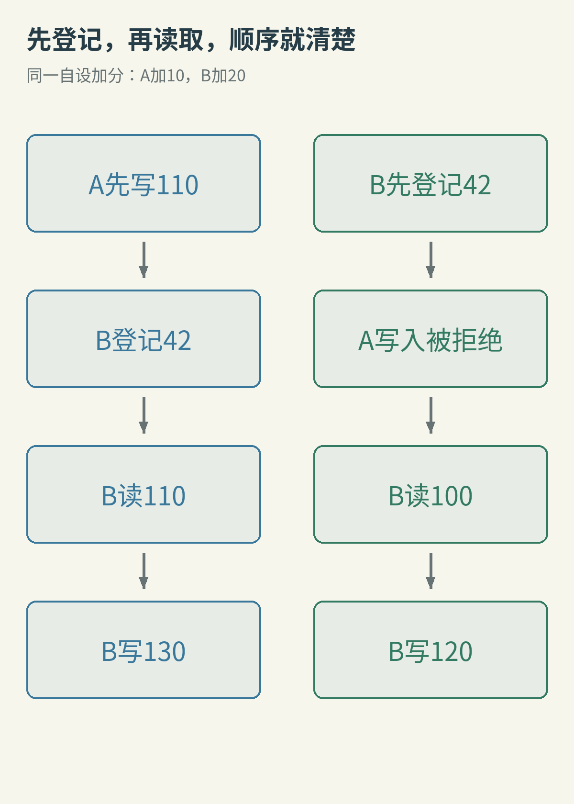

Flavio Junqueira在2016年2月10日的讨论里特别强调，把共享资源纳入交接过程，并在进行工作之前建立新的epoch。这里的三步实验正是为了把这个容易被一句“加个token”掩盖的条件摊开。[作者原文](https://fpjdotme.wordpress.com/2016/02/10/note-on-fencing-and-distributed-locks/)

## 8. 一小段代码，先把边界说清楚

下面的对象不是数据库。我们约定：每个方法调用都是资源端不可分割、已经可靠保存的一个动作。暂时没有线程、网络、文件或真实崩溃。

```python
class Resource:
    def __init__(self):
        self.epoch = 0
        self.value = 100

    def activate(self, token):
        if token < self.epoch:
            return False
        self.epoch = token
        return True

    def read(self, token):
        if token != self.epoch:
            return None
        return self.value

    def write(self, token, value):
        if token != self.epoch:
            return False
        self.value = value
        return True
```

activate允许相同代号重复登记，也允许更高代号接班；更小的被拒绝。登记之后，read和write要求恰好等于当前代号。

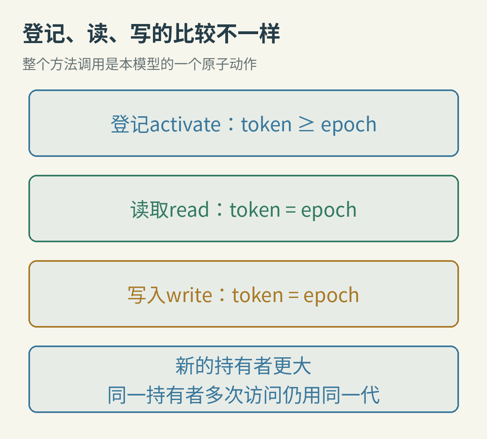

为什么不在write里直接接受所有大号码？那也可以成为另一种协议：把建立围栏和写入合在一个原子操作里。这里刻意拆成登记、读取、写入，是为了保障第7节那种依赖旧值的计算顺序，不让读发生在交接完成之前。

同一个持有者可以合法地做多次操作，因此不能不加解释地把每次写入都规定为“代号必须严格大于上一次”。**新一任的代号严格变大，与同一任每条命令都换代号，是两件事。**

现实API也需要分清这些语义。例如Hazelcast 5.5.0的FencedLock文档明确说明：同一线程重入获取返回相同token，完全释放后再次获取才进入更大的代号。我们没有运行该软件，也不把上面这个类称作它的实现。[固定版本API说明](https://docs.hazelcast.org/docs/5.5.0/javadoc/com/hazelcast/cp/lock/FencedLock.html)

## 9. 最后一道门，也不能先检查、后放行

还记得第3节那个缝吗？它在资源内部也可能重演。

如果存储先单独检查“41等于当前代号”，把结果暂存在内存里；随后另一请求把代号改成42并写入120；最后旧请求凭先前的检查结果直接写110，围栏还是漏了。

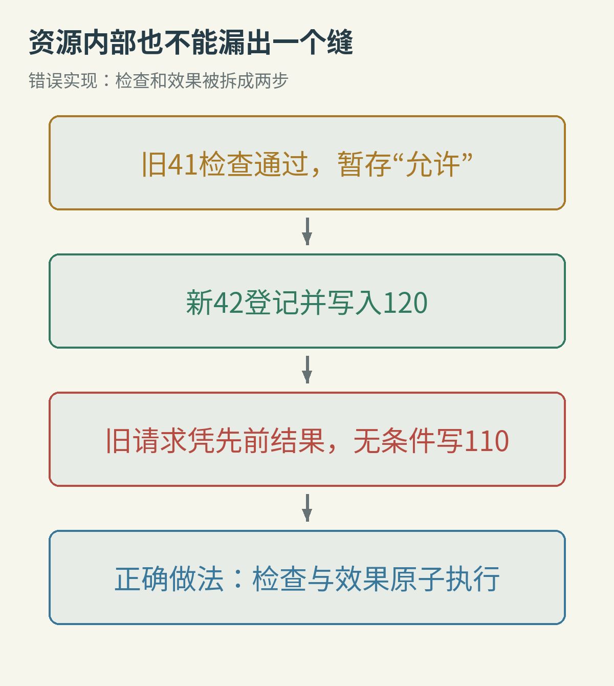

因此，本例要求“检查代号”和“改变数据”是同一个原子操作。所谓原子，就是并发操作不能从它们中间插进来，造成检查针对旧状态、效果作用于新状态的错配。

在真实系统里，这可能依赖一个合适的事务、条件更新或其他已经证明满足所需语义的资源端接口。仅仅在应用层先查一遍再发送无条件写入，不满足本例的假设。

我们的小程序是单线程状态模型，所以把每个方法直接当成一个步骤。它没有替你实现持久化、隔离或多副本一致性。

## 10. 重启后，谁还记得42？

假设存储已经登记42、保存120，然后重启。它恢复了120，却把当前代号忘成0。

旧A带着41来登记，41大于0，居然又成功了。随后110再次覆盖120。

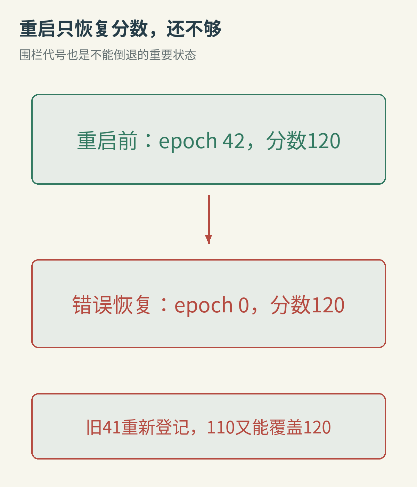

这说明围栏本身也是重要状态。对本文承诺的保证而言，资源重启后的代号不能回退；判断请求与保存效果所依赖的状态，需要满足明确的可靠保存和恢复语义。

发号端也一样。如果它重启后把“下一任”重新发成41，新旧持有者拿同一个数字，存储怎么区分？

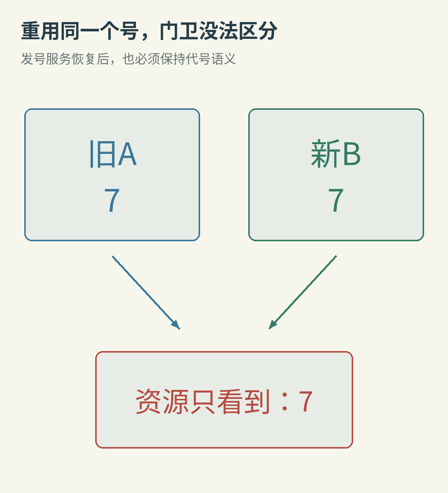

真正的工程问题还包括：资源删除后重建，旧请求会不会打到同名新资源？代号的比较范围是什么？计数器会不会耗尽？备份恢复到旧状态怎么办？

本文只研究身份固定的一份资源，假定代号没有回绕且不重用。它不是把这些问题解决了，而是把它们从一个含糊的“token够大就行”拆成明确前提。

## 11. 有了代号，为什么同一任仍能写乱？

42号持有者先发命令甲“写110”，再发命令乙“写120”。如果网络让乙先到，甲后到，两条请求的代号都是42。

围栏不会拒绝甲。最后可能回到110。

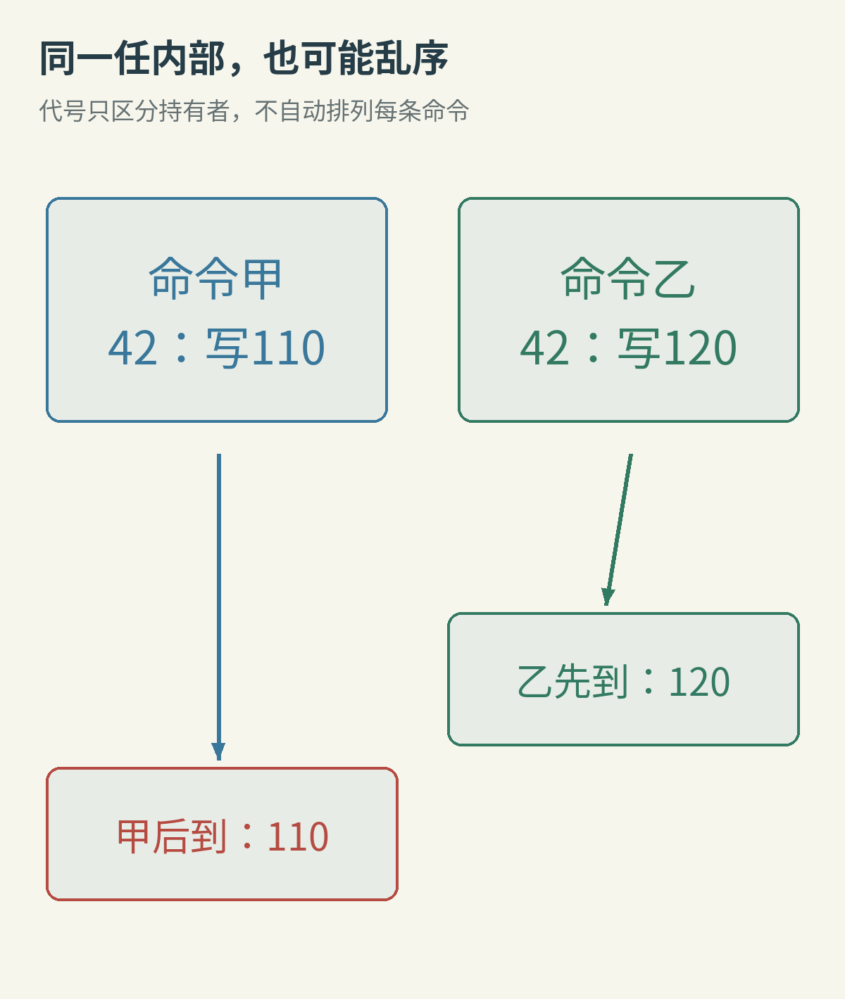

这不是围栏失效，而是我们要求了它没有承诺的事情。它区分的是旧持有者和新持有者，不是自动安排同一持有者所有命令的顺序。

如果业务需要同代命令的顺序，可以再设计操作序号或版本前置条件；如果同一请求可能重发，还需要考虑幂等或去重。

比如“把值设成120”重复做两遍，与“再加20”重复做两遍，效果就不一样。给同一次加分一个请求ID，并把“这个ID已处理”和加分效果一起可靠保存，才是另一种针对重试的保护。


这里只给出设计方向，不把三种数字混成一个“万能版本号”。配套实验单独演示了重复请求ID去重；它是附加机制，不是从围栏自动长出来的能力。

## 12. 不猜所有时序，让小程序逐个排一排

两位管理员，每人依次做“登记、读取、写入”三件事。各自内部不能颠倒，但不同管理员之间可以交错。

一种顺序是A登记、A读、A写，然后B全做完。另一种是A登记、A读，B做完三步，最后A才写。还可以有更多。

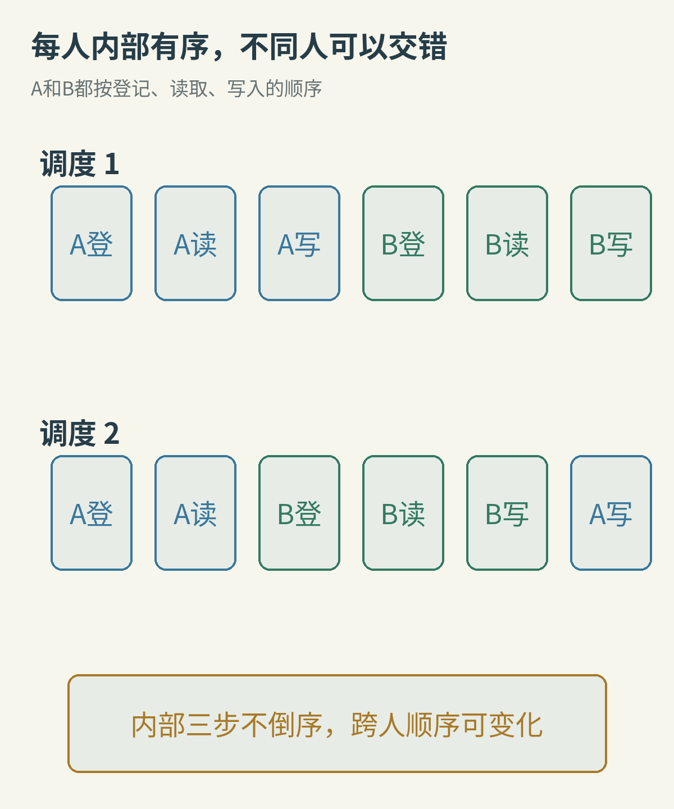

配套程序枚举这些交错。一人有1种，两人20种，三人1680种。每个人的加分量再分别取−2、0、3，连减分、无变化都一起测。

我在本地实际运行了总共45543条完整调度，检查409329个原子步骤。每一步都核两件事：资源代号不下降；当前数值等于初始100加上所有实际接受的写入所对应的增量。


为什么这个数值检查有意思？它不要求所有工作都成功。被围栏拒绝的操作不能偷偷算进去；已经成功接受的加分，也不能在后面被旧快照无声抹掉。

这里每一任只做一次读改写；先登记再读；读写都检查同代；代号预先可信且严格递增。离开这些条件，不能直接搬用这次结果。

程序还枚举了4096条长度为6的登记请求序列，号码可重复、可往回走，逐步核“当前代号等于已经见过的最大代号”。这是有限模型的验证，不是任意生产系统的证明，更不是吞吐量测试。[完整代码与实验范围](examples/README.md)

## 13. 当资源是一台打印机，或散在多台服务器上

记分表能改，是因为我们控制了接收请求的资源接口。

如果旧程序要做的是把一张纸打印出来，而打印机根本不检查代号，给请求贴42并不会自己出现围栏。一个只在上游检查、随后把普通请求放进不受控队列的网关，也可能留下相同的延迟缝。

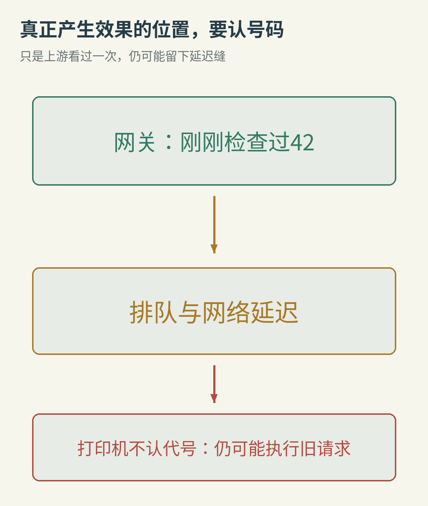

同样，如果数据分散在两个独立接收点，只在其中一个登记42，另一个还可能接受41。真实系统需要对资源范围、故障、复制与切换作完整设计，不能把“某一台机器已记录42”当作所有机器都已隔离旧持有者。

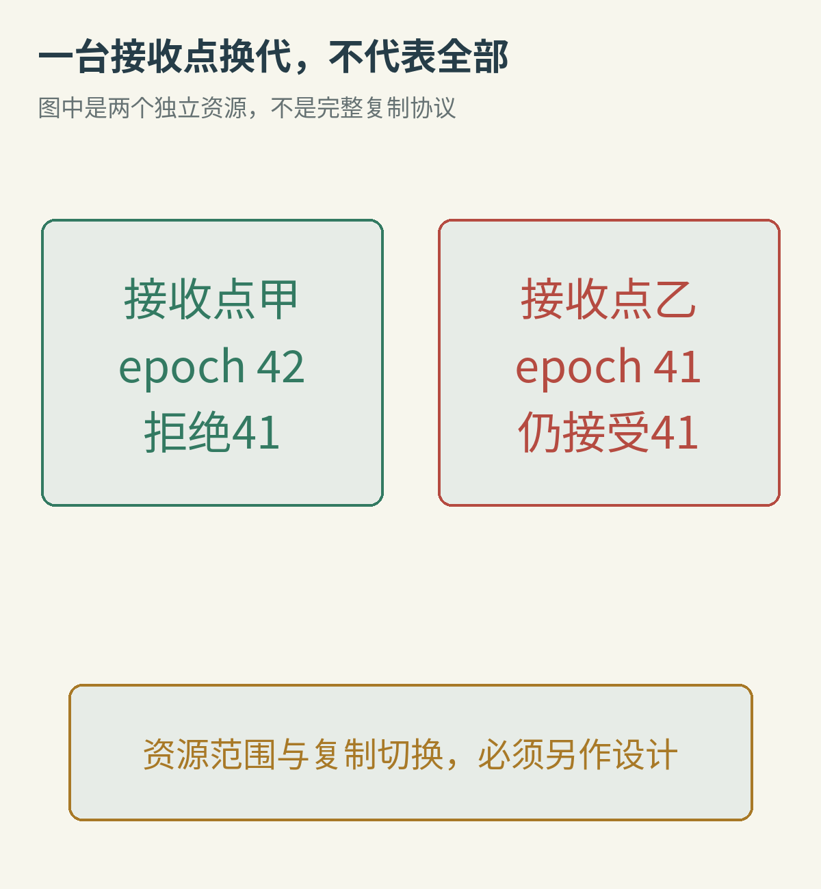

这也是为什么一个短小比较式可以解释核心，却不能替代整个系统设计。它依赖可信发号、正确资源身份、全部受保护访问经过检查、原子执行，以及不倒退的恢复。

## 14. 最后做三道小实验

第一题：A持有41，新B已经从锁服务拿到42，但存储还没见过42。此时A的写入一定被拒绝吗？

不一定。本文的保护从资源登记42开始，不从发号服务产生42那一刻凭空开始。

第二题：存储已经是42，先接受同代“写120”，再收到同代“写110”。围栏是否一定拒绝第二条？

不会。它需要额外的同代顺序或版本机制。

第三题：B先登记42再读取。这时A以41写入110，与B的登记，谁先真正完成，会怎样影响结果？

A先写成功，B会读到110，最后130；B先登记成功，A被拒绝，B从100写到120。读写模型把两种合法情况分开了。


下面动画取自实验的8个实际状态。租约到期只是情境事件，没有模拟真实计时；最后一帧的拒绝来自资源代号比较。


分布式系统里，有时最危险的程序不是坏掉的那个，而是**已经被接替，却还在认真完成旧工作的那个**。

我们无法靠一句“你已经过期”让它瞬间停止。但可以让真正保管资源的地方记住：已经交接到哪一任。

下一次看到“先加一把分布式锁就好了”，不妨多问一句：**旧持有者迟到时，究竟由谁挡住它？那道检查和真正的效果，是不是同一个可靠动作？**
