# 队伍有多长，等待有多久？Little 定律把两本账变成同一张图

一个领取资料的地方，十分钟来了五个人。

有人两分钟就走，有人待了五分钟。你站在门口数人数，里面有时一个人，有时三个；他们各自在手机上看时间，又留下五个不同的停留时长。

这两本账，一本“此刻有几个人”，一本“每个人待多久”，看起来不像同一种东西。

可它们能拼出一个很简洁的等式：

**平均在场人数 = 平均进入速率 × 平均停留时间。**

左边说的是“现在有多少人在”，右边说的是“人来得有多快、待得有多久”。两个完全不同方向的问题，被同一个数字连了起来。


这就是Little定律最容易握住的入口。它能帮助理解排队，也能帮助程序员检查请求并发数、吞吐率和平均延迟是否对得上。

麻烦在于，三个“平均”各有各的算法，混用就会出错。与其先把公式背下来，不如用五条自己设定的记录，把它一步步数出来。

## 1. 先画一个边界，才知道自己在数什么

我们把领取点的等候区和办理区一起圈起来。

人跨进这个圈，开始计时；拿完资料跨出去，停止计时。只要还在圈里，不论正在等还是正在办理，都算一个在场的人。

圈定边界听起来是准备工作，其实是这道题里最容易出错的一步。同一个系统，边界往外挪一米，答案就换一个。

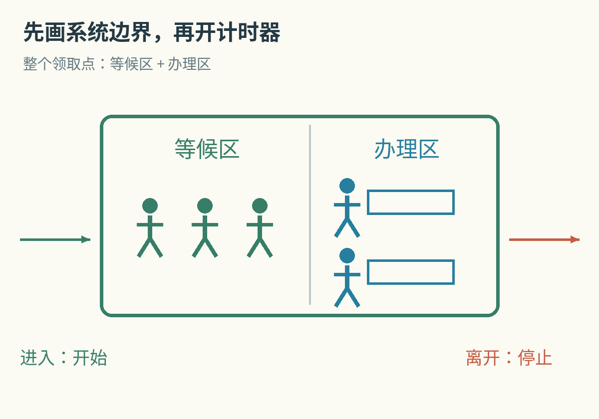

边界划在哪里，直接决定算出来的是什么。如果人数只数排队的人，时间却包含办理时间，两本账从第一笔就对不上。

下面是人为设置的五个人，单位都是分钟：

- 甲：0进入，4离开，停留4；
- 乙：1进入，3离开，停留2；
- 丙：2进入，7离开，停留5；
- 丁：4进入，6离开，停留2；
- 戊：6进入，10离开，停留4。

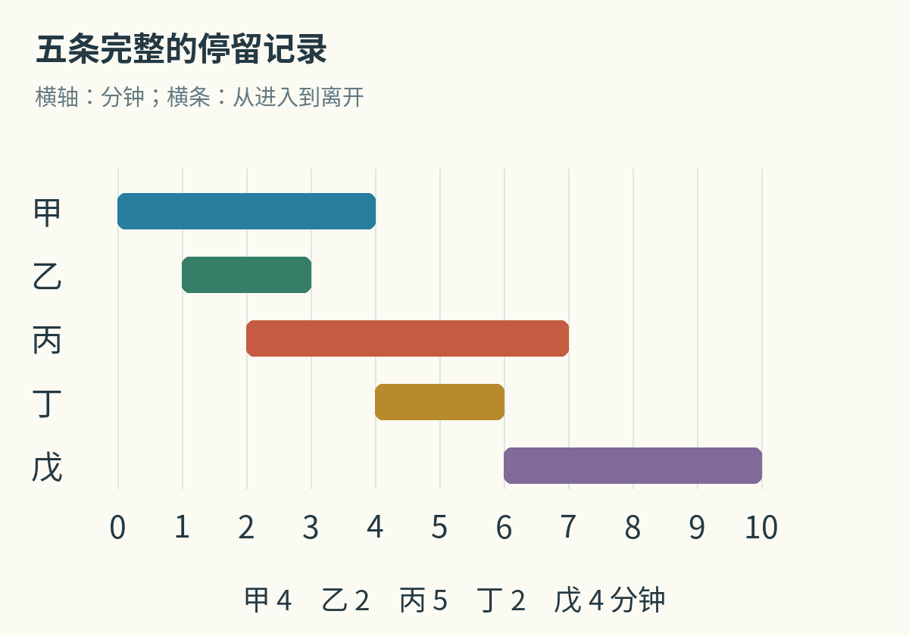

没有人从观察窗口开始以前一直待进来，也没有人到结束以后才走。五段完整停留都落在0到10分钟之内。甲比乙先来，却比乙后走；我们没有假设所有人必须先来先离开。

这组数字是我们自己编的，好处是每一步都能手算。真实日志不会有这么整齐，但同样的算法照样能用。

在进入或离开的那一个瞬间，人数可能同时跳变。约定“进入算在内，离开不再算在内”就够了；单独一个没有长度的时刻，不会增加任何人分钟。

## 2. 第一种数法：把每个人的时间加起来

给每个人画一条横条，从进入时刻画到离开时刻。

横条高1个人，宽是停留分钟数。于是，每一条的面积，就是这个人在这里贡献的“人分钟”。

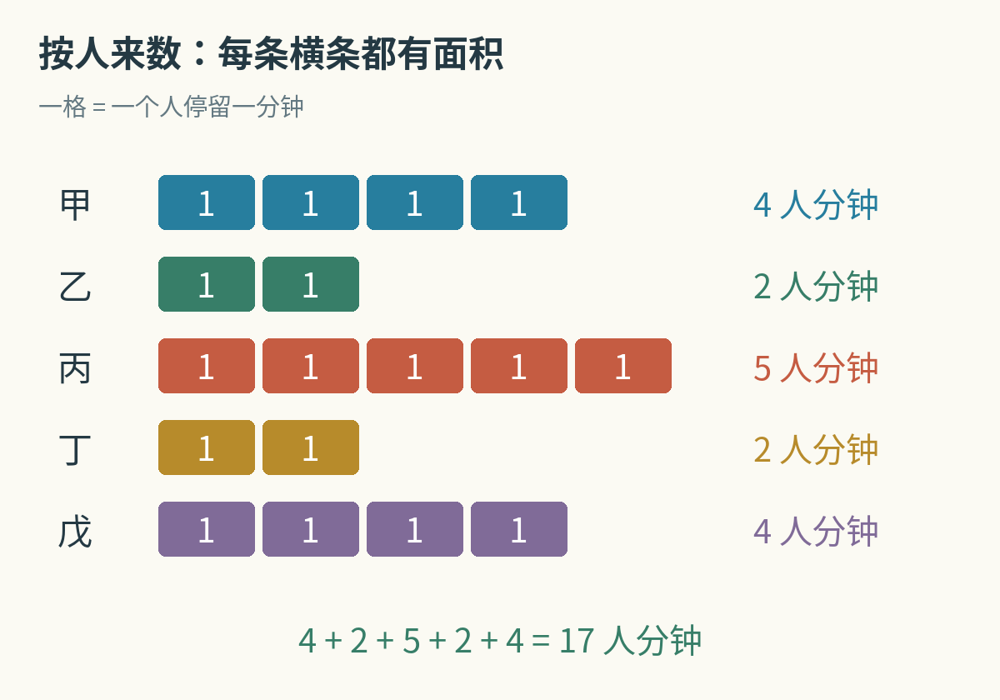

甲贡献4人分钟，乙贡献2，丙5，丁2，戊4。总共：

4 + 2 + 5 + 2 + 4 = 17人分钟。

“人分钟”听着有点陌生，其实很朴素：一个人待一分钟，记一格；两个人一起待一分钟，记两格。

就像三盏灯各亮两小时，一共是六灯小时，不是在说一盏灯真的亮了六小时。

单位本身不新鲜，只是把“人”和“时间”两样东西乘在了一起。任何“数量乘以持续时长”的量，都是这个形状。

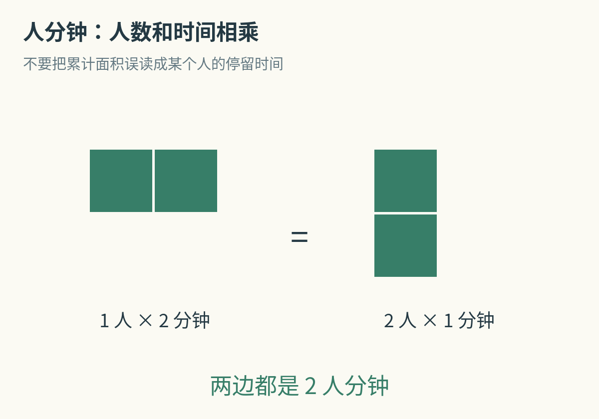

五个人总共贡献17人分钟，所以平均每人的停留时间，是17÷5=3.4分钟。

这个数字是整篇文章的支点。后面无论怎么换算法、换视角，都是在用不同方式重新数出这17。

注意，这里的平均是**对人平均**。每个人一票，把五个完整停留时长相加，再除以五。

## 3. 第二种数法：沿着时钟，数每一刻有几个人

现在把手指竖着放在时间轴上。

0到1分钟，只有甲，1个人；1到2分钟，多了乙，2个人；2到3分钟，丙也来了，变成3个人。

继续往后数，得到一条台阶线。

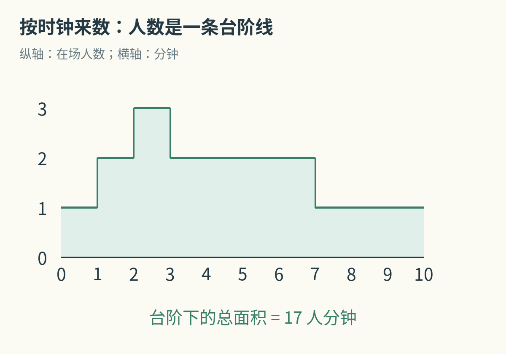

这条线下面的面积，也可以逐段算：

1×1 + 2×1 + 3×1 + 2×1 + 2×2 + 2×1 + 1×3 = 17人分钟。

4分钟时甲走、丁来，6分钟时丁走、戊来，人数没有改变，所以对应台阶可以连成一整段。

十分钟内积累了17人分钟，平均在场人数就是17÷10=1.7人。

17这个数没有变，变的只是我们除以谁。除以人数得到每个人的时间，除以时间得到每个时刻的人数。

这里的平均是**对时间平均**。不是随手拍几张照片再取平均；每一种人数持续多久，都应给它相应的权重。

两种平均长得像，含义完全不同：一个给每个人一票，一个给每一分钟一票。分不清这一点，后面的错位就无从检查。

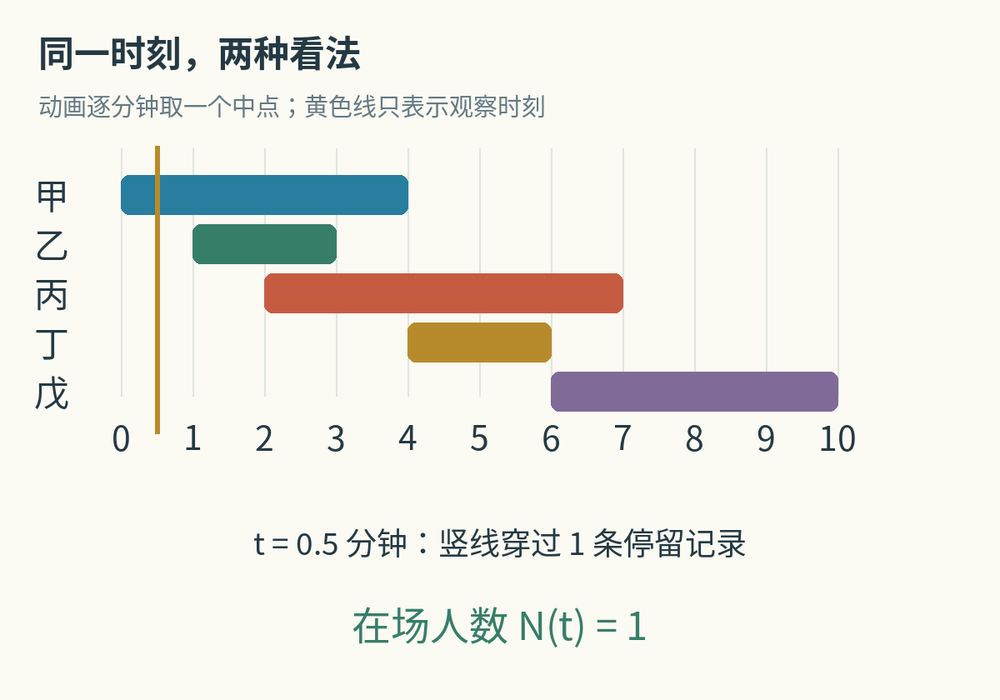

你可能已经看到了关键：我们没有发现两块“碰巧一样大”的面积。我们一直在数**同一批人占据的同一片时间**。

换个方向数，答案当然不能变。

换句话说，L和W不是两个独立的测量，它们是同一块面积的两个除法结果。这也是为什么它几乎不可能不成立。

## 4. 公式只是把同一块面积，拆成不同的除法

把三个量起个短名字。

L是平均在场人数，刚才算出1.7人。λ读作lambda，表示平均进入速率：五个人除以十分钟，等于0.5人/分钟。W是平均停留时间，等于3.4分钟。

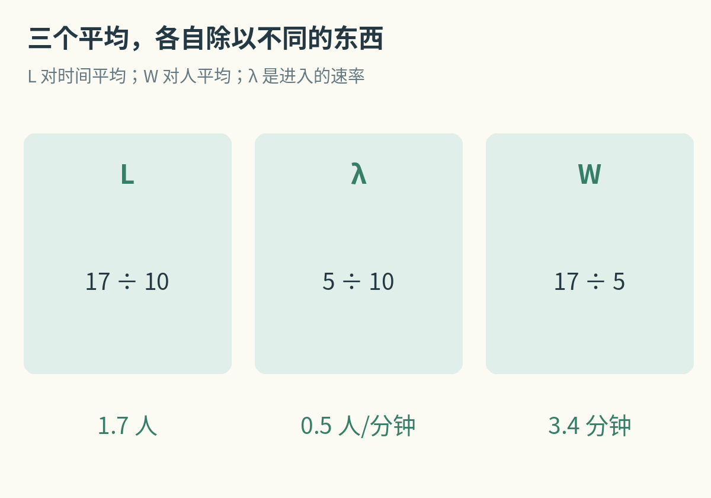

于是：

L = λ × W = 0.5 × 3.4 = 1.7。

为什么一定相等？把分数写出来就清楚了。

17/10 = (5/10) × (17/5)。

右边中间的5约掉，就回到左边。这个5不是凭空塞进去的，它是同一批人的数量。

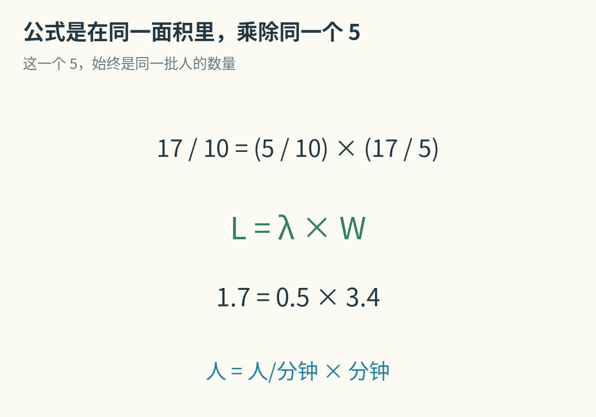

单位也能帮忙检查：人/分钟乘分钟，留下人。若你拿到的是每秒请求数，却乘上没有换算的毫秒，数字会错一千倍。

单位检查是这类公式最便宜的验算手段，几秒钟就能挡住大部分粗心。

这份十分钟的完整账，在这些边界条件下是精确相等的；不要求每分钟来一样多的人，不要求停留时间服从某种概率分布，也不要求只开一个窗口。

注意“精确”两个字。这里没有近似、没有大数定律、没有“样本足够多就差不多”。五个人的小账，等号是严格成立的。

## 5. 等候区与整个领取点，是两种不同的系统

现在再记一个时刻：每个人什么时候开始办理？

给五个人分别设成2、1、5、5、6分钟。这是一组多窗口的教学记录，不在推断某一种实际调度策略。

甲等2分钟，乙不等，丙等3分钟，丁等1分钟，戊不等。总等候时间是6人分钟；办理时间另有11人分钟，两者加起来仍是17。

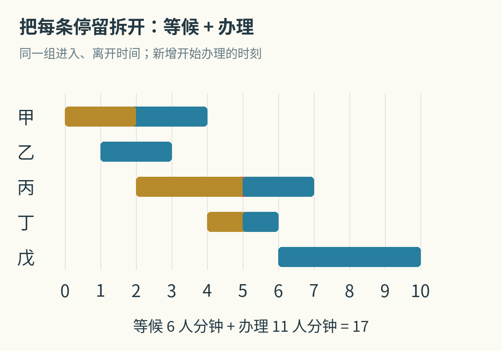

若只把等候区圈成系统：平均排队人数Lq=6÷10=0.6人，平均等候时间Wq=6÷5=1.2分钟。

此例五人都属于同一批进入对象，立即办理的人以零等候计入，所以仍有0.5×1.2=0.6。

两个圈套出来的数字不是一回事，所以不能交叉搭配。要换边界，人数和时间必须一起换。

如果圈住整个领取点，就应回到1.7人和3.4分钟，不能用0.6去搭配3.4。

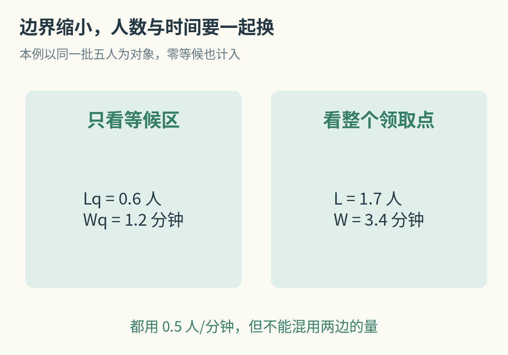

英文资料里waiting time有时指整个系统内的逗留，有时专指排队等待。遇到符号W时，先查边界和定义，比猜单词更可靠。

同一个符号在不同教材里可能指向不同的边界。看公式之前先确认边界，比事后怀疑数字可靠得多。

## 6. 后来的人先走，账为什么还是平的？

我们的甲0分钟进入、4分钟离开；乙1分钟进入、3分钟离开。乙后来先走，但17人分钟的两种数法并没有坏掉。

这件事比看上去重要。很多排队结论都依赖“先来先服务”，而Little定律不依赖。它只关心每个人在不在场，不关心谁排在谁前面。

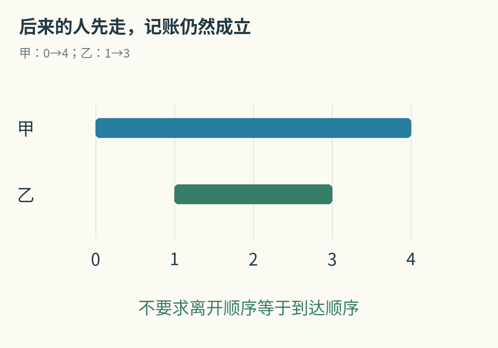

两种数法用到的信息，是“某个人在某一刻是否还在系统里”。谁先离开、谁后离开，从头到尾没有参与计算。

当然，不同的服务规则会给出不同的等待时间。先来先服务和优先级服务，算出来的W和L可以差很远。Little定律说的是这些量之间必须满足的关系，它没有说各种规则下的体验一样。

## 7. 只截取中间五分钟，为什么会算出两个答案？

现实里的日志很少这么配合：不一定等到系统空掉才开始记，也不一定等到所有请求都完成才停。

一旦窗口和停留区间不重合，账本里就同时混进了两类残缺记录：开始于窗口之前的，和结束于窗口之后的。

换一组记录：甲在−2分钟进入、2分钟离开；乙1进入、4离开；丙4进入、8离开。我们只观察0到5分钟。

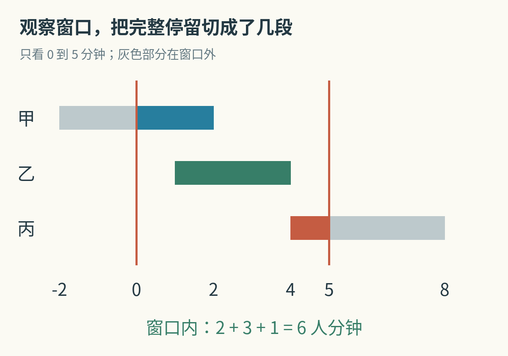

在这个窗口里，甲贡献2分钟，乙3分钟，丙1分钟，合计6人分钟。因此平均在场人数是6÷5=1.2人。

如果只数窗口内的新到达，只有乙、丙两人，速率是2÷5=0.4人/分钟。再把他们的**完整**停留3、4分钟取平均，得到3.5分钟。相乘却是1.4人。

定律失灵了吗？

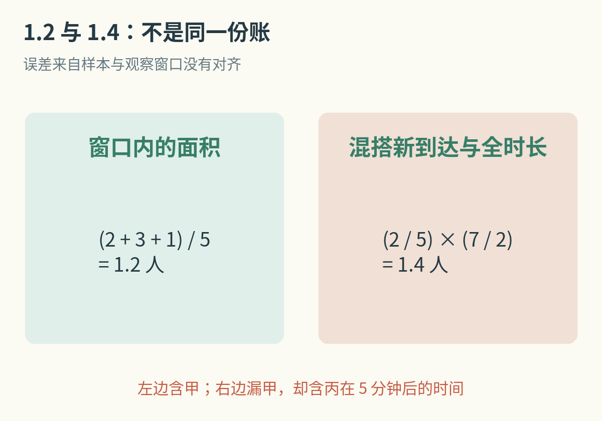

没有。我们混了两份口径不同的账：人数面积里算了甲在窗口内的那一段，却没算丙在窗口外的那一截；而两个“完整时长”正好反过来，把窗口外的部分算了进来、把窗口内的开头漏掉了。

处理有限窗口时，最稳妥的基础是：**每条停留记录只计算与观察窗口重叠的那一截，再把它们相加。**

这条规则朴素得近乎无聊，但它是有限窗口下唯一总能直接验证的做法。任何试图“把账凑平”的替代口径，都会在某个例子上翻车。

本例就是2+3+1。这条面积恒等式总能直接检查，不需要为了让等式好看，悄悄把“进入速率”改成别的定义。

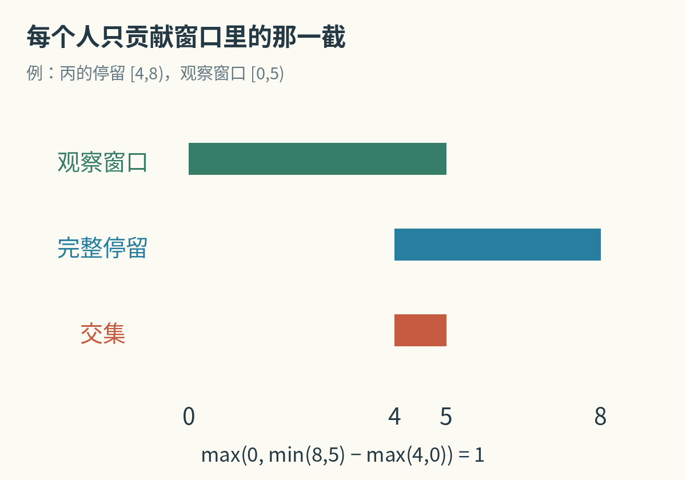

若希望讨论长期平均，则需要进一步说明平均数是否存在、是否有限，以及边界残余是否得到合适处理。“观测很久了”本身，不是一个自动通过的证明。

## 8. 一段直觉，与一个定理之间，还隔着什么？

Little是John D. C. Little。1961年，他发表《A Proof for the Queuing Formula: L=λW》。论文署名单位是Case Institute of Technology，而不是当时的MIT。

他的2011年回顾讲到一段起因：在Case教授排队课程时，他谈起这个经常出现的关系，学生Sid Hess追问一般情形下能否证明。Little随后着手研究。这里按本人回顾转述，不补写课堂对白，也不把一幅直观的面积图称为原论文的全部证明。


1961年的证明确实有条件，包括相关随机过程的严格平稳、均值有限，以及到达过程的遍历性条件。初读不必现在学完这些术语；先记住，它们是在控制“把观察延伸到无限长以后，平均数还能不能可靠地收敛”。

换句话说，定理保证的是长期行为，不是某一段日志上的巧合。

后来，Stidham的1974年论文给出样本路径方向的证明；可以从具体的到达和停留序列出发，在适当的有限极限条件下建立长期关系。不同证明版本的假设不一样，不能把它们拼成一句“Little定律完全没有条件”。

读论文时留意每个版本各自假设了什么，比记住结论更有用。

[Little的1961原论文](https://fisherp.scripts.mit.edu/wordpress/wp-content/uploads/2015/11/ContentServer.pdf)与[本人2011回顾](https://people.cs.umass.edu/~emery/classes/cmpsci691st/readings/OS/Littles-Law-50-Years-Later.pdf)都值得继续读。[MIT人物报道](https://news.mit.edu/2024/institute-professor-emeritus-john-little-dies-1009)可查看他在2005年办公室里的真实照片；该图标注非商业、禁止改编许可，本公开稿保留查看链接，不把它改标为本稿的CC BY 4.0。

这段历史真正值得琢磨的，是一个反复奏效的直觉如何被推进成一条能说清适用条件的结论。有人先注意到它总成立，再有人追问它在什么前提下成立。

## 9. 把人换成请求，先把秒和毫秒统一

下面的请求例子都假定满足前述长期平均条件，平均进入与完成离开的速率相同。我们把这个共同速率称为吞吐率；任意短时间窗口里的两个速率不一定相等。

假设一段匹配好边界的记录，平均每秒有50个请求进入，平均每个在系统里停留200毫秒，也就是0.2秒。

对应平均在途请求数为50×0.2=10。

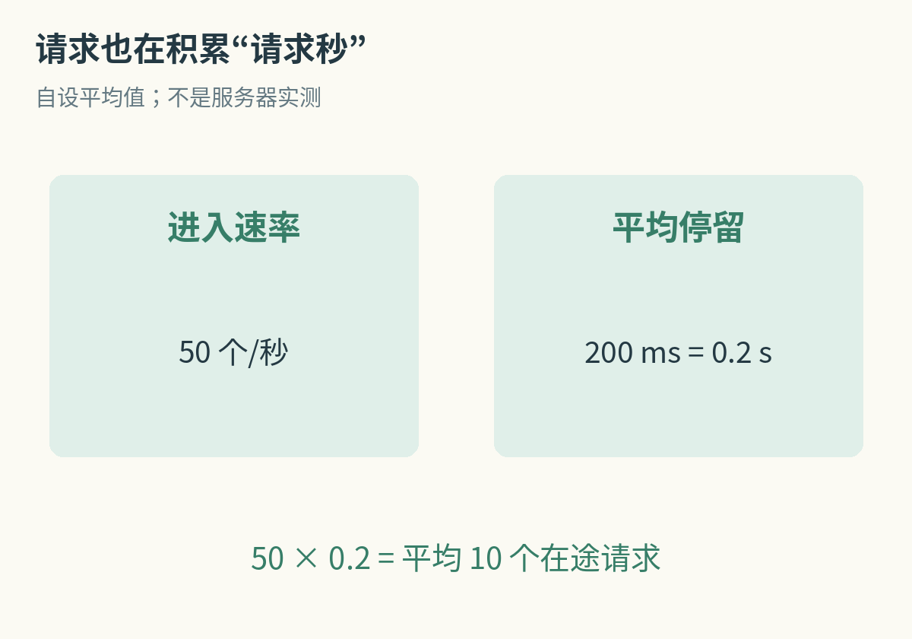

这里的“在途”包含你所圈定范围内的排队和处理。若测量只从线程开始执行计时，却把线程池队列里的请求也算进人数，口径仍然错了。

10是平均值，不是“永远恰好10个”，更不是“设置10个连接一定够用”。突发、资源限制和尾延迟，不能从这一个平均数里读出来。

它是一张对账单，不是一台预测机。

把10当成容量规划的目标，是这类公式最常见的误用。它描述的是已经发生的事实，不是应该设置多少。

## 10. 并发数翻倍，吞吐率就一定翻倍吗？

把等式变形，λ=L/W。

很容易产生一个诱人的推断：把L从10变成20，吞吐率不就从50变成100了吗？

只有当W仍保持0.2秒，而且其他条件允许这个运行点时，代数才给出100。可是增加拥挤可能让W也变。

而“W保持不变”恰恰是最不该假设的那一条：把并发调上去，往往正是因为系统已经变慢了。

比如另一个假设运行点是L=20、W=0.4秒，那么λ仍然是50/秒。

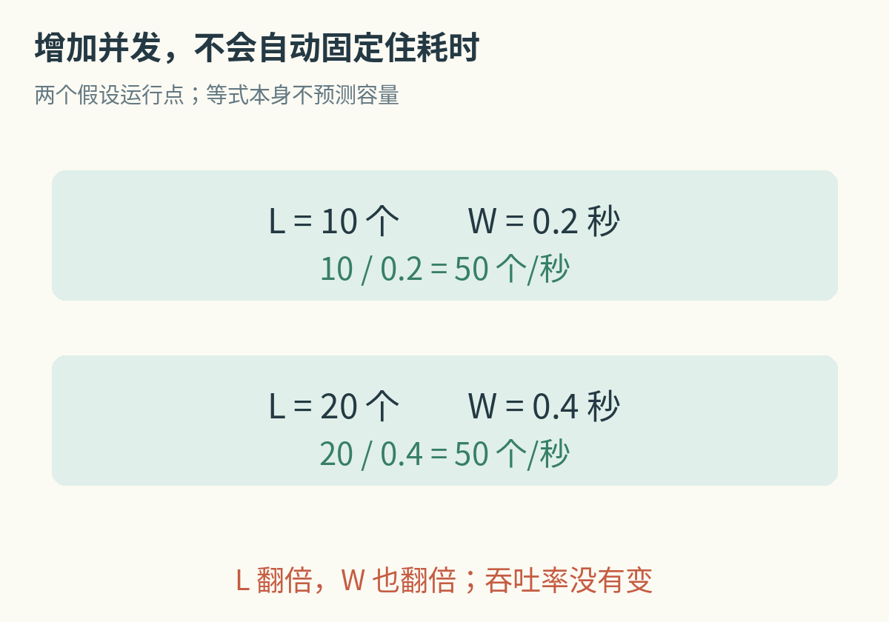

这个等式是一张一致性检查表，它不控制任何一个量。它告诉你三个测量彼此是否相容，却没法单凭它预测某台服务器能扛多少负载——那需要负载实验或者额外的系统模型。

## 11. 平均一样，尾部可以完全不同

看两组各100个请求的自设耗时，单位为秒。

第一组全部是2秒。第二组有98个1秒，另有2个51秒。两组总耗时都为200秒，平均都为2秒。

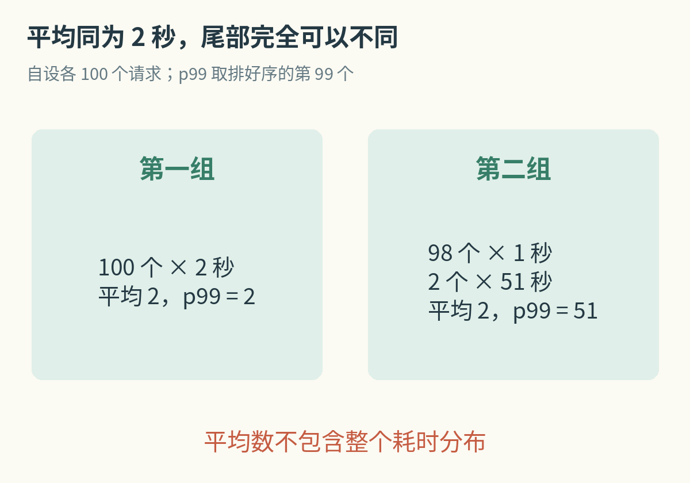

若在此明确约定：将100个数从小到大排，取第99个作为p99，那么第一组p99是2秒，第二组是51秒。

这两个p99相差二十五倍，而它们的平均数一模一样。

Little定律中的W是平均停留时间。把p99直接塞进L=λW，得到的通常不是平均在途数，也不是在途数的p99。

**一个平均数还原不出整份分布。** 这不是在贬低平均数，只是要给它安排合适的工作：看趋势可以，看最坏情况不行。

## 12. 来了100个，为什么有时只能用80个来算？

假设外面每秒发来100个请求，系统接纳80个，另有20个在我们圈定的入口外就被拒绝。接纳的请求平均停留0.125秒。

若人数只数系统内的请求，进入速率就应使用80/秒，于是L=80×0.125=10。

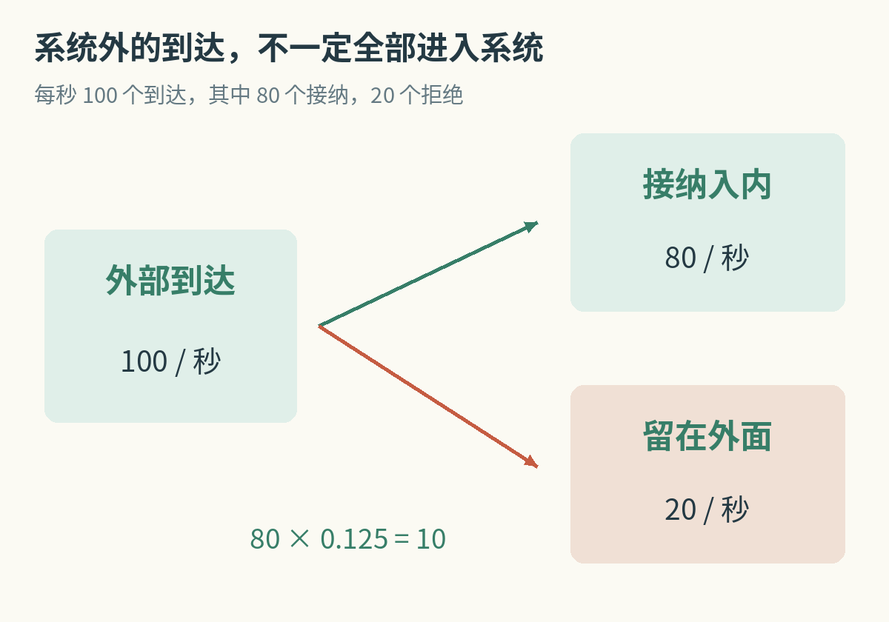

如果坚持把100个外部请求全部算作对象，那也必须配套地把那20个在系统内的停留时间记为0。这样全体对象的平均停留是0.1秒，100×0.1仍然得到10。

不能用100的总到达率，乘仅对80个接纳者统计的0.125秒。

取消、超时、重试也一样：先决定“一件东西”是用户的一次逻辑请求，还是每一次实际尝试，再为同一对象定义进入、离开和耗时。一次逻辑请求变成两次重试尝试，不能只在其中一张表里多算。

口径一旦定下来，就要贯穿到底，不能只在对自己有利的那张表里改定义。

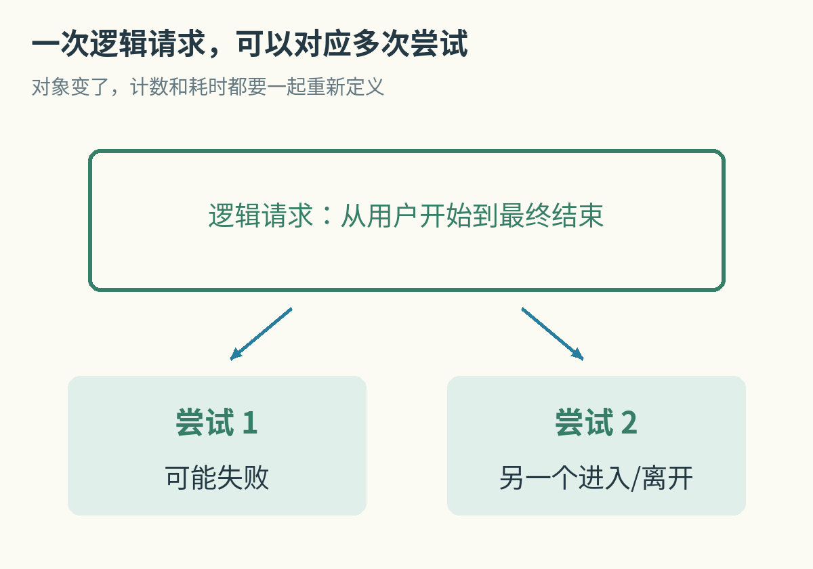

## 13. 用几行代码，检查自己的时间账

对一条进入a、离开b的记录，它在观察窗口start到end里的贡献，是：

max(0, min(b, end) − max(a, start))。

先取两段区间较晚的起点、较早的终点；没有交集时，贡献就是0。

```python
def person_time(jobs, start, end):
    return sum(
        max(0, min(end, leave) - max(start, enter))
        for enter, leave in jobs
    )

jobs = [(0, 4), (1, 3), (2, 7), (4, 6), (6, 10)]
area = person_time(jobs, 0, 10)
print(area, area / 10)  # 17, 1.7
```

[配套实验](examples/customer_time.py)还用另一种方法独立算面积：在每个进入或离开事件处切开时间轴，在小段中间数人数，再乘小段长度。两种计算对10000组固定种子生成的有限记录，实际全部一致。


这里检验的是程序和有限区间算术，没有模拟真实领取点，也没有靠随机测试证明所有长期过程都收敛。

你可以再做一个不用电脑的实验：拿五条纸带，画出开头那五人的区间。先按人剪成小格数一次，再按分钟竖着数一次。同样的17格，会让那个公式从字母变成可触摸的东西。

## 14. 最后一问：把整个故事放慢两倍

仍然是同样五个人，但所有进入和离开时刻都乘2，观察窗口也从10分钟变成20分钟。

平均停留时间会变成多少？进入速率呢？平均在场人数会不会也翻倍？

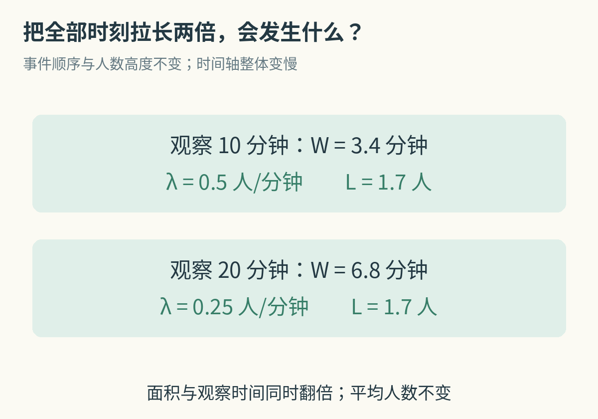

答案是：平均停留变成6.8分钟，进入速率变成0.25人/分钟，而平均在场人数仍是1.7人。面积从17变成34人分钟，但观察时间也翻倍了。

这个小问题提醒我们：多、快、久，是三个不同方向的描述。看到一条长队，不能只凭这一眼判断它是流量大，还是人待得久；看见延迟上升，也要检查同一边界里的在途数量和实际通过速率。

Little定律最有用的地方，往往是让你停下来问：

**我正在把哪一群人的哪一段时间，和哪一个窗口里的哪一种人数，放在一起比较？**
