# 既想快点回家，又不想每一步动太猛，机器怎样做取舍？

有个游戏角色站在目标右边4格。你只能一拍一拍地指挥它：下一拍往左或往右挪多少格。

最痛快的当然是猛地左移4格，一步到位。但“猛”是要付账的——动作越大，扣分越狠。那干脆不动？不动确实省下了动作分，可它永远站在4格开外。

我们给这一拍记两张账单：下一拍离目标还有多远（取平方），加上这次挪了多少（也取平方）。

- 不动：距离4，动作0，扣分16。
- 一口气左移4格：距离0，动作4，扣分16。
- 只左移2格：距离2，动作2，扣分8。

两个看上去最干脆的选项打了个平手，而且都输给了中间那个。

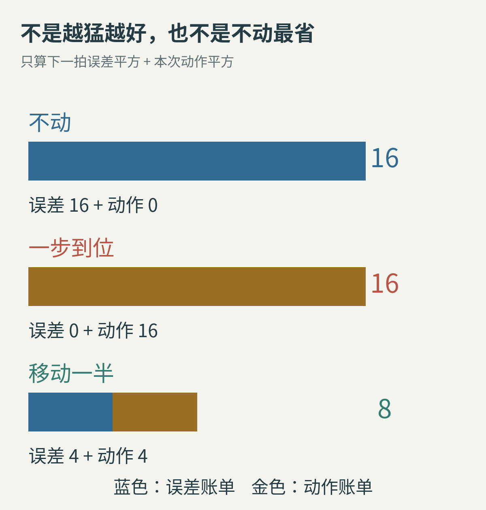

这篇文章要追的就是这件事：**如果还剩好几步，怎么既顾眼前、又顾后面，从一张取舍规则里算出一整套动作？**

答案之一叫LQR，Linear Quadratic Regulator，线性二次调节器。名字先放一边。我们拿一条数轴和几个平方，亲手把它倒推出来，看看它为什么最后长成一条反馈规则。

## 1. 先把这个小世界说清楚

把目标放在0。角色在右边时，位置误差x为正；在左边，x为负。指令u为正表示右移，为负表示左移。

每一拍的模型只有一行：

**下一拍的误差 = 这一拍的误差 + 这一拍的移动指令。**

写成短式就是x(k+1)=x(k)+u(k)，k只是第几拍的编号。

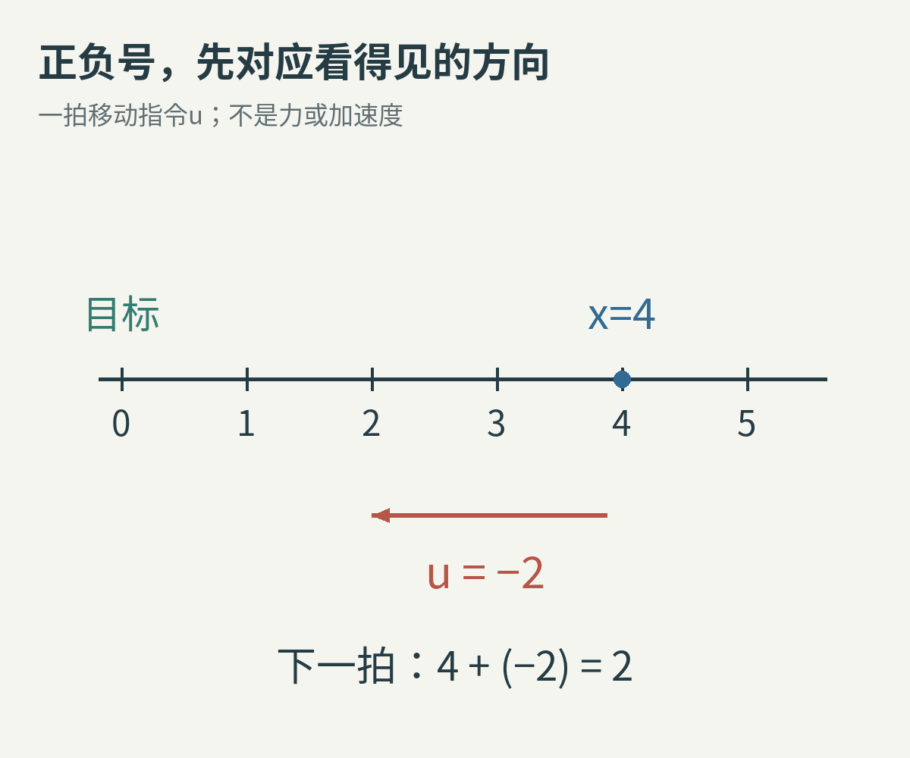

一格是我们自己选的参考长度，x和u都用它归一化。要留神u的含义：它是“这一拍想移动多少格”，跟电机的力不是一回事，跟加速度也不是一回事。这个模型还假定指令能在一拍之内做完，没有惯性，没有障碍，也没有速度上限。

真实小车当然比这复杂得多。先把这些困难放在门外，只为了单独看清“取舍怎样变成公式”这一件事。本篇所有轨迹都来自教学模型，不是实车实验。

如果你读过本系列讲可控性的那篇，会记得那里的小车用位置和速度两项状态、拿加速度当输入。这里是一维模型，是另一套明确简化过的系统。两篇的输入单位不能混着用。

## 2. 为什么要平方？谁决定扣多少分？

先说平方。它有几个顺手的好处。

向左偏2格和向右偏2格，扣分都是4；偏到4格，扣分变成16，比偏2格严重得多。大动作同样会被更重地记账。而且平方曲线是光滑的，找最低点时不会卡在尖角上。

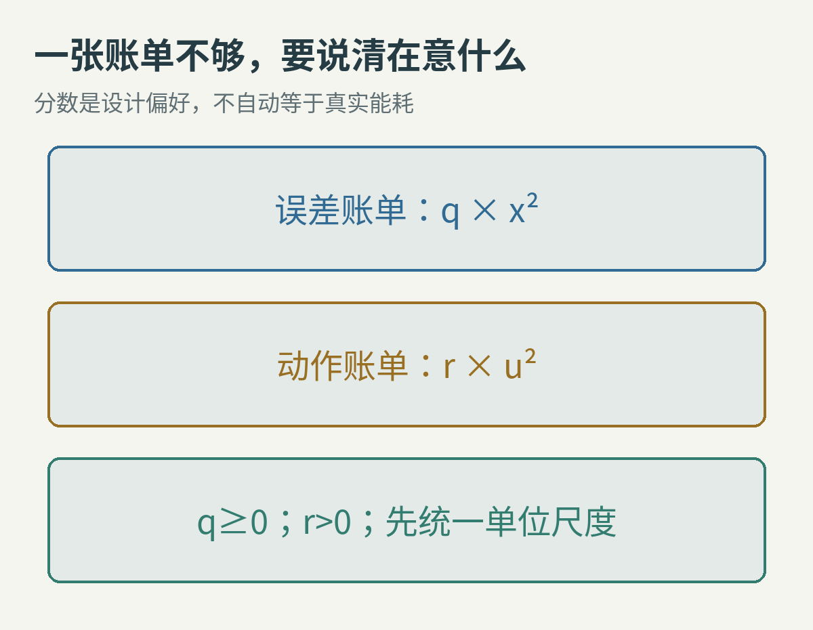

但平方并不是自然界颁布的唯一评分标准。你也可以在乎最大误差、总路程、动作变化的快慢，或者一条绝对不能越过的线。换一种在乎，就换一道优化题。

我们用两个非负权重q、r来表达在乎的程度：

**这一拍的成本 = q×x的平方 + r×u的平方。**

q越大，偏离目标越贵；r越大，动作幅度越贵。这里要求r严格大于0，好让任何非零动作都得付点代价；q可以取0。终点还能另外加一张账单，稍后再说。

这些分数是设计者写下的偏好，它并不自动等于焦耳、电费或者电机损耗。真要把位置、速度、电流混进同一个模型，权重还必须配合各自的单位和参考尺度。只把米改成厘米，却不跟着改权重，同一个物理问题就被你悄悄换成了另一份评分表。

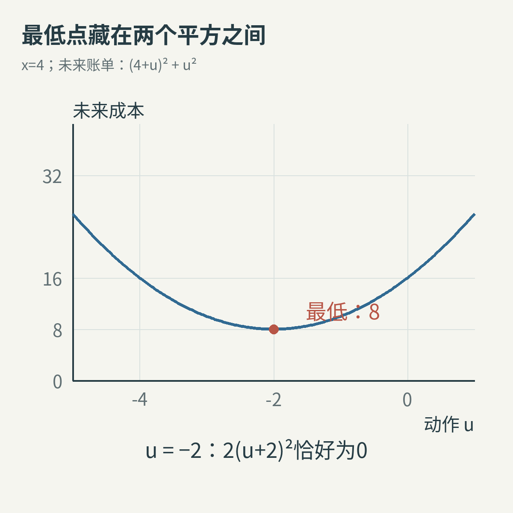

开头那道题其实不用微积分。

下一拍误差是4+u，未来误差加动作的账单是：

(4+u)²+u² = 2(u+2)²+8。

平方不可能小于0，所以u=−2时成本恰好最低，是8。这个最低点是能证明的，不靠“感觉上折中一下”。

## 3. 一篇老论文提醒我们：先说清“最优”指什么

1960年，Rudolf E. Kálmán的《Contributions to the Theory of Optimal Control》研究了线性系统的二次型调节问题，把状态描述、可控性、可观性、Riccati方程，以及解的存在性和稳定性条件连在了一起。[原论文](https://liberzon.csl.illinois.edu/teaching/kalman_paper.pdf)


*照片：ETH-Bibliothek Zürich，Bildarchiv；摄影者未知；HK_04-01925，2007-12-27；CC BY-SA 4.0。原图未修改，完整署名、来源和许可见[sources.md](sources.md)。这不是1960年写论文时的照片。*

论文里有一句话，比“算法会自动选出最好的一切”谨慎得多，也重要得多：研究完最优反馈之后，Kálmán专门指出，不能悄悄假定一个系统只要用了最优控制就必然稳定，成立条件还得另外检查。我们后面会亲手造一个“最优但不稳定”的例子，看看这句话在防什么。

Kálmán在署于1978年的回顾中，把这项工作描述为多种思想的结合；该回顾于1979年刊出。这段发展史不适合压成“某天突然想出一个万能系数”。另外，连续时间原论文的符号也不能直接搬来当下面的离散两步算例。[作者本人回顾](https://garfield.library.upenn.edu/classics1979/A1979HE37100001.pdf)


这一篇先只解决一个边界清楚的问题：模型已知，状态已知，还剩有限步，输入暂无限幅，给定二次成本，怎么让总成本最低？

## 4. 还有两步时，不能只算这一步

回到x=4的角色，这回让它移动两次。两次动作记作u0、u1，状态依次是x0、x1、x2。

- x0=4，已知的起点。
- x1=x0+u0，第一步之后。
- x2=x1+u1，第二步之后。

取q=r=1，终点权重也取1。总成本规定为：

**J = x0²+u0² + x1²+u1² + x2²。**

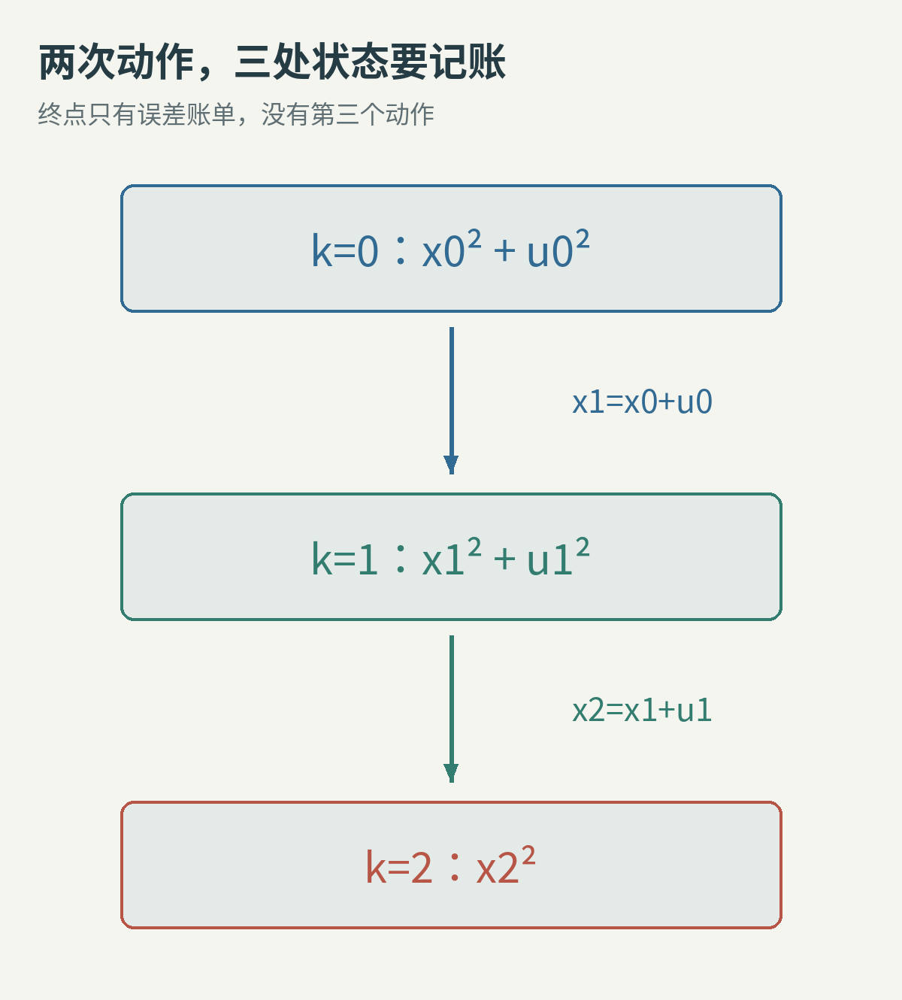

这条式子里每一项都有来历：开始时的误差、第一次动作、中途的误差、第二次动作、最后的误差。

x0²已经定死了，你怎么选动作都得付，它不影响最优选择，但算总账时仍在。x1、x2不一样，它们会被前面的动作改变，不能当成互不相干的数字。

最常见的偷懒办法是只看眼前的x0²+u0²。因为x0已经固定，最省的u0就是0。下一拍再这么想，又是0。角色当然永远回不了家。

所以关键不在于把局部最小化重复几遍，而在于把每一步对后面的影响算进去。

## 5. 先假装已经走到最后一步

从最后一步倒着想，事情反而简单起来。

假设第一步已经走完，当前误差是某个数x，我们还能选一次u，然后结束。剩下的账单是：

x²+u²+(x+u)²。

整理成平方：

**x²+u²+(x+u)² = 2(u+x/2)² + (3/2)x²。**

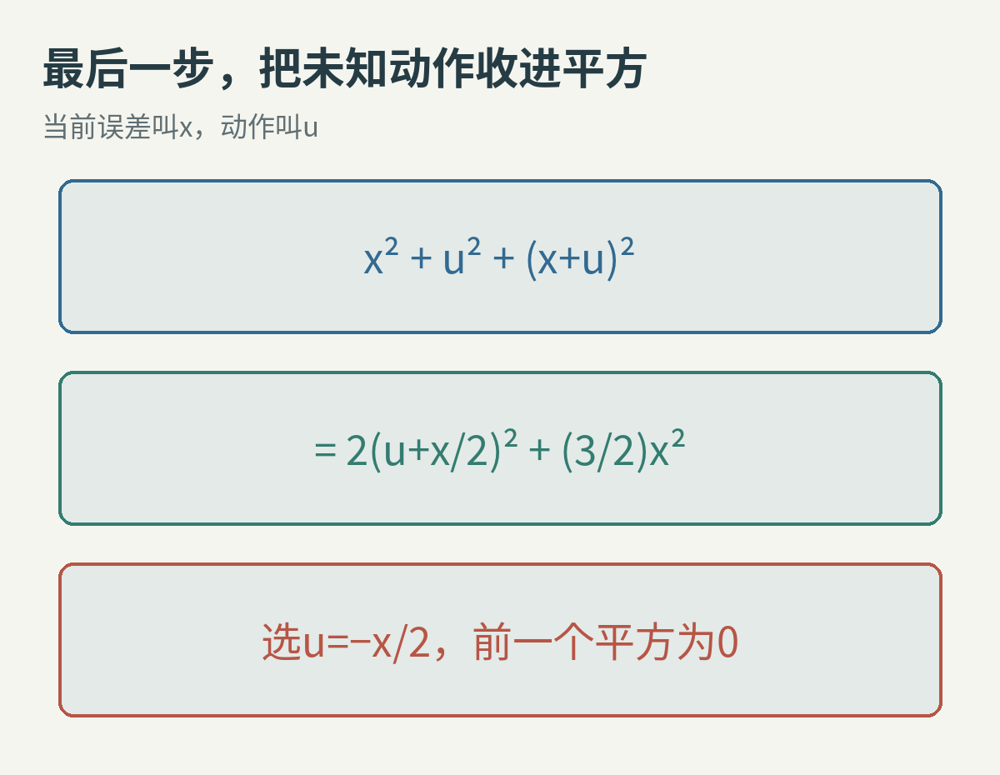

因此，不管最后一步开始时x是多少：

- 最合算的动作是u=−x/2。
- 从这里走到结束，最少还要付(3/2)x²。

第二条和第一条一样要紧。它把“后面还有一个动作要选”这团麻烦，压成了一张简单的价目表。

x=2时最少付6；x=4时最少付24；x=−2时仍然是6。

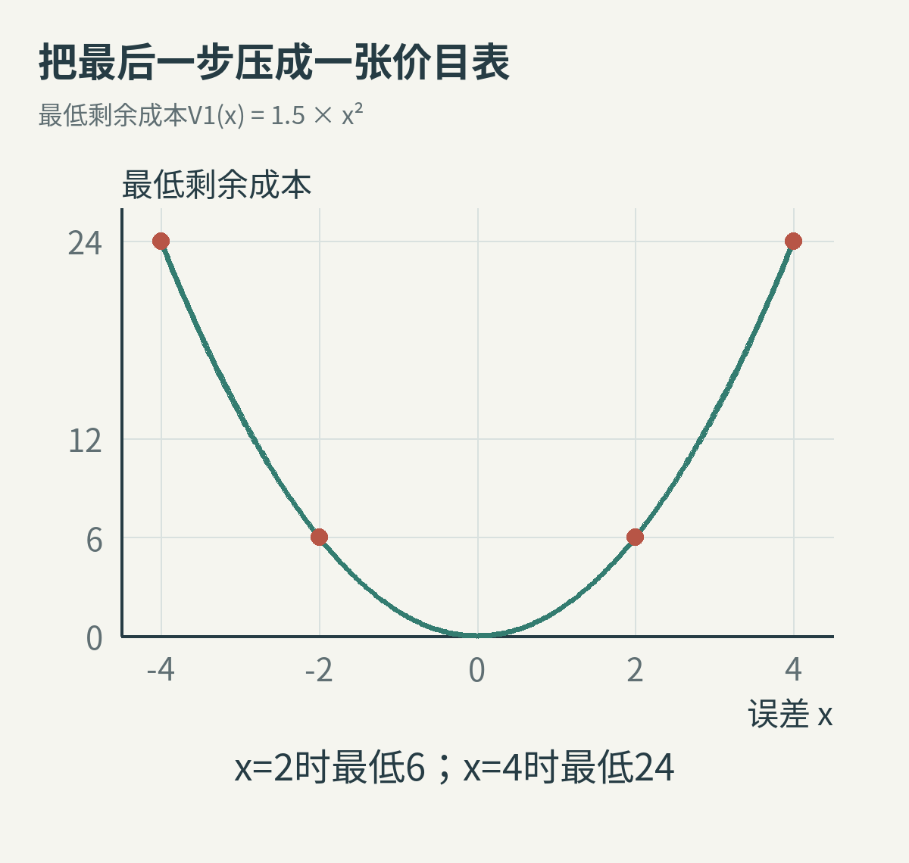

这张表叫价值函数，也叫最小剩余成本，这里记作V1(x)=(3/2)x²。它描述的是：从当前状态出发，后面都选好了的话，最低还要付多少。

它不是随手猜未来，也没有把未来略过。它是把最后一步优化完之后，交给前一步的一份精确摘要。

## 6. 带着这张价目表，退回第一步

现在回到开头。第一步选u0之后，角色落在x1=4+u0。

后面最少要付V1(x1)=(3/2)x1²，所以第一步只需要最小化：

16 + u0² + (3/2)(4+u0)²。

再配一次方：

**16+u0²+(3/2)(4+u0)² = (5/2)(u0+12/5)² + 128/5。**

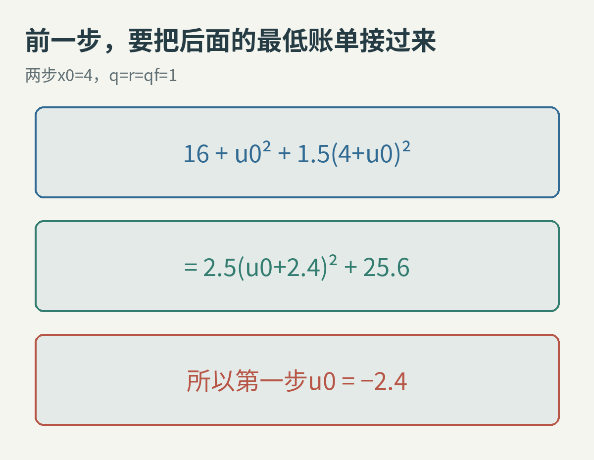

最低点出现在u0=−12/5，也就是−2.4。

于是：

- 第一步左移2.4，落到x1=1.6。
- 最后一步按刚才那条规则，左移x1的一半，也就是0.8。
- 最后停在x2=0.8，总成本25.6。

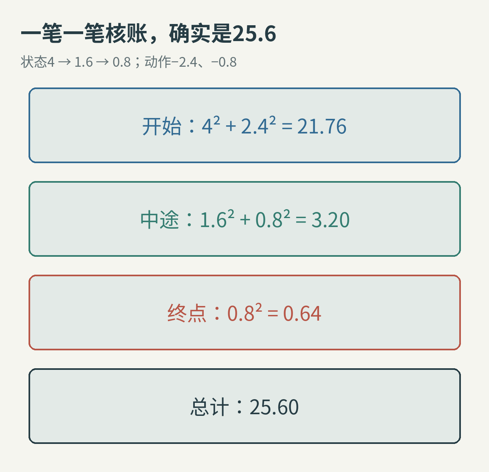

你可以亲手核一遍账：

16+5.76+2.56+0.64+0.64=25.6。

对比一下：第一步就左移4格、后面不动，总成本是32；两步都不动，总成本是48。最优方案并没有最快到达0，却在这份评分里赢了。

这也顺手回答了一个很容易误解的问题：**有限步LQR的终点罚分通常是软要求。** 它并不要求精确到达0。终点还剩0.8，不是程序漏算。如果任务真的要求第二步必须到0，那应该把这条要求写进问题里，而不是事后怪算法没读心。


## 7. 倒着算成本，正着用反馈

刚才算出的−2.4和−0.8，可以当作一份从x0=4出发的行动表。

但倒推过程真正给出的东西更有用：它并不只是为4算了一次。

如果第一步开始时误差是任意x，把4换成x，同样配方，就得到：

- 第一步：u=−(3/5)x。
- 最后一步：u=−(1/2)x。

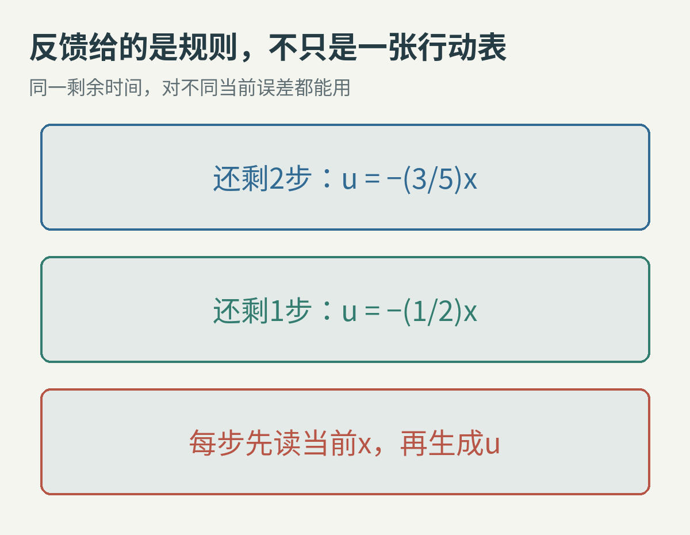

这两个系数叫反馈增益。它把当前状态变成当前指令。负号意味着往减少误差的方向走，系数决定这次纠偏有多大力。

所以我们完全可以离线算好“还剩两步用3/5，还剩一步用1/2”，运行时再读当时的状态，乘出动作。**倒推是在计算未来的价目表；实际运动仍然按时间向前发生。**

这条标量规则看起来很像比例控制，但这里的系数来自模型、剩余时间和整段成本。它不意味着一般的多状态LQR就是“只看位置的一个比例按钮”。

## 8. 如果中途被推了一下，行动表和反馈有什么不同？

还按原计划走第一步：u0=−2.4，本该落到x1=1.6。

假设这一拍结束时发生了一次额外的+1偏移，实际到了2.6。这个偏移并不在原先优化已知的条件里，是我们另设的教学扰动。

照抄旧行动表，第二步还是走−0.8，最后剩1.8。

按反馈规则，最后一步先读实际的x=2.6，再走−1.3，最后剩1.3。

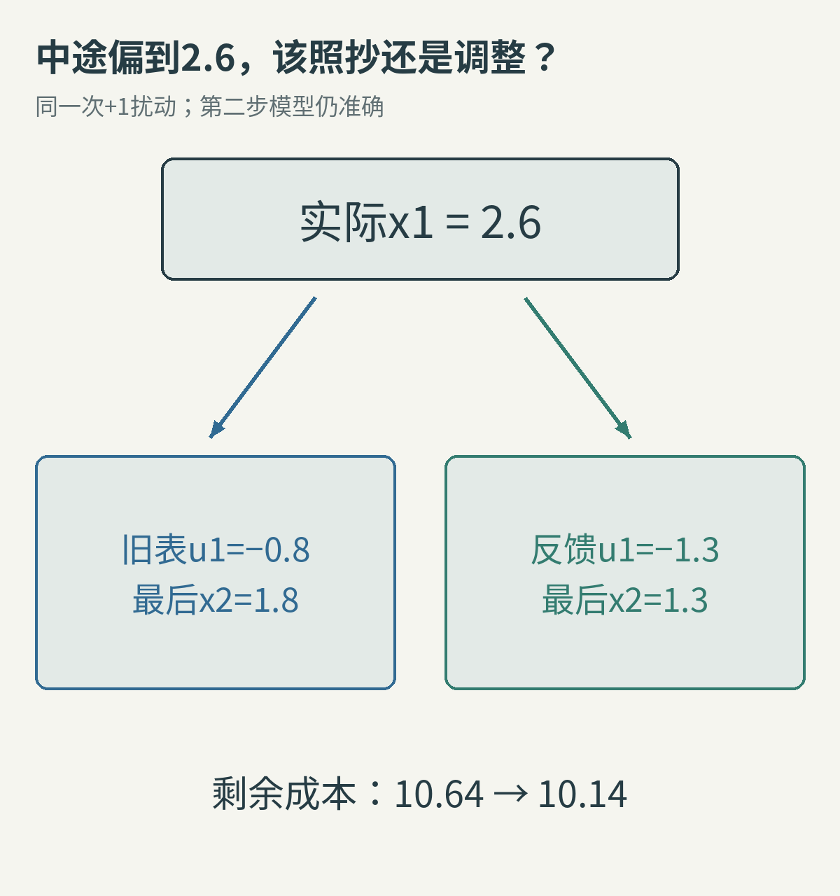

在实际x1=2.6已经发生、且最后一步模型仍然准确的条件下，反馈把剩余成本压到了最低：

- 旧指令：2.6²+0.8²+1.8²=10.64。
- 反馈指令：2.6²+1.3²+1.3²=10.14。

差别不大，却点出了反馈的本质：世界会偏离计划，所以每一拍都拿新的当前状态重新选一次。

这并没有证明“任意随机扰动下整段过程仍保持原来的最优性”。带噪声的模型、状态估计误差、对未来扰动的假设，都是另外需要写清楚的条件。


## 9. 把两步的规律压成一条递推

到这里可以给它一个更正式的名字了。

当状态转移是线性的、代价由平方或二次型组成，并且你希望把状态调回目标附近，就进入了LQR的世界。

先保持最简单的x(k+1)=x(k)+u(k)，只把权重换成q、r。假设下一拍之后最少还要付p_next×x_next²。那么当前要选的u，就是让下面这个式子最小：

q×x² + r×u² + p_next×(x+u)²。

配方之后得到两条规则：

**反馈增益 K = p_next / (r+p_next)，动作u=−Kx。**

**当前剩余成本系数 p = q + r×p_next / (r+p_next)。**

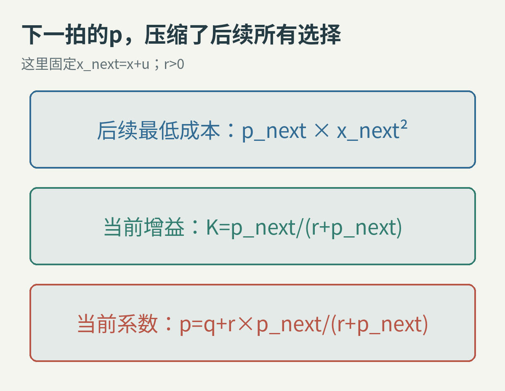

为什么一个p就够了？因为优化之前是二次式，优化之后还是“一个系数乘x²”。整张价目表的形状没变，变的只是弯曲程度。

从终点开始，令p等于终点罚分权重qf，然后一路向前倒推。取q=r=qf=1时：

终点p2=1 → 最后一步p1=3/2 → 第一步p0=8/5。

算动作时用的是**下一时刻**的p。最后一步的K1=1/(1+1)=1/2；第一步的K0=(3/2)/(1+3/2)=3/5。这里的下标错一位，结果就变了。

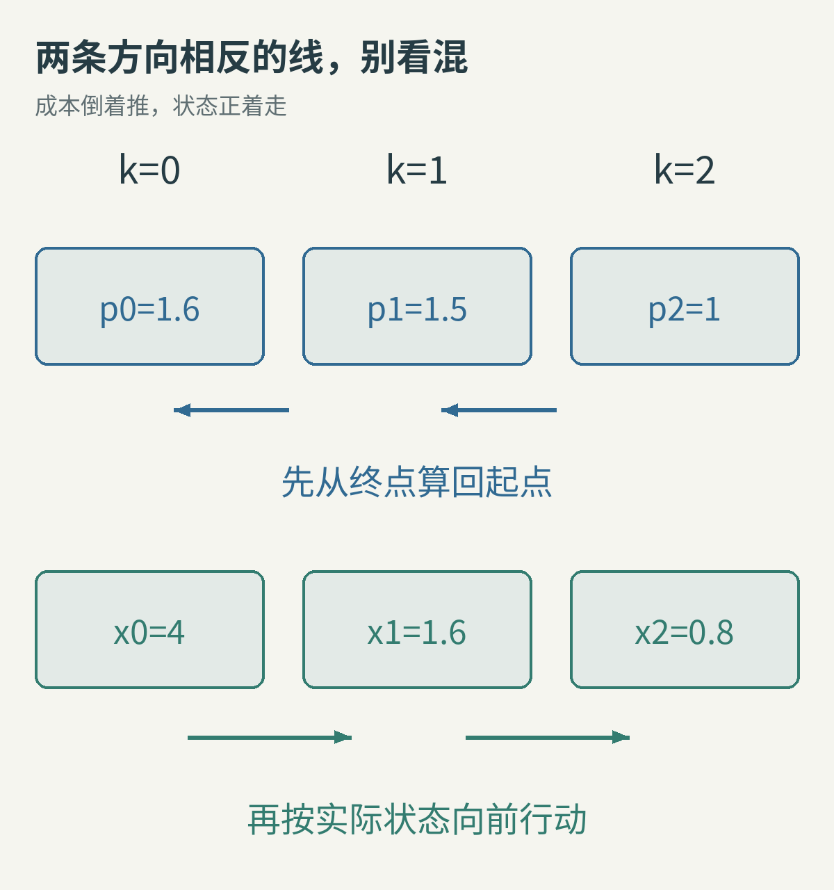

在更一般的线性系统里，状态可以是一列数，p会变成矩阵。这一族递推称为离散Riccati递推。名字可以晚点再记，先记住刚刚完成的动作：**用后面的最小剩余成本，把当前选择变成一个可以直接求最低点的二次式。**

## 10. 调权重，究竟改了什么？

保持同一个x0=4、两步时长、q=qf=1，只调整动作权重r。精确分数程序算出来是这样：

- r=1/4：第一步约−3.310，最后误差约0.138。
- r=1：第一步−2.4，最后误差0.8。
- r=4：第一步约−1.241，最后误差约2.207。

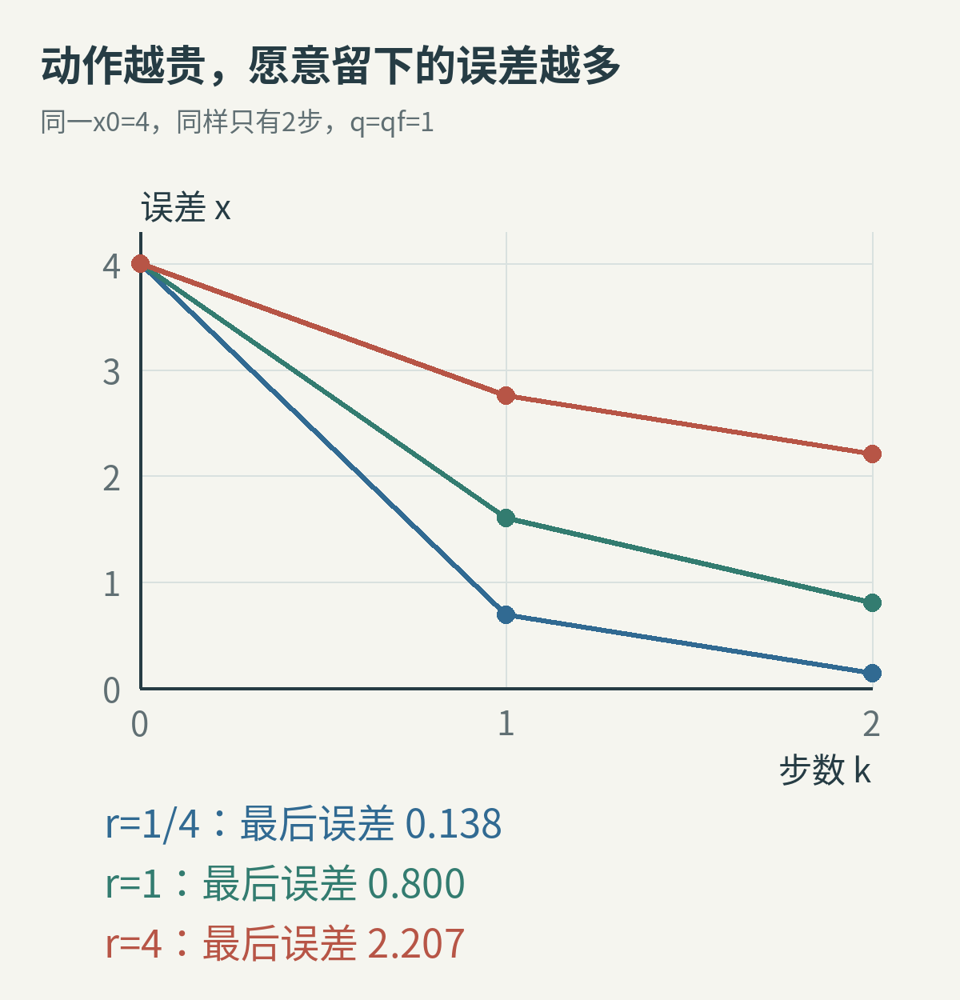

动作越来越贵，控制器就愿意留下更大的位置误差，换取少动一点。

但拿三份加权总成本直接排名，说哪个r的数字最小、所以哪套控制最好，是错的。换r就是换评分表，跨评分表比总分很容易把人带偏。更实在的做法是分别看未加权的位置误差平方和、动作平方和，再判断哪个取舍符合任务。

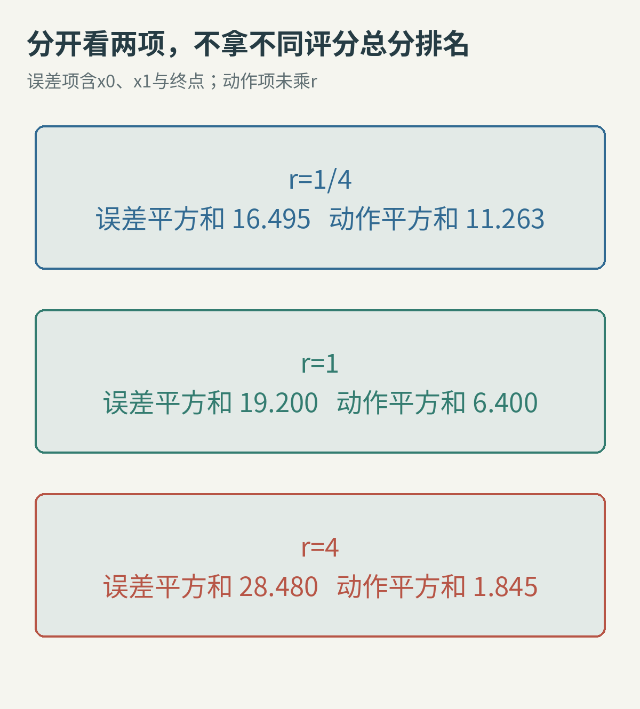

还有个小性质：把q、r、qf同时乘一个正数，比如都乘100，每个候选方案的总分都乘100，名次不变，反馈增益也不变。重要的是相对权重，而不是把所有数写得更大。

## 11. 动作罚得很贵，能保证不超过上限吗？

不能。

刚才r=4时，第一步系数是9/29。如果起点不是4而是40，第一步指令就是−360/29，约−12.41。r还是4，动作却已经大得离谱。

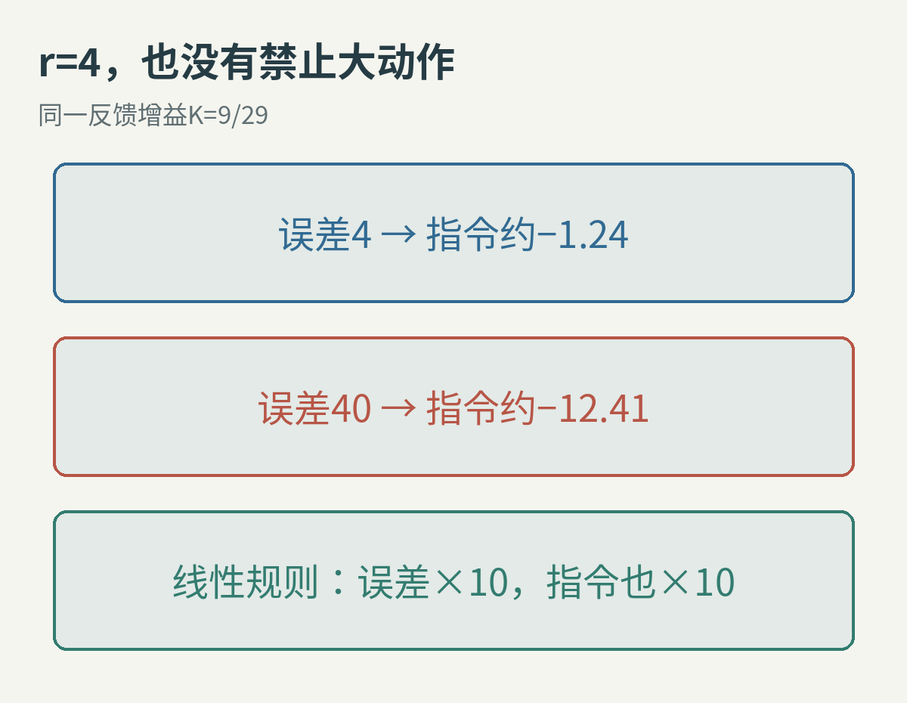

因为这套无约束公式u=−Kx是线性的：状态放大十倍，指令也放大十倍。

“每步最多移动1格”是一条硬约束，跟“动作很贵”不是同一句话。你当然可以在输出端把指令裁到[−1,1]，但裁完之后，就不能原封不动套用无约束LQR的最优性证明了。

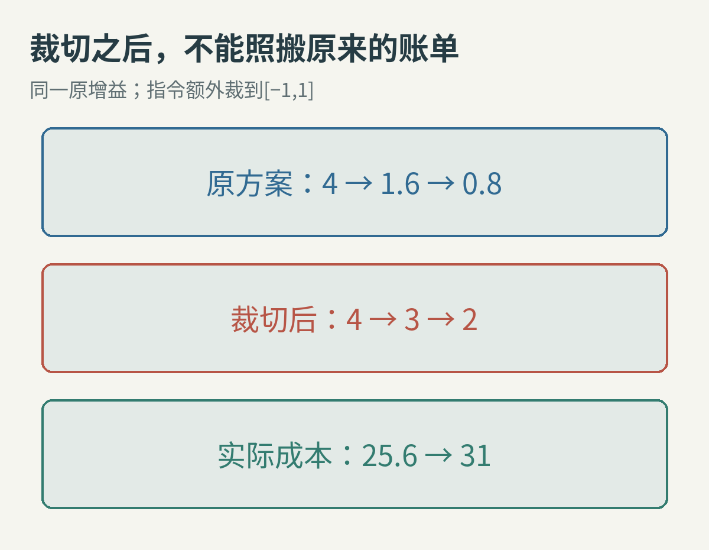

本稿把x0=4、原增益的输出裁到±1之后，得到4→3→2，成本31。原无约束方案那个25.6，已经不是这条限幅轨迹的成本。

这个例子只说明“加入上限改变了动作和问题”，并不声称裁切在所有受约束问题里都必然差于最优——有些简单特例可能碰巧相同。想系统地处理墙、速度和输入上限，得把约束放进优化过程里，后面的MPC篇会接着讲这件事。

## 12. 为什么“最优”仍然不自动等于“稳定”

我们故意写一张很糟的评分表。这类反例也出现在[Boyd的归档无限时域课件第11页](https://ee363.stanford.edu/archive/lectures/dlqr-ss.pdf)。

换一个会自行放大误差的系统：x(k+1)=2x(k)+u(k)。动作要扣平方分，误差完全不扣：q=0、qf=0、r=1。

最省动作的策略当然是u=0。成本为0，已经不可能更低。可从x0=1出发，状态却是1、2、4、8、16、32……

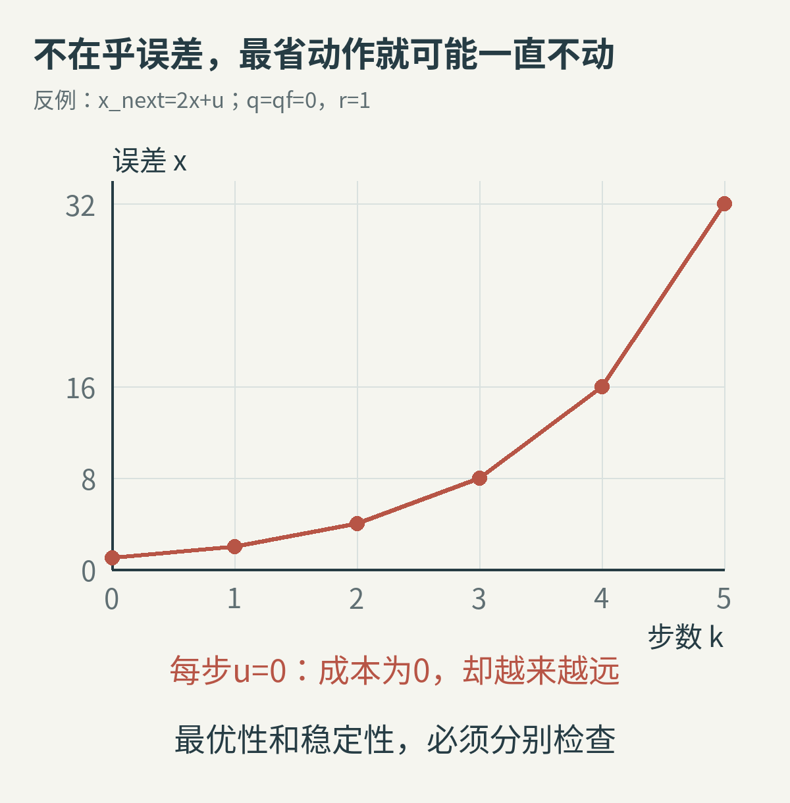

算法没有违反评分表，是这张评分表根本不在乎你最担心的事。

有限时间里“按这张表最省”，和无限时间里“状态回到目标”，是两个不同的命题。无限时域LQR的稳定结论需要相应条件。上面课件给出的充分条件是：系统可控，而且成本所关注的状态信息具有相应的可观性。直观地说，不稳定的方向必须有办法管住，也不能在评分里彻底隐身。这些条件不能省，两步计算也代替不了一般稳定性定理。

还有别的边界。状态得能拿到或者估计出来；模型如果漏掉了延迟、饱和和重要的动力学，纸上的最优未必是现实里合适的控制。平方惩罚u也不等于惩罚相邻两次指令的变化u(k)−u(k−1)。如果你在意动作忽快忽慢，应该把那个要求单独建模。

## 13. 一个小彩蛋：这个极简模型里会出现黄金比例

仍用x_next=x+u、q=r=1。把时长拉得很远，远离终点的递推系数会逐渐逼近一个固定值p。

固定值的意思是：再递推一次还是它自己。

p = 1 + p/(1+p)。

两边整理，得到p²−p−1=0。取正根：

p=(1+√5)/2，约1.618。

反馈增益K=p/(1+p)，约0.618；每一步剩余误差大约乘0.382。

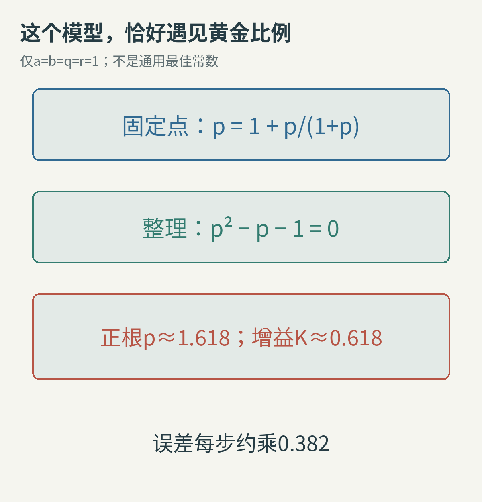

自然界并没有一条“最佳控制比例永远是黄金比例”的定律。只是我们特意选了a=b=q=r=1，固定点方程恰好长成这一条。改一下动作代价，数字就变了。

一个熟悉的常数从另一条路冒出来，这件事本身挺有意思。但更有用的是搞清楚它出现的条件，而不是把它当成万能口号。

## 14. 把整个两步例子亲手跑一遍

下面这段代码只做刚才那些精确分数计算，不依赖任何控制库。

```python
from fractions import Fraction as F

p = [F(0), F(0), F(1)]
gain = [F(0), F(0)]
for k in range(1, -1, -1):
    gain[k] = p[k + 1] / (1 + p[k + 1])
    p[k] = 1 + p[k + 1] / (1 + p[k + 1])

x = F(4)
for k in range(2):
    u = -gain[k] * x
    x = x + u
    print(k, u, x)
```

它依次打印：第一步指令−12/5、到达8/5；第二步指令−4/5、到达4/5。

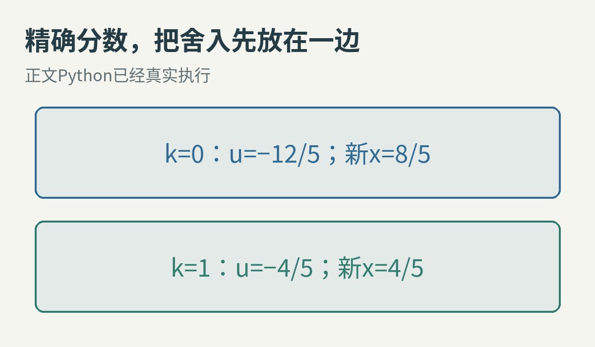

[完整实验程序](examples/lqr_lab.py)还实现了更一般的标量x_next=a×x+b×u，并且用另一条路线核对答案：把所有时刻的状态展开成整段动作的函数，直接建立二次目标的线性方程组，用精确分数消元。它没有和倒推算法共用Riccati递推，所以不会制造“自己验证自己”的假象。

实际检查了1620组时长、模型与权重组合；另有3000组任意动作序列，用配方恒等式核对它们比最优多付的成本，随机种子196001。两步动作网格的961组候选也找到了同一个最低点。再加上扰动、限幅、反例与权重同比缩放测试，范围都写在[实验说明](examples/README.md)。

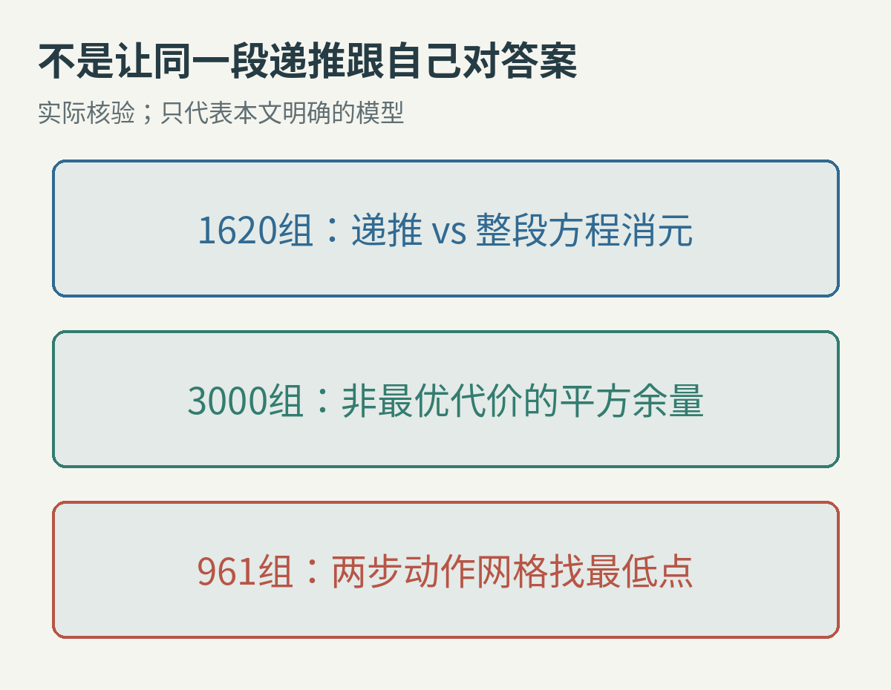

这些是已经跑过的精确模型计算，没有测量真实机器的能耗、控制时延或安全性能。

把时长另外改成12步，仍从4出发，下面三条轨道分别使用r=1/4、1、4的反馈。动画13帧对应k=0到12的实际计算状态，它只显示每拍的位置，没有假装知道两拍之间真实发生了什么。这个新时长明确不同于前面的两步手算。

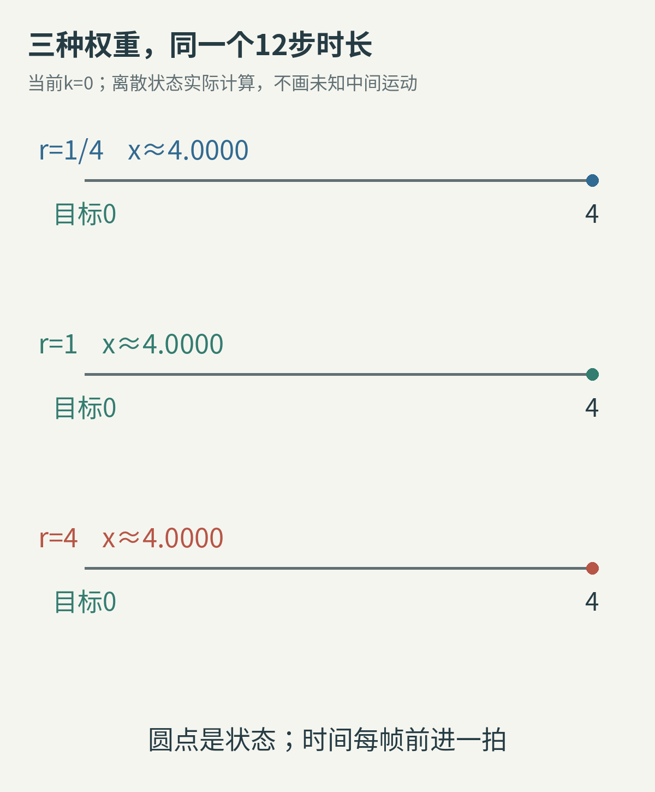

最后留一个小练习：如果只有一步，把动作平方前的权重改成3，下一拍误差平方仍取1，x=4，该走多少？

配方或者套一小步公式都行：u=−4/(3+1)=−1。误差还剩3，未来误差成本9，动作成本3，总共12。想让它动得更少，正是这张新评分表的选择。

LQR没有替人决定什么值得追求。它做的是：**把你写下的模型和取舍推到底，变成每一步都能执行的反馈规则。**

而你仍然要问：这份模型像不像真实对象？这张账单在不在乎真正重要的东西？那些绝不能违反的边界，有没有被认真写进去？

---

原创正文、教学示意与实验代码采用CC BY 4.0；ETH照片单独遵守CC BY-SA 4.0。[一手来源、照片署名与实验范围](sources.md)
