# 计划了三步，为什么只走一步？MPC 怎样给未来留一条退路

小车正在向右滑。终点在第8格，终点后面就是一堵不能穿过的墙。

你可以让它加速、保持、减速。眼下离终点还远，当然加速最痛快。可车不是光标：下一次松手，它不会立刻停下。

有些坏决定，做下去的那一刻还没有撞墙。只是从那一刻起，无论以后怎么努力，都已经来不及了。

控制器能不能在行动前，先看见这种“现在合法，未来无路”的局面？

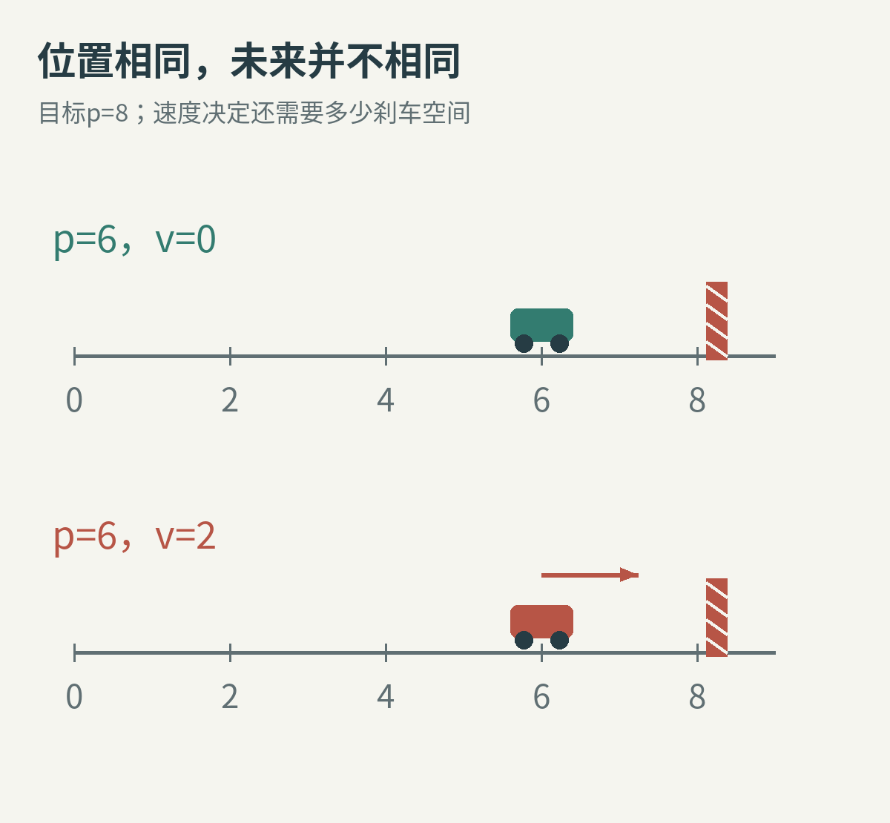

这篇从一辆纸上小车出发，认识模型预测控制，英文 Model Predictive Control，简称 **MPC**。我们会把每个计划真的算出来，再看看：为什么它明明认真规划了三步，却只执行第一步；为什么“下一次还能找到合法计划”和“最终一定到达目标”，是两件事。

这辆小车是纸上的教学模型。它不连真车、机器人或工业设备，纸上的那堵墙也得不出任何关于现实碰撞风险的结论。

## 1. 工厂里的难题：这次拧旋钮，影响不会马上结束

先把小车放一边，看看这类想法为什么有用。

工业过程常常有一种令人不耐烦的脾气：现在调了输入，输出要过一会儿才明显变化；这次变化还会在后面持续。几个输入、几个输出之间，又可能相互牵连。

把温度刚刚低了一点，便理解成“现在应该猛加热”，有时会忘记：前一轮加热的影响还在路上。

这里的加热只是直觉类比。历史上，一个重要的工业分支叫 **动态矩阵控制**，Dynamic Matrix Control，简称DMC。C. R. Cutler 和 B. L. Ramaker 署名的1980年会议论文，作者单位是 Shell Oil Company。论文把过程对输入变化的响应组织起来，用预测的未来输出，计算一串输入调整。[1]

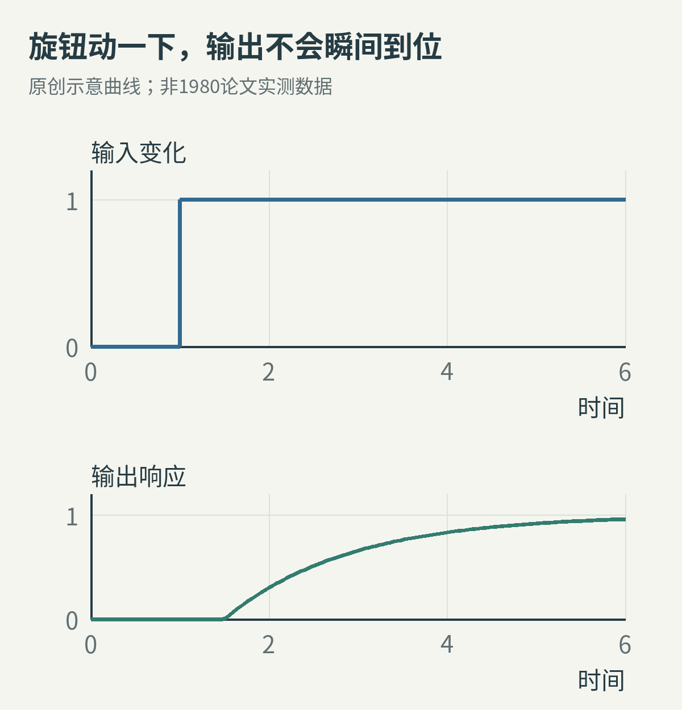

原文里有一个动作很关键：计算出后续多次调整后，先实施当前这次；取得新的测量后，再修正预测、重新计算。控制器并不把最初那串答案当成不可更改的命令。

不过，1980年这篇论文并没有解决今天MPC的全部问题。它讨论了动作抑制等处理，末尾还明确把操纵变量的硬约束留给了后续论文。我们下面用的“越过墙就绝对不允许”，是为了讲清现代约束控制而设的教学规则，并非那篇DMC算法的逐行复现。[1]

MPC也不是某一天由某一个人凭空发明的孤立故事。1978年 Richalet、Rault、Testud、Papon 的工业模型控制论文，是另一个重要的早期工业工作；本文对它只使用已取得的出版记录与摘要，没有假装读完了全文。[2]

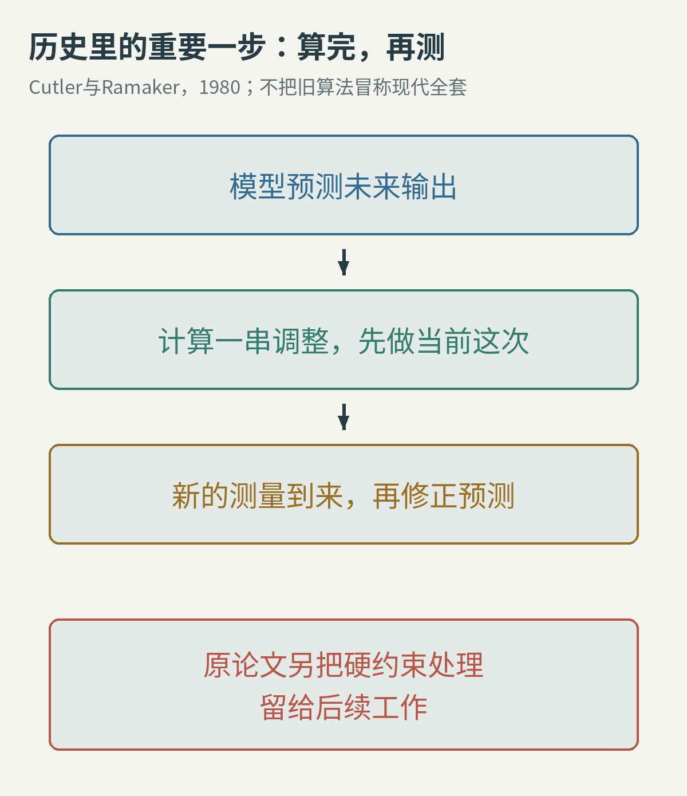

接下来我们不模拟炼油厂。只保留一个能用铅笔检查的核心：**用模型预测多步，在限制内挑计划，然后带着新的状态再来一轮。**

## 2. 先把“状态”和“动作”变成看得见的东西

小车此刻有两项信息：

- 位置 **p**：在第几格。
- 速度 **v**：每一拍向右走多快，以“格/拍”计。

模型把小车简化成一个参考点，暂不计车长；图中的小车图标也不表示碰撞外形。

这两个数合在一起，叫这里的**状态**。只知道位置不够：都在第6格，静止与高速冲来，对下一步的要求完全不同。

动作 **u** 是这一拍保持不变的加速度，只有三档：−1、0、+1，以“格/拍²”计。每拍时长定为1。因此一拍后：

**新速度 = v + u**

**新位置 = p + v + u/2**

第二式里的“一半”从哪里来？这一拍速度从v均匀变到v+u，平均速度就是v+u/2。平均速度乘一拍，就是这一拍走过的距离。

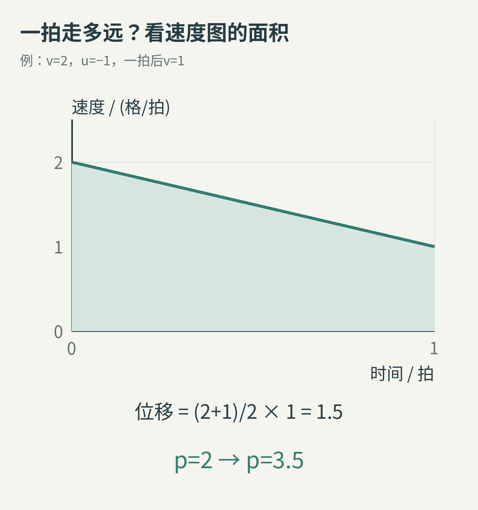

例如现在p=2、v=2，选择u=−1。新速度为1，新位置为2+2−0.5=3.5。

**减速不等于立刻倒退，也不等于原地停住。**这次它仍然向右走了1.5格。

我们还规定：位置只能在0到8之间，速度只能在0到3之间。模型不允许倒车；动作也不能越过三档限制。

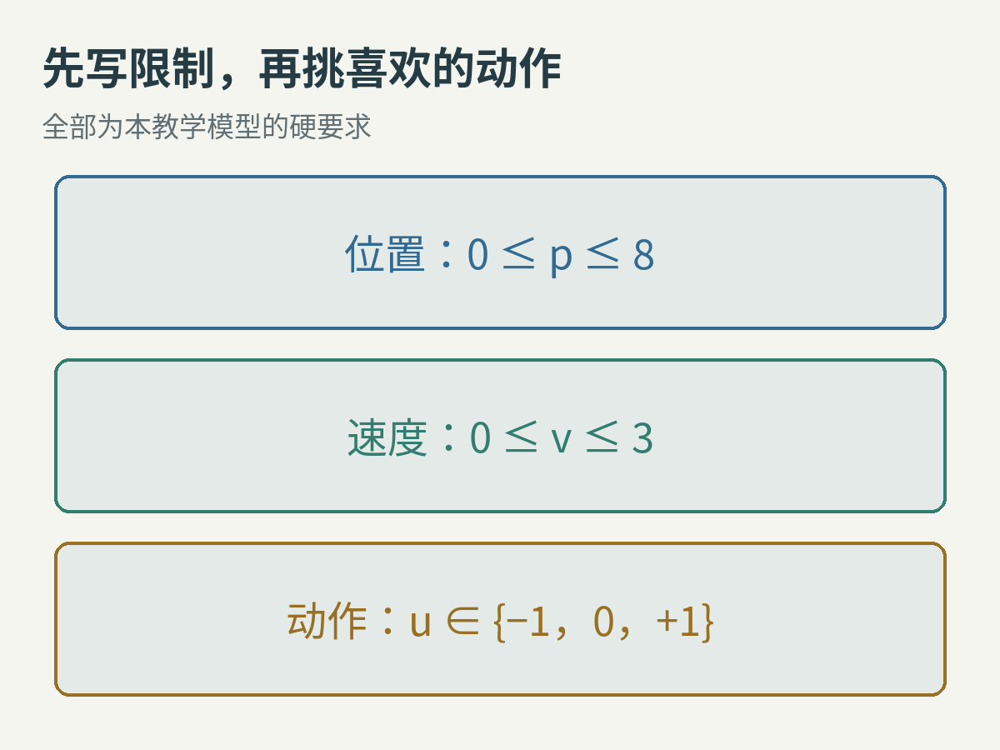

这一拍内加速度恒定，速度在两个端点间线性变化。若前后速度都非负，位置就不会先冲过墙再退回来。因此在这个特定模型里，检查端点位置与速度，就足以检查拍内的这些限制。换成别的模型，不能随意照搬这个结论。

## 3. 看一拍很聪明，为什么仍会把自己逼进死角？

从p=2、v=2开始。三个动作的下一拍结果是：

- 减速−1：到p=3.5，v=1。
- 保持0：到p=4，v=2。
- 加速+1：到p=4.5，v=3。

三种都还没到墙。加速那一种，看上去还最接近目标。

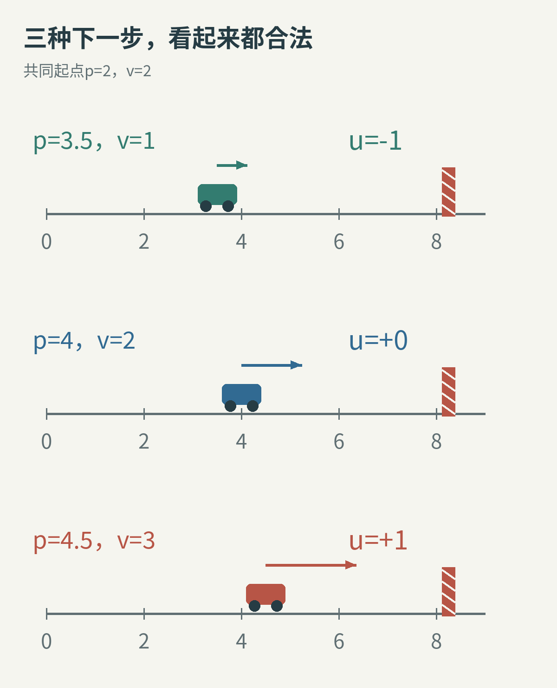

但请沿着加速那条路，再往前算。到达p=4.5、v=3之后，就算之后每拍都选最强减速−1：

第一拍到p=7、v=2。

第二拍到p=8.5、v=1，已经越过墙。

继续算到静止，会停在p=9。

问题不在于后面还不够努力。它已经使用了允许的最强减速。问题出在更早的那次加速：**它花掉了以后必需的刹车空间。**

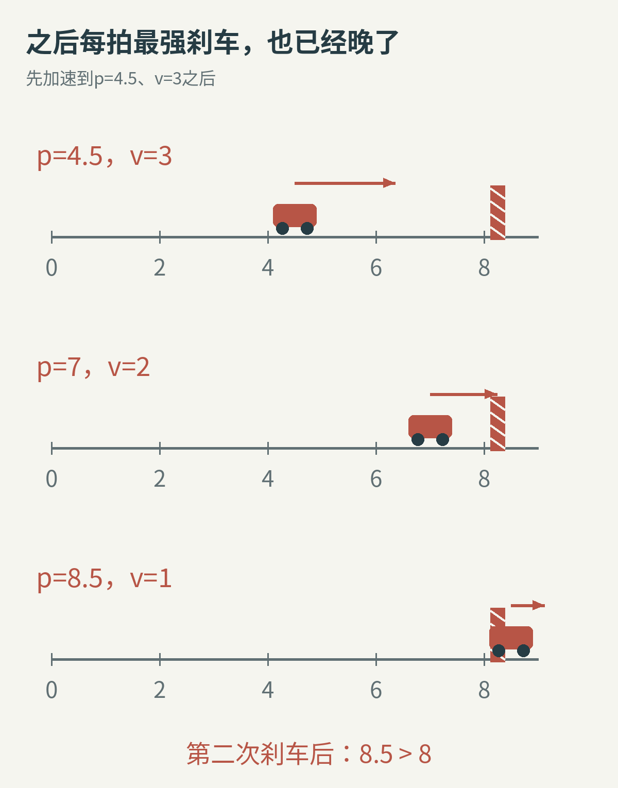

在这套理想模型中，速度v以每拍1的幅度降到0，刹车距离恰好为v²/2。v=3时，需要4.5格；从4.5到8却只剩3.5格。

这是模型里的精确算术，不是现实车辆的刹车距离公式。现实里的轮胎、路面、反应延迟和模型误差，都没有在这里出现。

## 4. 先定“允许什么”，再定“喜欢什么”

控制器需要两份不同的清单。

第一份是刚才的**硬限制**：超出就不允许，不管它看起来多快。

第二份是**评分**：在合法计划之间，我们更喜欢哪一个？

为了让例子可手算，每预测完一拍，就记一笔成本：

**这一拍成本 = 4 × (新位置−8)² + 新速度² + 动作²**

离目标越远，第一项越大；速度太大，第二项越大；动作太猛，第三项越大。这里的4、1、1是人为选择的权重，已按这套格子与拍子的尺度归一化，不是真实耗电量。


算刚才三个下一拍：

- u=−1：4×4.5²+1²+1²=83。
- u=0：4×4²+2²+0²=68。
- u=+1：4×3.5²+3²+1²=59。

如果只看一拍，最低分真的是那次危险的加速。评分并没有算错，只是这张一拍账单根本没把后果记进去。

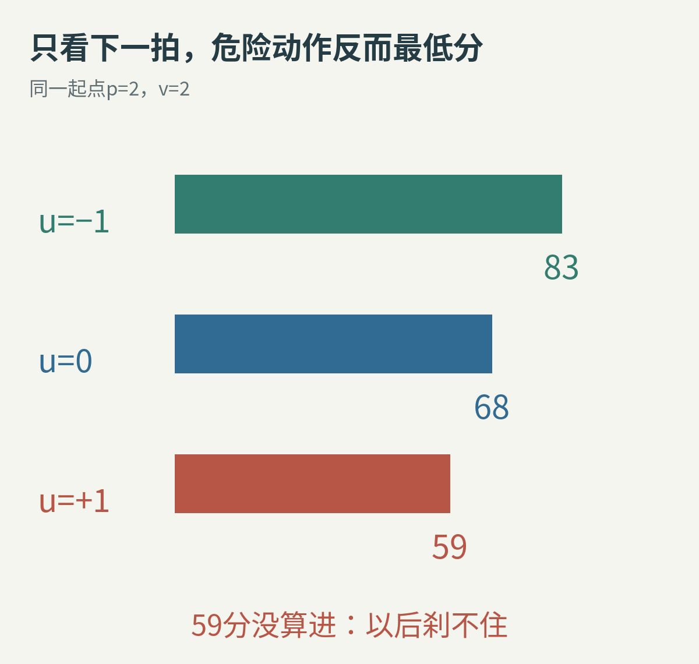

## 5. 把三拍都摊开，再加一条收尾要求

现在，控制器每次向前看三拍。这个三拍窗口叫**预测时域**，英文horizon，也可理解成“本轮计划看多远”。

每拍三种动作，三拍共有3×3×3=27串候选，例如：

0，−1，−1。

−1，0，−1。

+1，−1，0。

对每一串，按模型依次算三次状态。中途任意一步越界，这一串就淘汰。

我们还加一个**终端条件**：第三拍结束时，速度必须为0。

请留意措辞：**必须停住，但没说必须停在第8格。**第三拍停在第6格，照样满足这条收尾规则。


这不是所有MPC都必须采用的唯一规则。它是本例特别选的一个终端集合：墙内所有已经静止的状态。它的好处很快就会出现。

从p=2、v=2出发，27串中，最后只剩三串符合全部要求：

1. **0，−1，−1**，总成本112。
2. **−1，0，−1**，总成本170。
3. **−1，−1，0**，总成本212。

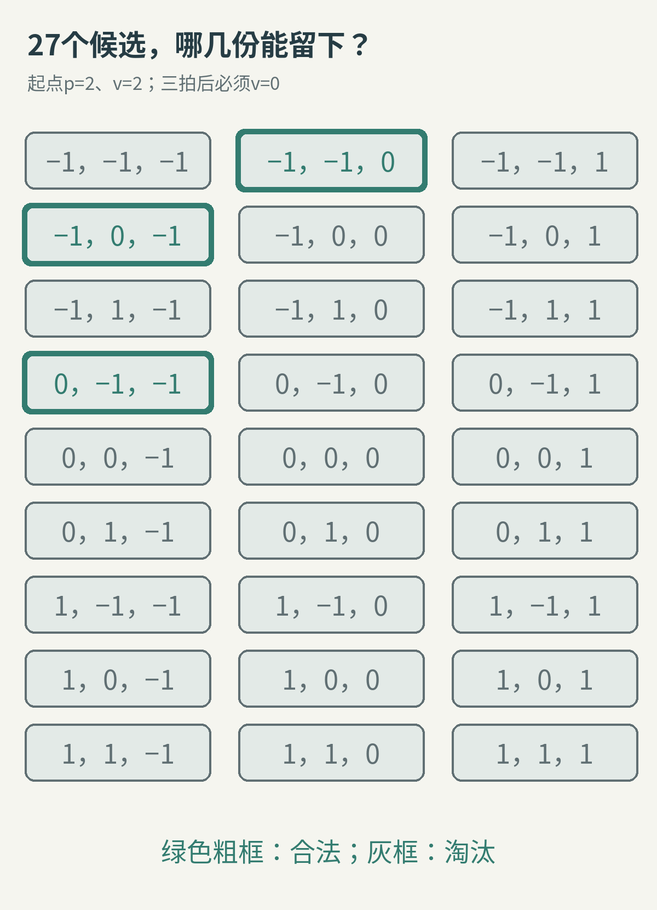

这里没有神秘求解器。只是枚举、预测、淘汰、加分，然后挑最低的。

## 6. 把112分逐笔验算

最低分计划是0，−1，−1。我们从头算：

**第一拍，u=0。**从p=2、v=2，来到p=4、v=2。

成本4×(4−8)²+2²+0²=68。

**第二拍，u=−1。**来到p=5.5、v=1。

成本4×(5.5−8)²+1²+1²=27。

**第三拍，u=−1。**来到p=6、v=0。

成本4×(6−8)²+0²+1²=17。

合计68+27+17=112。

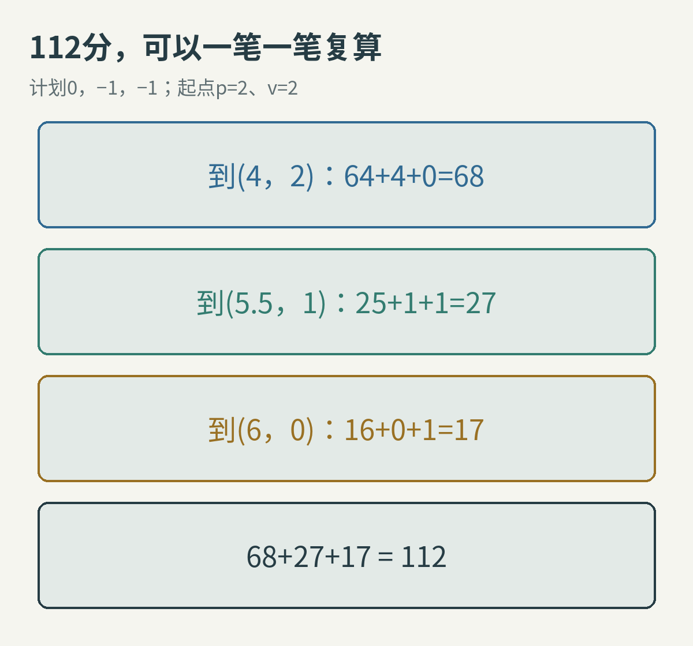

你可能会问：终点明明在8，它为什么打算停在6？

因为本轮只看三拍，又要求第三拍停住。从当前速度和动作限制出发，这三拍里不是想在哪里停，就能在哪里停。控制器求的是**当前这个有限问题**的最优解。

“有限时域最优”不等于“对无限未来已经作出最终裁决”。

## 7. 最奇怪的一步：算完三步，却只做第一步

现在实际执行的，只有第一拍u=0。

如果模型准确，小车来到p=4、v=2。然后控制器重新测量状态，重新向前看三拍。

它不是只剩两拍。窗口跟着时钟向前移动，**每次仍然有三拍**。

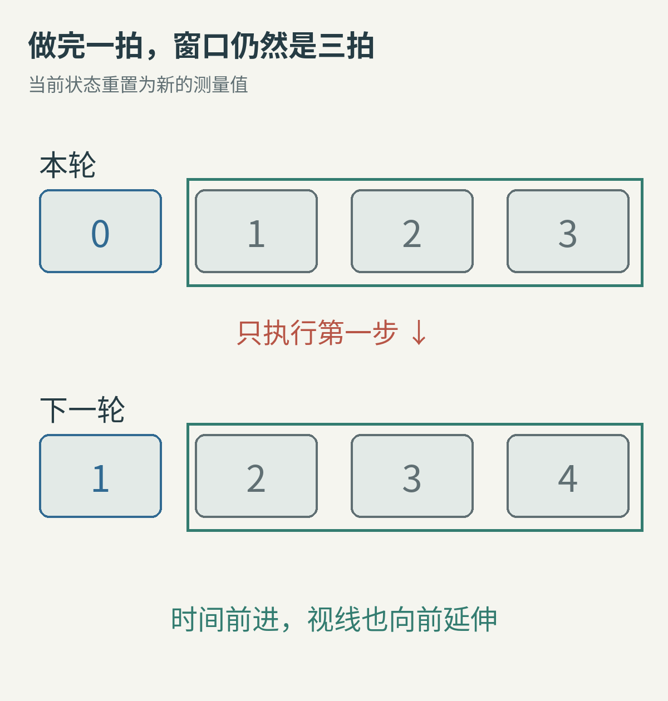

在新状态p=4、v=2下，新一轮最优计划仍是0，−1，−1，但对应的位置变成：

p=6、v=2；p=7.5、v=1；p=8、v=0。

新总成本是20+3+1=24。

旧计划还剩“−1，−1”，新计划的第一个动作却是0。**即使没有任何干扰，重新计划也可能改变下一步。**因为这次看见的时间范围，已经向后延伸了。


继续“计划三拍、只做一拍”，从最初p=2、v=2出发，实际动作成为：

**0，0，−1，−1。**

实际位置是2→4→6→7.5→8，最后速度为0。

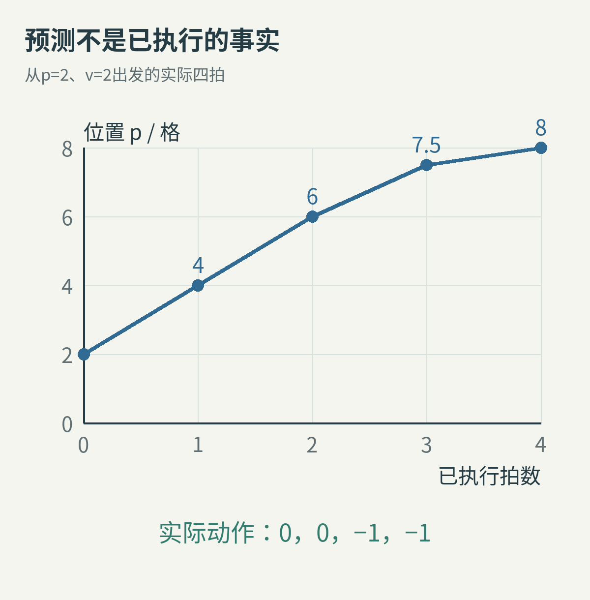

预测中的未来是候选，已经执行的过去才是事实。看图时，把虚线计划与实线行动分开，会省去很多困惑。

## 8. “再规划”怎样用上新的测量？

假设第一拍结束后，本来预测p=4、v=2，传感器却报告p=5、v=2。这里仅设定一个测量状态与预测状态不一致的情形，不把它伪装成某种已经模拟过的风力。

若仍按“假定自己在4”算出的0，−1，−1执行：第一拍到p=7、v=2，第二拍到p=8.5、v=1，会越墙。

按新测得的p=5、v=2重算，最低分合法计划改成：

**−1，0，−1。**

它经过p=6.5、v=1；p=7.5、v=1；p=8、v=0。总成本11+2+1=14。

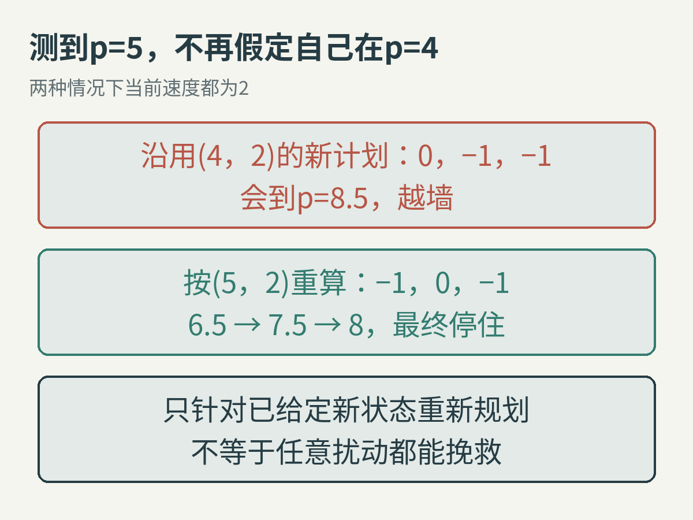

这正是反馈在这里的落点：新测到的状态进入下一轮优化，旧计划不会被原样重印一遍。

但不要立刻得出“只要不停重算，就一定安全”。如果新的测量已经表明自己处于p=4.5、v=3那种无路可退的状态，重算不会凭空增加刹车能力。

## 9. 为什么“最后停住”能帮下一轮留后路？

回到没有干扰、模型准确的情形。

设这一轮找到一个合法三拍计划，叫A、B、C。执行A后，剩下B、C能把车带到墙内的静止状态。

下一轮需要三个动作。我们至少可以拿出一份候选：

**B、C、0。**

前两步沿用旧计划的尾巴；第三步在静止处保持不动。仍然不越墙，也仍然满足末端静止。


因此，在这些假设下，第一轮只要有解，下一轮就不会完全找不到合法候选。新一轮优化可以选这份候选，也可以找到更好的一份。

这个“每次都有下一次”的性质，叫**递归可行性**。名字先放一边，记住那份看得见的构造：**旧尾巴，加一个能够持续维持合法状态的动作。**

静止状态为什么合适？因为它在墙内，而且动作0能让它继续留在那里。这就是本例的终端集合具有不变性的具体含义。[3]

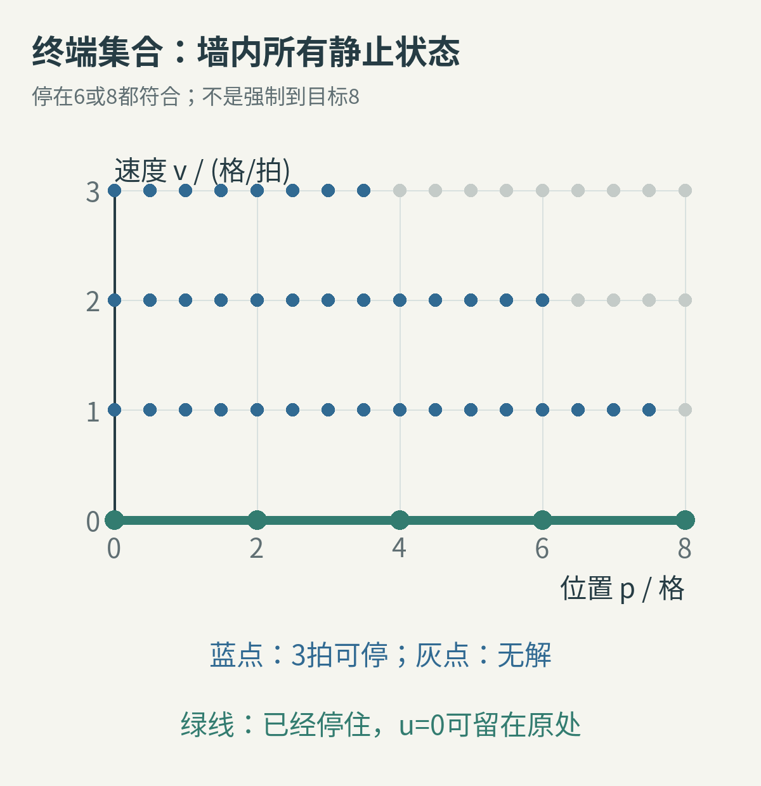

这段证明的关键前提也很具体：实际下一状态，必须等于旧计划预测的下一状态；执行器也必须真的能执行那个动作。有扰动、估计误差或模型不准时，旧尾巴不一定还能用。[3]

## 10. 能一直找到计划，不等于一定到达终点

我们可以立刻做一个反例。

把窗口从三拍缩成一拍，但保留“窗口末端速度必须为0”。小车从p=0、v=0出发。

此时若选+1，下一拍速度就是1，不满足末端条件；选−1又违反不许倒退。因此唯一合法动作是0。

下一拍还是p=0、v=0。再算一次，仍然只能选0。

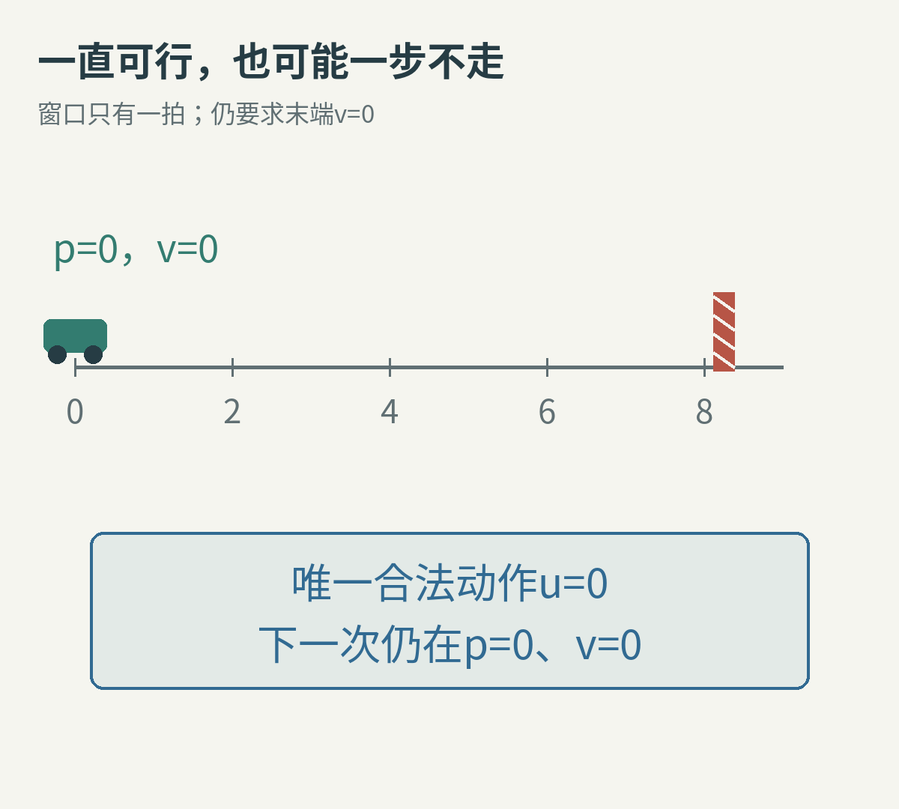

它一直有合法计划，也一直没有靠近终点。

所以本例刚才证明的，只是“以后仍有合法计划”，没有顺手证明“成本必然下降到0”或“所有初态都会到终点”。后两类结论需要额外分析，不能从一张顺利跑通的动画推出。

另一方面，如果去掉末端条件，一拍一拍贪心，从静止出发会选择加速，接着加速，再加速，直到把自己逼进未来无法满足约束的局面。配套程序会返回“无合法计划”，而不是假装找到一个安全答案。

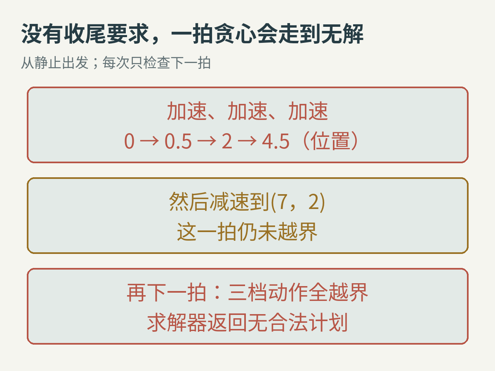

终端条件不是“越严越好”，预测窗口也不是“越短越省就越好”。两者要和模型、目标、限制一起设计。

## 11. 看一段真正由程序生成的滚动计划

这次从p=0、v=0出发，仍用三拍窗口和末端静止条件。

程序实际执行的动作是+1、+1、0、0、−1、−1。位置依次为0、0.5、2、4、6、7.5、8。

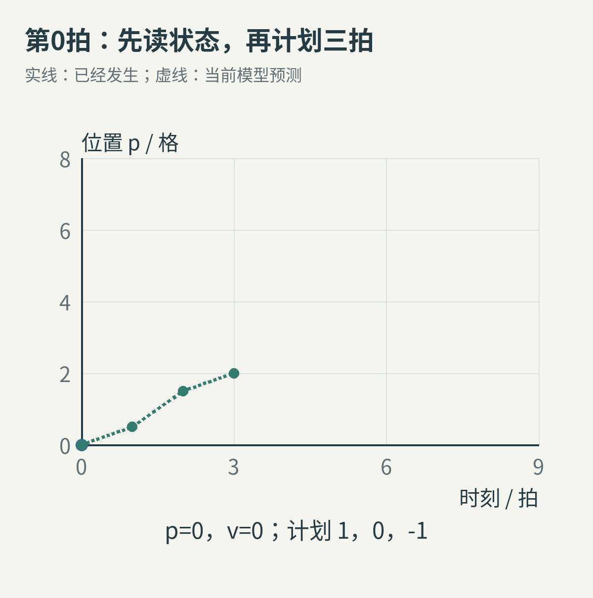

注意最初预测的终点与最终实际终点不是同一个概念。最初三拍计划是+1、0、−1，原本预测在第2格停住；走完第一拍，新的三拍窗口又展开了。

这不是程序自相矛盾。计划描述的是“如果从此不再重算，我现在会怎样安排这几拍”；MPC的执行机制，本来就是下一拍再求解。

## 12. 27个计划能枚举，真实系统怎么办？

我们的三档动作、三拍窗口，只有27个候选。

保持同样的笨办法，10拍就是59049个候选；15拍是14348907个。若同时控制多个输入，组合还会增加。

下面纵轴用以10为底的对数压缩数量：刻度2代表100个，4代表10000个。这样才能把很小和很大的数量放进一张图；图上的直线不表示候选数只在匀速增加。

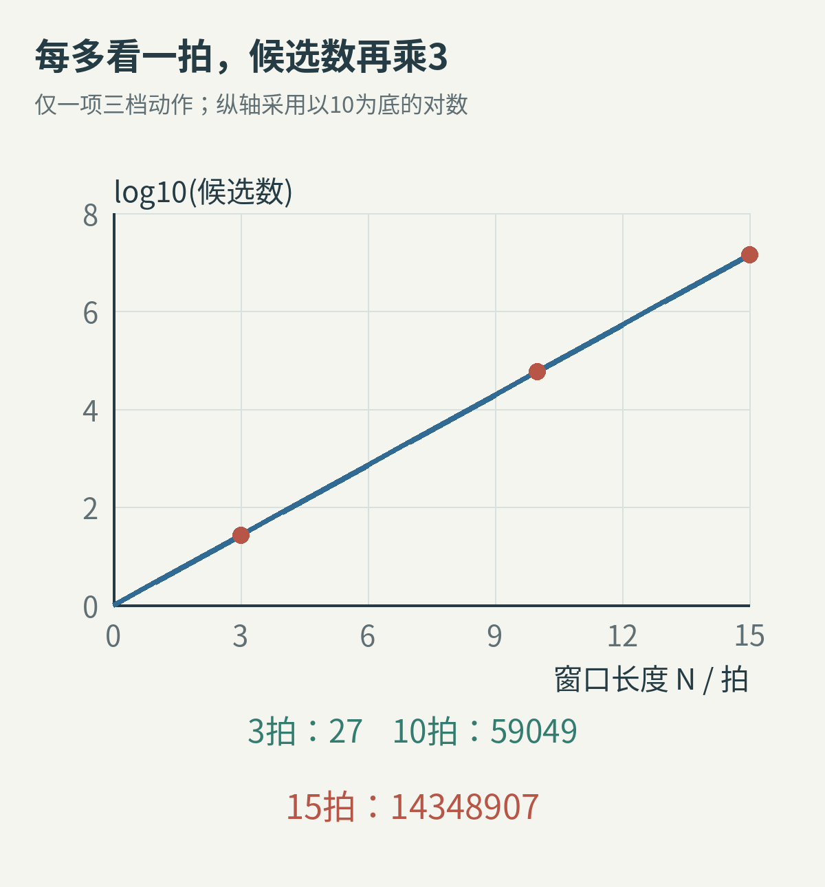

实际MPC通常不会按这篇的方式把全部动作串列出来。在线性模型、二次成本和适当线性约束下，可以构造成二次规划问题，使用对应的数值算法。非线性、离散开关等条件又会改变求解问题的性质。[3]

“只做第一步”也不意味着计算其余步骤是浪费。那些后续步骤，正是用来判断第一步有没有后路的。

当然，计划必须在下一次需要动作之前算完。求解精度、时间预算、可行候选的保留、没有解时怎么办，都属于真实实现的一部分。本文的枚举程序没有被包装成实时工业软件。

## 13. MPC和上一张LQR账单，在哪里相遇？

如果读过本系列的LQR文章，你已经见过：给状态偏差和动作大小打分，然后用模型寻找低成本动作。

MPC不是另一种神秘的评分方式。它更强调一种执行结构：反复解决有限时域问题，把当前状态放进去，只实施首个动作。

这套结构可以容纳硬限制，也可以用不同模型与成本。某些适当设置的无约束线性二次问题，会与LQR的反馈结果联系起来；不能因此把两者说成任何情况下都完全等价。[3]


我们的小车例子用了有限三档动作，还加了末端速度必须为0的要求。它不是“先求无约束LQR，再把过大的动作截断”。约束已经参与了计划的筛选；未来会发生什么，也参与了对当前动作的判断。

## 14. 这份小程序，怎样避免悄悄算错？

完整实验在[cart_mpc.py](examples/cart_mpc.py)。只需Python标准库；没有下载模型、联网控制设备或安装求解器的步骤。

代码内部用P=2p保存位置，所以半格也能用整数表示。两条更新式变成：

```python
def step(state, u):
    P, v = state
    return P + 2*v + u, v + u

def stage(state, u):
    P, v = state
    return (P - 16)**2 + v*v + u*u
```

这不是把物理位置偷偷改了单位后忘记补系数。因为4(p−8)²=(2p−16)²=(P−16)²，成本恰好仍是同一张账单。

候选计划先检查每一步是否合法，再检查末端速度，最后比较成本。如果一个都没有，返回None。**“无解”不能擅自改写成“选0就好”。**正在向墙滑去的小车，保持加速度0并不等于停住。

作者自检实际做了680组“穷举动作串”和另一种动态规划递推的对照，覆盖17个半格位置、4个速度、5种窗口长度，以及有无末端条件两种情况。结果一致。

还逐一检查了这些格点上全部167份合法三拍计划：执行首步后，旧尾巴加0仍然合法。这个枚举核查帮助发现程序错误；真正说明一般机制的，仍是前面那段构造论证。


## 15. 留给你三次小探索

**第一题：**从p=2、v=2出发，把第一拍改成−1。你能不看前面的答案，算出“−1、0、−1”的170分吗？

**第二题：**三拍窗口末端要求停住，为什么从p=4、v=2出发可以在8停住，而从p=2、v=2出发本轮却停在6？先画出同一串动作0、−1、−1，比较起点不同造成的位置平移。

**第三题：**把墙从8移到7，可以只改检查上界就宣称仍在解同一个任务吗？想想目标位置、评分里的8、终端集合、图的坐标和预期测试，哪些也需要重新审查。

最后再回到开头的问题：小车下一步为什么不总选最快的那个？

因为眼下最划算的一步，可能已经透支了未来的选择。

MPC的有趣之处，不是它确信自己预知未来。恰恰相反：**它用模型认真计算未来，又承认下一次测量到来后，计划值得重新考虑。**

计算得远一些，只行动一步；给当前的好选择，附上一条以后仍能走下去的路。

## 来源线索

[1] Cutler、Ramaker，1980年《Dynamic Matrix Control—A Computer Control Algorithm》。历史范围、原件信息及全部9幅原图的查看位置见[图片与来源说明](sources.md)。

[2] Richalet等，1978年《Model Predictive Heuristic Control: Applications to Industrial Processes》。本篇仅使用已读取的出版记录与摘要范围。

[3] Rawlings、Mayne、Diehl，《Model Predictive Control: Theory, Computation, and Design》，第二版第三次印刷，2020。重点参考第2章89–97页的定义与假设、109–112页的动态规划和递归可行性解释；本篇小车、成本权重、三档动作及全部算例为另建教学模型。
