# 不移动刻度，一条直线为什么会算题？d’Ocagne 与印在纸上的方程

桌上有一张纸，纸上竖着三条刻度。你把直尺的一条边压在左边的2和右边的6上，中间居然出现了8。

换个位置，把直尺压在另外两个数上，第三个数也跟着改变。没有滑动的尺芯，没有齿轮，更没有电池。

这张纸究竟做了什么？难道制图者已经把所有题目的答案都列在里面了？

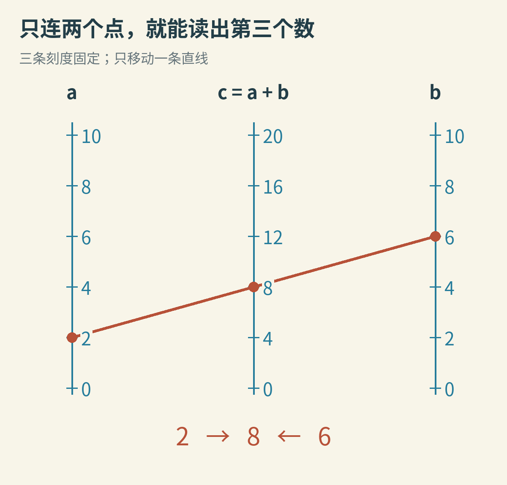

图是本稿设计的加法列线图。左、右两条轴读输入，中间读和；三条轴的横向间距相同。红线是直尺边缘的位置示意，不是实物测量照片。

这种工具叫列线图，也常见英文名nomogram。它是图解计算的一种形式：把一个方程安排成几套刻度之间的几何关系，再通过对齐读出未知量。

名字不必先背下来。我们先造一张最简单的，故意让它算错，再把它修好。随后，同一套思路还会去算乘法、除法，以及两个电阻并联后的等效阻值。

## 1. 一段历史，藏着一个很朴素的工作需求

反复计算同一种关系，是工程工作里常见的麻烦。

题目的形式不变，输入的数字却一直在变。如果能把关系预先画好，使用者就不必每次重新展开一遍代数运算。它并没有让人停止理解，只是把反复相同的部分交给了一件工具。

Maurice d’Ocagne，中文常译作莫里斯·多卡涅，是把这类方法系统化的重要人物。1925年原书的署名注明他任教于巴黎综合理工学院。这里不把一张列线图虚构成某次码头施工中的灵光一现；我们能核实的是他的著作，以及著作里真正讨论的问题。[原书署名与正文](https://www.numdam.org/item/MSM_1925__4__1_0/)

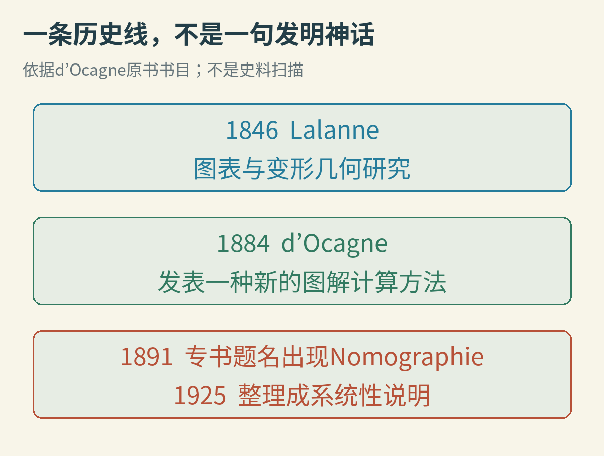

这是根据文献绘制的关系图，不是历史原件。d’Ocagne在1925年《列线图学概览》的书目里列出了Lalanne的1846年图表研究、自己1884年的图解计算论文及1891年专书，并说“nomographie”一词首次出现在这本专书的题名中。这里保留“作者如此记述”的范围，不把一门方法的全部历史压给一个人。[1925年原书](https://www.numdam.org/item/MSM_1925__4__1_0/)

这本书第26至28页讨论了一次很有意思的转换：原来需要在多组线之间找交会，能不能改成让几个带数值的点落在同一条线上？他的说明还提到，可以把细线画在透明片上，也可以用绷紧的线作为活动指标。

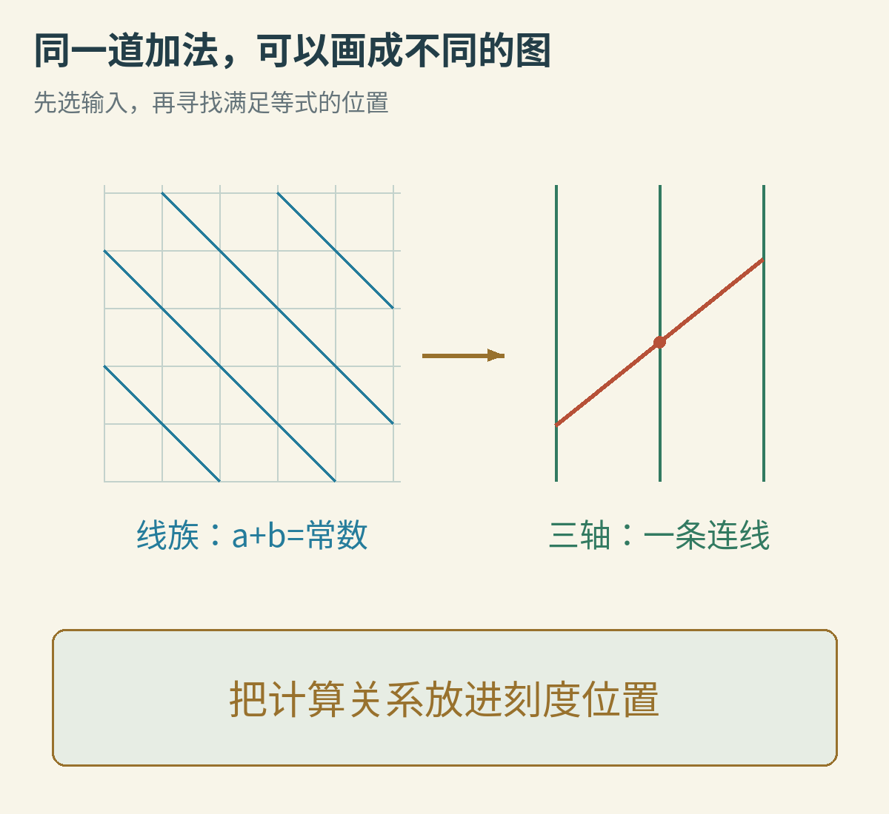

这是本稿独立构造的加法示意，不是对原书图形的临摹。它只强调一个设计选择：与其让使用者在密密的线里寻找交点，不如把所需的关系集中到少量刻度上。

接下来，我们从一条直线最普通的性质开始。

## 2. 先用三把普通尺，看看为什么算错

在纸上画三条竖线，让中间那条恰好落在另外两条的正中。三条线都用同样的刻度：0、1、2、3……向上等距增加。

连接左边的2和右边的6。

中间读到多少？

答案是4，不是8。

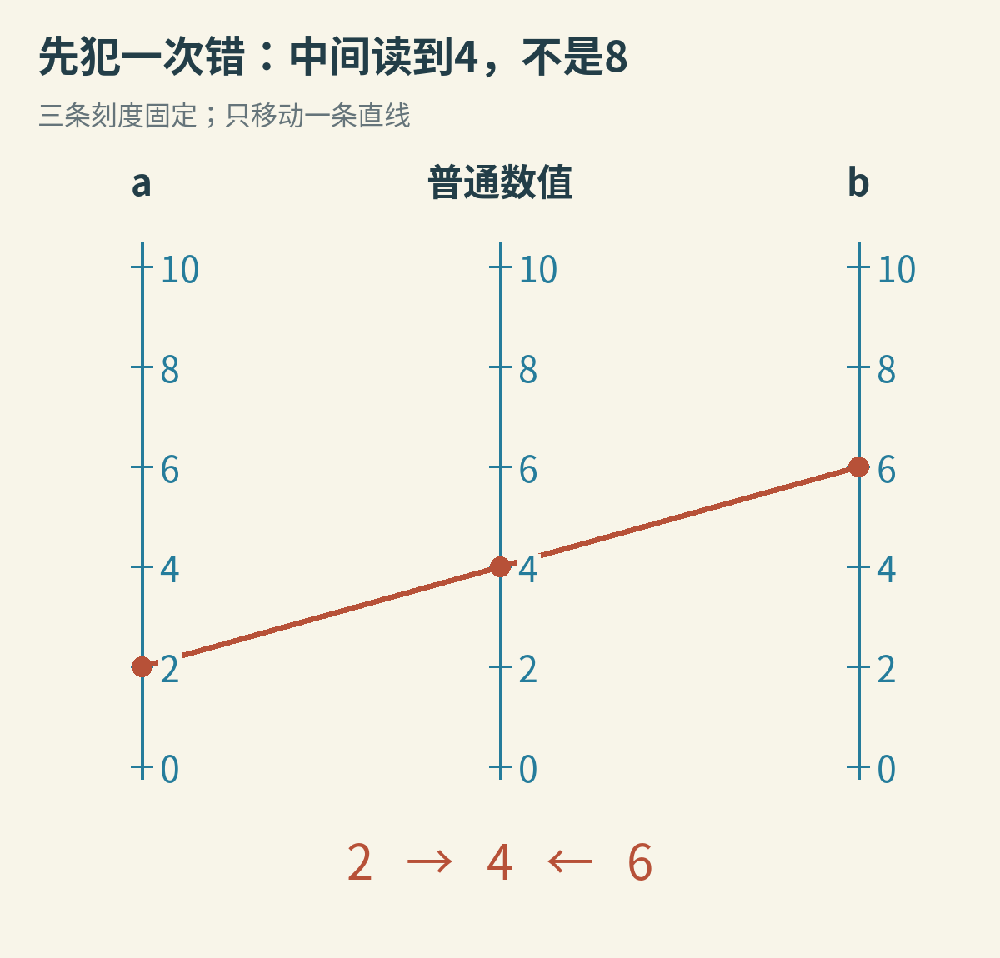

直线没有算错。它只是不知道你想做加法。

左端高度为2，右端高度为6。从左向右，整个高度增加了4；横向走到一半，直线也只升高了一半，也就是2。所以中间高度是2+2=4。

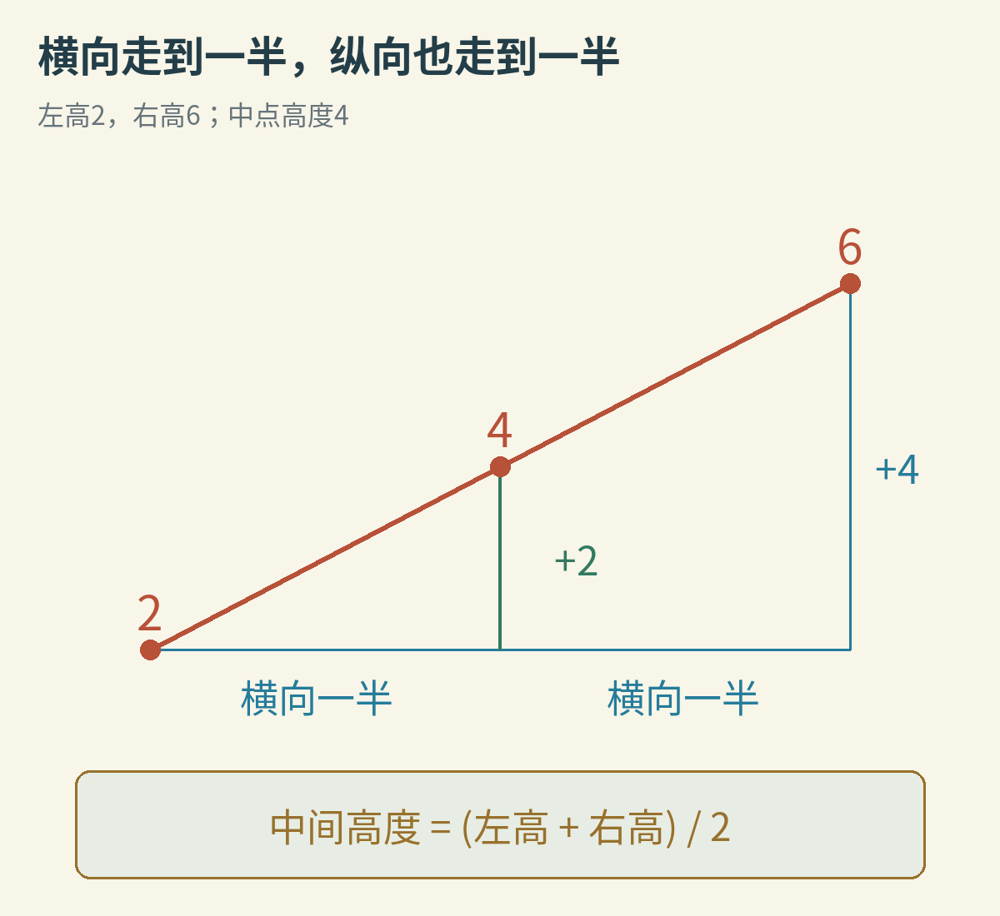

换成任意两个高度a和b，中间高度就是：

(a+b)/2

这里的a、b，一开始只是两个高度数值。它们还没有被赋予乘法或者加法的特殊含义。

**几何给我们的原始动作，是取两端高度的平均。**

要让它交出“和”，不必改直线。可以改刻度。

## 3. 最关键的一步：数字和位置可以不是一回事

保持三条竖线的位置不动，只重写中间那条的标签。

- 原来高度0的位置，仍然写0；
- 高度1的位置，写2；
- 高度2的位置，写4；
- 高度4的位置，写8。

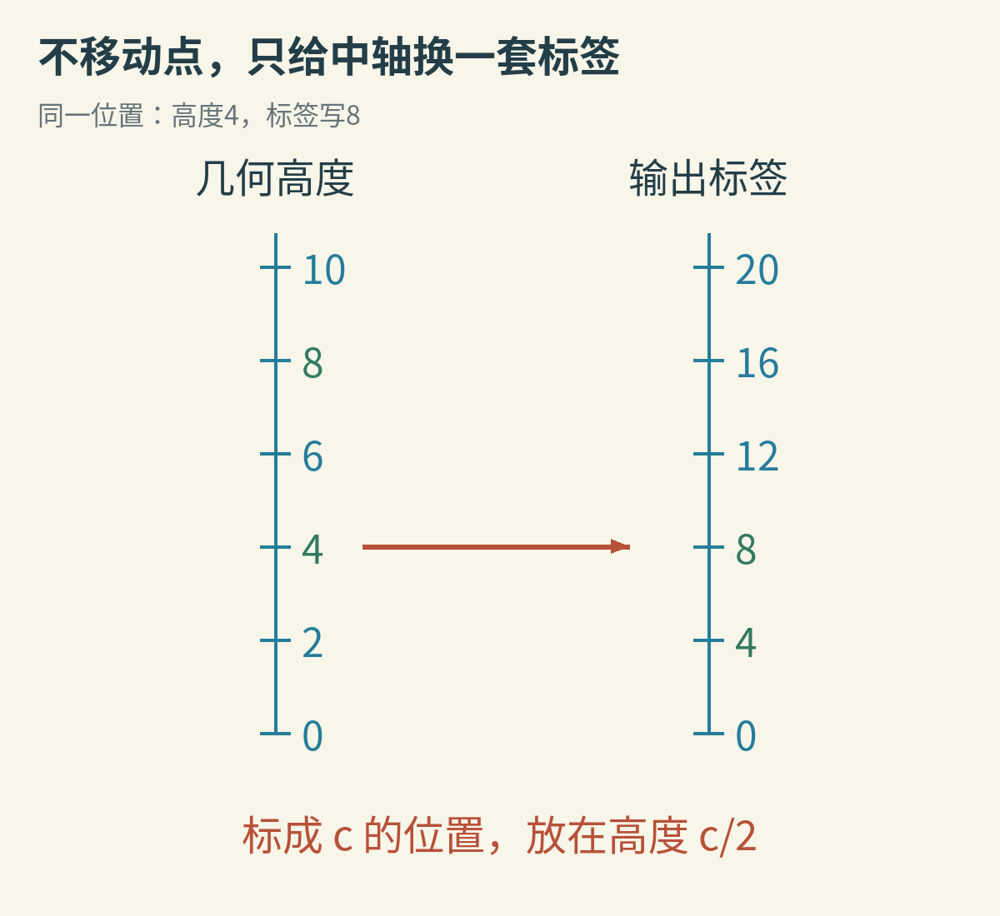

现在重新连接左2、右6，直线仍然穿过中间高度4。但这个位置的标签已经叫8了。

于是它就读出了2+6。

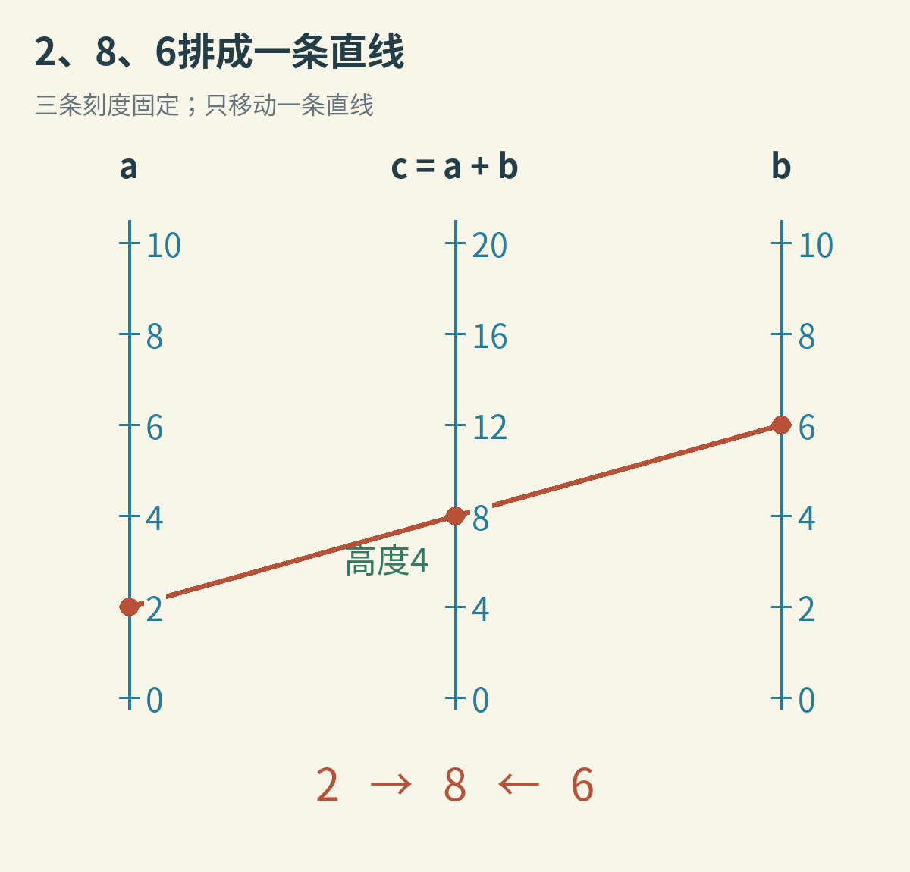

如果把中间的输出叫c，那么标签c必须放在高度c/2。

三点共线要求中间高度等于两端的平均高度，所以：

c/2 = (a+b)/2

两边同乘2，便得到c=a+b。

看起来只是重新贴了几个数字，其实我们已经做完了一次“编译”：把想要的代数关系，翻译成了纸上位置的关系。

使用者不必在每一次读图时重新推导这个等式。制图者已经把它放进了刻度里。

## 4. 它没有规定谁一定是答案

刚才给a、b，求c。反过来可不可以？

比如已知总数c=11、右边b=8，想知道左边a是多少。

把直线通过中间的11和右边的8，再延长到左轴，就会读到3。

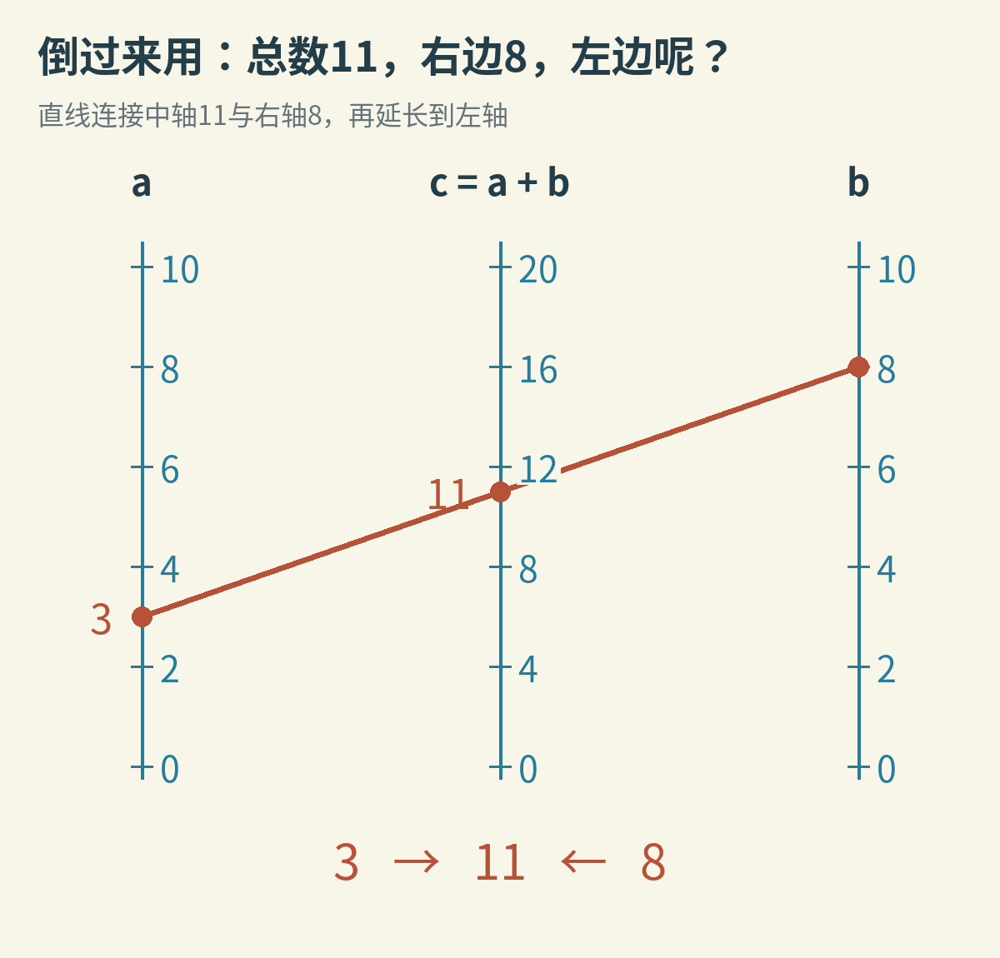

直线仍然满足同一个方程c=a+b。只是这一次，未知的字母换了位置。

这也是列线图很吸引人的地方：合适的图可以让同一关系的不同变量轮流成为未知量，不必为每一种变形另造一个按钮。

不过，这句话有条件。直线要能与目标刻度相交；结果必须落在画出的范围内；同一位置上的标签还要能唯一解释。更复杂的图会出现多值或退化，不能只凭“一条线碰到了某个地方”就宣布答案唯一。

## 5. 中轴挪一点，为什么会坏？

前面我们反复强调“中间恰好在正中”，这可不是版式洁癖。

如果中轴位于从左到右三分之一的位置，它看到的就是一个加权平均：

中间高度 = (2/3)×左高 + (1/3)×右高

左高2、右高6时，这个高度是10/3。要是还沿用刚才“高度翻倍就是标签”的中轴，就会读成20/3，约6.67。

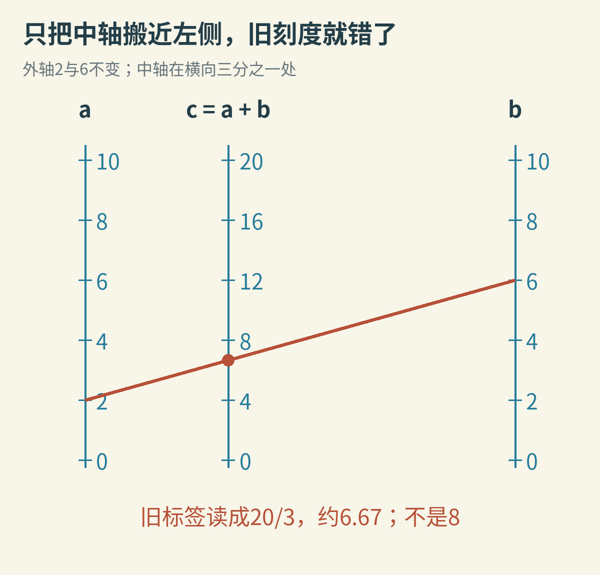

这并不是说列线图的三条轴永远必须等距。可以设计不等距的图，但必须让刻度比例和轴的位置一起配合。

我们暂时固定最容易手算的方案：三条等距、平行的直轴。

别低估这个限制。一个明确的小模型，比一个什么都能做却说不清前提的“大法”更有用。

## 6. 把高度换成函数，就不只会加法

现在先给三个“位置制造器”起个名字。

F(a)表示：输入数a，应该放到左轴的什么高度。

G(b)表示右轴的高度规则。

H(c)表示输出数c对应的一种变换。

如果左轴高度用F(a)，右轴用G(b)，中轴刻成H(c)/2，那么一条直线就要求：

H(c) = F(a) + G(b)

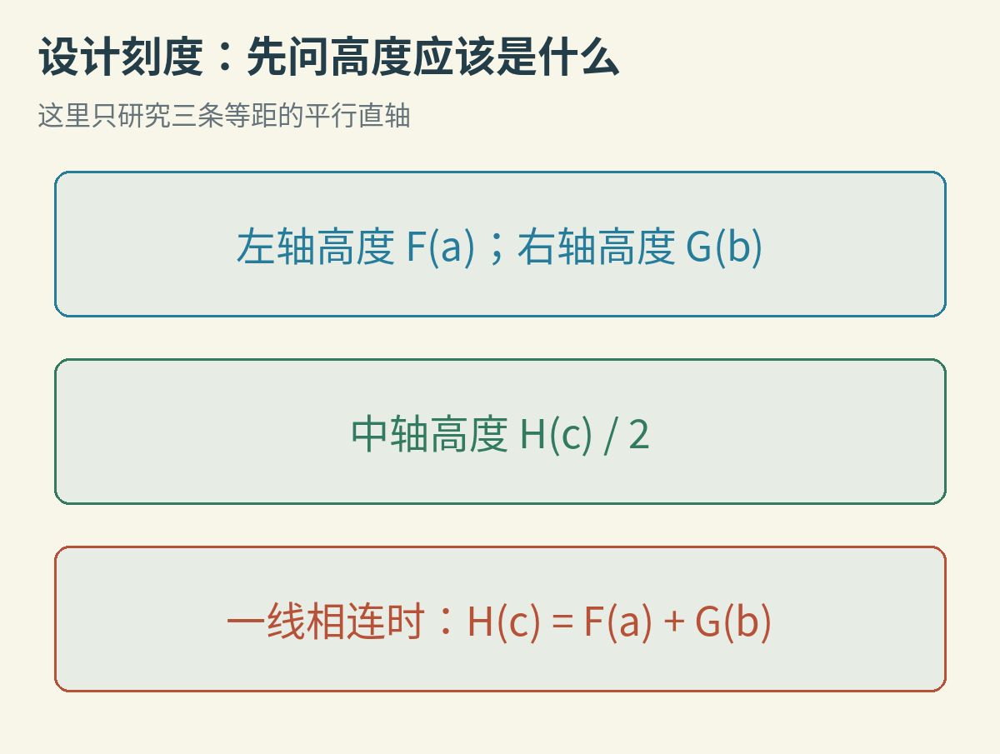

先别被字母吓到。刚才的加法就是最简单的一种：F(a)=a，G(b)=b，H(c)=c。

不同的高度规则，会把同一个几何动作变成不同的计算。这一次我们不改“连接两点”这个动作，改的是数字在轴上的地址。

## 7. 乘法为什么也能交给直线？

我们需要一种变换，能把乘法改写成加法。

对数正好满足：

log10(a×b) = log10(a) + log10(b)

log10表示以10为底的对数。它问的是“10取多少次方才能得到这个正数”。1对应0，10对应1，2约对应0.3010。你也可以把它暂时理解成一种数字地址：比值相同，对应的距离就相同。

[前一篇计算尺文章](https://zyuanming.github.io/tech-articles/articles/2026-10-11-slide-rule-logarithmic-distance/read.html)详细展开了这一点。不过不读前篇也能继续：这次你只需要接受上面那条乘法变加法的规则。

让左右两条轴的高度都是：

h = 100×log10(数值) 毫米

让中间轴的高度是：

h = 50×log10(数值) 毫米

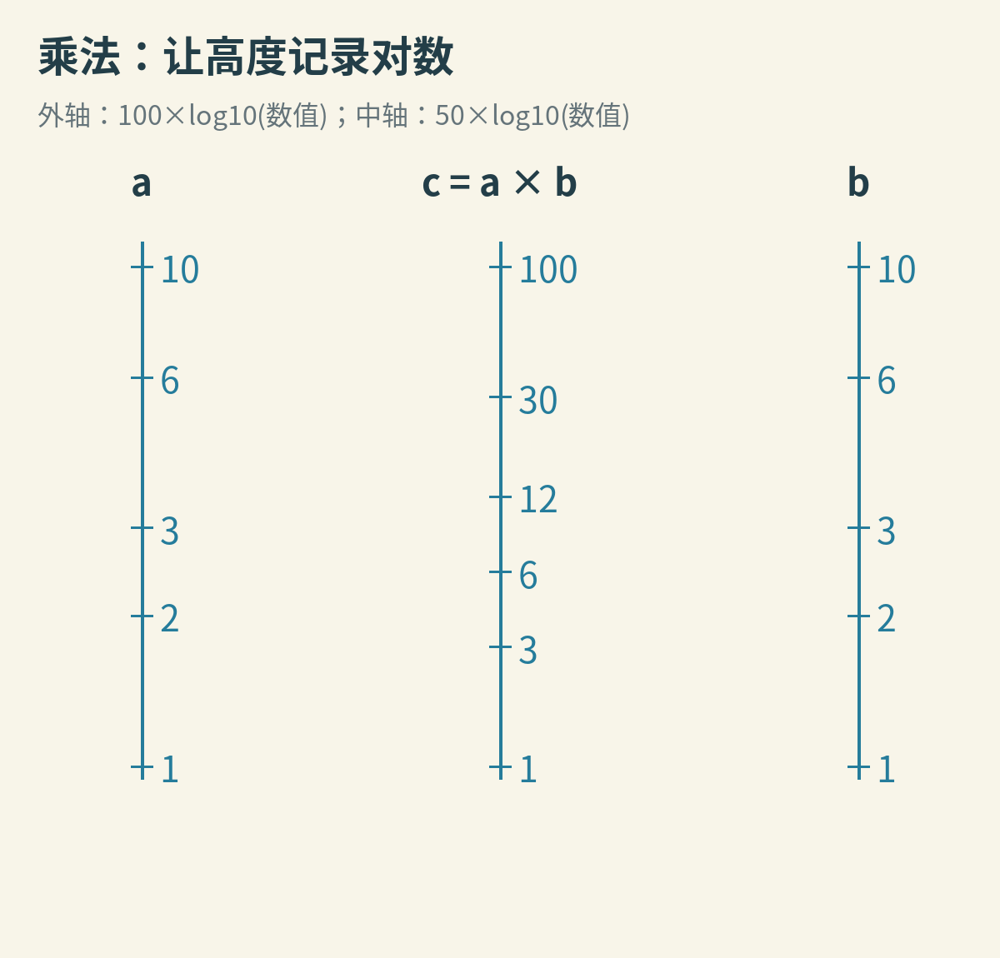

这里的100和50是我们选的理想制图尺度，并非某件古董的实测尺寸。正文示意图会整体缩放；随文纸页才按这些毫米坐标生成。

中间为什么又是一半？因为直线先把两个外轴的高度平均了一次。我们必须在结果轴上安排相应的比例。

连接左2与右6：

- 左端高度约30.103毫米；
- 右端高度约77.815毫米；
- 中间高度约53.959毫米；
- 中轴上，12的高度正是50×log10(12)，也约53.959毫米。

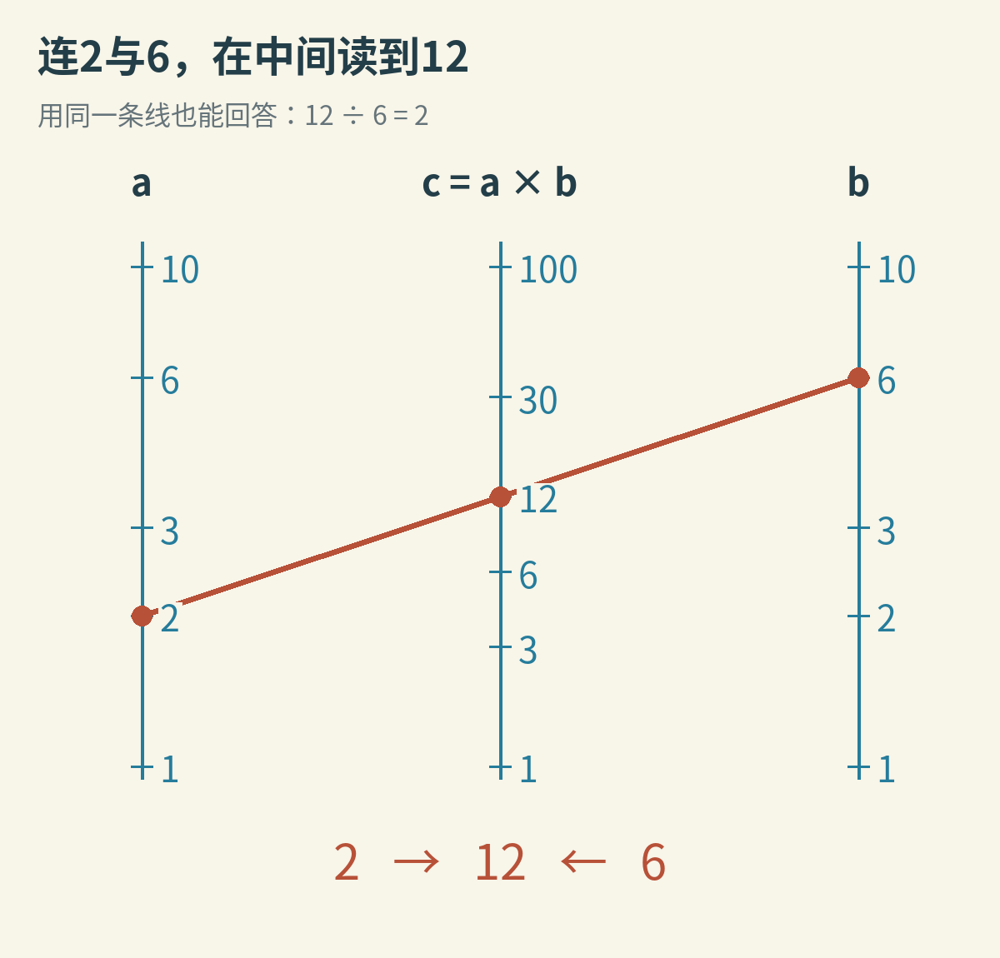

这些小数只是核查理想坐标，不能理解成纸尺可以读到千分之一毫米。真实纸上只能根据线宽和刻度估读。

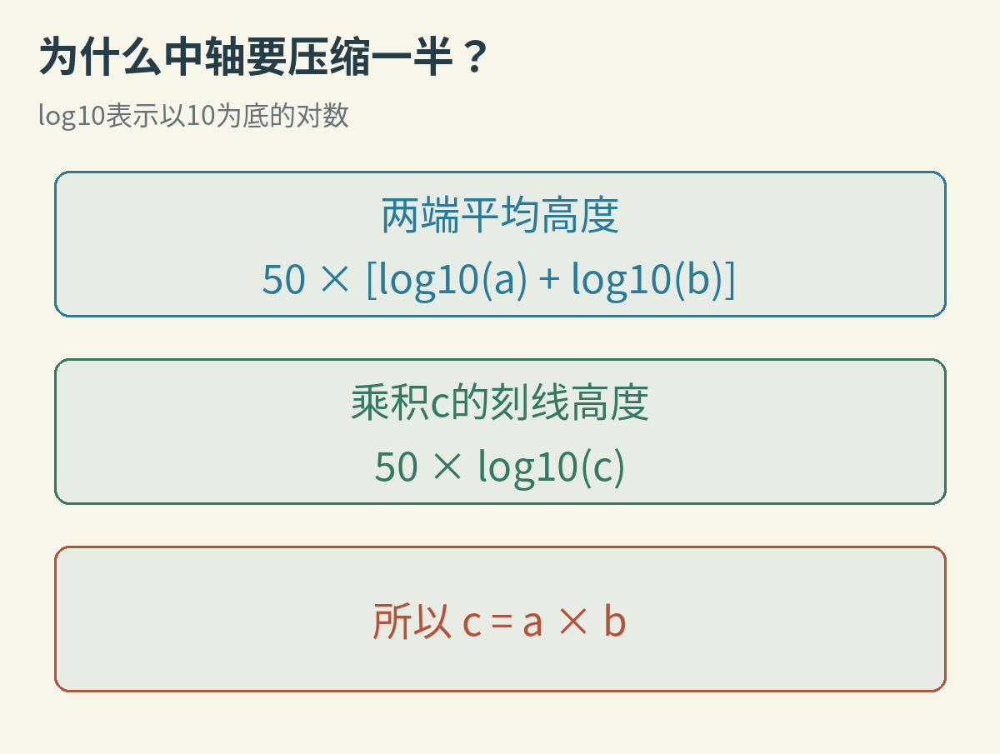

同一张图也能做除法。已知c=12、b=6，把直线通过中轴12和右轴6，左边就是2。

和普通的一段计算尺不同，这一张教学图明确标出了中轴1到100的完整数值，不需要把“12”只读成“1.2”再另补十倍。但如果输入或结果跑出了画定范围，仍然不能硬读，也不能未经约定就把刻度当成循环的。

## 8. 再换一种地址：两个电阻并联

下面换一道不用对数的题，看看这个思路是不是只会重复计算尺。

两个理想电阻分别为30欧姆和60欧姆，把它们并联，也就是两端分别接在同一对节点上。等效电阻是多少？

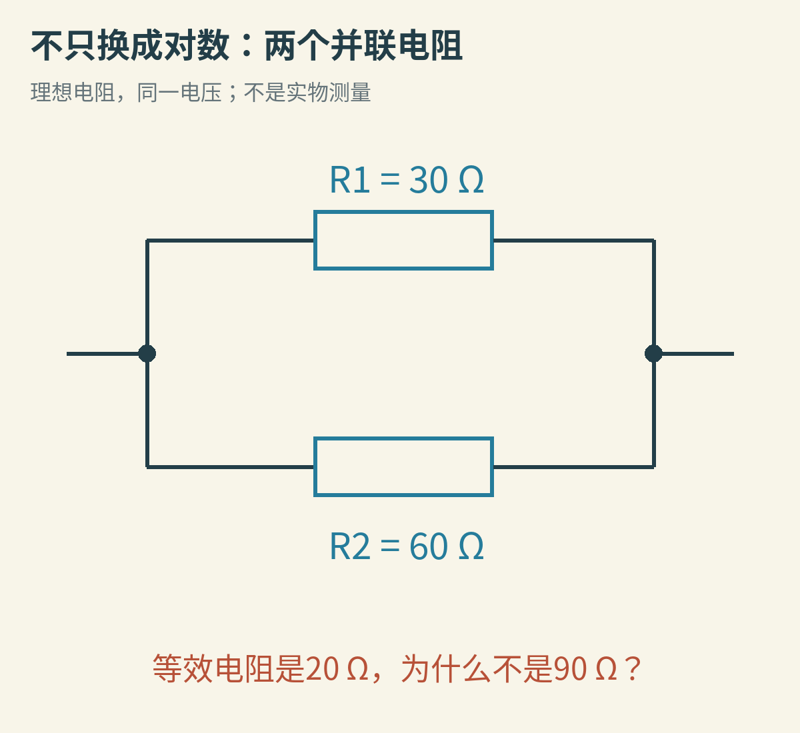

这里讨论的是理想电阻关系，不做带电实物操作，也不讨论温度、功率或器件误差。

并联的两个支路承受相同电压。为了好算，先设电压为1伏。根据I=U/R，两个支路的电流分别为1/30安培和1/60安培。

总电流是两者之和，即1/20安培。因此在同样1伏下，单个20欧姆电阻会给出相同的总电流。

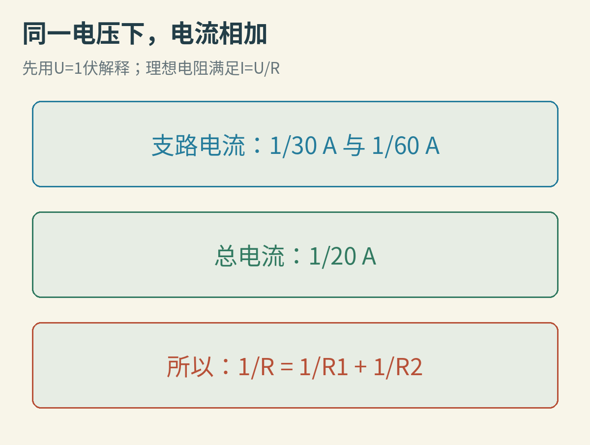

把共同电压约去，得到：

1/R = 1/R1 + 1/R2

R1、R2是两个支路阻值，R是等效阻值。倒数1/R也叫电导；阻值越小，同一电压下通过的电流越大。

你看，右边又是一个“两个东西相加”的关系。这回需要把数字换成倒数地址。

## 9. 倒数刻度的数字，为什么越来越挤？

选左右轴的高度为：

h = 1200/R 毫米

这里R的数值按欧姆代入。1200这个制图系数包含了单位约定，不是任意阻值单位都能直接共用的纯常数。

中轴改成：

h = 600/R 毫米

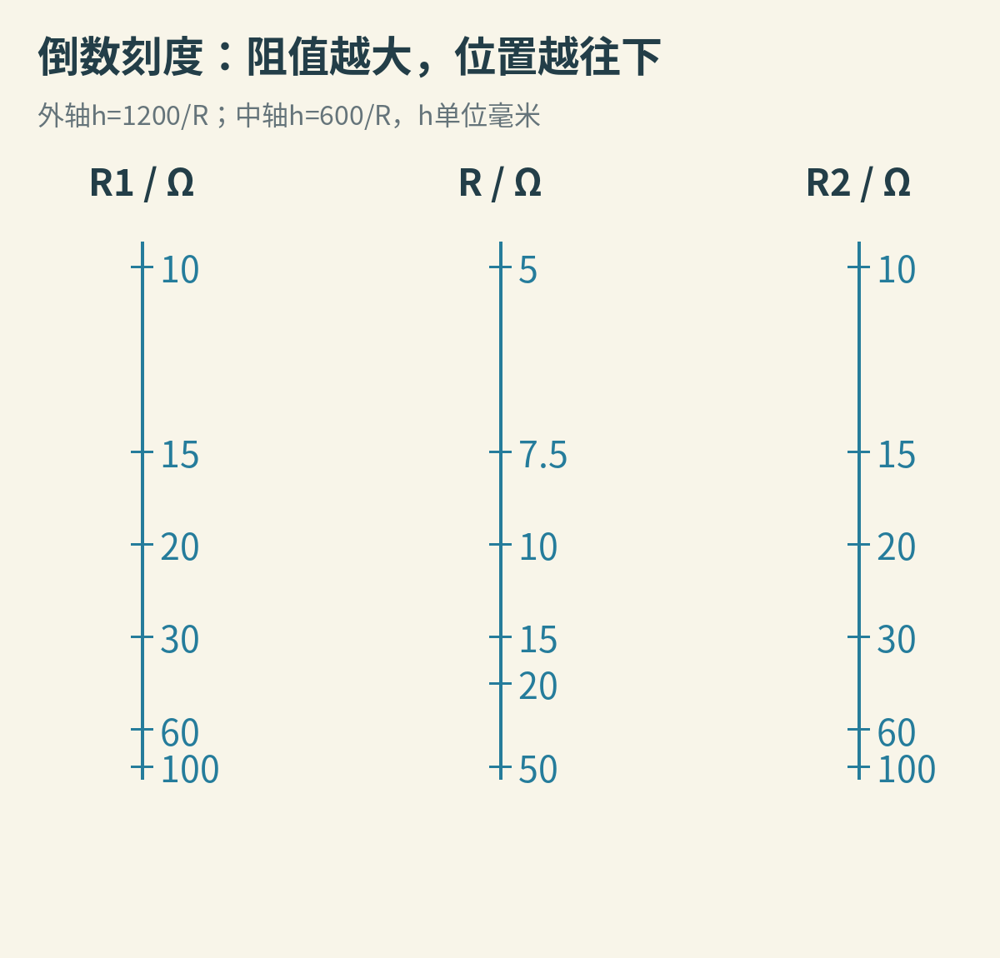

于是30欧姆在外轴的40毫米处，60欧姆在20毫米处。中间高度是30毫米；而中轴上，600/20也等于30毫米。

因此连线读到20欧姆。

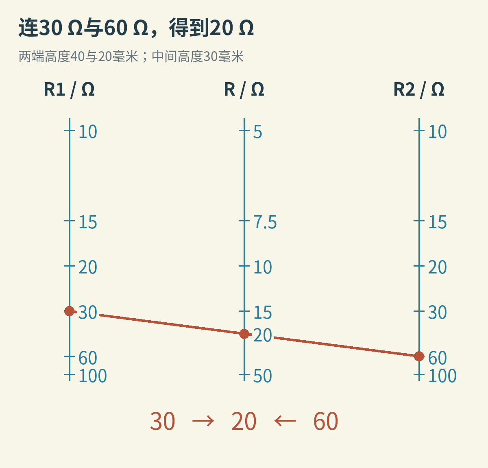

这个图的数字方向和刚才很不一样：阻值越大，倒数越小，位置越往下。数字增加也不再等距。先看轴上的标签，别把“越往上越大”当成所有图都必须遵守的规则。

还能做一个不依赖细刻度的检查：两个正的、有限的电阻并联，等效电阻应当小于其中任何一个。

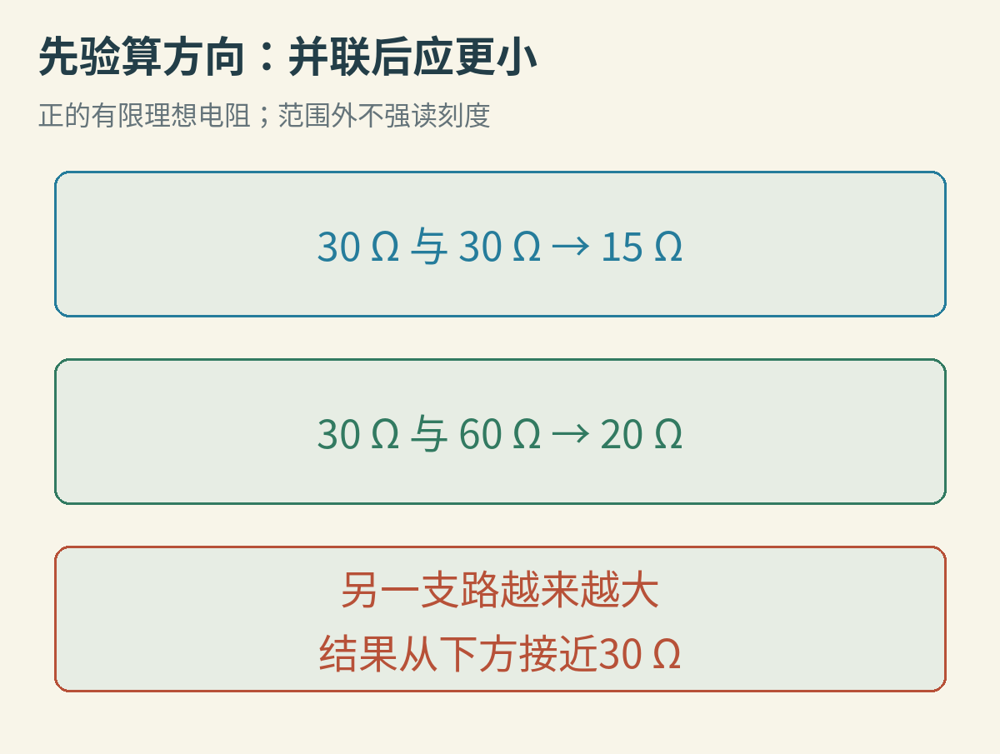

30与30并联得到15。另一支路从30变成60，结果升到20。如果另一支路阻值继续增大，它提供的电流越来越少，等效阻值从下方接近30，而不会超过30。

这是模型上的极限。它没有叫你去只画到100的刻度上寻找“无穷大”。公式的定义域，和纸上实际印出的范围，是两层不同的限制。

## 10. 读出很多小数，不等于真的知道很多位

现在你可能想把每条轴刻得非常密，让答案更精确。

问题在于，线不会无限细，眼睛也不会无限准。

用刚才的乘法中轴做一个小模型：h=50×log10(c)毫米。假设两端对齐完全正确，只在最后读取中轴交点时，纵向误差为正负0.5毫米。

把高度偏移代回去，读数会乘上10的正负0.01次方。真值12对应的读数区间大约是11.727到12.280，即约−2.28%到+2.33%。

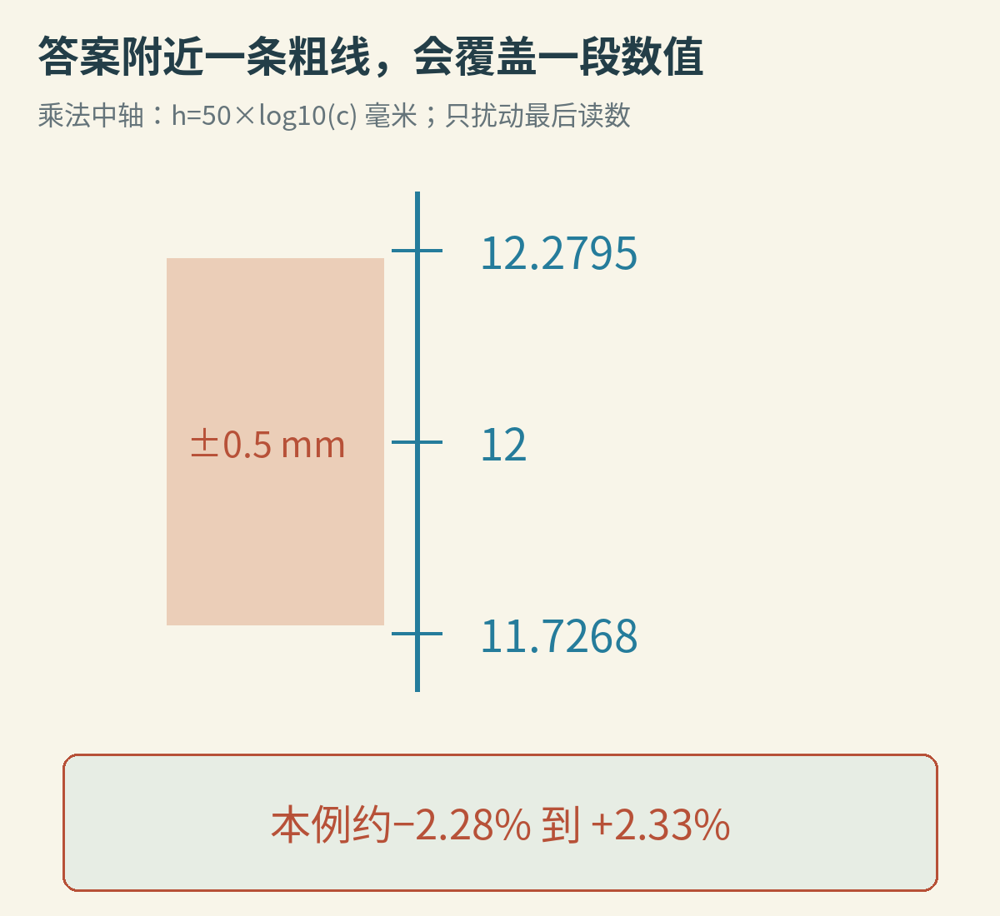

这里并没有宣称列线图通常只有这种精度，它也算不上一次实测。我们只分析一次特定尺度、特定误差来源；实际还会有两端对齐、纸张、印刷和线条角度等误差。

图做大，同样的数值差异就能分得更开。但也不能只给整张图贴一个“精确到两位小数”的标签。

看看倒数刻度就明白了：10到20欧姆，高度从120降到60毫米，差60毫米；50到60欧姆，高度从24降到20毫米，只差4毫米。同样增加10欧姆，留给眼睛的空间完全不同。

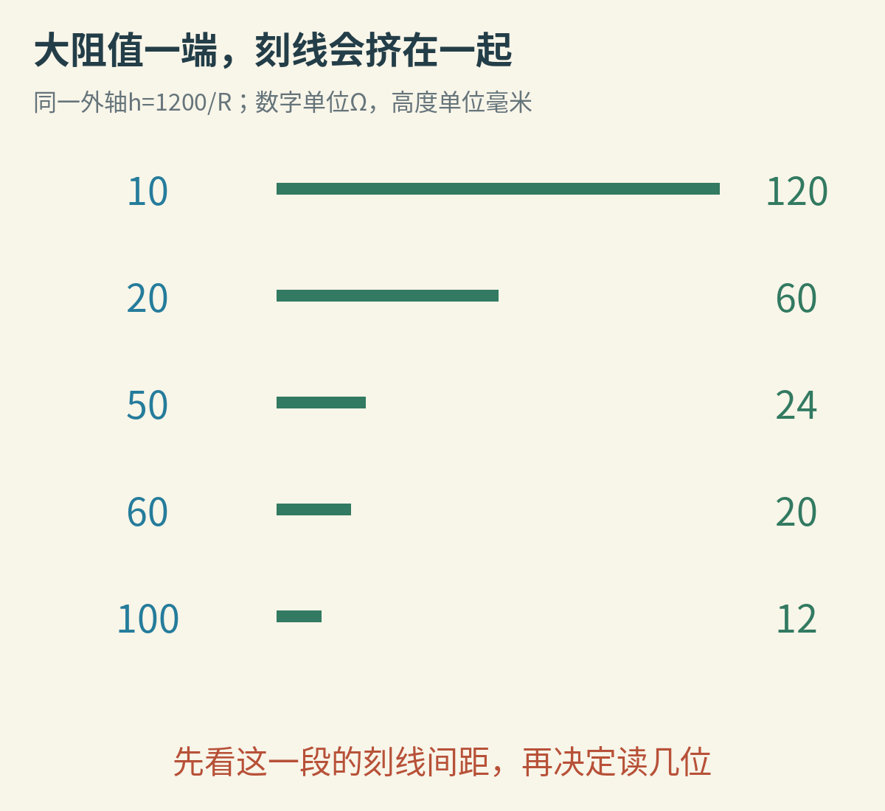

**精度不是图上写了几位，而是相邻结果到底隔得有多远，以及你能把位置确定到什么程度。**

d’Ocagne在1925年原书第29至30页也讨论了刻度布局不便、指标与刻度相交角度太小的问题。形式上能表示一个方程，还不等于已经造出了一张好读的图。

## 11. 这张纸有哪些明确的不能？

第一，它只接受设计范围内的输入。

本文乘法页的两端是1到10，中轴是1到100。实数对数不能给0或者负数提供这里需要的有限地址，不能把0挤到1旁边假装解决了。

电阻页只画两端10到100欧姆、中轴5到50欧姆。阻值关系本身可以用于更广的正数，但这张有限的纸图没有自动扩大范围的本领。

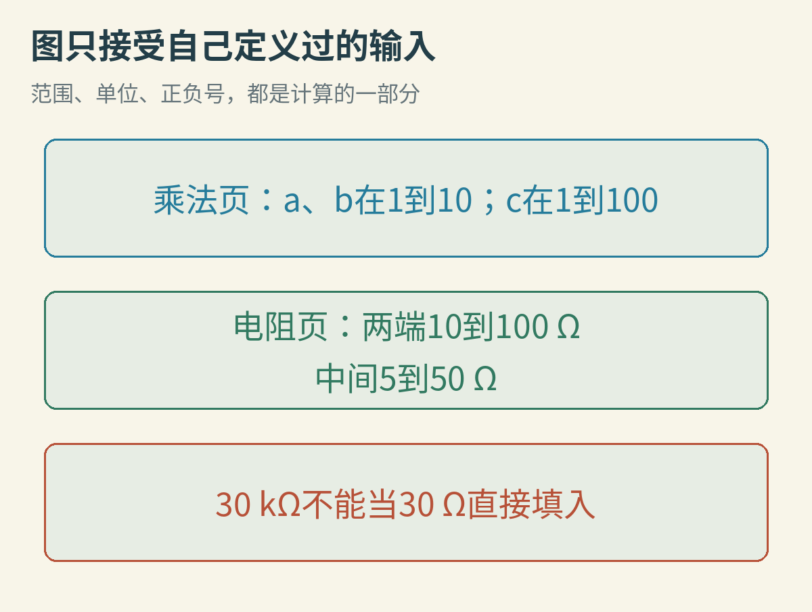

第二，单位必须一致。30千欧姆不能直接当作30欧姆使用。若想把整张电阻图解释为另一套共同单位，需要明确地连同全部输入、输出标签一起改变；不能只把一条轴悄悄换单位。

第三，它没有万能求方程的能力。

我们推导的是能化成H(c)=F(a)+G(b)的三条等距平行轴方案。更复杂的列线图会使用曲线、多次对齐或者额外结构；不能由这篇的几个例子推出“任意公式都能用三条直尺一连算完”。

即使形式适合，也必须考虑输出是否唯一。如果H(c)=c²，同一高度可能对应正负两个c；制图时可以限定c≥0，但不能把这个限制藏起来。

## 12. 打印时，真正不能弄乱的是什么？

最简单的操作是把完整纸页一起打印，别分别裁出三条轴再凭感觉摆放。

不过，还有一个值得自己推敲的细节：整张图横向和纵向的缩放比例不同，就一定不能算了吗？

不一定。对整张图一起作平移、旋转或者可逆的线性拉伸，原本共线的点仍然共线。全图统一的非等比缩放，虽然改变了角度和外观，也不会凭空破坏这三个点的共线关系。

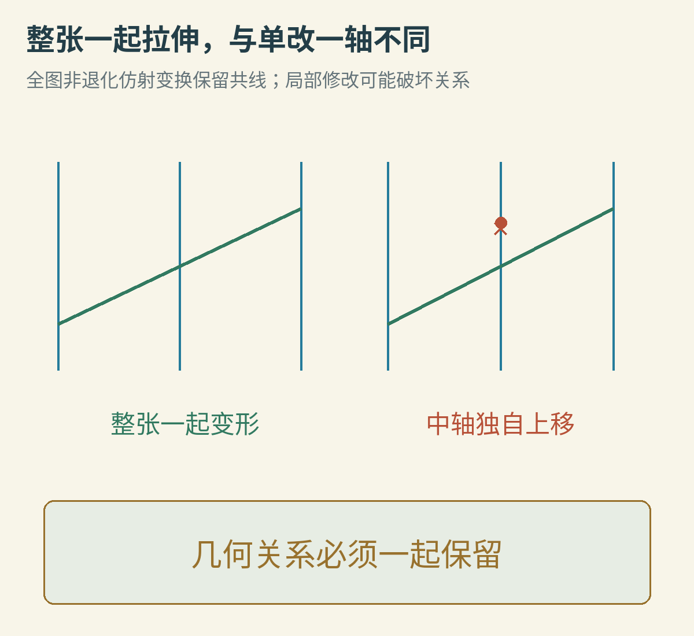

但只移动中轴，或者只拉长某一条轴，通常会改变刻度之间的配合。第五节已经给了一个实算反例。

数学关系保留，也不等于读数体验相同。把整图压得极扁，刻线仍然可能挤得无法辨认；纸页受局部扭曲、卷曲，也不能简单看作整图共同的线性变换。

这能帮我们区分两件事：图在几何上是否仍然成立，以及它在人手里是否仍然好用。

## 13. 它与计算尺，到底哪里不同？

两者都把数值变成位置，也都需要估读。但保存关系的动作不同。

计算尺的基本做法，是让两套刻度相对滑动，把距离拼接或者减去。本文的列线图固定三套刻度，用一个活动的直线指标，让三个位置满足共线条件。

所以，本篇不是再换一种外形讲对数。加法、乘法、并联倒数这三个例子，展示的是同一个“设计高度函数”的框架。

答案并没有作为一份无限长的表被逐项存起来。被保存的是生成答案的关系，以及这个关系允许我们省掉的重复运算。

## 14. 做一张纸图，再故意让它失效

这里有三份原创可打印SVG：[加法页](examples/paper-addition.svg)、[乘法页](examples/paper-product.svg)、[并联电阻页](examples/paper-parallel.svg)。它们是矢量文件，放大不会因原图像素不足而模糊；实际打印仍受纸张和打印机限制。

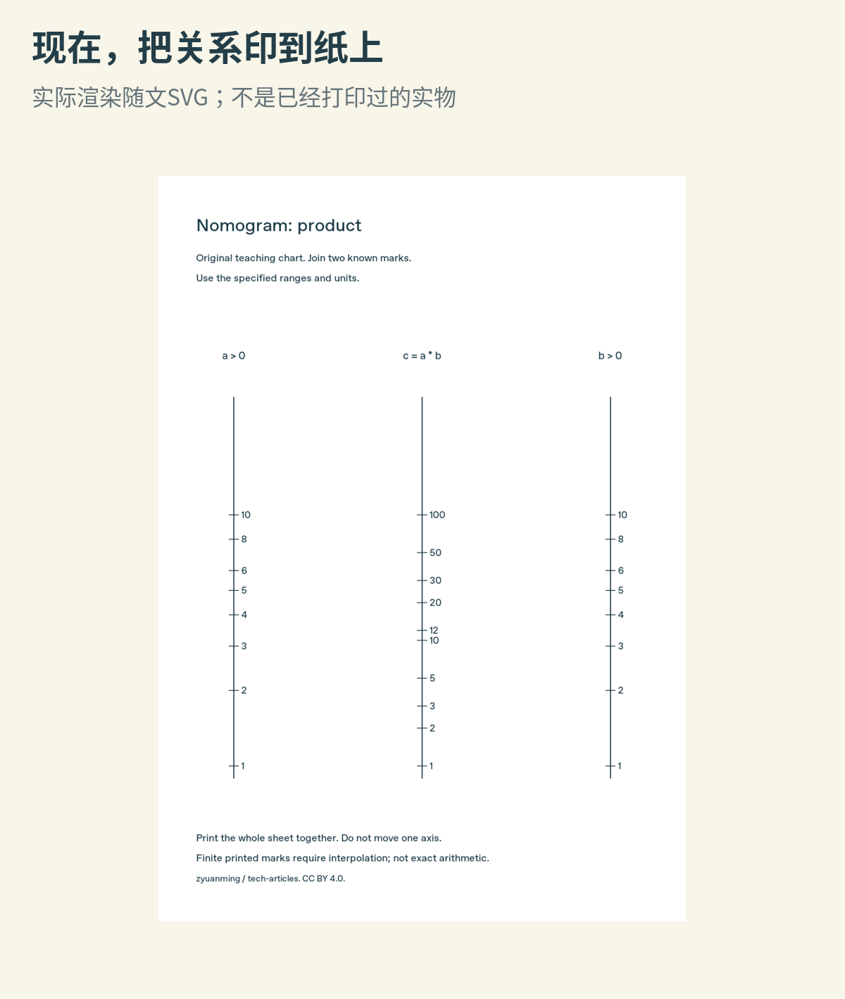

这是交付文件的渲染，不是已经打印、操作或测量过的纸尺照片。图上的有限刻线需要插值估读，不能要求它交出任意多位结果。

可以这样试：

1. 在加法页上连2与6，确认中轴读8。再连中轴11与右轴8，向左延长看看是不是3。
2. 在乘法页上连2与6，观察中轴12的位置。保持这条线，再把问题改成12除以6。
3. 在电阻页上连30与60，看看结果是否接近20。先不用精读，检查它是否小于30。
4. 复制一张加法页，只把中轴横向移走一点，再用同一道题测试。什么前提被你改掉了？
5. 把整张图一起横向压缩，再试一遍。为什么这一次不必自动判错？

最后两步，比多算十道题更能检验你是否真的理解了它。

[随文Python实验](examples/nomogram_lab.py)只用标准库，能重新生成三张纸图，并检查理想坐标。

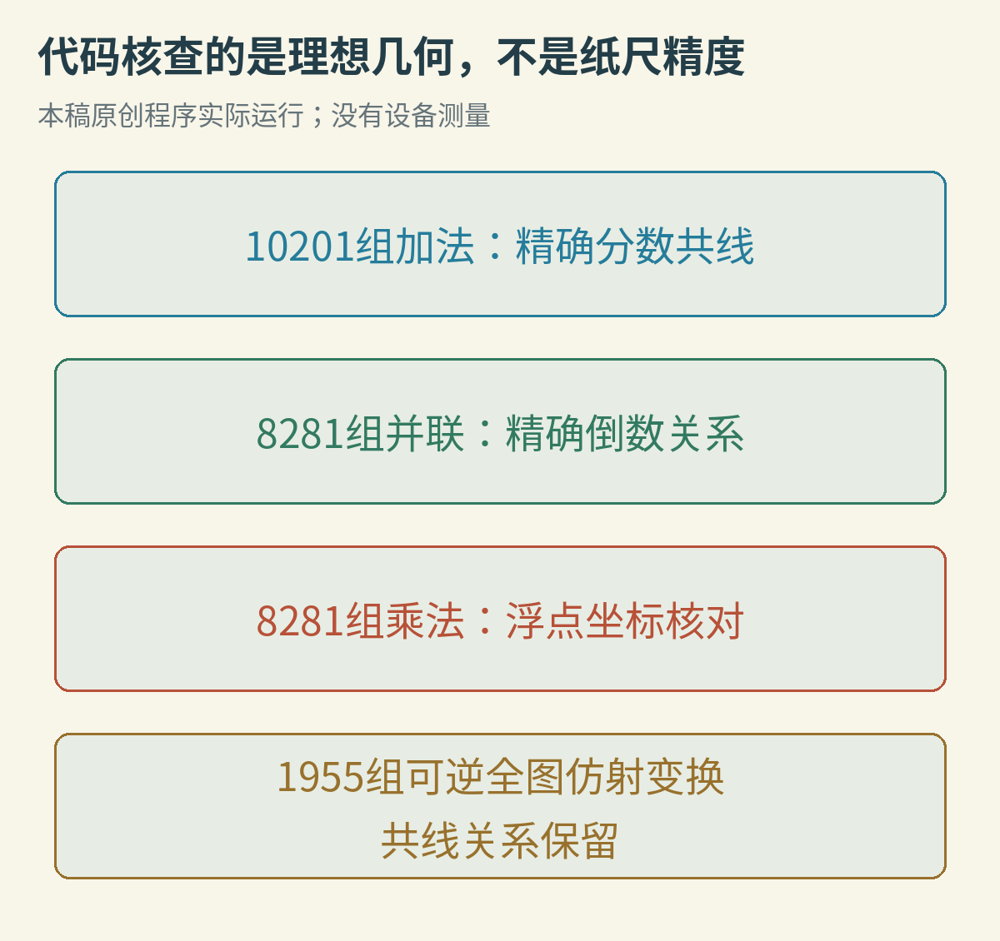

本稿实际检查了10201组加法输入的精确分数共线关系、8281组正整数电阻的精确倒数关系、8281组正数乘法的浮点坐标，以及2000次固定种子试验中1955个可逆的全图仿射变换。其余45次变换矩阵不可逆，被排除在该项“可逆变换”检查之外。

这验证的是有限输入上的代码与几何一致性，不是历史器械或纸页的精度测量，也不替代前面的推导。

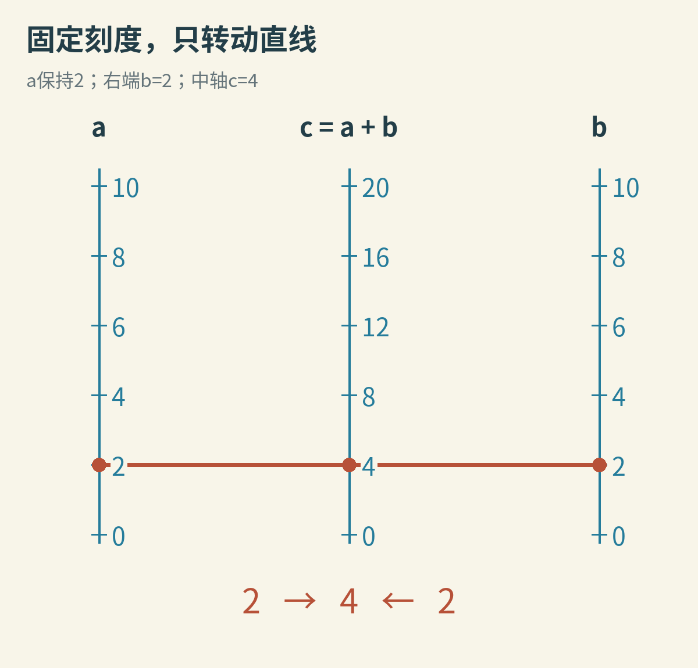

动画使用同一套固定刻度，右端依次为2至9；它展示直线位置如何改变，未模拟手的抖动或测量误差。

现在再看开头那张纸：直线依然只会做直线擅长的事。真正巧妙的是，人选择了什么刻度，让它恰好替自己完成想要的计算。

许多算法与工具都藏着类似的想法：与其每次用力重复同一个过程，不如先找一种表示，让正确的关系能够自己站出来。
