# 地板没有弯，格子为什么折了？透视校正把“平均”放回正确的地方

想象你给游戏里的一块地板贴上棋盘格。四个角的位置对，远端比近端窄，外轮廓也很像一块向远处延伸的板子。可是板子里面的格子像被折了一下。

更奇怪的是：地板由两个三角形拼成。你没有移动任何一个角，也没有换纹理，只把它内部的对角线换了个方向，格子的形状竟然跟着变了。

这次我们不先追查显卡。先问一个小得多的问题：**屏幕上走到一条线的一半，真的等于在物体上走到一半吗？**

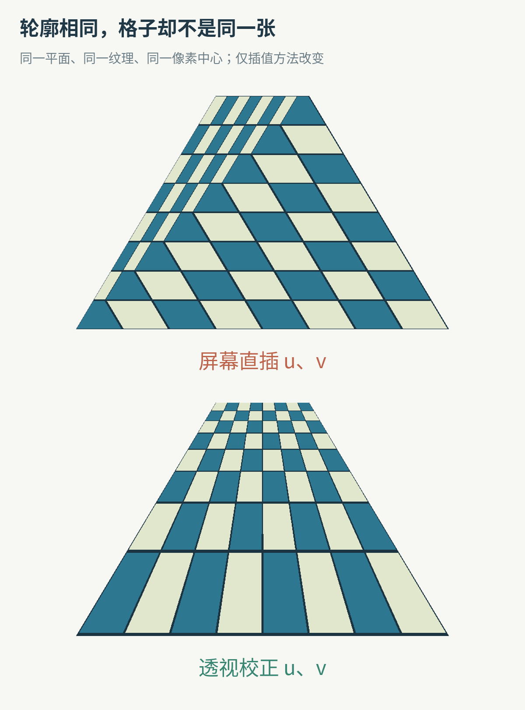

这是本文自写CPU程序的实际输出，不是游戏截图。上下两张使用相同平面、8×8格子纹理、像素中心和取色规则，只改变纹理坐标的插值方式。格子边上的细小锯齿暂且放在一边，我们先看大的几何走向。

## 1. 一段老教程，为什么还值得慢慢读？

1995年，Chris Hecker在《Game Developer》写下《Perspective Texture Mapping》的第一篇。他想用基础代数和几何，把透视纹理映射的依据讲清楚，再提供能落地的实现。他在开篇说，自己寻找直观说明和可用代码时，感到资料并不理想。这是作者对当时学习材料的亲身判断，不是“此前没人知道这个算法”。

第一篇原本预告一个两篇的安排。[他自己保存的文章目录](https://chrishecker.com/Miscellaneous_Technical_Articles)最后列出了从1995年4/5月到1996年4/5月的五篇：基础、光栅化、端点与映射、近似，再到时间与优化。

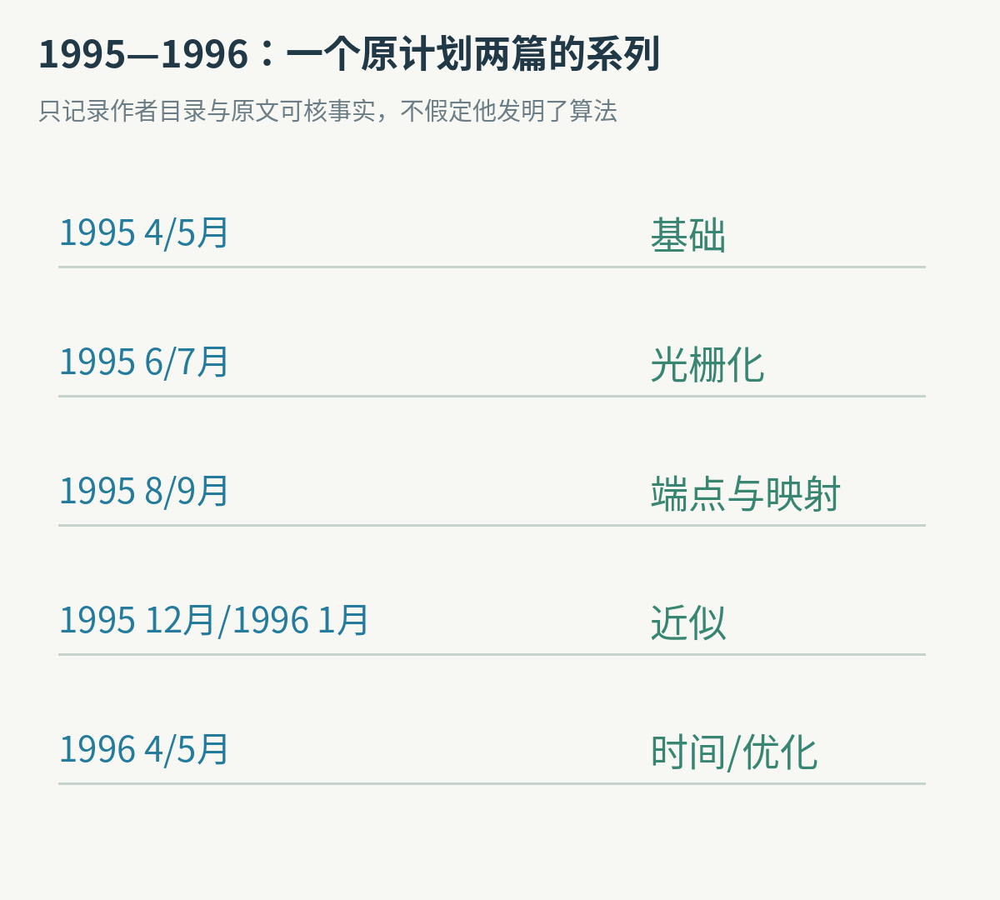

一件“把图片贴上去”的小事，会牵出几何、像素边界、取整与性能。我们今天只把其中一根线拉直：为什么直接平均纹理坐标会出错，又该平均什么。

这不要求你读过前面的光栅化文章。会看比例、会算分数，就能先走完主例子。后面再把一条线扩展成三角形。

## 2. 先分清两种地址

把纹理想成一张画有方格的纸。我们给纸上的位置起两个名字：u表示从左向右走了多少，v表示从下向上走了多少。在本文的约定里，它们都从0变化到1。

例如，(u,v)=(0,0)是左下角，(1,1)是右上角，(1/2,1/2)是纸的中心。它们是**纹理坐标**，不是屏幕像素编号。

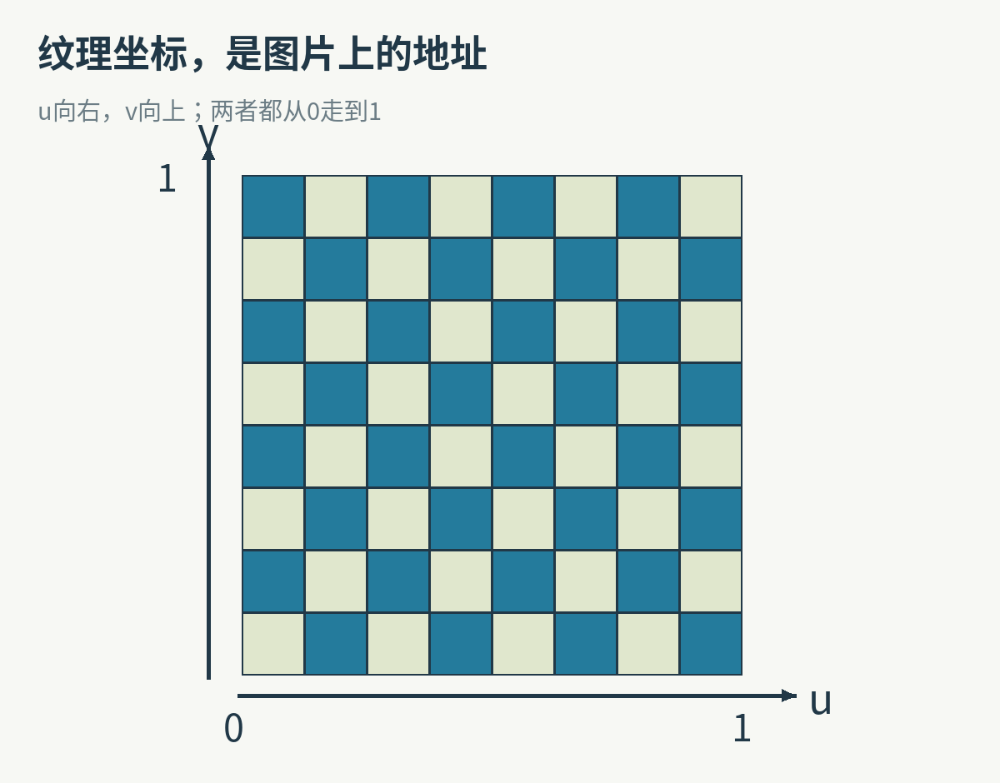

渲染器最终面对的是屏幕上的一个采样位置。它要先找到这个位置对应纸上的哪个地址，再去那个地址取颜色。

“已知顶点的地址，补出中间地址”叫插值。最熟悉的插值是平均：两端温度分别是10和20，若假设沿线均匀变化，中间就是15。

麻烦藏在“沿哪条线、在哪个空间里均匀变化”。透视投影会改变比例。物体上的均匀，不会自动变成屏幕上的均匀。

## 3. 把整个地板缩成一条边

我们给自己造一个很小的相机模型。

相机位于原点，朝前方的+Z方向看。X表示横向位置，Z表示沿前向轴的距离；成像面放在Z=1处。本文暂时只看一个二维切片，所有物体点都在相机前方。

由相似三角形，一个物体点(X,Z)投影到成像面的位置是：

**x = X/Z。**

大写X是物体的横向位置，小写x是投影后的位置。一个字母大小写的区别，在这里真的代表两个空间。

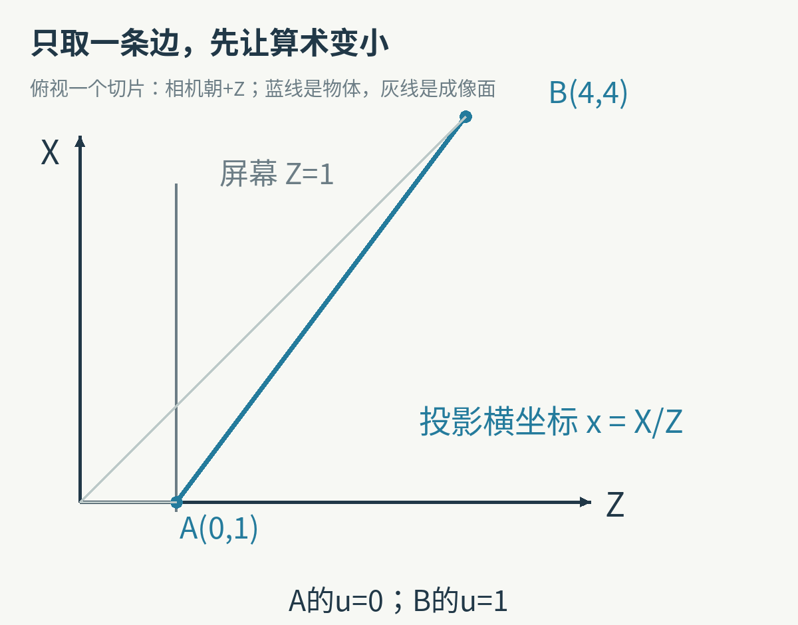

取两个端点：A=(0,1)，B=(4,4)。它们的屏幕位置分别为0/1=0、4/4=1。让纹理地址u沿物体边从A的0，均匀增加到B的1。

现在可以提两个看起来很像、答案却不同的问题。

## 4. 在物体上走一半，会落到屏幕哪里？

物体线段的中点，两个坐标分别平均：

X=(0+4)/2=2，Z=(1+4)/2=2.5。

再做投影：x=2/2.5=0.8。

所以，**物体走到一半时，屏幕上已经走到了0.8**。它并没有落在屏幕中点0.5。

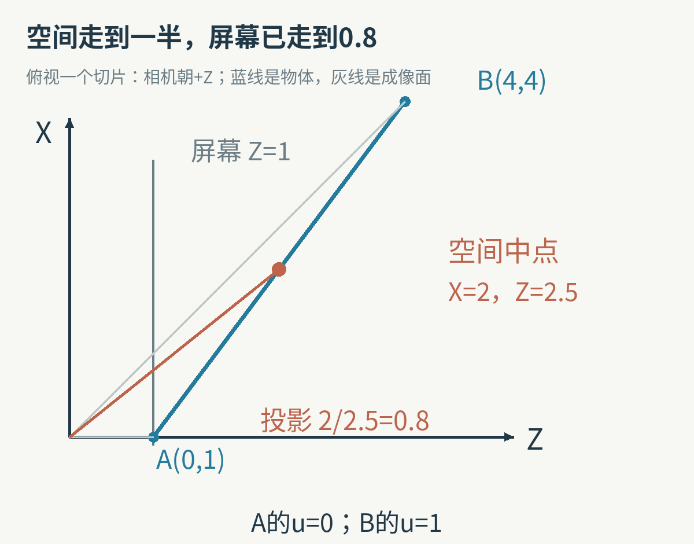

这就是近大远小在一条边上的具体表现。靠近相机的那一段，占据了更多屏幕长度。既然“走一半”都对不上，直接拿屏幕比例当纹理比例，自然可疑。

## 5. 反过来：屏幕的一半，对应物体上的哪里？

用t表示沿物体从A走向B的比例。t=0在A，t=1在B。

走到比例t时，X从0变成4t；Z从1变成1+3t。于是屏幕位置是：

x = 4t/(1+3t)。

我们要找屏幕中点，令x=1/2：

4t/(1+3t)=1/2。

两边乘以2(1+3t)，得到8t=1+3t，所以5t=1，t=1/5。

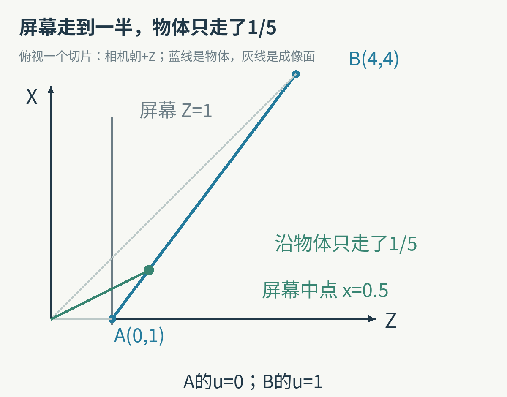

纹理地址u沿物体均匀变化，因此这里应该取u=1/5，而不是1/2。对应的空间坐标是X=4/5、Z=8/5；重新相除，(4/5)/(8/5)=1/2，验算成立。

为了不再混淆，我们把屏幕上从0走向1的比例记为s。本例中s恰好就是屏幕坐标x。解同一个方程，可得：

**u=t=s/(4−3s)。**

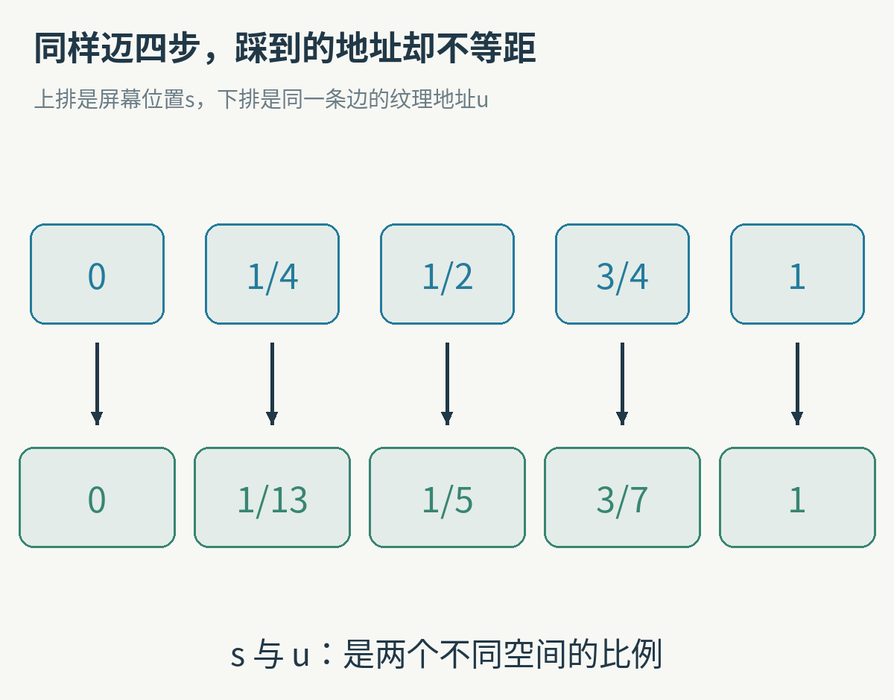

屏幕每次增加1/4，纹理地址依次是0、1/13、1/5、3/7、1。增量并不相等。出错的不是平均运算，而是把两个空间的比例当成了同一个东西。

## 6. 既然u会弯，有没有什么量仍然走直线？

从刚才的t=s/(4−3s)出发，物体深度是：

Z=1+3t=4/(4−3s)。

这不是s的线性函数。但把它倒过来：

**1/Z = (4−3s)/4 = 1−3s/4。**

好消息出现了：1/Z随屏幕比例s线性变化。端点从1走到1/4，直接按屏幕比例插值就对。

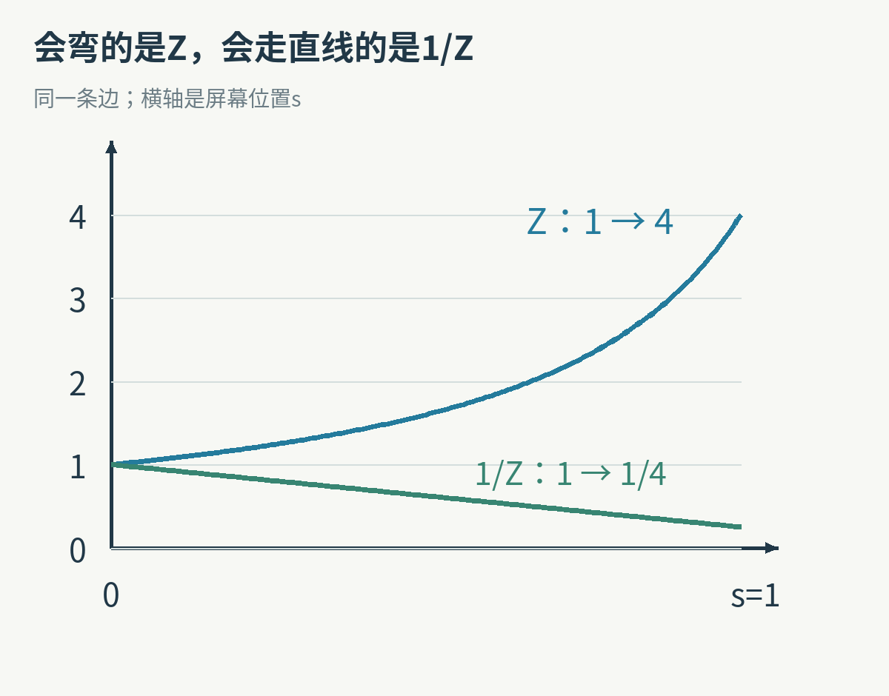

这还差一步。我们需要纹理地址u，不只是深度。试着看u/Z：

u/Z = [s/(4−3s)] ÷ [4/(4−3s)] = s/4。

它也变成直线了。

于是办法不再是“直接插u”，而是分开维护两本账：一本记1/Z，一本记u/Z。两本账都能沿屏幕线性插值。最后用第二本除以第一本，恢复u。

## 7. 用屏幕中点再算一次

两个端点预先准备的数据如下：A处1/Z=1、u/Z=0；B处1/Z=1/4、u/Z=1/4。

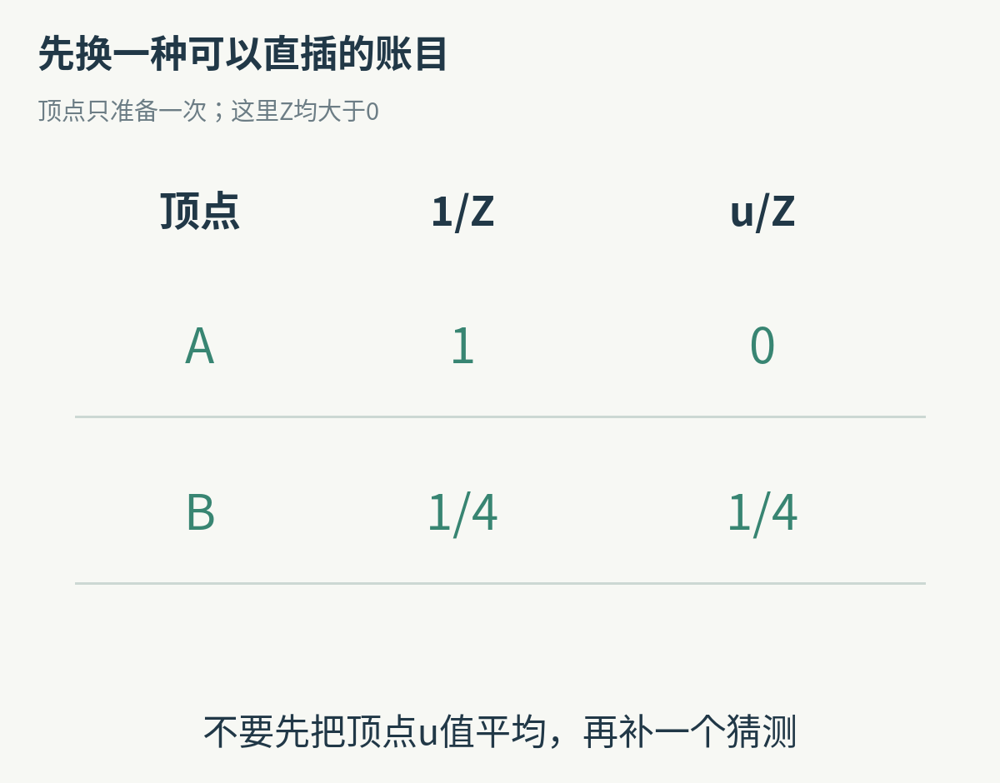

屏幕中点对两端各取一半：

1/Z的插值结果 = (1/2)×1 + (1/2)×(1/4) = 5/8。

u/Z的插值结果 = (1/2)×0 + (1/2)×(1/4) = 1/8。

最后u=(1/8)/(5/8)=1/5。它与直接解投影方程得到的答案完全一样。

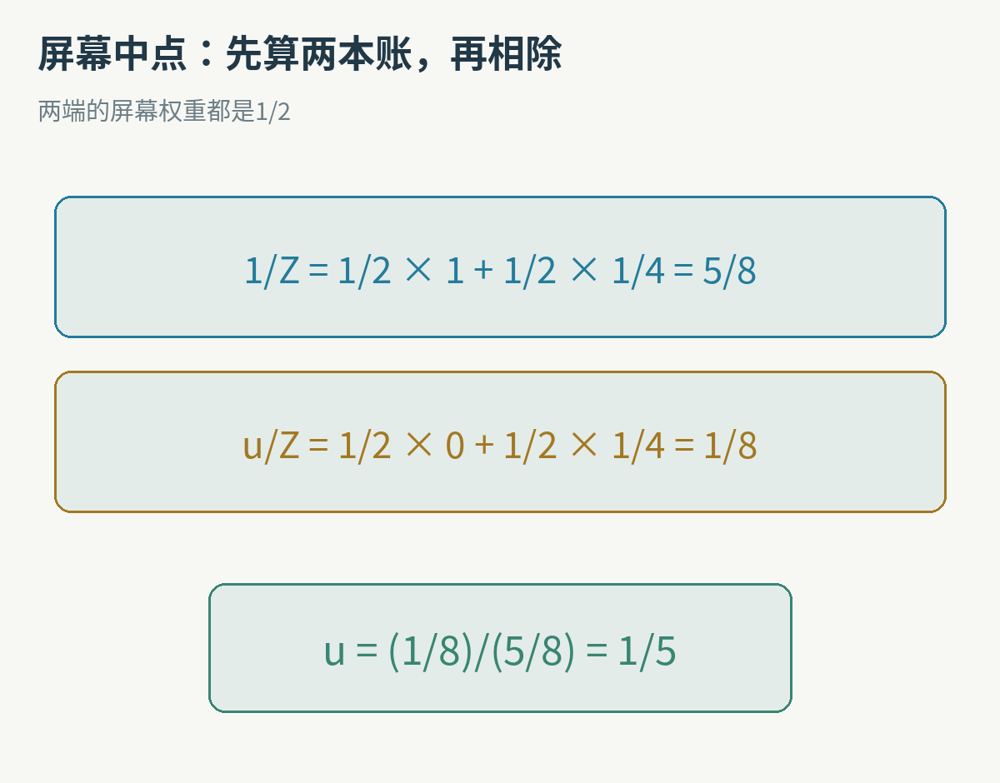

这就是本文的核心技巧：**先变换成适合屏幕线性插值的量，插值后再还原。**

它并不只对我们挑的整数成立。对于正深度端点，屏幕比例为s时，一般的纹理地址可写为：

u = [(1−s)×uA/ZA + s×uB/ZB] ÷ [(1−s)/ZA + s/ZB]。

A、B表示两端，uA、uB是纹理地址，ZA、ZB是各自的相机深度。分子、分母每个符号都来自刚才那两本账。

## 8. 一个可以自己改数的程序

下面只实现这条边上的计算，不连接图形接口。输入深度须为正，s限定在0到1之间。

```python
def perspective_u(s, z_a, z_b, u_a, u_b):
    if not (0 <= s <= 1 and z_a > 0 and z_b > 0):
        raise ValueError("bad s or depth")
    inverse_z = (1 - s) / z_a + s / z_b
    u_over_z = (1 - s) * u_a / z_a + s * u_b / z_b
    return u_over_z / inverse_z

print(perspective_u(0.5, 1, 4, 0, 1))
```

实际用Python 3.12运行，输出0.2。可以做三次小改动：

- 把两端深度都设为4。中点的u是不是回到0.5？
- 保持近端为1，把远端从4改成9。中点的u会向哪一端靠近？
- 交换两端的深度和纹理地址，再把s改成1−s。应当得到同一物体点的地址。

第二问的答案是0.1。它提醒我们：深度差异越大，直接把屏幕中点当纹理中点，可能错得越明显。这里讨论的是坐标误差，不是画质评分或运行速度。

## 9. 一条边懂了，三角形怎么接上？

屏幕上的三角形有三个角。一个内部点的位置，可以由三个角的坐标加权得到；三个权重非负，合起来等于1。这组权重叫重心坐标。

例如，屏幕三角形A=(0,0)、B=(4,0)、C=(0,4)中的P=(1,1)，满足P=(1/2)A+(1/4)B+(1/4)C。横纵坐标分别算一遍，都是1。

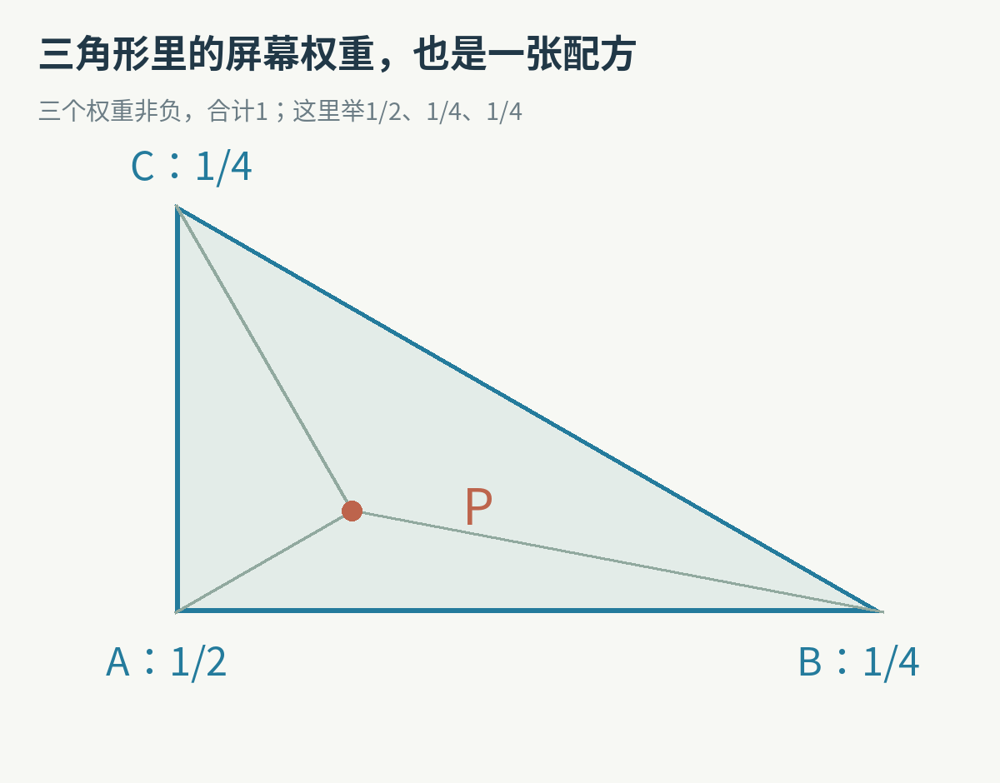

把三个屏幕权重记为a、b、c，不要把它们直接当成空间表面的权重。仍然先对三份u/Z加权，再对三份1/Z加权，最后相除。

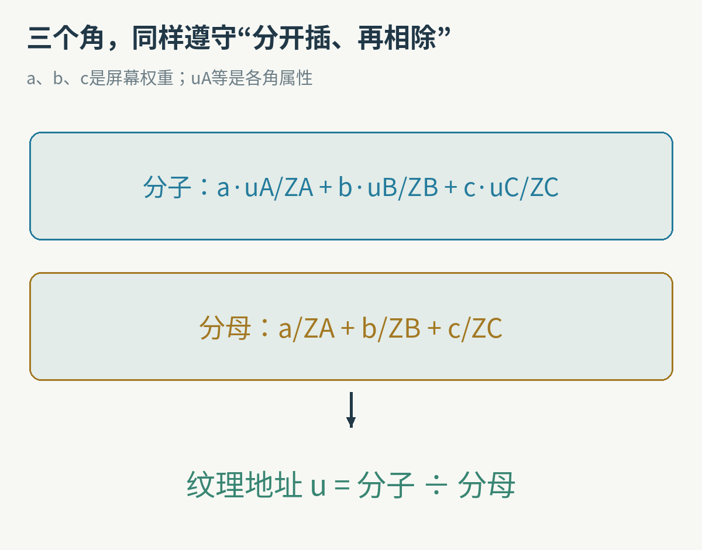

v也用同样的方法。我们不需要先给每个屏幕点重建完整三维位置，才有办法找到纹理地址。

这一步假设属性在空间三角形上按线性方式变化。它不会自动修好一套本来就错误或不连续的UV设计，更不会把弯曲曲面变成精确的平面。

## 10. 换对角线的实验，现在能解释了

回到开头的四边形。实验中的纸面用两个纹理坐标参数描述：

X=−1+2u，Y=−1+2v，Z=1+3v。

当u、v从0走到1时，它们覆盖一块平面。近边Z=1，远边Z=4。四个角按左下、右下、右上、左上记作A、B、C、D。

先沿AC切成两个三角形，再沿BD重新切一次。两种切法保留相同的四个角与UV。

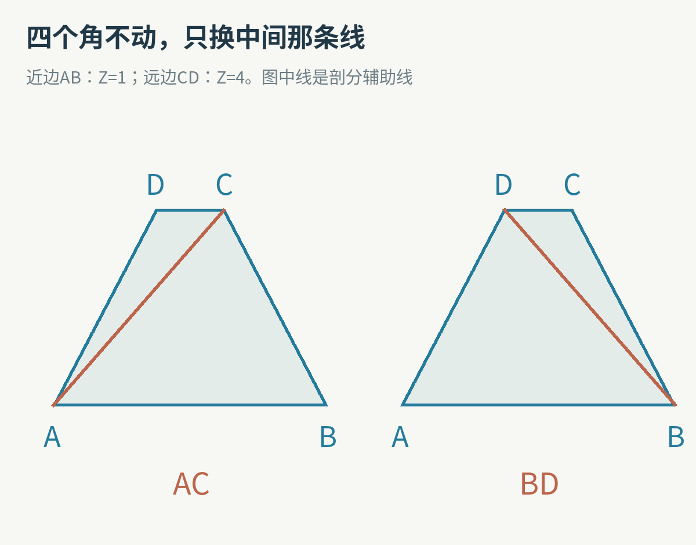

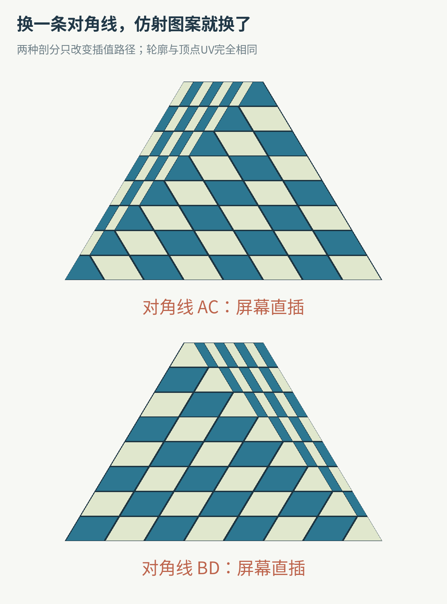

直接在屏幕上插值u、v，相当于在每个三角形里建立一套屏幕线性地址关系。换了三角形，内部关系可能就变了。

但请注意：**图案折向，不等于共享边上必有一条值不连续的裂缝。** 两个三角形在共享边两端使用相同属性，仿射插值也可以在整条共享边保持数值连续；真正变化的可能是跨边后的变化率，以及四边形内部的映射方式。

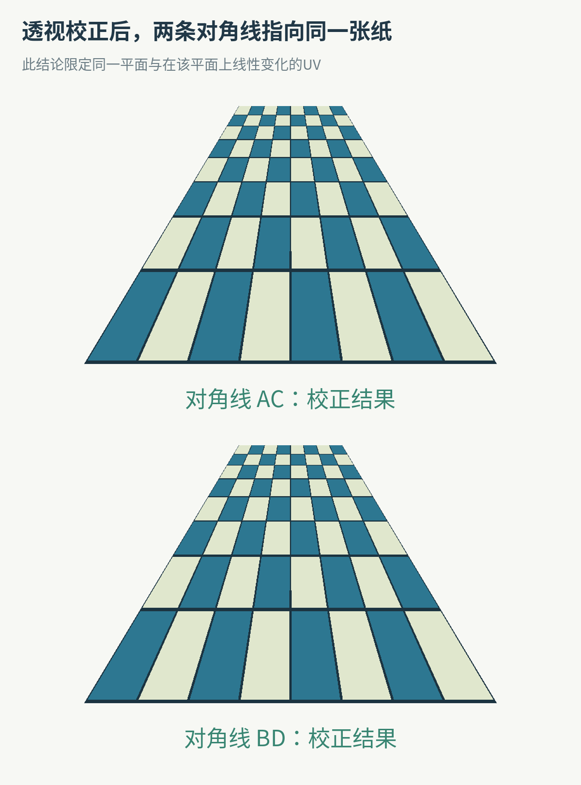

做透视校正后，两种切法都应对应同一张平面纸上的地址。因为这次我们的四个角确实共面，UV又在该平面上线性变化，所以不同对角线不该改变理想的内部映射。

这个结论有条件。随意扭成非平面的四边形，或给四个角设置不符合上述线性关系的属性，不能照搬“换对角线一定完全一样”。

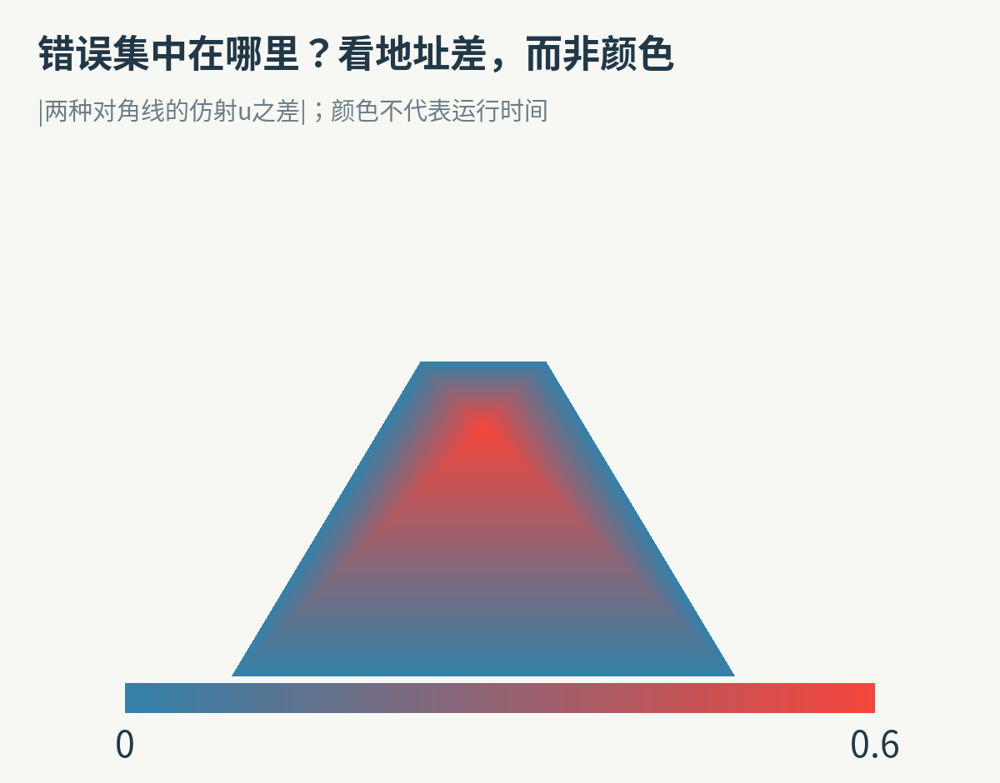

热图直接比较地址差，避免“两个错误地址恰好落进同色格子，看起来没差”的遮掩。本文这块纸的屏幕中心，差值能达到0.6。

## 11. 别让实现自己给自己发奖：换一种验算

插值程序有可能整套写错，还让两个结果错得很一致。因此我们另走一条几何道路：从屏幕点发出视线，直接求它与平面的交点。

对于屏幕坐标(sx,sy)，视线上的点满足X=sx×Z、Y=sy×Z。上面的纸面也可以写成Z=2.5+1.5Y。

将Y=sy×Z代入，就得到Z=2.5/(1−1.5sy)。有了Z，再算X和Y，最后恢复u=(X+1)/2、v=(Y+1)/2。

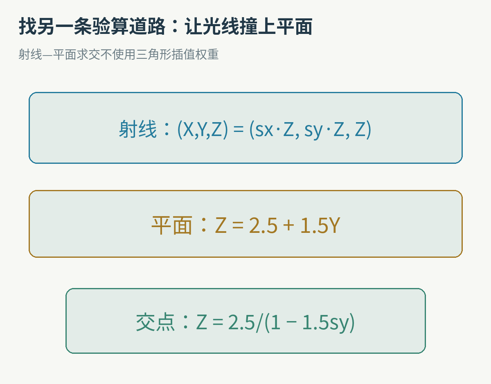

这条路线没有调用三角形重心插值。它可以充当独立的参照答案。

屏幕中心(sx,sy)=(0,0)对应X=Y=0，因而真实纹理地址是(1/2,1/2)。透视校正的两种对角线都给出这个答案；仿射AC剖分给出(4/5,4/5)，BD剖分给出(1/5,4/5)。

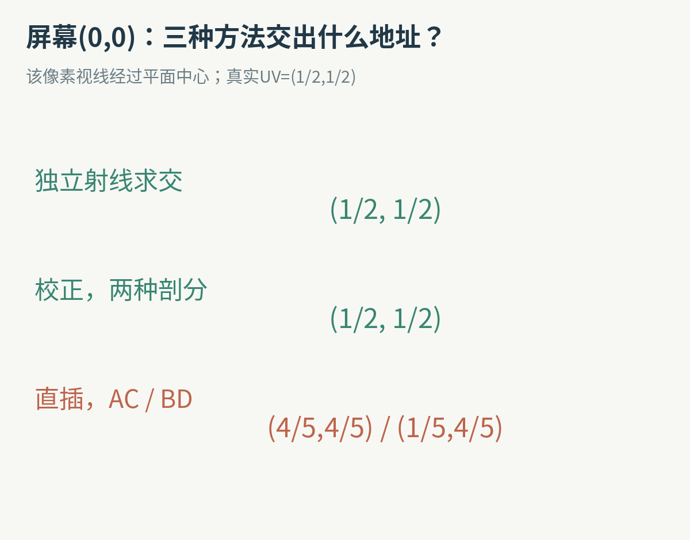

[配套实验代码](examples/perspective_lab.py)使用精确分数检查了8405个平面采样案例：五种远近差、每种41×41个UV点，两种对角线的校正值都与独立求交一致。另有101个线段例子和42个共享边连续性例子。

我们还按静态校正图实际采用的850×850采样，以及动画13帧各自的570×570采样，对所有被纸面覆盖的采样点用独立射线公式检查了UV坐标，最大数值差小于10的负12次方。排版缩放后的颜色像素，不与这些原生采样坐标混为一谈。这是给定模型中的程序检查，不是对所有输入的数学证明，也不是对某款GPU的测量。

## 12. 哪些时候，普通平均恰好没错？

最容易看见的情况是：所有角离相机一样远。在我们的模型里，各个Z相同，分子分母中的共同1/Z可以约掉，公式就退回普通加权平均。

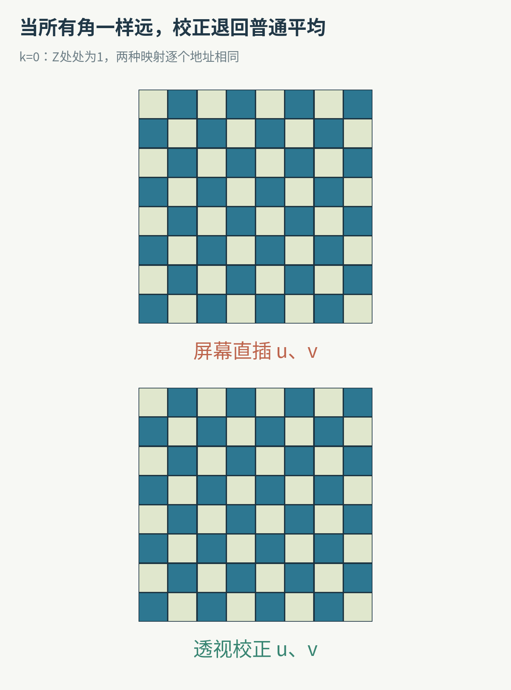

正交投影也没有这里的近大远小效应，通常可以使用对应的线性关系。反过来说，不是所有看到的纹理问题都由透视插值造成。

让实验中的纸慢慢倾斜，可以更直接地观察差异如何出现。

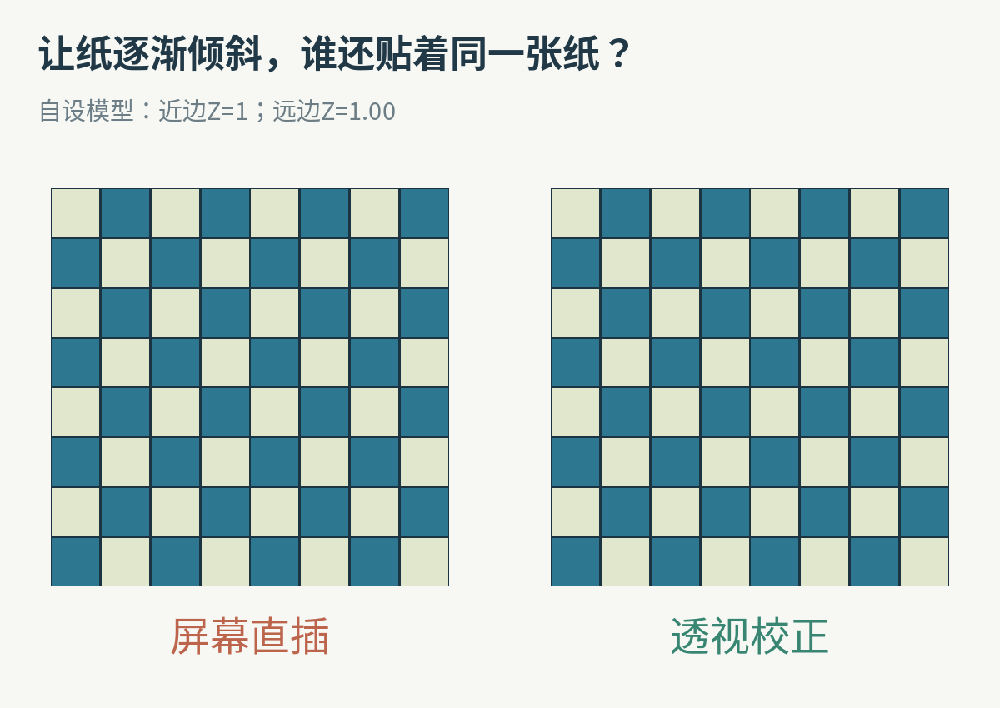

动画有13个状态，近边Z始终为1，远边Z从1逐步变成4。两侧在每一帧都使用相同的纸面和纹理。这里改变Z参数时也改变了平面的纵向边长，所以不是一块固定纸张的刚体旋转；它是自设数值实验，不对应历史游戏或真实相机拍摄。

## 13. 真正写着色器时，留意w和“深度”的含义

为了把几何讲清楚，我们一直使用朝+Z看的相机，并让透视分母等于相机深度Z。

真实图形管线会先产生裁剪坐标，包含x、y、z、w四个分量，然后用w做透视除法。正式的属性插值规则使用的是这个**裁剪坐标w**。在本例的投影约定下，可把它对应到相机Z；在别的坐标约定下，别直接抄这个等号。

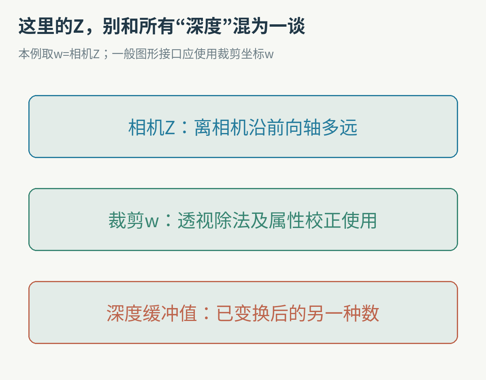

尤其要区分相机Z与深度缓冲中的值。后者已经经过投影及映射，不是“再照纹理公式校正一遍相机距离”。[Vulkan光栅化规范](https://docs.vulkan.org/spec/latest/chapters/primsrast.html)明确区分属性的透视插值与深度值的线性插值。

[GLSL的插值限定符](https://github.khronos.org/Vulkan-Site/glsl/latest/chapters/variables.html)也把选择写在了名字里：smooth是透视校正插值，而且是没有显式限定时的默认选择；noperspective按屏幕空间线性插值；flat不做插值，而取规定顶点的值。

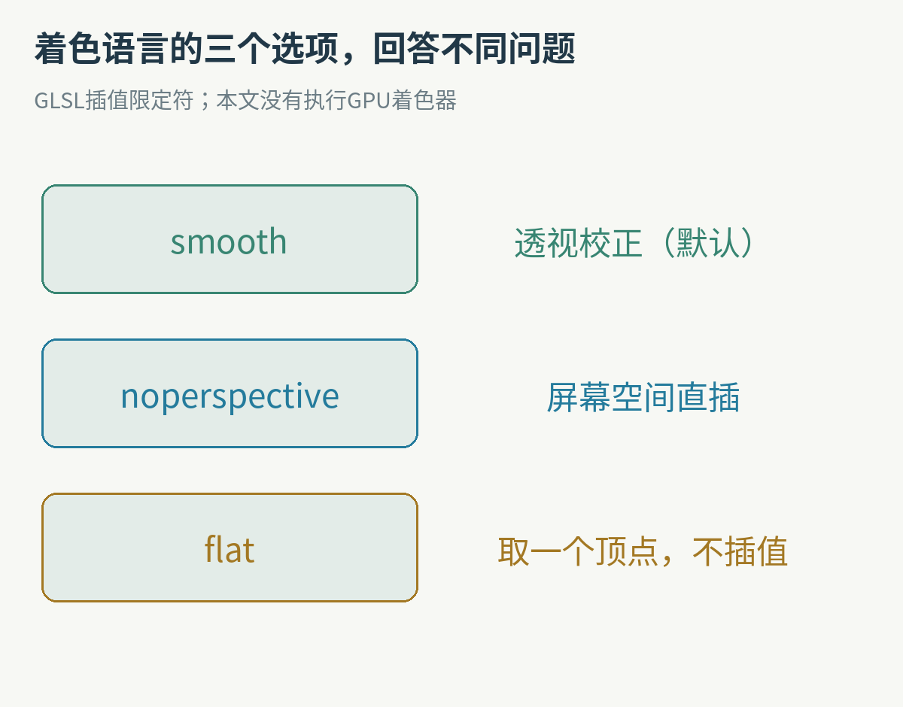

这些名字不是“高、中、低画质”按钮。屏幕空间的属性可能本来就应该按屏幕距离变化；整数类别标签也可能根本不该平均。选择要服从属性的含义。

## 14. 修好了几何，为什么远处还会闪？

因为找对地址和正确采样是两个问题。

透视校正回答：这个屏幕位置对应物体表面的哪里？纹理滤波回答：一个像素覆盖了一片纹理区域时，应该怎样综合那片区域的颜色？

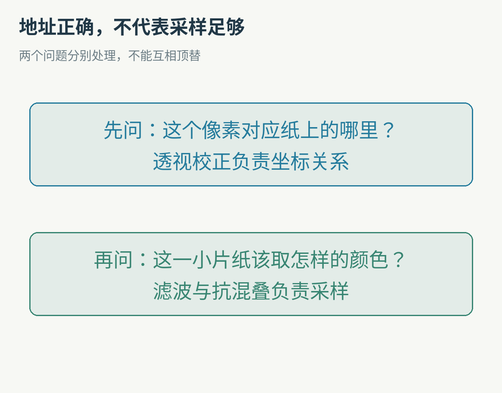

即使坐标完全正确，远处一个像素装下很多小格子，只取一个点的颜色仍可能产生混叠。Mipmap、各向异性过滤等处理的是另一层困难。它们不能靠把一张本来就映射错位的格子图变模糊，来证明几何已正确。

本文故意给所有对比采用同一种简单取色规则，便于隔离插值差异；因此图中仍可能看到细线锯齿。

## 15. 公式还有几道门槛

我们全程把顶点放在相机前方，并排除退化的屏幕三角形。Z=0时，X/Z本身就没有定义；三角形跨过相机或裁剪边界时，真实管线需要先妥善裁剪，不能指望最后一除自动收拾所有情况。

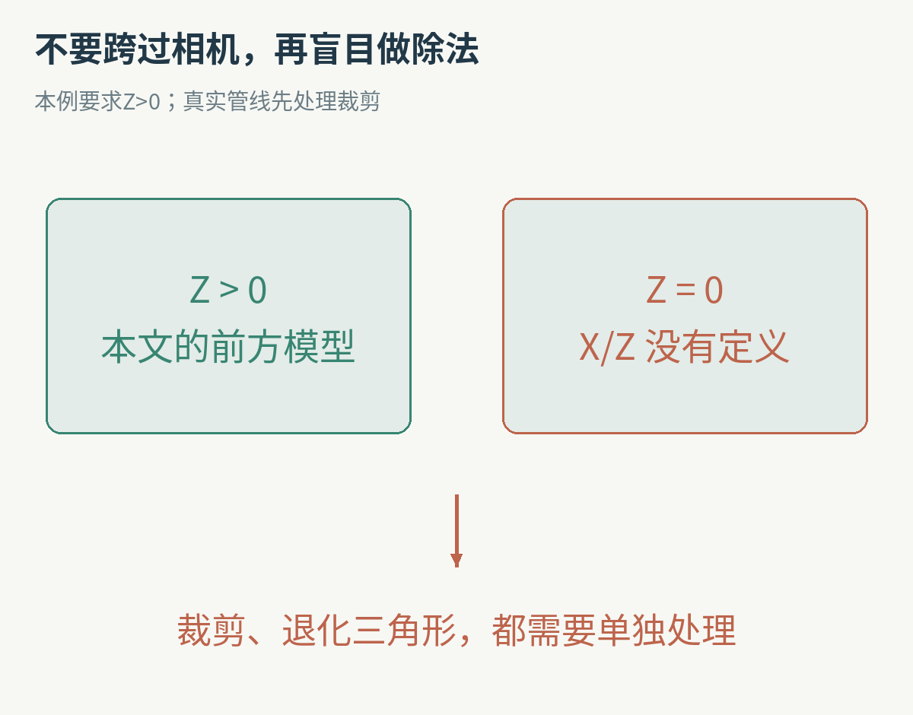

此外，有限精度、共享边归属、纹理寻址、采样位置都会影响最终像素。这也是为什么一个几何关系明白以后，完整软件渲染器仍有很多工程细节要处理。

但现在，你已经拿到了定位错误的一条清晰路线：先固定同一个物体和采样规则，观察映射哪里变了；用一条线手算；寻找可线性插值的量；最后换一种独立方法验算。

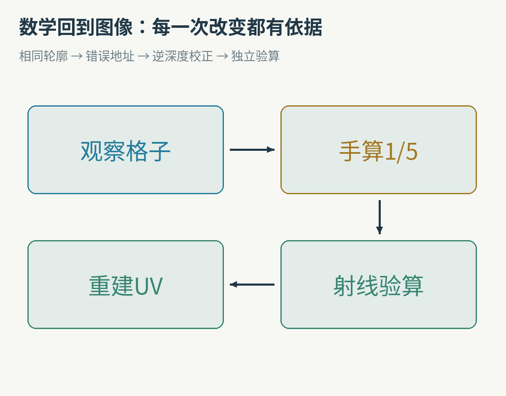

最后留一个不用写渲染器的问题：如果屏幕中点对应的两个端点深度分别为2和6，纹理地址分别为0和1，正确地址是多少？

先各取一半：分子为1/12，分母为1/4+1/12=1/3；相除得到1/4。下次再看到“平均一下就行”的说法，可以多问一句：**我们正在平均的量，在哪个空间里真的是直线？**
