# 只沿着边缘走一圈，仪器怎么知道里面有多大？

把一张校园地图摊在桌上，圈出中间那片弯弯绕绕的池塘——你要算的，是它到底占了多大一块。

第一反应多半是量长和宽。可池塘不是长方形，边线拐来拐去，两个数字根本框不住它。那就换一招：拿一张透明方格纸盖上去，一格一格数。落在中间的整格好办，麻烦全在岸边——那些只被池塘切掉半格、四分之一格的格子，得凑近眯着眼分辨，数着数着就走神，回过神已经忘了前面数到哪。

有没有一种办法，不用把池塘切碎，也能知道它多大？

有。把一支描针沿着池塘边缘慢慢走一圈，走完低头看一眼旁边那个小轮子上的读数。仪器既没伸进池塘里扫过，也没给地图拍过照——它只是绕着边界摸了一圈，面积就出来了。

这东西叫**求积仪，planimeter**。它看起来不过是两根杆加一个小轮子。今天我们就把它拆开，弄清一个有点反直觉的问题：边界明明只是一条线，它凭什么替里面整片区域记账？

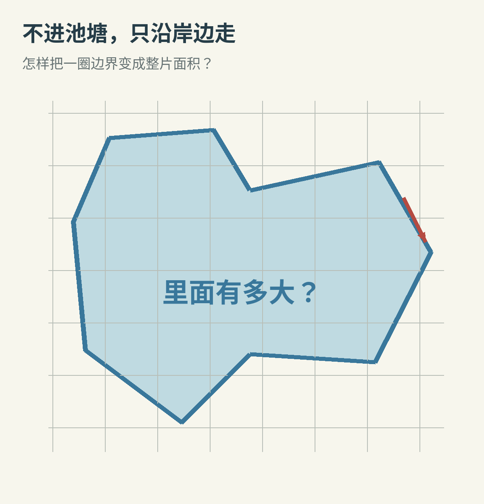

## 1. 先排除一个很诱人的错误答案

“沿边界走一圈”，第一反应总是：这不就是在量周长吗？

如果轮子真像里程表那样被拖着走，它确实会如实报告你走了多远。可惜周长回答不了面积。

一个边长为3的正方形，周长是12，面积是9。一个长5、宽1的长方形，周长同样是12，面积却只有5。同样绕12个长度单位，围出来的面积差了不少。

周长只回答“走了多远”，面积问的是“圈住了多少”。同一段绳子，摊成细长的长方形和绷成方方正正的正方形，围住的面积可以差很远。里程表式的轮子，天生只答得出前一个问题。

所以求积仪的小轮子显然不能老老实实把所有路程都加起来。它得学会挑食：**某些方向的移动要记，另一些方向的移动不记；有的要加，有的还要减。**

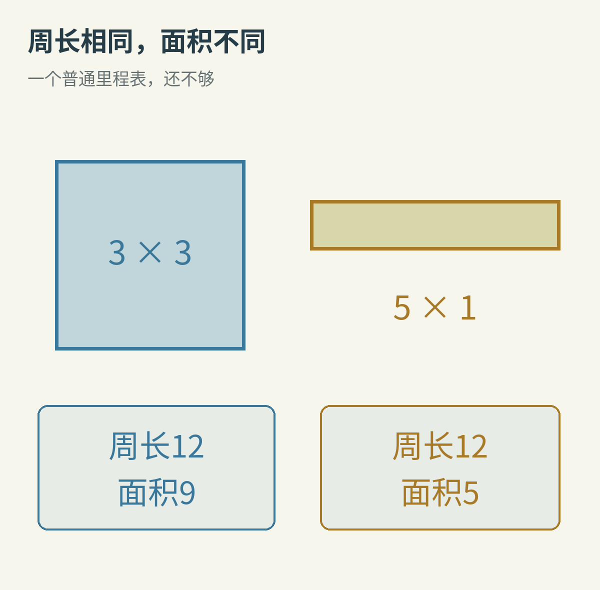

## 2. 1856年的一篇文章里，已经有这台小机器

1856年，J. Amsler 在《Polytechnisches Journal》发表了《Ueber das Polar-Planimeter》，介绍自己发明的极式求积仪。文章末尾署着沙夫豪森和5月12日。

他写得相当具体：先读轮子的刻度，沿图形描一圈，再读一次；还要区分固定支点放在图形外面还是里面。支点在内时，读数规则得额外加一项和仪器有关的常数。

连最容易让初学者漏掉的使用边界，都已经写进了早期说明。[原文](https://dingler.bbaw.de/articles/ar140073.html)

下面这份历史材料可以直接查看：Henry S. H. Shaw 的1886年著作《Mechanical Integrators》里的极式求积仪图，固定端、关节、描针、轮子和读数机构都画了出来。

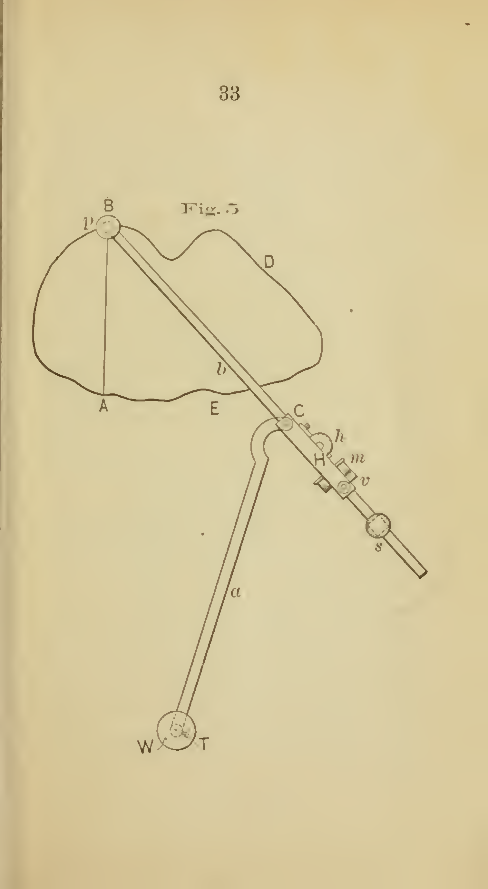

图源：H. S. H. Shaw，1886年纽约出版《Mechanical Integrators》，第33页，图5；University of California Libraries / Internet Archive 扫描。1886年原著属于美国公有领域，来源标注 NOT_IN_COPYRIGHT。这里按扫描标称500 dpi呈现整页，未裁切或改画；[完整原PDF](examples/shaw-1886-original.pdf)保留原文件字节，[来源记录](sources.md)列出处理与权利范围。原图字母沿用原书，与下文的教学字母不是同一套。

仔细看这张图：测轮并不正好放在杆的中点。为了让原理更容易看见，接下来我们会**有意把测轮放在中点**。这是一台理想教学模型，历史上真实的机器未必都这么装。

## 3. 两根杆，给每个点安排一份工作

把固定在纸上的那个点叫 O。

从 O 伸出一根长度固定为 R 的杆，另一端叫 Q。因为长度不变，Q 只能沿着以 O 为圆心、R 为半径的圆移动。

Q 又通过一根长度为 L 的杆连着描针 P。你真正用手控制的其实是 P，让它沿着池塘边界走。

最后，把测轮放在第二根杆的中点 M。

- O：固定支点，也叫极点。
- Q：两根杆的关节。
- P：描针，沿待测图形走。
- M：教学模型里测轮的中心。

英文先不用记。盯住三件事就够了：**O不动，P描边，Q被杆长约束着跟随。**

这四个点里，只有 P 是你直接操控的。O 钉在纸上，Q 和 M 都由两根杆的长度自动决定——你一动 P，整条机构就跟着联动，没有多余的自由度。

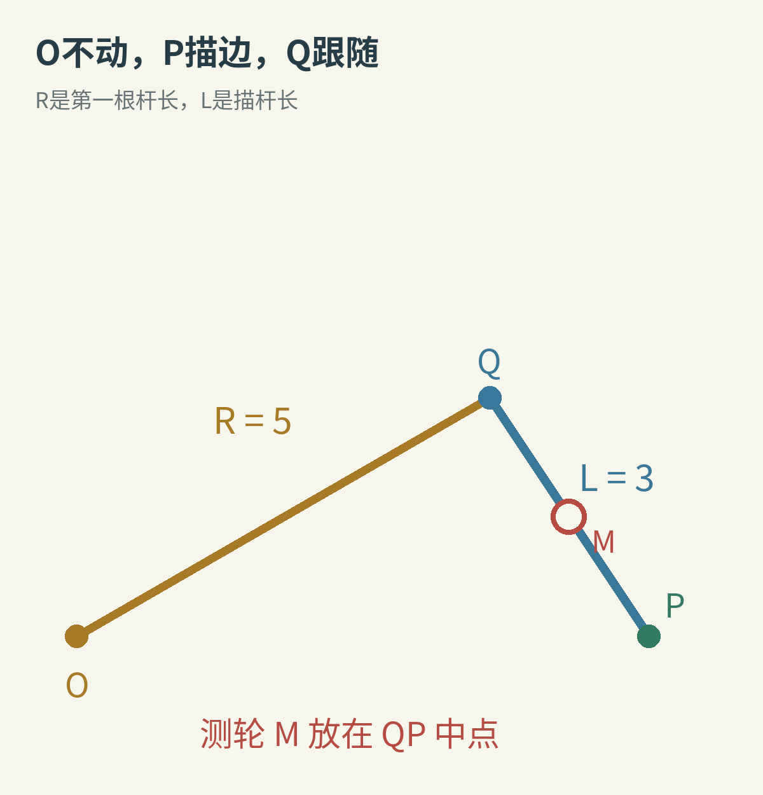

## 4. 它是个轮子，却会侧滑

测轮的轮轴，沿着描杆 QP 摆放。

把整根杆沿着自己的方向平移，轮子是在沿轮轴方向侧滑。理想情况下这种移动不让轮子转动，读数不变。把整根杆朝垂直于杆的方向平移，轮子就滚起来了。

斜着推呢？把这一小段位移拆成两份：沿杆的一份只管滑，垂直杆的一份才滚。

为什么沿轴的那一份不算数？因为轮子只会绕自己的轮轴转动。你让它沿着轴的方向平移，它顶多在轴上打滑，转数一点不增加；只有垂直方向的推动，才会真正带着轮子滚起来。这个“只认一个方向”的脾气，是整台仪器最关键的地方。

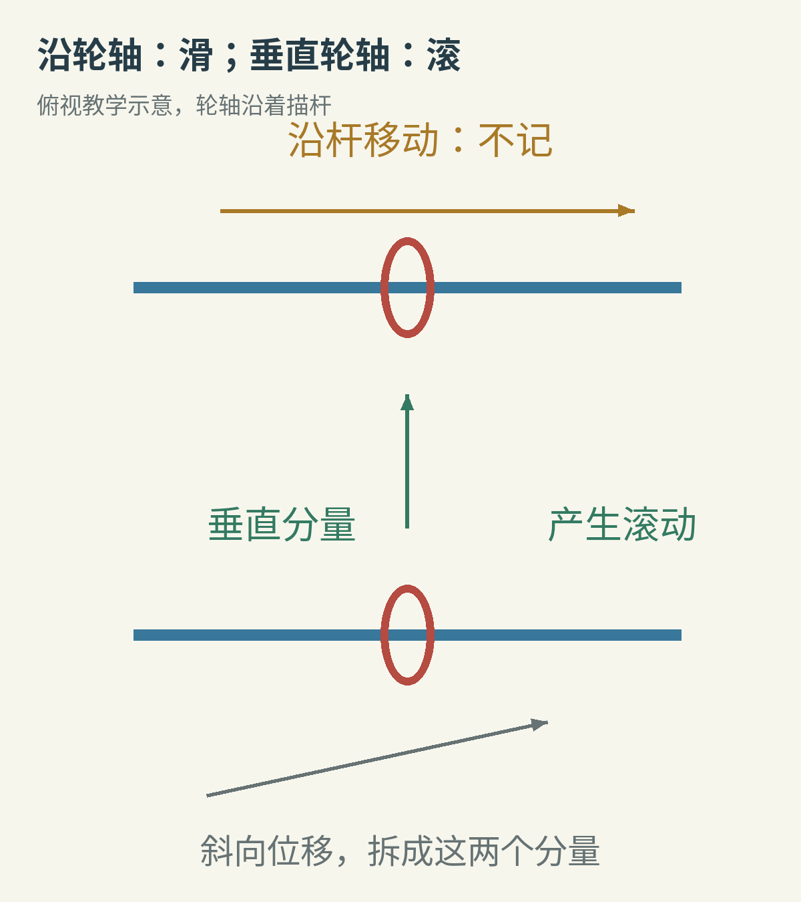

不过现实里“能滑”不等于“想怎么打滑都行”。理想模型允许沿轮轴方向滑动，却要求滚动方向能忠实传递位移；滚动方向要是也乱滑，读数就错了。

现在给读数一个明确的单位：把轮子累计的**有正负号的滚动距离**叫 w。它是一个长度，不是轮子转过的角度。

如果记录的是转数 n、轮子周长是 c，那么 w = c × n。反向转动时，n 和 w 都带负号。表盘上的刻度，只是把这件事换算成更方便读取的数字。

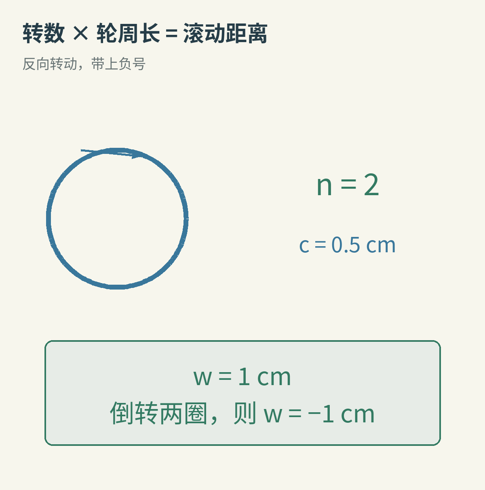

## 5. 为什么忽略一个方向，反而能知道面积？

先把第一根杆搁到一边，只盯住长度为 L 的线段 QP。

把它朝垂直方向平移一小段距离 h，它就扫出一个长方形，面积是 L × h。就算斜着平移，扫出的是平行四边形，面积仍然只取决于垂直高度 h。沿杆的那一份位移不增加这个高度。

为什么斜着也不影响？把平行四边形斜出来的一角剪下、平移到另一边，正好补成一个长方形：底边还是 L，高还是 h。剪拼不改变面积，所以真正起作用的，只有那个垂直高度。

换句话说，扫出的面积只跟“横向挪了多高”有关，跟“顺着杆滑了多远”无关。小轮子要做的，恰好就是把后者丢掉。

于是小轮子的“偏心”有了理由：它记录的，恰好是面积计算需要的那一份。

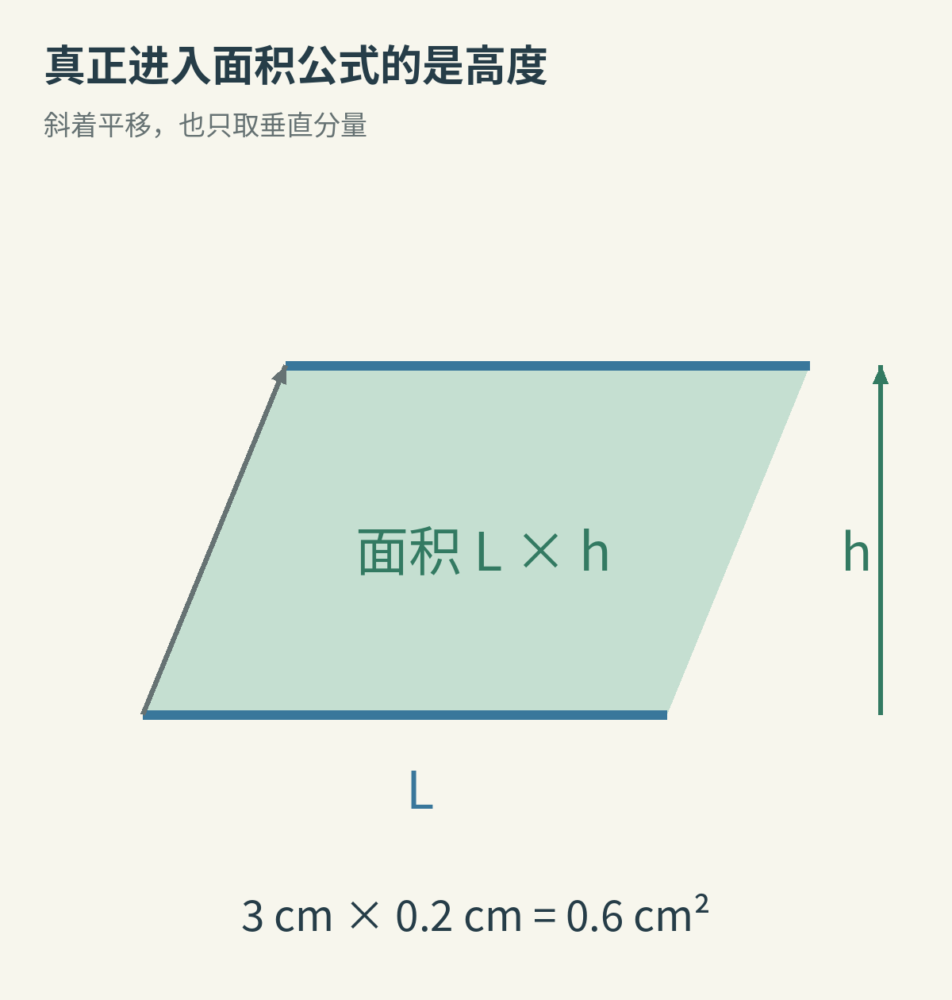

举个例子。杆长是3厘米，整体向上平移0.2厘米，轮子就记下0.2厘米，杆扫过的面积是0.6平方厘米。往下平移0.2厘米，我们给它记作 −0.6平方厘米。

这里的负面积，说的是扫动方向，而不是纸上真有一块“负的土地”。后来逆着扫回来，可以把先前那一笔抵消掉。

只问“经过过哪些地方”，和记录“带方向的累计扫动”，是两个不同的问题。

## 6. 可杆子还会转啊，怎么办？

这是最关键的一步。

如果 QP 绕自己的中点 M 转一点角度，两端会扫出两个同样大的扇形。按刚才的方向约定，一边贡献为正，另一边贡献为负，正好抵消。

为什么两边一样大？它们张开的圆心角相同，半径又都是半个杆长，而扇形面积只由这两个量决定，自然相等。

与此同时，位于中点的测轮中心没有移动，也就没有滚动距离可记。

“轮子不记”和“净扫动面积为零”，又对上了。

旋转就这样在账上消失了。

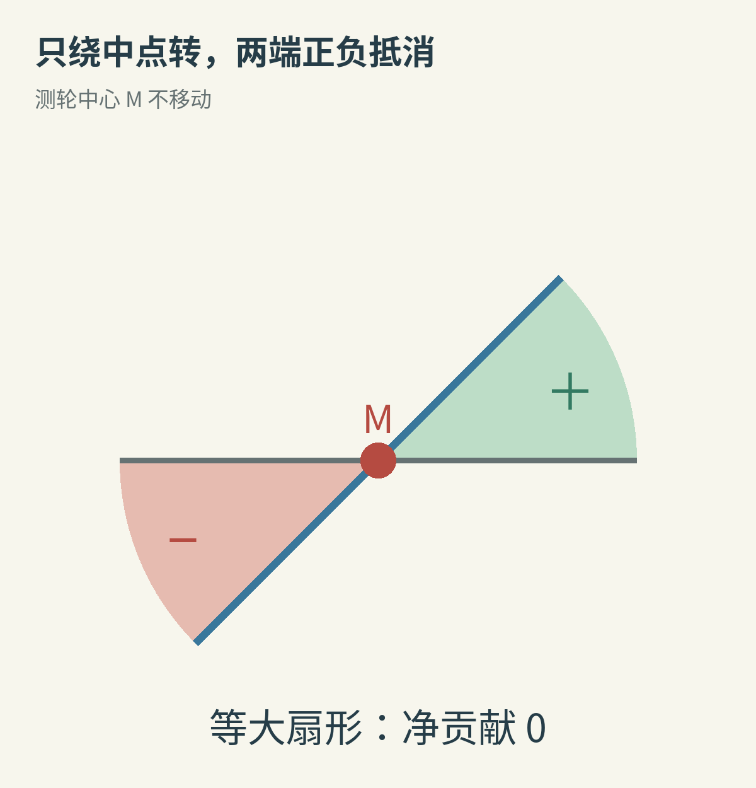

一般的移动，都能分解成“中点平移”加“杆绕中点转动”。把整段运动切得越来越细：每一小步，轮子记录平移产生的净面积，中点旋转的两份面积互相抵消。

这里的关键是“切得足够细”。真实的一小步里，平移和转动其实同时发生；可只要步长足够短，就可以先当成一次纯平移、再当成一次纯转动，偏差小到可以忽略。几何规则管的，正是这个极限情形。

于是整段运动累计下来，就得到：

**杆的有向净扫动面积 = L × w。**

这是连续运动的极限关系。后面的程序用很多小步去近似，会带数值误差；不能把有限步长的模拟结果，当成一条没有误差的几何定理。

## 7. 杆扫了一大圈，为什么只剩池塘？

沿着边界走的时候，杆会反复经过图形内部和外部。单看一幅静止图，确实像一团乱麻。

但别把每次经过都涂成一块新的实心区域。我们在做的是带正负号的记账。

把运动切成许多很短的扫带。相邻扫带之间共享的那条内部边界，方向正好相反，会互相抵消。最后只剩两条外层轨迹：P 走过的轨迹，和 Q 走过的轨迹。

可以这样想：杆在图形内部来回穿过很多次，每一次穿过都给相邻两片小扫带留下同一条边界，一条正着算、一条反着算，成对消掉。真正留在账本上的，只有最外面那一圈——两端各自画出的闭合轮廓。

所以这根杆的净扫动面积等于：

**P轨迹围出的有向面积 − Q轨迹围出的有向面积。**

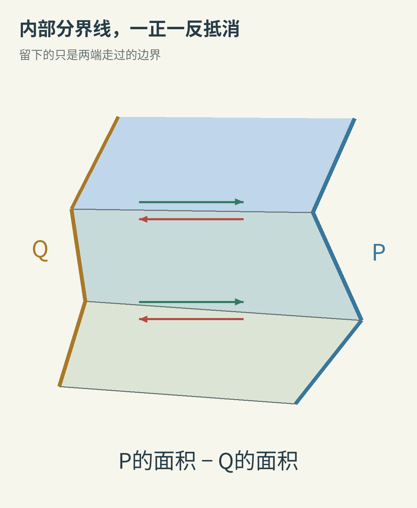

接上上一节，就得到全文最重要的一条关系：

**P的面积 − Q的面积 = L × w。**

换句话读：轮子量到的，是描针围出的面积，减去关节自己围出的面积。

这就是整台仪器的骨架。

先别急着把后面那一项扔掉。极点放在哪里，恰好决定了它能不能扔。

## 8. 极点在外面：关节走出去，又走回来

下图是一个外置支点的小圆案例：P 绕小圆一圈时，Q 只在自己那条圆周的一段弧上来回运动。

更一般的情形里，极点在简单待测边界之外，机构保持连续、不退化，这时不能要求 Q 始终只走一小段弧——它中间可能绕很远再倒回来。真正需要的是：走完整整一圈后，Q 围绕 O 的**净绕数为零**，有向面积自然也为零。

道理不复杂。Q 可能先朝一个方向划过去，再朝相反方向划回来，来回的贡献一正一负相抵。只要它绕完一整圈后净绕 O 的圈数是零，这些来回加起来就是零，那一项就可以放心丢掉。

反过来说，只要极点挪到边界里面，Q 就可能真的把 O 围上一整圈，净绕数不再是零，这一项也就丢不掉了——第11节会看到这种情形。

于是公式就简化了：

**待测面积 = L × w。**

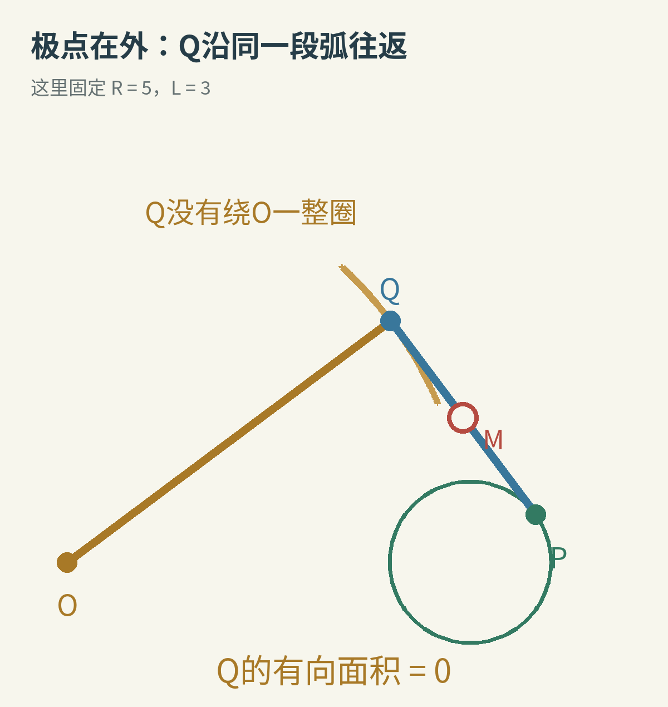

设 L = 3厘米，轮子净滚动4/3厘米，面积就是4平方厘米。

这里要注意，4/3是轮子的**净滚动距离**。它不同于 P 走过的周长，不同于 Q 行走的路程，也不同于把轮子中心轨迹的长度全部加起来。这几个“走了多远”一旦混在一起，求积仪就又显得像魔术了。

## 9. 不碰机械，也能手算“边界替面积记账”

我们换一个特别简单的边界记账规则，单独验证这件事。

每走一小段，就记下“当前横坐标 x × 向上移动的距离”。向下走，移动距离是负的；水平走，记零。

看一个宽2、高2的长方形，顶点依次是：

(4,−1) → (6,−1) → (6,1) → (4,1) → 回到起点。

- 下边水平走：0。
- 右边向上走2，x始终是6：记 +12。
- 上边水平走：0。
- 左边向下走2，x始终是4：记 −8。

合起来是4，正好等于面积。

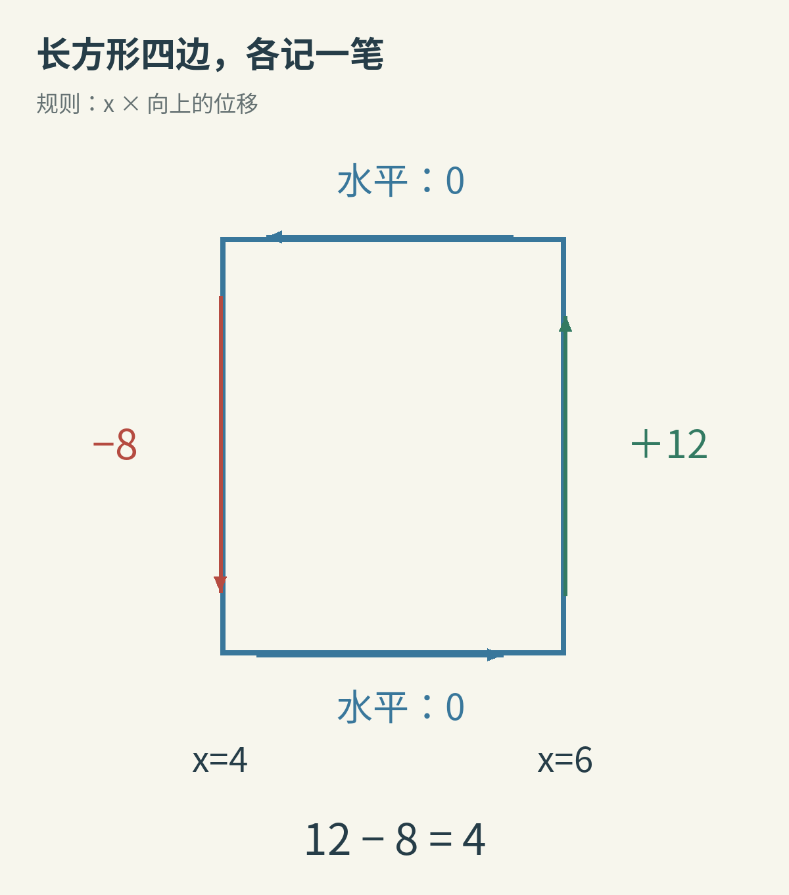

再把长方形整体向右挪10：右边变成 +32，左边变成 −28，总和仍然是4。单笔数字变大了，但多出来的那两笔正好抵消。面积不依赖你把坐标原点放在哪里。

这一点值得停一下：同一块地，换个坐标原点，每一笔的数值都变了，总和却纹丝不动。多出来的部分永远成对出现，一正一负，自己把自己抵消。

数学里，把这种沿整条闭合边界的连续累计写成“∮ x dy”。别被符号吓住：小圆圈提醒你最终要回到起点，dy 是那一小步的上下位移，∮ 提醒你把所有小步加起来。

对一条逆时针、不自交的简单边界，它给出的就是围成的面积。这是格林公式的一种形式。上面那台两臂机械，用的是另一种几何安排，把等价的有向面积账本变成了轮子的转动。

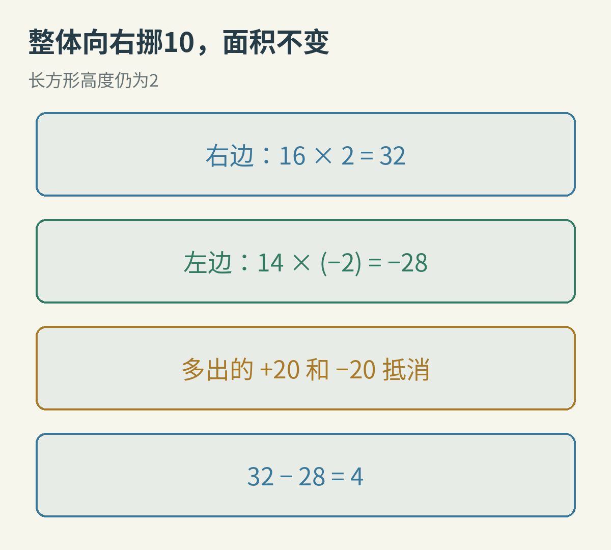

如果某条边是斜的，x 就不再固定。对直线段，用两端横坐标的平均值乘这一段的竖直位移，就能精确算出该段的贡献。对任意多边形把这些项相加，就得到熟悉的鞋带公式。实验文件里也用精确分数核对过这两种写法，不靠“看起来差不多”的小数。

## 10. 方向、洞和交叉，都不是小事

同一个正方形，反方向走一圈，刚才的每一笔账都会反号。读数变成 −4，几何面积仍然是4。

所以我们得先约定方向，再解释正负。下面的教学图都取逆时针为正；至于实物表盘的正负方向，还要看安装和刻度怎么约定。

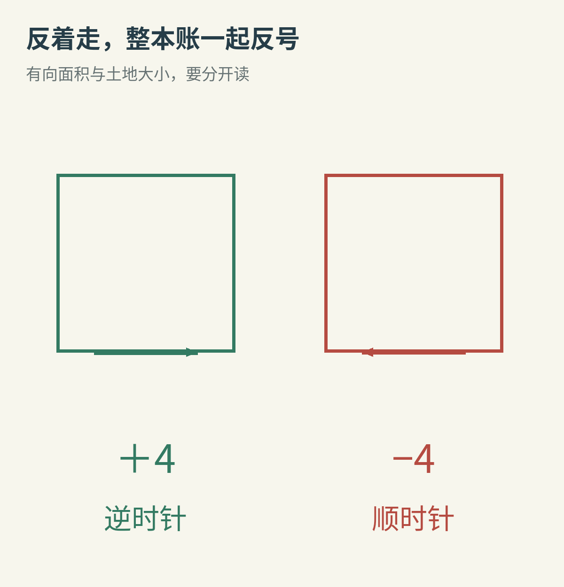

如果区域中间有个洞，可以沿外边界逆时针走，沿洞边界顺时针走。后者的贡献就会自动被减掉。

假设外方形面积16，里面的洞面积4，合起来就是12。

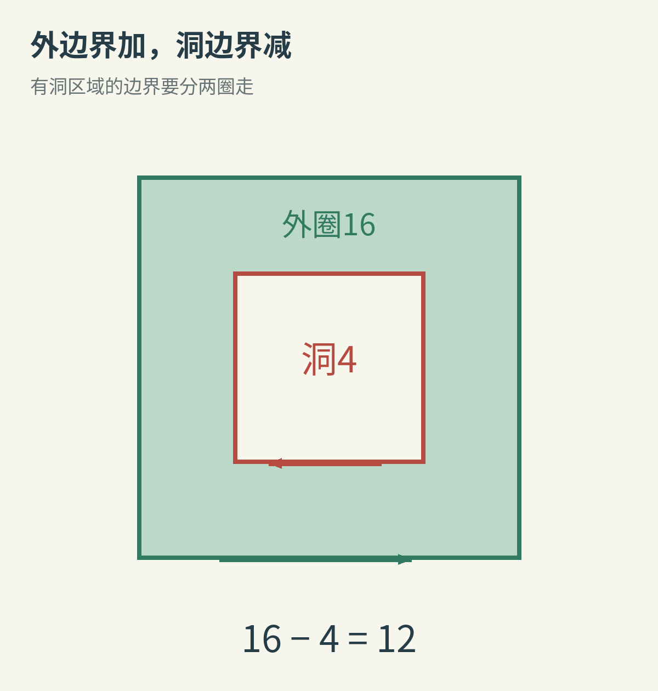

但随手画一个“8”字自交曲线，情况就不同了。两片区域可能朝相反方向绕，贡献会相互抵消。求积仪给出的是有向累计，并不保证等于“所有被笔迹围住的地方取并集”的面积。

这不是机器算错，而是你问了两个不同的问题。

换个说法：画一个自交的圈，等于把两片区域用相反的朝向叠在了一起。仪器老老实实按方向记账，得到的正是这个带正负的净结果；至于“这些笔迹盖住的地方合起来有多大”，那是另一道题，得另算。

## 11. 极点在里面：那一整圈不能凭空消失

现在让 P 绕着 O 转一整圈。

Q 也可能沿半径 R 的圆完整转一圈。它到 O 的距离始终是 R，画出的正是一个半径为 R 的整圆，面积是 πR²，不再是零。

回到总关系 P的面积 − Q的面积 = L × w。对本文的中点测轮模型、逆时针绕一圈的情况，它变成：

**待测面积 = L × w + πR²。**

为什么偏偏多出 πR²？因为支点在内时，Q 自己也绕着 O 画满了一整圈，围出一块真实的面积。它没有再被抵消，于是公式末尾得把它补回来。

这也正是内、外两种放法读法不同的根源。同一台仪器，极点挪到图形里面，读数规则就得多加这一项；漏掉它，算出来的面积就会差掉一整块。Amsler 在最早的说明里把两种情形分开讲，道理就在这里。

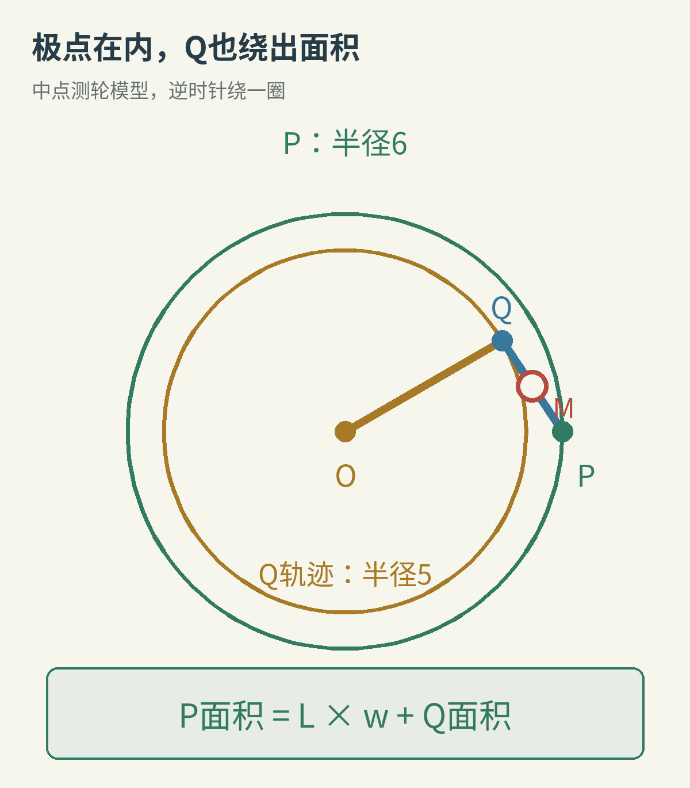

要强调：这个简洁的 πR²，是**本文中点测轮模型**的修正量。

历史实物的轮子可能装在杆的其他位置，甚至在关节外的延长线上。轮子一旦偏离中点，杆转一整圈还会多出一份和安装位置有关的贡献。所以不能把这里的 πR² 抄去替代任何一台实物的仪器常数。

这也解释了 Amsler 原说明为什么要提醒使用者去看仪器的常数，而不是给所有机器一个统一的数字。

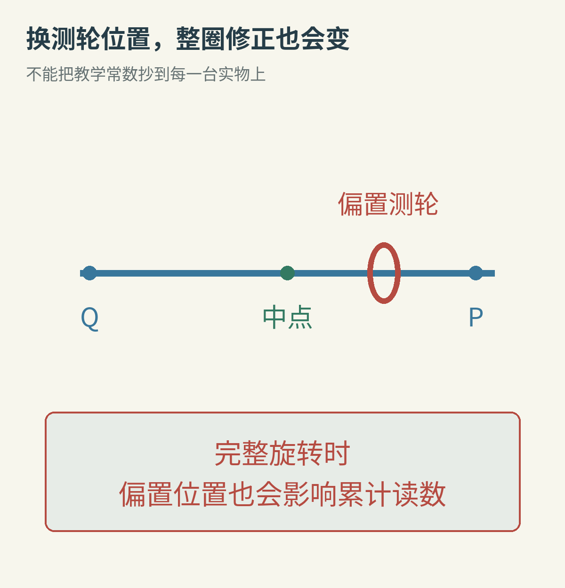

## 12. 最反直觉的实验：轮子没转，面积却不是零

继续用教学模型，设 R = 5，L = 3。

让 P 沿着以 O 为圆心、半径5的圆走一圈。P 围出的面积是25π。Q 也在半径5的圆上走一圈，围出的面积同样是25π。

两者相减是零，所以 w = 0。

这一圈里，轮子从头到尾几乎没转过。

测轮中心其实一直在移动，可它的运动恰好沿着轮轴方向，只有侧滑、没有净滚动。对这个特殊的圆，理想模型里甚至每一瞬间都不滚。

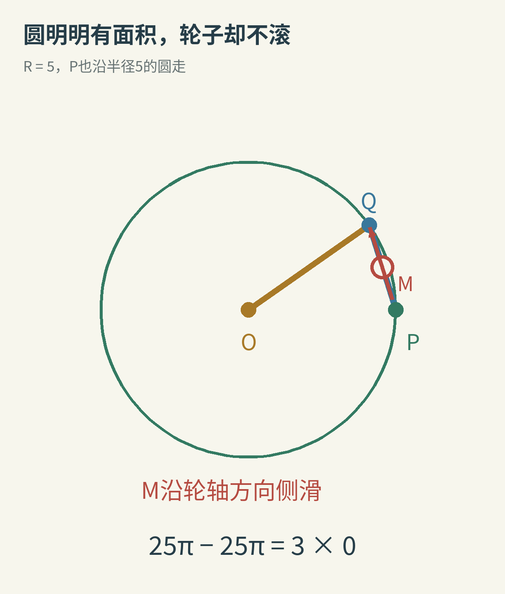

如果你套用“面积 = L × w”却忘了支点在内，就会断言一个明明看得见的圆面积为零。把修正项加回来：0 + 25π，事情就解释通了。

这也顺带说明：轮子的读数本身并不等于面积。它对应的是两条端点轨迹围出面积的差；要得到真正的待测面积，还得看支点在哪、要不要把 Q 自己围出的那一块补回来。

再让 P 沿半径6的同心圆走，面积是36π。Q 仍然贡献25π，轮子只需要记录剩下的11π：

L × w = 11π，因此 w = 11π/3。

同一个轮子，测到的是两条端点轨迹的面积差，而不是全部面积。看清这一点，再看总公式，就不容易把它当口诀背错了。

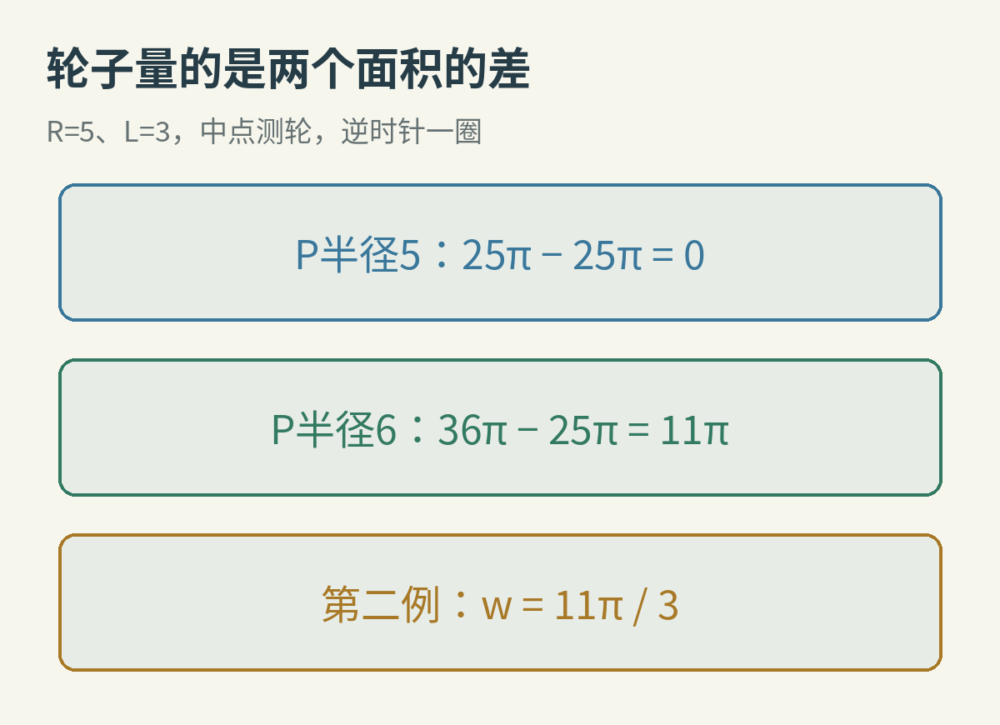

## 13. 在电脑里搭一台不会磨损的求积仪

[配套实验](examples/planimeter_lab.py)只用 Python 标准库，不需要安装图形库。

程序里既没有摩擦，也没有金属弹性，更没碰过任何一台真仪器。它只做几何：给出描针 P 的位置，用两根杆的长度求出关节 Q，再算中点 M 朝测轮滚动方向移动了多少。

两根杆能到达的范围是有限的。R = 5、L = 3时，P 到 O 的距离必须在2与8之间。程序会排除恰好伸直、完全折叠的位置，并沿着同一条连续的关节分支运动，不让关节突然跳到另一边。

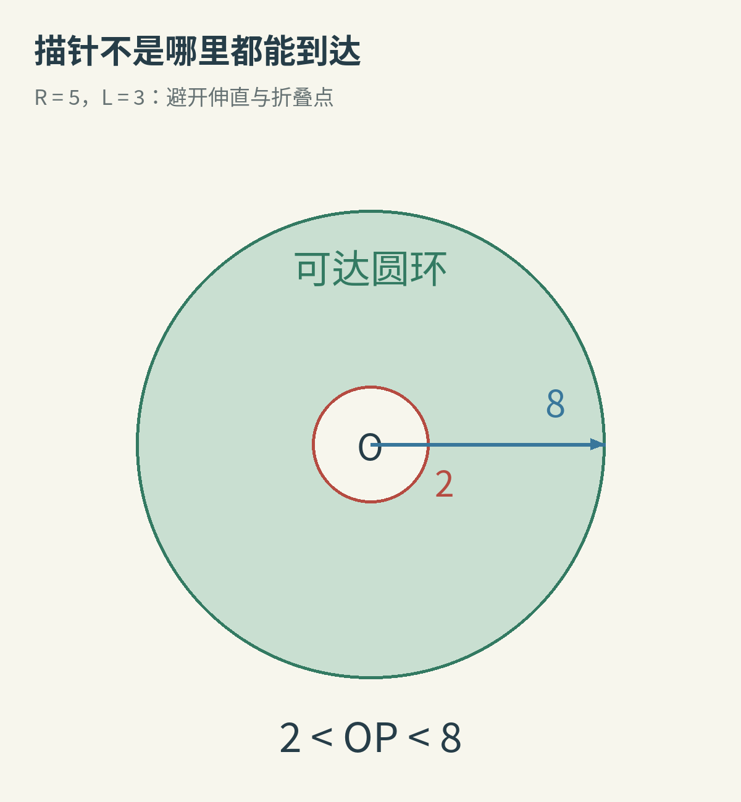

每一小步的计算可以读成这样：

1. 找到这一步开头和结尾的测轮中心 M。
2. 求中心位移。
3. 用这一步中间时刻的杆方向，找出垂直于杆的单位方向。
4. 把中心位移投影到这个方向，得到这一步的滚动距离。
5. 所有小步相加，得到 w。

第4步是整个算法的核心：把这一小步里轮子中心的真实位移，投影到垂直于杆的方向上。所谓投影，就是只保留“能让轮子滚动”的那一份，把沿杆侧滑的那一份丢掉。换句话说，程序把前面那条几何规则，一小步一小步地照做了。

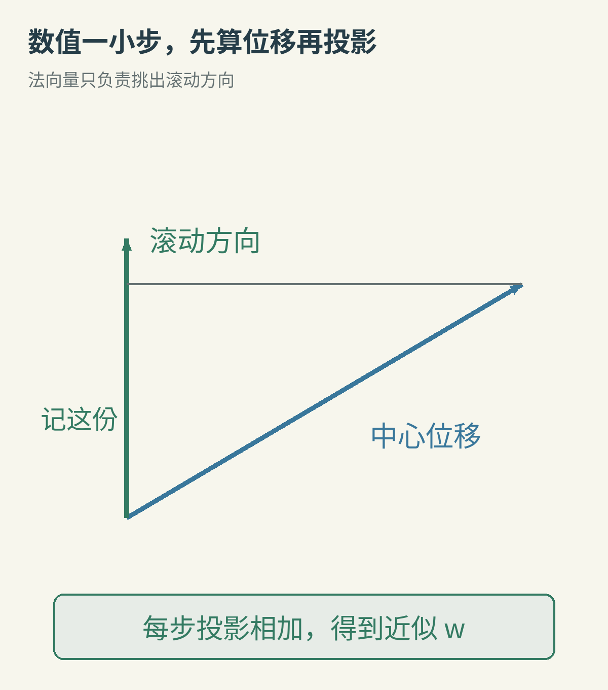

在 R = 5、L = 3的外置支点案例里，让 P 沿以 (5,0) 为圆心、半径1的圆走一圈。正确面积是 π。

实际运行配套程序后：100步得到约3.141065，6400步得到约3.141592525，后者与 π 相差约0.000000129。

步子缩小，近似就更接近连续几何结果。这个误差是本次算法和这个案例的数值误差，既不代表某款实物仪器的精度，也不是对所有形状的统一误差保证。

为什么会越算越准？因为程序拿一条条短直线去逼近圆，步子越短，折线越贴合圆弧，多出来或漏掉的那点面积就越小，结果自然越靠近真实的 π。它逼近的是几何答案，和仪器的机械精度是两回事。

程序还核对了49个平移过的小长方形；又用1000条整数顶点闭合折线、配合精确分数，验证了边界记账、反向变号、平移不变，以及三倍缩放后面积变九倍。自交折线只比较有向面积，绝不拿它冒充图形并集面积。

下面这段动画来自同一几何模型的12个位置。O 固定，P 绕小圆，Q 在弧上往返，M 跟着移动。每帧之间是等比例的路径参数，不是实物运动的拍摄。

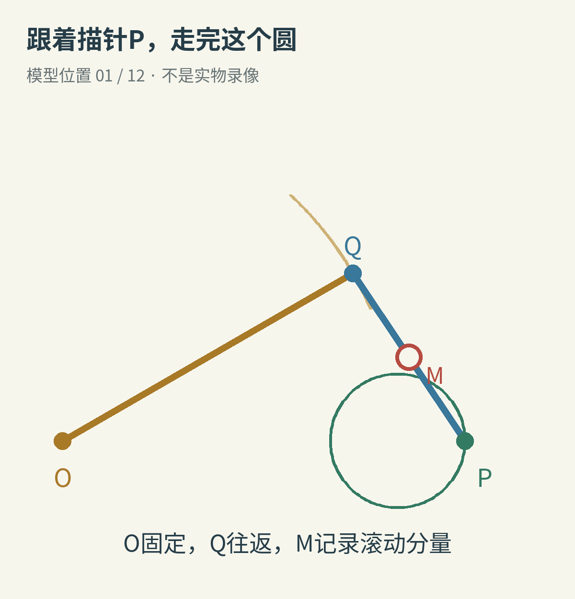

## 14. 从纸上读数到池塘面积，还有一层比例

假设地图比例是1:1000。图上1厘米，对应实际10米。

图上面积是4平方厘米，实际面积就该乘1000²，再换单位，得到400平方米。

为什么是平方？因为长度和宽度都被放大了1000倍。只乘1000，会把整个面积少算1000倍。

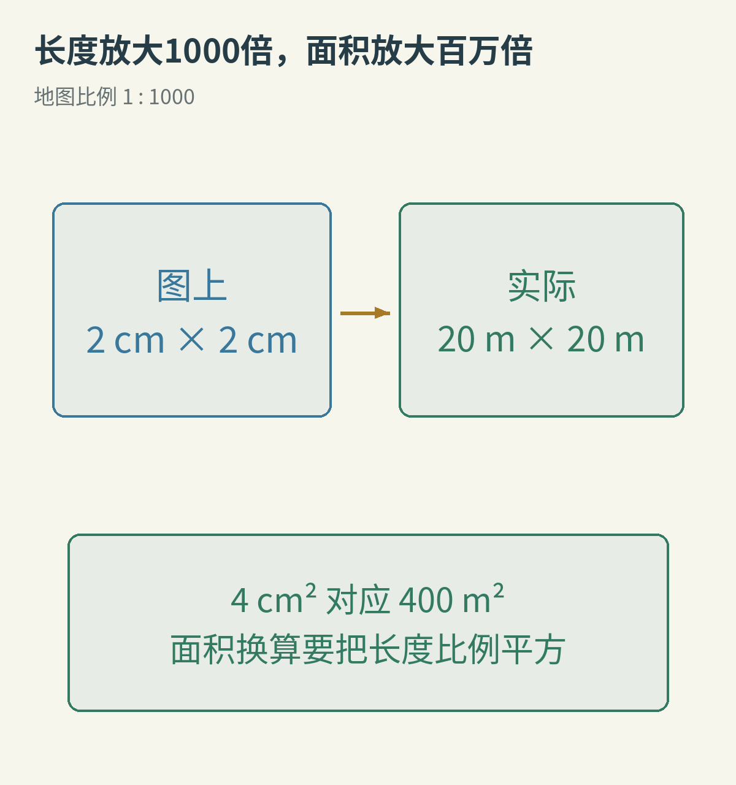

真实使用还有一串朴素但重要的条件：纸要平、极点不能偷跑、描针要回到起点、滚动方向不能打滑、读数和仪器常数要用对；太小的图形，描边和读数的误差也可能占很大比例。

这些都不是一个漂亮公式就能消除的。

换句话说，公式给你的是几何上的理想答案；仪器能不能真的拿到这个答案，还得看你怎么用它。

求积仪最精彩的地方，并不在于“老机器居然能比电脑聪明”。它是在提醒我们：计算可以存在于材料和运动的约束里。一根杆把位置联系起来，一只轮子挑出需要的方向，闭合一圈让多余的内部账目相互抵消。

它从未走遍池塘内部，却让整片面积在边界的运动中显现出来。

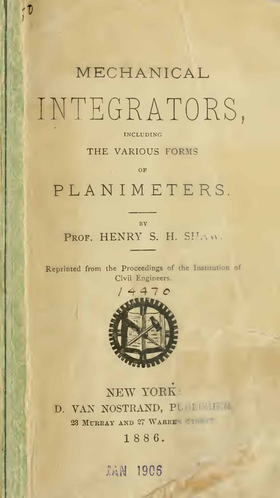

扉页同样来自上述1886年公有领域原书的完整扫描，来源为 University of California Libraries / Internet Archive；按500 dpi整页呈现，未裁切。原著与第三方扫描不纳入本文原创正文的CC BY 4.0声明。

留一道可以先不运行代码的小题：把同一条简单闭合边界逆时针走两圈，轮子读数和有向面积各会怎样？

答案是都变成一圈的两倍。但纸上那个区域的并集面积仍然没变。记住这个区别，你就已经抓住这台机械积分器最重要的脾气了。

[来源、素材与实验说明](sources.md)
