# 五个变量，两只抽屉：编译器怎样给寄存器排座位？

写程序的时候，我们很容易再起一个名字：a、b、c、d、e。可处理器不会因为源代码里多了一个名字，就在芯片上长出一个新寄存器。

寄存器可以暂时想成运算器旁边的几只小抽屉。执行一条指令时，机器从指定的抽屉里取数，再把结果放回某个抽屉。名字可以很多，抽屉却是有限的。

问题来了：**只有两只抽屉，怎样执行一段用了五个临时名字的计算？**

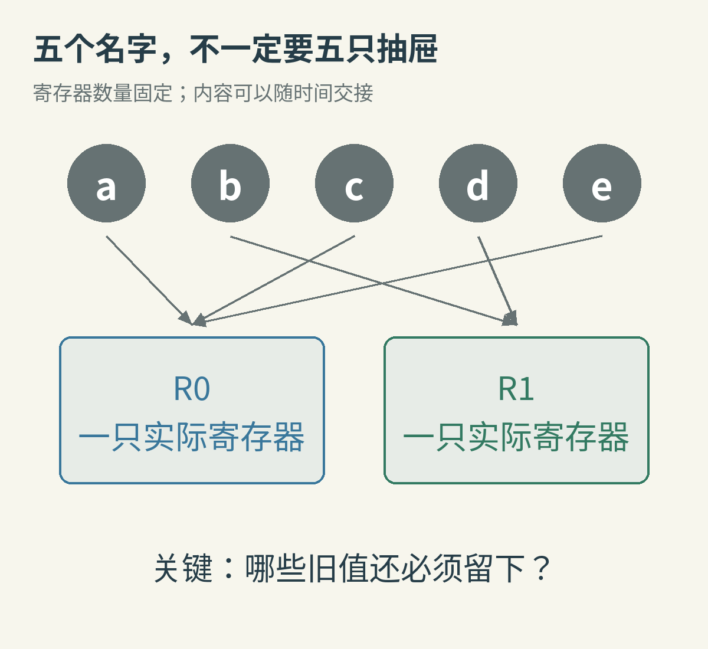

别急着把三个变量赶到内存去。也许它们根本不需要同时住下。

## 1. 先把这台教学机器说清楚

本文先使用一台简化机器：寄存器叫R0、R1；一条加法或乘法会**先读完两个输入，再写结果**。所以，结果可以覆盖一个已经用完的输入。整数不设位宽，不考虑溢出；这里也没有函数调用、异常和固定寄存器要求。

这不是某款处理器的精确仿真。我们先隔离出一个核心问题：哪些值必须同时保留？最后再把真实机器的限制放回来。

编译器通常先把程序整理成某种中间代码，其中的临时名字像一份便于分析的草稿。寄存器分配要把这些名字安排到实际存储位置上，并在必要时增加存取内存的指令。它改变的是安排，不能改变程序的答案。


## 2. 一个有意思的历史转弯：把机器问题交给一张图

1981年，Gregory J. Chaitin、Marc A. Auslander、Ashok K. Chandra、John Cocke、Martin E. Hopkins和Peter W. Markstein发表了《Register allocation via coloring》。IBM保存的原始摘要介绍了他们在实验性PL/I优化编译器中的实现：用图中的点表示待安排的计算值，用边表示不能共用寄存器的冲突。

这里并没有说他们发明了“图着色”，也没有说只有Chaitin一个人在做这件事。值得记住的转折是：编译器里一项很具体的资源安排，被整理成了一个可以计算、可以检查的图问题。[1]

次年，Chaitin的《Register allocation & spilling via graph coloring》继续处理抽屉真的不够时该怎么办：把“哪些值留在寄存器里更划算”的成本估计，纳入了溢出决策。**找到一种颜色安排，和决定哪些值值得留下，是相关但不同的两件事。**[2]

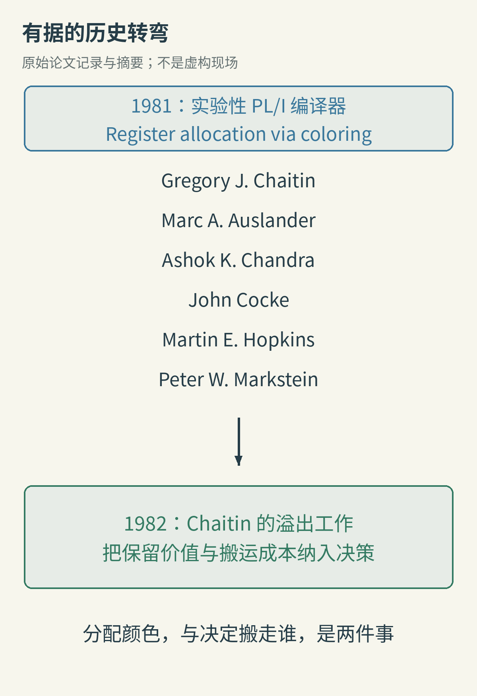

下面不是那两篇论文的逐行复刻。我们用一个自己设计的小程序，造出一个能手算的简化分配器，看看这座桥究竟是怎样搭起来的。

## 3. 五个名字，并不等于五个位置

固定下面这段中间代码，暂时不做代数化简：

```text
a = input(x)
b = input(y)
c = a + b
d = c * b
e = d + c
return e
```

让x=7，y=5。于是a=7，b=5，c=12，d=60，e=72。

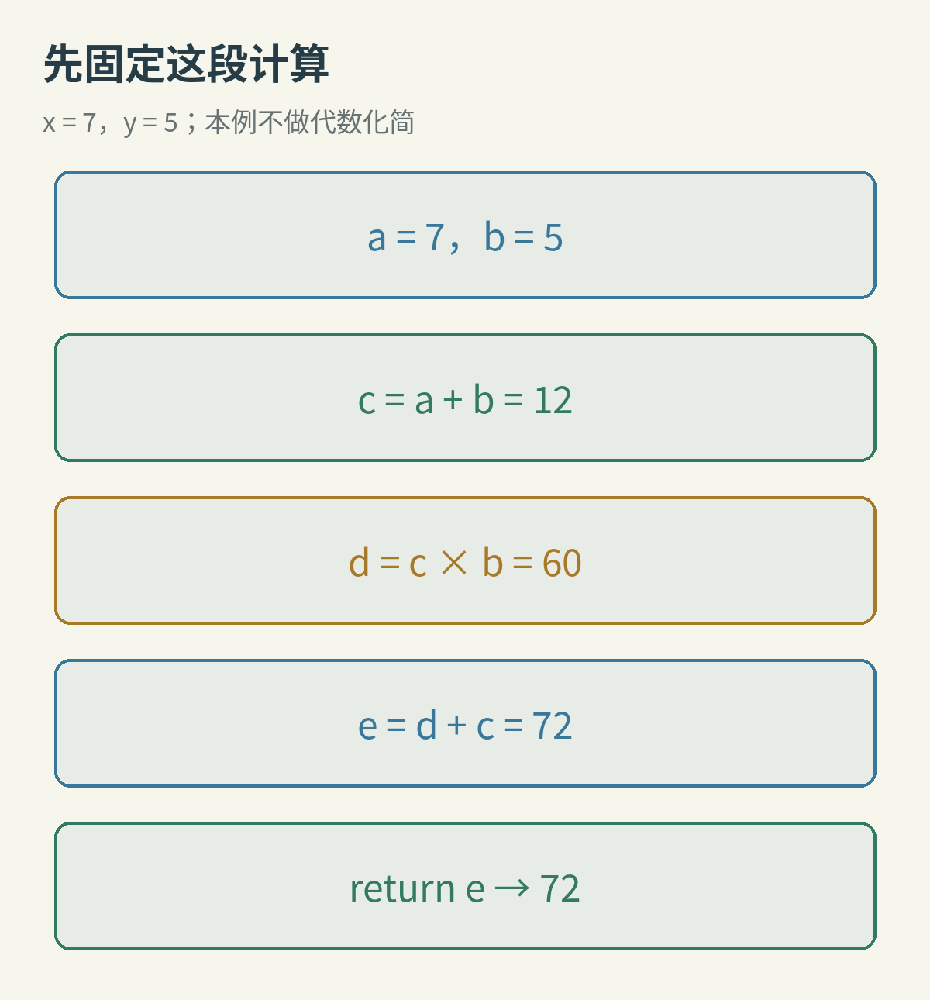

如果给每个名字永久占一只抽屉，当然需要五个位置。可请盯住第三行：算完c以后，后面还会读取a吗？不会。a的任务已经完成了。

再看第四行：算完d以后，后面还会读取b吗？也不会。

这正是重复使用存储位置的机会。旧值没有了后续用途，它占着的位置就可以交给新值。

## 4. “活着”，指的是后面还用得上

在这里，一个值在某个程序位置**活跃**，意思是后面还可能读取它，而在那次读取之前，它没有被新的定义取代。我们这段直线程序没有分支，所以可以直接沿着后面的指令看。

第三行执行前，需要a和b；执行后，需要b和c。a退场，c上场，但b必须留下。

第四行执行前，需要b和c；执行后，需要c和d。b退场，d上场，但c必须留下。

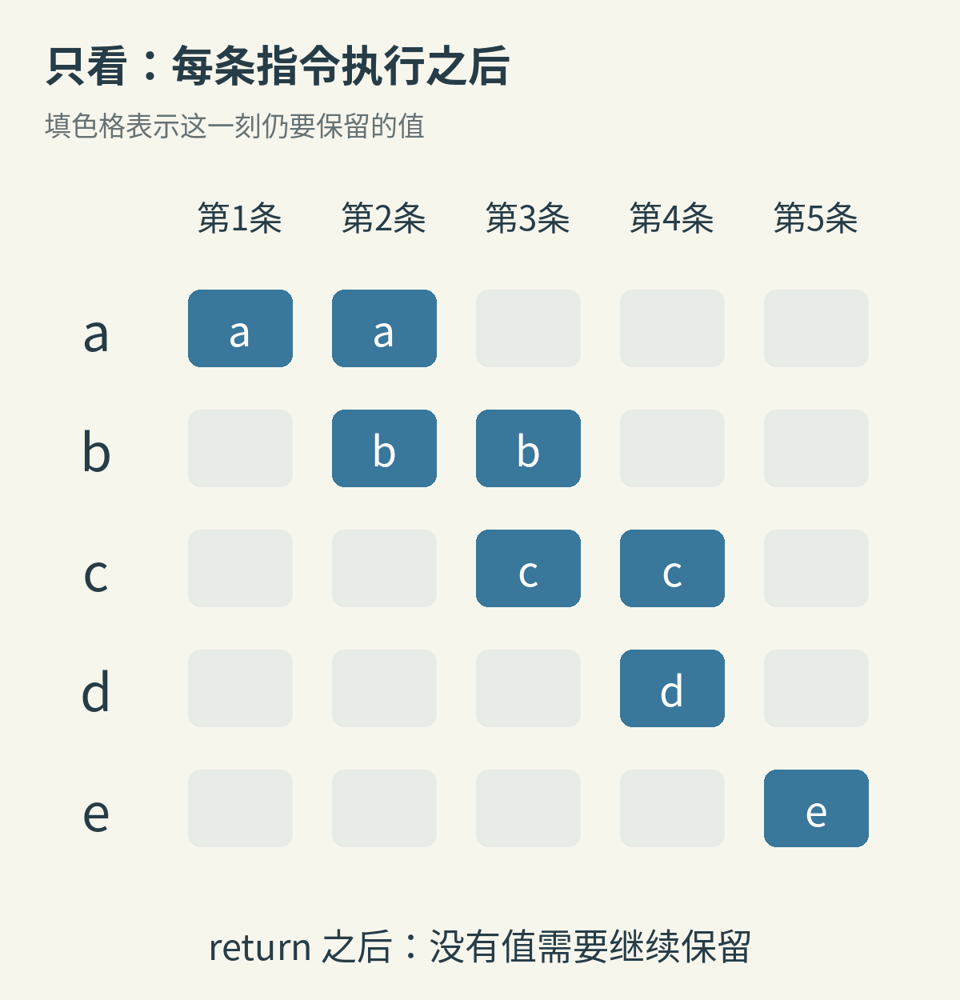

这里的“活跃”跟“这个名字曾经出现过”无关，也跟“调试器现在还能显示它”无关。它回答的是一个关于未来用途的问题。

这也说明，源代码里的花括号作用域和寄存器里的保留时间不是一回事。名字在语法上还可见，不代表这一份旧值必须继续占着寄存器。

## 5. 不妨倒着读一次程序

怎样系统地算出活跃集合？从最后往前走。

return e之前必须有e。再往前跨过e=d+c：为了产生e，需要d、c；而e是在这条指令里才写出来的，不需要提前保存它。

再跨过d=c*b：需要b、c。c后面还要继续用，所以仍然留下。

对一条指令，可以记成一句朴素的规则：

**执行前需要的值 = 本条指令会读取的值，加上执行后仍需要且没被本条重新定义的值。**

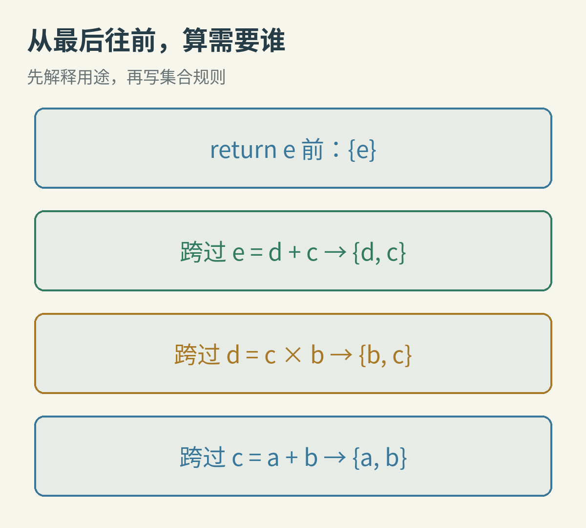

如果愿意看集合写法，就是：

`live_before = uses ∪ (live_after − definitions)`

uses是“这条指令读什么”；definitions是“这条指令写什么”。符号只是把刚才那句话缩短，并没有增加一种神秘判断。

遇到分支时，分析会考虑后继路径；遇到循环时，通常要反复传播信息直到不再变化。那是更一般的数据流分析。本篇先把直线例子走透，不把它冒充成完整编译器。[3]

## 6. 第三行里，为什么允许c住进a的抽屉？

把a放在R0，b放在R1。第三行计算c=a+b时，机器先读到7和5，得到12，再把12写回R0。

a确实被覆盖了。可是后面再也不读a，所以没有信息损失。

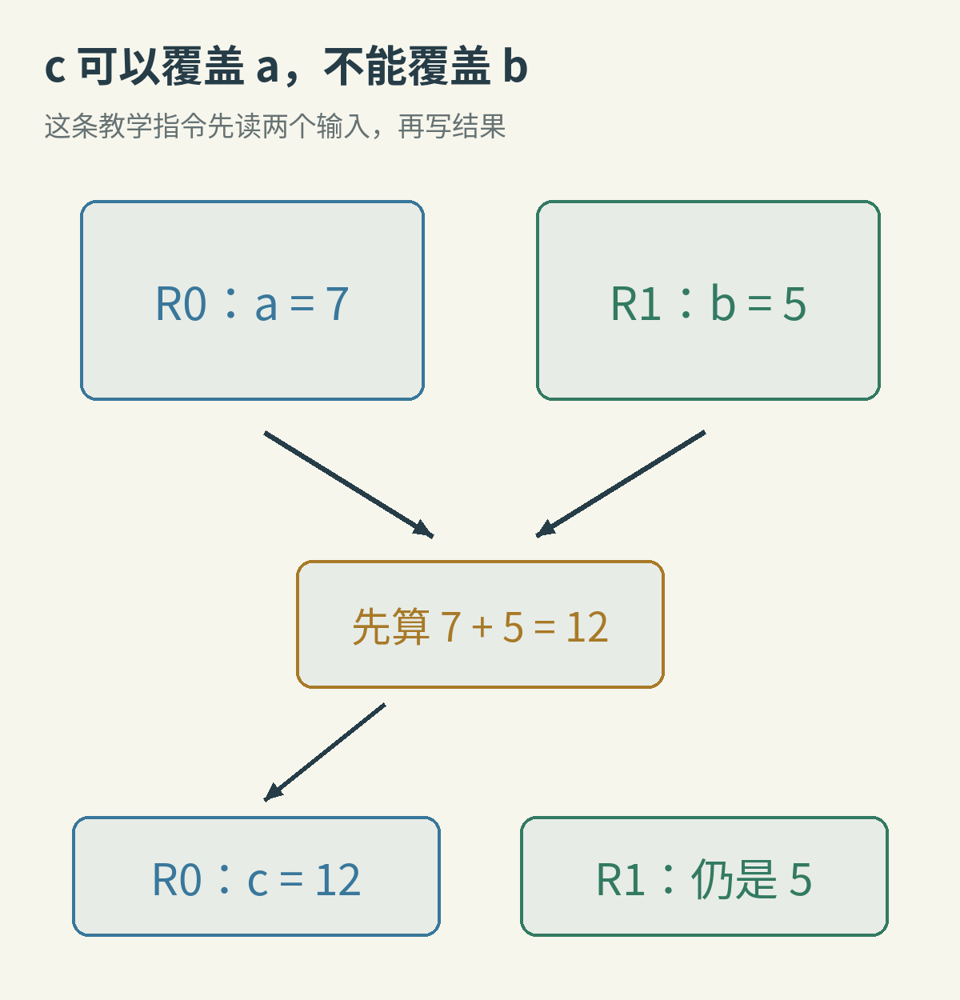

请注意，这一步依赖开头说好的指令语义。如果某条真实指令要求结果必须放进第三个独立寄存器，或者要求某个输入固定放在特定位置，就要额外加入限制。不能拿教学机器的自由去替所有硬件作保证。

同样，不能让c覆盖b。b还要参加下一次乘法，覆盖它就把仍然需要的数弄丢了。

## 7. 把“不能同住”画成边

现在给a、b、c、d、e各画一个点。

- a和b要同时保留，所以连边。
- b和c要同时保留，所以连边。
- c和d要同时保留，所以连边。
- e产生之后只剩它自己，不需要和其他点连边。

得到一条a—b—c—d的链，以及一个孤立的e。

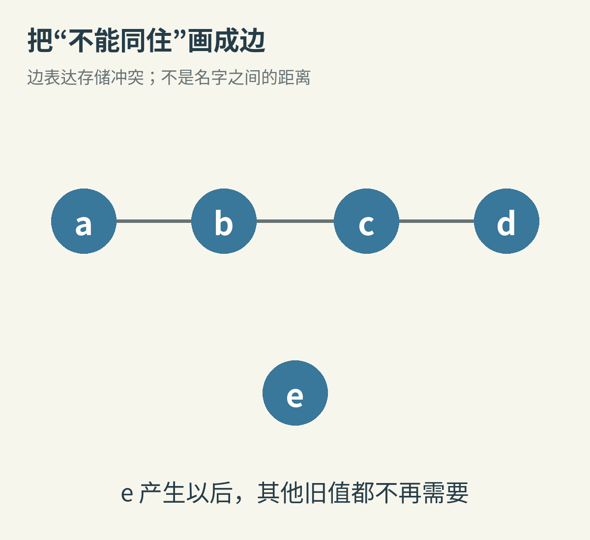

这叫**干涉图**。边的意思不是“这两个变量参与过同一次计算”，更不是“名字写得很近”；边表达的是这份分配模型里的存储冲突。

在我们的固定直线程序里，构图也可以这样做：某条指令写出一个新值时，把它与执行后仍活跃的其他值连起来。这样新结果就不会覆盖仍有用途的旧内容。[3]

如果错误地给b和c同一个位置，第三行会把b的5覆盖成12。随后原本的12×5就可能变成12×12，最终答案从72变成156。

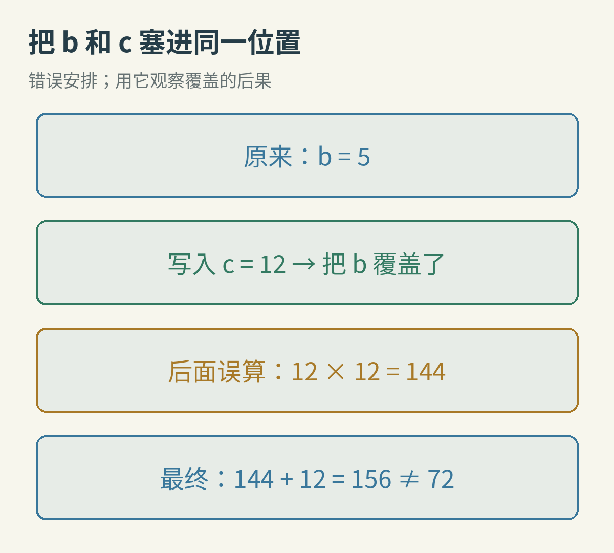

这不是“性能差一点”。这是算错了。

## 8. 颜色，终于有了实际含义

用蓝色表示R0，绿色表示R1。相连的点不能同色，不相连的点可以同色。

一种合法安排是：a、c、e用R0；b、d用R1。

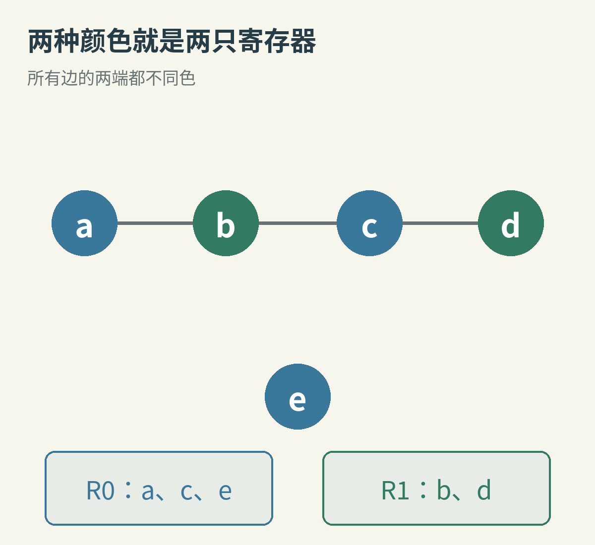

程序于是可以依次执行：

```text
R0 = input(x)
R1 = input(y)
R0 = R0 + R1
R1 = R0 * R1
R0 = R1 + R0
return R0
```

这六行用的始终只有两只寄存器。它们并不各自永远属于某个源代码变量，只是在不同的时间保管不同的值。

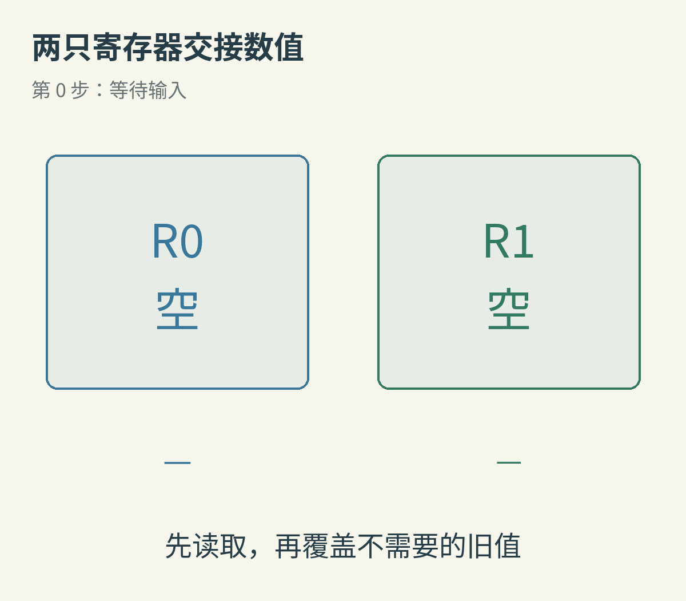

图中的旧数值被覆盖，不代表把“还需要的东西”丢掉了。分配是否正确，恰恰取决于能不能把这两种覆盖分清楚。

## 9. 随便涂颜色，会不会多用一只抽屉？

会。最简单的贪心做法是：按某个顺序访问各点，每次选邻居还没占用的最小颜色。

按a、b、c、d的顺序处理这条链，很容易得到两种颜色。可如果先处理a、d，它们不相邻，贪心可能先给它们同一种颜色；随后b需要第二种颜色，最后c同时挨着第二色的b和第一色的d，就被迫拿出第三种颜色。

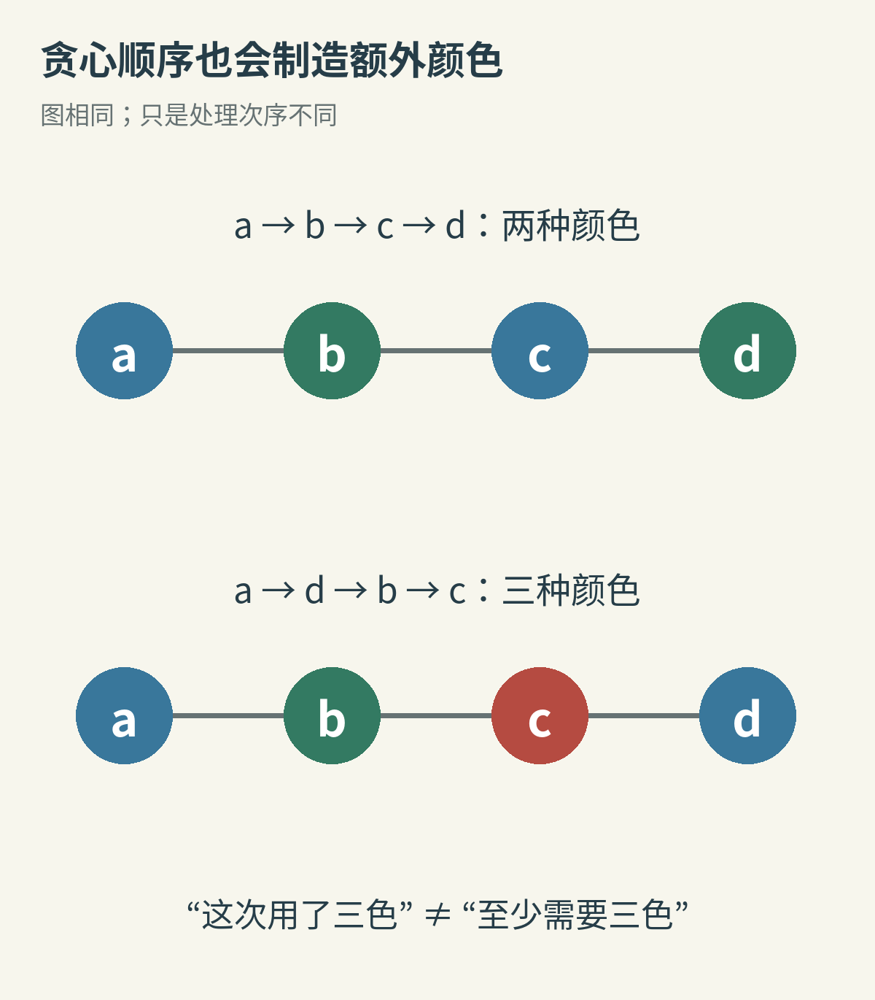

图没有变，真正需要的最少颜色也没有变。多出来的那一色，只是这次选择顺序造成的。

所以，看到一个贪心算法用不下，不能立刻宣布“机器至少需要这么多寄存器”。你看到的是一种安排的结果，还不是最少资源的证明。

## 10. 一个可以证明的捷径：先拆掉容易安排的人

假设我们有K种颜色。某个点当前只连着少于K个邻居，那么可以先把它暂时拿走，处理剩下的图。

为什么可以放心？等把它放回来的时候，它的那些邻居至多占用K−1种颜色，所以K种颜色里至少剩下一种可以给它。

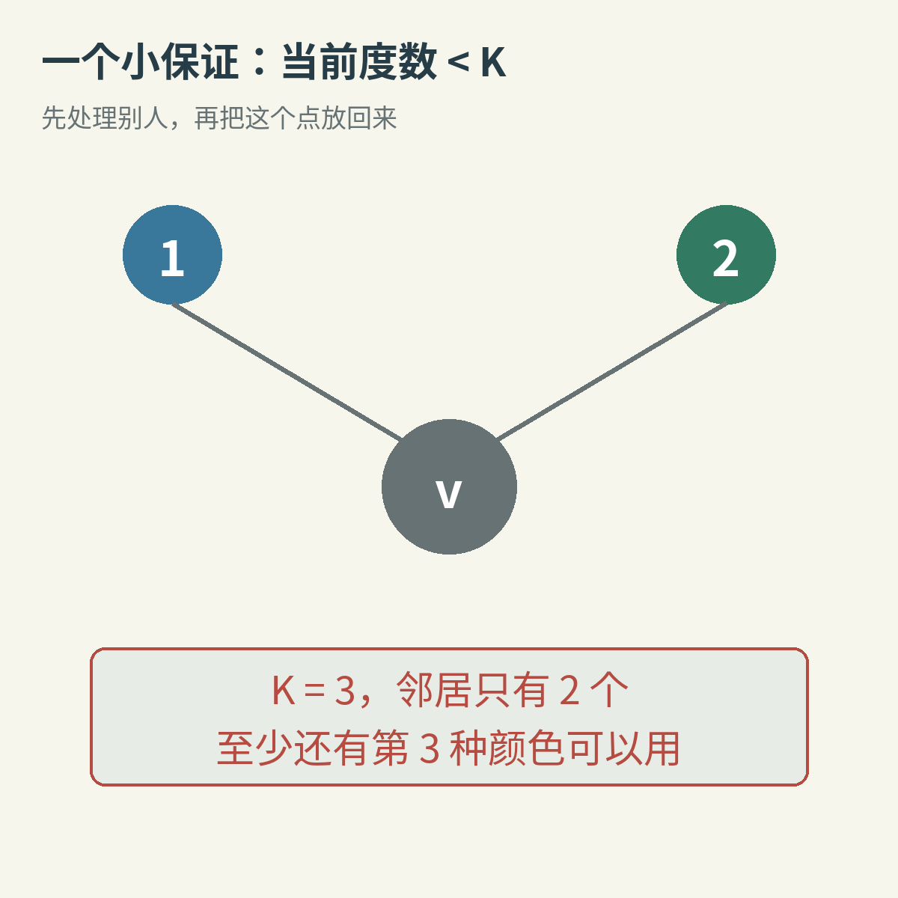

这里的**度数**就是相邻点的数量。它跟整张图里有多少个点无关，也跟程序读取这个变量多少次无关。

对两色的链，可以先拆a，再拆b，再拆c，再拆d；孤立的e随时都容易安排。每拆一个，就把它记进栈里。

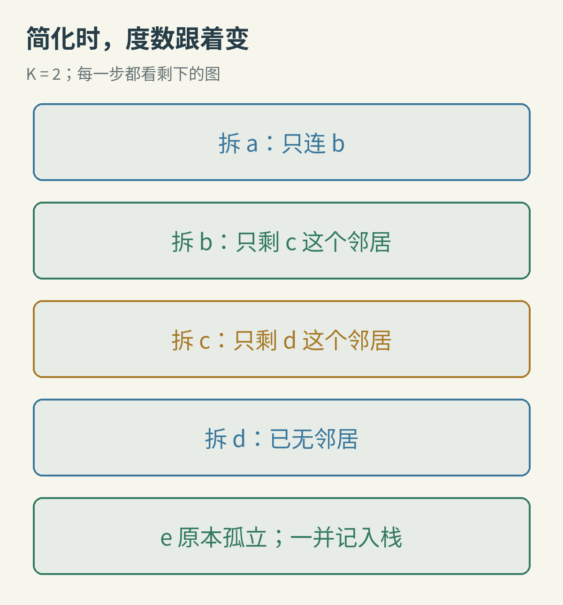

然后倒着把点放回去，每次避开已经着色的邻居。刚才的论证保证了：只要每次拆点都满足“当前度数<K”，恢复时就不会突然没有颜色。

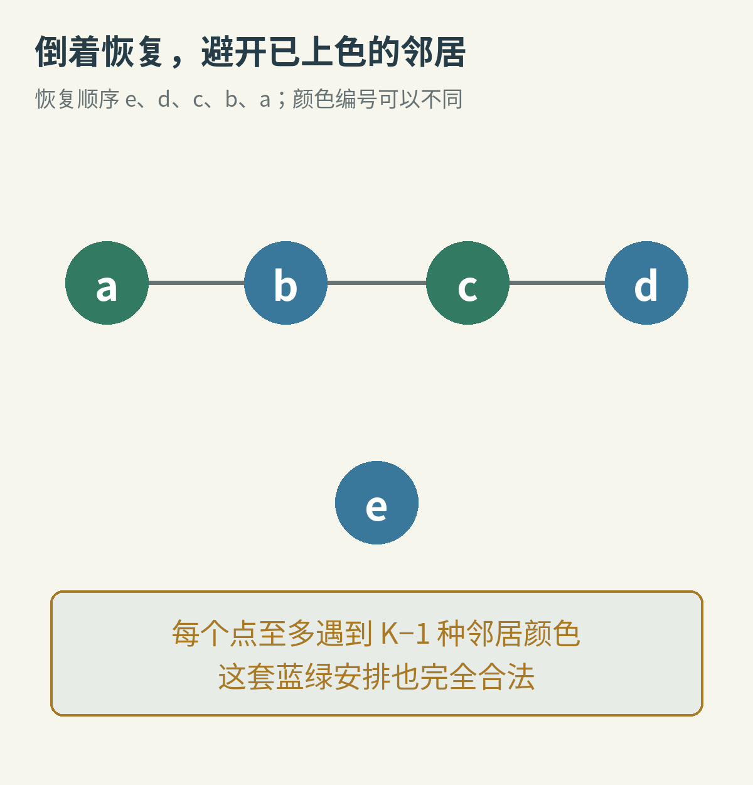

这个“先简化，再倒着恢复”的想法很值得学。它并没有蒙一个答案，而是在每次缩小问题时留下一条能把解扩回去的理由。

## 11. 拆不动，不等于肯定无解

画一个四边形的环，四个点，每个点都连着两个邻居。现在只有两种颜色。

每个点的度数都等于2，谁也不满足“度数<2”。刚才的简化步骤一开始就卡住了。

但给四个点交替涂蓝、绿、蓝、绿，显然就成功了。

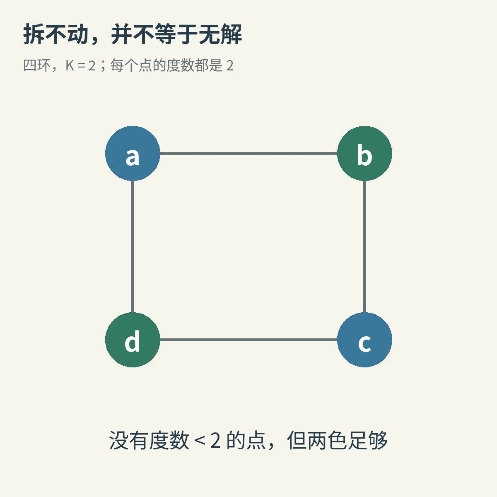

所以那条规则是一个**充分条件**：满足它时可以安心拆；不满足时，它只是不再提供保证，并没有证明不可能。

实际分配器可以用更多启发式、尝试乐观着色，或者选择溢出候选。不同方法在编译速度、生成代码质量与实现复杂度之间取舍。本篇不把一个教学版的失败，宣判成所有分配方法的失败。

## 12. 抽屉真的不够时，必须搬东西

换一段程序：

```text
a = input(x)
b = input(y)
c = input(z)
d = a + b
e = b + c
return d * e
```

c刚产生时，a、b、c都还要用。按“每个临时值整段固定占一个寄存器”的模型，它们形成一个三角形，两种颜色确实装不下。

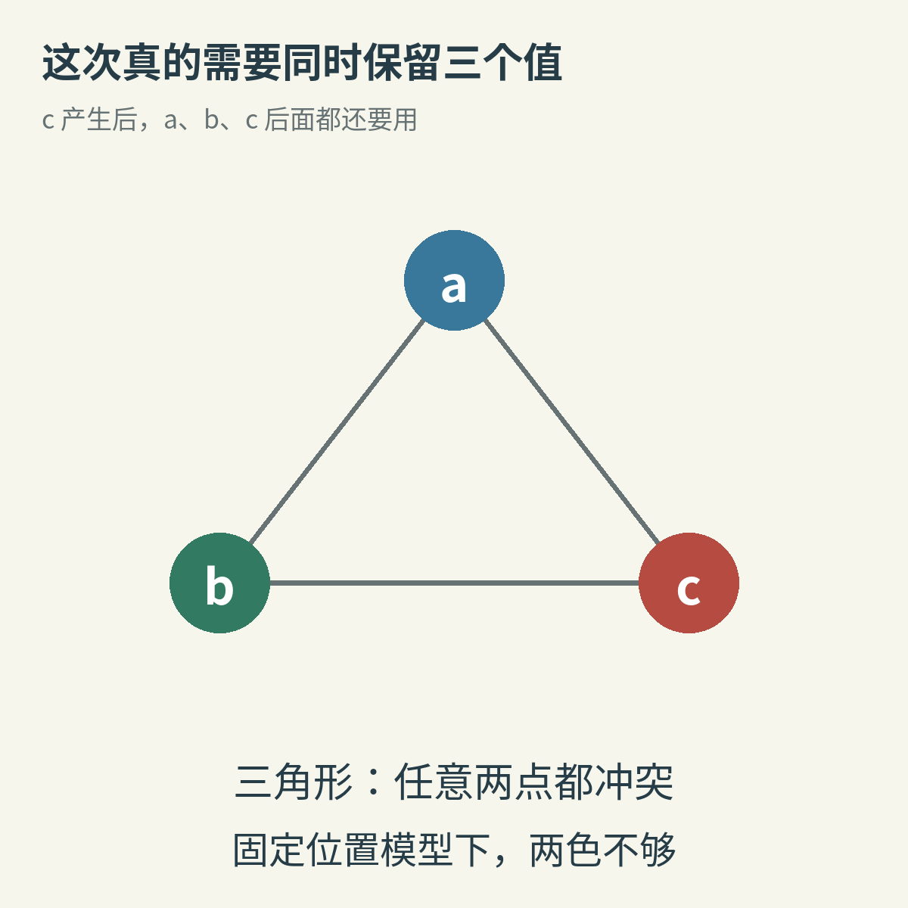

可以把某个值暂存到内存里的栈槽，需要时再取出。这叫**溢出**，英文是spill。

为了清楚地看见一次搬运，我们选择把b放进一个叫slot_b的内存位置。这只是示例选择，并不宣称成本最优。

下面的教学机器增加一项明确规则：加法允许一个源操作数直接来自内存。于是可以写成：

```text
R0 = input(x)
R1 = input(y)
slot_b = R1
R1 = input(z)
R0 = R0 + slot_b
R1 = R1 + slot_b
R0 = R0 * R1
return R0
```

取x=7、y=5、z=3，最后得到12×8=96。这里有一次保存b的内存写入，以及两次读取b的内存访问。

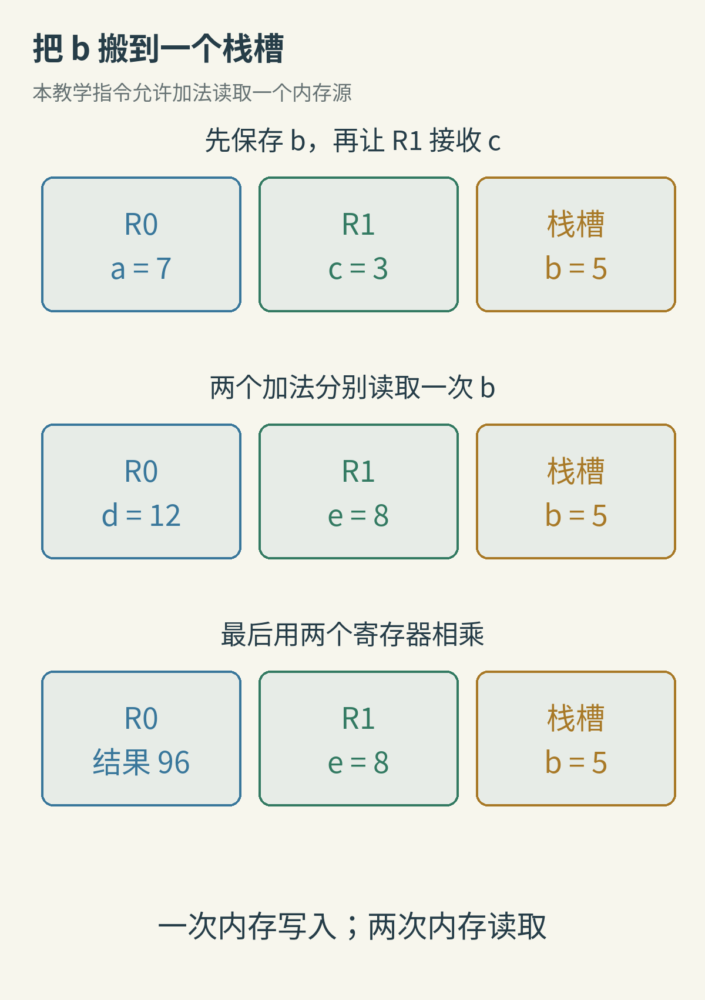

不要把这两次读取自动说成“两条独立LOAD指令”。在当前教学指令里，它们由带内存源的加法表达；真实机器是否允许这样做，要看指令集。对于只允许寄存器参与算术的机器，需要显式装载、临时寄存器以及相应安排。[3]

**溢出不是在图上擦掉一个点就结束了。** 必须改写指令，让取值位置真的变了；改写可能产生新的临时值，活跃信息与冲突也可能要重新计算。


## 13. 同时活跃，也有一个值得小心的例外

假设有一条复制：t=s。紧接着，程序既读取s，也读取t。

它们此刻确实同时有用途。但如果两者保证保存同一个值，而且后续使用和定义没有制造新的冲突，就未必需要两个不同的物理位置。让t与s共用寄存器，这条复制甚至可以消失。

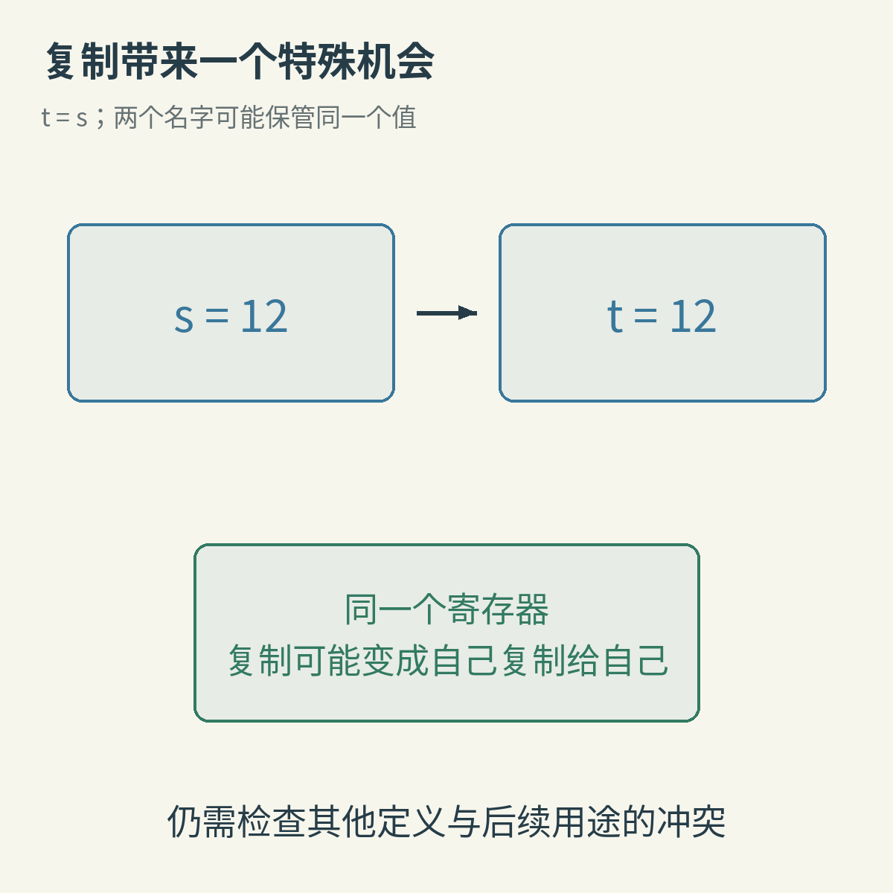

所以，更精细的构图会对复制指令作特别处理，而不是把所有“同时出现的名字”一律连边。我们前面的主例子没有变量到变量的复制，才可以先用更简单的规则来理解。[3]

把两个没有冲突的复制相关节点合并，通常叫**合并**，英文coalescing。但“它们之间没有一条边”，并不保证合并之后仍然容易着色。

比如，一条四点链的两个端点不相邻。把两端强行并成一个点，就可能把原本可两色的链变成需要三色的三角形。这张图只用于展示合并约束的风险，不是说主例子的a与d之间存在复制。

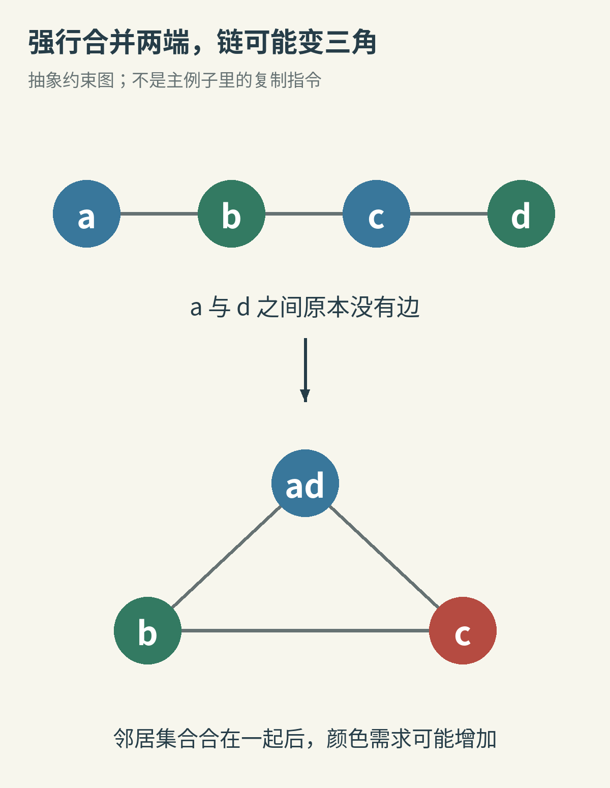

少一条复制指令可能是收益，多几次内存搬运可能是代价。编译器要算的是整件事，而不是只盯着一个局部动作看起来变短了。

## 14. 回到真实程序：有些边来自保守判断

一段带分支的程序，运行时只走一条路；分析的时候却可能必须同时考虑几条可能的路。只要某个值在一条可行的后续路径上还会被读取，就不能随便覆盖它。

把本来不会发生的冲突也算进去，可能浪费寄存器；漏掉一个确实会发生的冲突，却可能让程序算错。实用分析首先要守住后者。[3]

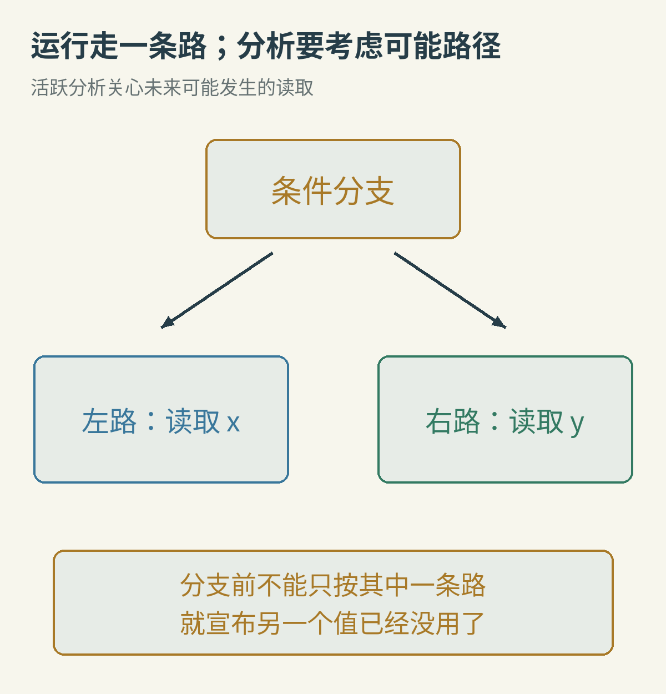

此外，真实机器的寄存器不总是“一排完全相同的抽屉”：有些指令要求特定寄存器；整数与浮点可能用不同寄存器组；宽值可能占多个位置；函数调用还带来“保存哪些、破坏哪些”的约定。

所以，“K个颜色”是一个有用的模型，不是抹平所有机器差异的万能翻译器。


## 15. 让一个小实验替你挑刺

配套的[register_lab.py](examples/register_lab.py)使用Python标准库，包含三件事：

1. 对主例子倒推活跃集合、建立干涉图，并比较虚拟名字版与两寄存器版的结果。
2. 实现贪心着色、度数小于K的简化，以及用于小图独立检查的回溯着色。
3. 检查上面的栈槽改写是否保留了答案。

本稿实际运行了所有1至6个顶点的简单无向图，分别给1、2、3种颜色，共101601个“图与颜色数”组合。在其中29618个组合里，简化法成功，得到的着色全部逐边合法；还有4578个组合，简化法卡住，但独立回溯仍然找到了合法着色。

这些数字最有价值的地方在于，它把第11节的提醒变成了一个可以重复观察的现象：**没有通过某个容易检查的条件，不等于问题没有解。**

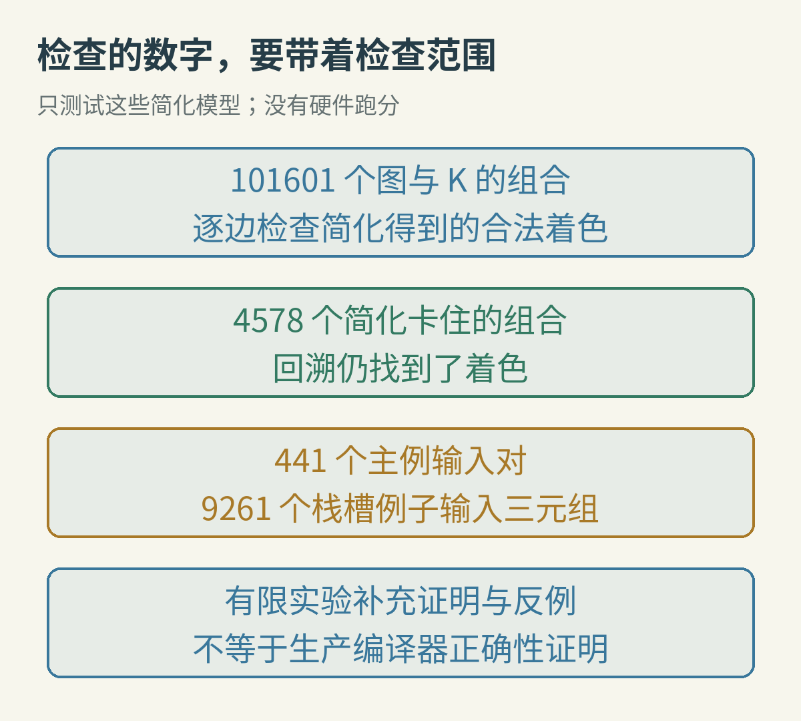

另外，主例子检查了x、y各取−10至10的441组输入；栈槽例子检查了x、y、z同范围的9261组输入，结果均与原计算相同。

这仍然只是明确范围内的有限检验。它不是一个生产编译器的正确性证明，没有测量任何硬件耗时，也没有覆盖循环、调用、溢出异常或者各种真实指令集。

你可以做三个小改动：

- 把主例子的最后一行改成return e+a。a突然又有了未来用途，哪几条边会新增？原来的两寄存器安排还能照搬吗？
- 给四环补上一条对角线。两种颜色还够吗？试着找一个三角形作证据。
- 在三角压力例子里改选别的值放进栈槽。先写出完整指令，再数内存访问；别只比较删点之后的图。

当你再看到源代码里一长串变量时，可以换一个问题：不是“它们一共有多少个”，而是“在这一刻，哪些旧值还必须留下？”

编译器正是靠这份关于未来的账，反复使用那几只很小的抽屉。

---

[1] Chaitin等，1981，IBM原始论文记录与摘要。  
[2] Chaitin，1982，IBM原始论文记录与摘要。  
[3] Pfenning等，2026，CMU《Register Allocation》讲义。实际核读范围、原图查看位置与未取得素材见[来源与素材说明](sources.md)。
