# 不知道表面在哪，光线为什么还敢向前迈步？Sphere Tracing 的安全圆

假设我们给电脑一个小任务：画出一颗球、一只方盒子和一个悬空的圆环。

这次不交给它顶点清单，也不先把圆环切成几万个三角形。我们只交给它几个函数。电脑可以拿任意位置去问：“我离这些物体最近的表面，还有多远？”

下面这张图，就是本文附带程序这样算出来的。它不是游戏截图，也不是生成式图像：场景里只有自建的几何体、一个地面，和一盏用来算明暗的点光源。

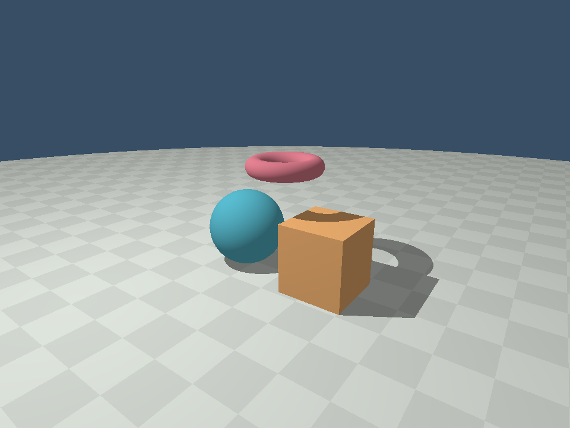

*原创计算图，原生960×720。每像素一条主射线；使用简单漫反射与硬阴影，不包含路径追踪的多次反弹。具体参数和近似见文末。*

要画一个像素，先得知道相机朝这个方向看过去，最先遇见的是哪个表面。困难在于：函数愿意回答“这里离表面多远”，却不直接告诉我们“沿前方走几步就会碰到”。这两个距离通常不是一回事。

如果光线每次只往前蹭一点，空旷处也得蹭很久。可要是大胆迈大步，又可能一脚跨过细墙，落到另一边，误以为一路畅通。

**有没有一种步长，既能利用空旷空间，又带着“不跨过表面”的证据？**

Sphere Tracing，常译作球体追踪，就从这个问题开始。我们先把世界压成二维，让安全的球变成圆，亲手算完一条光线。

## 一、先把物体变成一道可以询问的函数

普通网格告诉我们：“这里有一批顶点，它们围成这些三角形。”距离函数则告诉我们：“你给我一个点，我告诉你它离边界多远。”

这不是说物体变成了一团雾。表面仍然可以清清楚楚，只是它的表达方式变了。

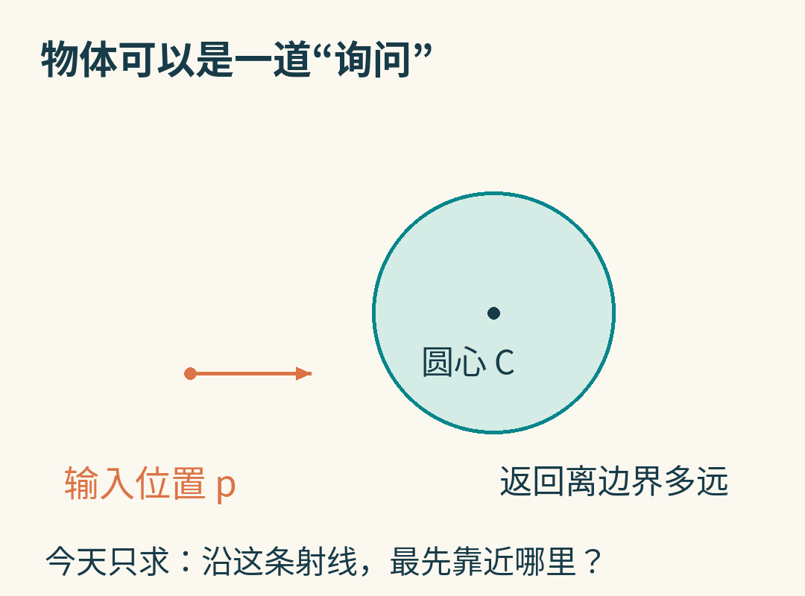

我们把一种特别有用的函数叫作**有符号距离函数**，英文是 signed distance function，简称 SDF。约定：

- 外面返回正数，大小等于到最近表面的直线距离；
- 表面返回零；
- 里面返回负数，绝对值仍然是到最近表面的距离。

“最近”并不问你打算往哪走。你面朝走廊尽头，最近的墙可能就在左手边。这一点，后面会解释球体追踪为什么会变慢。

本篇和另外几种图形算法要解决的问题也不同。GJK询问凸物体的支持点，处理两个形状之间的几何关系；Marching Squares从格点样本拼出等值轮廓；路径追踪处理光沿许多可能路线传播的贡献。我们此刻只解决其中一个基础问题：**给定一条射线，怎样靠近隐式表面的第一个交点。**

## 二、一个圆，足够让我们把第一步算明白

在纸上画一个圆，圆心是 C=(5,1)，半径是2。单位是我们自设的教学长度，不对应厘米或者米。光线从 O=(0,0)出发，沿横轴向右走。

用参数t记已经前进的长度，光线上的点就是：

p(t)=(t,0)，t≥0。

这里方向向量是(1,0)，长度为1，所以t恰好就是空间中的路程。三维里同样可以写成 p(t)=O+t·v，但要先保证v是单位向量；否则增加t和实际走了多远就不是一回事。

圆的距离非常容易算：到圆心的距离，减去半径。

**d(x,y)=√((x−5)²+(y−1)²)−2。**

在起点，我们到圆心的距离是√26，因此到圆边界的距离是：

d(0,0)=√26−2≈3.099020。

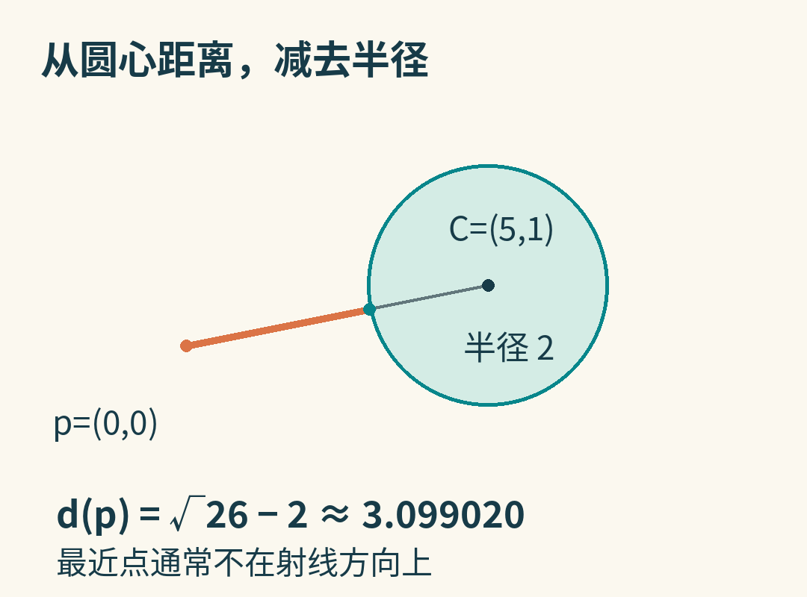

别急着把3.099020叫作“交点位置”。起点到圆心的那条线是斜的，最近的表面点落在这条斜线上；光线却只能水平往右走。所以水平交点还在更远处。

不过，这个最近距离已经能告诉我们一个很强的事实。

## 三、空圆内部，为什么不可能藏着表面？

以当前位置p为圆心，画一个半径为d(p)的圆。

如果这个圆内部还有一个表面点，那么那个点到p的距离就会小于d(p)。可d(p)本来已经是最近距离。矛盾。

所以：**半径d(p)以内的开圆盘里没有表面；圆周允许刚好碰到表面。**

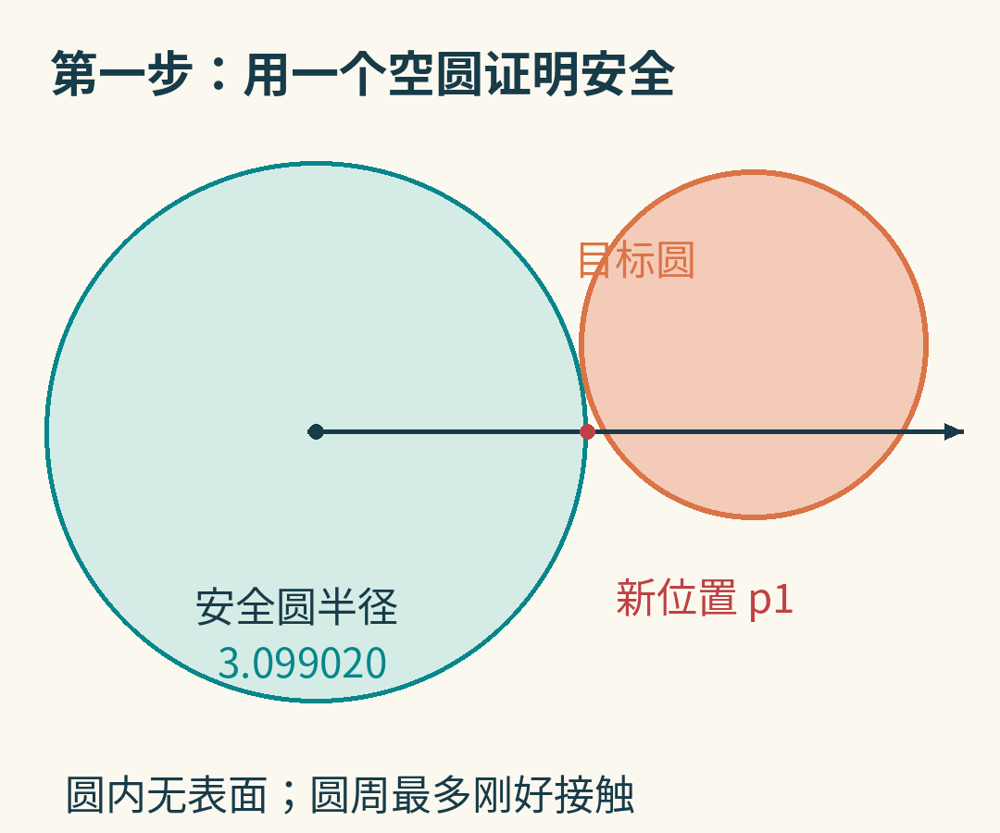

光线朝任何方向走，只要路程不超过这个半径，就不会穿越表面。这里有意说“不穿越”：最后一步可以正好落在表面上。

于是第一步可以直接前进3.099020，而不必在中间撒满小样本。新位置约为 p1=(3.099020,0)。

这只圆不是拿来把物体包住的。它包住的，是我们已经证明没有表面的那片空间。三维里把圆换成球，名字里的 sphere 就有了来处：算法沿着射线串起一连串这样的空球。

## 四、到了新位置，再重新问一次

在p1处，原来那只安全圆已经不能替下一步担保了。重新求距离：

d(p1)=√((3.099020−5)²+1)−2≈0.147959。

再前进0.147959，到达 p2≈(3.246978,0)。

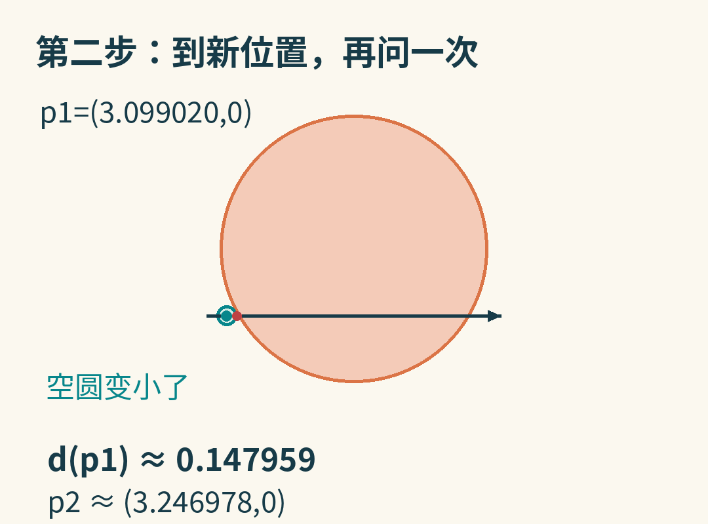

反复执行的核心只有一句话：

**下一位置的参数 = 当前参数 + 当前的安全距离。**

前面很空，圆就大，一步走远；靠近物体，圆变小，脚步变细。我们并没有提前知道交点在哪里，但每一步都能说明自己为什么安全。

下面是附带Python程序实际输出的前六次询问。显示值四舍五入到六位小数；计算使用双精度浮点数，不是拿表里截断后的数继续算。

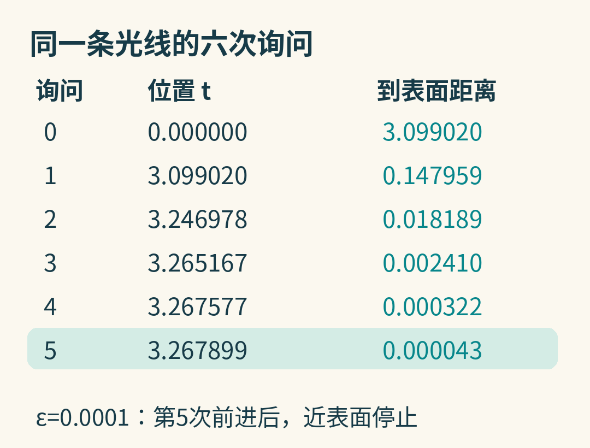

如果把“足够接近”的阈值设成 ε=0.0001，第六次询问时距离约为0.0000431864，小于ε，程序停下。它进行了五次前进、六次距离计算。

这回我们可以额外偷看一眼标准答案：把y=0代入圆方程，得到 (t−5)²+1=4，所以第一次相交在：

t*=5−√3≈3.267949192。

程序停在 t≈3.267899325，并没有精确碰到表面。它只是接近到了约定的程度。后面我们会专门追问“接近”究竟保证了什么，不把这个小差别藏起来。

## 五、换成方盒子，距离要怎样量？

圆能算得这么整齐，会不会只是因为挑了一个过分友好的物体？

换成轴对齐的方盒子：中心(5,0)，横纵半边长都为1，也就是 x从4到6、y从−1到1。

取盒子左上方的点p=(2,3)。最近的盒子点是角(4,1)。横着还差2，竖着也还差2，所以距离是√(2²+2²)=√8≈2.828。

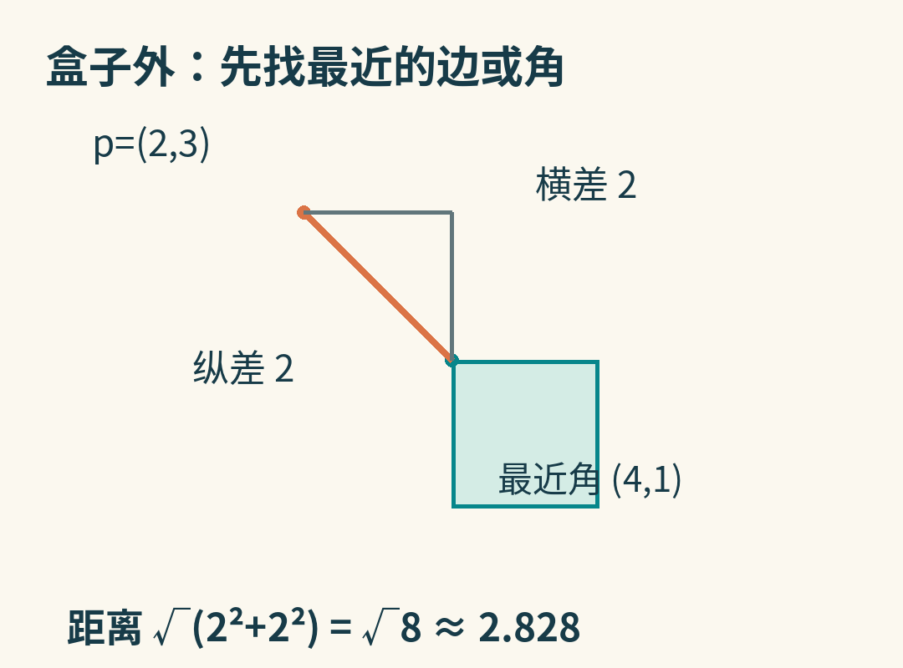

这里如果只取横差、纵差中较大的那一项，得到2，就低估了真正的距离。这个2可以保守地用于某些步进，但它不是欧几里得真距离。边角正是识别“看起来像距离”的公式的好地方。

一般的轴对齐盒子，中心为c，半边长为h。先分别计算：

qx=|x−cx|−hx，qy=|y−cy|−hy。

qx为正，表示横向越出了盒子；qy为正，表示纵向越出了盒子。把负的分量换成零，正分量组成的向量长度，就是外侧距离。

内部怎么办？两个q都不大于零。这时取较大的那个q，也就是最接近零的负数，它对应最近的边。

合起来，二维盒子的SDF可以写成：

d盒=√(max(qx,0)²+max(qy,0)²)+min(max(qx,qy),0)。

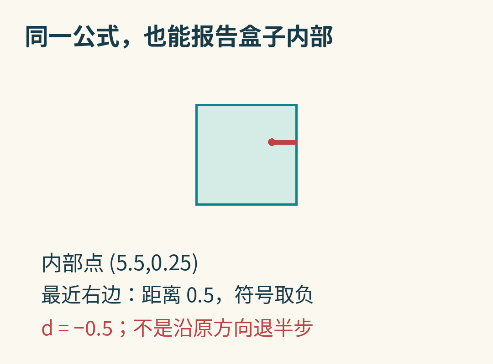

比如p=(5.5,0.25)，有qx=−0.5、qy=−0.75，公式返回−0.5。我们离右边最近，而且人在盒子里面。

附带实验没有只用这个公式检查自己：它还分别计算点到四条边线段的距离，取最小值，再根据是否在盒内补上符号。这是另一条几何计算路线，后面会用它交叉验证。

## 六、场景里有两个物体，听谁的？

假设我们站在所有物体之外，圆说“离我3.1”，盒子说“离我7.2”。安全步长当然不能听较远的那个。

取较小值就行：

d场景(p)=min(d圆(p),d盒(p))。

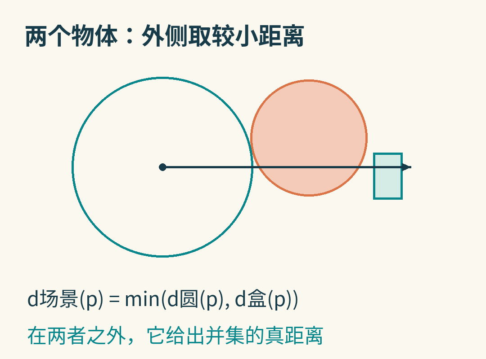

对并集的**外部点**来说，这个值是到并集的真距离，因为最近的表面一定来自某一个组成物体。正文开头的渲染器就组合了球、盒、圆环与地面半空间，从外部推进。

但如果已经进入多个物体重叠的地方，简单的min未必还给出到并集外边界的准确有符号距离。交集、相减、平滑混合、扭曲变形等操作，也要分别核对距离性质。

这不是对组合建模泼冷水。它提醒我们：**零集合可以对，符号可以对，距离大小仍然可能变了。** 接下来我们就把这三件事拆开。

## 七、距离不够准，也能安全吗？低估与高估不是同一种错误

假如函数给不出真距离d，只能给出一个非负数b，而且能够证明：

0≤b(p)≤d(p)。

那么用b当步长仍然不会跨过表面。我们只是在真的安全圆里又画了一个小圆。这样的b称为距离的**保守下界**。

比如在刚才的圆场景里，每步只走d/2。同一个ε、同样用真距离判断停止，实际需要19次询问，而原来只需要6次。

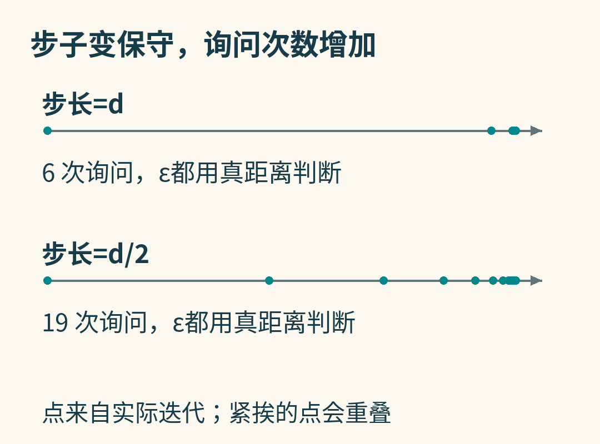

*点由实际迭代位置绘制。接近终点时多个点挤在一起；它们没有被人为均匀排开。*

低估的代价通常是慢。还要补一句：如果下界在远处就等于零，程序甚至可能不再前进。只满足“不会走太远”，并不自动保证“一定走得到”。讨论收敛还需要持续进展、连续性等条件，不能把任意小数都叫作一个好距离估计器。

高估则可能直接漏掉物体。故意把第一步改成3d，我们会从t=0跳到t≈9.297059。圆的两个交点约为3.267949与6.732051，已经全部跨过去了。

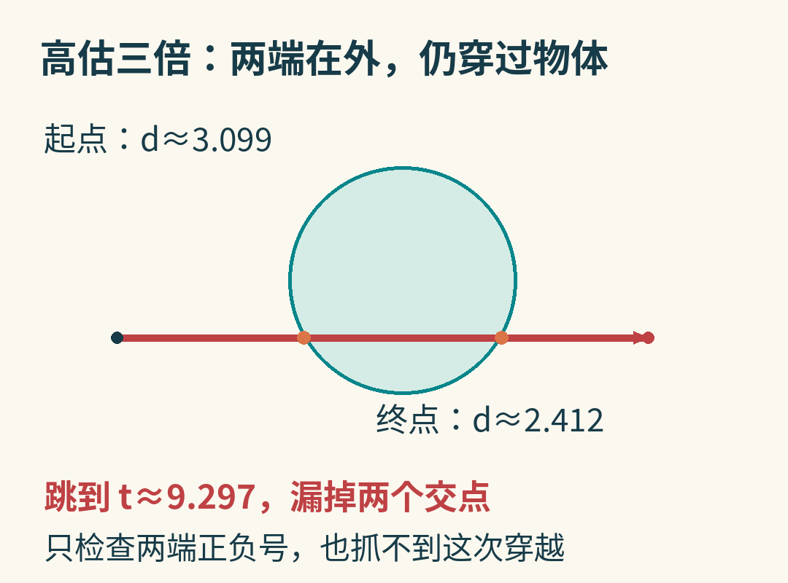

更麻烦的是，新位置的距离仍然为正，约2.411883。于是“只要两个采样点同号就没穿过”这个补丁，也抓不到这个错误。

所以，经验性的“乘0.8应该保险”并不是万能证明。它只能把一个已经知道误差范围的估计适当缩小；如果原函数高估十倍，乘0.8仍然可能高估八倍。

## 八、同样画出一个圆，为什么有的函数不能当步长？

我们还可以用另一个函数描述同一个圆：

f(x,y)=(x−5)²+(y−1)²−4。

它在圆上为零，圆外为正，圆内为负，这些都没错。但在起点，它返回22，而真距离只有约3.099。

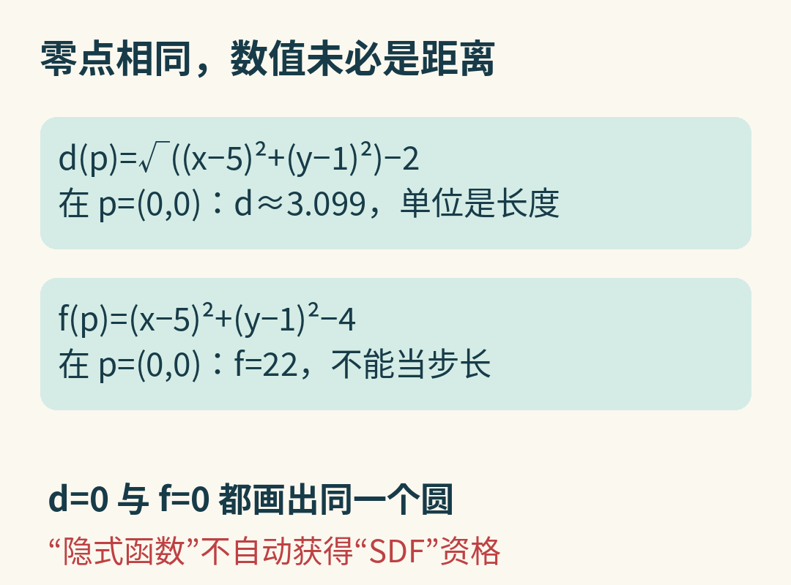

要是把22直接当路程，光线会跨过整个圆。而且在这里，f的量纲还是长度的平方，更没有资格未经换算就充当长度。

**隐式函数**只要求通过一个条件来定义表面，比如f(p)=0。**有符号距离函数**还承诺数值大小就是到表面的距离。后者比前者多了一份很重要的合同。

Hart的研究正是沿着这条区别展开的。John C. Hart的论文《Sphere Tracing: A Geometric Method for the Antialiased Ray Tracing of Implicit Surfaces》发表于《The Visual Computer》12卷，1996年，527–545页。可以读到的作者手稿首页标着1994年7月，某些下载封面还有1995年的元数据；它们不是同一个日期概念。[论文记录](https://doi.org/10.1007/s003710050084)、[作者手稿](https://graphics.stanford.edu/courses/cs348b-20-spring-content/uploads/hart.pdf)

这篇工作的关键不只是“有距离就往前走”，还包括：当函数不直接返回真距离时，怎样通过变化速度的界限，构造出一个可以信任的安全步长。

## 九、Lipschitz界：函数离零还这么远，至少要走多远？

先不用记人名。把f(p)看成仪表读数，把在空间中的移动看成时间。

假如你能证明：在规定区域里无论选哪两个位置p、q，仪表变化的绝对值都满足：

**|f(p)−f(q)|≤L·|p−q|。**

也就是说，每走一个长度单位，读数最多改变L个单位。这个正数L就是一个 **Lipschitz界**。它可以比最紧的界更大，代价是让我们更保守。

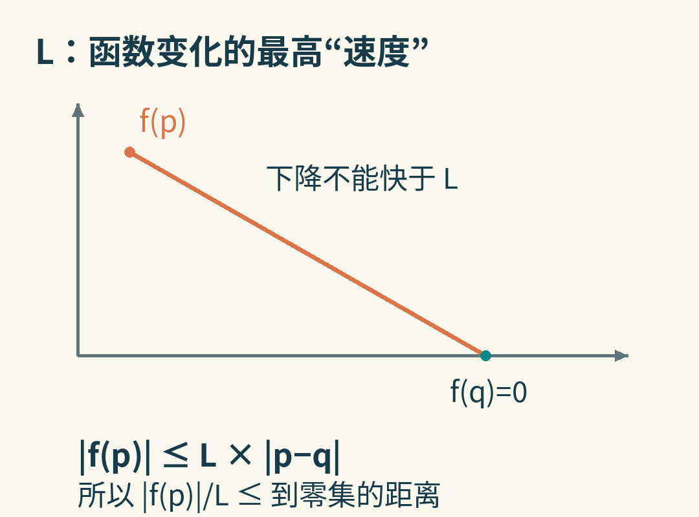

现在，让q取最近的表面点。表面上f(q)=0。代进去：

|f(p)|≤L·|p−q|。

两边除以L，得到：

**|f(p)|/L≤到表面的距离。**

于是，|f(p)|/L可以当安全步长。这里最漂亮的地方，是把一条“函数变化不能太快”的约束，变成了一段“至少这么远都没有零点”的空间保证。

对刚才的平方函数，我们限定在“以C为圆心、半径6的圆盘”内。如果学过偏导数，可以算出梯度∇f=2(p−C)，它的长度最多为12。圆盘是凸的，连接两点的线段也留在其中，因此L=12是一个有效界。

还没学过梯度也能核对：设u=p−C、v=q−C，则

|f(p)−f(q)|=||u|²−|v|²|≤(|u|+|v|)·|u−v|≤12|p−q|。

最后一步用的是两个位置到C都不超过6。

所以起点可以安全地走22/12≈1.833333，虽然小于真距离3.099020，却已经有了依据。

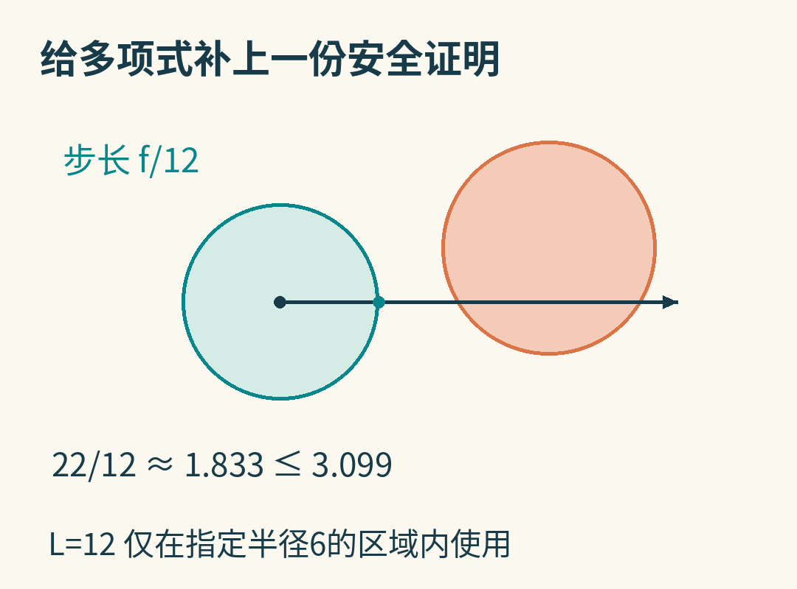

**区域限制不能藏起来。** 这个证明只在指定圆盘内成立；跨出区域之后，不能继续拿12当全空间的万能界。一般的局部界，需要覆盖你要据以排除表面的那段空间，或者与区域边界检查配套。仅在当前位置采样一次梯度大小，也不等于证明了附近没有更陡的变化。

真距离本身还有一个可爱的性质：它是1-Lipschitz的。你移动Δ长度，到表面的距离最多改变Δ。否则，先走到旧位置，再走旧位置到表面的最短路，就能构造出一条比“新位置最近距离”还短的路，违反最近的定义。

这也解释了，为什么真距离是这里特别合身的一把尺子。

## 十、一直收敛，是否等于有限步精确命中？

不等于。

想象表面就是x=1这条直线，起点x=0。每次只走剩余距离的一半，就得到：

0，1/2，3/4，7/8，15/16……

第k次之后的位置是 t_k=1−2的负k次方。在理想实数算术里，任何有限的k都小于1；但当k无限增大时，位置趋近于1。

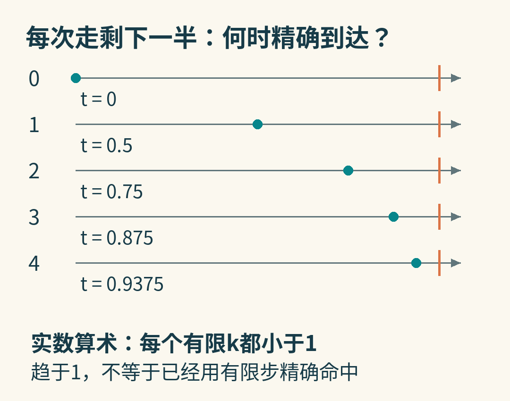

“不会越过第一交点”和“足够接近第一交点”，是可以通过条件证明的性质；“有限次计算正好等于那个实数交点”，通常是另一个更强、也不必要的要求。

真实程序既没有无限时间，也没有无限精度，必须规定怎样停。接下来几个边界，比把循环写得很短更重要。

## 十一、ε到底是在说什么？先分清两种尺子

对真距离来说，如果0≤d(p)≤ε，我们可以肯定：**p离某个表面不超过ε。**

几何上，相当于在物体外面包了一层厚度ε的薄壳，走进壳里就允许停止。

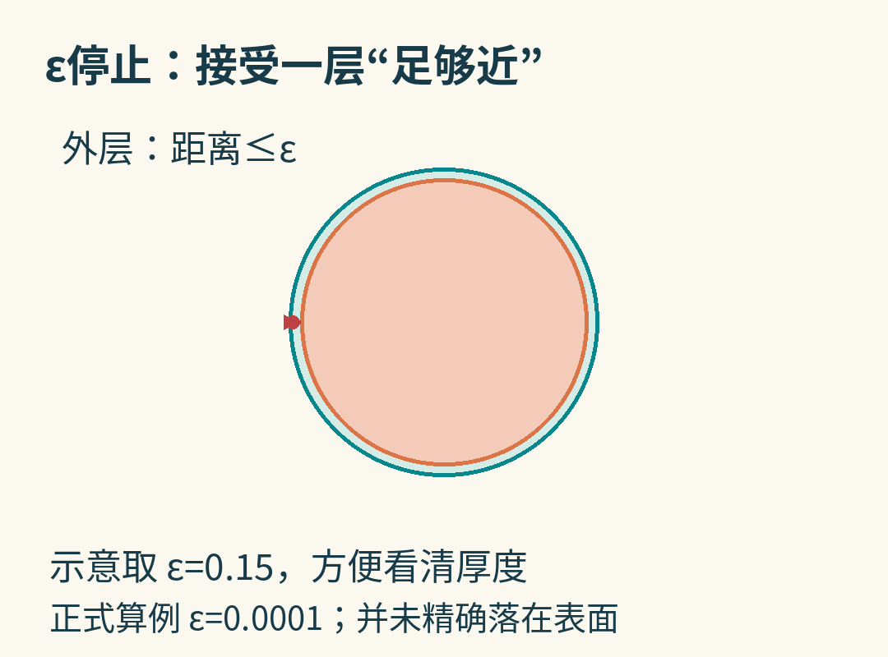

*此图特意用ε=0.15画出看得见的薄层，圆仍按真实比例绘制；手算实验使用ε=0.0001。*

但如果手里只有下界b≤d，判断b≤ε就不能推出d≤ε。比真实距离小的数，本来就可能小得离谱。

比如b=d×0.000001，显然是个保守下界。在起点，b≈0.000003099，小于ε=0.0001，但真实表面还在3.099个单位之外。要是把“小下界”当成“很接近”，程序会在起点就误报。

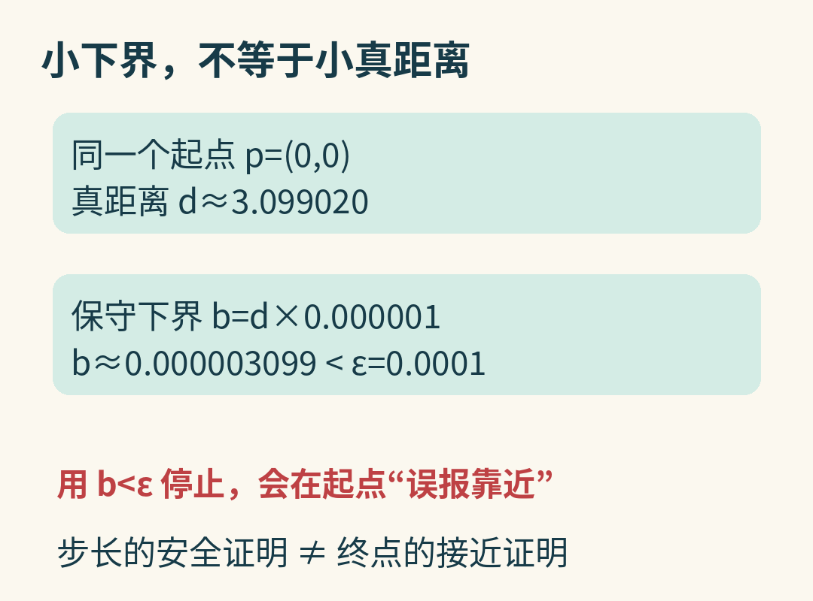

所以有两份不同的证据：

- 决定走多远，要一个不超过真距离的下界；
- 决定是否足够近，要真距离，或者一个已经足够小的距离上界，或者其他可靠的几何验证。

如果还有质量保证 b≥c·d，其中c>0已知，那么d≤b/c。此时用b≤cε就能证明d≤ε。可这个c必须有依据，不能临时猜一个。

附带实验故意让“步长缩小一半”和“终止用真距离”分开。所以19次与6次的比较，并没有偷偷放宽停止精度。生产渲染器可以接受基于下界的小步启发式，但应该知道那已经不等于严格的接近保证。

## 十二、擦着物体走，会把“近”字放大成什么？

把射线改成y=3，仍然从x=0向右。这次它与圆在(5,3)相切。

在同样ε=0.0001的条件下，程序用了196次询问，停在t≈4.980065。到表面的真距离已经小于0.0001，但沿射线到切点还有约0.019935。

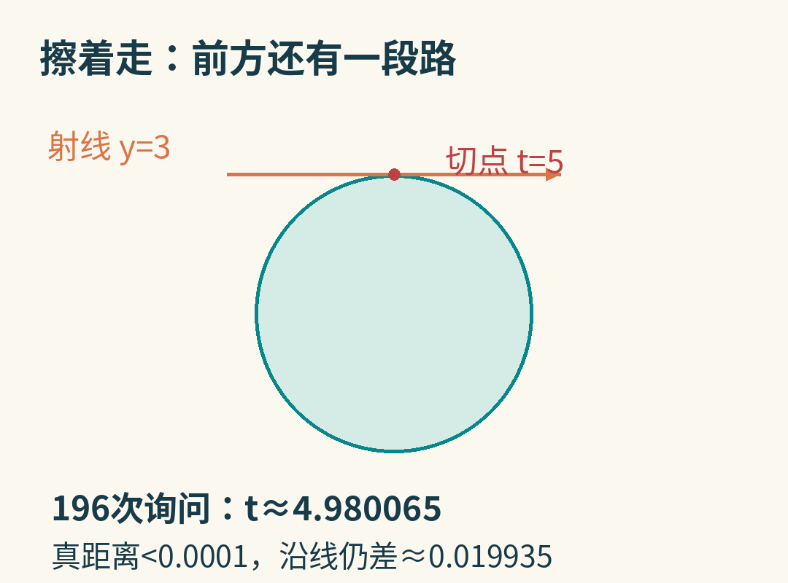

原因就在我们一开始强调的那句话：最近的表面通常在侧面。

靠近圆顶时，如果沿射线离切点还差s，最近距离是√(4+s²)−2。把它乘以共轭式，得到 s²/(√(4+s²)+2)，s很小时约为s²/4。于是表面距离已经非常小，沿射线的误差却仍然大得多。

这也解释了为什么d≤ε并不自动意味着“交点参数误差≤ε”。正对表面时差别可能很小，接近切线时就不能忽略。

再往上移动一点，把射线放在y=3.00005。它高于圆顶，数学上根本没有交点。但它会进入ε=0.0001的外壳。程序实际在218次询问之后返回“近表面”。

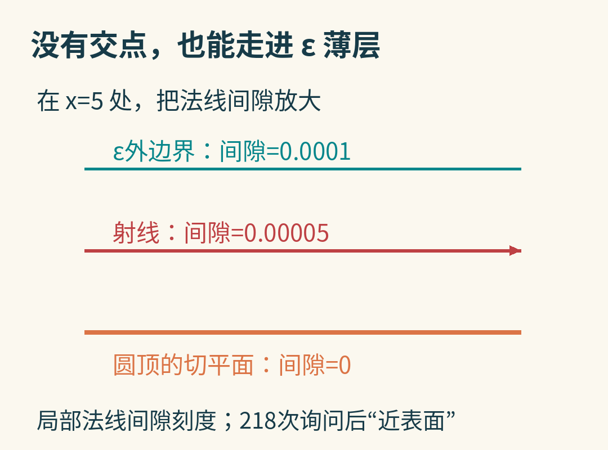

*图中只放大x=5处的法线间隙刻度，不把整只圆挤成扁椭圆。圆顶间隙为0，射线间隙为0.00005，ε边界为0.0001。*

所以我们的状态名叫 **NEAR_SURFACE**，而没有叫“已严格证实相交”。视觉渲染可能乐于接受这个近似，精密碰撞或者严格的几何求交却可能需要更强的方法，比如带区间界的求根与验证。

把ε调小通常能缩小近似范围，代价是更多计算；它也不能靠有限浮点数消除所有退化情况。

## 十三、没碰到、还没算完、起点已经在里面，必须分开

如果光线根本没遇见物体，我们不能让它永远走下去。通常要限定一个查询范围，比如t从0到12。

当前空圆如果已经覆盖了剩余整段射线，我们就可以宣布“这个有限区间内无交点”。本例代码中，对严格大于剩余长度的安全步长返回 RANGE_CLEAR。它没有宣称无限远处也没有东西。

如果只是循环做满了256次，还没获得接近或者排除的证据，则返回 BUDGET：**预算耗尽，结论未定。** 把它直接当作“没碰到”，会把难算的轮廓变成漏光或者缺口。

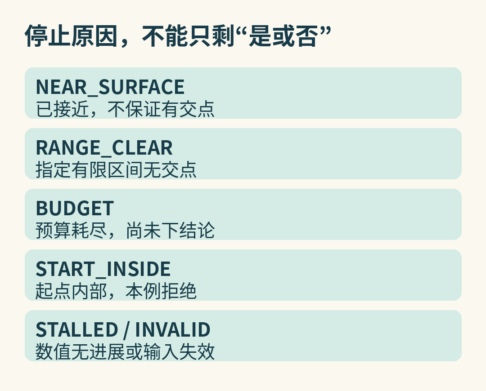

切线那个例子如果把预算从256改成64，就会遇到这种“还没算完”。图形学里的预算限制是现实需求，但它不会把未知自动变成否定。

起点在内部又怎样？比如直接从圆心(5,1)出发，SDF返回−2。要是写成t+=d，光线会向后退两单位，而不是按原方向寻找出口。

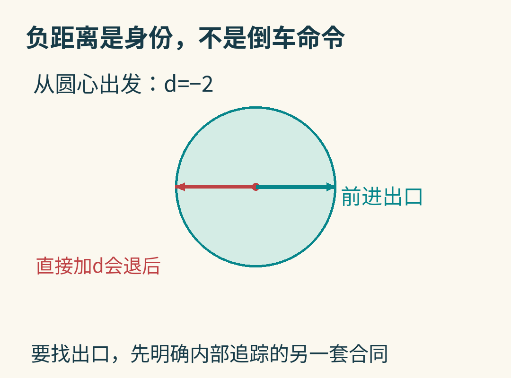

可以专门设计“从内部到出口”的追踪，用到边界的绝对距离等信息；透明材质、多次穿越也有自己的处理方式。本文的简化实现选择明确拒绝内部起点，返回 START_INSIDE。这样读者不会误把一段“外部首交点”演示当成完整的折射追踪器。

起点恰好在表面时，本例允许立即返回“近表面”。如果是从已有交点发出的阴影或者反射射线，就需要小心处理自相交，而不是机械地从同一点再来一遍。

## 十四、几行循环后面，还站着浮点数

数学里的“安全”是按精确值说的。计算机里的平方根、加减和坐标变换会舍入。

特别远的坐标配上特别小的步长，可能出现t+step与t在浮点表示上完全相同。继续循环也不会前进。本例会报告 STALLED。

遇到NaN、无穷值，或者本应从外部保守推进却突然得到负距离，也不能一律按“d小于ε，所以命中”处理。代码会分别报告 INVALID_DISTANCE 或 OVERSHOOT。后者可能是距离合同被破坏，也可能暴露数值问题，需要查明原因。

实际工程还应该检查：

- 方向是否归一化，场景坐标和距离是否使用相同尺度；
- 缩放、扭曲之后，距离是否仍然保守；
- 从离散纹理插值得到的距离，是否具有足够的误差界；
- 薄物体、相切、几乎重合的表面与极大坐标，怎样报告无法判定；
- 距离估计、法线估计与终止阈值，是否各自满足用途。

一个解析SDF正确，不代表用纹理近似、量化和插值存下来的版本也自动保持同样性质。本文的实验证据只覆盖明确列出的解析圆与盒，以及另列参数的演示场景。

## 十五、给算法换一把尺子，再核对它的脚印

本篇的二维实验只用Python标准库。完整实现与运行说明在[附属实验](examples/README.md)，这里先看圆与盒的距离函数。

```python
from math import hypot

def circle(p):
    x, y = p
    return hypot(x-5, y-1)-2

def box(p):
    x, y = p
    qx = abs(x-5)-1
    qy = abs(y)-1
    outside = hypot(max(qx, 0), max(qy, 0))
    return outside + min(max(qx, qy), 0)
```

把这两个函数交给附带的march，程序会逐次记录当前位置与距离，并区分前面那些状态。核心前进仍然是t+=factor*d，其中factor在0到1之间且不能为零；终止检查使用未经factor缩小的真距离。

我们没有让步进程序给自己打分，而是另外写了两种参考求交：圆解射线代入后的二次方程；盒子用横纵两个“坐标允许区间”的交集。它们都不通过累加距离来寻找交点。

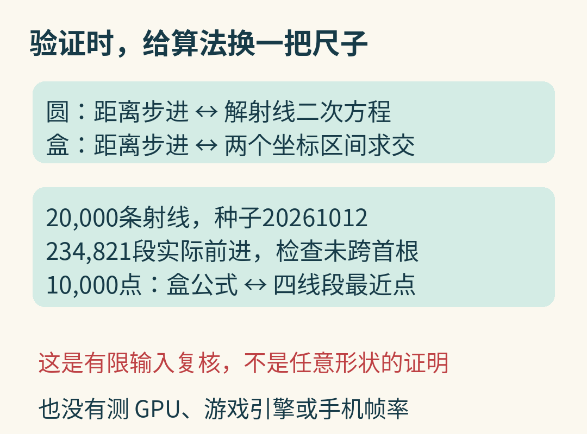

实际在Python 3.12.14运行，随机种子为20261012。主要范围如下：

- 10,000个点，把盒子SDF与“四条边线段最近距离”比较；最大绝对差约8.9×10的负16次方。
- 20,000条射线，起点x在[−4,0]、y在[−4,5]，方向角在[−0.8,0.8]弧度；圆与盒各测两种步长因子1、0.5，每组合5,000条。
- 射线测试使用ε=0.00001、t最大20、预算1,024次；逐段核对234,821次实际前进没有跨过解析参考的第一个非负交点，比较容差为2×10的负10次方。
- 返回14,507个 RANGE_CLEAR、5,493个 NEAR_SURFACE；这批随机输入没有耗尽预算。相切、极近未相交、内部起点、范围截断、低预算、非单位方向与非有限数值另有定点测试。

随机组中没有出现“近表面但无真实交点”，并不说明这种事不会发生。我们刚才专门构造的y=3.00005，已经给出了反例。**测试分布里没撞见，不等于数学上不存在。**

这些是有限输入范围内的复核，不是生产几何库的形式化证明，也没有测试GPU速度或者游戏帧率。二次方程本身在极端数值下也会有舍入问题；本次坐标范围适中，不把它称作任意浮点输入上的精确判定器。

## 十六、把每次询问涂成颜色，会看见什么？

回到开头的三维场景。下面不画材质颜色，只画每条主射线用了多少次距离询问。

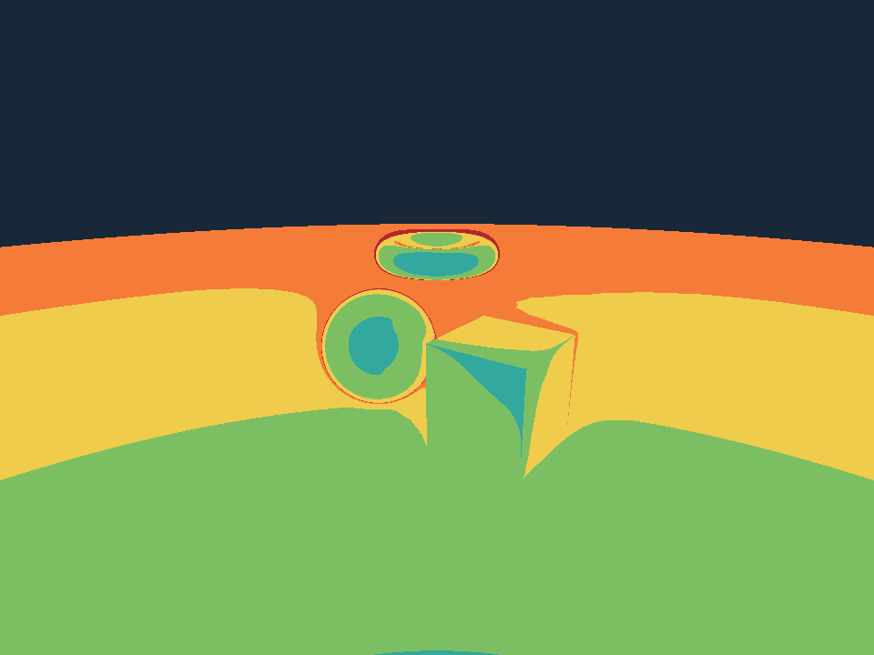

*青色1–7次，绿色8–15次，黄色16–31次，橙色32–63次，红色64次及以上；深蓝是有限范围内未接近表面的像素。本图不含阴影射线的查询次数。*

你会发现，近处正对相机的平整区域相对便宜，物体轮廓与远处接近水平视线的地面更费询问。最近的表面在旁边、却还没到沿射线前方的交点，正是这种拖慢的一个原因。

这张图不是用“哪里看起来难”手工涂色的。程序实际累计了10,429,501次主射线距离查询，单条最多157次。691,200个像素中，446,462个到达近表面状态，244,738个越过有限远界，没有主射线耗尽256次预算。

主射线使用ε=0.001、最远距离30，和二维测试参数不同。圆环和盒子等组合在外部用最小距离。法线用六次距离采样的中心差分估计，再计算一盏点光源的简单明暗。

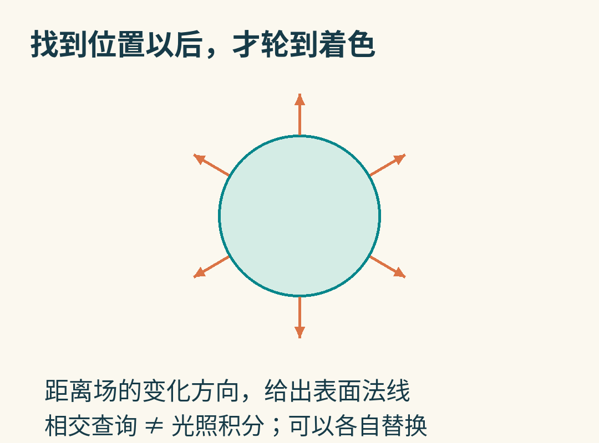

阴影射线另设128次上限，仍有39个着色点的阴影查询耗尽了预算，演示程序把这些未决阴影当作未遮挡。它可能产生少量漏阴影；我们保留并说明这个近似，不把图片当成无误差的光照真值。每像素只有一个主样本，边缘也没有抗锯齿。

球体追踪负责的是找到或者接近表面；得到表面之后怎样着色、要不要多次反弹、要不要计算景深，是可以继续组合的其他问题。一个画面很好看，不代表这些问题已经被同一个算法全部解决了。

## 十七、原论文里的图，与今天的研究还在问什么？

Hart的作者手稿中，第27页的图8给出了三个圆环的混合形状、局部放大与工作量图；第28页展示了zeno字样的几何造型。这些是真实论文中的程序结果，可以直接打开[原手稿相应页面](https://graphics.stanford.edu/courses/cs348b-20-spring-content/uploads/hart.pdf#page=27)观察。论文还讨论了抗锯齿与复杂距离模型，远比本文这个小循环完整。

我们没有取得这些老图的开放再分发依据，所以只链接原件，不把它们换成一张“看起来像1990年代”的生成图。Hart本人的真实照片可以在[伊利诺伊大学人物页](https://grainger.illinois.edu/about/directory/faculty/jch)查看；这里也不制造假的历史肖像或工作现场。

后来的研究仍在处理同一个张力：怎样更快接近表面，同时守住安全条件。2023年，Róbert Bán与Gábor Valasek的论文比较了几种步长放松方法。下面是其图1左上子图，显示所比较的一种增强算法在Temple场景里的平均步数分布。

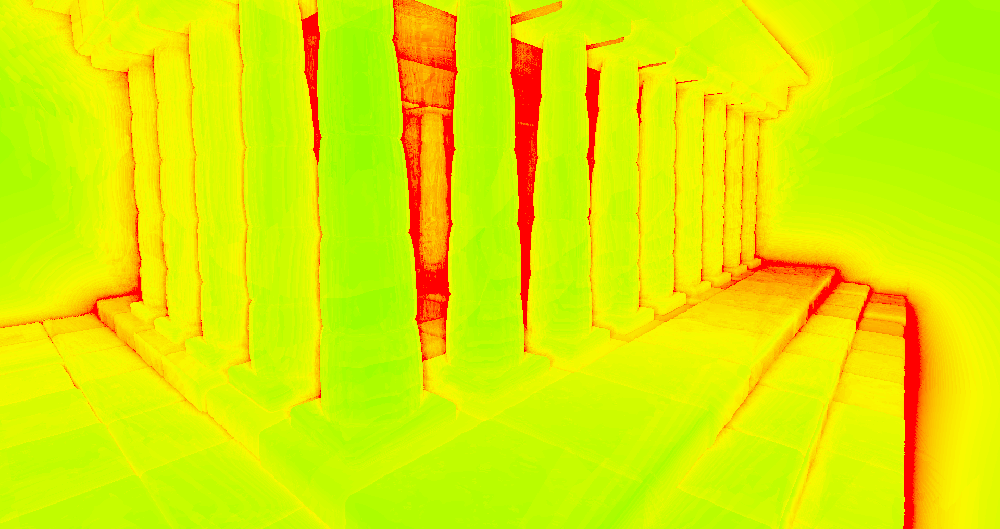

*© 2023 Róbert Bán、Gábor Valasek，CC BY 4.0。来自《Automatic Step Size Relaxation in Sphere Tracing》图1左上，增强方法参数ω=0.88；绿表示较少、红表示较多，不与本文上一幅热图共用数值色标。保留PDF内1920×1017像素图像，未重绘。场景来自论文所引Takikawa等人的SDF数据集，不是本文场景。[原文与许可](https://diglib.eg.org/items/56b3a5fa-9c27-4036-a21f-7287dd83af11)*

这类方法并不是无条件把d乘一个大于1的数就收工。它们会额外检查候选步长的安全关系，必要时退回普通步进。本文没有实现或复测这些性能比较，也不把这张第三方实验图冒称成自己的测量。

为了让原图上下文完整，随稿保留了这篇开放论文的[原PDF](source-assets/ban-valasek-2023-original.pdf)和全部11个正文嵌入图像，见[来源与素材说明](sources.md)。老论文的历史结果和新论文的性能研究，都只是帮我们看见问题如何延续；掌握基础的安全证明，并不等于掌握了所有优化版本。

## 十八、留三件值得亲手改的小事

第一，把主算例射线的高度依次改成1、2.5、2.99和3。看看询问次数怎样从2变成10、56、196。再想想，为什么“离表面很近”和“沿前方很快就能碰到”不是一回事。

第二，把步长因子从1改成0.5，同时保留用真距离进行的ε检查。如果又把ε也乘进步长里，先写清自己到底改变了哪一份合同，再比较查询次数。

第三，故意把圆的平方隐式函数当成距离，预测第一步会跳到哪里。随后用区域内有效的Lipschitz界修正步长。不要只比较最后画面像不像，要检查中间每一段是否可能越过表面。

到这里，开头的问题就有了答案。

光线并不是知道了前面所有表面藏在哪里，才敢前进。它知道的是：**以当前位置为中心，至少有这么大一块空间里没有表面。**

每迈一步，都先拿到一个局部证据；走完之后，再问下一次。真正重要的不是把步子迈得神奇，而是分清这张证据能保证安全、接近、相交，还是只能告诉我们“还没有算完”。

原创正文、原创教学图与实验代码采用CC BY 4.0；第三方素材按各自列明的许可保留署名，详见[来源说明](sources.md)。本文使用AI辅助检索、写作、程序实现与科学制图。全部实验数值来自实际运行，未声称亲测真实GPU、游戏引擎、手机设备或发布平台。
