# 变量只能赋值一次，循环怎么还能转？SSA给每个值一个清楚的来处

看一眼这三行小程序：

```text
score = 10
score = score + 3
result = score * 2
```

人读起来一点都不难：最后得到26。但第二行左右两边那两个score，其实不是同一个时刻的值——右边拿的是旧分数，左边写进去的是新分数。

再加上几十个分支、几层循环，编译器要是想问“这个乘法到底用了哪一次计算的结果”，光看变量名就不够了。它得沿着程序所有可能走过的路，找出这个名字此刻究竟指向谁。

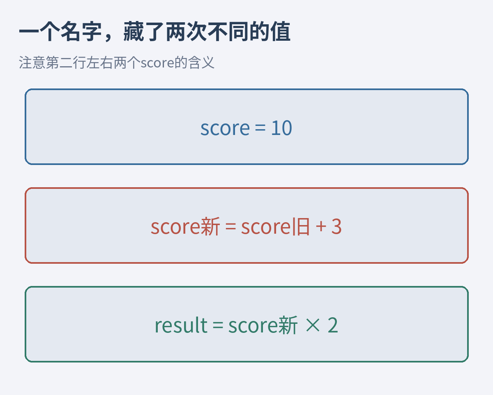

那能不能换一种写法，让每个值的来处天然就清清楚楚？

一种经典做法叫SSA，Static Single Assignment，中文常译成静态单赋值形式。这名字听上去像一条不近人情的禁令：一个变量只能被赋值一次。

可程序明明要循环，分数明明会变化。这条规则管的到底是“代码长什么样”，还是“机器运行时真的发生了几次”？

## 1. 先换名字，不改结果

把刚才的程序改写成这样：

```text
score0 = 10
score1 = score0 + 3
result0 = score1 * 2
```

每个新名字在等号左边只出现一次。结果仍然是26，只是10和13不再共用同一张名牌了。

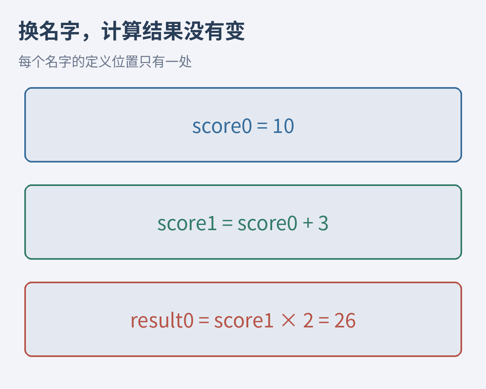

这里的0、1不是数组下标，也不是“程序执行到第几秒”。它们只是用来区分定义的标签，编译器完全可以换一套不重复的名字。

我们把“在代码中产生一个值的位置”叫定义，把“拿这个值去做事的位置”叫使用。SSA想达到的效果是：每个名字只有一个定义点，用的人能直接找到它。

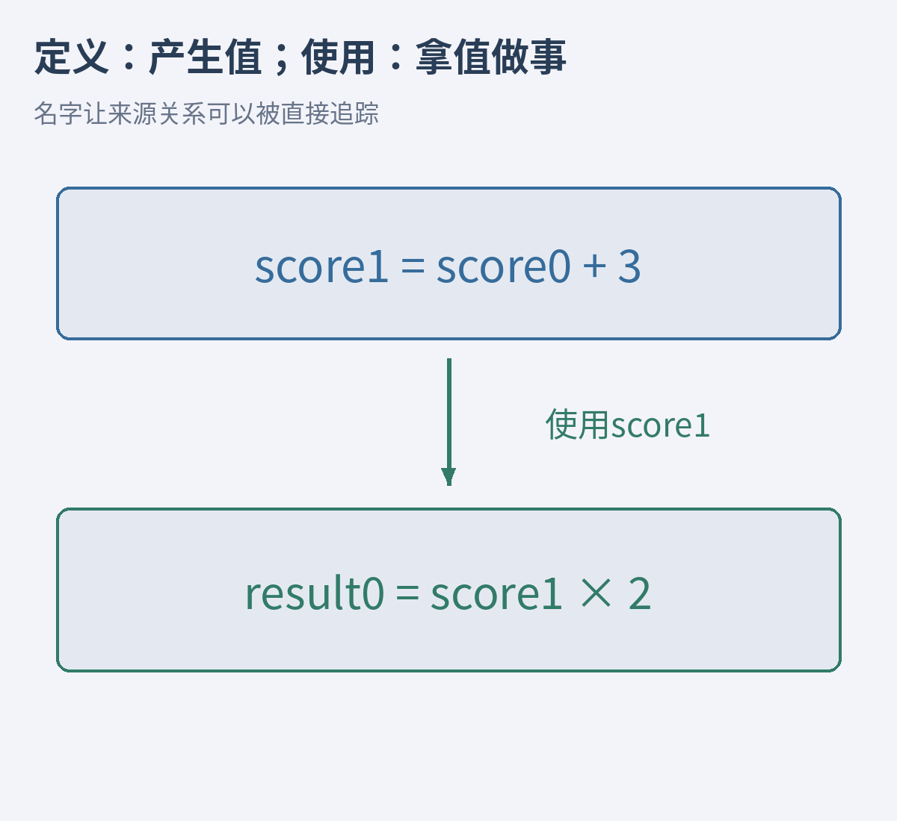

这不要求计算机为每个名字永久留一块独占内存。SSA是一种中间表示，是编译器在分析、修改程序时用的内部写法。最终哪些值放进哪个寄存器、能不能复用同一块存储，还要留给后面的阶段去安排。

我们暂时只谈整数值，不谈指针、数组和多线程。把边界收窄，才能先看清名字本身在起什么作用。

## 2. 一次关于“改名”的研究，怎样连到了程序的岔路

1980年代，Jeanne Ferrante和同事研究过程序里的重命名。她在2006年UC San Diego的一篇报道中回忆，自己1985年到UC Berkeley访学期间研究了这个方向，回到IBM后与Ron Cytron合作，写成了1987年的《What's in a Name》。与此同时，Barry Rosen、Mark Wegman、Kenneth Zadeck等人在探索更有力的程序变换，两条研究线慢慢合到了一起。[大学原报道及人物照片](https://jacobsschool.ucsd.edu/news/release/547?id=547)

这段历史里有个很具体的转折：Ferrante回忆说，她意识到先前研究控制依赖时用过的思路，也许能用来构造SSA。这是多年之后、具名的研究者本人的回忆，不是我们替她补写的实验室对话。

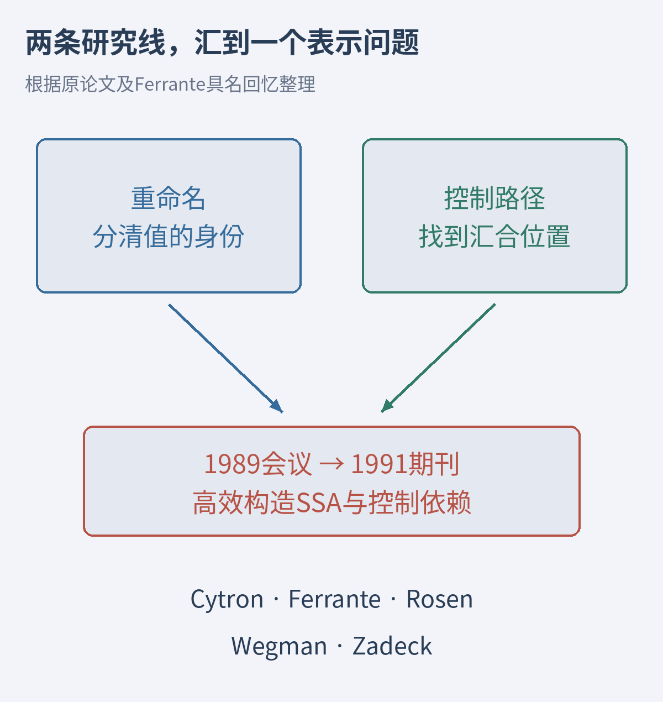

1989年的会议论文已经有了这项高效构造工作；1991年，Cytron、Ferrante、Rosen、Wegman、Zadeck的长篇论文把SSA的构造和控制依赖图的构造放在一起讨论，用到了支配边界这个概念。[1991原论文](https://www.cs.utexas.edu/~pingali/CS380C/2010/papers/ssaCytron.pdf)

这件事的重点不只是“换个名字更好看”。一种表示方式再有用，如果很难从普通程序造出来、或者一造就膨胀得很大，工程师也不愿意用。构造成本本身，就是那篇论文要解决的实际难题。

我们先用一个小分支看看难点从哪里冒出来。等走到循环，再回头理解“支配边界”这个听着吓人的名字。

## 3. 直路上好改名，岔路口怎么办

假设游戏根据一个真假条件flag，给出不同的奖励：

```text
if flag:
    x = 3
else:
    x = 1
return x + 2
```

flag为真时结果是5，为假时结果是3。

给两次赋值起不同名字，左路叫x1，右路叫x2。问题立刻就来了：两条路重新汇合之后，该写“x1+2”还是“x2+2”？

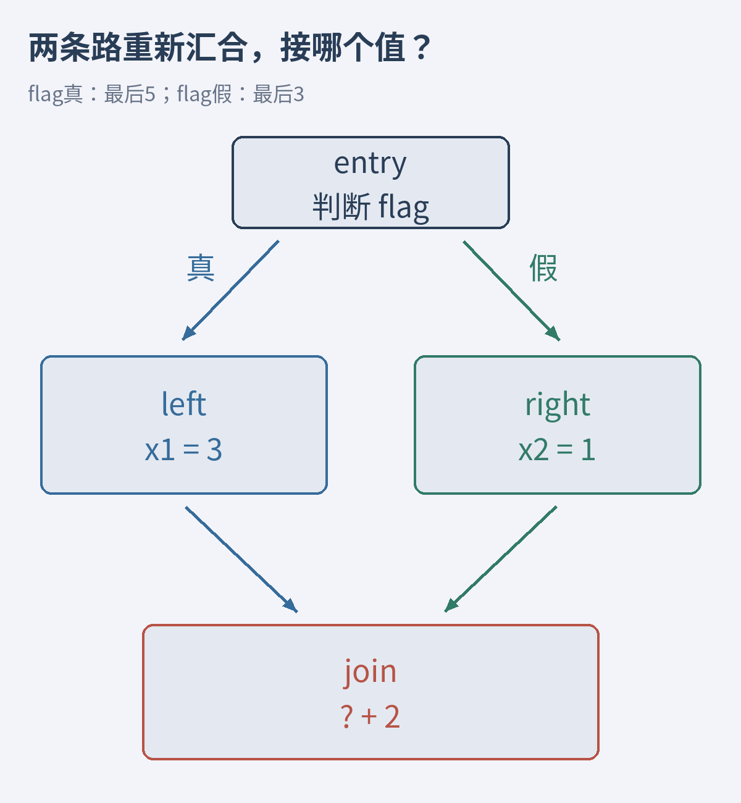

不能用x1——走右路的时候，x1压根没被产生过。也不能取平均，那会把本来清清楚楚的5或3变成另一个数。

更不能把“走左路就用x1，否则用x2”这句话留在人脑子里，让编译器自己去猜。我们得在中间表示里，把这件事明确记下来。

## 4. phi不是算术函数，是“从哪条路来的”登记处

先给几段代码所在的位置起名字：entry是入口，left是左路，right是右路，join是汇合点。

把join里的选择写成这样：

```text
x3 = phi(left: x1, right: x2)
y1 = x3 + 2
return y1
```

phi读作希腊字母φ的名字。这里先把它理解成一张来路表：**刚从left过来，就取x1；刚从right过来，就取x2。**

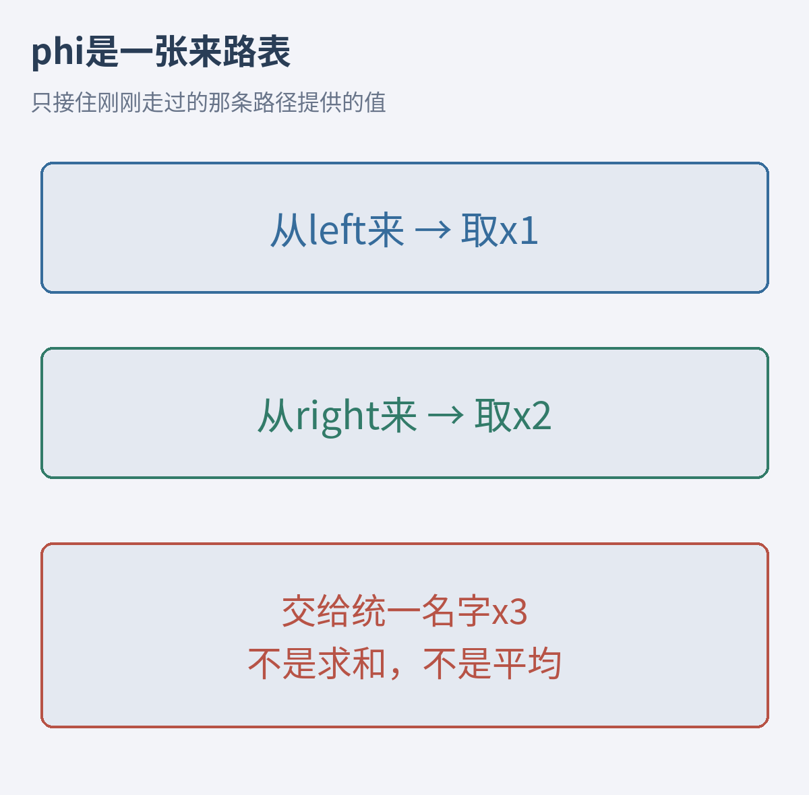

它不会把x1和x2都算一遍，也不会让两条分支同时执行。真正运行时只会走过其中一条路径，phi接下那条路径递过来的值。

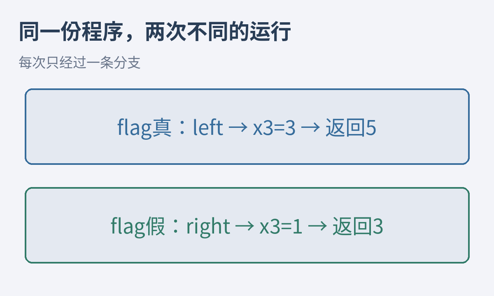

这样一来，x1有一个定义，x2有一个定义，x3也有一个定义——就是这条phi指令。后面谁要用这个值，只要找x3，就能找到唯一的定义点；而定义点内部，又把不同来路列得清清楚楚。

“唯一来源”并没有抹掉路径之间的差异，它只是把差异收进了一个明确的位置。

## 5. 基本块：一段进来就顺着走到底的路

我们刚才给entry、left、right、join起了名字，它们就是这个例子里的基本块。

可以把基本块理解成一段中途不分叉的指令序列：从块开头进入，按顺序执行，最后决定下一步去哪，或者直接返回结果。用箭头把可能的跳转连起来，就得到控制流图，简称CFG。

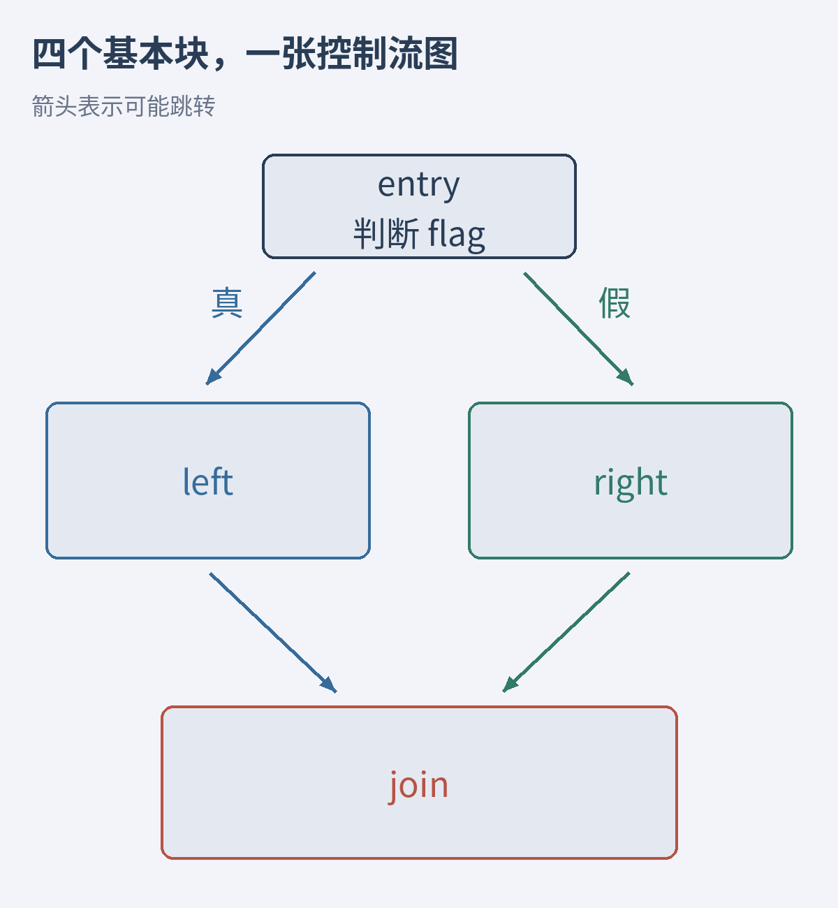

这里有两种箭头，千万别混：

- 控制流箭头说的是“执行完这一块，可能去哪里”。
- 定义—使用箭头说的是“这条运算拿的是哪个值”。

它们经常画在同一份程序上，回答的却是完全不同的问题。


在LLVM 18.1.8的规则里，phi放在基本块开头，并为每个前驱基本块列出对应的输入值。它选取刚刚执行完的那个前驱所对应的值；每个输入值的使用，被视为发生在那条进入当前块的边上。[固定版本phi说明](https://releases.llvm.org/18.1.8/docs/LangRef.html#phi-instruction)

“值必须和前驱成对”不是装饰。要是把左右标签接反了，程序照样能跑起来，只会在错误的分支上给出错误的奖励。

## 6. 为什么不能把左路的值直接拿到汇合处

这里可以介绍一个很直观的图论词：支配。

如果从入口出发，无论走哪条能到达B的路，都必须先经过A，就说A支配B。注意这里讨论的是代码图里的所有路径，不只是刚才碰巧跑过的那一条。

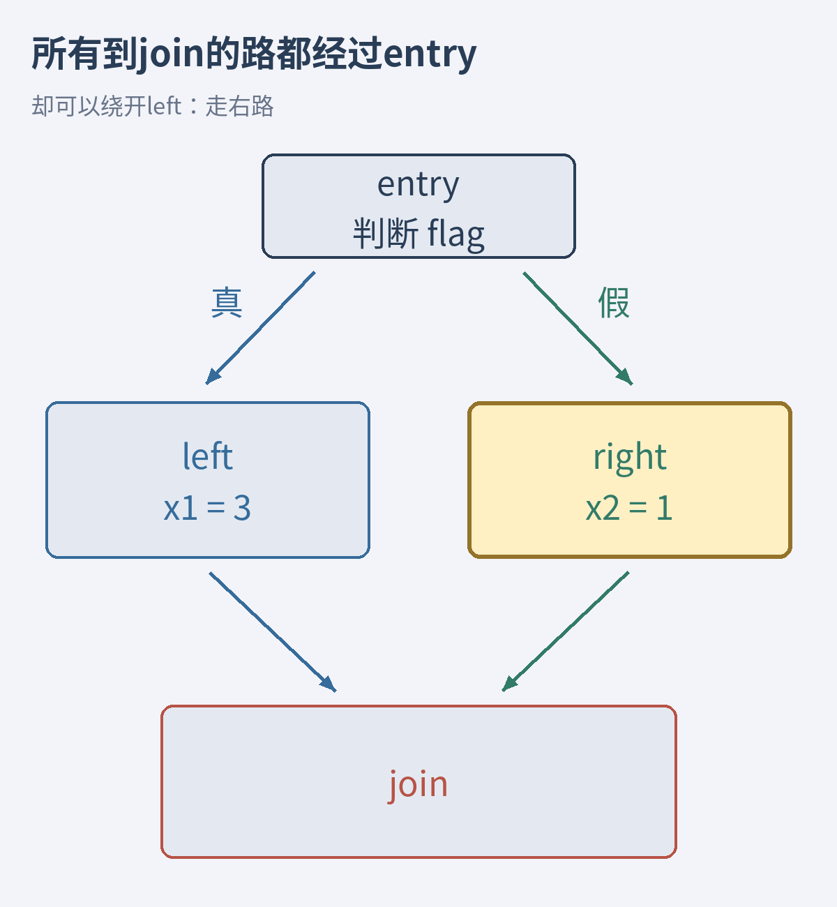

在奖励程序里，entry支配join。left却不支配join，因为entry→right→join这条路绕开了left。

一条普通指令使用某个SSA名字时，那个名字的定义必须在所有能到达这次使用的路径上都已经发生过；同一块内，也得先定义再使用。这就是“定义应当支配普通使用”的直觉。

所以join里直接写x1+2是不合法的，而用phi产生的x3就合法。phi的左输入x1只需要在left→join那条来边上可用，不能要求左路的定义先经过右路。

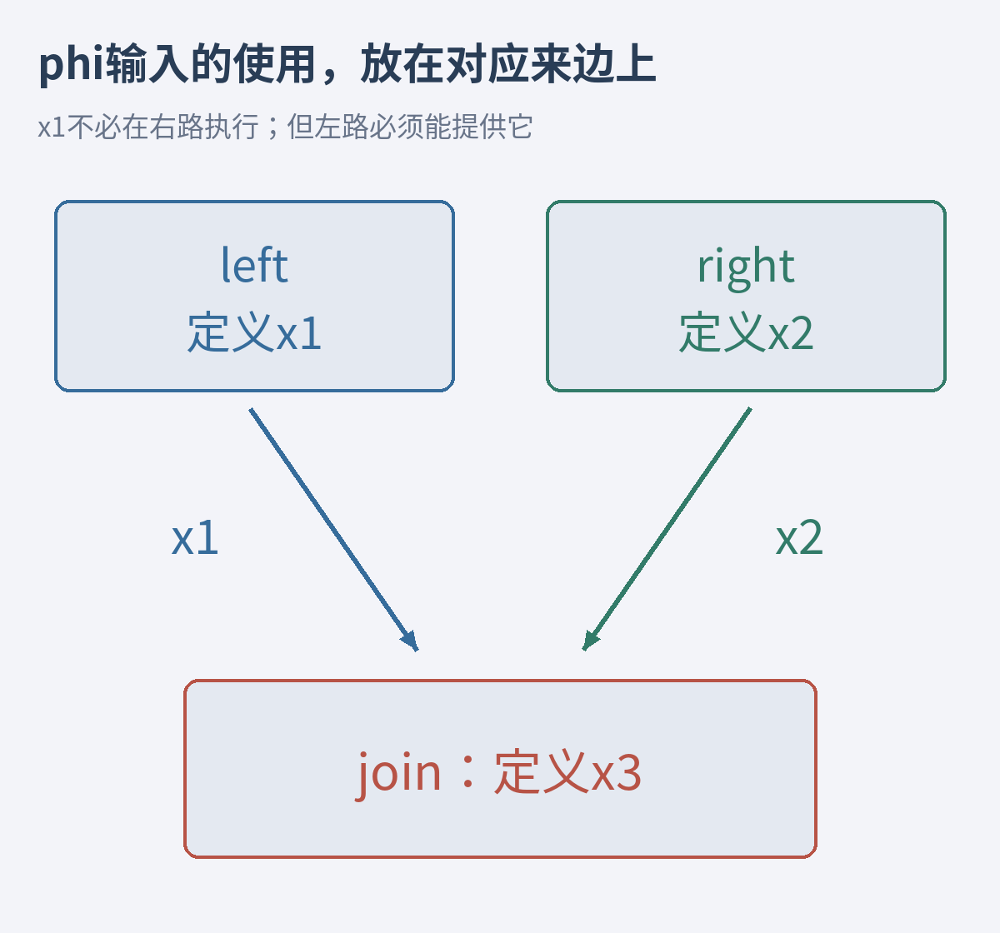

我们的教学检查器会直接拒绝“join用x1+2”这种版本。哪怕你只拿flag=true测过，它每次看起来都对，也证明不了另一条路安全。

## 7. 循环没有毁掉SSA，反而让phi更有用

现在把条件奖励换成累加：算0+1+…+(n−1)。普通写法是：

```text
i = 0
s = 0
while i < n:
    s = s + i
    i = i + 1
return s
```

n=4时返回6。

循环头有两种来路：第一次从entry进来，此时i、s都应该是0；以后从body绕回来，此时要接住上一轮产生的新i、新s。

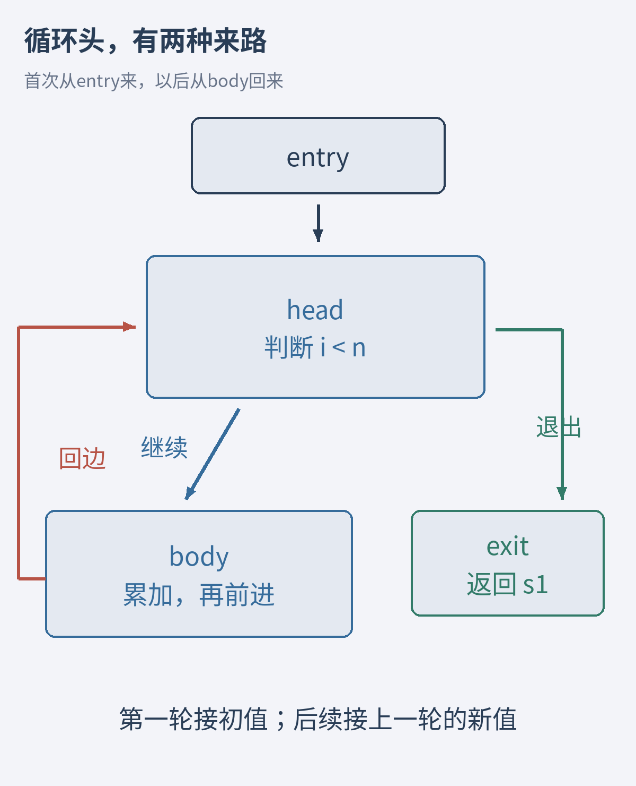

写成SSA教学记法就是这样：

```text
entry:
    i0 = 0
    s0 = 0
    goto head

head:
    i1 = phi(entry: i0, body: i2)
    s1 = phi(entry: s0, body: s2)
    if i1 < n: goto body
    else: goto exit

body:
    s2 = s1 + i1
    i2 = i1 + 1
    goto head

exit:
    return s1
```

这段写法不是Python。它是一段带标签、跳转和phi的教学中间表示。对应的可运行解释器在文末。

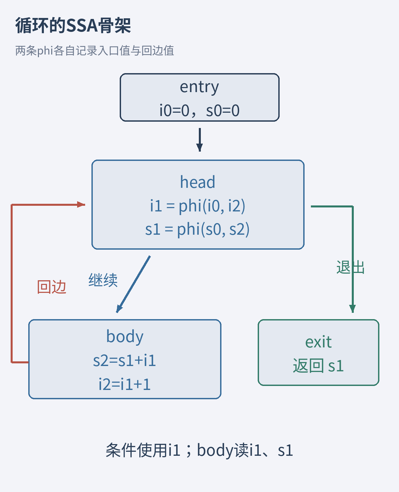

看起来出现了“先用后定义”：head里的phi提到了i2，可i2的代码明明写在下面。

关键在来边。第一次从entry进入时，phi只选i0，根本不去读还没执行的i2。只有从body绕回来时，它才选i2，而那时body刚刚算完它。

代码文本里的上下位置，不等于每次运行走过的先后顺序。

## 8. “静态一次”不等于“运行时只执行一次”

这一点值得单独停下来讲。

SSA要求的是：**同一个名字，在程序的静态文本里只有一个定义点。** 它没有说这条定义指令在整个运行期间只能执行一次。

循环每绕一圈，head里同一条phi就又执行一次，得到这一轮的值；body里同一条加法也可能再次执行。指令位置只有一个，动态执行的实例可以有很多。

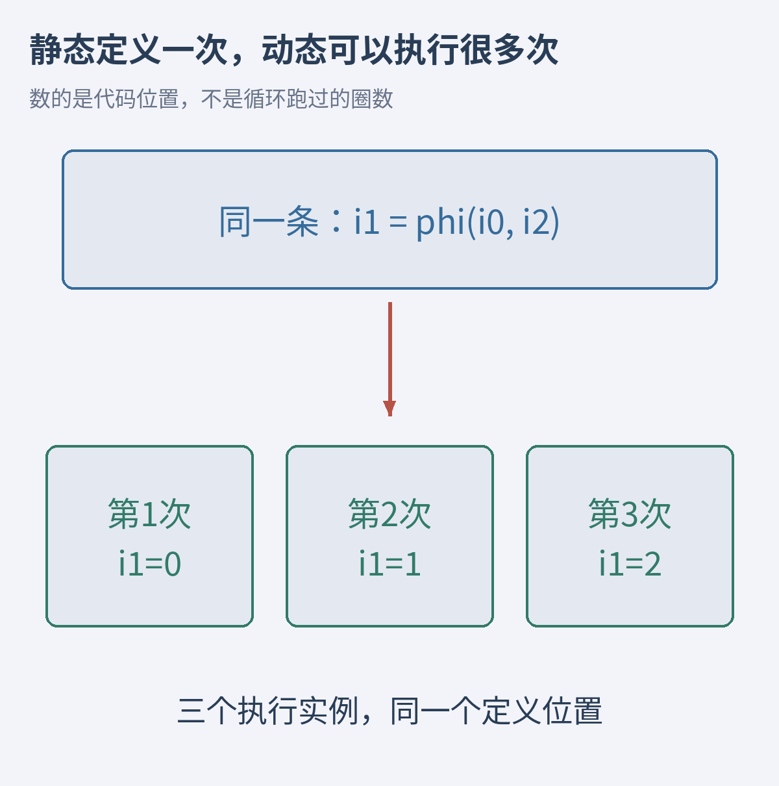

拿n=4来说，每次进入head时记录下的(i1, s1)是：

- 从entry来：(0, 0)，继续循环。
- 从body来：(1, 0)，继续。
- 从body来：(2, 1)，继续。
- 从body来：(3, 3)，继续。
- 从body来：(4, 6)，退出。

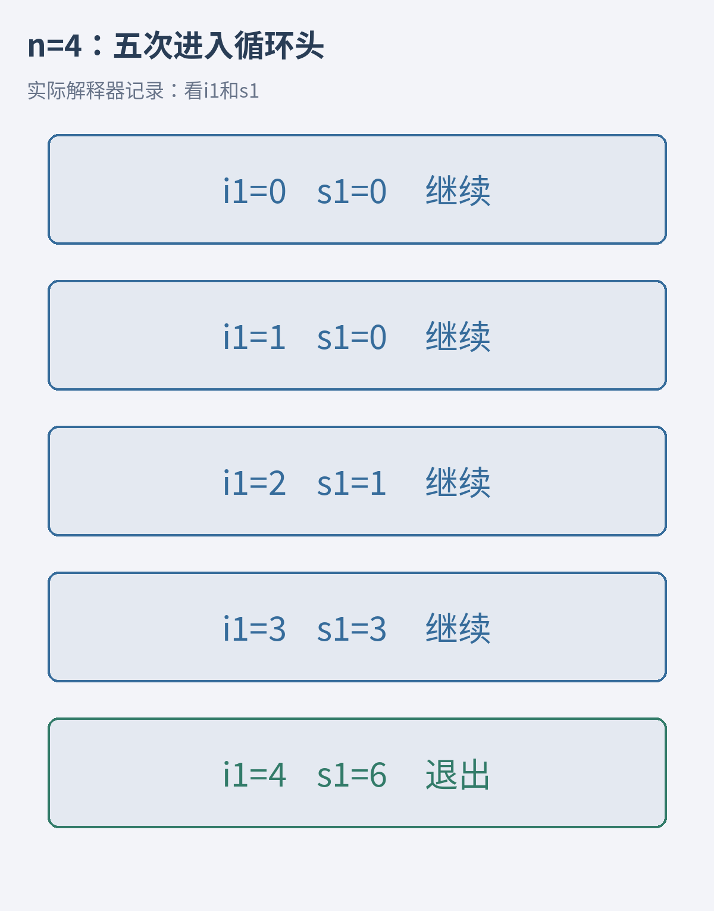

如果把循环想成“同一个变量被改了很多次”，SSA看上去就很矛盾。换成另一种想法就顺了：同一张计算模板被执行很多次，每次按来路接好这一轮的值。

## 9. 一个微妙陷阱：同一块里的phi要一起接值

假设循环每一圈只做一件事——把a和b交换。循环头的两条phi，可以在回边上分别取上一轮的b和上一轮的a。

从a=1、b=2出发，绕一圈后应该是a=2、b=1。

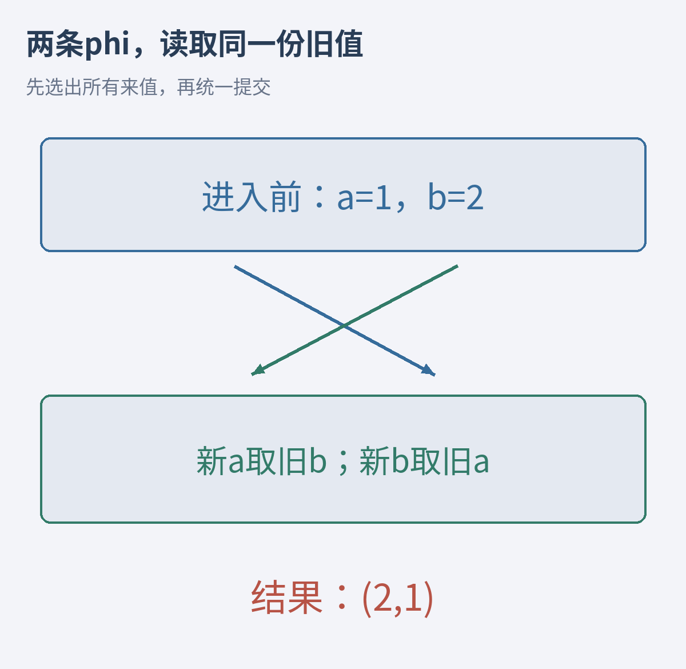

如果解释器偷懒，先把新a写成2，再回头读已经改过的a来生成b，就会得到(2, 2)，把旧的1弄丢了。

所以同一个基本块开头的phi，应该先根据前驱把所有输入选出来、读出来，再一起交付结果。本文的解释器用一个临时字典保存选中的值，最后统一更新环境。

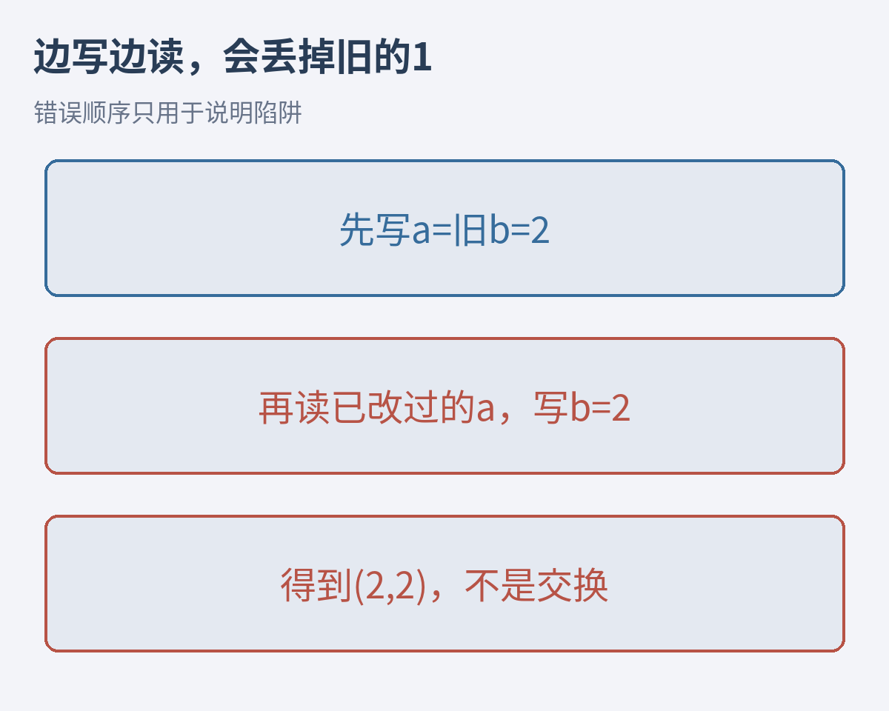

这并没有要求CPU同时执行两条指令。它要求的是实现保持这种并行赋值的语义。真正把SSA变回普通机器操作时，也得处理好类似的搬运次序。

## 10. phi该放哪？先找“原来必经，往前却未必”的边界

小程序靠眼睛就能在汇合处补上phi。大程序要是对每个变量、每个汇合点都补一份，可能塞进大量根本不需要的节点。

回头看left这个块。从left出去的时候，我们确知x1已经定义过了。可刚踏进join，这份“所有路径都经过left”的保证就没了，因为另一条路也能到join。

join正好落在left的支配边界上。

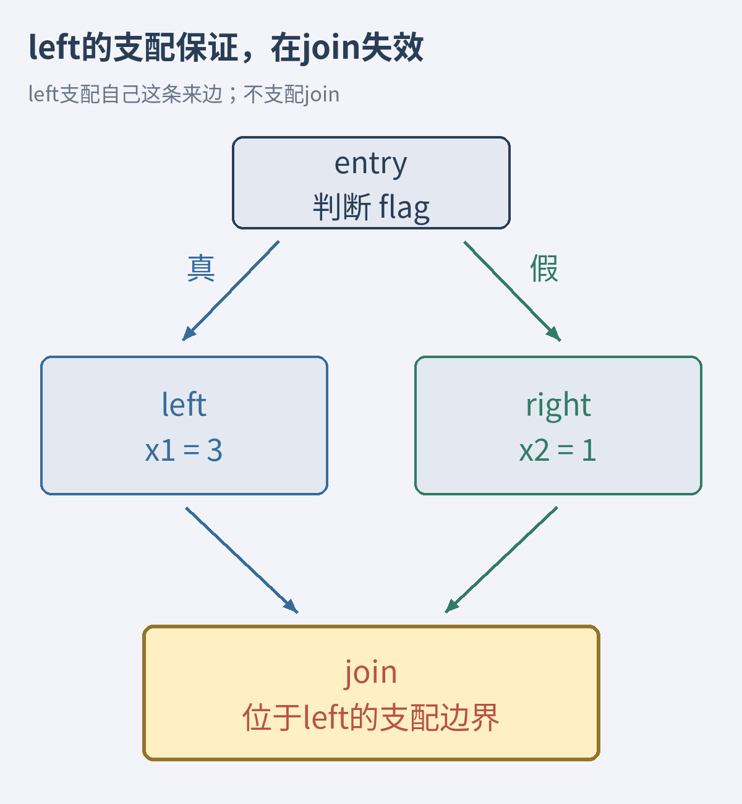

说得精确一点：Y属于X的支配边界，是指X支配Y的至少一个前驱，却不严格支配Y。严格支配就是支配但不等于自己。这个“严格”不是咬文嚼字——在循环里，一个块完全可能落在自己的支配边界上。

对累加循环来说，head支配body，可回边又进入head本身。head不会严格支配自己，所以循环头正好能成为接值的位置。

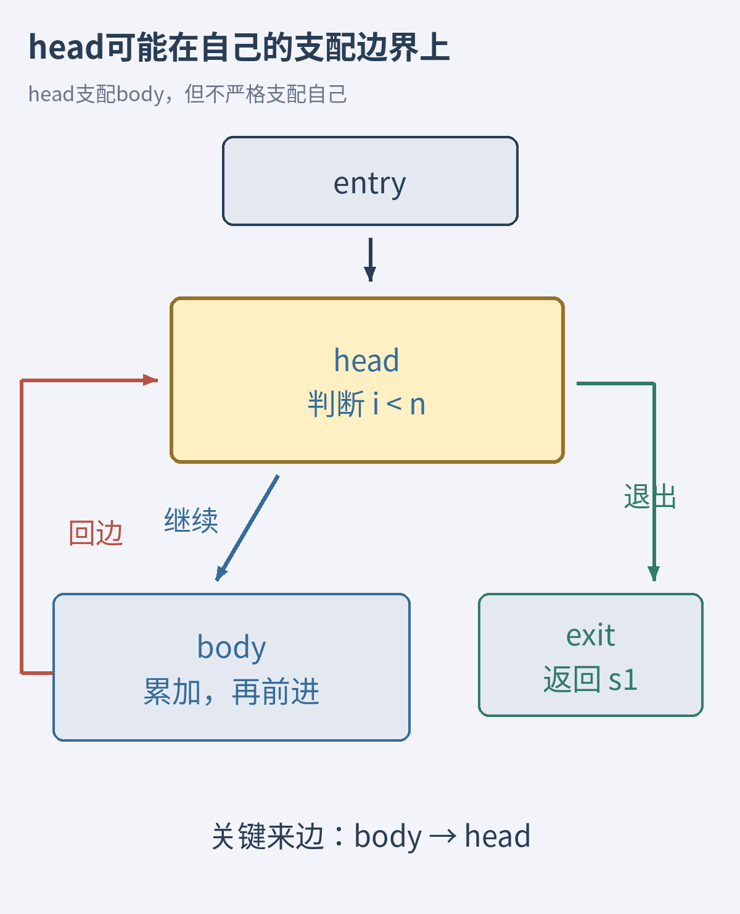

经典的构造方法从变量的定义块出发，沿着支配边界放置phi；而新增的phi本身又产生了一个新定义，所以还可能要继续处理它的边界。之后再按合适顺序重命名定义和使用。

这是理解1991年那篇论文的一条路线，不是本文已经完整实现了那篇论文的高效算法。本文的小图检查器直接按定义计算支配关系与边界，方便读者核对；它不追求生产编译器的构造速度。

也不是只要看到两个前驱，就得给所有变量都放phi。如果同一个定义已经覆盖了两边，或者某个变量后面根本不再用了，还可以少放甚至删掉相应节点。SSA有各种构造和精简形式，不能把所有实现压成一句口诀。

## 11. 来处清楚了，优化能省下什么

把奖励例子改一下：左右两路都给7，最后再加2。

```text
left:  x1 = 7
right: x2 = 7
join:  x3 = phi(left: x1, right: x2)
       y1 = x3 + 2
```

虽然还不知道flag是真是假，但既然哪条来路都给7，就能确定x3=7，进而确定y1=9。

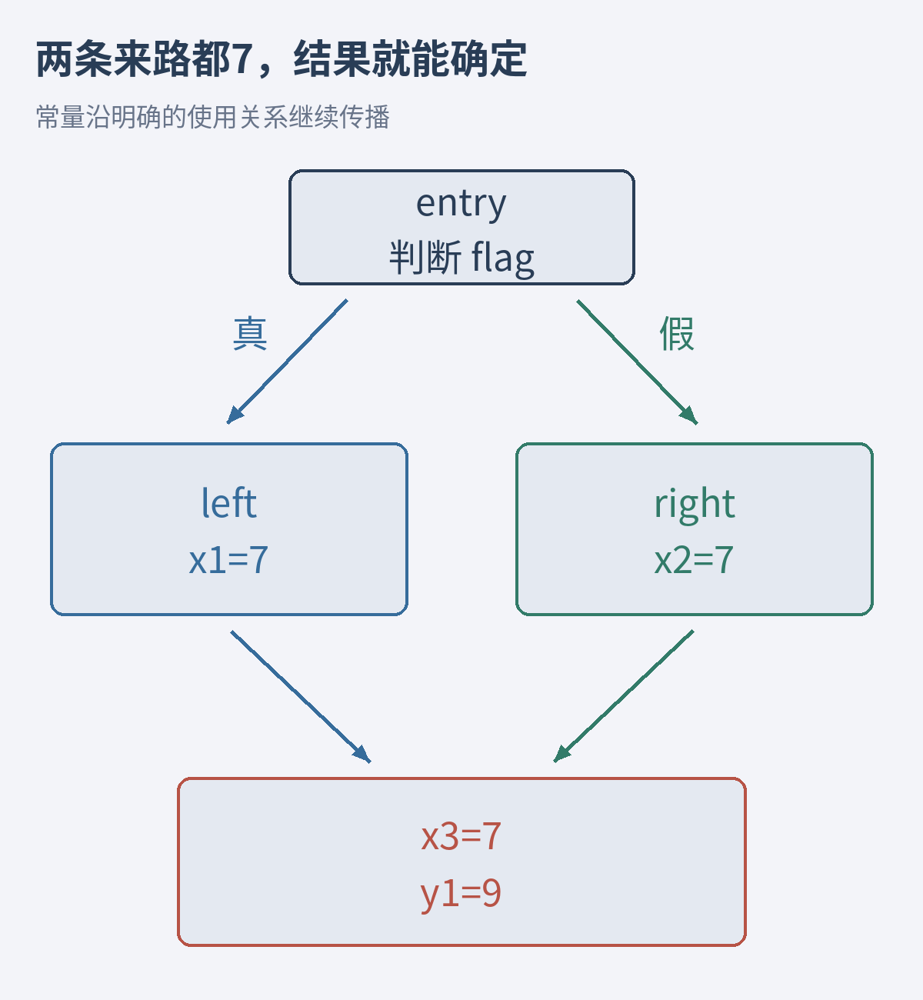

反过来，原来那两路分别是3和1，在不知道条件的情况下就不能把x3随便认成某个常量。

这件事其实不用SSA也能分析。SSA的价值不在于发明了“7+2=9”，而在于把值的依赖关系整理得更直接：这次使用对应哪个定义、一个定义的结果又流向了哪些地方，都更容易追踪。

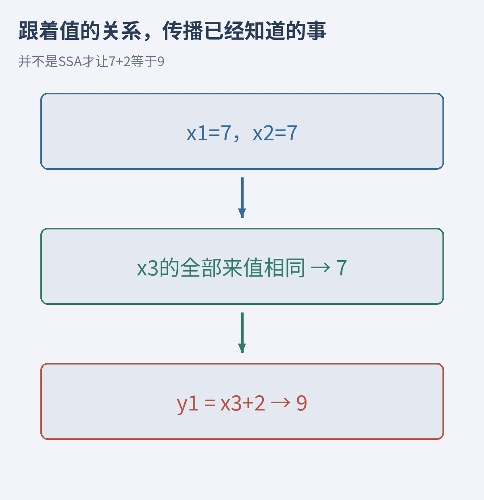

附带程序实现了一个很保守的常量传播：只有所有phi来值都已知且相等，才承认结果为常量。它没有分析哪些边永远不会执行，所以不冒充完整的稀疏条件常量传播算法。

在“两路都7”的小例子里，替换常量之前，实际走过的路径含一次加法；替换之后是零次。两种flag输入的返回值都是9。这是教学解释器里的运算计数，不是某台CPU的提速测试。编译速度、机器指令和最终耗时，都不能从这个计数直接推出来。

## 12. phi最后一定会变成一条机器指令吗

不一定。

可以先把奖励例子的phi想成这样：left到join之前，把左路结果交到一个统一出口；right到join之前，把右路结果交到同一个出口。每次实际只走一条边，所以不会同时交两份值。

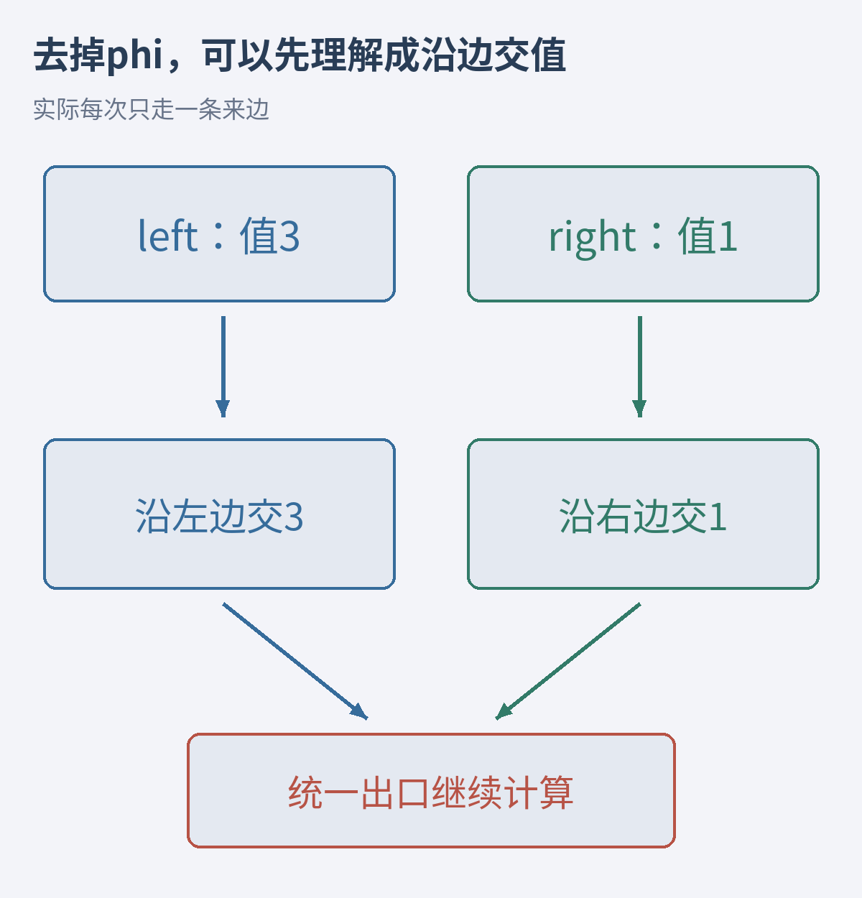

实现时可能需要插入复制，也可能因为前后恰好分到同一个寄存器而把复制省掉。如果边的两端还有别的分叉、汇合，放置复制的位置也要仔细处理，必要时得把边拆开。

我们这里只解释去SSA的方向，不给出一个能处理所有图和所有寄存器冲突的完整后端。刚才那个交换陷阱也在提醒：搬值的顺序同样属于正确性，不能一看到phi就机械地顺序写两个赋值。

还有一个重要边界：给指针名字加上编号，并不会自动让它指向的内存只被写一次。两个不同名字仍然可能指向同一个地址。标量SSA把值的来处说清楚了，内存别名和读写依赖还得另外分析。

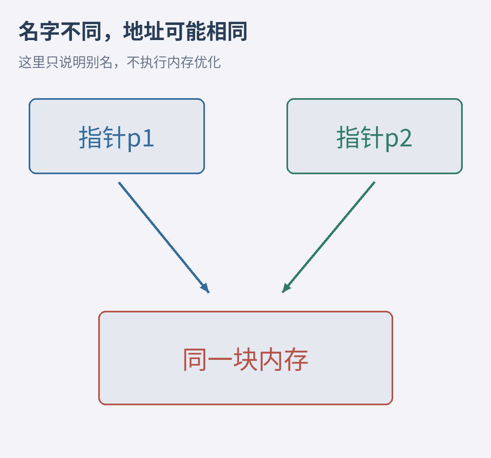

## 13. 看一眼真实的LLVM写法，再跑我们的小实验

LLVM的phi也是把值和前驱成对排列。比如在固定的LLVM 18.1.8语法中：

```text
%x = phi i32 [ 3, %left ], [ 1, %right ]
%y = add i32 %x, 2
ret i32 %y
```

i32表示32位整数；百分号是LLVM局部值或块名字的记法。phi里也可以直接写常量，不一定先单独定义x1、x2。

[完整的原创LLVM IR示例](examples/bonus.ll)把前面的分支和标签也列齐了。这份例子按官方语言规则核对过，但本次环境没有实际运行LLVM编译器；不要把下面的教学解释器结果说成LLVM实测。

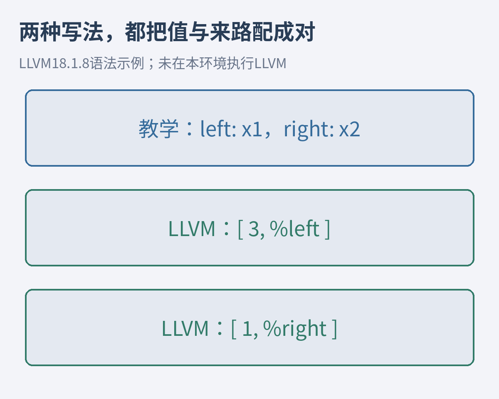

真正已经运行的是[SSA教学解释器](examples/ssa_lab.py)。它只用Python标准库，实现了整数复制、加法、乘法、比较、分支、返回和phi；没有指针、溢出、异常、I/O，也没有LLVM的poison语义。

可以这样跑一个完整例子：

```python
from ssa_lab import sum_loop, run
result = run(sum_loop(), {"n": 4}, trace=True)
print(result["value"])
for event in result["trace"]:
    if event["block"] == "head":
        print(event["phi_values"])
```

它返回6，并打印出前面五次进入循环头时的phi值。你也可以把n改成0：第一次进head就该直接退出，结果仍然定义良好，是0。


实际运行的检查包括：9826组分支输入，同时验证原程序与常量替换版本；311个累加循环输入；1701组交换循环输入；2000个随机控制流图，把支配关系和“删去一个节点后还能不能到达”这个独立方法互相对照。随机种子是199110。三个故意写错的程序，分别触发了重复定义、phi遗漏前驱、定义不支配使用这三种拒绝。

这些检查的范围和执行方法写在[实验说明](examples/README.md)。它们证明不了任意程序的正确性，更谈不上是对真实LLVM优化器的全套测试。

最后看一次n=4的执行动画。亮起来的是当前进入的基本块；循环头同时显示这一轮真正选中的i1、s1。动画来自解释器的实际记录，不是随手排的一张循环示意。

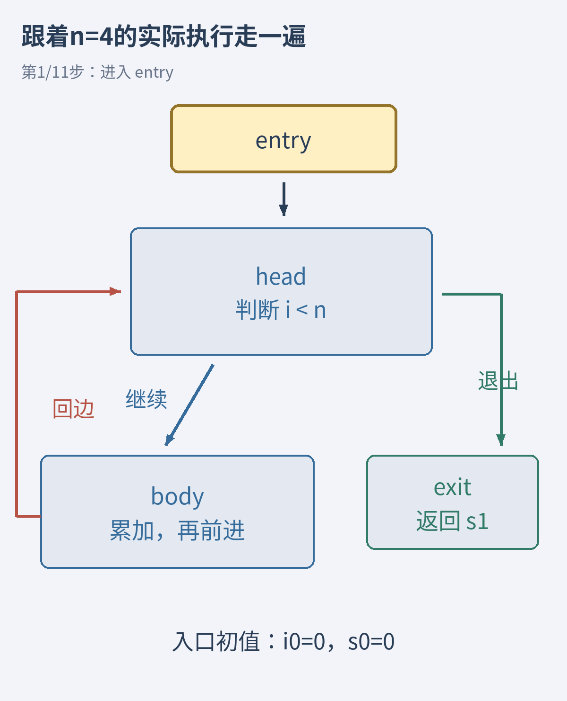

## 14. 给自己留一个小检查

如果把奖励程序的右路也改成3，汇合处的x3能确定为常量吗？要是再把右路改成接收一个未知整数input呢？

第一种情况可以，x3恒为3；第二种通常不行，光看SSA写法并不知道input是多少。名字干净，并不等于信息凭空变多了。

SSA真正做的事，是把一团“同名但不一定同源”的关系，整理成可以追问的结构：**这个值在哪里产生？使用它的时候，那次定义一定发生了吗？如果来自不同路径，汇合处到底接了哪一份？**

这些问题答清楚了，优化器才敢更放心地删、搬、合并计算。而循环依然能转，分支依然能选——改变的只是程序在编译器眼里的组织方式。

---

原创正文、教学视觉与示例代码采用CC BY 4.0。[原始来源、素材取舍和实验范围](sources.md)
