# 都分到位置了，为什么还想偷偷换？稳定匹配先学会“暂时答应”

三个学生想参加三个小项目，每个项目只收一人。学生有自己更想去的项目，项目也有自己的候选顺序。

现在名单出来了：甲去X，乙去Z，丙去Y。三个人都有地方去，三个位置也全部填满。看起来，问题解决了。

可是乙更想去X，而X也更愿意接收乙，而不是现在的甲。只要乙和X单独商量，就会一起想推翻这张名单。

问题不在于“有没有分完”，而在于：**名单之外，是否还藏着一对彼此都想换过来的搭档？**

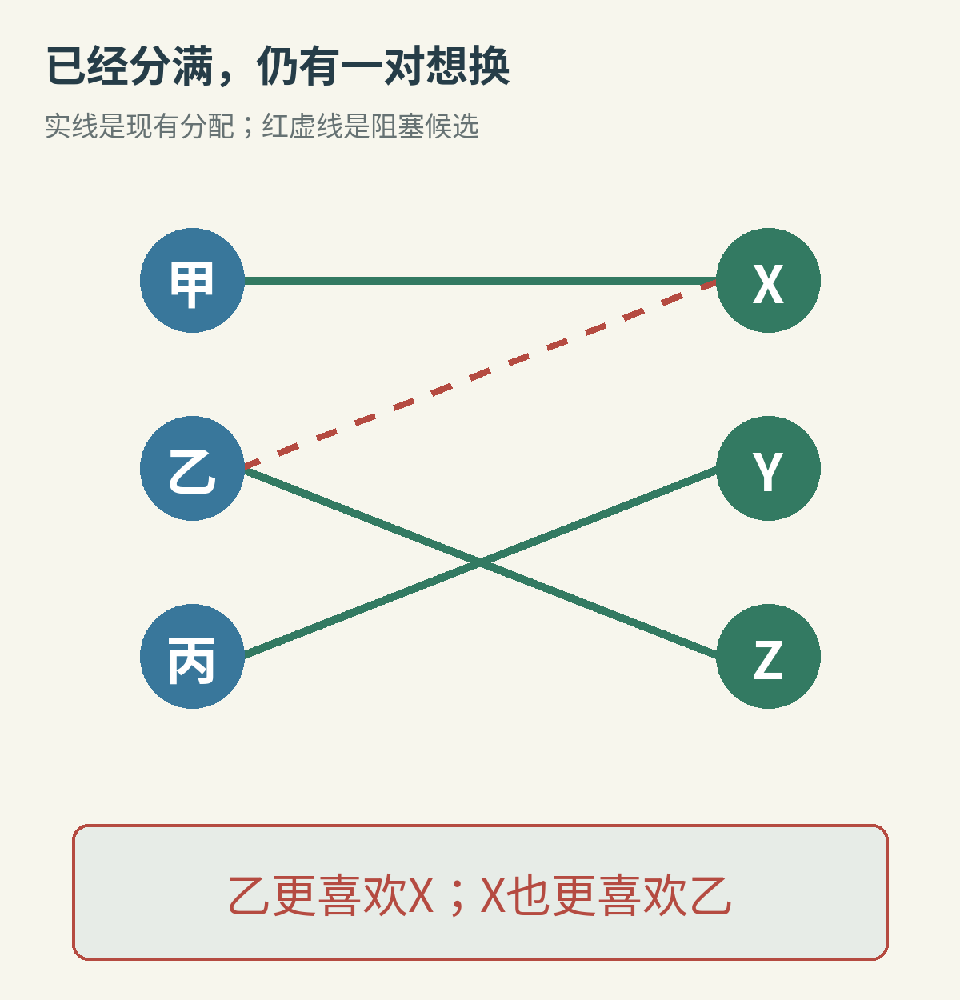

本文使用自设的虚构名单，不含真实学生数据，也不提供现实招生决策建议。我们要研究一种很小、很清楚的数学模型，看看它怎样把“没有理由两人一起改口”变成可检查的条件。

## 1. 两边都有意见，难点才真正出现

如果只有学生选项目，项目对所有人都一样满意，事情会简单很多。但现实中的许多配对有两份排序：一边想选择，另一边也想选择。

先把模型的边界说清楚：

- 左边n个人，右边n个位置；
- 每人最终只配一个位置，每个位置只配一人；
- 双方都把对面的全部候选排出严格先后，没有并列；
- 本篇基础模型里，排在最后仍比不匹配好；
- 排序先给定，算法过程中不改变。

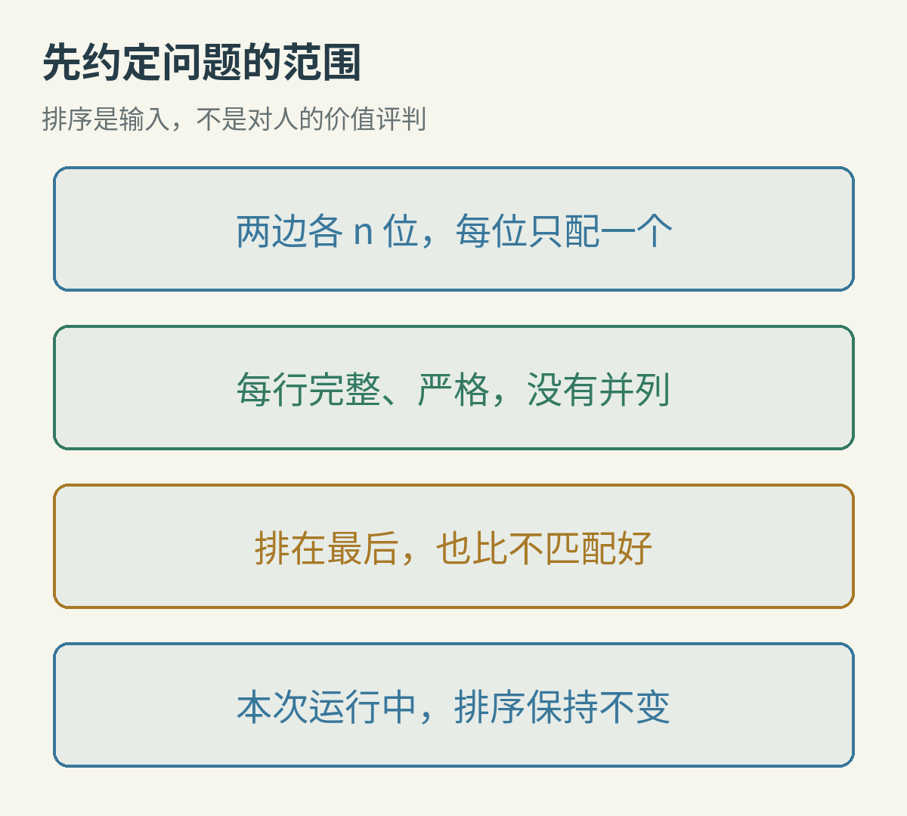

这些是数学问题的输入条件，不是对真实人的完整描述。一个项目可以有多人名额，有人可以宁愿空缺而不接受某个候选，也可能出现并列或共同申请。那些都需要另行说明规则，不能在代码跑完后悄悄假设它们已经解决。

## 2. 把“不稳定”说成一句可检查的话

一份匹配，就是把两边连起来，同时保证每个点恰好连一条线。

假设甲已经配给X，乙已经配给Z。乙更喜欢X，这还不够：如果X更喜欢现在的甲，乙只是一厢情愿，不能构成我们要找的反例。

必须同时满足两件事：

1. 乙更喜欢X，而不是自己当前的Z；
2. X更喜欢乙，而不是自己当前的甲。

这样的乙与X，叫作一对**阻塞对**。他们当前没有配在一起，却都把彼此排在现有搭档之前。

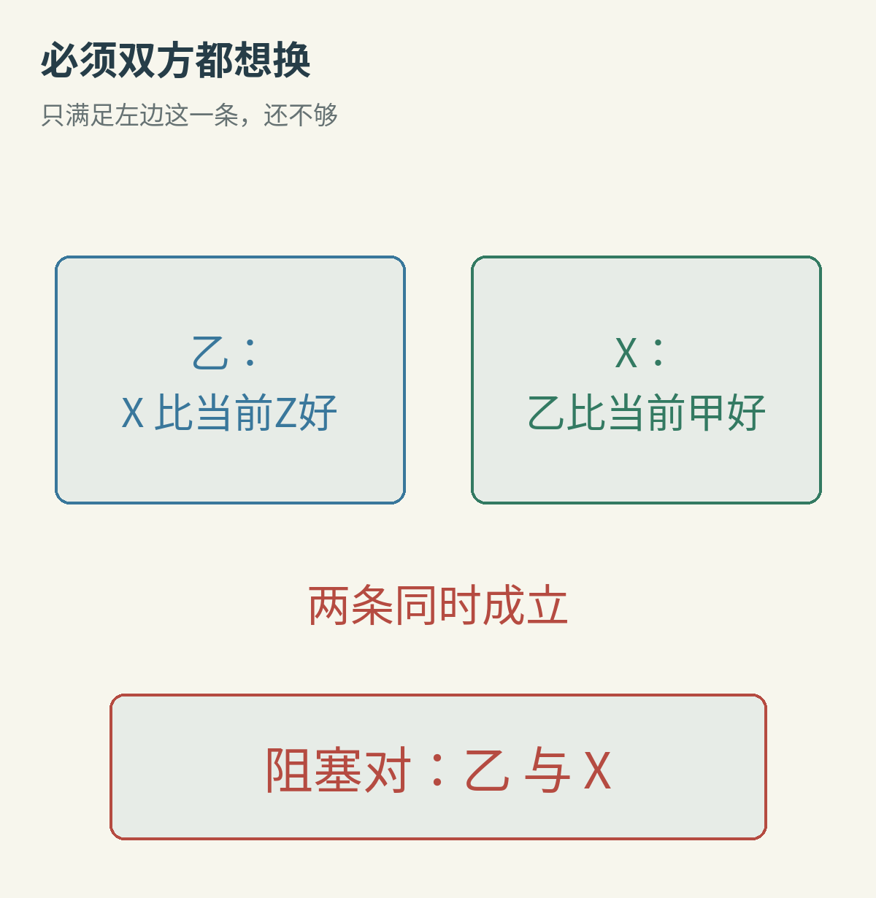

没有任何阻塞对的匹配，叫**稳定匹配**。

“稳定”在这里是一个专门定义。它不表示每个人都拿到第一名，也不表示所有人都高兴，更不表示今后偏好永远不变。它只排除了当前排序下的这一类双边改配动机。

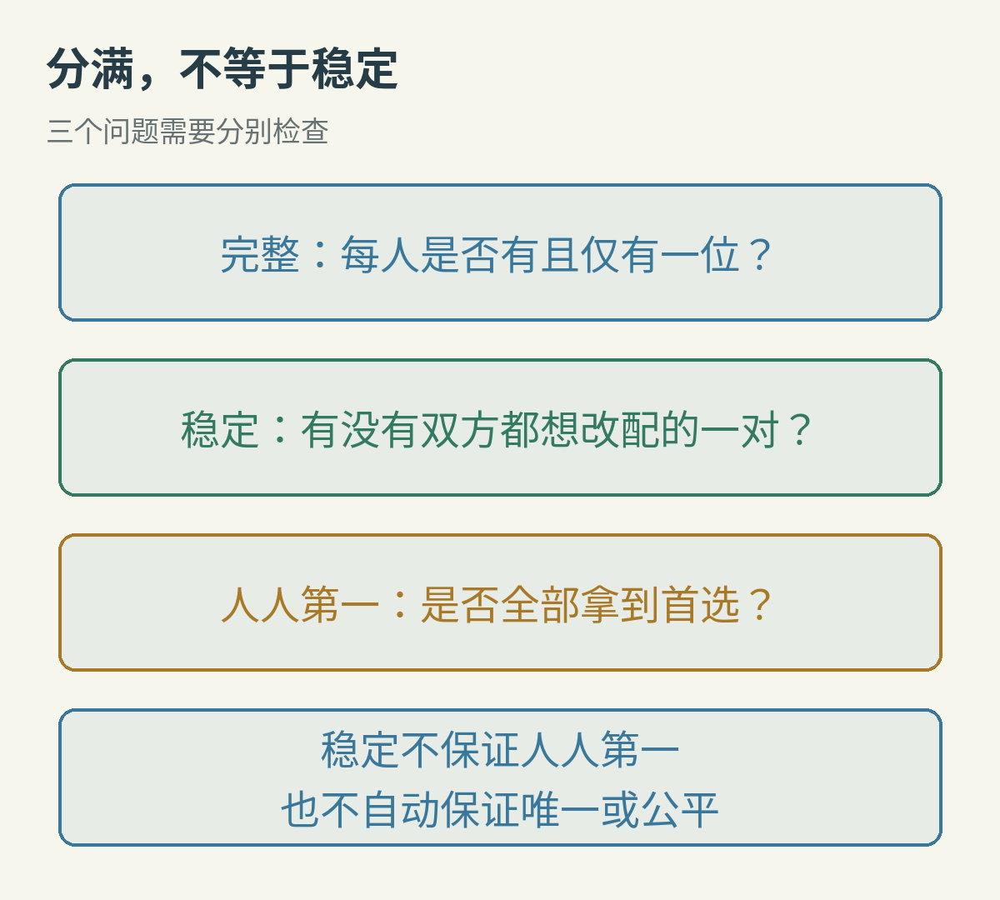

## 3. 1962年的论文，先问的其实是招生

David Gale和Lloyd S. Shapley在1962年1月的《The American Mathematical Monthly》发表了《College Admissions and the Stability of Marriage》。标题里有婚姻，开篇谈的却是大学招生：学校发多少录取，申请人等哪份结果，候补与接受之间会出现怎样的不确定性。[原论文，印刷第9—15页](https://iqua.ece.toronto.edu/baochun/ece1771f/papers/Gale-Shapley-1962.pdf)

他们先把问题压缩到容易推理的版本：双方人数相同，每边只配一位，再研究怎样得到稳定结果。随后才回到一个学校可以有多个名额的情况。

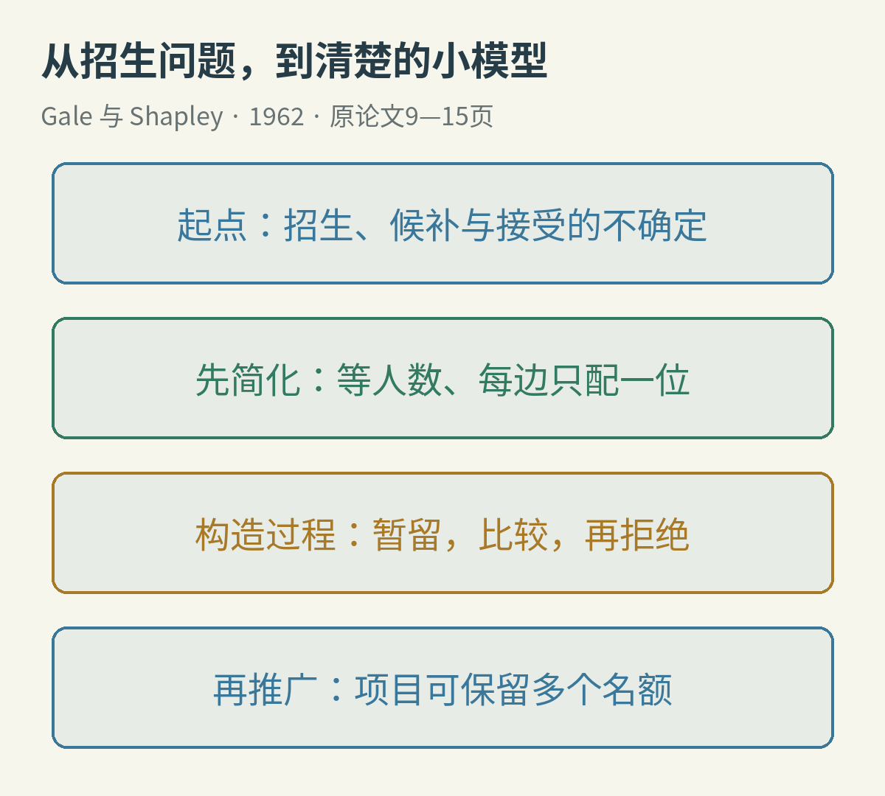

这个过程很像程序员调试一个复杂系统：先把环境缩到可以逐步追踪的尺度，但不能忘记缩掉了哪些条件。

原论文中的男女配对只是当时用来说明模型的一种叙事。本文改用学生与项目，算法只需要两边的排序；它不能描述真实亲密关系，也不替参与者决定什么值得喜欢。

作者照片与原始偏好表的具体取得情况见[来源说明](sources.md)。本文不使用未取得的图片，也不把教学头像当作真实人物。

## 4. 先摊开我们自己的六份排序

为了全程能跟住，我们只用下面这份小名单。箭头从更喜欢指向更不喜欢：

学生一侧：

- 甲：X → Y → Z
- 乙：X → Y → Z
- 丙：Y → X → Z

项目一侧：

- X：乙 → 丙 → 甲
- Y：甲 → 乙 → 丙
- Z：甲 → 乙 → 丙

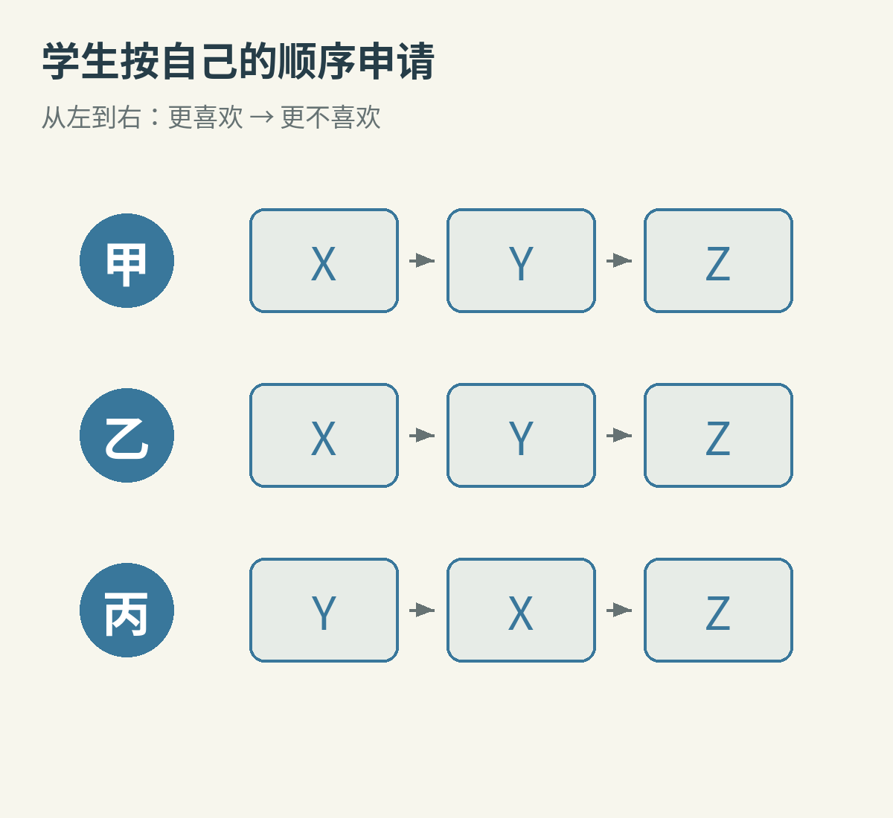

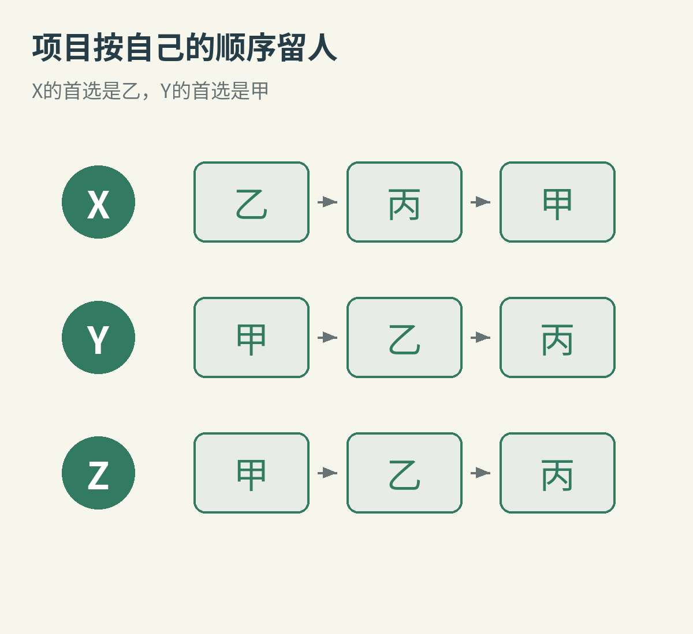

现在可以核对开头的名单“甲—X、乙—Z、丙—Y”。乙把X排在Z之前，X把乙排在甲之前，所以乙与X确实是阻塞对。还可以找到乙与Y，但找到一对就足以证明这份名单不稳定。

接下来，我们不从坏名单局部修补，而是从空名单重新做一遍。

## 5. 关键动作：接到申请，先别把门焊死

如果一个项目接受第一个来的人，以后再也不能调整，它就可能错过自己更喜欢的候选。

另一个极端，是所有项目都一直等待更好的选择，永远不作决定。这样也无法收尾。

我们需要一种中间状态：**暂留**。

每个项目在已经申请过的人里，暂留自己最喜欢的一位。如果更喜欢的新申请人后来出现，就改留新人，拒绝旧人。被拒绝的人再去申请自己还没试过的下一个项目。

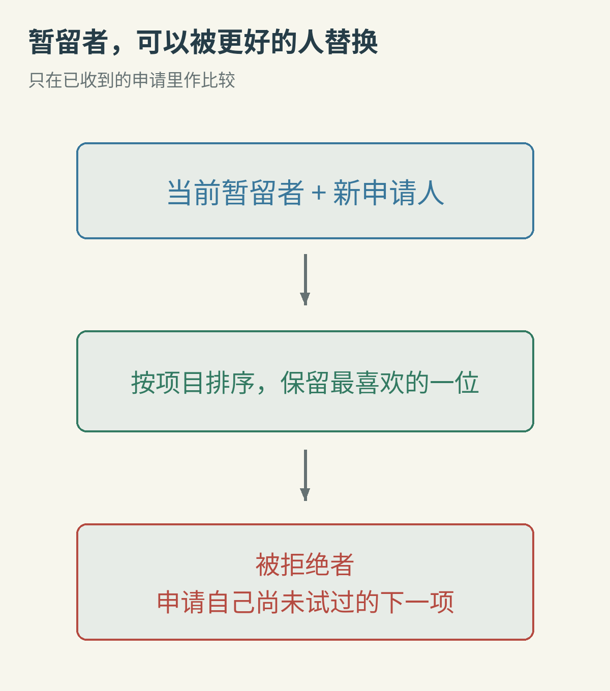

这里有两条纪律：

- 学生只按自己的排序向后申请，不向同一项目重复申请；
- 项目把新申请人与当前暂留者一起比较，不能忘掉旧候选。

等到没有自由学生需要继续申请时，暂留关系才变成最终匹配。这就是**延迟接受**的核心。延迟的是最后定案，而不是拒绝之后还反复要求同一个项目回头。

## 6. 六次申请，跟住每一次改变

下面按“先来先处理”的自由学生队列执行。队列最初是甲、乙、丙。每次被拒绝的人排到队尾。这只是一个便于展示的处理顺序。

**第1次：甲申请X。** X目前没有候选，暂留甲。

**第2次：乙也申请X。** X的排序是乙、丙、甲，因此改留乙，拒绝甲。甲下一次要去Y，而不是回X重新敲门。

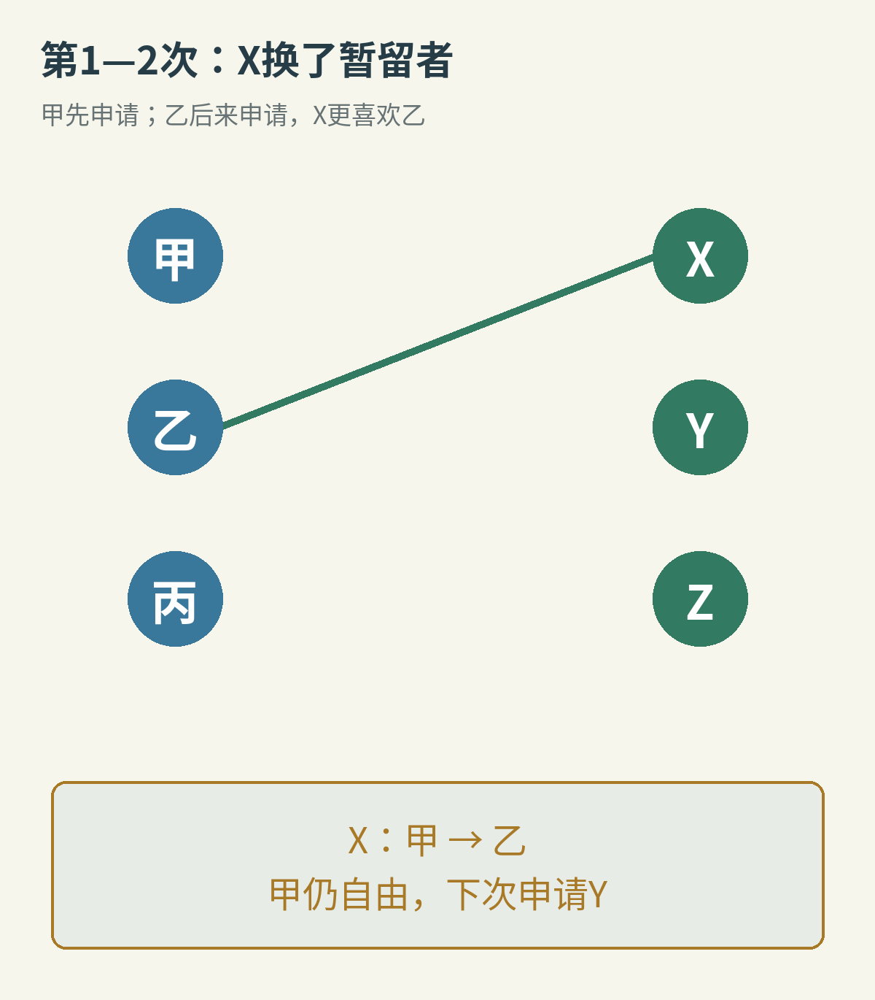

此时丙还在甲前面，所以：

**第3次：丙申请Y。** Y暂留丙。

**第4次：甲申请Y。** Y更喜欢甲，于是改留甲，拒绝丙。

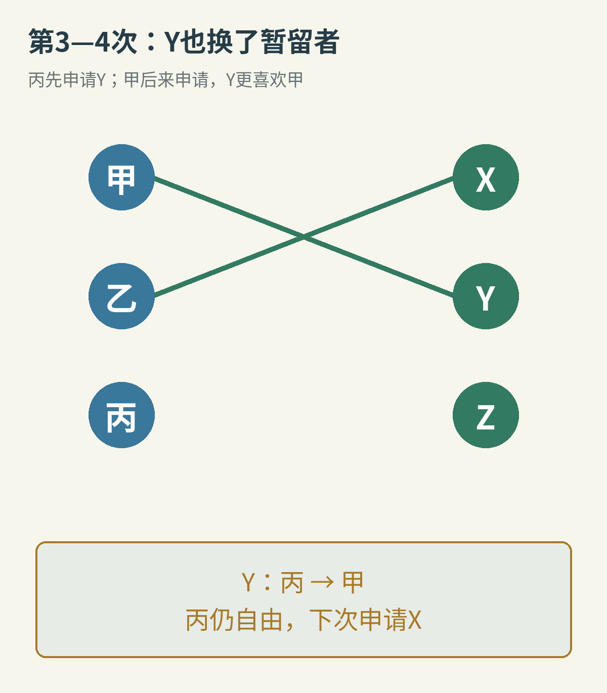

**第5次：丙申请X。** X已经暂留乙，而且X更喜欢乙，所以这次仍留乙，直接拒绝丙。注意：收到了新申请，不代表一定要换人。

**第6次：丙申请Z。** Z为空，暂留丙。

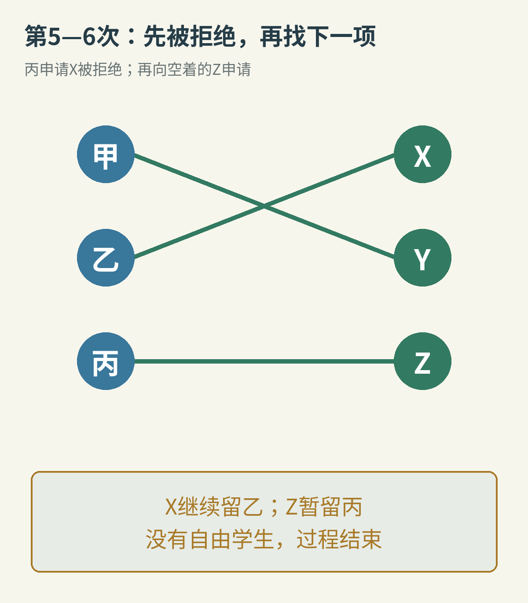

现在三人都有暂留位置，自由队列为空。最终结果是：

- 甲—Y
- 乙—X
- 丙—Z

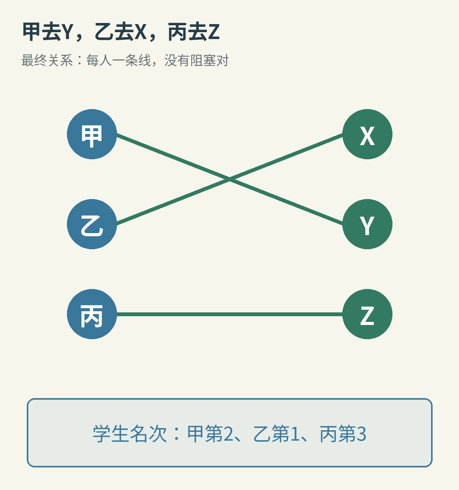

丙得到第三选择。这并不自动推翻稳定性。要反驳稳定，必须找到一对双方都愿意改配的对象，而不能只指着一位不满意的人。

## 7. 为什么不会永远折腾下去？

每次申请都沿学生自己的名单向后走。同一个学生最多申请n个项目，n个人合起来最多发出n²次申请。

这个上界很朴素：把所有“某学生向某项目申请”的组合画成一张n乘n的方格纸，每发生一次就划掉一个从没划过的格子。格子总数有限，所以不能无限继续。

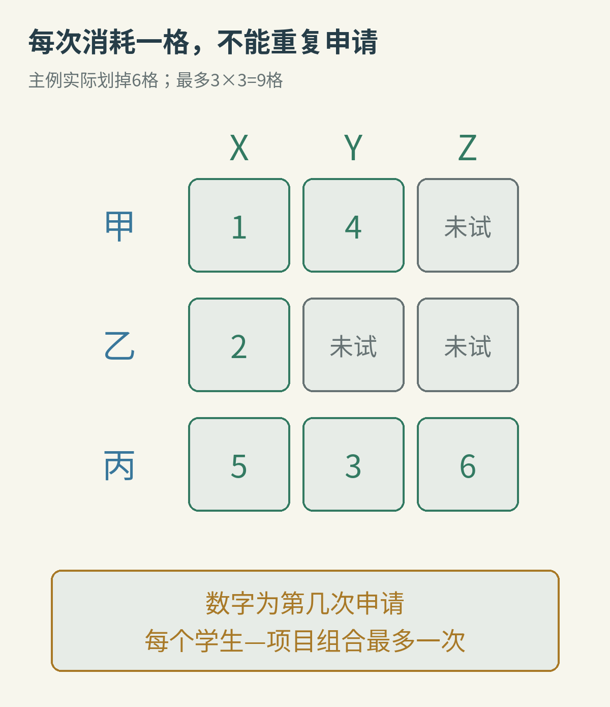

但停止时会不会还有人没有位置？在本篇完整等人数模型里，不会。

假如一个学生申请遍了全部n个项目仍然自由，说明每个项目都收到过申请。一个项目一旦开始暂留，之后即使换人，也始终留着一人。因此n个项目此时都各有一位不同学生，共需要n个人；再加上那位自由学生，就变成至少n+1个人，与总共只有n个人矛盾。

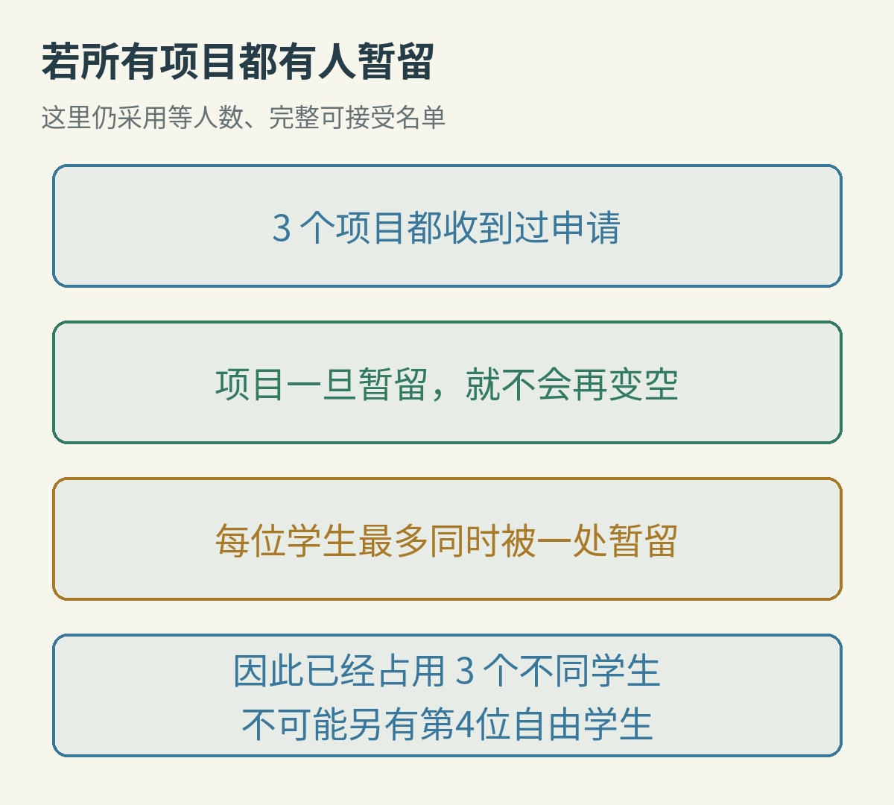

这里再次用到了“名单完整且人数相等”。允许拒绝某些对象或两边人数不同后，仍能研究稳定，但“人人都有位置”就不是这段论证给出的保证。

## 8. 稳定性的证明，只需要盯住一次拒绝

假设最终结果里，甲更想去X而不是现在的Y。

甲按顺序申请，既然X排在Y前面，他一定先申请过X。如果最后没去X，就说明X曾经拒绝过他：可能当场拒绝，也可能先暂留后换掉。

拒绝发生的那一刻，X手里一定有一位它更喜欢的人。而项目后续只会留住自己更喜欢的候选，不会主动换成更差的人。

所以到最后，X的搭档仍然排在甲之前。甲想换，但X不想。两人的阻塞对不成立。

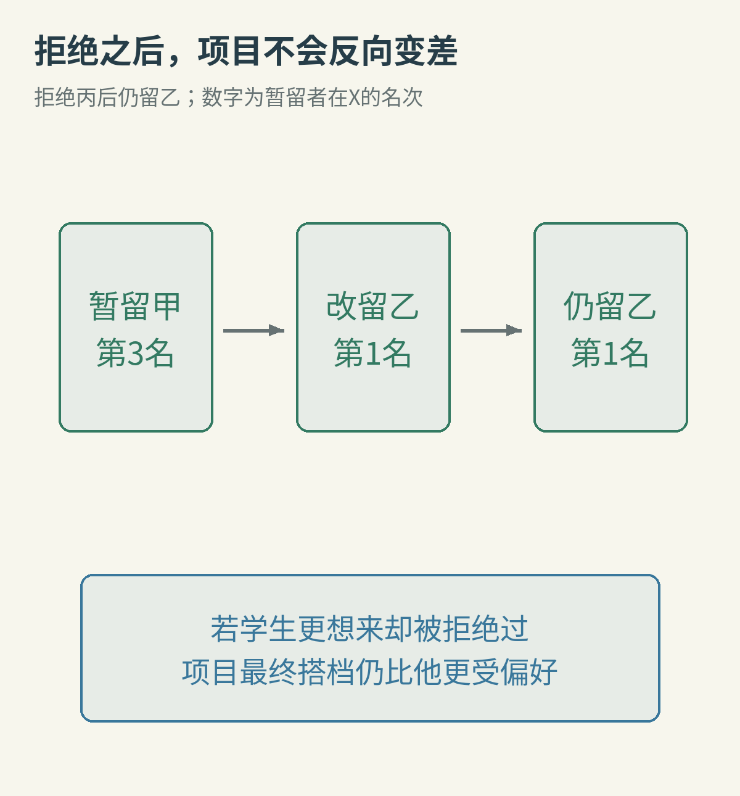

对任何“学生更喜欢的另一个项目”，都可以作同样的推理。于是没有阻塞对，结果稳定。

这不是检查了几个漂亮例子后作出的猜测，而是对任意一份符合条件的排序都成立的论证。

## 9. 稳定结果，可以不止一个

换一个两人两项目的小例子：

- 甲更喜欢X，再到Y；乙更喜欢Y，再到X。
- X更喜欢乙，再到甲；Y更喜欢甲，再到乙。

如果由学生申请，两人各自向第一选择申请，得到“甲—X、乙—Y”。学生都拿到第一选择，项目都拿到第二选择。

如果由项目发起，X向乙、Y向甲申请，得到“甲—Y、乙—X”。这次项目都拿到第一选择，学生都拿到第二选择。

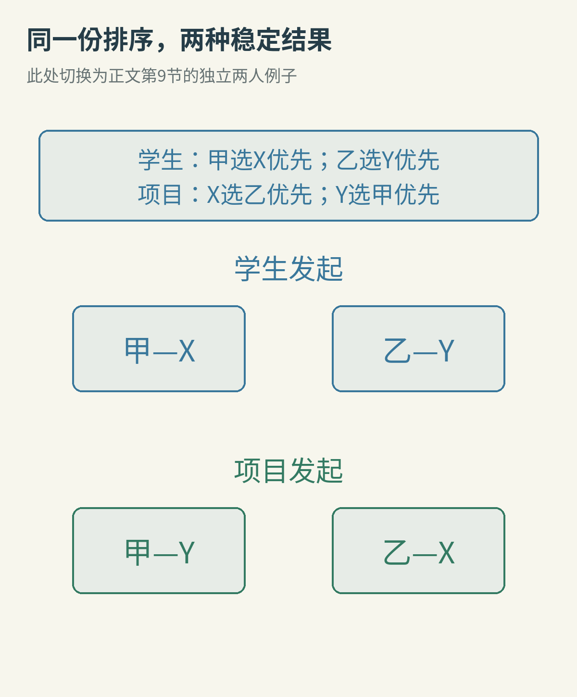

两种都稳定：第一种里学生不愿换，第二种里项目不愿换，所以都找不到双方同时赞成的改配。

这也告诉我们，稳定不是唯一的社会评价标准。由哪一边提出申请，是机制设计的一部分，会影响最终结果。不能把算法的一种稳定输出说成“唯一正确”或“绝对公平”。

## 10. “申请方最优”，到底在哪个范围里最优？

延迟接受还有一个更强的性质：在严格完整的一对一模型中，由学生发起时，每个学生得到的搭档，至少不差于他在**任何其他稳定匹配**中能得到的搭档。

重点是加粗的范围。它没有说“每人都拿到自己名单第一名”，也没有把所有不稳定方案算进候选集合。

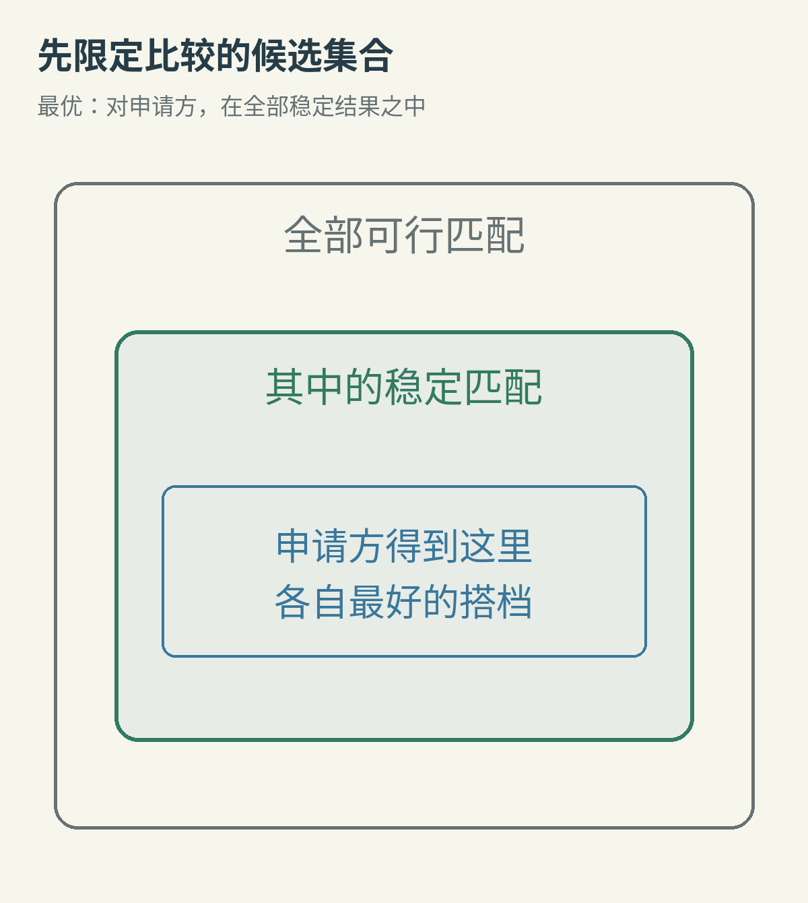

为什么一轮轮拒绝，不会把某个人本来可以在稳定方案中得到的项目弄丢？可以试着反证。

假设第一次发生了这样的“错误拒绝”：项目X拒绝甲，但某份稳定方案M恰好让甲去X。X拒绝甲时，暂留的是它更喜欢的乙。

乙在申请X之前，已经被所有排在X前面的项目拒绝。因为我们选的是第一次错误拒绝，先前那些拒绝都不会出现在任何稳定方案里。因此在M中，乙不可能分到他排在X之前的项目。

乙也不可能在M中去X，因为X已经给了甲。所以乙在M中的位置比X更差。

这样，乙更想去X，X也更喜欢乙而不是甲。乙与X会阻塞M，M不稳定，与假设矛盾。

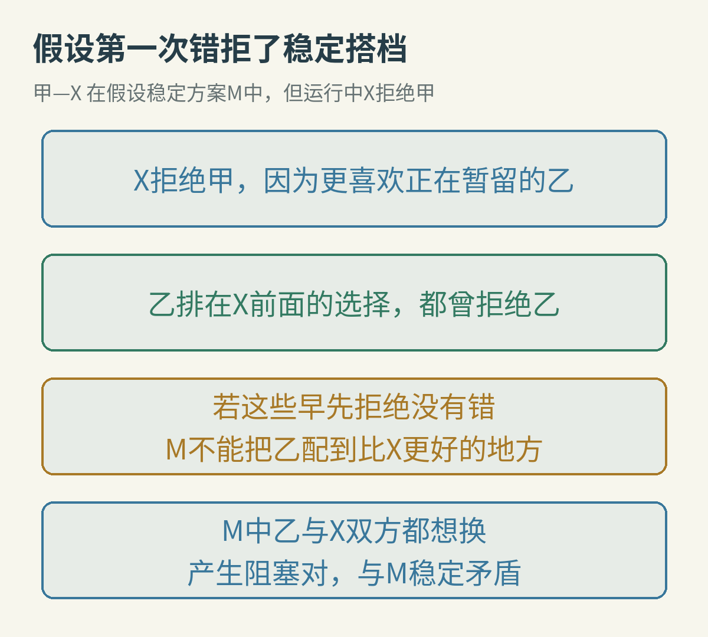

因此不存在那样的第一次错误拒绝。学生一路试过但被拒绝的项目，都不是他在任何稳定方案里能得到的搭档；最后留下的，就是稳定范围内他的最好选择。

这段论证也解释了为什么换一种自由学生处理顺序，不会改变本模型下的学生最优结果。不过，这不意味着改变谁发起、改变排序或加入并列后也保持相同输出。

## 11. 把“暂留”写进代码

我们需要三类小账：

- `next_choice[p]`：学生p下次该试自己名单的第几项；
- `held[q]`：项目q当前暂留谁，没有则为None；
- `free`：仍需继续申请的学生队列。

项目不能每次都线性扫描自己的名单寻找谁更靠前。先把排序转换为“候选人→名次”的字典，就可以直接比较名次。

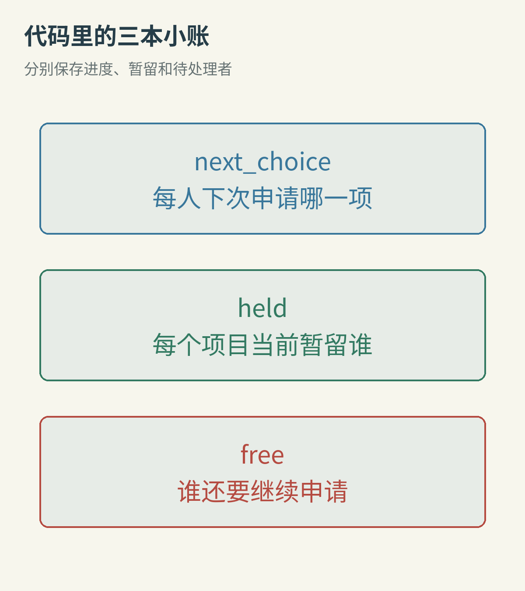

下面代码假设输入已经满足本篇模型：左右都是n行，每行都是0到n−1的一个完整排列。它不是接收任意输入的生产服务。

```python
from collections import deque


def match(left, right):
    n = len(left)
    rank = [
        {person: i for i, person in enumerate(row)}
        for row in right
    ]
    next_choice = [0] * n
    held = [None] * n
    free = deque(range(n))

    while free:
        person = free.popleft()
        project = left[person][next_choice[person]]
        next_choice[person] += 1
        old = held[project]

        if old is None:
            held[project] = person
        elif rank[project][person] < rank[project][old]:
            held[project] = person
            free.append(old)
        else:
            free.append(person)

    result = [None] * n
    for project, person in enumerate(held):
        result[person] = project
    return result
```

主例把甲乙丙编号为0、1、2，把XYZ编号为0、1、2：

```python
left = [[0, 1, 2], [0, 1, 2], [1, 0, 2]]
right = [[1, 2, 0], [0, 1, 2], [0, 1, 2]]
assert match(left, right) == [1, 0, 2]
```

输出第0项为1，表示甲去Y，不是项目Y选择了编号1的学生。注意返回数组的方向。

![输出按学生编号索引，[1,0,2]表示甲Y、乙X、丙Z](assets/20-result-direction.png)

预处理名次需要O(n²)空间与时间，申请最多n²次；在字典查询与基本操作按常数成本计的模型中，整体是O(n²)。这不是从六次主例外推的机器耗时，也没有说输入偏好本身只需O(n)空间。

## 12. 怎样独立检查一份输出？

写完算法后，不应只问“输出看起来顺眼吗”。我们可以另写一个更慢、却更直接的检查器：遍历每个未配在一起的学生与项目，比较双方当前搭档的名次，收集所有阻塞对。

小规模下还可以更彻底：枚举n!份完整匹配，只留下没有阻塞对的那些，再检查算法结果是否在其中，以及每个申请人是否已经拿到稳定范围内的最好搭档。

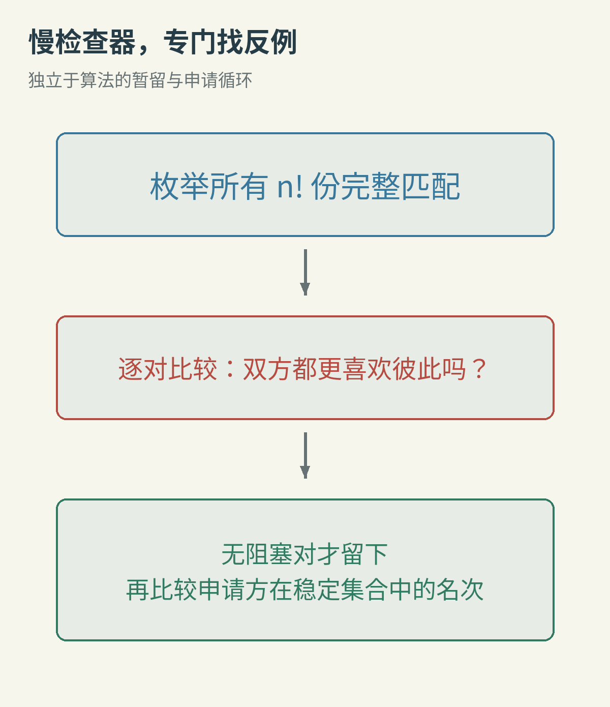

本文配套程序实际遍历了：

- n=1的1份完整偏好；
- n=2的16份；
- n=3的46656份。

这里“一份偏好”包含双方全部排序，不是只数一种匹配。对每份都枚举所有完整匹配，共找到60343个稳定结果；同时核对终止、稳定性、申请方最优、反向发起的对应最优、先取队头与先取队尾的结果，以及被拒绝的搭档不会出现在任何稳定结果中的性质。另以固定种子1962生成1000份n=4的完整偏好，同样逐一检查。

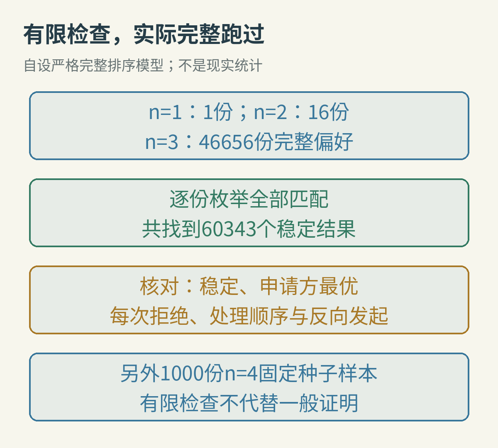

n=3的46656份偏好中，有34080份只有一个稳定匹配，11484份有两个，1092份有三个。这个分布仅属于这里均匀枚举的三人完整严格模型，不是现实社会的统计。

测试不能代替上一节的一般论证，但可以独立抓出索引反向、暂留者丢失、重复申请等实现错误。[完整实验与运行说明](examples/README.md)

## 13. 哪些新要求，会改变原来的问题？

**一个项目收多人。** 原论文也讨论了招生名额：项目暂留目前候选里排名靠前的若干位，而非只留一人。但项目对群体的选择规则如果不只是固定个体排序，不能直接套用这条简化推广。

**有人不可接受。** 名单可以不完整，停止时可能留下未匹配者；检查稳定时还要把可接受性与空缺规则写清楚。本篇代码不处理这种输入。

**存在并列。** “更喜欢”与“至少不差”不再相同，会出现不同的稳定定义。任意打破并列可以得到某一种处理结果，却不等于证明所有公平目标都满足。

**两个人必须一起去。** 双人或群体联动改变了基本选择结构，原来的一对一保证不能原封不动搬过去。

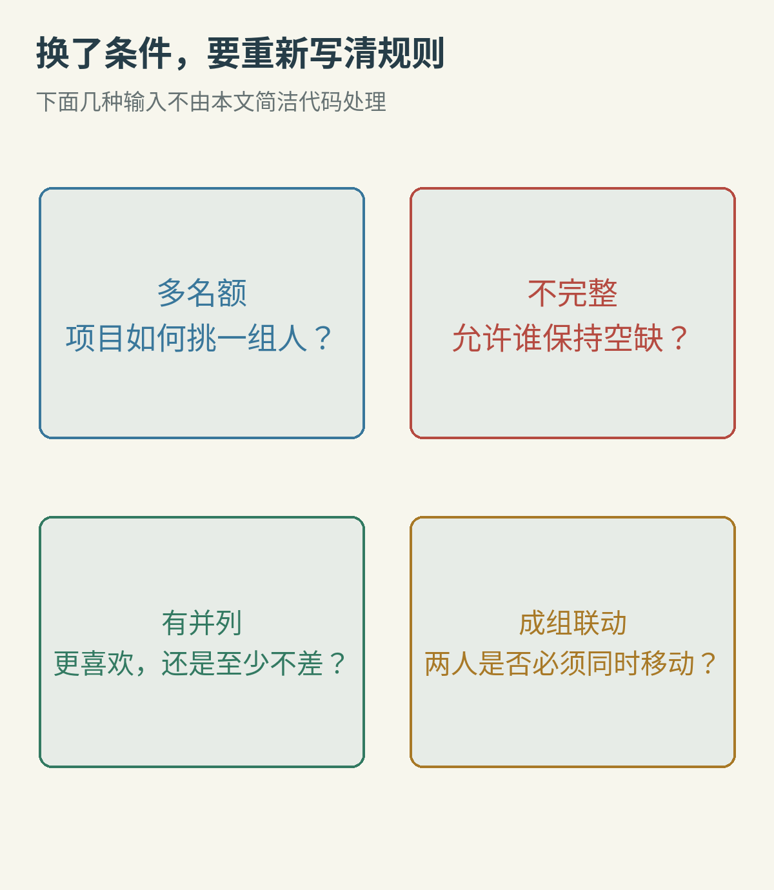

还有一件事：这篇把给定排序当作输入，并没有证明双方都不会策略性填报。“结果稳定”“申请方最优”“如实填报是否有利”是不同的命题，不能混成一句算法会解决一切。

## 14. 最后的纸笔挑战：换谁先开口？

回到第9节的两人例子。先让学生发起，再让项目发起。每次只在纸上记录三个东西：申请箭头、暂留线、被拒绝的人。

你应得到两份不同、却都没有阻塞对的结果。接着任选一份，看能否找出一个不满意的人；再问：对方是否也同意换？

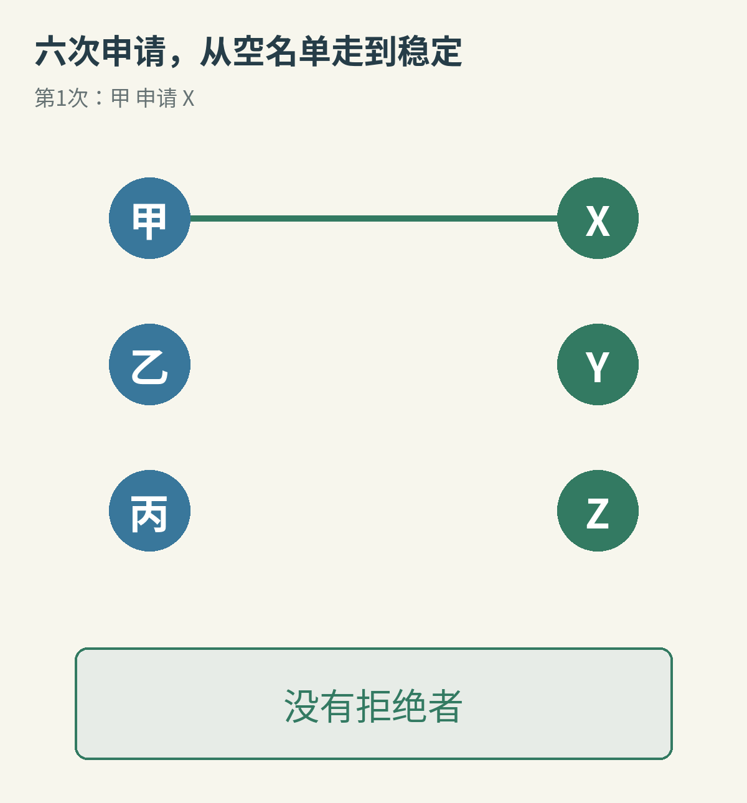

动画是自设模型的六次离散事件，不是现实录取流程或系统执行耗时。第5帧里X拒绝丙，暂留线不变，这个“不变”也是算法的一步。

1962年论文结尾特别提到，这种论证不必依赖复杂公式：只要把推理接得足够精确，也是在做数学。[原论文第15页上半部](https://iqua.ece.toronto.edu/baochun/ece1771f/papers/Gale-Shapley-1962.pdf)

这篇最值得记住的，也许不是一段循环，而是一种做事方式：先定义你不允许出现的反例，再设计一个过程，让每次拒绝都留下能够排除反例的理由。
