# 一柜子齿轮，怎样提前画出明年的潮汐？

桌上没有盛海水的水箱，也没有一颗小月亮绕着小地球转。

只有转轴、齿轮、上下移动的架子，以及绕过许多滑轮的一条链。转动手柄，旁边的笔就能画出一条起伏曲线，供人编制潮汐表。

它怎么知道海水明天几点涨、几年以后又怎样变化？

秘密不在齿轮“懂得”海洋，而在于人先把某个地点的潮汐写成若干有规律的起伏，再让机器把这些起伏加起来。

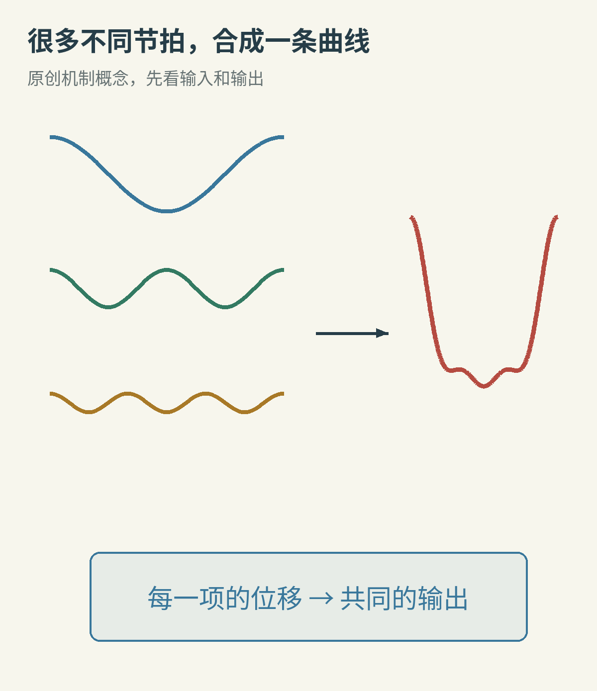

这篇从一个旋转的小销钉出发，追到一条绳子的总长度。中途会手算一张小表，还会遇到一个有点反直觉的现象：两条简单曲线相加，原本像谷底的位置，竟可能变成一个小峰。

## 1. 先看看它真的长什么样

下面是美国海岸与大地测量局的第二号潮汐预测机。NOAA的设备档案写明，它由Rollin A. Harris和E. G. Fischer设计，在测量局仪器工场制造，1910年完成，1912年接替Ferrel预测机，能够合成37个分潮。

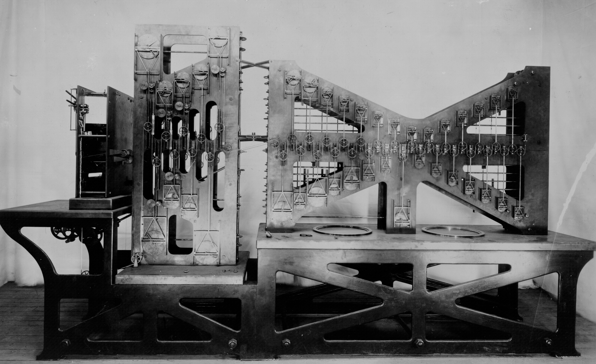

图源：NOAA / NOS / CO-OPS，[第二号预测机档案](https://tidesandcurrents.noaa.gov/predma2.html)。原站链接的1792×1095原GIF，未裁切或改画。依[该站材料使用说明](https://tidesandcurrents.noaa.gov/disclaimers.html)，无另行标注的政府材料属公有领域，本文保留来源；本图不纳入本文原创CC BY 4.0许可。

注意照片中许多重复的小单元。重复不是装饰：不同单元承担不同的节拍，最后汇入共同的读数装置。

从正面再看一次，你能找到记录曲线的纸，以及桌下的手柄。

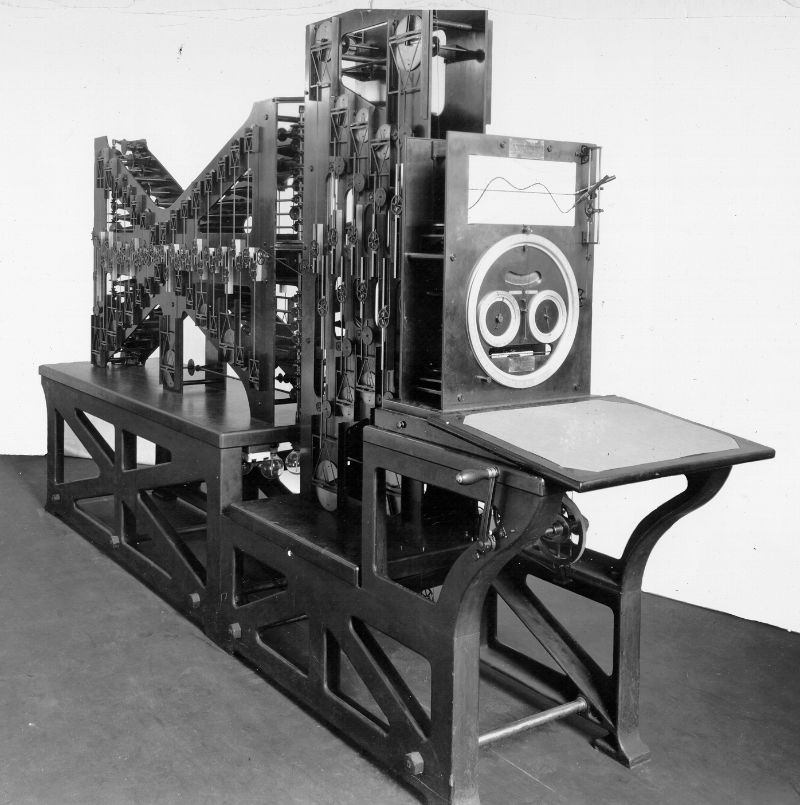

图源与使用范围同上：NOAA / NOS / CO-OPS，1396×1405原GIF，[公有领域与署名说明](https://tidesandcurrents.noaa.gov/disclaimers.html)。照片中的具体拍摄日期未在该档案页注明，不把机器完工年份当成照片日期。

这台设备也不是Kelvin本人那台机器。19世纪70年代的Thomson，也就是后来的Lord Kelvin，推动了早期机械潮汐预测；美国随后有Ferrel机器，后来才是照片里的Harris–Fischer第二号机。把这些名字放在一条历史线上，可以看见方法的延续，不能把不同机器的年份、分潮数和功能拼成一个“超级原型”。


## 2. “分潮”不是海里藏着几层水

先想一个跷跷板的端点：上去，下来，再上去。

如果它重复得很规则，可以用一条光滑波线描述。潮汐分析中的“分潮”，可以先理解为这样的一个数学起伏分量。

真实海水的运动受月球、太阳引力和海洋地形等影响。不同地点对这些周期性作用的响应不同。因此，一个港口合适的振幅和相位，不能直接搬给另一个港口。

分潮不是说能从海里舀出一桶“月球水”和一桶“太阳水”。它是把一个复杂变化写成若干项的模型语言。

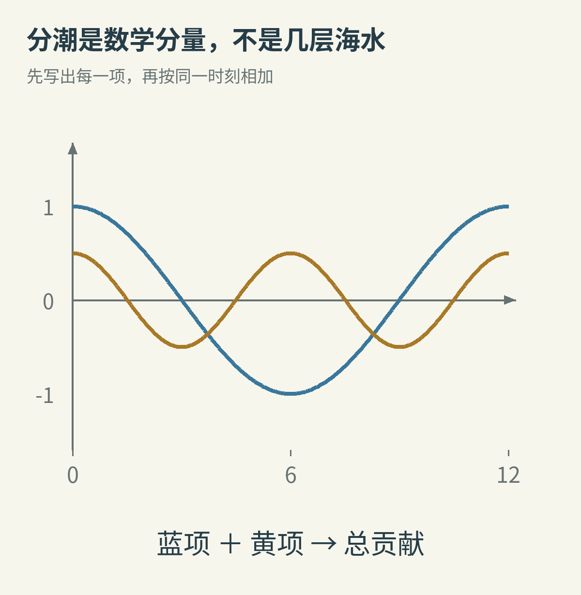

这里还有两个方向不同的任务：

- 分析：从一段实际水位记录，估计各分量的参数。
- 预测：参数给定以后，算出指定时刻的各分量，再相加。

本文的齿轮机器主要完成第二步。它并不会只凭空转几圈，就自己发现某个港口的全部参数。以前讲FFT时，重点是如何高效分解信号；这次重点是如何把已经知道的分量，真的变成可以机械相加的位移。


## 3. 一个圆周运动，怎样变成上下起伏？

在一个圆盘上，离中心一定距离处安装小销钉。圆盘匀速转动，小销钉绕圆走。

只看销钉的高度，忽略它左右移动多少，你看到的就是周期性上下运动。

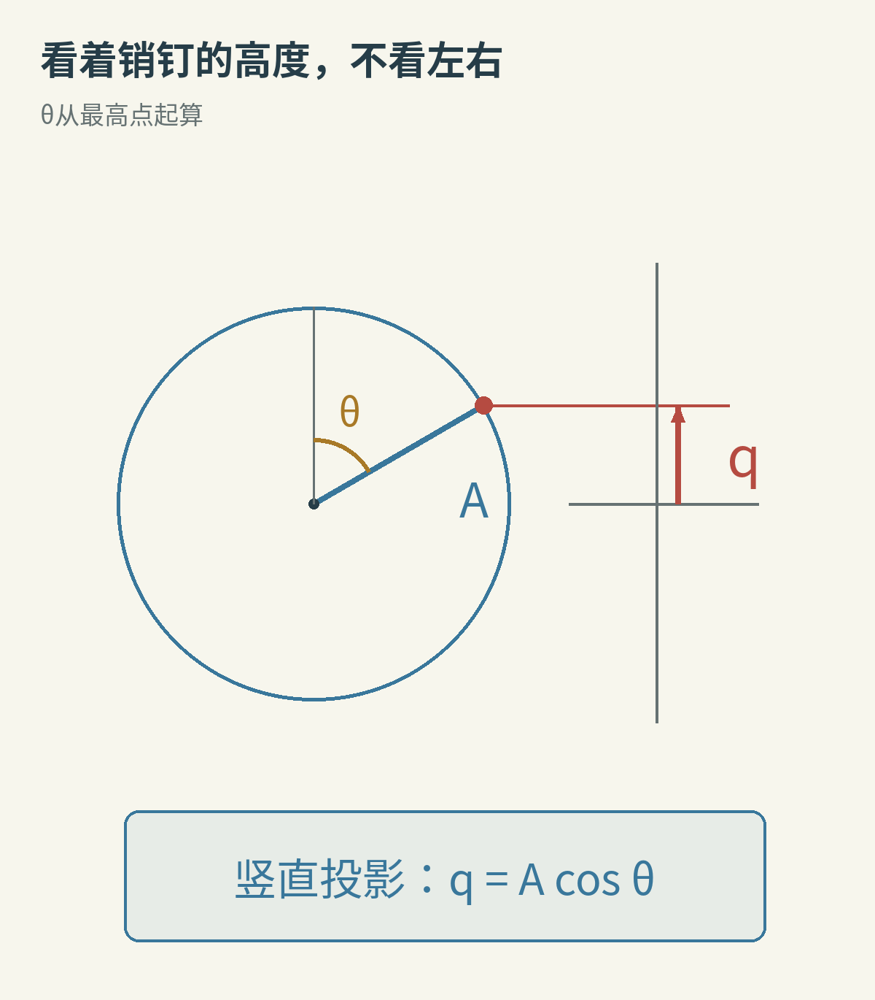

怎样让一个架子只跟随这个高度？可以把销钉放进一条水平槽里。销钉左右移动时在槽里滑动；它上下移动时，带着整个槽架上下走。槽架再受到竖直导轨约束。

这就是把“转动”变成“简谐运动”的一种销钉与槽架结构。下面是概念示意，不是第二号机的零件加工图。

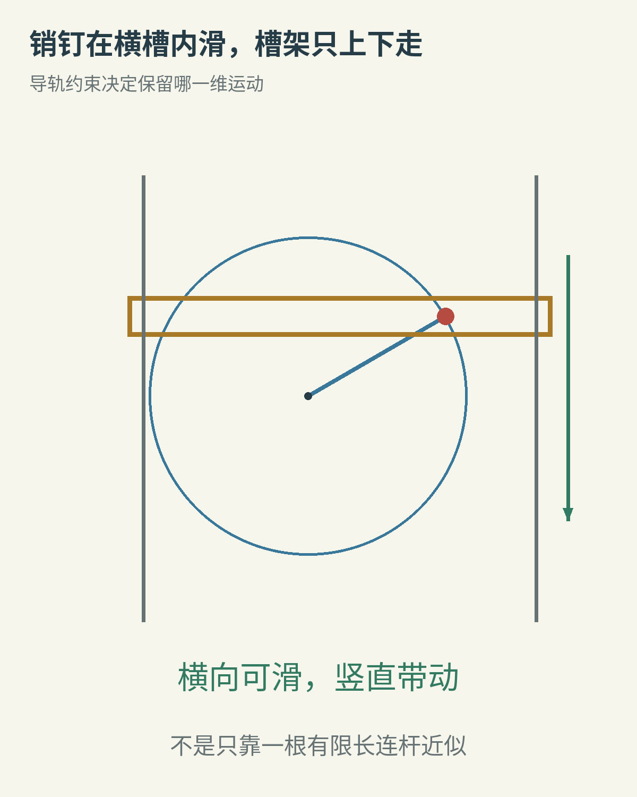

先把角度θ从圆的最高点起算。销钉离中心的距离为A，那么它相对中心的高度就是：

q = A cos θ。

你不必先背三角函数表。转到最高点，高度是A；转四分之一圈，高度是0；转半圈，高度是−A；再转回去，重复。

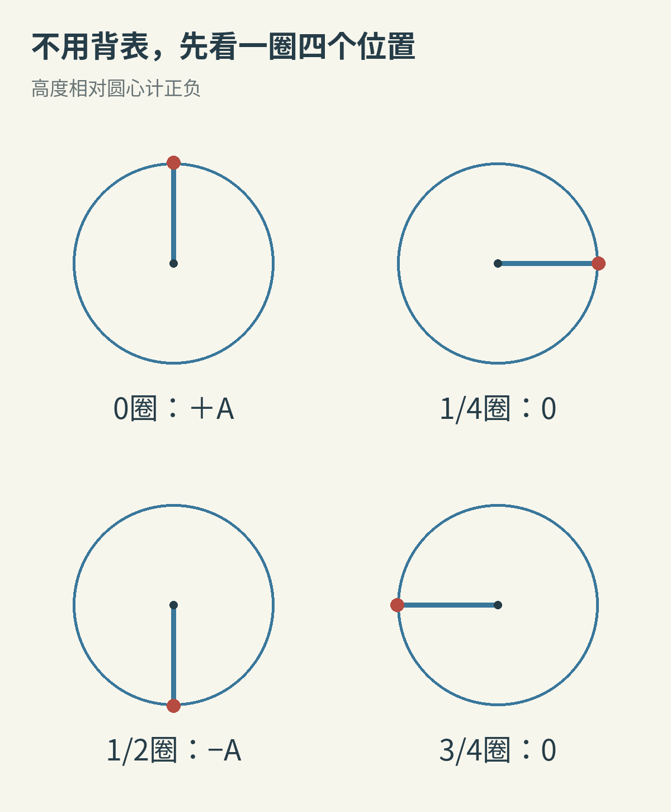

## 4. 三个设置，各管一件事

一个起伏分量可以写成：

q(t) = A cos(ωt + φ)。

这里的符号都能落到可见的机械动作上。

A是振幅，控制上下摆动有多大。销钉离盘心越远，行程越大。

ω是角速度，控制一个周期要多久。不同齿轮比让各根轴在同一时间基准下转得快慢不同。

φ是初始相位，控制从圆周上的哪里开始。两只轮子大小相同、转速相同，如果初始角度错开，它们的波峰也会错开。


角度单位要统一：本文代码用弧度，所以一圈是2π。如果周期T用小时，ω=2π/T，单位就是每小时多少弧度。

“把某个波推迟3小时”和“加3弧度”不是一回事。推迟τ小时，应把t换成t−τ，角度相应减少ωτ。相位必须连着时间原点一起理解。

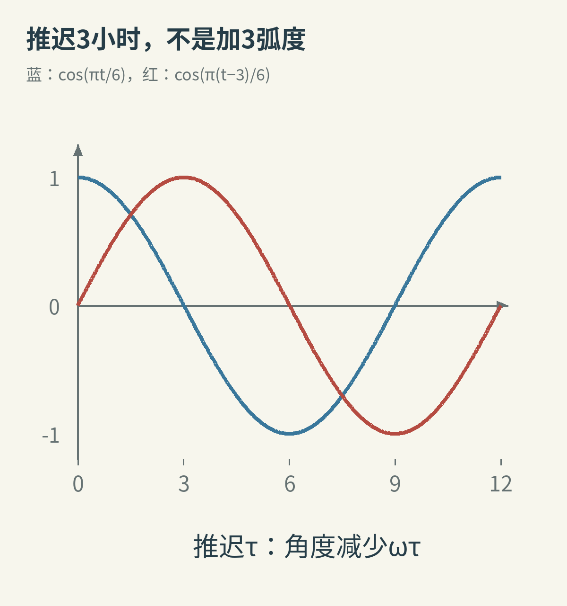

再回头看真实设置照片。原档案将这一张说明为设置一个分潮的振幅与相位。照片里人的身份没有给出，我们也不替他编名字或操作对白。

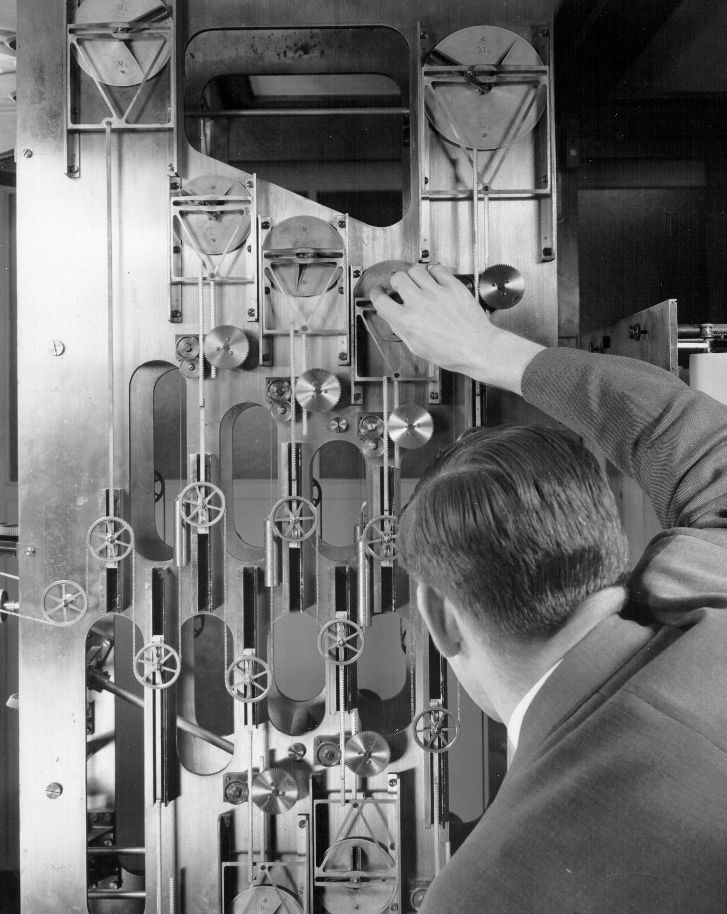

图源：NOAA / NOS / CO-OPS，1458×1833原GIF，未修改；[原档案](https://tidesandcurrents.noaa.gov/predma2.html)、[材料使用说明](https://tidesandcurrents.noaa.gov/disclaimers.html)。这是实物照片，前面的中文图是另绘的机制解释。

## 5. 先不用机器，合成一个玩具潮汐

为了能手算，我们故意选整齐的周期，不冒充任何港口的实际参数：

h(t) = 2 + cos(πt/6) + 0.5 cos(πt/3)。

t的单位是小时；h的单位在这个虚构例子中取米。平均基线是2米，第一项振幅1米、周期12小时，第二项振幅0.5米、周期6小时。两项初始相位都设为0。

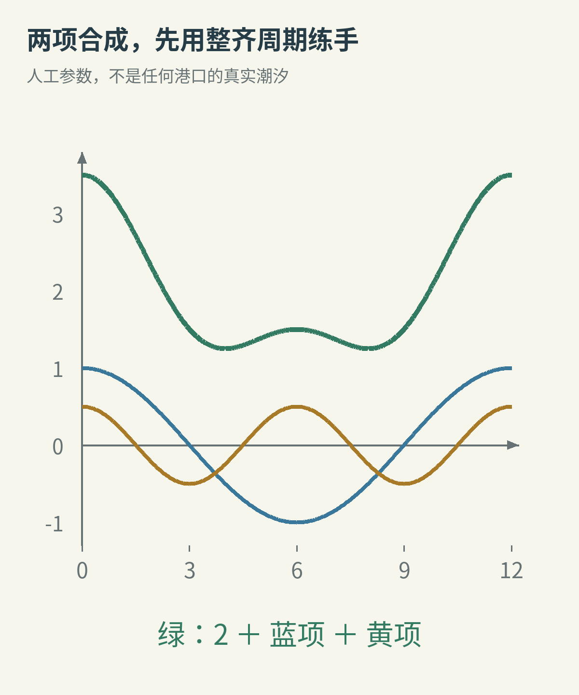

先算t=0：两只“轮子”都在最高处，结果是2+1+0.5=3.5米。

到了t=3，第一项走了四分之一圈，贡献0；第二项走了半圈，贡献−0.5。结果是1.5米。

到了t=6，第一项贡献−1，第二项已经绕完一圈，贡献+0.5。结果仍是1.5米。

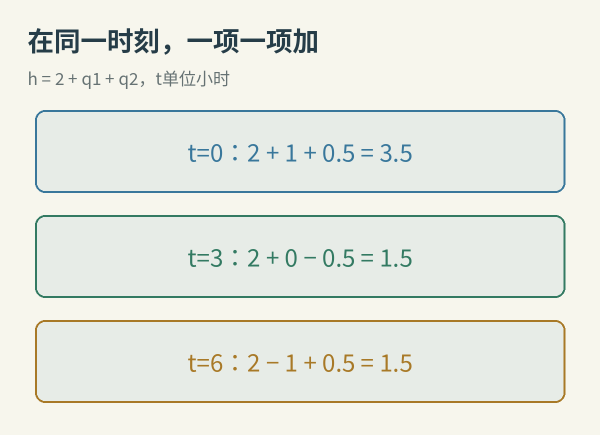

相同高度，不代表处于相同变化状态。t=3时曲线还在下降；t=6附近却有一个小峰。我们稍后再来找它。

先记住预测机器每个时刻要完成的工作：让各单元处在正确角度，读出各自贡献，然后加起来。

## 6. 一条绳子，怎么做加法？

轮子能制造起伏，现在缺的是加法器。

设一根理想绳子不伸长，始终绷紧。一端固定，经过导向件，再从一个可以上下移动的滑轮下面绕过去，最后通到自由端。

如果活动滑轮向下移动1厘米，它左右两段竖直绳各变长1厘米，总共多需要2厘米。总绳长不变，自由端那一段就必须缩短2厘米。

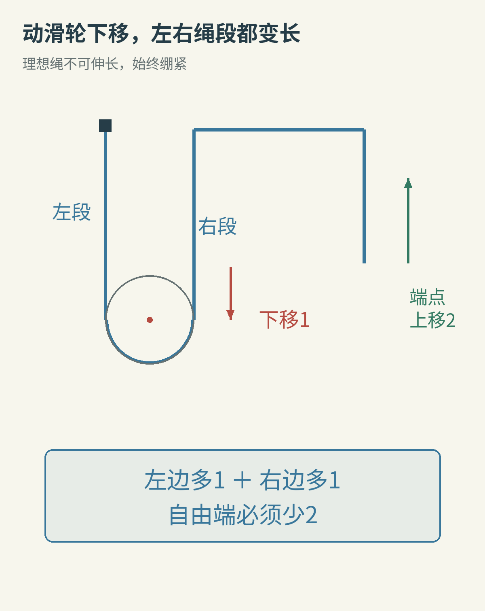

这个2很重要。只写“滑轮移动多少，笔就移动多少”，很容易把比例算错。

把两个活动滑轮串进同一根绳子，分别用y1、y2表示它们向下的位置，用z表示自由端向下的位置。在图中的理想布置下，固定导向段和不变的绕轮弧长合起来记为C：

总绳长 L = C + 2y1 + 2y2 + z。

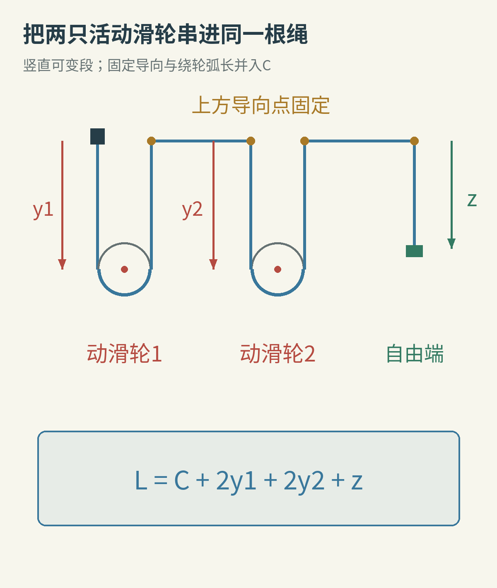

绳长固定，所以变化满足：

Δz = −2Δy1 − 2Δy2。

这已经是加法。它带一个反号和一个2倍系数，我们通过方向与刻度来处理。

让每个滑轮相对自身基准向上移动q/2，也就是y=Y−q/2。这样自由端向下的增量，就等于q1+q2。

如果想让笔在纸上向上表示正数，再加固定转向连接或反向标尺。机械位移的正方向，与纸上的高度正方向，需要明白约定，并非所有真实机器都采用本文这套布置。

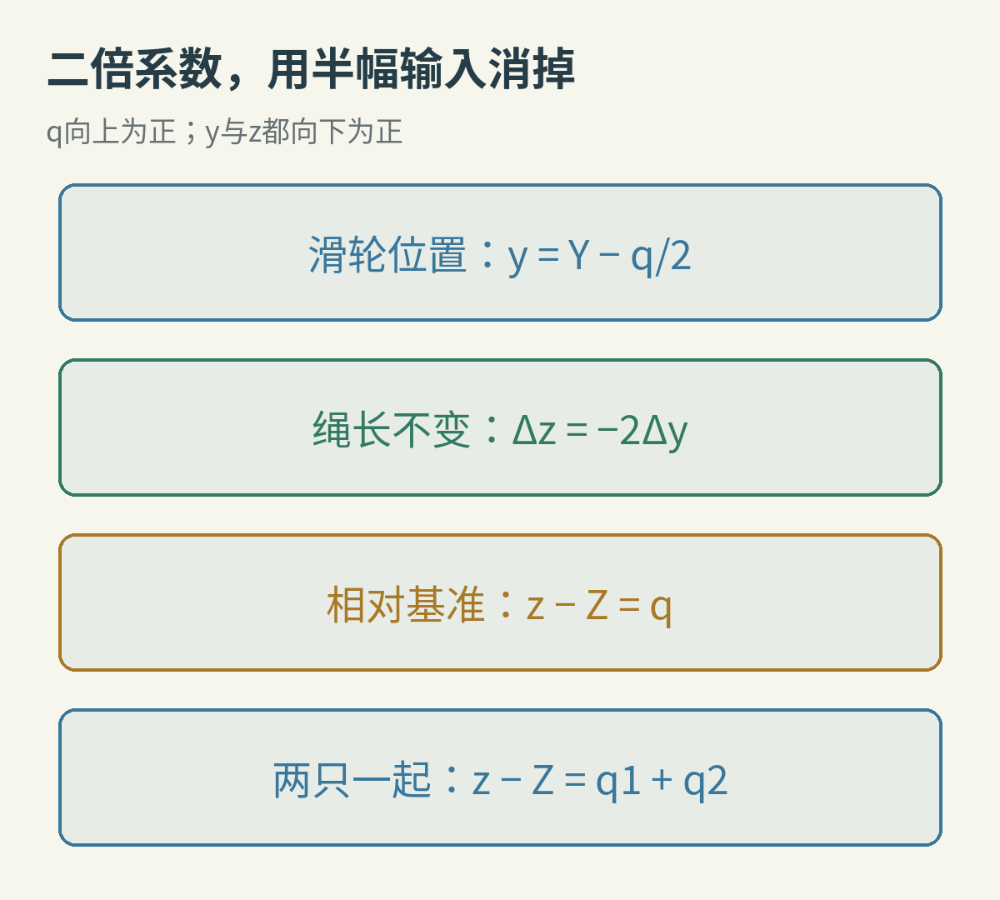

本文图是便于推导的绳长模型，省略摩擦、绳的伸长、导向零件厚度和张紧机构的细节。历史机器使用过线、带或求和链；不能据此把所有实物说成同一根理想绳。

## 7. 两只滑轮一起动，答案仍能核对

沿用玩具例子。把长度单位按比例选好，设两个滑轮的基准位置都为10，自由端基准也是10。

t=0时，q1=1、q2=0.5，因此：

- y1=10−1/2=9.5；
- y2=10−0.5/2=9.75；
- z=10+1+0.5=11.5。

可变化的绳段总长是2×9.5+2×9.75+11.5=50。

t=3时，q1=0、q2=−0.5，两个滑轮变为10和10.25，自由端为9.5。总长还是20+20.5+9.5=50。

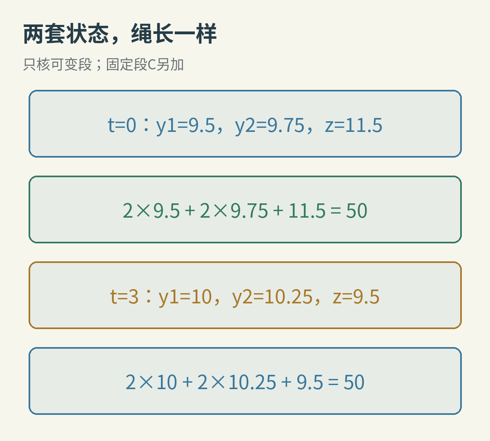

预测高度读作h=2+(z−10)。你会再次得到3.5和1.5。

机器并不需要把这些小数先写在纸上，再执行一条加法指令。绳长约束让自由端只能出现在符合加法关系的位置。

下面是NOAA教材中的原示意图，可以与我们的分步图对照。上排固定滑轮负责导向，下方活动滑轮随各分量升降，输出连接记录笔。

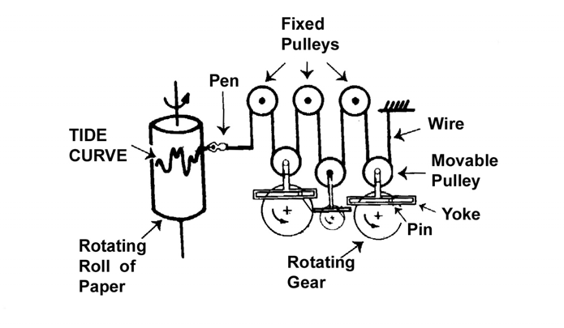

图源：Bruce B. Parker，NOAA《Tidal Analysis and Prediction》（2007），印刷第9页图1.2；从原PDF直接提取695×405内嵌图像，未放大重画。[原教材](https://tidesandcurrents.noaa.gov/publications/Tidal_Analysis_and_Predictions.pdf)、[NOAA材料使用说明](https://tidesandcurrents.noaa.gov/disclaimers.html)。该图无另列第三方权利标识，作为政府材料署名引用；不纳入本文原创CC许可。

## 8. 把时间轴一起带起来，才得到整条曲线

目前自由端告诉我们“此刻有多高”。要画曲线，还需要让纸按代表时间的比例移动。

一组齿轮把共同的输入轴分配给各分潮轴。另一条传动路径推进记录纸。于是横向位置代表时间，纵向位置代表预测高度。

转得快些，表示在桌上更快地扫过预测时间，并不是让真实海洋加速。这也是机器可以提前算未来的重要原因：参数来自已经分析过的观测，后续只是把模型中的时间往前推进。

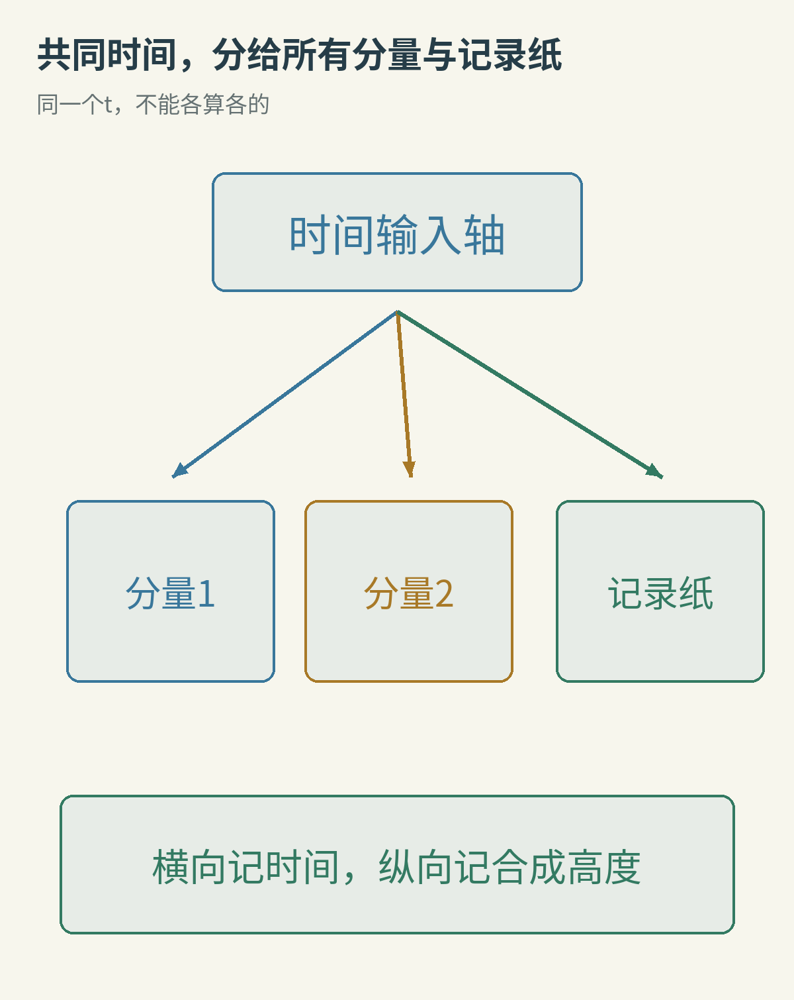

不过，手柄转得快并不自动保证精度。传动间隙、链的伸长、摩擦、读数与设置误差，都可能影响结果。我们没有操作或测量这台历史机器，不能把数学图上的光滑曲线写成一次实际机械精度测试。


## 9. 为什么潮汐的节拍会慢慢“对上又错开”？

玩具例子的12小时与6小时，纯粹为手算服务。两个重要真实分潮M2与S2的周期却很接近：NOAA教材列M2约12.4206小时，S2为12小时。

两个节拍稍微不同的轮子，一开始对齐，以后会逐渐错开，再重新对齐。

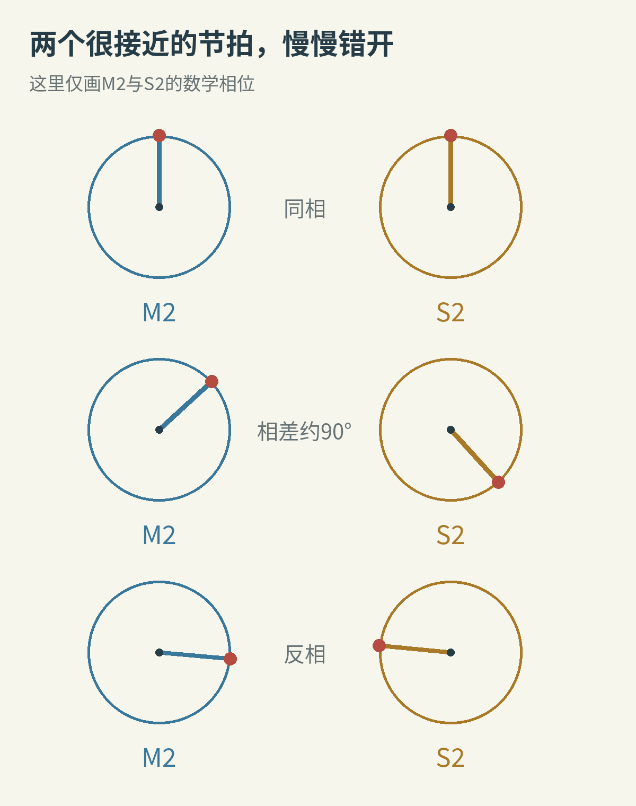

用教材给出的角速度算：M2为28.9841042度/小时，S2为30度/小时。相对角速度是两者相减，约1.0158958度/小时。

相对角度累积一整圈需要：

360 ÷ 1.0158958 ≈ 354.367小时，也就是14.7653天。

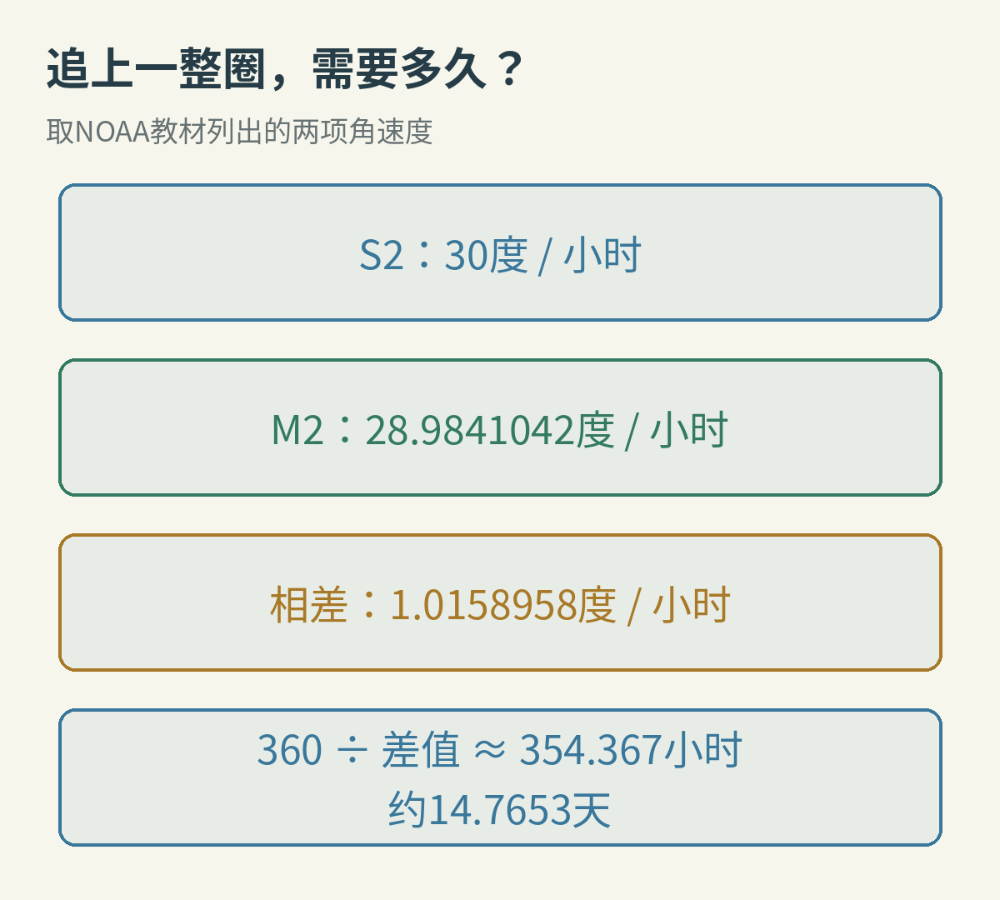

这是这两个分量相对相位的循环时间。它帮助解释为什么它们的叠加会有较慢的强弱变化。

仍用振幅1和0.5作示意：当两项同相，合成振幅为1.5；反相时，合成振幅为0.5。这里说的是二分量的合成幅度，不是说“第14.7653天某港水位恰好1.5米”。实际各分潮的相位、其他分量、海湾响应与天气都还在。

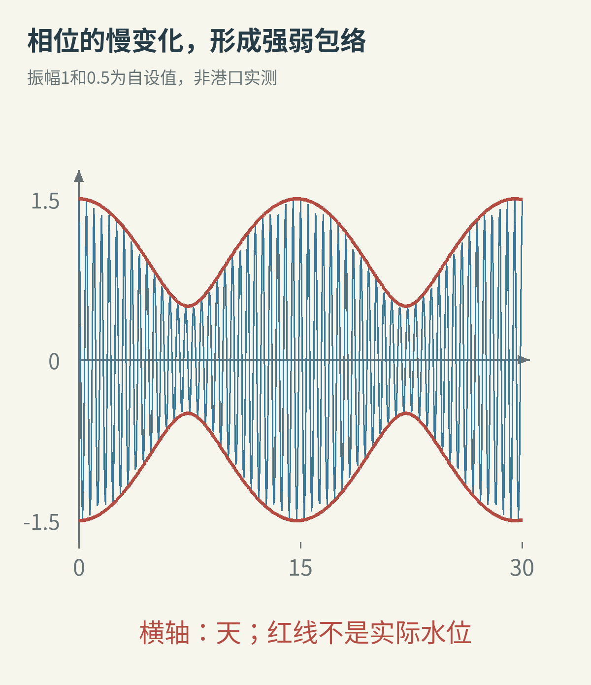

大潮、小潮与月日作用有关，但真实地方的潮差最大时刻，不应仅靠一个两轮示意就无条件认定与某个月相瞬间完全重合。

## 10. 高潮时刻，为什么还要算另一条曲线？

画出h(t)是一件事，直接列出“几点几分高潮”又是一件事。

一个光滑峰顶附近，曲线先上升，再下降；最高处的变化率为0。于是可以另外合成各分量的变化率，再寻找它们总和过零的位置。

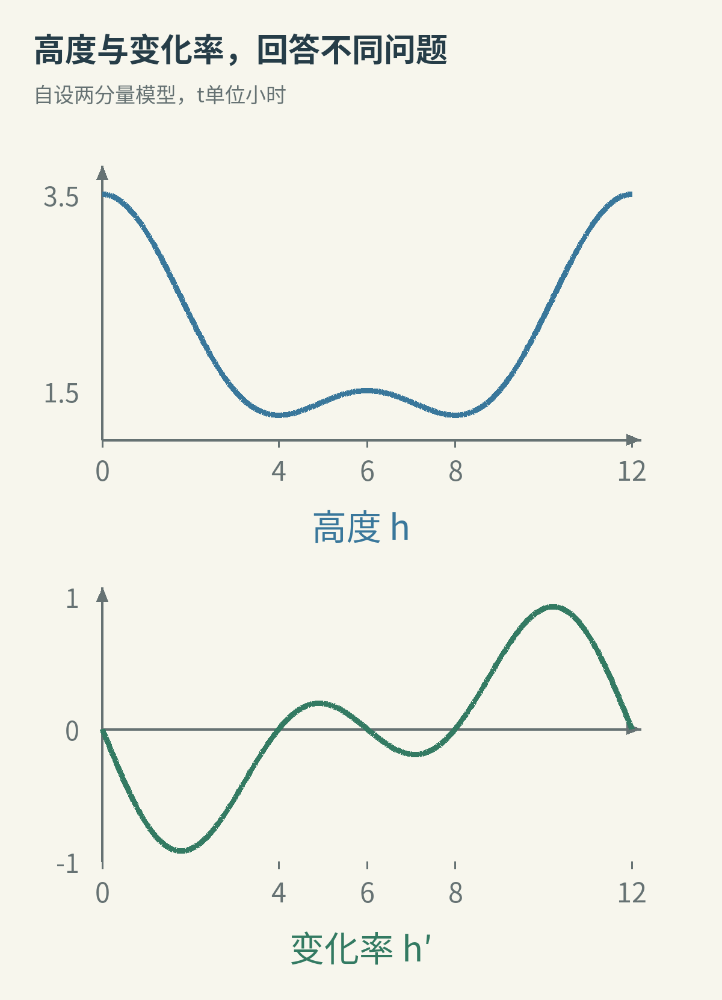

如果一项是A cos(ωt+φ)，它的变化率就是−Aω sin(ωt+φ)。仍然是有规律的起伏，只是幅度多乘ω，相位也变了。

NOAA对第二号机的说明分别列出高度求和与变化率求和，解释它怎样指示高低潮时刻。不要把这个功能倒安到每一台早期机器身上；不同机器有的主要画曲线，有的专门指示高低潮。

还要留心：变化率等于0本身，只给候选点。一般函数可能在平坦位置继续上升，不能把每一个零都不加判断地称为峰或谷。看前后上升、下降是否变号，才知道这一处是什么。


## 11. 回来找那个“谷里冒出的峰”

我们玩具例子的变化率是：

h′(t) = −(π/6) sin(πt/6) − (π/6) sin(πt/3)。

两项前面的系数相同，因为第二项振幅虽减半，角速度却加倍。

在t=4、6、8时，变化率都为0。直接算高度：

- t=4：2−0.5−0.25=1.25；
- t=6：2−1+0.5=1.5；
- t=8：又是1.25。

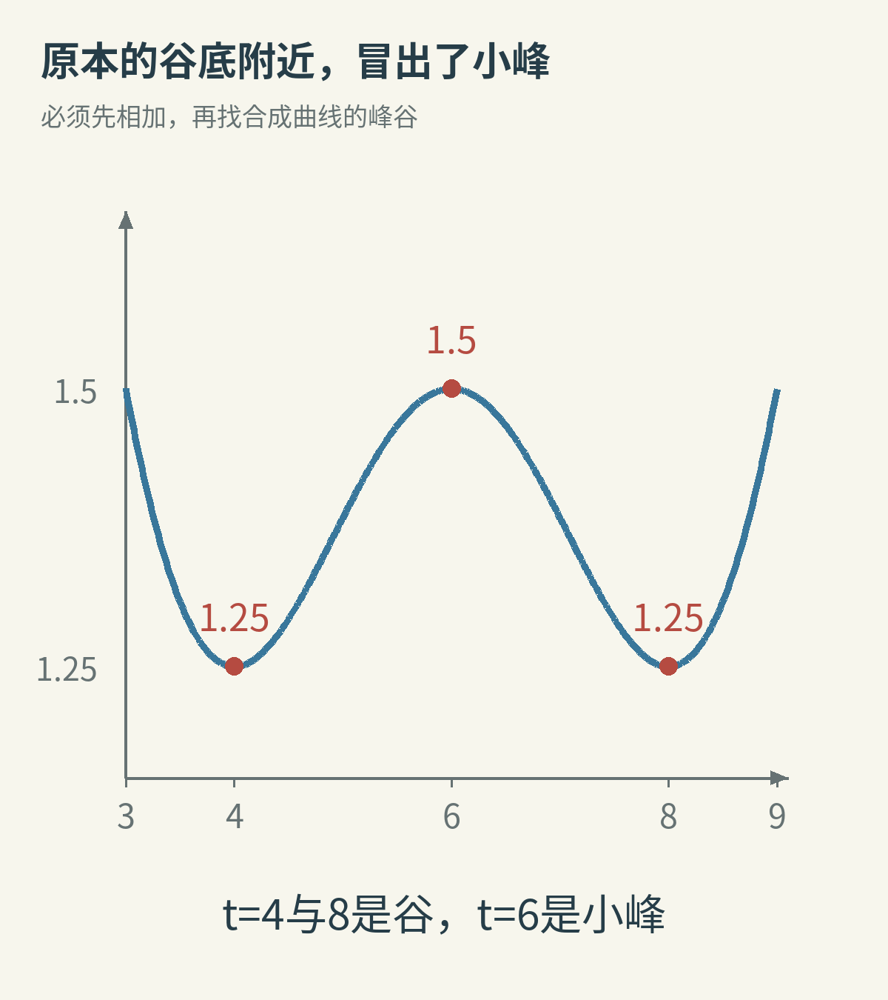

所以t=6是夹在两处低谷之间的小峰。第一分量正到谷底，第二分量却到峰顶；两者的曲率组合，改变了总曲线的局部形状。

这说明，不能先找每条分量各自的高潮时刻，再取平均当总高潮时刻。需要先合成，再研究合成曲线。

真实读数装置长这样。档案说明它用于记录高低潮的时间与高度；我们不会从照片里模糊的纸面编造一个港口或某年的真实数据。

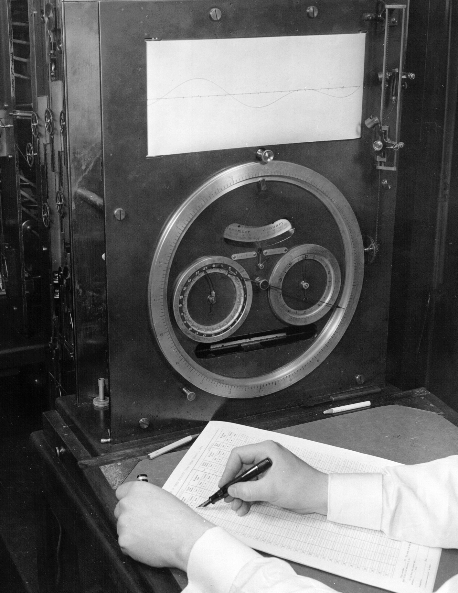

图源：NOAA / NOS / CO-OPS，1417×1833原GIF，未修改；[原档案](https://tidesandcurrents.noaa.gov/predma2.html)、[材料使用说明](https://tidesandcurrents.noaa.gov/disclaimers.html)。

## 12. 给齿轮正确参数，比把齿轮转起来更难

机器能执行一个模型，不意味着模型自动正确。

港口的分潮振幅与相位来自观测分析。记录太短、测量有误、时间基准混用，都会把错误带进设置。把小时当分钟，或者混淆角度与弧度，更会得到漂亮却不对应原问题的曲线。

正式潮汐预测还会处理天文论元与缓慢变化的校正。本文用固定A、ω、φ，是为了看清合成机制，没有把整套专业预测简化成三行万能公式。


另外，实际水位并不只有可预测的天文潮。风、气压、河流等会改变水位。NOAA的现代水动力预报也会纳入部分这类影响，和只做调和合成的潮汐表有不同输入与预测范围。

所以本文玩具模型和配套代码不能用于航行、涉水、赶海或安全判断。需要行动时，使用当地主管部门的实时水位、天气、预警和适用的正式预报。

## 13. 用代码复算，再看滑轮真的怎样动

配套[实验程序](examples/tide_machine_lab.py)只用Python标准库。最核心的高度计算很短：

```python
import math

def height(t, terms, mean=0):
    return mean + sum(
        amplitude * math.cos(speed * t + phase)
        for amplitude, speed, phase in terms
    )

terms = [(1, math.pi / 6, 0),
         (0.5, math.pi / 3, 0)]
print(height(0, terms, 2))  # 3.5
print(height(4, terms, 2))  # 1.25
```

程序实际做了6561组精确分数绳长检验，另做3200组随机合成与变化率核对、2880组圆周投影核对、3625组两分量包络核对。主要例子的三个驻点数值定位为4、6、8小时。

这些检验支持代码与理想模型的一致性，不是一次历史设备测量，也不是潮汐预测准确率报告。

下面的13帧动画取t=0到12的整点：上部两只活动滑轮的位置来自q1/2与q2/2，自由端来自两项相加，底部红点标出此刻h(t)。同一时刻的绳长一直保持不变。播放每帧的时长只是阅读节奏。

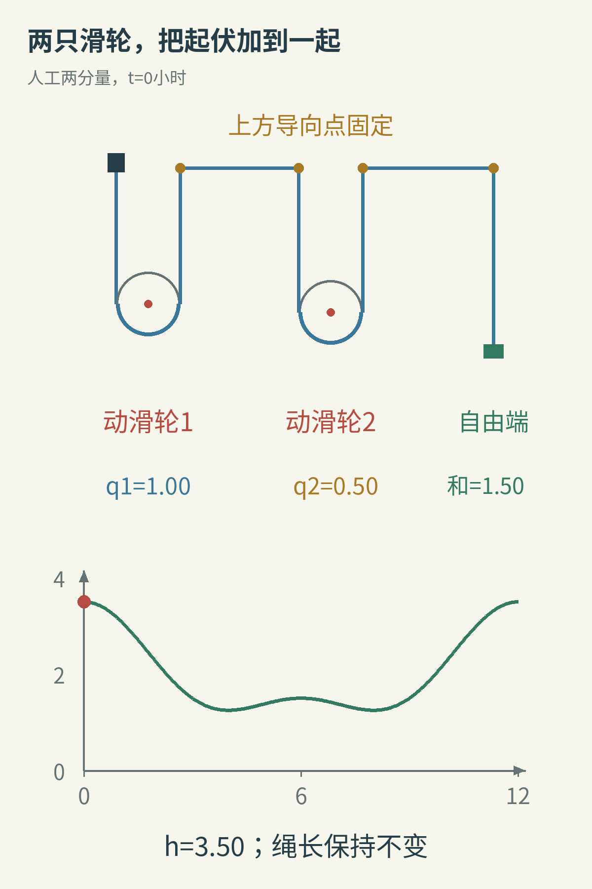

可以先暂停在t=3，再去核对前面那张总长50的账单。

## 14. 真正值得记住的，是“一个约束替你做了运算”

圆周投影负责制造简谐运动。齿轮比负责节拍。销钉位置和初始角度负责振幅与相位。绳或链的总长度约束负责求和。记录纸把共同时间变成横坐标。

其中没有一步要求齿轮知道“海洋”这个词。机器准确执行了人选择的数学表示；模型从哪里来、参数属于哪个地点、结果能信到什么程度，仍然需要人的观测、分析和判断。

留一道能拿纸笔做的题：如果把第二个分量的初始相位改成π，其他都不变，t=0的高度是多少？

第二项从+0.5变成−0.5，所以结果是2+1−0.5=2.5。机械上相当于把第二个分量的起始角度翻转半圈，而不是把所有轮子的转速改掉。

一柜子齿轮最有趣的地方，是它把一个看不见的“加号”，变成了你能沿着绳子逐段追踪的长度守恒。

[完整来源、原图附册与实验范围](sources.md)
