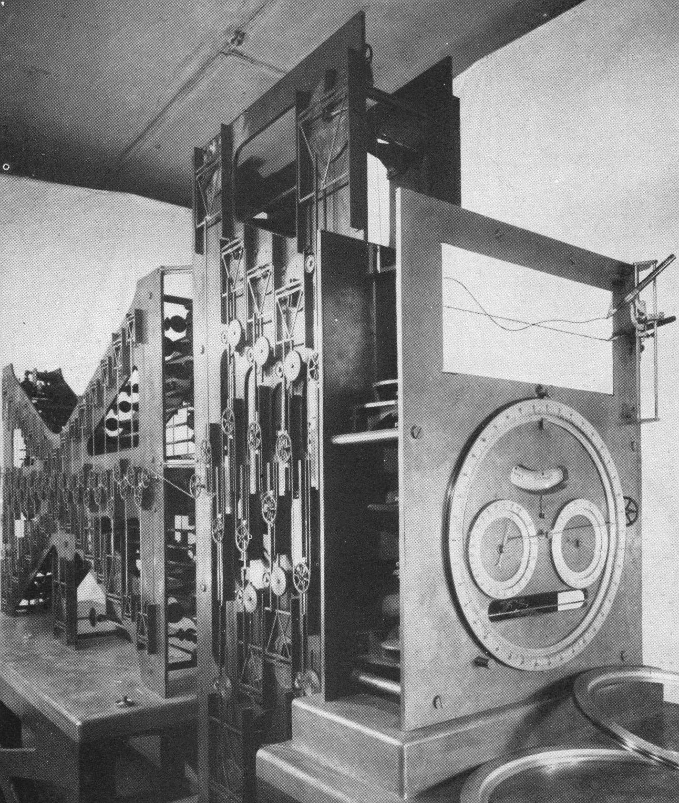

# 原图附册：整机、设置与求和结构

四幅NOAA设备档案原图全部收齐，保持原文件原字节。另有教材技术相关图1.1与1.2原像素提取。具体权利与提取方式见[sources.md](sources.md)；这些政府原图不适用本文原创CC BY 4.0许可。

## 1. 第二号机右侧

NOAA / NOS / CO-OPS，[原档案](https://tidesandcurrents.noaa.gov/predma2.html)，[使用说明](https://tidesandcurrents.noaa.gov/disclaimers.html)。1792×1095原GIF。

## 2. 第二号机正面

同一机构、原档案与使用说明，1396×1405原GIF。

## 3. 设置振幅和相位

同一机构、原档案与使用说明，1458×1833原GIF。档案未注明操作者身份。

## 4. 记录时间与高度

同一机构、原档案与使用说明，1417×1833原GIF。未从照片认定具体港口、年份或数值。

## 5. 教材图1.1

Bruce B. Parker / NOAA，*Tidal Analysis and Prediction*，2007，印刷第4页。原PDF内嵌1292×1528像素，直接提取，不重绘。[完整原教材](https://tidesandcurrents.noaa.gov/publications/Tidal_Analysis_and_Predictions.pdf)，[材料使用说明](https://tidesandcurrents.noaa.gov/disclaimers.html)。

## 6. 教材图1.2

同一教材印刷第9页，695×405完整内嵌图。固定与活动滑轮、销钉、槽架及记录笔的总体关系；正文中文图分步骤解释绳长约束，不在原图上覆盖中文。
