# 两台数据库都说“准备好了”，为什么还不能各自决定？两阶段提交把一声YES变成承诺

游戏里有一笔交换：甲交出一把剑，乙交出十颗宝石。

如果两份背包数据由同一个数据库管理，可以把两处修改放进同一笔本地事务。但游戏扩展后，甲的数据在东边服务器，乙的数据在西边服务器。两边各自很可靠，也不代表交换整体可靠。

东边说“剑已经转走”，西边却因为库存不足说“宝石没法交”。两个本地数据库都忠实完成了自己的决定，玩家仍然得到了一场失败的交换。

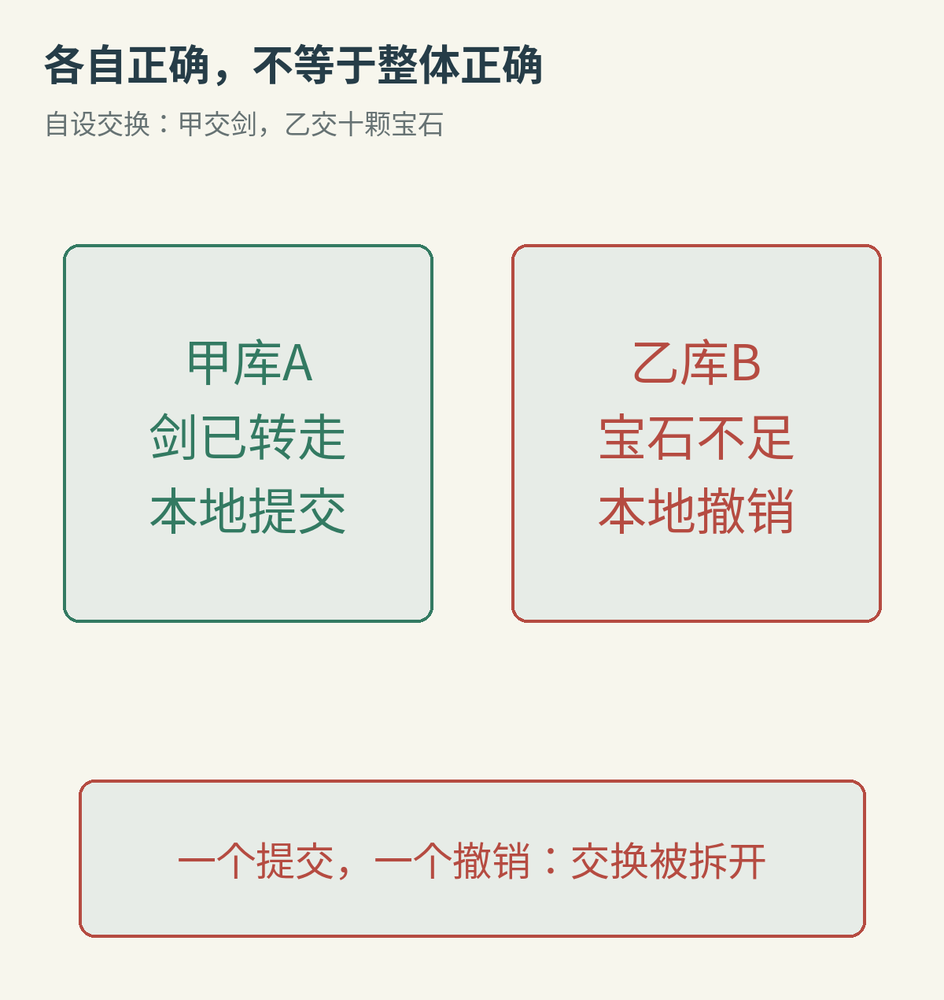

这次要解决的不是“怎么让一台机器记住提交”，而是：**当一次操作跨越多个独立资源时，怎样避免有人提交、有人撤销？**

一种经典办法叫两阶段提交，Two-Phase Commit，简称2PC。它最有意思的地方，不是多问一次“行不行”，而是把“我行”变成一种不能随便反悔的状态。

## 1. 先区分两种“全部完成”

我们安排三个角色：甲库A、乙库B，以及协调者T。协调者负责收集意见和公布决定；它不替两边保管每一颗宝石。

A、B是参与者，论文中常称资源管理器RM。协调者也常叫事务管理器TM。它们是逻辑角色，不要求恰好运行在三台物理机器上。

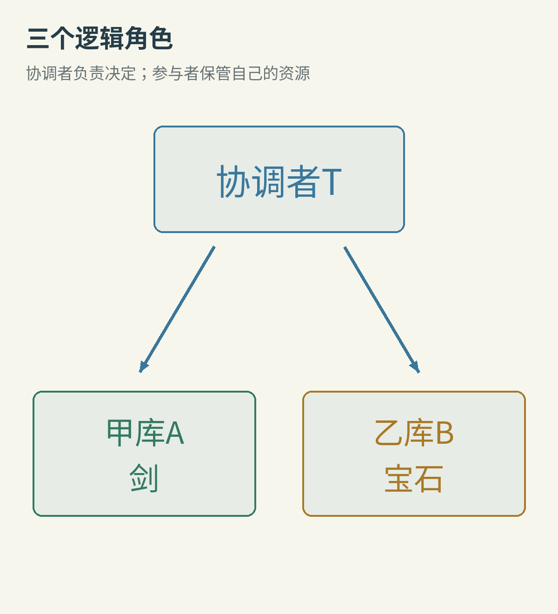

本篇希望保证两件事：一旦某个参与者最终提交，另一个就不能最终撤销；已经作出的最终决定不能再反向改写。

这不要求两个处理器在完全相同的纳秒改变状态。提交消息先到A、后到B时，可以暂时是“A已提交，B仍在等待决定”。危险的是“A已提交，B却已经撤销”。等待状态与相反的最终结果，不能混为一谈。

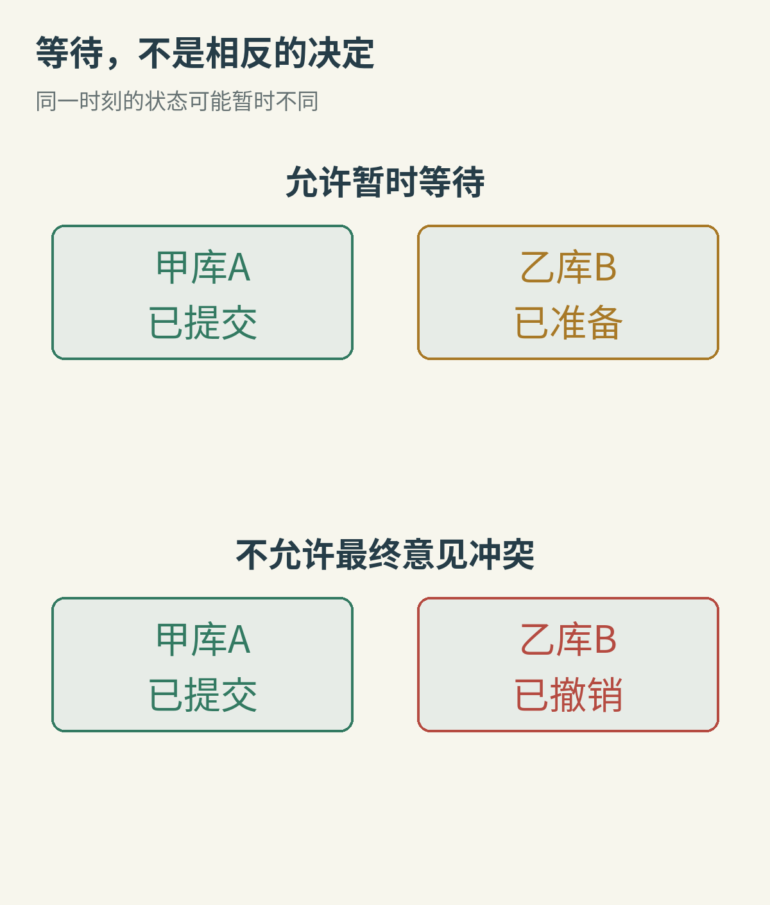

我们也希望大家最终结束等待。但“不会作出矛盾决定”和“在故障中还能继续向前”是两个需要分别检查的目标。2PC最值得耐心研究的，正是它在这两个目标之间留下的边界。

## 2. Gray与Lamport问的，不只是多数人同意什么

Jim Gray和Leslie Lamport合写的《Consensus on Transaction Commit》，在2006年发表于ACM Transactions on Database Systems。他们把事务提交与共识放到一起比较：事务要提交，所有参与者都得愿意；某个资源做不到，就不能靠其余资源投票把它“表决成做得到”。[论文及作者说明](https://www.microsoft.com/en-us/research/publication/consensus-on-transaction-commit/)


Lamport本人网站提供的照片；本图按本人公开的任意用途使用许可收录，不标成CC照片。


Gray照片由Tony Hey拍摄，出自微软出版的《The Fourth Paradigm》，按CC BY-SA 3.0 US使用。两幅都保留完整原文件，准确来源、许可与日期范围见文末。

Lamport在论文说明页回忆，他与Gray曾一起梳理Paxos和传统两阶段提交的关系。那是作者对研究过程的回忆，不是本文虚构的一段现场对话。这篇文章先沿他们清楚区分的问题边界，理解传统2PC；不展开Paxos Commit的全部算法，也不把2PC说成这篇2006论文才发明的东西。

下面的角色、剑与宝石都是自设模型，没有真实玩家或支付数据。

## 3. YES之前，是“我觉得可以”；YES之后，是“我已经准备承担决定”

假设A已经检查剑确实存在，B也检查十颗宝石确实够用。只检查还不够：如果发完YES之后，B又让另一笔交易花掉宝石，它先前那声YES就失去了意义。

因此，参与者在回答YES之前，要完成本地准备。必要的修改、恢复信息和资源约束必须被可靠地保留下来，使它随后能够按整体决定提交或撤销。需要保留哪些锁、版本或预留资源，取决于具体系统。

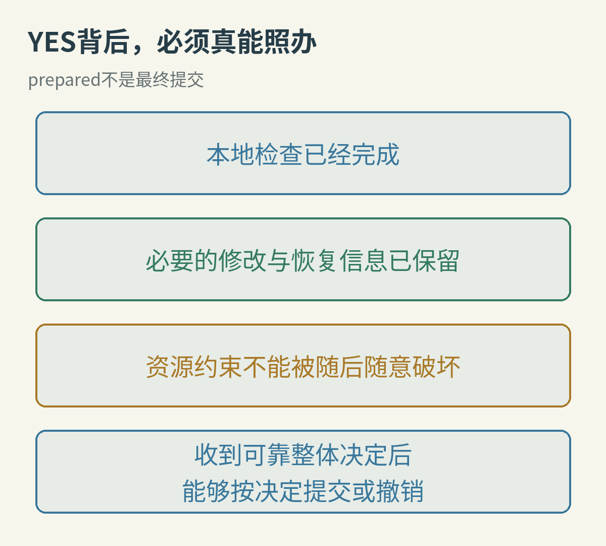

这个状态叫prepared，本文译作“已准备”。它既不是最终提交，也不是一条还可以无条件收回的随口承诺。

本篇规定，参与者把已准备状态持久化之后，才发送YES。若先把YES发出，再来得及记住自己承诺了什么就崩溃，其他机器可能已经据此决定提交，本机却完全忘了如何完成这笔操作。

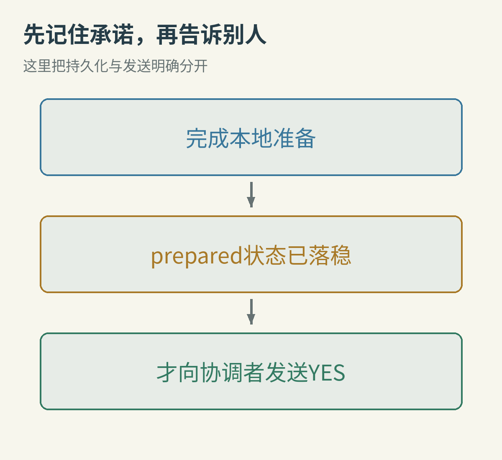

与WAL一样，关键是顺序依赖。但这里有了一层新的含义：日志不仅帮本机重启，还支撑别的机器基于我的答复作决定。

## 4. 第一阶段：询问，然后等待有分量的回答

用一种常见的叙述顺序：协调者向A、B发出PREPARE请求。

A完成本地准备，持久化prepared状态，再回复YES。B同样操作。任何一边无法准备，都可以在作出YES承诺之前回复NO并撤销自己的本地部分。

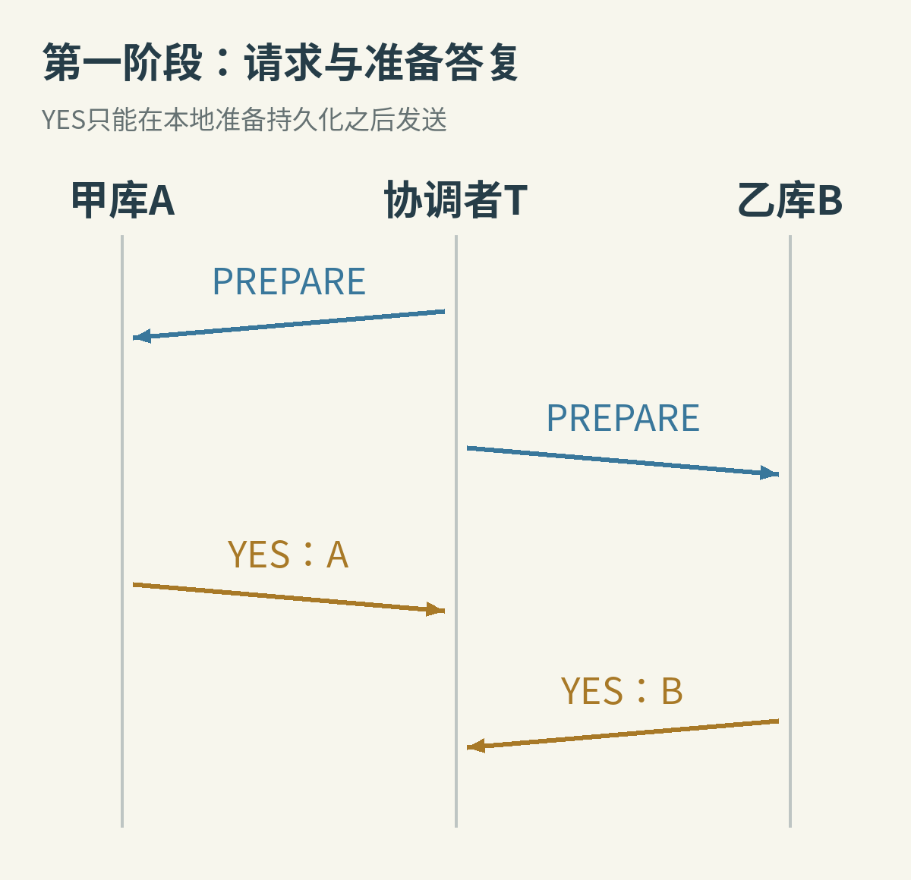

这里不能把“收到两个YES”实现成“收到两条文字为YES的网络消息”。同一个参与者可能重发答复，网络也可能重复投递。A的YES来两遍，不能代替B的一票。

协调者必须知道固定的参与者名单，并按身份记录谁已经准备。本文用集合保存收到YES的参与者编号，重复加入A仍只有一个A。

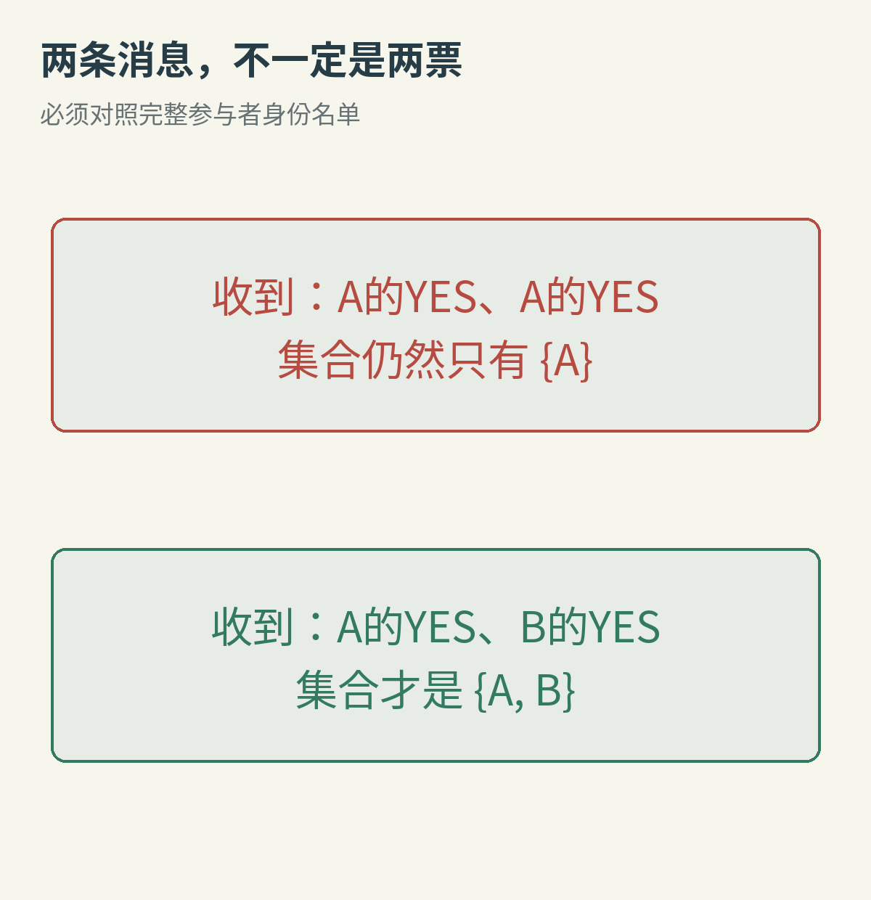

本篇模拟器为专注安全性，省略协调者的询问消息，允许每个参与者主动准备。这与原论文附录采用的简化方向相同：询问是启动准备的提示，真正约束决定的是准备承诺。正文展示请求消息，不意味着程序测试了完整网络栈或请求重试实现。

## 5. 第二阶段：决定先落稳，再让别人照办

若协调者收齐所有参与者的YES，就具备作出COMMIT决定的条件。

它先持久化这个决定，再通知A、B。A收到决定后提交自己的部分，B收到后也提交。为了方便阅读，这里把“持久化最终决定”与“发送决定消息”画成两个独立步骤。

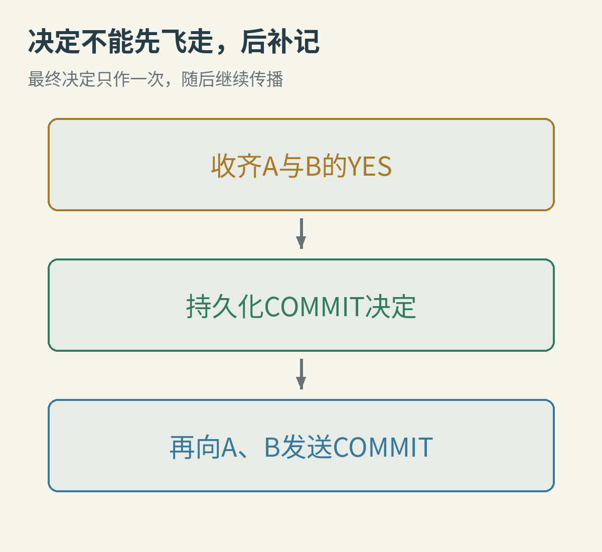

为什么必须先记稳？想象协调者只在内存里决定提交，先通知A；A已经提交，协调者崩溃。重启后，如果它忘了曾经决定提交，又因为超时决定撤销B，整个交换就裂成了两半。

一旦COMMIT决定持久化，后续的工作是继续把这个决定传播出去，不能因为某封通知暂时收不到，就把它改成ABORT。

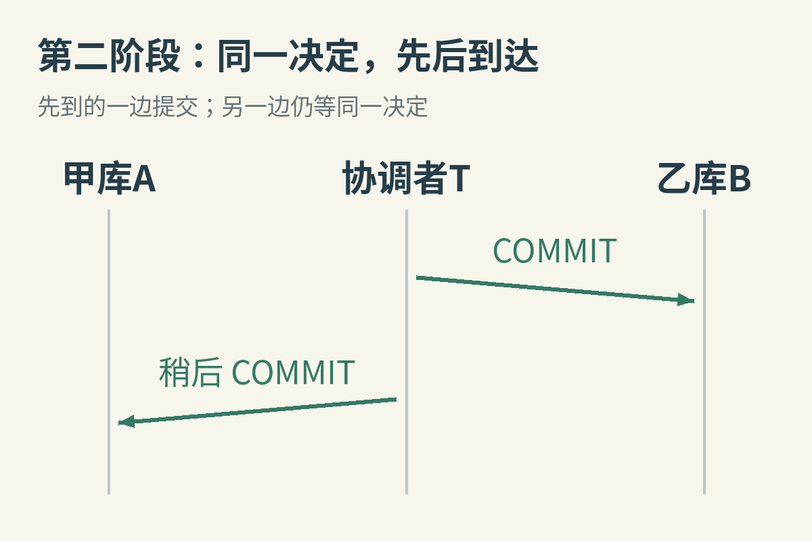

参与者之间不同步的这段时间，还可能影响外部读取。2PC本身解决的是原子提交决定；跨库读者能否读到同一个一致视图，还需要隔离、锁或其他读取协议配合。本篇没有把“决定不矛盾”偷换成“任意查询总能看到全球同一时刻”。

## 6. 有一个NO，为什么不是少数服从多数？

假设A可以交剑，B的宝石数量不够。B在YES之前拒绝，协调者应走撤销路线，通知其余参与者放弃这次交换。

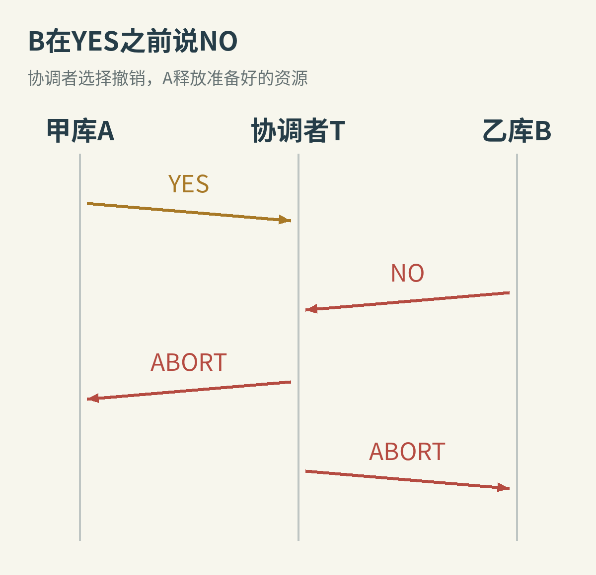

再把模型扩为三方：剑库、宝石库、入场券库。前两方YES，入场券库NO。

三分之二同意，不会让不存在的入场券出现。多数可以帮助一组副本就同一个记录达成一致，但原子提交中，每个参与者代表的可能是不可替代的资源。想提交这笔整体事务，不能忽略任何一个必需参与者。

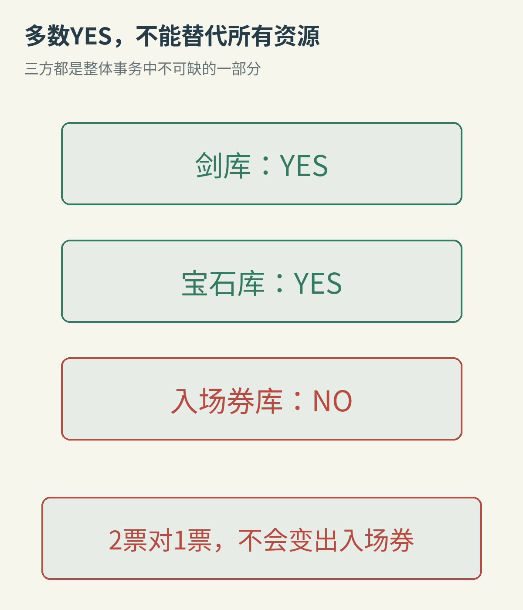

“全部YES”也不是“每个参与者现在可以各自提交”。它只是协调者可以作出提交决定的条件。谁知道全员准备？谁保留最终决定？出了故障又由谁拿出证据？这些问题还在。

## 7. 最难的状态：我已准备，却听不见决定

A已经持久化prepared，也把YES发出。接着协调者失联，A一直没收到决定。

对A来说，至少有两种可能：

- 世界一：协调者已记稳COMMIT，只是消息没送到A。
- 世界二：协调者已记稳ABORT，只是消息也没送到A。

在这两种世界里，A自己的持久状态都可以完全一样：prepared，YES已发，没有最终通知。甚至A和B都已准备、都还没收到决定，也不能单凭这两份本地状态分辨协调者最后记下了什么。

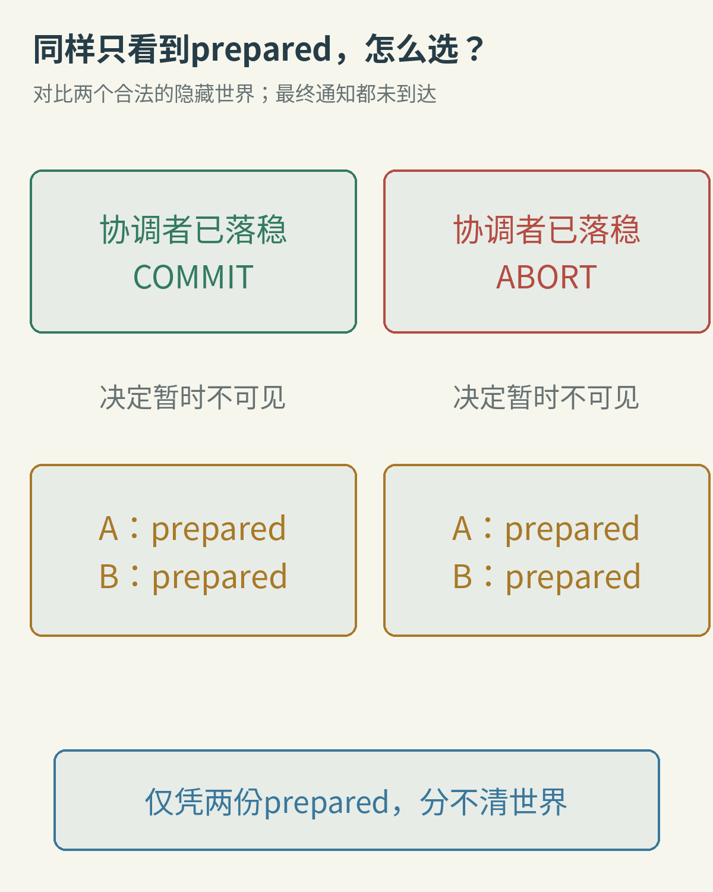

在我们的安全性模型中，协调者尚未作出决定时，可以选择撤销，例如超时策略触发撤销；它不因为“对方也许已经准备”就失去撤销权。但如果已经持久提交，就绝不能再撤销。

这与参与者的处境不对称：参与者一旦承诺YES，就把无条件反悔的自由交了出去。

## 8. 超时后自己撤销，会发生什么？

试着给A加一条看似体贴的规则：“prepared等太久，就自己撤销，别一直占着资源。”

坏事可以这样发生：A发出YES，然后超时自行撤销；它的YES迟一点才被协调者收齐。协调者没有理由知道A偷偷反悔，记稳COMMIT并通知B。于是B提交，A已经撤销。

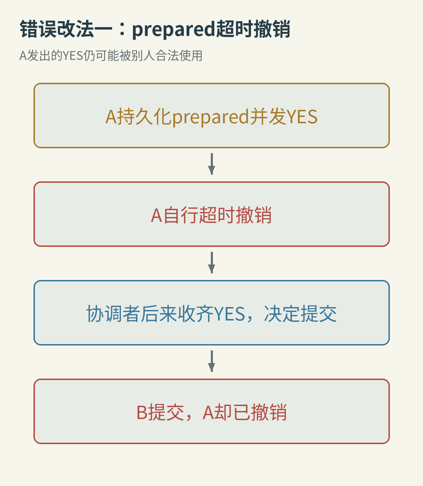

也可以换个顺序：协调者早已决定提交、B也已提交，A的通知却一直丢失。A再自行撤销，仍然破坏一致决定。

那么超时后自己提交呢？也不行。B可能根本无法准备，或者协调者已经决定撤销。prepared不是“成功只差走个形式”，它是一个等待整体决定的状态。

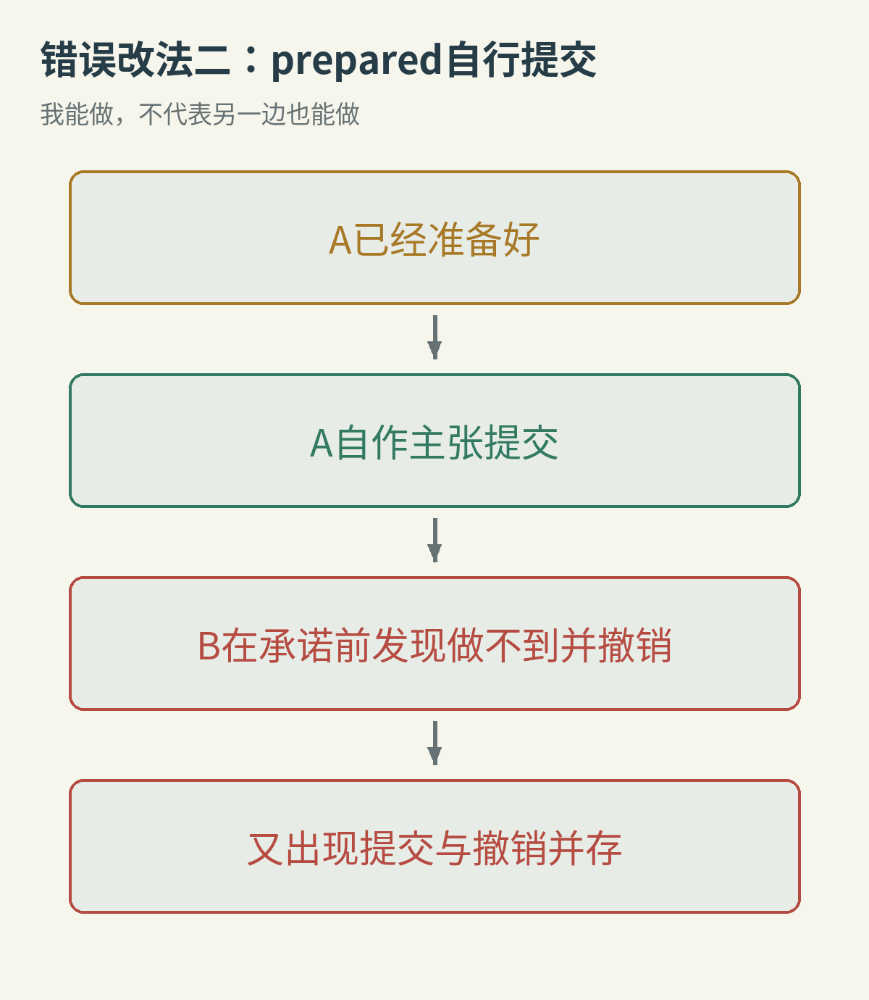

超时能告诉我们“等得比预期久”，不能告诉我们“那台机器的持久日志里必定没有COMMIT”。在允许任意消息延迟的安全性讨论里，沉默不是一个相反决定的证明。

## 9. 什么证据可以结束等待？

最直接的办法是协调者恢复，读回持久决定并重新发送。它重启后不能依赖已经丢失的内存印象。

如果系统实现了合适的结果查询或终止协议，一个已经知道可靠最终决定的参与者，也可能帮助别人获知结果。因此，“协调者一坏，所有事务必定永远卡死”同样是过度概括。

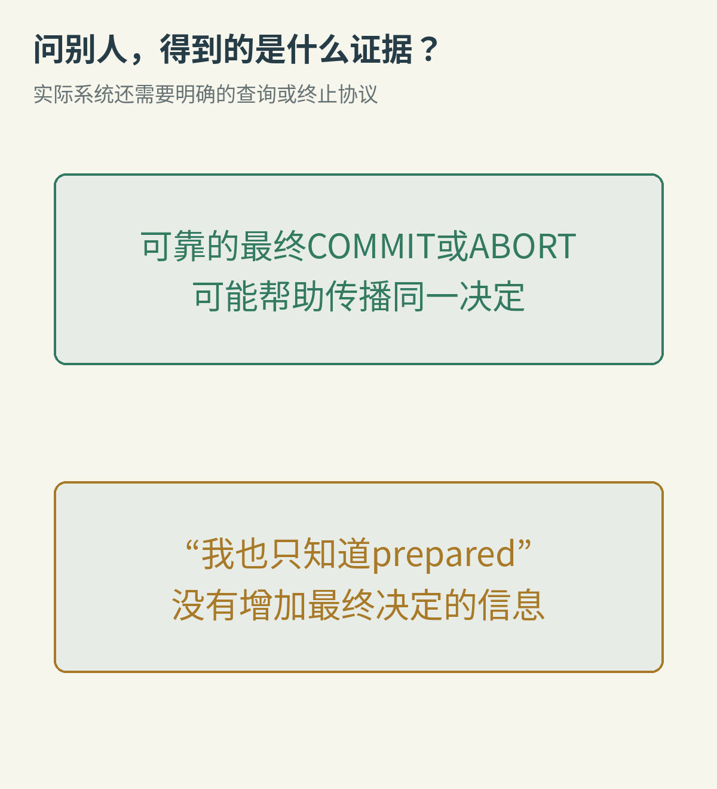

真正麻烦的是：能联系到的人都只知道prepared，找不到任何可靠的最终决定，也无法联系保留决定的协调者。此时经典2PC可能阻塞。它宁愿继续等，也不能随便制造一个与隐藏决定冲突的新结果。

这里“可能阻塞”不是“安全性失效”。算法仍然可以做到没有人作出相反决定，只是无法在这个故障场景下保证参与者及时结束。

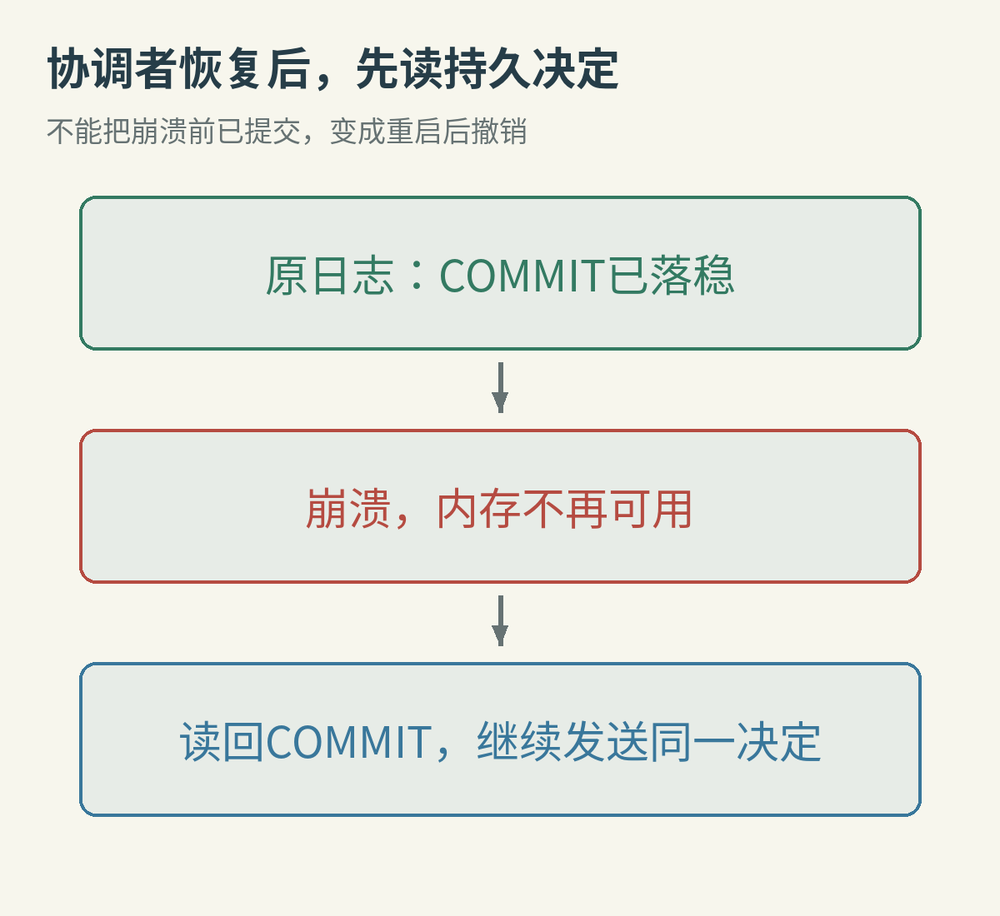

当然，本篇假定持久记录还能读回来。如果决定日志所在介质永久毁坏，或者进程重启后冒充另一个协调者乱发消息，已经超出这个故障模型。增加副本、选主或共识机制能改变某些可用性条件，却需要明确的新协议，不能只把协调者进程多开一个就算解决。

## 10. 一句超时处理，可以暴露整个理解是否正确

下面只是一张状态规则表的代码表达，没有网络或数据库操作：

```python
def timeout_action(state):
    if state == 'W':
        return '可在承诺前撤销'
    if state == 'P':
        return '等待或查询可靠决定'
    return '保留已有最终结果'
```

W表示还在工作、尚未承诺YES；P表示已准备；C和A分别是最终提交与撤销。最后一行仅接受本篇这四种状态，不是通用输入校验。

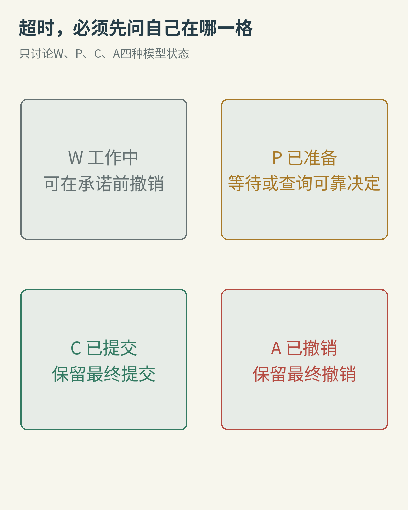

这段小函数不负责执行恢复。它只提醒我们：同样叫“超时”，发生在承诺之前和之后，允许的动作完全不同。工程里不能把一个统一的“超时就回滚”回调贴在所有阶段上。

## 11. 我们怎样实际寻找反例？

配套[两阶段提交模拟器](examples/two_phase_lab.py)显式保存五类信息：参与者状态、谁发出过YES、协调者收到谁的YES、持久最终决定，以及决定是否已经发送。

准备持久化与发送YES是不同动作；决定持久化与发送决定也是不同动作。因此，程序能停在“已经落稳，但还没发消息”的缝隙上。

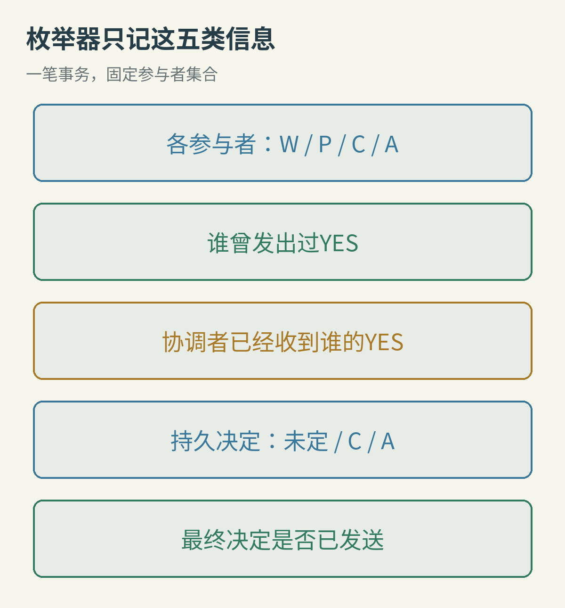

模拟器枚举每一种允许的下一步，并记录出现过的不同状态。它使用“曾经发送的消息集合”，不把消息拿走：接收可以任意推迟，也可以一直不发生；重复消息没有第二张选票。这是安全性模型，不是一个宣称消息必达的网络实现。

节点崩溃在这里抽象为暂停动作，恢复后从同一持久状态继续。没有模拟文件损坏、冒名消息或真实磁盘写一半。能够永久暂停，也就没有偷偷假定协调者一定会按时回来。

对1、2、3、4个参与者，实际分别枚举20、104、602、3668个状态，合计4394个；检查每一步都不会让已结束的状态反转，也没有任何“有人C、有人A”的状态。

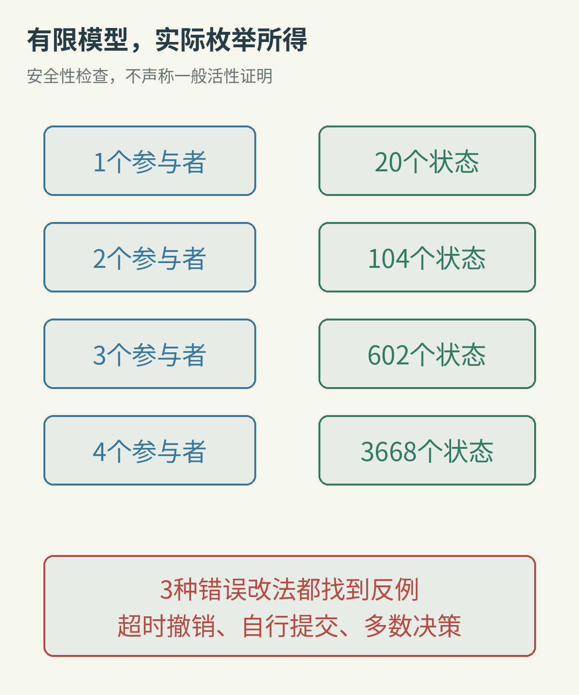

然后分别故意加入三种坏规则：prepared超时自行撤销、prepared自行提交、协调者凭多数YES提交。三种都实际找到了有限反例，程序会打印完整事件序列，前两种用2个参与者就能暴露，最后一种用3个。

作者的有限枚举不是一般正确性证明。更重要的结构性理由是：只有持久化prepared之后才能发YES；发了YES的参与者不再自行撤销；协调者只有收齐所有身份的YES才能提交，且最终决定只能作一次。于是，只要有人最终提交，其他参与者要么仍等待同一个提交决定，要么也已经提交，不会合法地走进撤销。

## 12. 真实数据库里的prepared，会占着什么？

PostgreSQL 18提供`PREPARE TRANSACTION`等接口，供外部事务管理器组织跨资源事务。官方文档明确提醒：prepared事务仍持有原来的锁，长时间遗留会造成实际问题；这个接口不是鼓励应用随手留下待决事务。[官方文档](https://www.postgresql.org/docs/18/sql-prepare-transaction.html)

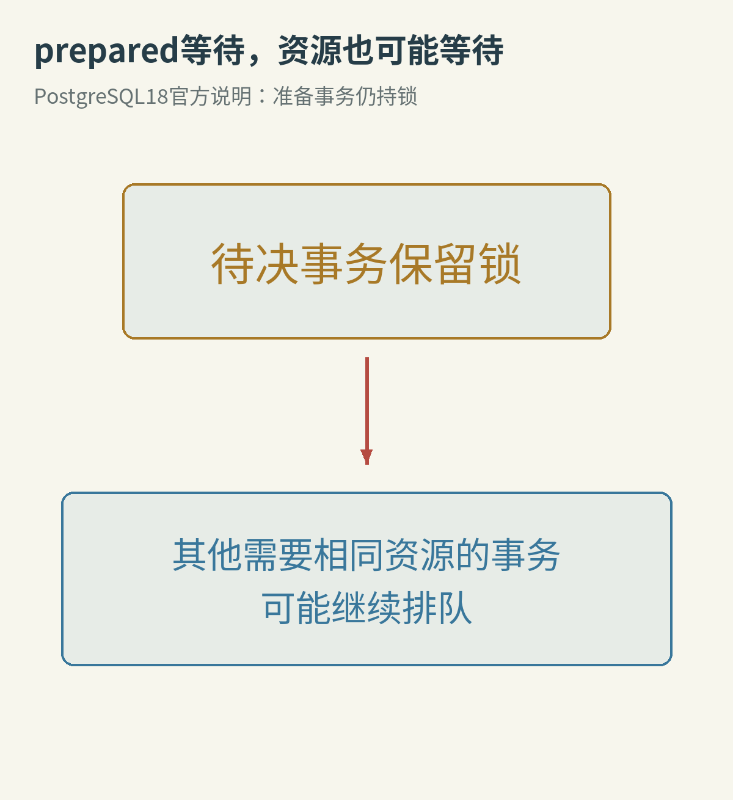

所以“阻塞”不只是屏幕上的一个旋转图标。被占用的行、锁或预留资源，可能让后续相关操作也等下去。一次协议中的等待，会沿着资源依赖传给别人。

本文没有连接PostgreSQL，没有创建真实prepared事务，也没有给出生产环境清理命令。对真实待决事务，看到一个很旧的编号就手动撤销，可能是在不知道整体决定的情况下替系统反悔。应先查清负责这笔事务的管理器和可靠决定。

## 13. 三组容易混淆的词

第一组，2PC与两阶段锁2PL。前者协调提交或撤销的整体决定；后者属于并发控制，讨论锁的获取与释放阶段。名字里都有“两阶段”，不能互相替代。

第二组，原子提交与隔离。原子提交防止参与者作出相反终局；隔离约束其他事务怎样观察与干扰执行过程。具体数据库常让两者配合，但一个协议名不能自动许诺另一层的全部性质。

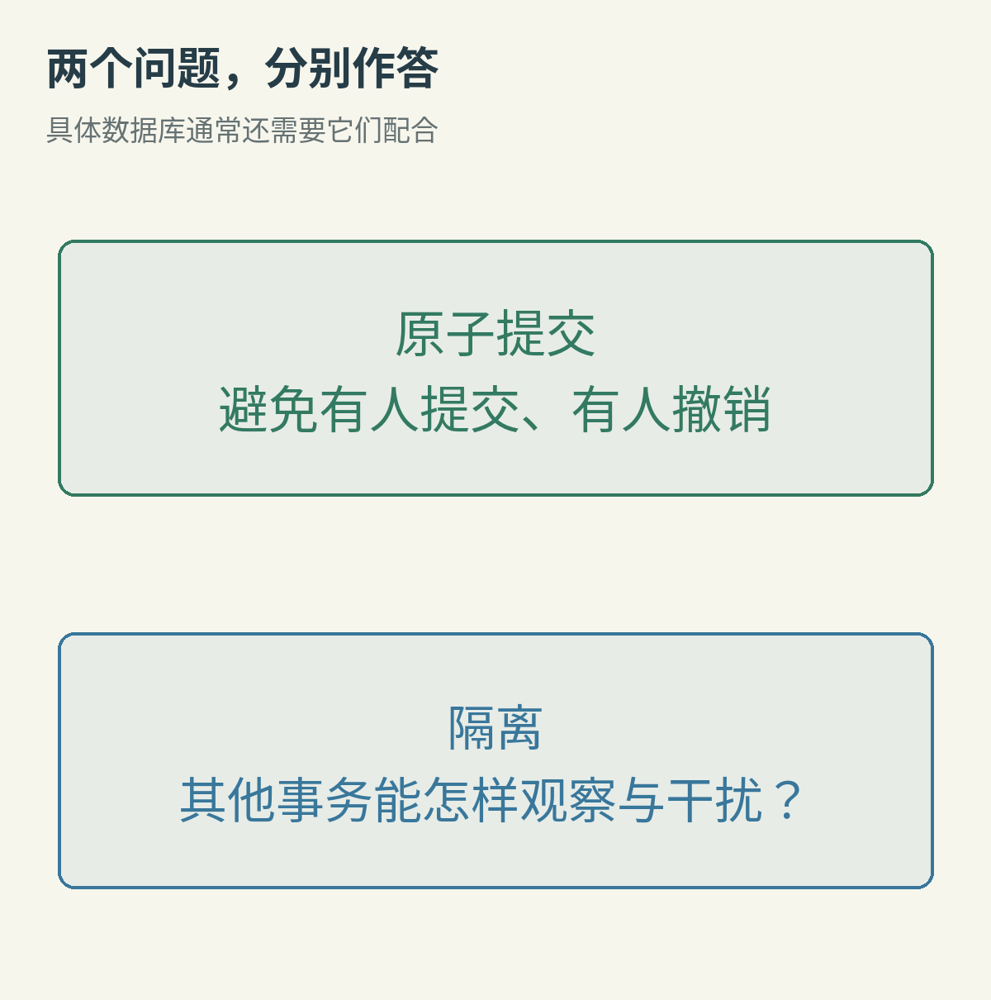

第三组，2PC与共识。共识可以用来复制协调决定，或被组织进更复杂的提交协议；但“多数副本一致”并不等于“所有业务资源都已准备”。Gray与Lamport的论文正是在清楚区分这些角色之后，再分析它们的关系。

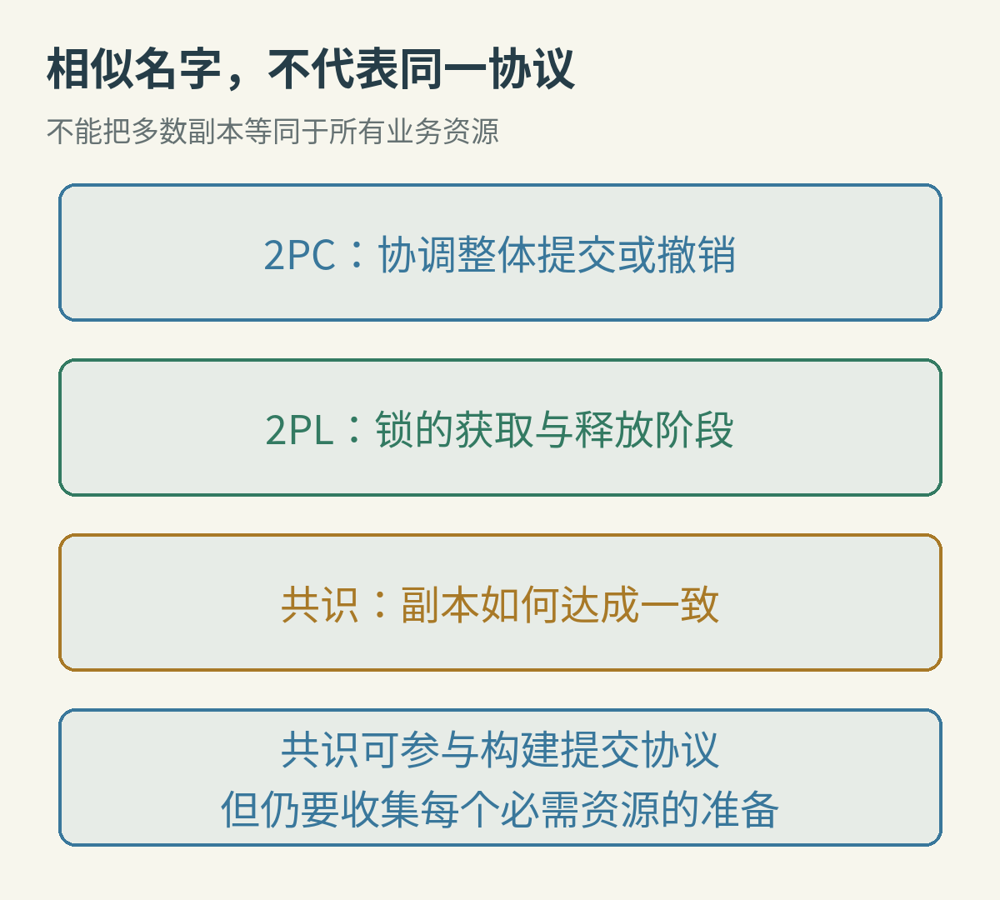

这篇没有展开三阶段提交，也没有声称加一个阶段就能在任意网络分区下解决等待。要作这种判断，需要先重新说明时间、故障、成员和恢复假设。

## 14. 最后一封信没到，故事还没有结束

做一个小练习：A、B都已准备，协调者已经把COMMIT记稳；它刚通知B就崩溃。B提交了，A仍是prepared。

现在A等了十分钟，能自行撤销吗？不能。时间再长，也不会把B已经完成的提交变成没发生。

如果协调者恢复，读到了COMMIT，应该做什么？继续传播同一个提交决定，而不是重新发起一轮多数投票。

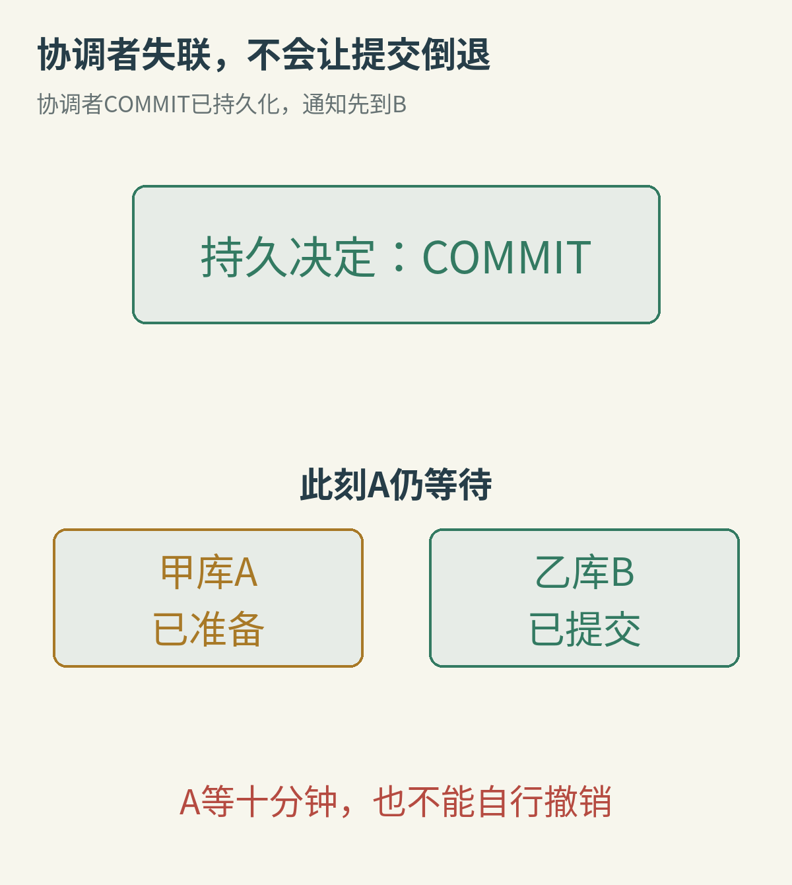

下图把正常路径的持久状态与消息步骤逐一展开。它来自配套程序的11个实际状态，动画间隔只是帮助阅读，不代表网络耗时。

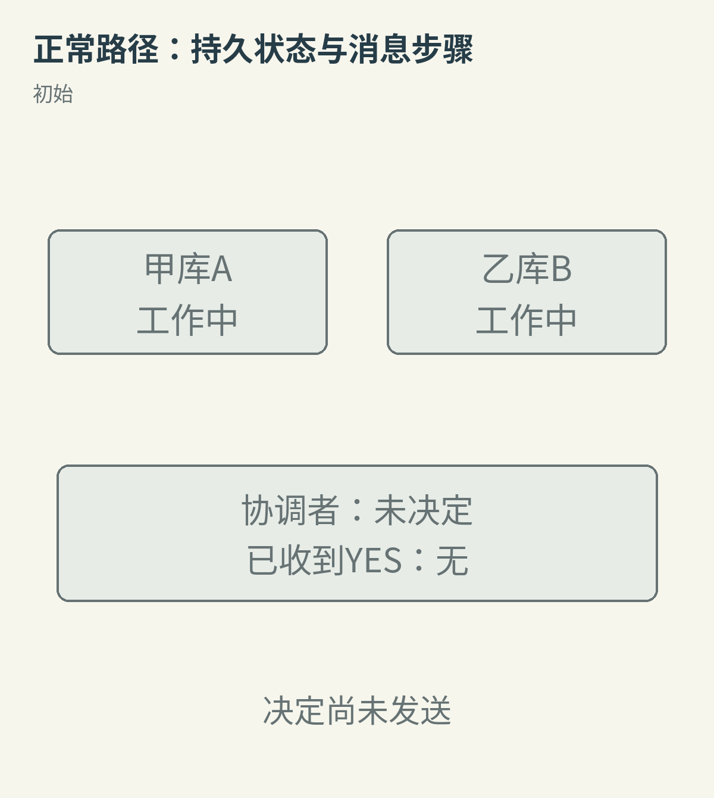

两阶段提交教给我们的，是一种很具体的克制：承诺前，可以说不；作出有持久证据的YES之后，就必须把自己的后续行动，约束在同一个整体决定之内。

它没有让故障消失，也没有让沉默变成知识。它把最危险的那句“我猜应该没事”，换成了可以追问的三个问题：你现在处在哪个状态？你已经对别人承诺了什么？最后决定的可靠证据在哪里？

---

原创正文与原创教学示意CC BY 4.0；两幅第三方照片按各自许可，代码MIT。完整原始来源、素材权利、模型与实际测试范围见[来源说明](sources.md)。
