# 没有试跑一次，它怎么知道类型错了？Hindley–Milner 把代码变成等式

一个函数把收到的东西原样交回来。你给它整数，它还你整数；给它真假值，它还你真假值。代码里没有写“整数”或“真假”，编译器却能描述它的类型。

更奇怪的是：把这个函数起个名字，再分别用于两种输入，可能完全合法；把“一个函数”作为参数传进来，在函数体里做同样两次调用，却可能被拒绝。

电脑凭什么区别对待？它是不是偷偷试跑了几组输入？

我们来做一次纸上侦探。这里不需要先学编译原理，也不需要会证明定理。只要愿意给未知量起名字，再把几条必须同时成立的等式对齐，就能看见一种经典类型推导方法的骨架。

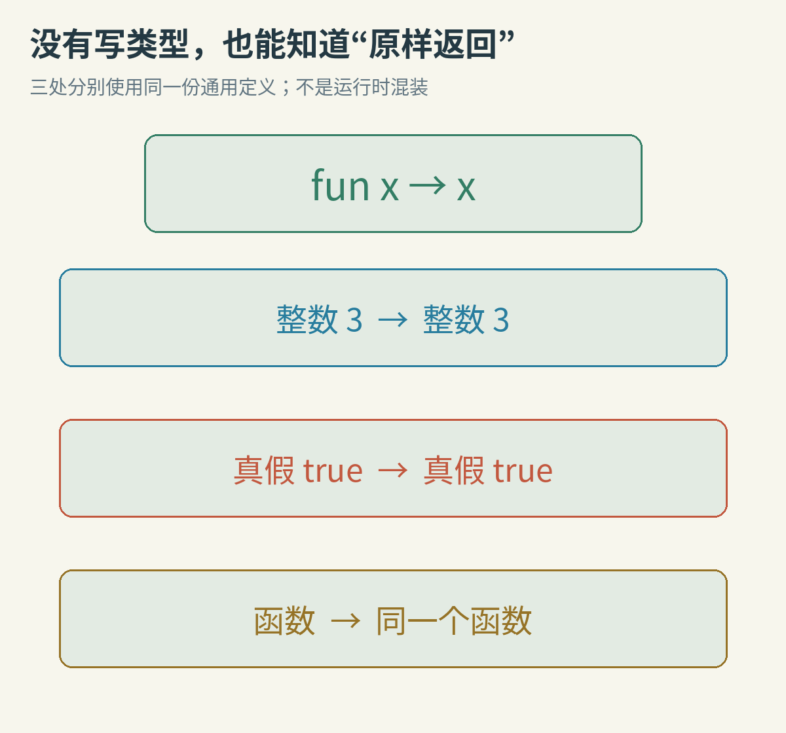

*原创教学示意。三个例子各自使用这份函数定义；图中说的是输入与输出的类型关系，不是把三种值混进一个未说明规则的容器。*

## 1. 一个为证明服务的语言，为什么关心普通程序的错误？

1982年，Luis Damas 和 Robin Milner 在论文《Principal type-schemes for functional programs》开头回顾：ML 最初是 LCF 证明系统里用来进行证明的元语言。“元语言”在这里可以先理解为：写程序来组织和操作证明过程的语言。ML 的名字就来自 metalanguage。

这样的工具需要两种看似拉扯的能力。一方面，函数要灵活，最好同一套操作能处理多种类型；另一方面，错误应尽早暴露，不该等复杂的证明工作运行到一半，才发现某个位置拿到了不合要求的东西。

这条历史线并非只有一个人的名字。1969年，Roger Hindley 在组合逻辑中研究主类型方案；他在原文中也说明，相关主要结果由他与 Haskell Curry 几乎同时、独立地证明。1978年，Milner 研究程序中的类型多态及其可靠性。1982年，Damas 与 Milner 进一步回答一个关键问题：对论文限定的纯函数核心，算法能否找出**最一般的合法类型方案**，而不是随便找到一个过分狭窄的答案？

今天常说 Hindley–Milner，简称 HM。名字是路标，不能把 Damas、Curry 或更早的统一算法工作从历史中擦掉。我们接下来实现的是一个很小的 HM 教学语言，也不会把现代 ML 家族的所有特性都算进去。

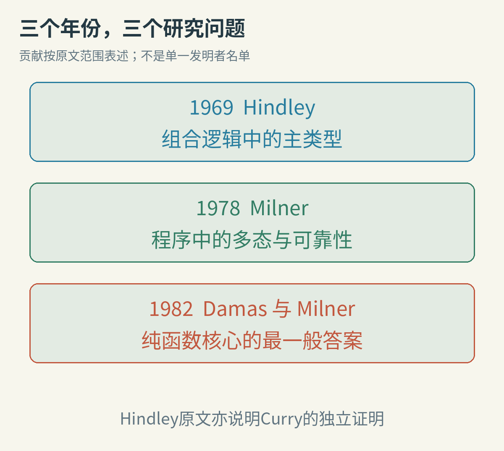

*原创历史问题图。1969条目特指组合逻辑；1982条目特指论文的纯函数核心。不是“三个人依次独自发明整个编译器”的时间线。原论文和人物原站查看链接见文末来源。*

## 2. 先分清：值是东西，类型是它必须遵守的接口

为了把问题缩小，我们约定一种教学语言。它只有整数 Int、真假值 Bool、函数，以及由两个值组成的二元组。没有自动类型转换，没有加号重载，也没有可变变量或递归。

3 是一个值，Int 是它的类型。true 是一个值，Bool 是它的类型。

`Int -> Bool` 表示一种函数类型：收到整数，给出真假值。箭头说的是接口，没说具体计算过程。判断整数是否为零，与判断它是否大于十，都可能符合这个接口。

`(Int * Bool)` 在本文表示二元组类型，例如把一个整数和一个真假值放在一起。这里的星号不是乘法。

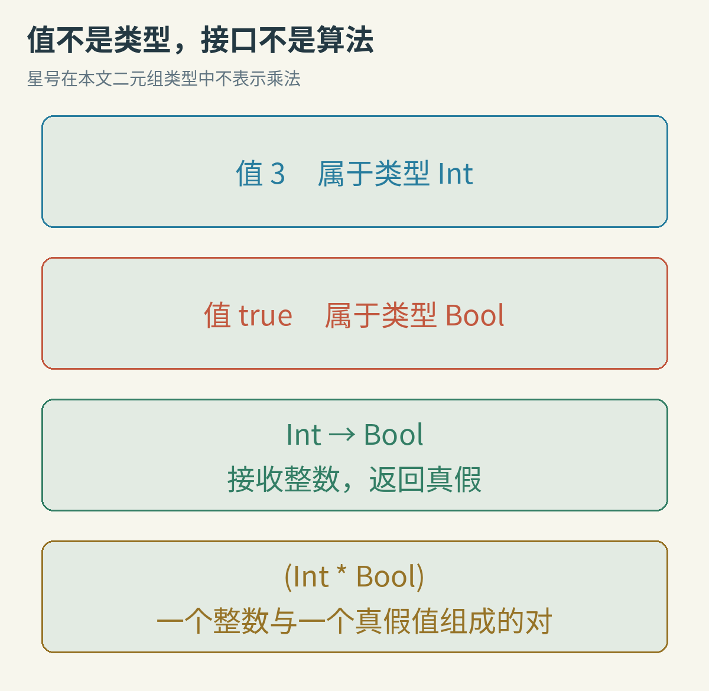

我们用 `fun x -> x` 写“收到 x，原样返回 x”。它没有要求 x 必须是整数，所以先别替它做决定。给 x 的未知类型起一个名字，叫 a。

输入的类型是 a；返回的就是 x，所以输出类型也是 a。于是整个函数的类型关系是 `a -> a`。

注意两个 a 是**同一个未知量**。它不是“输入随便一种，输出另外随便一种”。如果后来把 a 选成 Int，两处都得变成 Int；若选成 Bool，两处都得一起变。

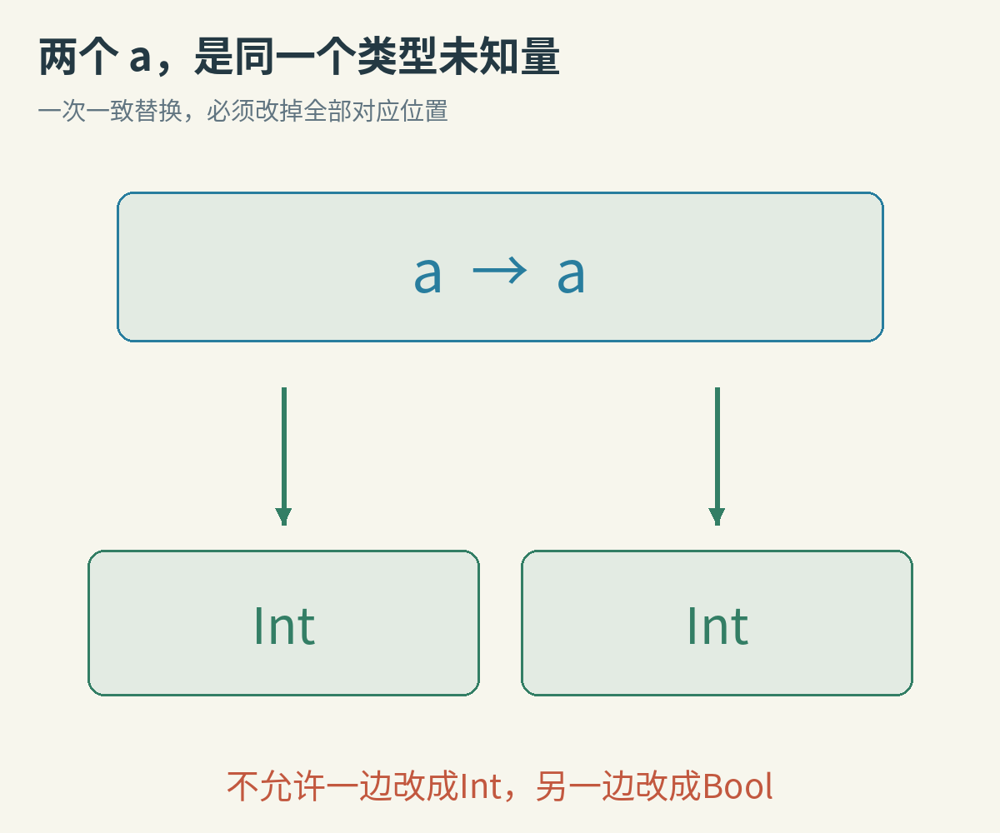

这也不是一种名叫“什么都可以”的运行时类型。a 是类型推导里的占位符；它能不能在不同使用处重新选择，要看后面介绍的绑定规则。

## 3. 一次调用，就能留下一条证据

假设还不知道 f 的类型，也不知道 x 的类型。先分别记作 p 和 q。

现在代码写了 `f x`，也就是把 x 交给 f。给这次调用的结果再起一个类型名 r。

仅凭“发生了一次函数调用”，就有一条必须成立的等式：

`p = q -> r`

原因很直接：f 得是一个接收 q、返回 r 的函数。即使一个具体输入都没给，程序结构已经透露了接口关系。

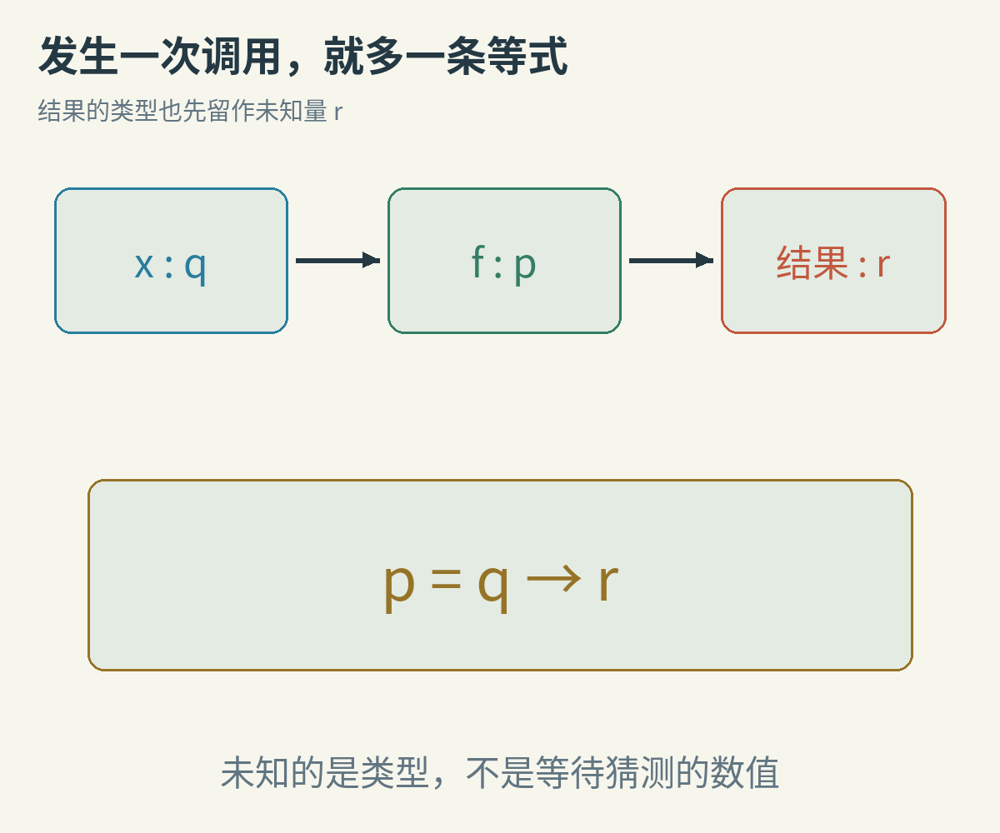

如果后来发现 p 是 `Int -> Bool`，那么 q 必须是 Int，r 必须是 Bool。如果同时又从别处得知 q 是 Bool，在我们的语言里两条证据就冲突了。

类型推导的第一步，是把代码的结构变成这些约束；第二步，是让所有约束同时成立。编译器没有预测运行结果，它在核对接口能否接上。

## 4. 用一个真正有意思的函数手算

定义 twice：把同一个函数对一个值连续用两次。

```text
fun f -> fun x -> f (f x)
```

先读内层 `f x`，再把结果交给外层 f。这里的两个 f 来自同一个参数绑定。

如果 f 是“整数加一”，twice 就把一个整数加二；如果 f 是“把真假翻转”，twice 就翻转两次。它并不因此可以接收任意接口的函数：例如“整数变真假”用完一次以后，第二次还接得上吗？

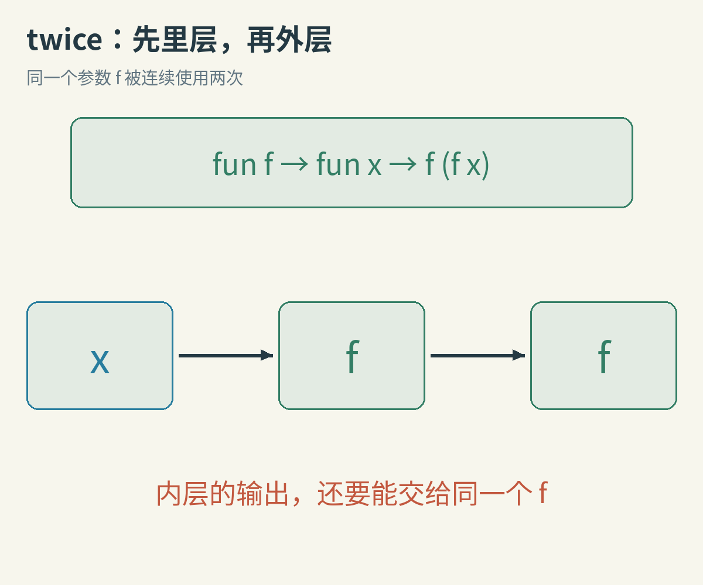

先把不知道的类型写下来：

- f 的类型：a
- x 的类型：b
- 内层 `f x` 的结果类型：c
- 外层 `f (f x)` 的结果类型：d

这些小写字母代表类型，不代表运行时的数值。c 也不是计算出来的“中间数字”，而是中间结果应有什么类型。

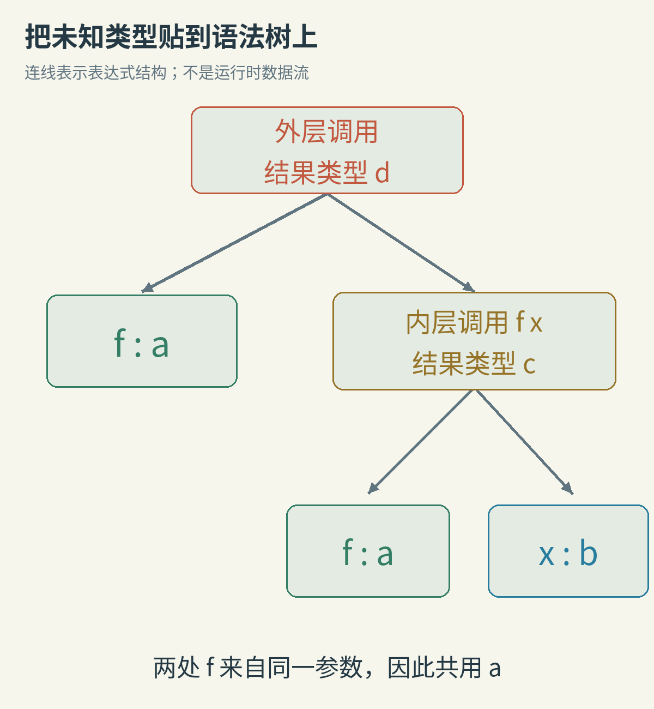

内层调用要求：`a = b -> c`。

外层调用仍使用同一个 f，输入却是刚才的结果 c，所以要求：`a = c -> d`。

把两条合在一起：`b -> c = c -> d`。

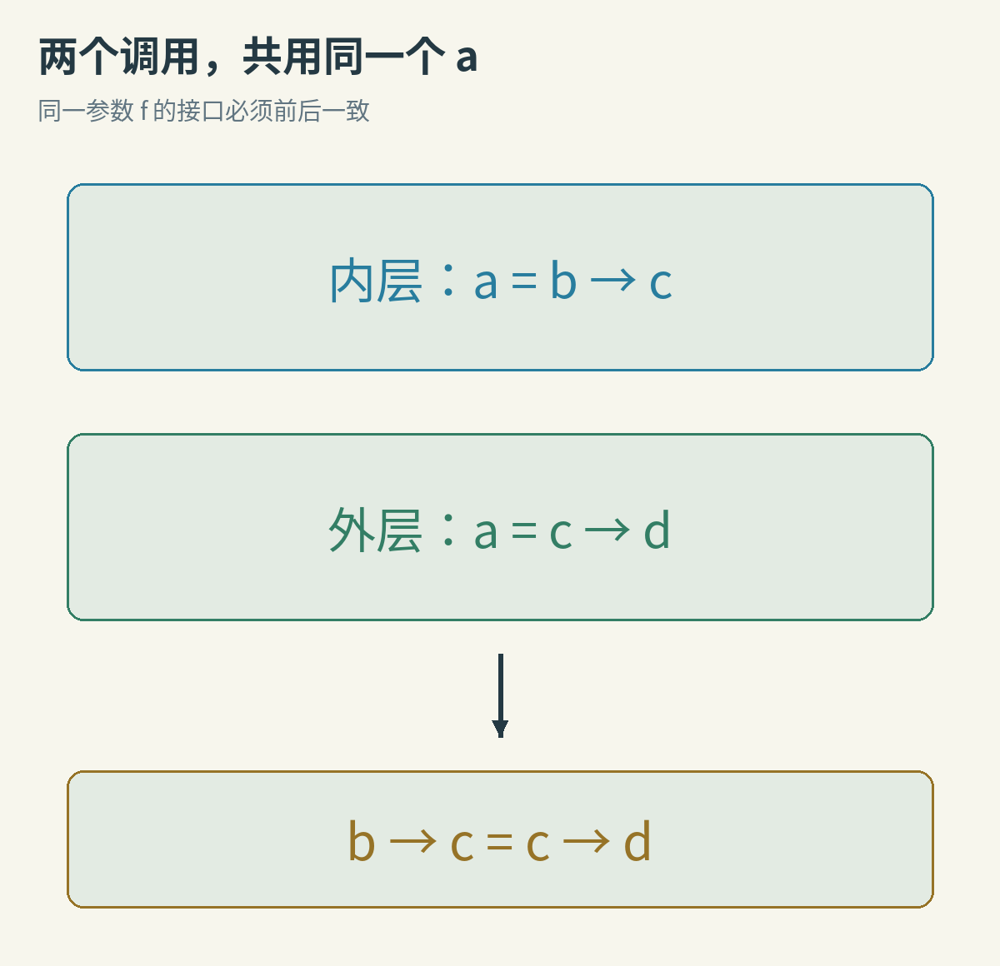

两个箭头类型相等，就要求对应位置相等：左边输入 b 等于右边输入 c；左边输出 c 等于右边输出 d。

因此 b、c、d 必须是同一种类型。f 的输入和输出也必须相同。

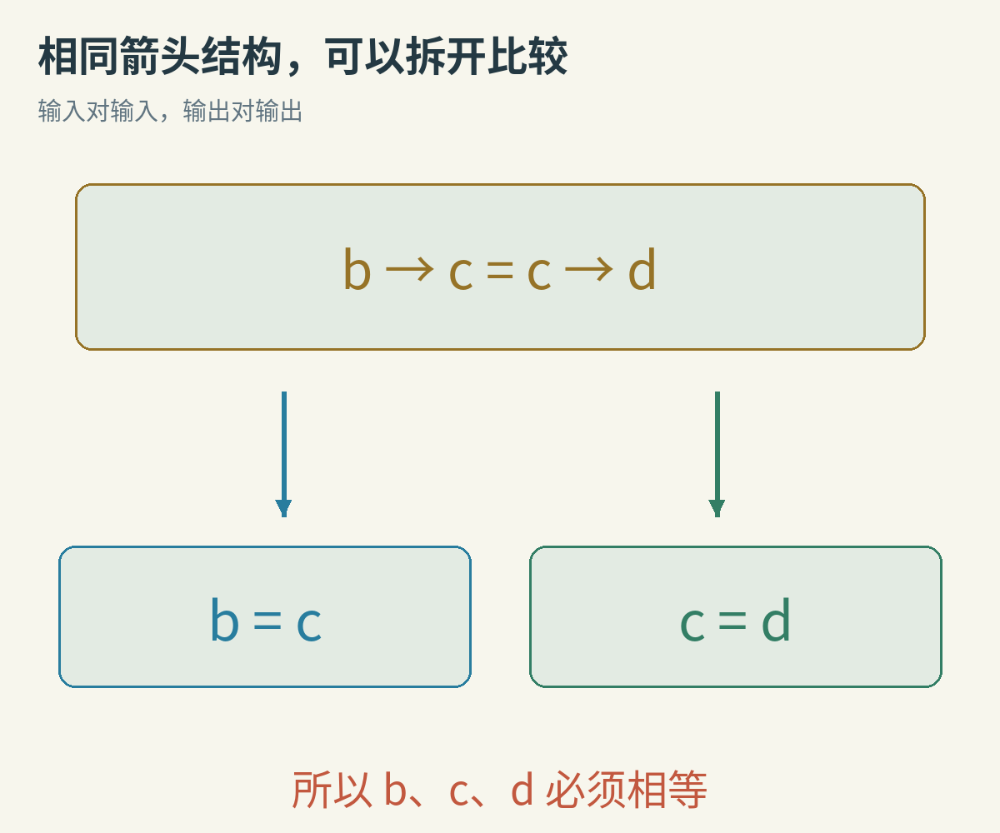

把这份结果写回去：f 是 `b -> b`，x 是 b，最终结果也是 b。

twice 先接收一个函数，再接收一个值，于是得到：

`(b -> b) -> b -> b`

箭头默认向右结合：它等于 `(b -> b) -> (b -> b)`。外面那一对括号非常重要，说明第一个参数本身是函数。为了名字简洁，也可以把这里所有 b 一起改名为 a；含义没有变化。

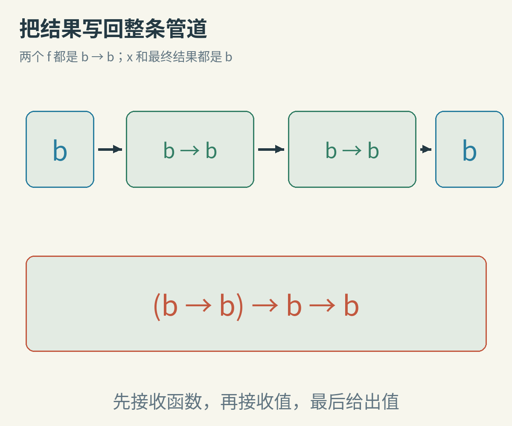

这时再看“整数变真假”的函数就很清楚了。它的接口是 `Int -> Bool`，而 twice 要求的是某个 `b -> b`。要接上，就必须让 b 同时等于 Int 和 Bool；本教学语言把它们视为不同类型，所以拒绝。

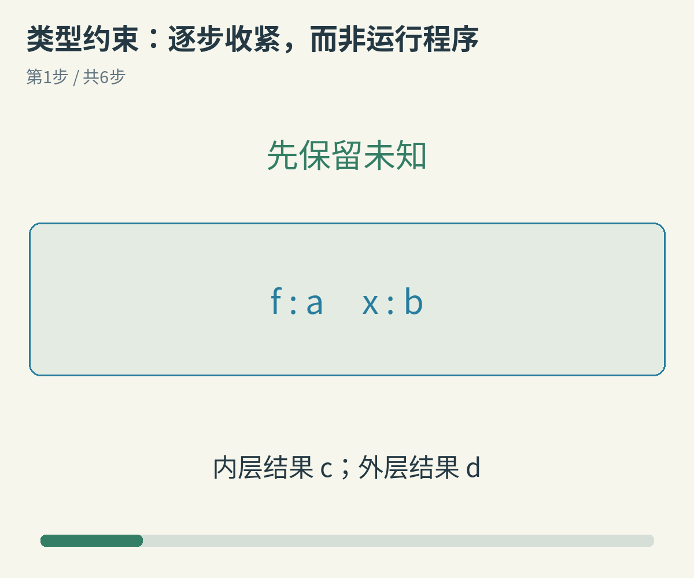

*原创约束动画。它按刚才的手算顺序展示信息如何收紧，不是编译器性能测试，也不是程序运行过程。静态图保留了每个关键步骤，不看动画也能完整推导。*

## 5. 为什么不能干脆选成整数？

`(Int -> Int) -> Int -> Int` 的确是 twice 的一个合法具体类型。但如果推导器到此为止，它就把“真假翻转两次”这种合法用法无缘无故排除了。

更一般的答案是 `(a -> a) -> a -> a`。把 a 一致替换成 Int、Bool，甚至函数类型或二元组类型，就得到不同的合法实例。

**主类型方案**想表达的正是这种“保留所有允许的选择，同时不放进非法选择”的答案。在这里讨论的 HM 规则内，其他合法的具体类型都能由它做一致替换得到。它并不是把限制全部删掉：`a -> a` 中输入与输出相同，这条关系仍然牢牢保留。

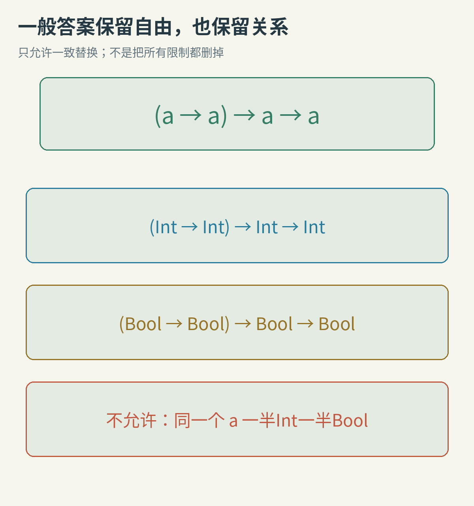

1982年论文的关键问题，现在变得可感知了：算法不只要避免接错接口，还不能因为自己推得太保守，拒绝本来合法的程序。论文给出了算法 W 在所述系统中的可靠性和完备性结果；我们的几段代码和有限测试当然不能代替那个一般性结论。

## 6. 统一：拆结构、替未知量、拒绝冲突

刚才把两套类型表达式变得相同的工作，叫**统一**，英文 unification。这个名字容易让人误会成“强行把不同类型转换成一种”；它不做数值转换，只寻找满足等式的类型替换。

可以把它缩成四个动作：

1. 两边已经一样，什么也不改。
2. 一边是未知量，就尝试用另一边替换它，并把结果传播到后续约束。
3. 两边都有相同结构，例如都是箭头，就比较对应的内部部件。
4. 结构冲突，例如 Int 与 Bool，或 Int 与一个箭头类型，就报告失败。

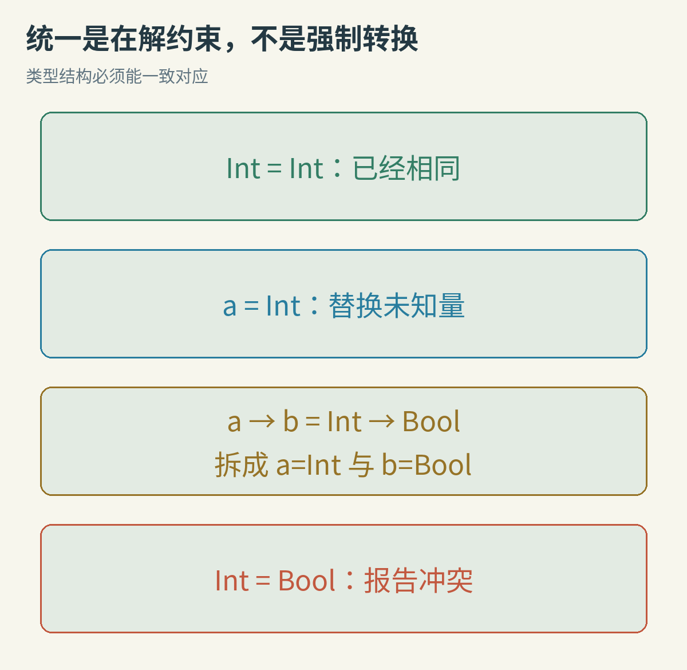

“传播”这一步不能省。如果先知道 a=b，后来又知道 b=Int，那么最后 a 也得变成 Int。两份替换要按发生顺序组合，不能仅仅把两个字典拼在一起就以为完成了推导。

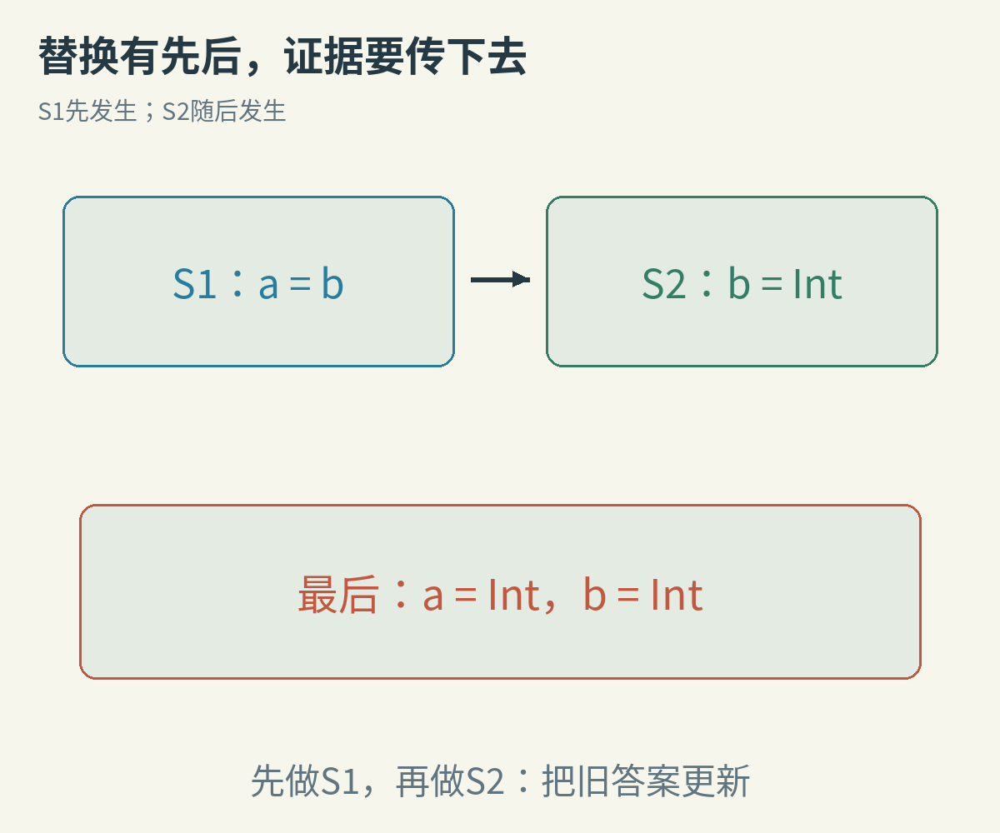

还有第五个很小、却会改变答案的检查：未知量不能被替换成一个包含它自己的、更大的有限类型。先记住这条，稍后用一个反例看它为什么必要。

## 7. 终于回到开头：为什么起名字之后更灵活？

看这段程序：

```text
let id = fun x -> x in
    (id 3, id true)
```

let 在这里把 id 绑定到一个定义；in 后面是使用这个名字的范围。它不是修改可变变量。

推导器先为定义找到 `a -> a`。如果 a 不受外部环境限制，就可以把它记成一份可重用的类型方案：`forall a. a -> a`。forall 的意思是“对这里允许选择的每一种 a”；并不是让一个 a 在同一次使用里前后变成两种类型。

每次在后面的表达式中使用 id，推导器会为方案里的 a 换一个**新的类型变量**。

第一次使用得到 `b -> b`，与整数3对齐，b=Int。第二次使用得到 `c -> c`，与true对齐，c=Bool。b 和 c 不互相牵连，最终二元组类型是 `(Int * Bool)`。

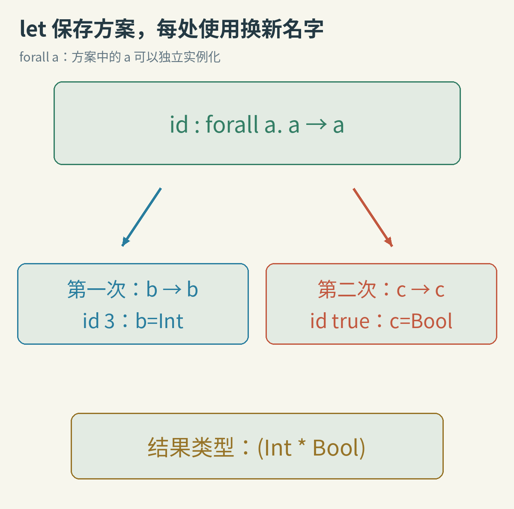

这叫**实例化**。新的是类型推导的占位符，不是在这里宣称编译器复制了两份机器码，更不代表运行时克隆了两个函数对象。代码生成怎样实现多态，是另一层问题。

再看外形相似的版本：

```text
fun f -> (f 3, f true)
```

这里的 f 是函数参数。在本文的 HM 规则里，给这个参数登记的是一份尚待确定、但必须前后一致的类型，不是一个每次使用都可重新实例化的多态方案。

第一次调用要求它接收 Int；第二次要求同一个接口接收 Bool。这两条约束冲突，于是被拒绝。

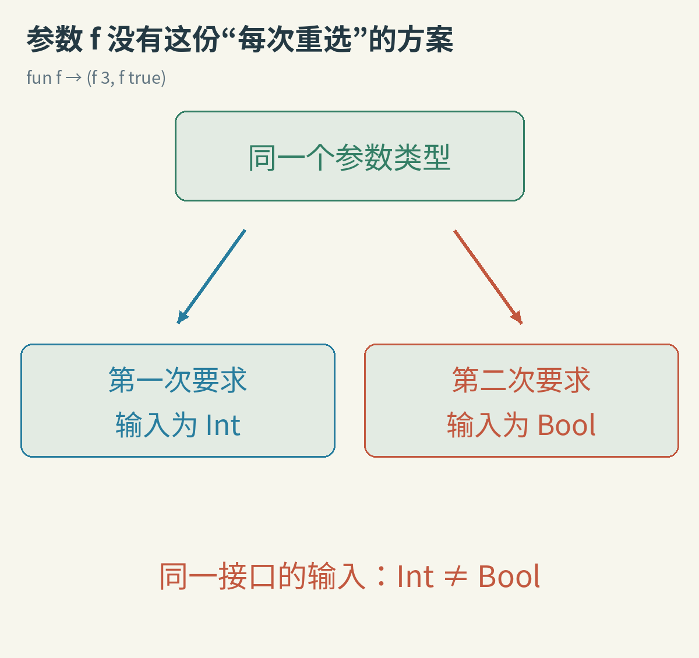

这不等于“传入的那个函数实际上一定做不到”。人可能知道某个具体函数很通用；其他类型系统也可以借助显式标注表达更高阶的多态。结论只是：**按照本文的这套隐式、秩一 HM 规则，参数 f 没有获得那种使用许可。**

这里的“秩一”可以先理解为：类型方案里的 forall 只在最外层概括变量，没有把任意多态方案直接放进函数参数的类型里。

程序长得相似，不代表类型规则必须一样。先看名字是怎样绑定的，再看它怎样使用，开头的谜题就解开了一半。

## 8. 哪些未知量可以自由选择？先问它是不是借来的

不能看到 let，就把定义中所有未知类型都变成“每次使用随便选”。考虑：

```text
fun x ->
    let k = fun y -> x in
        (k 3, k true)
```

k 不管收到什么 y，都返回外层的 x。

假设 x 的类型是 a，y 的类型是 b，那么 k 的类型是 `b -> a`。b 只属于这段新定义，可以在不同使用处分别选为 Int 或 Bool；a 却来自外面。两次 k 返回的都是同一个外层 x 的值，不能一处假定它是整数，另一处又假定它是真假值。

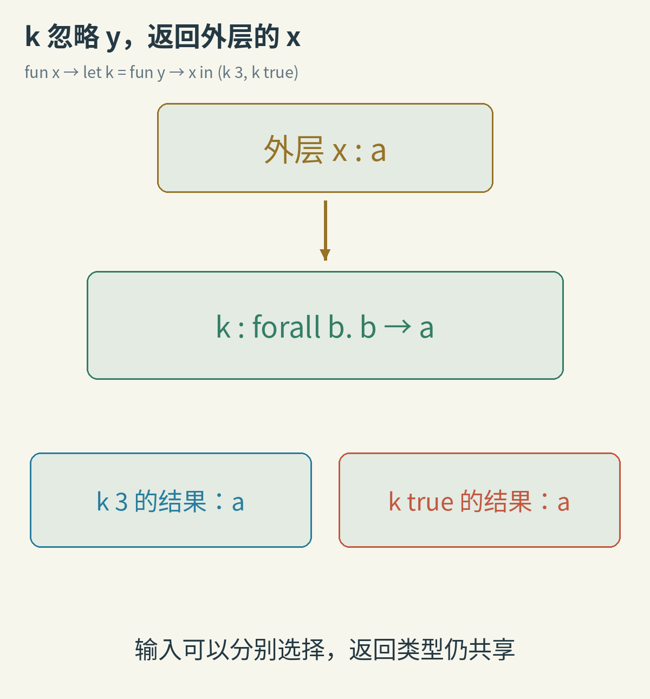

因此 k 的方案是 `forall b. b -> a`，只概括 b，不概括 a。整个外层函数的类型是 `a -> (a * a)`，两个结果的类型必须一致。

这里的“环境”是静态类型名册：记录当前可见名字已有的类型假设。它与闭包执行时携带的运行时环境有关联，但两者不是同一个存储结构，更不能把类型变量当成实际捕获的内存地址。

规则可以写得非常短：

**可以概括的类型变量 = 新定义类型里的自由变量 − 当前环境里的自由变量。**

“自由”在这里是说，变量尚未被某个 forall 在类型方案内部绑定。把集合差看成“去掉借来的部分”就容易记住。

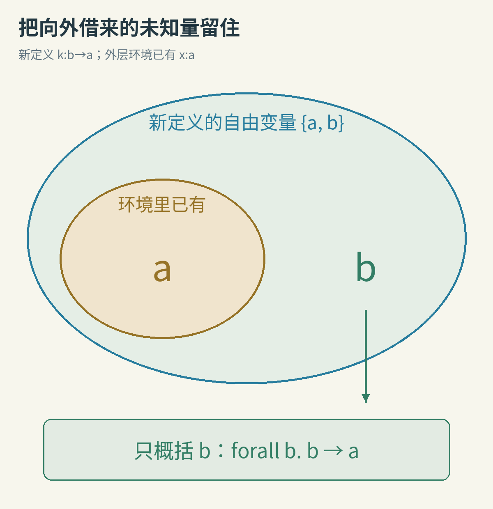

如果错误地连 a 也概括了，就可能让一处 `k 3` 被当作整数拿去加一，另一处 `k true` 被当作 Bool 拿去取反。同一个外层 x 被赋予互相矛盾的接口，错误就这样溜进去了。配套实验专门包含这个应被拒绝的例子。

## 9. 函数为什么不能这样调用自己？

看 `fun x -> x x`。左边的 x 被当作函数，右边的 x 又作为参数传给它；它们来自同一个参数绑定。

给 x 的类型记作 a，调用结果记作 b，就要求：`a = a -> b`。

试着替换看看。a 变成 `a -> b`，里面还有 a；再展开，又多出一层。无论展开多少次，都装不进一棵有限的类型树。

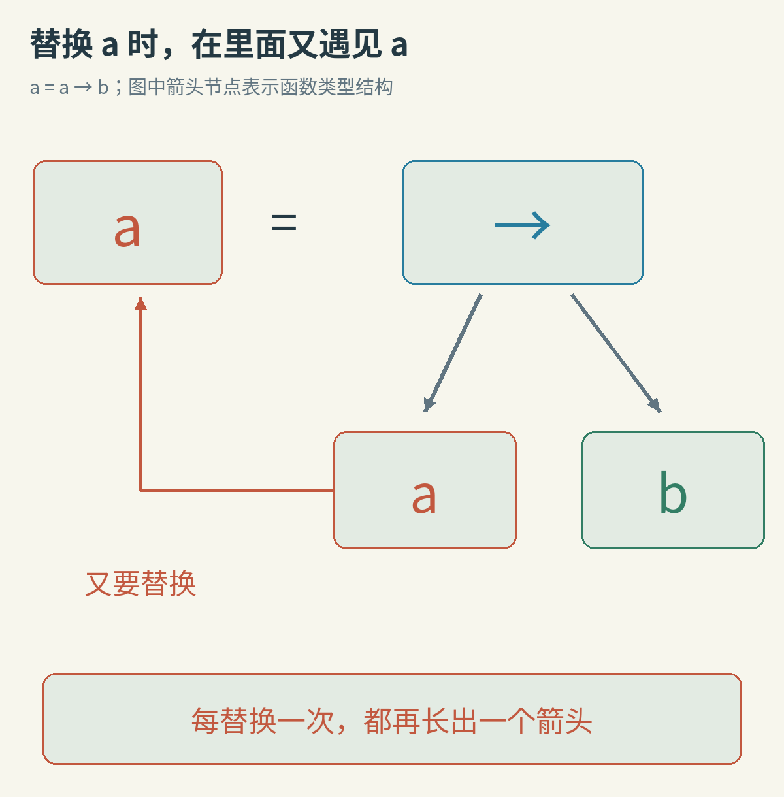

检查“a 是否出现在准备替换给它的类型内部”，就叫**出现检查**，英文 occurs check。在这里，发现了就拒绝。它防止算法把无限展开误当成一个普通答案。

这不是宣称所有语言都不允许递归类型；有些类型系统专门定义了它们的规则。只是本文的 HM 类型是有限结构，不能偷偷换一套问题来绕开检查。

但现在请小心另一段：

```text
let id = fun x -> x in id id
```

它可以通过！左边 id 的类型先实例化成 `b -> b`，右边 id 另一次实例化成 `c -> c`。调用只要求 b 等于 `c -> c`；b 并不出现在右边，所以不会形成自我包含。结果的类型仍是 `c -> c`。

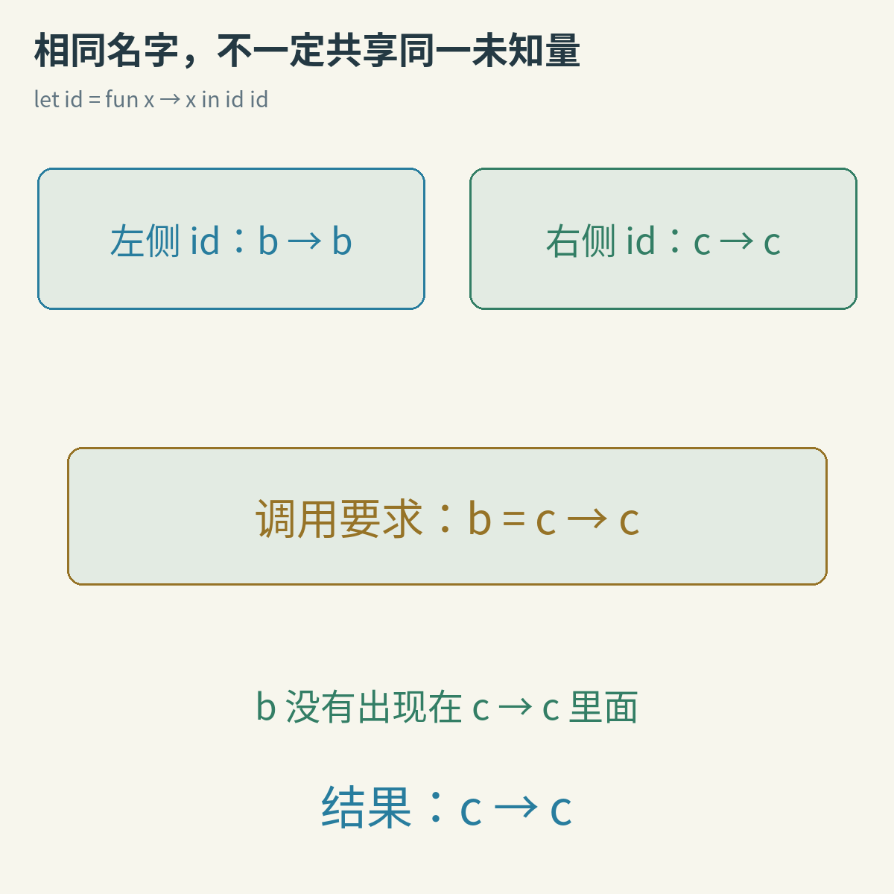

所以不能把规则记成“函数用到自身名字就错了”。真正的依据是：哪些位置共享未知量？统一时产生了哪条等式？有没有形成环？名字相同不等于所有类型占位符都相同。

## 10. 算法 W 怎样把这些小规则串起来？

W 不是另一个神秘的数学对象，而是一条沿语法树递归走下去的工作路线。名字 W 来自经典论文，我们这里用自己的小程序实现这条思路。

遇到字面量，就登记约定好的类型；遇到变量，就从名册取方案并实例化。遇到函数定义，给参数一个新未知量，进入函数体推导，再拼回输入与输出的箭头。

遇到调用，先推导函数部分，再带着已经得到的替换去推导参数部分，然后统一接口。遇到 let，先推导定义、更新环境，概括不受环境限制的变量，再推导后续表达式。

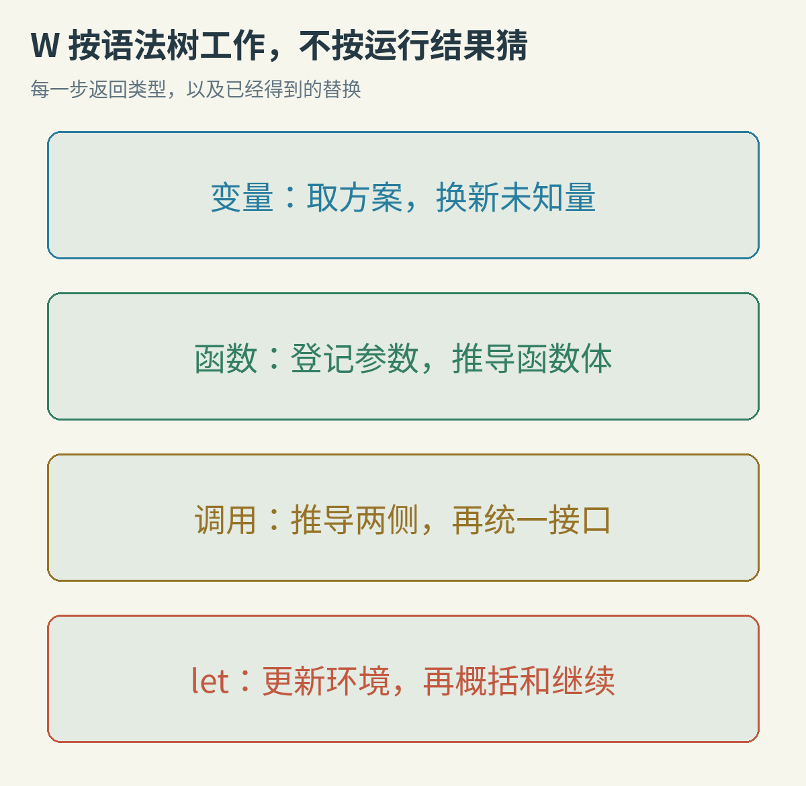

下面是配套代码中“调用”这一步的原样节选。即使暂时不想写代码，也能逐行对照第3节的 `p = q -> r`。

```python
s1, tf = self.w(env, f)
s2, tx = self.w(apply_env(s1, env), x)
result = self.fresh()
s3 = unify(apply(s2, tf), arrow(tx, result), self.trace)
return compose(s3, compose(s2, s1)), apply(s3, result)
```

s1、s2、s3 是逐步得到的类型替换；tf 是函数部分的类型，tx 是参数类型，result 是结果类型的新未知量。compose(newer, older) 的约定是先做 older，再做 newer。对环境和旧类型应用新替换，是为了不遗忘已经收集到的证据。

完整的 [infer_lab.py](examples/infer_lab.py) 只依赖 Python 标准库。输入使用 Var、Lam、App、Let、Pair 等构造器组成的小语法树，没有把真实语言的解析器偷偷省略后仍声称能检查任意 Python 或 OCaml 文件。它输出类型或冲突，**不执行这棵输入语法树**。

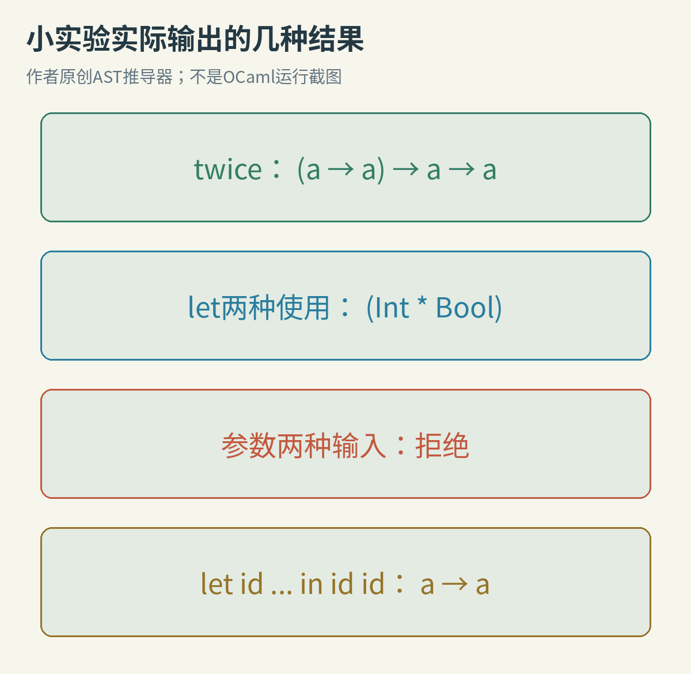

作者实际运行了10个具名案例，又用一份可变图实现与这份显式替换实现交叉比较。所有大小1至9的有限范围闭合纯lambda项，以及固定种子的20000棵随机小语法树，都检查了接受/拒绝和接受时的类型是否一致。具体数量、种子与方法在来源说明；[check_lab.py](examples/check_lab.py) 可以重跑。

两份实现可能共享理解上的错误，所以这仍然是有限测试，不是可靠性定理的证明。它的用途是让手算、代码和图里的例子彼此核对，也让“我觉得应该没错”变成读者可以检查的东西。

## 11. 再做一个管道，把答案留给自己推出来

这次不重复同一个函数，改成先用 g，再用 f：

```text
fun f -> fun g -> fun x -> f (g x)
```

让 x 的类型是 a，g 的结果类型是 b，f 的结果类型是 c。于是 g 必须是 `a -> b`，f 必须是 `b -> c`。

整个组合函数的类型是：

`(b -> c) -> (a -> b) -> a -> c`

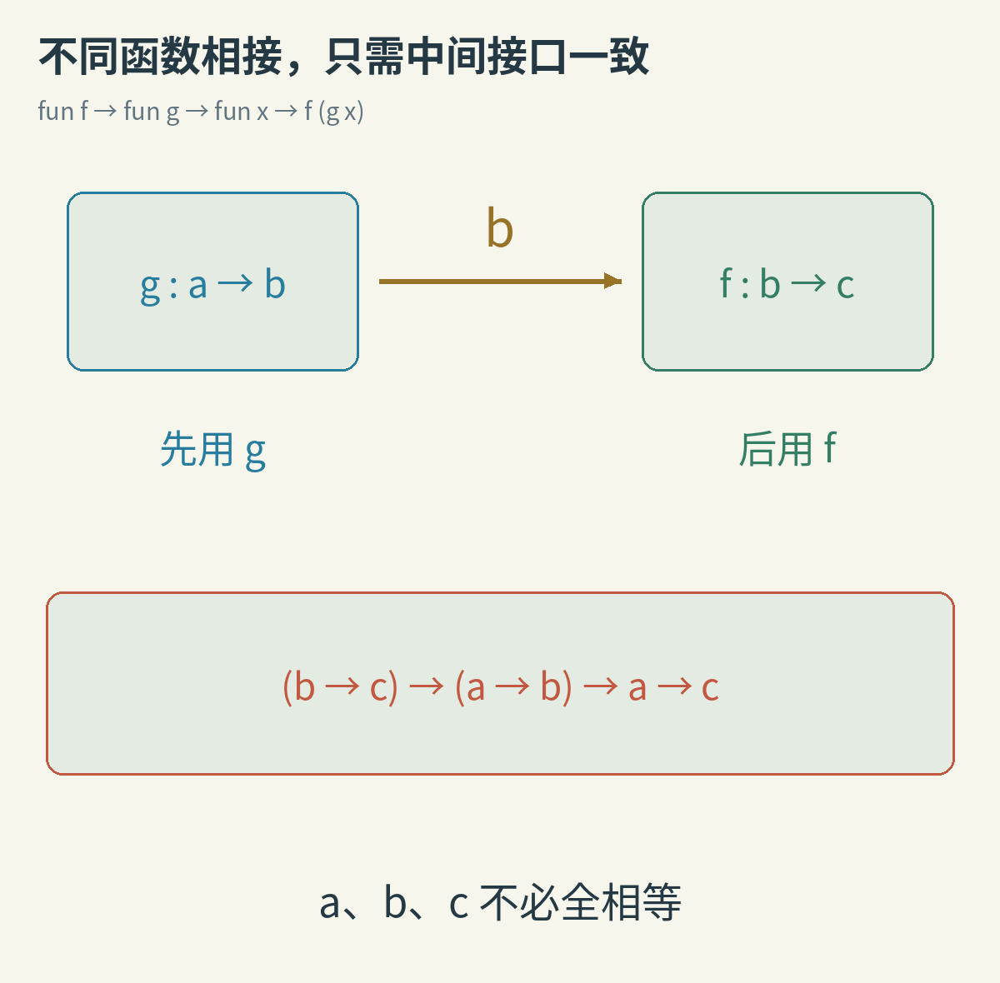

与 twice 比较，区别就出现了。twice 两次使用同一个参数 f，所以两段接口被绑在一起；这里 f 和 g 是不同参数，只需中间接头相同，不必强迫 a、b、c 全相等。

配套程序打印时可能把字母按首次出现顺序改名，得到 `(a -> b) -> (c -> a) -> c -> b`。这与上面的答案等价：字母是占位符名字，真正重要的是相同字母的对应关系和箭头结构。

你还可以故意写错：把整数加法 add 的一个输入换成 true。在本文中，add 的类型固定为 `Int -> Int -> Int`。那条输入约束会要求 Int=Bool；推导器不需要算任何加法，就能指出冲突。

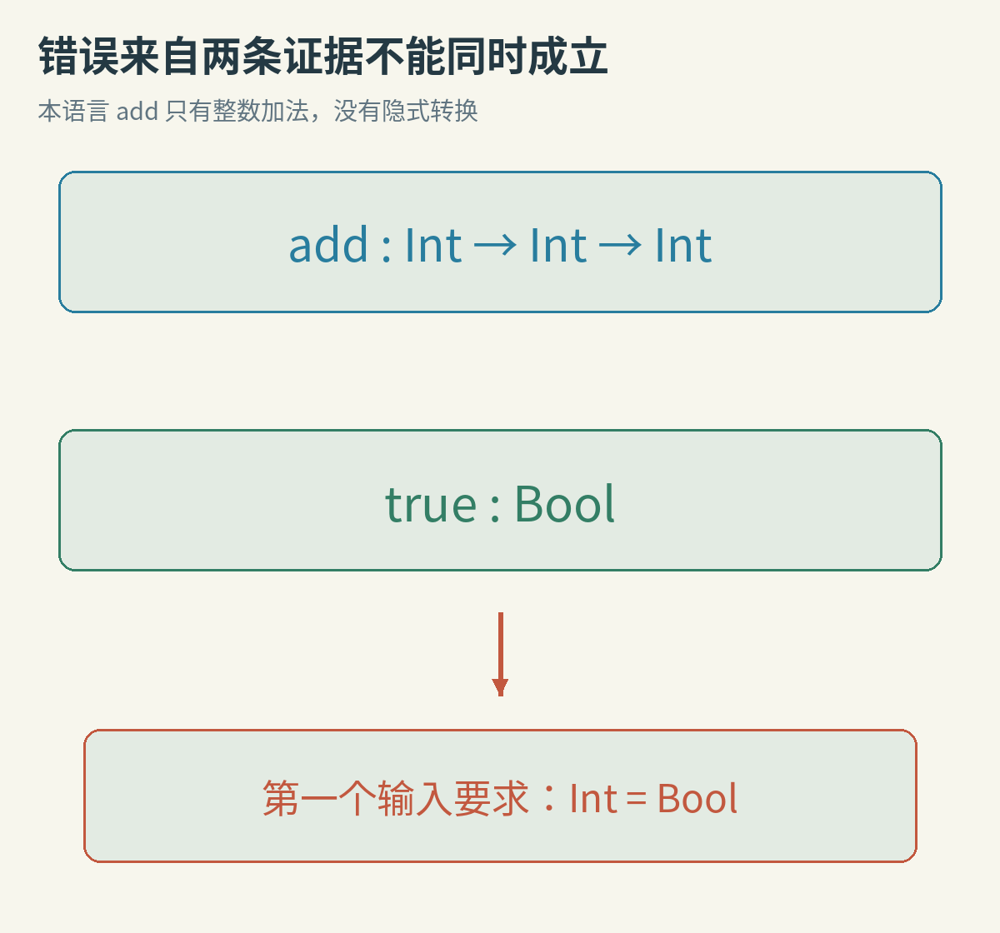

## 12. 会推类型，不等于会读心

如果你想写“加一”，却写成“减一”，两者都可能拥有 `Int -> Int`。类型接口并不会自动记录你的业务意图。

类型通过也不等于所有真实程序都会终止、不会除零、不会耗尽内存。现实语言还可能包含异常、递归、可变状态、子类型、重载或更高阶多态；哪些性质能保证，要看它究竟定义和证明了什么，不能从本文的小语言直接外推。

尤其是可变状态。把一个会记住旧值的容器当成每次都能自由换类型的东西，会破坏接口的一致性。真实 OCaml 因而有值限制及其放宽形式等额外规则；这里仅用[官方5.1手册](https://ocaml.org/manual/5.1/polymorphism.html)指出边界，不把我们“纯语言里的 let 可以这样概括”当成现实语言的全部规则。

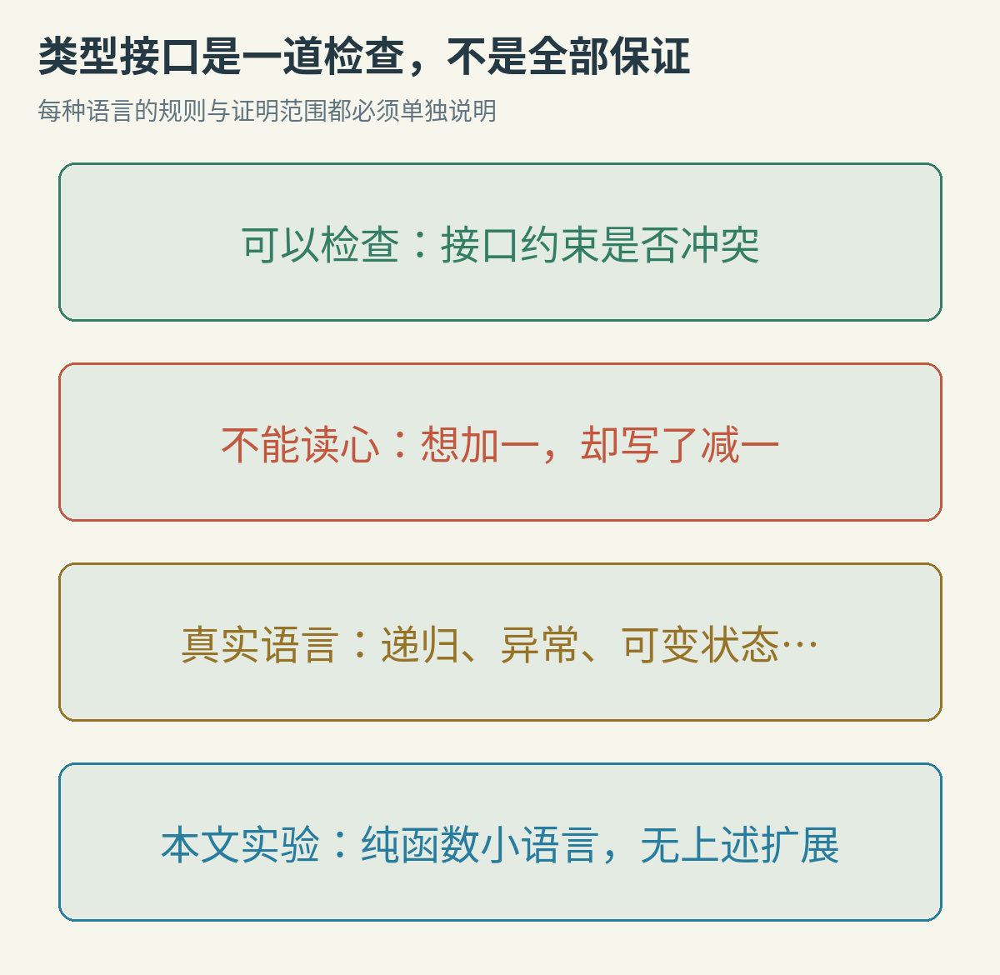

回到开头，编译器没有给所有可能输入试跑一遍。它把名字的作用范围、函数的输入输出、类型变量的共享关系，转成一组可检查的约束。

先保留未知，再根据证据收紧；能独立选择的地方保留自由，来自外部的承诺则不能擅自改写。Hindley–Milner 有意思的地方就在这里：**它不仅在寻找答案，也在谨慎地保留尚不需要决定的部分。**

最后留一个小练习：`fun x -> fun y -> x` 的主类型是什么？为什么不要求 x 与 y 同类型？再把最后的 x 改成 y，哪些字母关系会改变？

答案分别是 `a -> b -> a` 和 `a -> b -> b`。如果你的草稿没有把 a、b 过早合并，你已经开始像一个类型推导器那样思考了。

[事实、图片与实验来源](sources.md)
