# 没有发动机，小球为什么越荡越高？Verlet 与模拟中的“假能量”

你在游戏里放下一颗连着弹簧的小球。没有风，没有马达，也没有玩家再碰它。按理说，它应该来回运动；如果加上摩擦，还会慢慢停下来。

可程序跑着跑着，小球越冲越远，最后像获得了无限电池。

先别急着给它加一个“每帧速度乘 0.99”的补丁。一个更有意思的问题是：**能量可能不是从场景里来的，而是从更新位置与速度的规则里来的。**

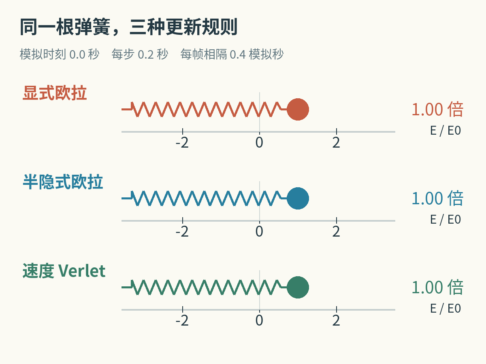

本文程序产生的教学动画。三行使用同样的质量、弹簧、初始状态和固定步长；动画只展示前一段运动，不是某款游戏引擎的测评。后面我们会把每一行拆开手算。

这一次，画面多久刷新并不是主角。我们把时间步固定住，只改一件事：**每走一步，究竟怎样把旧状态变成新状态？**

## 先造一个能核对答案的小世界

把小球限制在水平直线上。用 x 表示它偏离平衡位置的距离：右边为正，左边为负；用 v 表示速度，正负表示运动方向。

弹簧拉得越长，往回拉的力越大。这个简化规律写成 F = −kx。k 是弹簧刚度，前面的负号表示：拉向右边时，力指向左边。

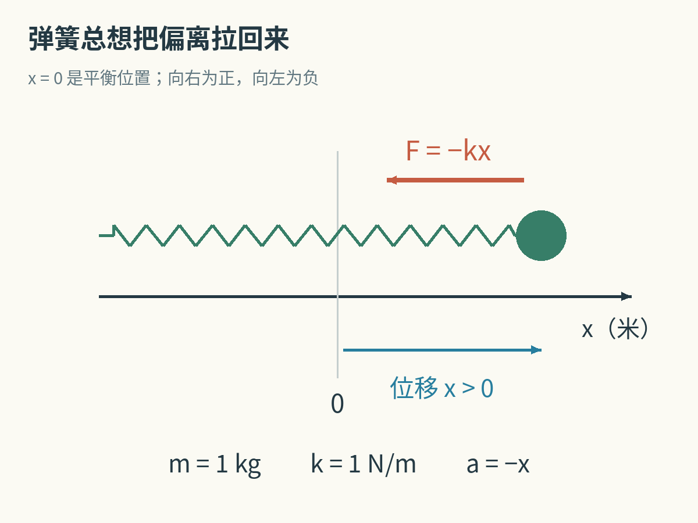

取质量 m = 1 千克、刚度 k = 1 牛顿/米，忽略摩擦与其他力。于是 a = F/m = −x：当 x 的数值为 1 米时，加速度为 −1 米/秒²。这是模型设定，不是真实弹簧的测量报告。

开始时，把小球拉到 x = 1 米，静止松手，即 v = 0。

它的能量分成两份：运动携带的**动能** mv²/2，以及弹簧储存的**势能** kx²/2。二者相加是机械能 E。在这套无摩擦模型中，总能量应当一直是 0.5 焦耳。

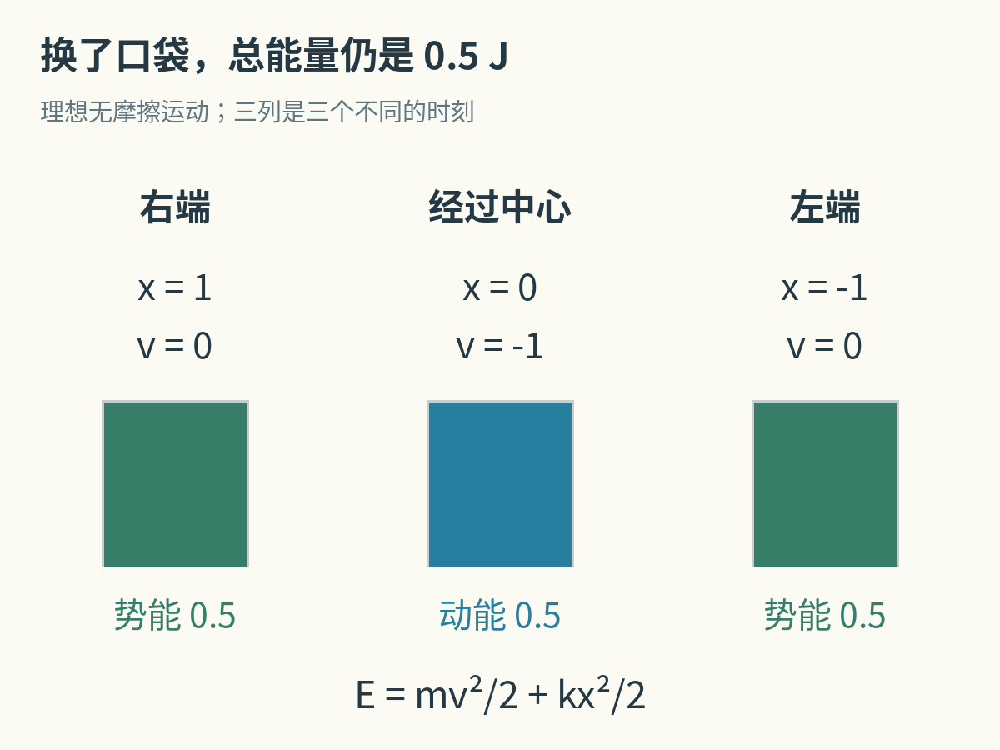

来到平衡位置，弹簧暂时不拉它，但小球速度最大，所以不会在那里停住。来到另一端，速度降为零，能量又主要存回弹簧。能量换了口袋，总数没有增加。

这个往复系统叫**谐振子**。名字陌生，动作并不陌生：越偏离中心，越想被拉回来。

## 最自然的两行程序，怎样偷偷多算了一点

设每一步 h = 0.2 秒。最直接的写法，是用当前速度推进位置，用当前加速度推进速度：

```python
x_next = x + h * v
v_next = v - h * x
```

注意两个右边都使用旧的 x、v。这叫**显式欧拉法**。它把不断变化的运动，近似为一小段一小段的更新。

第一步从 (x, v) = (1, 0) 出发：位置仍然是 1，速度却变成 −0.2。

这意味着什么？弹簧没有变短，所以仍存着 0.5 焦耳势能；小球又凭空多出 0.02 焦耳动能。总能量变成了 0.52。

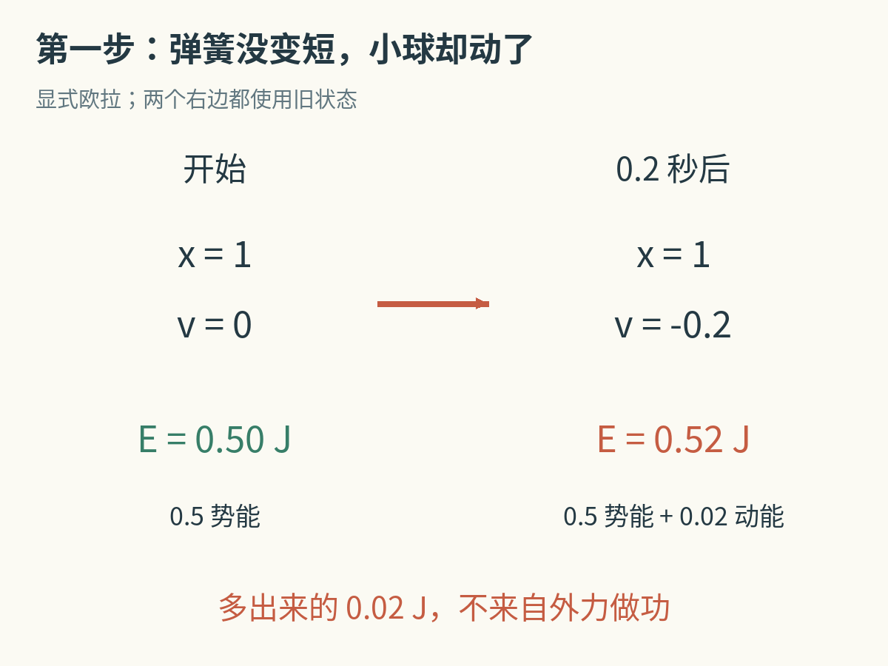

不是牛顿定律要求它制造能量，而是我们让“整个 0.2 秒的位置变化”都使用段首那一个速度。真实小球在这段时间里已经开始移动、弹簧也开始回缩，程序却把这些变化错开处理了。

第二步算得 x = 0.96、v = −0.4，总能量是 0.5408。它又增加了。

会不会只是这两个起点恰好不走运？把平方展开，就能看见更强的结论。

## 不是偶尔多一点，而是每步乘一次

为把单位说清楚，先记住弹簧的快慢尺度 ω = √(k/m)。它叫角频率，单位是每秒；本例 ω = 1 每秒，完整往复一圈需要 2π 秒，约 6.28 秒。

把速度除以 ω，得到 u = v/ω。这样 u 和 x 都以米为单位；再记 r = hω，r 没有单位。本例 r = 0.2。

显式欧拉的两行便是 x′ = x + ru、u′ = u − rx。平方后相加，交叉项正好抵消：

x′² + u′² = (1 + r²)(x² + u²)。

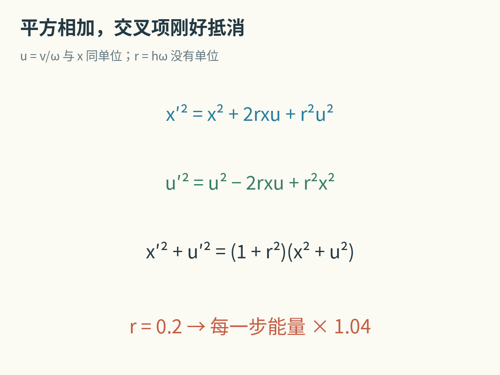

能量与 x² + u² 成正比，所以本例每走一步，能量都乘 1.04。走 100 步，也就是 20 秒，能量变成初始值的约 50.50 倍。

这个结论甚至不依赖浮点舍入。用分数做精确计算，同样会出现。**把数存得更精确，也救不了一个本身就在放大能量的更新规则。**

减小 h 有帮助。例如同样模拟 20 秒，h 从 0.2 减到 0.1，能量倍数从约 50.50 降为 7.32；减到 0.05，则约为 2.71。

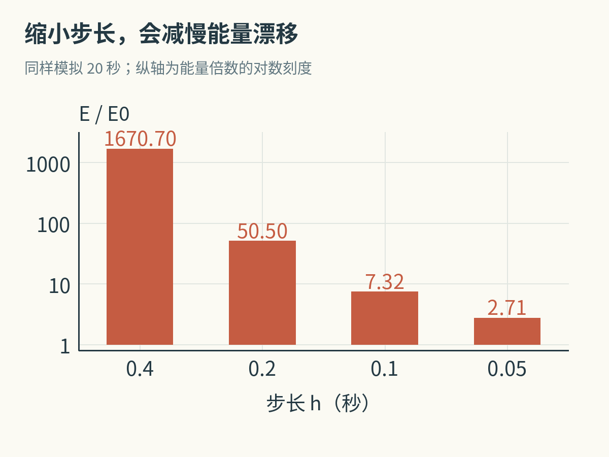

它在固定的有限时间内，确实能随步长变小而逼近真实解；但对这个无阻尼谐振子，只要固定 h 大于零，长期反复迭代仍有放大趋势。**有限时间精度**和**长期稳定性**不是同一道问题。

## 把轨迹画到另一张纸上

平常我们只画小球在哪里。现在换一种画法：横轴是位置 x，纵轴是 u = v/ω。一个点同时表示“在哪里”和“朝哪边、多快地走”。这张状态地图叫**相平面**。

本例真实运动始终满足 x² + u² = 1，因此状态点沿半径为 1 的圆转动。这里的圆不是小球在房间里的路径；小球仍然只在水平线上来回走。

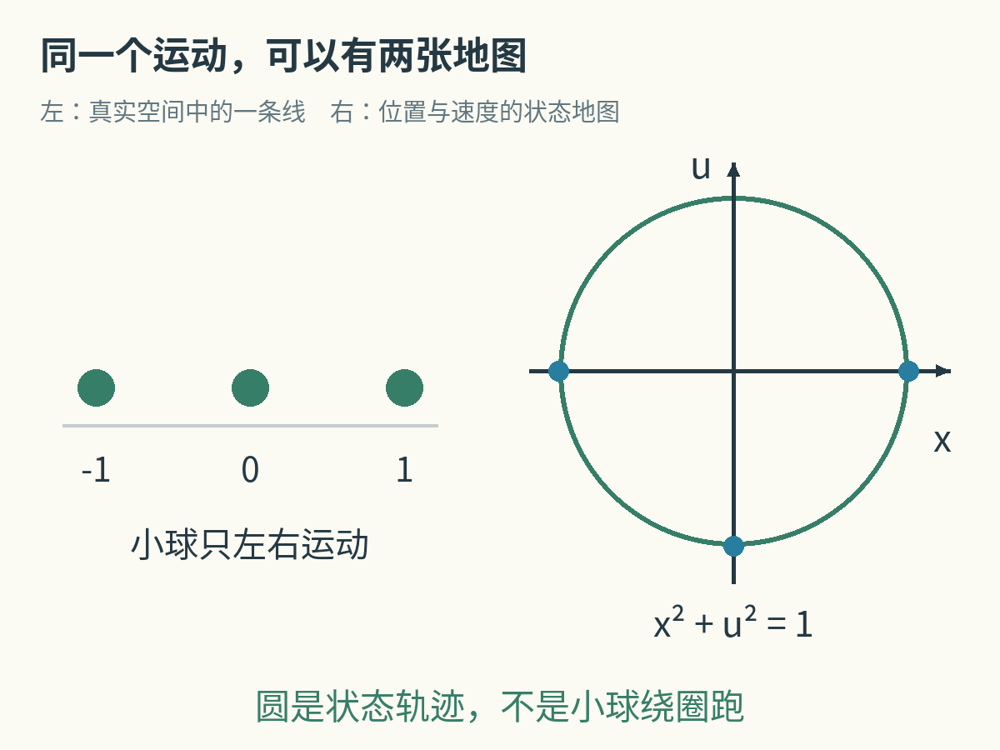

显式欧拉每一步沿当前方向走一小段直线，像顺着圆的切线跨出去。切线上的新点落在圆外，下一步又从更大的半径出发。

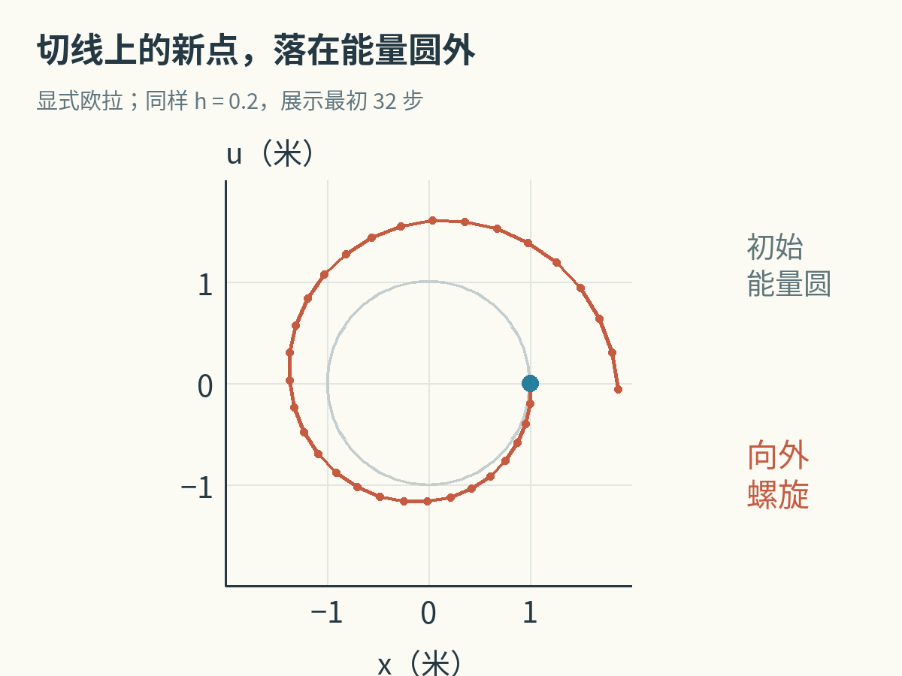

现在“假能量”就有了形状：状态点离中心越来越远。即便画面暂时还挺顺滑，这条螺旋已经在报警。

## 只调换顺序，结果就不一样

试着先更新速度，再用新速度更新位置：

```python
v = v - h * x
x = x + h * v
```

这叫**半隐式欧拉法**，在这个模型里也叫辛欧拉法。名字里的“半隐式”不意味着这里必须求解一个复杂方程；这两行可以直接执行。

第一步仍得到 v = −0.2，但新位置是 0.96。能量变为 0.4808。它不再凭空上涨，却也没有精确等于 0.5。

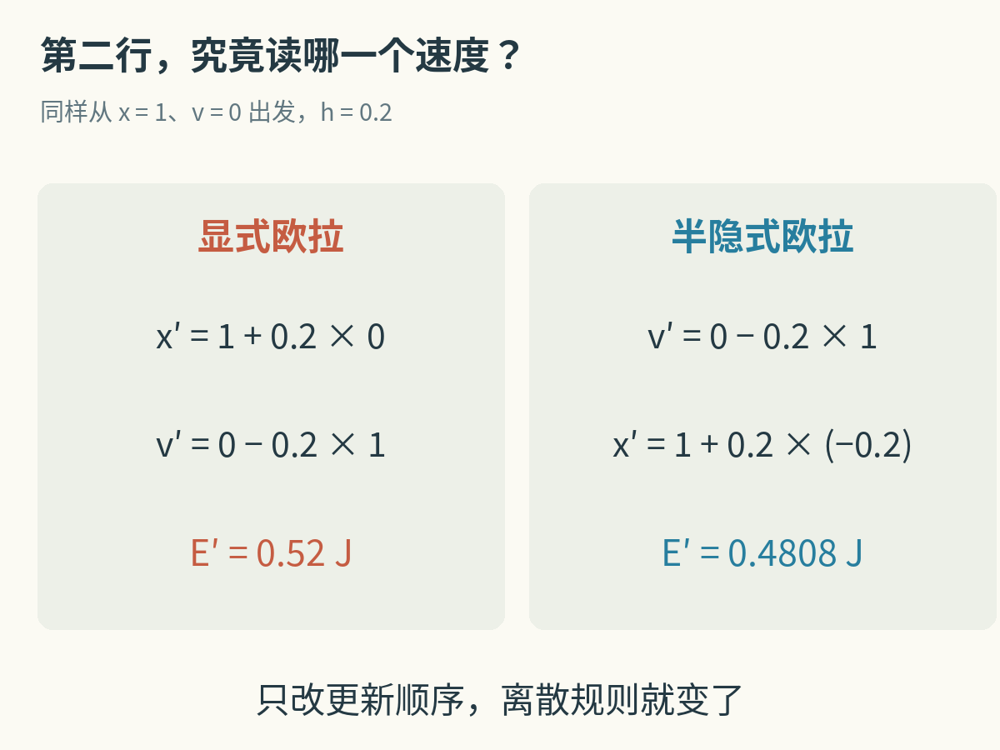

如果只看这一刻，很容易得出“只是从加能量变成减能量”的结论。继续跑就会发现：本例能量会上下摆动，并不是每一步都扣掉相同比例。

在 h = 0.2、连续 500 步的实验中，能量约在初始值的 0.9091 到 1.1111 倍之间波动。它没保持原来的圆，而是在附近沿一条倾斜的椭圆运动。

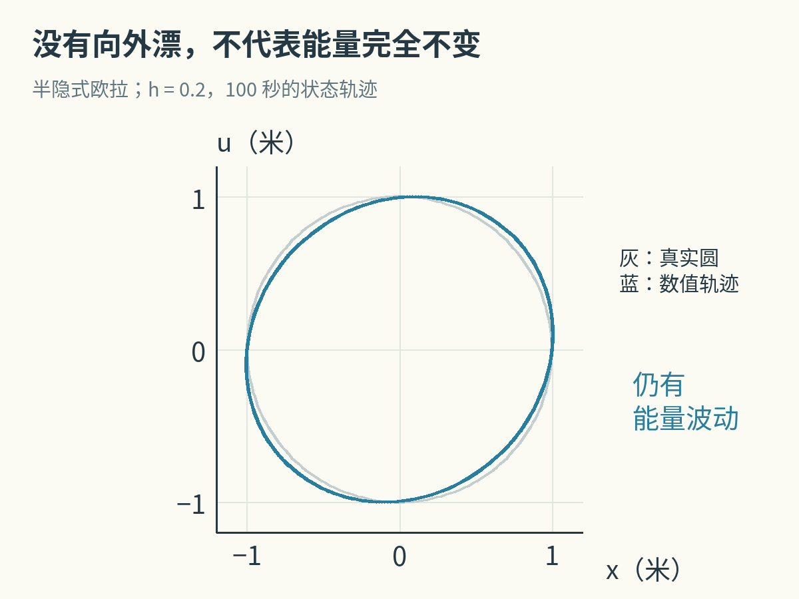

这已经是重要改善，但还有一个问题：能不能让更新方式更对称，让误差再小一些？

## 1967 年，问题出现在分子之间

在游戏披风和布娃娃之前，类似的更新问题已经出现在分子模拟中。

Loup Verlet 的 [1967 年原论文](https://journals.aps.org/pr/abstract/10.1103/PhysRev.159.98)研究了 864 个相互作用粒子的运动与热力学性质。第 99 页写出了利用“前一个位置、当前位置、当前受力”推算下一个位置的更新式。论文还讨论了减少邻居相互作用计算的办法；那是另一项优化，不能把全部性能收益都算到积分公式头上。

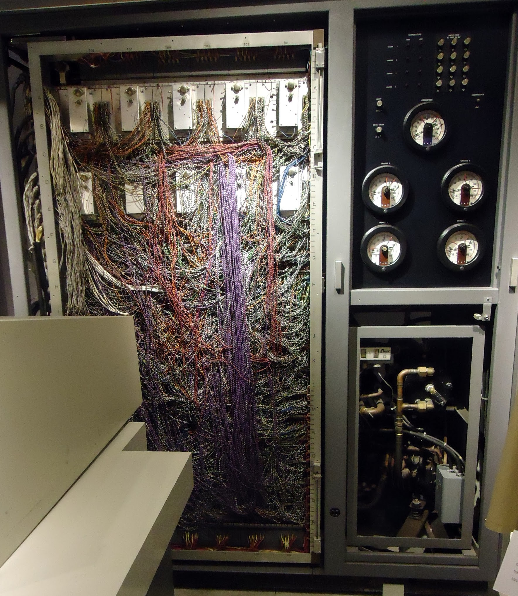

CDC 6600 机箱与冷却面板，Tomwsulcer 摄于 2015 年，CC0。原论文提到部分计算使用纽约大学的 CDC 6600；图中是博物馆展品，不是那台研究设备的现场照片。

当计算机代替实验者，让一群模型粒子经历许多个微小时间步，更新规则不能只在第一步看起来合理。它得经得起反复使用。

今天常说的 Verlet 方法属于一个更长的数值方法家族，也常与 Störmer、leapfrog 等名称一起出现。这里不把“1967 年用于分子模拟”说成“这个思想第一次被人类发明”。我们要拆的是它为何有用。

## 同时向前、向后看，速度项就消掉了

先设想加速度在一个很短的时间段内变化不大。向前走 h 秒的位置，近似为：

x(t+h) ≈ x(t) + hv(t) + h²a(t)/2。

向后退 h 秒，则是：

x(t−h) ≈ x(t) − hv(t) + h²a(t)/2。

注意速度项变了符号，加速度项却没有。把两式相加，速度项就抵消了。

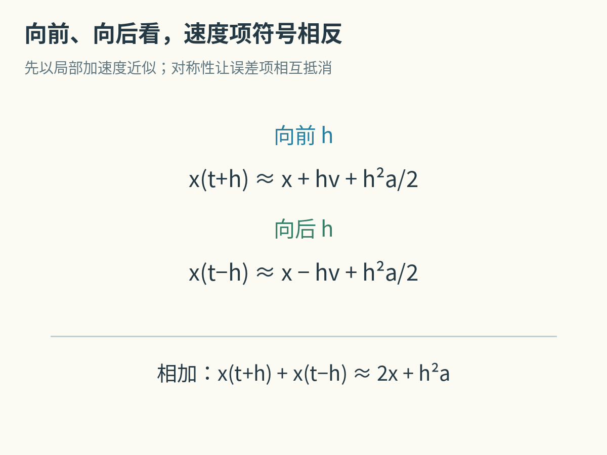

整理后得到：

**下一个位置 = 2×当前位置 − 前一个位置 + 加速度×h²。**

也可以写成：当前位置 + 上一步的位移 + 这一步的加速度修正。对于平滑运动，对称展开还会消掉三次项，这与方法的二阶整体精度有关；“消掉一些误差”不等于“任何轨道都能精确算出”。

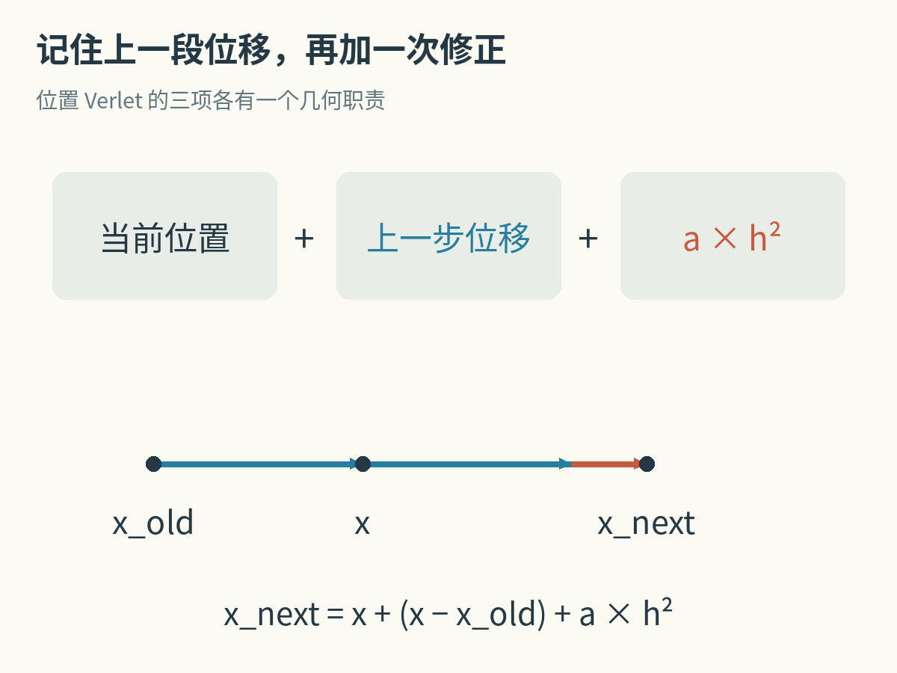

上图是三项相加的通用示意，箭头不按本例的数值比例绘制。这里保存的是两个位置，速度没有消失，而是隐藏在位置之间的变化中。必要时，可以用前后两个位置之差除以 2h，估计中间时刻的速度。

第一次运行却没有“前一个位置”，怎么办？需要根据初始速度和初始加速度准备它：x_old = x0 − hv0 + h²a0/2。

本例 x0 = 1、v0 = 0、a0 = −1、h = 0.2，于是 x_old = 0.98，第一步也得到 x_next = 0.98。

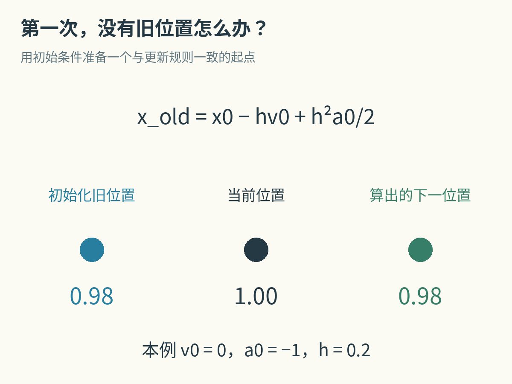

这是让离散算法正确起步的初始化值，不是声称我们已经测到了过去的真实轨道。直接令两个位置相同，并不总是等价于你心里想的“当前速度为零”。

## 不想藏速度，就分成“推半步、走一步、再推半步”

为了直接核算动能，我们采用保存位置和速度的 **velocity Verlet，速度 Verlet** 写法。它可分为三件事：

1. 用当前位置的加速度，更新半步速度。
2. 用这个中间速度，更新一整步位置。
3. 重新计算新位置的加速度，再更新另外半步速度。

这里“推”只是改变速度的形象说法；它不是额外添加一股物理冲量。[GROMACS 2025.4 官方手册](https://manual.gromacs.org/2025.4/reference-manual/algorithms/molecular-dynamics.html#the-velocity-verlet-integrator)给出的速度 Verlet 更新，也采用这种分步形式。

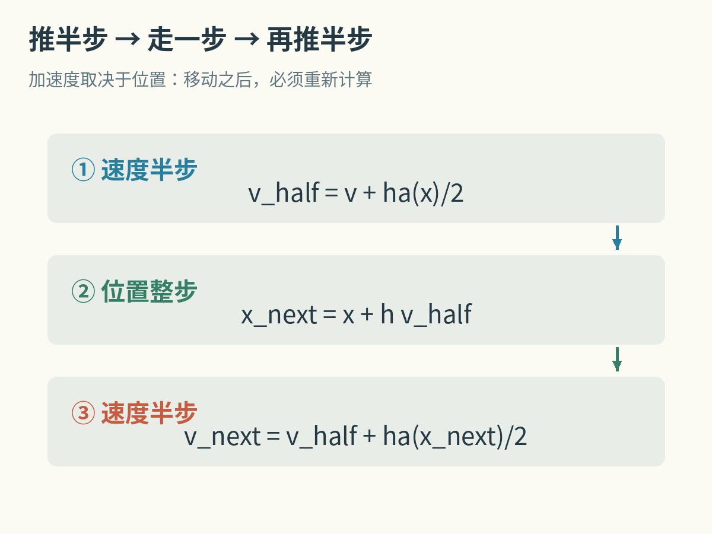

还是从 (1, 0) 出发，h = 0.2：

- 先推半步：v_half = 0 + 0.1×(−1) = −0.1。
- 走一整步：x_next = 1 + 0.2×(−0.1) = 0.98。
- 新加速度是 −0.98，再推半步：v_next = −0.1 + 0.1×(−0.98) = −0.198。

能量为 (0.98² + 0.198²)/2 = 0.499802 焦耳。它仍不是精确的 0.5，但比刚才两种方法的第一步更接近。

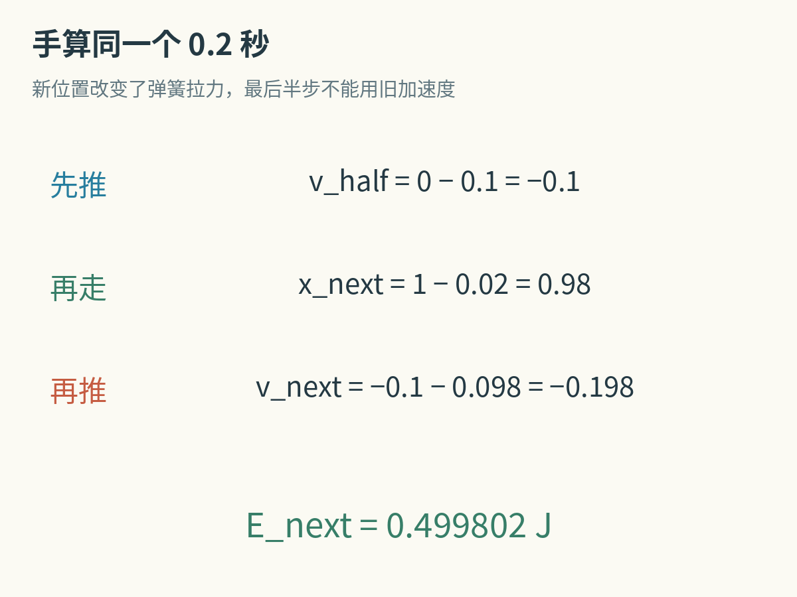

中间那个 v_half 是算法的中间量。不要仅因为名字带“半步”，就把它当作真实运动在 t+h/2 的精确速度；算例里的所有结果仍然是近似。

## 给三种办法同样的时间，再看一次总账

下面的实验不调整参数来偏袒某个方法：质量与刚度都取 1，初始 x = 1、v = 0，h = 0.2 秒，各跑 500 步，共 100 秒。纵轴画能量除以初始能量，方便比较。

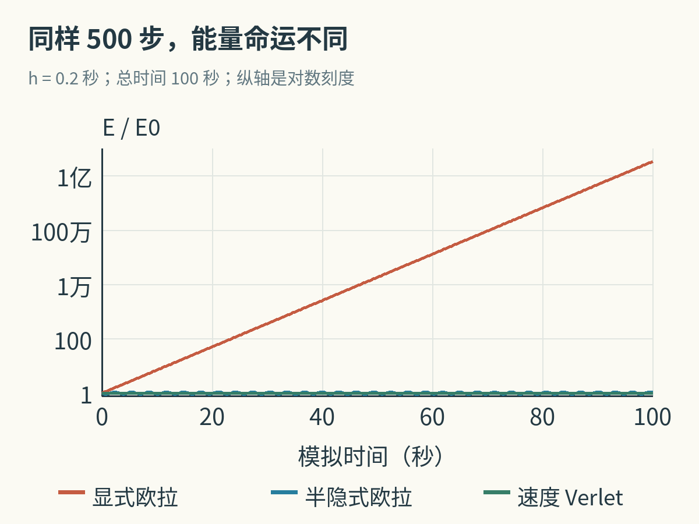

对数刻度上的等距表示相同比例，不是相同能量差。显式欧拉最后约有初始能量的 3.286 亿倍；另两条曲线挤在 1 附近，得放大才能看清。

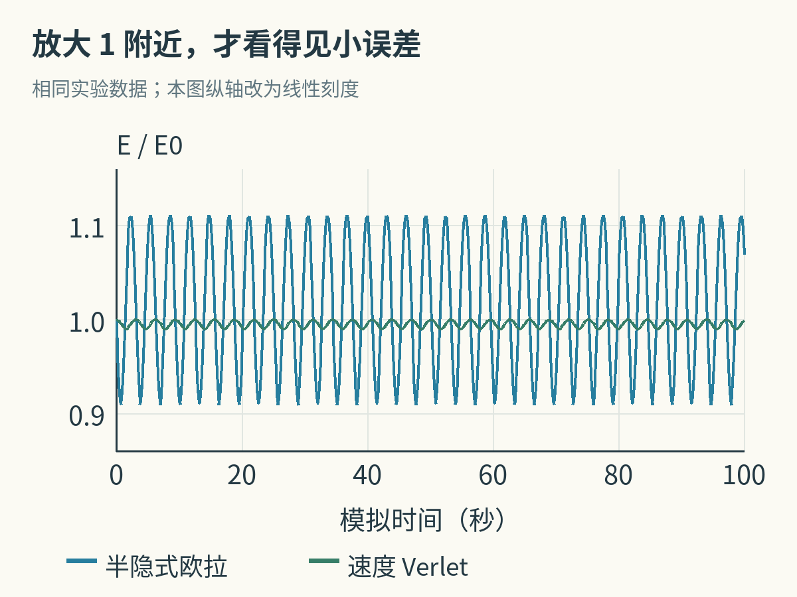

在这些采样点上，半隐式欧拉的能量比例约为 0.9091～1.1111，速度 Verlet 约为 0.9900～1.0000。不要把这几个百分比背成算法通用指标：它们取决于这道模型、步长和初始条件。

为什么 Verlet 的误差没有一直朝一个方向累加？对这一个谐振子，可以写出一份它精确保住的“邻近账本”。当 m = k = 1、h = 0.2 时，这份账本是：

Q = (v² + 0.99x²)/2。

把上面的三步更新代入，会发现 Q 前后相同；初始 Q = 0.495。真实能量则是 E = Q + 0.005x²。随着小球来回运动，x² 改变，E 就在附近摆动。

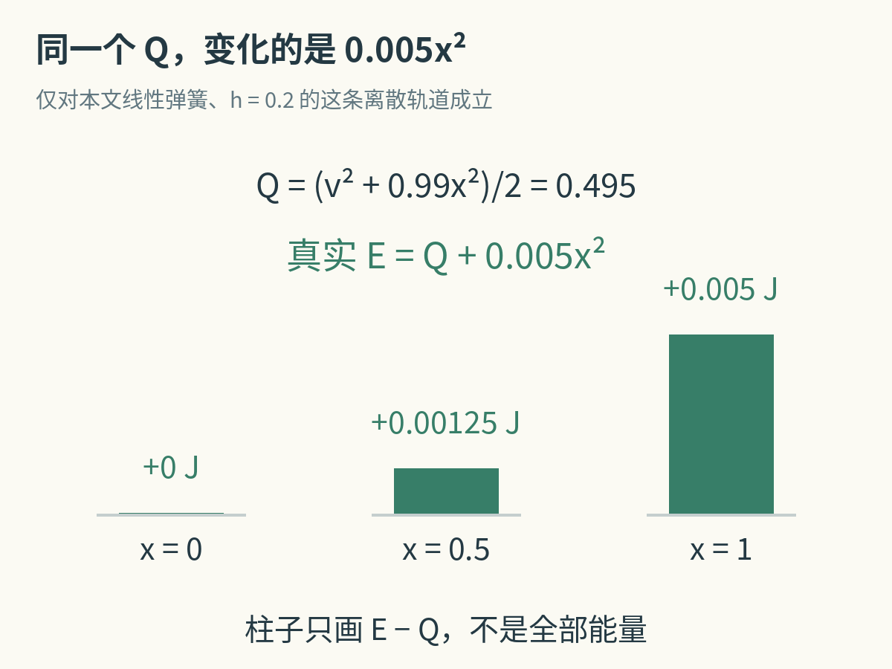

**Q 不是现实里突然多出的新能量定律。** 它说明这套离散规则恰好沿着一条稍有变形、但封闭的曲线走。这个精确二次式只针对本文的线性弹簧；更一般系统的长期行为，需要相应条件和更深入分析。

## 能量看起来很好，也可能已经走错拍子

把速度 Verlet 的步长改成 h = 1 秒，仍用同一根弹簧。

每一步的位置依次是 1、0.5、−0.5、−1、−0.5、0.5、1。六步之后，位置和速度都回到原处；程序里的周期是 6 秒。

可真实模型的周期约为 6.283 秒。程序每圈都走快一点。

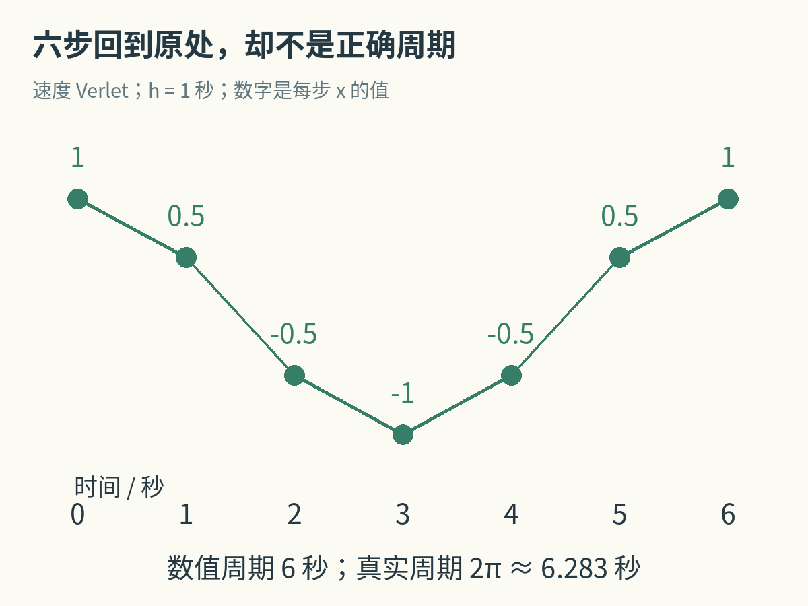

跑到 30 秒，数值结果刚好是 x = 1、v = 0，能量也漂亮地等于初始值。真实答案却是 x = cos(30) ≈ 0.1543、v = −sin(30) ≈ 0.9880。

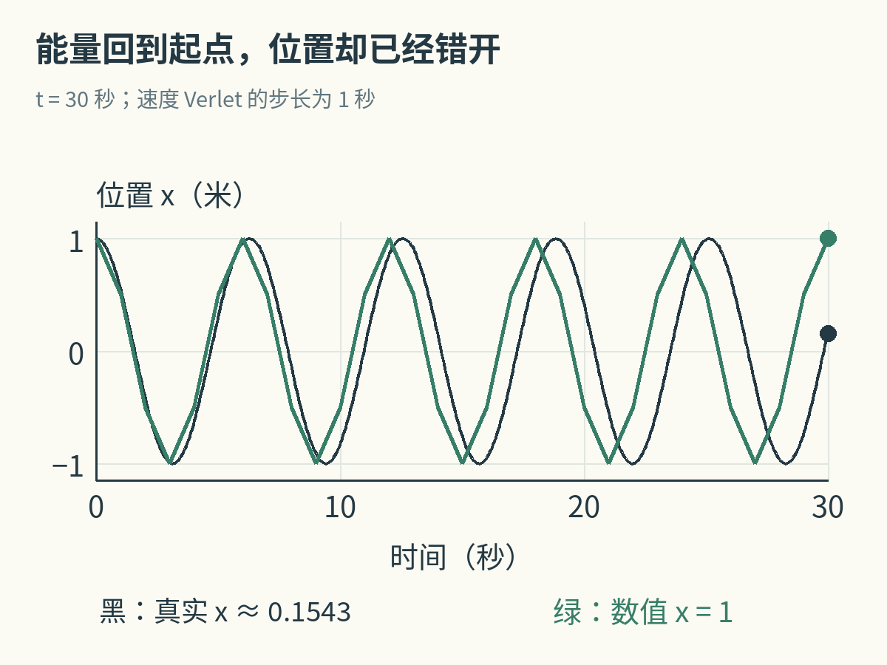

所以“没有爆炸”“能量没长期漂移”“每一时刻的位置足够准确”，是三种不同程度的要求。只盯一条能量曲线，会漏掉相位误差，也就是运动节拍的错位。

## Verlet 也不是无限步长通行证

对本文无阻尼线性弹簧，半隐式欧拉和速度 Verlet 的通常稳定区间是：

**0 < hω < 2。**

h 是每步多少秒，ω = √(k/m) 表示系统振动多快。弹簧越硬、质量越小，ω 越大，可用步长就得相应缩小。应检查的是这个无量纲乘积，而不是孤零零一个“每秒 60 次”。

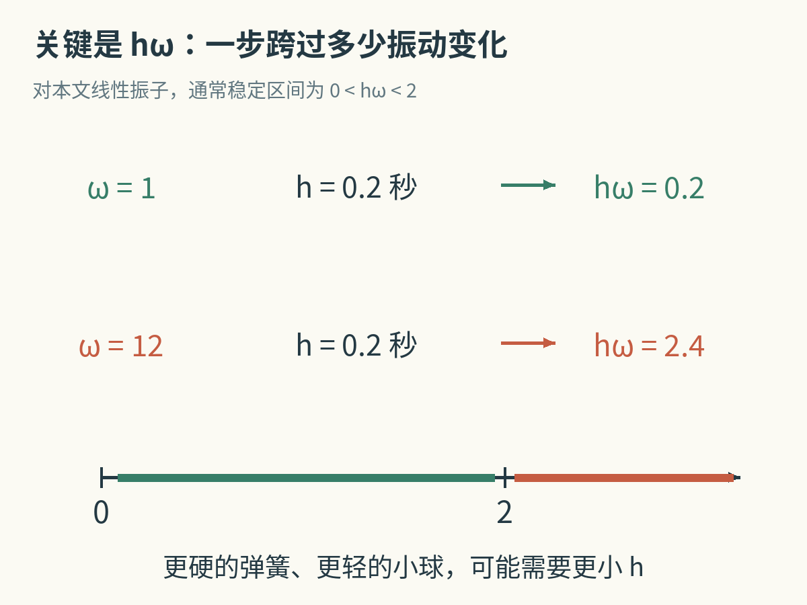

边界上也不能只测一个特别幸运的起点。例如 ω = 1、h = 2 时，从 x = 1、v = 0 出发，速度 Verlet 会在两个位置之间交替，看似没有越界。但把初速度改成 0.1，位置幅度就能随步数增长。

超过边界，例如 h = 2.2，增长更剧烈。下面特意让这两组都从 x = 1、v = 0.1 出发。

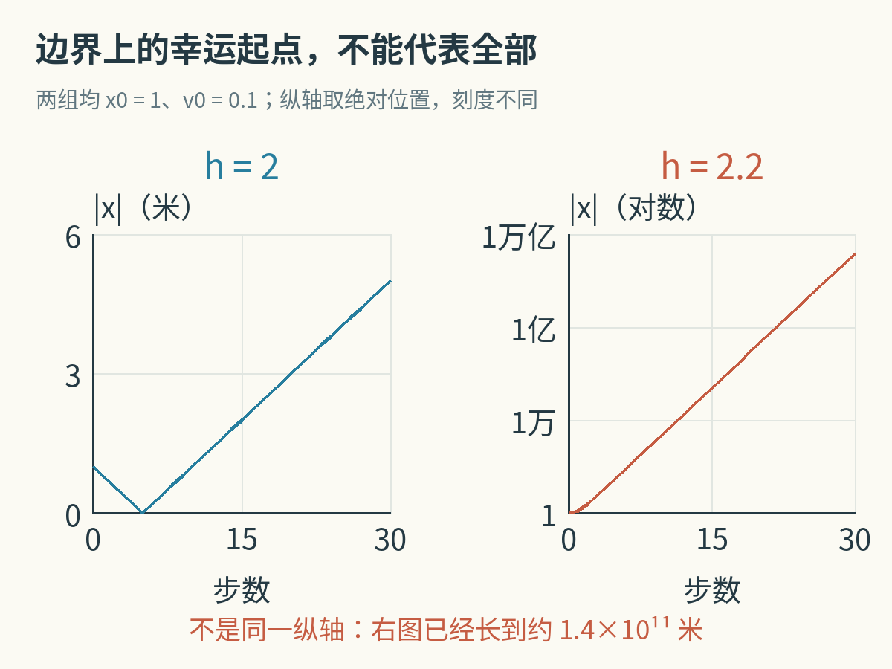

这个“2”只属于我们分析的线性振子稳定条件。它不是复杂布料、关节、碰撞或任意力场的全局保证；接近边界时，即便没有发散，误差也可能早已不能接受。

## 写成代码后，最值得检查什么

下面是本例三个更新器的核心。函数中的 x、v 都是进入这一步时的状态，返回值才交给下一步。

```python
def step(method, x, v, h):
    a = -x
    if method == "explicit":
        return x + h * v, v + h * a
    if method == "semi":
        v = v + h * a
        return x + h * v, v
    if method == "verlet":
        half = v + 0.5 * h * a
        x = x + h * half
        return x, half - 0.5 * h * x
    raise ValueError(method)

for method in ["explicit", "semi", "verlet"]:
    x, v = 1.0, 0.0
    for _ in range(500):
        x, v = step(method, x, v, 0.2)
    print(method, round((x*x + v*v) / 2, 6))
```

本地执行结果，三行最终能量依次为：164300790.789831、0.534679、0.499368 焦耳。完整[可运行实验与检查代码](examples/oscillator.py)还保留了参数、初步结果、边界反例，以及独立的位置递推对照。

它用精确分数检验了 484 组显式欧拉放大恒等式，并用固定随机种子 1967 检查了 10000 次位置 Verlet 与速度 Verlet 的位置一致性。这些检查覆盖的是教学模型与实现，不是在证明所有物理系统都稳定。

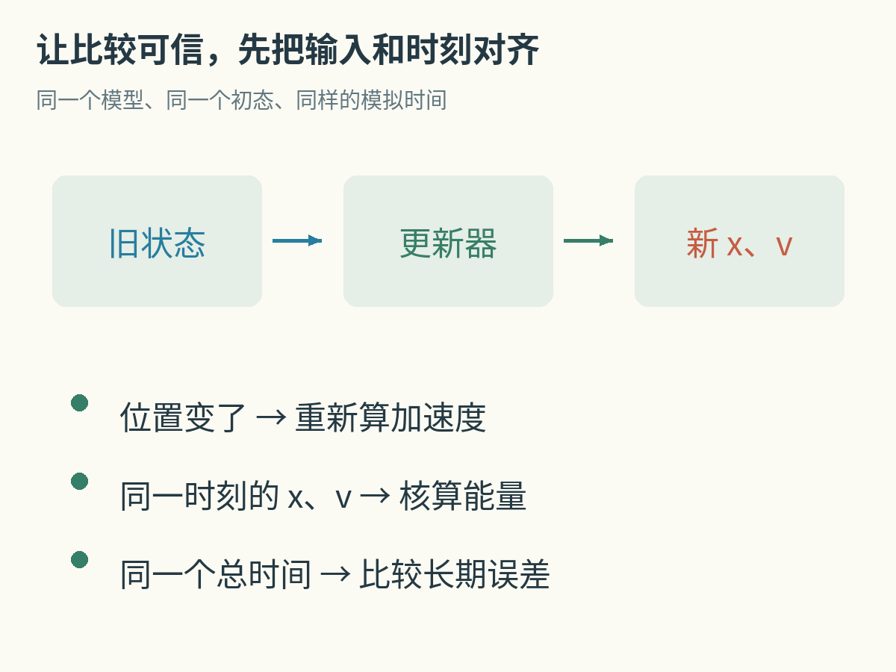

还有几个容易混在一起的问题：

- 固定步长解决的是“每一步条件是否相同”；它不会自动挑出一个好更新器。本文没有重新实现游戏循环或渲染插值。
- Verlet 的简单形式假设此处的加速度由位置决定。速度相关的阻力、时变驱动、约束和接触，需要相应处理，不能直接套上后宣称仍保持这里的能量性质。
- 碰撞会改变状态，摩擦本来就应该耗散能量。不能把所有能量下降都叫错误，也不能用人为阻尼把错误增长盖住，就当保守系统算对了。
- 为了比较算法，必须把同一时刻的位置与速度配在一起。把半步速度当成整步速度去计算能量，会把另一种时间错位带进图表。

## 留一个能亲手拆开的实验

把 h 从 0.2 改为 0.1，先只手算一步，再跑同样的 100 秒。

注意“同样 100 秒”意味着从 500 步改成 1000 步。如果只改 h、不改步数，你连比较的终点时间也一起改了。

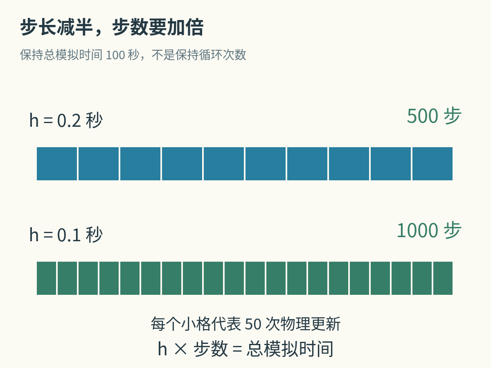

可以先核对第一步：显式欧拉能量为 0.505；半隐式为 0.49505；速度 Verlet 为 0.49998753125。然后再看：哪一条曲线长期向外漂？哪一条有界却仍然不精确？

回到开头那颗越荡越高的小球。它没有找到秘密发动机，只是在每一次“差不多”的更新里，拿到了一点现实从未给过它的能量。

数值模拟最迷人的地方，也在这里：我们不是把连续世界原封不动塞进电脑，而是在选择一套离散规则。好规则不只要第一步像，还要在反复走了很久以后，仍记得这个世界原本不该随便改变什么。

图片来源：教学图、动画与数值曲线为本文原创计算和示意；CDC 6600 展品照片为 [Tomwsulcer](https://commons.wikimedia.org/wiki/File:CDC_6600_chassis_and_cooling_panel_at_CHM.jpg)，[CC0 1.0](https://creativecommons.org/publicdomain/zero/1.0/)，保留下载原文件，未修改。出处、模型范围与素材说明见 [sources.md](sources.md)。
