# 已经显示“保存成功”，断电后还算数吗？WAL把承诺写在修改前面

你在做一个小游戏。仓库A里有100颗宝石，仓库B里有40颗。玩家点击“转移30颗”，程序先把A改成70，再把B改成70。

界面看起来只发生了一件事。存储设备却可能先完成第一处写入，第二处还没落稳，机器就断电了。

重新打开游戏：A是70，B仍是40。

30颗宝石没有被偷走。程序只是把“一件事”拆成了两个在不同时刻完成的动作，而断电恰好落在中间。

更难受的是另一种情况：玩家明明看见了“保存成功”，重启后又变回100和40。屏幕上那句话，究竟什么时候才算数？

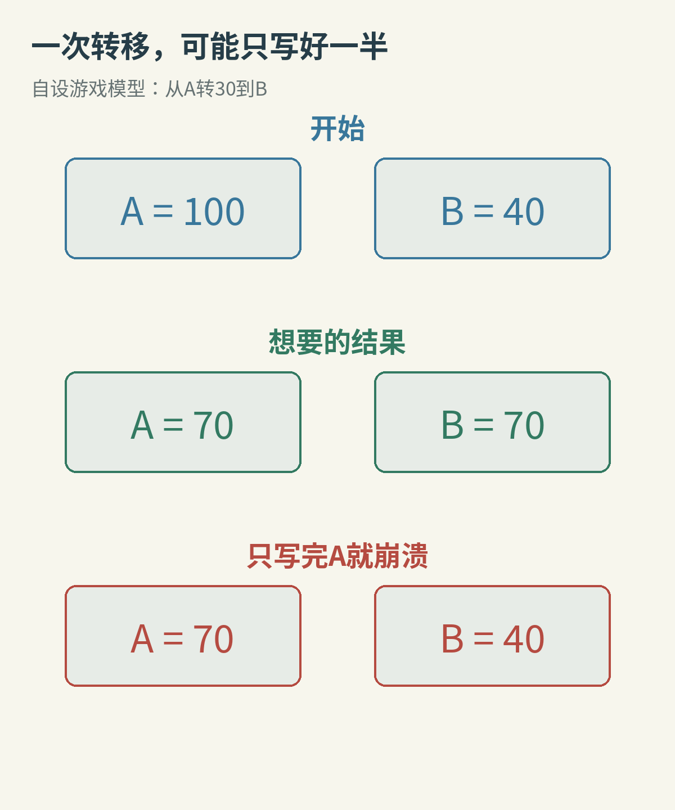

这篇要做的实验很简单：把这个小账本真的搭起来，然后在每一步都插入一次崩溃，看哪些顺序能恢复、哪些顺序会把证据弄丢。

## 1. “程序改了”，至少可能指三件事

玩家按下“转移”的那一瞬间，程序其实可能停在三个完全不同的位置。这三个位置听起来都像“改好了”，但断电之后的结果完全不一样。

第一件：数字只在内存里改了。内存很快，但本篇假定断电后这些工作状态全部消失。

第二件：程序已经把写请求交给持久存储。请求发出，不等于设备已经保证这份数据能跨过本篇讨论的那类故障。

第三件：内容真的持久化了。下文说“落稳”，专门指第三件；一次普通的写入函数返回，不算。

把这三件事分开，是理解后面所有内容的前提。平时我们说“存进去了”，其实是在这三者之间来回滑；而出故障的时候，恰恰要精确知道当时停在哪一件上。

我们把保存A、B的地方叫作两张“数据页”。真实数据库的一页能装很多条记录，这里一页只装一个数——小到可以手算。内存里的副本改过、持久副本还没跟上时，习惯上叫脏页。“脏”只说明两个版本不一致，不说明数据错了。

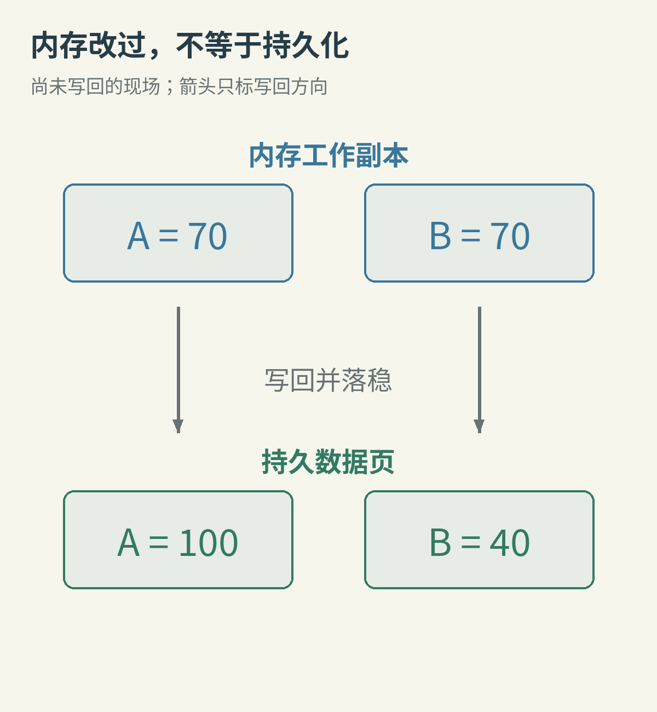

一次“转移”想给出的，其实是两个承诺：

- 原子性：这笔转移要么整体生效，要么整体不生效，不留只扣不加的半成品。
- 持久性：已经对外确认成功的转移，不能因为一次崩溃就消失。

这两个承诺并不要求“磁盘上每一刻都是完整结果”。过渡状态可以存在——只要系统留下足够证据，重启后能恢复，而且在恢复完成之前，不把半成品交给玩家。

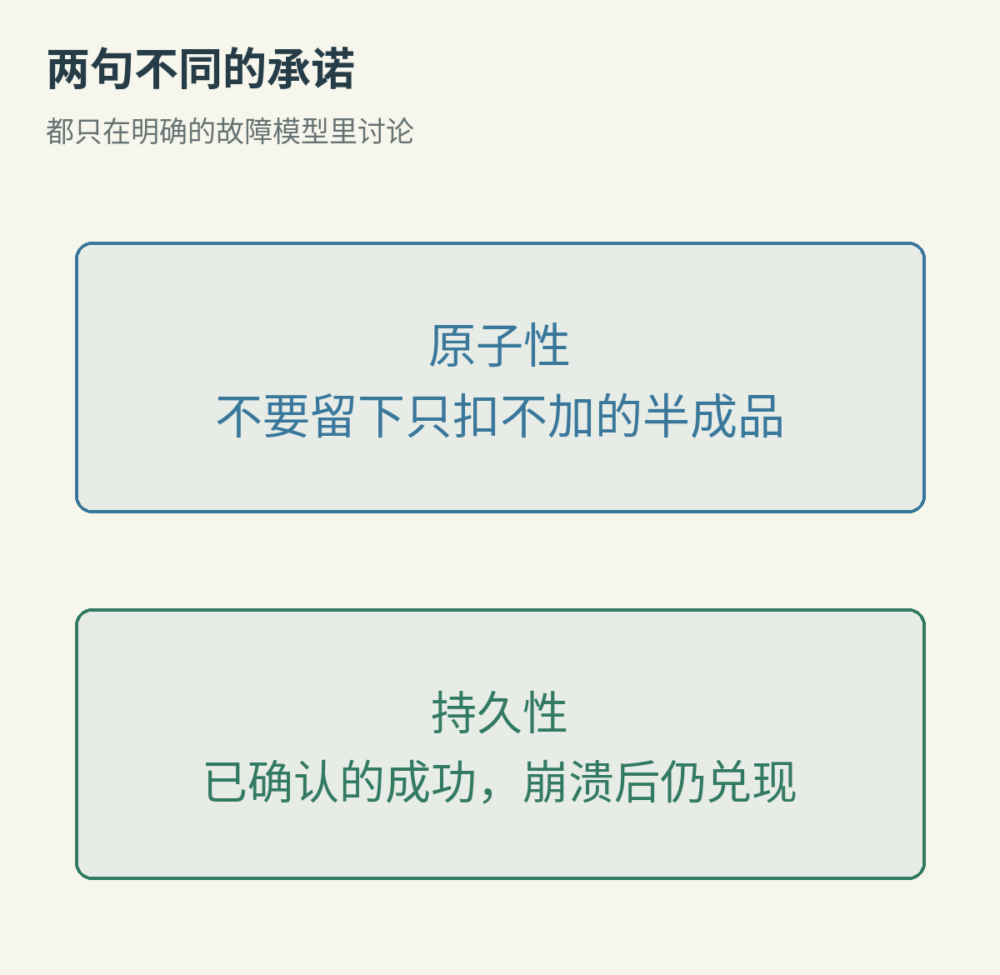

## 2. Jim Gray关心的，是故障前后同一个承诺

1981年，Jim Gray在《The Transaction Concept: Virtues and Limitations》里，把事务、日志和恢复放到了同一条论述线上。[原论文](https://www.cs.utexas.edu/~dahlin/Classes/GradOS/papers/Gray81.pdf)

他真正追问的是：动作做到一半机器停了怎么办？已经答应的结果怎么保住？哪些现实中的动作大到根本不适合塞进事务模型？

这篇论文不是WAL的发明公告，它比WAL更早、也更基础。它记录的是一个更朴素的确认：系统研究者很早就开始认真区分“发生过”“应该保留”和“需要撤销”这三件不同的事。


照片由Tony Hey拍摄，摄于2006年1月，出自微软研究院出版的《The Fourth Paradigm》第234页。这里用的是原书中嵌入的完整JPEG，没有裁切或重绘，按CC BY-SA 3.0 US使用；署名、来源和许可见文末素材说明。

今天打开PostgreSQL 18的官方文档，还能读到同一条顺序：描述修改的日志先持久化，对应的数据页修改才可以写回持久存储。[官方说明](https://www.postgresql.org/docs/18/wal-intro.html)

## 3. 先造一间很小的实验室

真实数据库还要处理并发、锁、写了一半的页、磁盘故障、日志校验、备份，以及“恢复过程中又崩一次”。全塞进来，最基本的依赖关系反而看不清。

所以先约定六件事：

1. 只有A、B两页。初始持久状态是100、40。
2. 事务串行运行，同一时刻最多一笔；上一笔的提交记录落稳后，下一笔才能开始。
3. 一次数据页持久写入是完整的；日志落稳后总是一个完整前缀，不会中间缺一条。真实设备怎么提供或补强这些保证，这里不实现。
4. 崩溃会清空内存和未落稳的日志尾部，但不损坏已经持久化的内容。
5. 从已知的一致起点开始，保留全部日志；不做日志截断，也不实现运行中的主动回滚接口。
6. 恢复结束之前，不开放玩家读写。

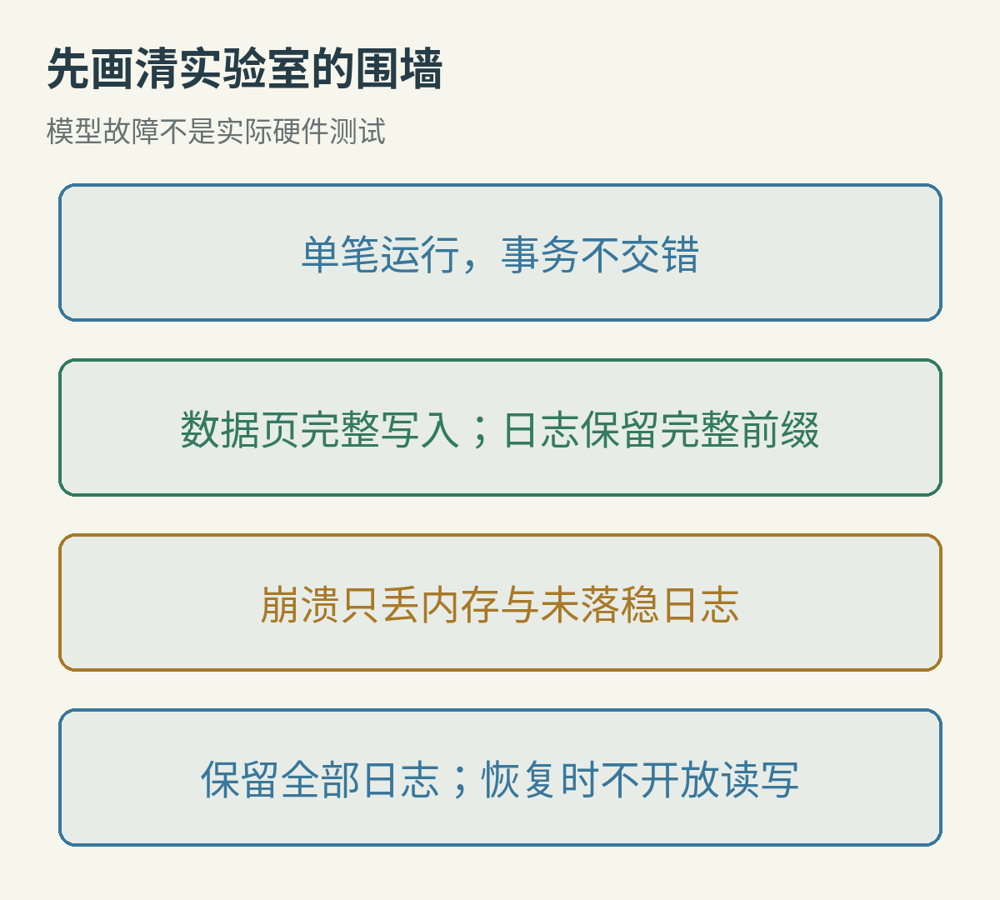

这六条不是随手加的。串行（第2条）让“未提交的事务一定在末尾”这句话成立，撤销才好做；完整前缀（第3条）让“落稳到第3条”这句话有确定含义；只崩内存、不损坏已持久内容（第4条），把问题限制在“顺序”上，而不是“位翻转”；不截断日志（第5条）保证证据一直在手边。每放宽一条，恢复程序就要多长一块。

这套设定故意放开两个口子：允许“没提交的事务，它改过的数据页先写回”，也允许“提交时不立刻写回全部数据页”。麻烦就是从这两个口子里进来的，而撤销和重做正是为了收拾它们。它们的英文名字放到后面再补。

程序是原创的教学模拟器。它不打开任何数据库，不调用真实的磁盘同步，也不会真的让你的机器断电。

## 4. 在旁边另开一本顺序账

设第一笔事务叫T1，任务是把30颗宝石从A转到B。除了改内存，我们还记下三条日志：

- 第1条：T1把A从100改成70。
- 第2条：T1把B从40改成70。
- 第3条：T1提交。

每条修改记录都带事务编号、对象、修改前的值、修改后的值。“提交”是单独的一条记录，不靠“最后看见两个数都改了”去猜。

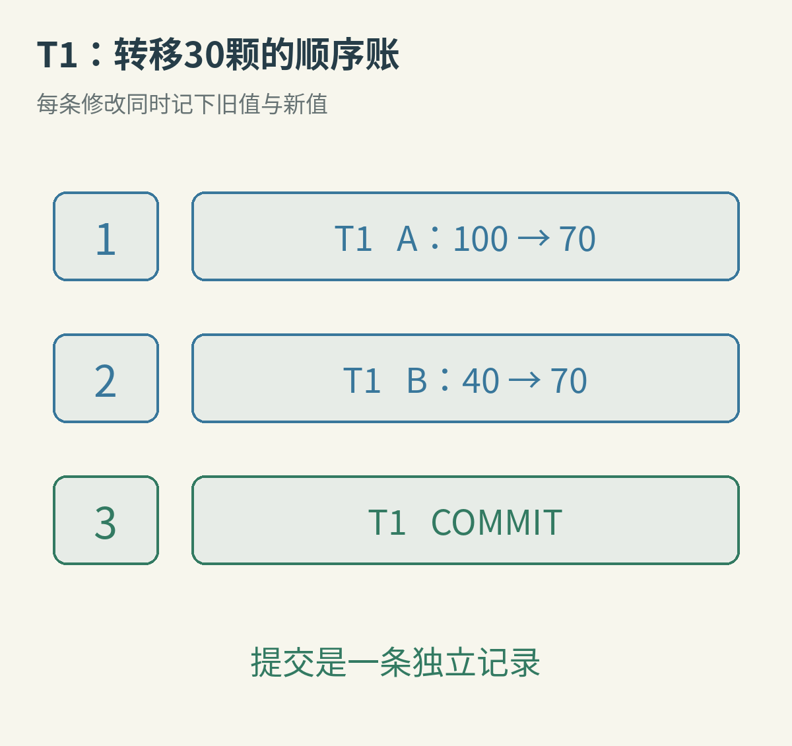

记录序号是顺序账上的位置，用来讲清楚“至少落稳到第几条”，它不是时间戳。真实系统用的是日志序列号LSN，编码和用途都比这里丰富。

为什么要同时存旧值和新值？旧值让系统能撤销没做完的事务，新值让系统能补上应该保留的效果。这是本模型选的日志格式，不是说所有WAL产品都必须逐字段存这一对值。

“预写”的先，关键在于持久顺序：**不能让修改后的数据页先落稳，却把解释这次修改所需的日志留在易失内存里。** 日志只进到内存缓冲区，还没满足这条规则。

## 5. 两道门：写页之前，承诺之前

第一道门管数据页。要把A的新值70写回持久存储，至少先让第1条日志落稳；要把B的新值70写回去，至少先让第2条落稳。

注意这道门是“一对一”的：哪一页要动，就要求解释那次改动的那条日志先到位。不是“随便有一条日志在磁盘上就行”。

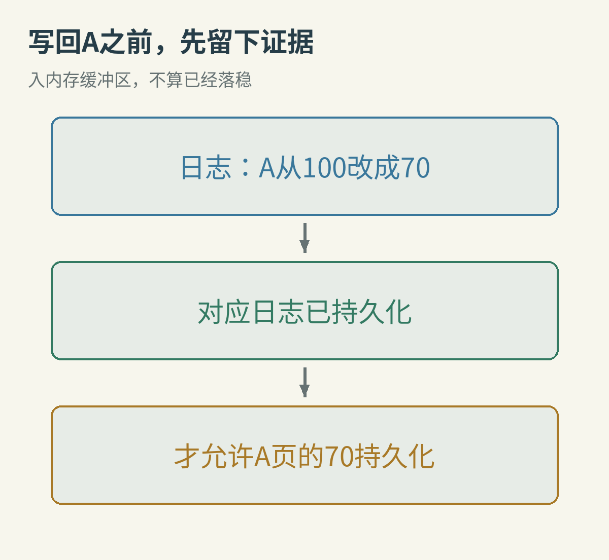

第二道门管对外承诺。只有T1的提交记录也落稳了，系统才有资格回复“成功”。

因为日志是完整前缀，第3条落稳本身就意味着前面两条修改记录已经落稳。系统不需要单独把“提交”两个字抠出来保存。

这两道门各管一件事，别把它们混起来。第一道门保证“无论何时崩溃，都还找得到撤销所需的旧值”；第二道门保证“一旦说了成功，重启后一定还能兑现”。缺了第一道，崩溃后可能不知道从哪儿退回去；缺了第二道，答应的结果可能凭空消失。

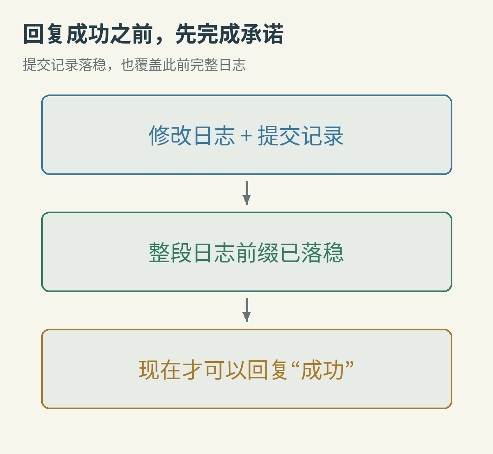

这里有个很自然的疑问：既然都要等，为什么不干脆把两张数据页都写好再回复玩家？

当然可以，那是更严格的策略。WAL提供了另一种选择：先持久化紧挨着的一小段日志，把分散的数据页写回留到以后。它改变的是写入的组织方式和等待的时机，持久化的成本并没有消失。真实系统还可能让一次日志同步覆盖多笔事务；本文没有测吞吐量，也给不出“快几倍”的数字。

## 6. 已提交，页却没写全：需要重做

现在假定第1、2、3条日志都已落稳，数据页仍是100、40，然后崩溃。

只翻数据文件，会以为T1压根没发生过。但持久日志里明明白白留着提交决定。恢复时按记录把A写成70、把B写成70，这笔事务就兑现了。

这个补做叫重做，英文REDO。

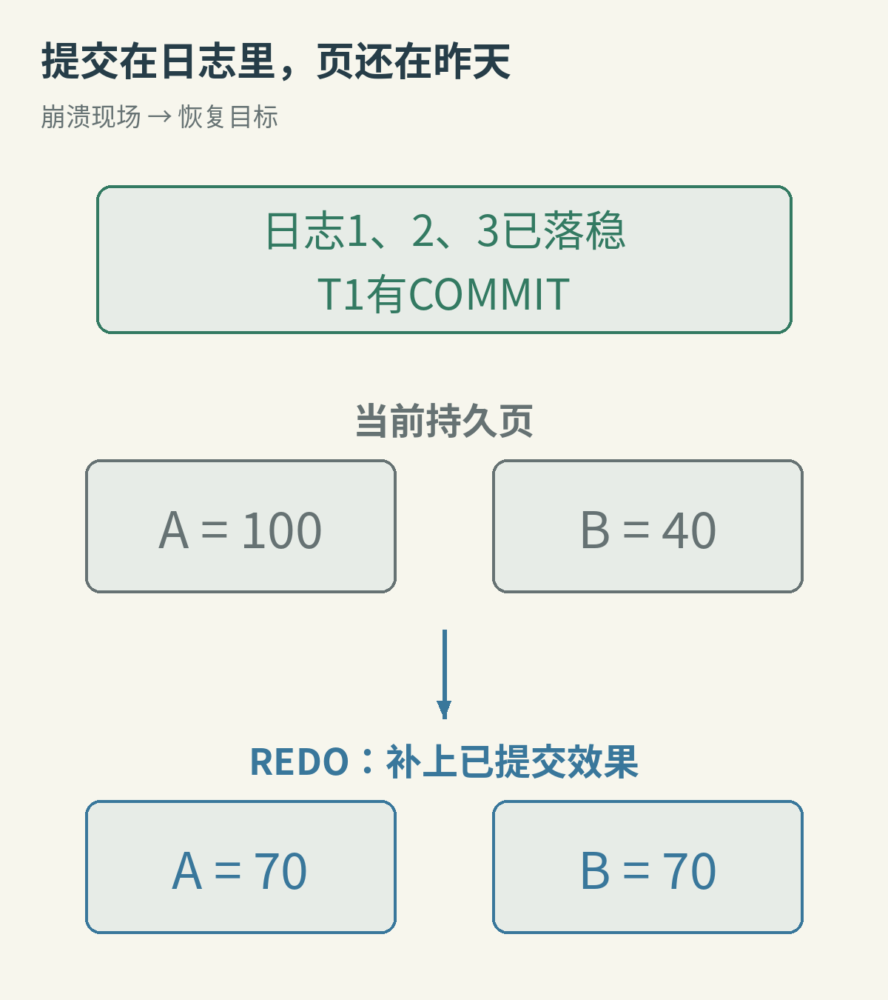

注意，恢复的是日志里记录的效果，不是再向玩家收一次操作。日志写的是“把A设为70”，和业务层再做一次“A减30”完全是两回事——后者执行两次，A可能变成40。

这也是为什么数据库恢复和网络请求去重是两个问题。WAL能帮数据库记住提交结果，却不会自动拦住客户端因为超时而重发的那笔新请求。

## 7. 未提交，页却已写了一半：需要撤销

换一个崩溃点：第1条日志已落稳，A的数据页也已经写成70，但T1还没有持久提交记录，B仍是40。

这时候不能说“扣款都落到磁盘了，就算转移成功”。本模型的判据是持久提交记录。T1没提交，就该把A恢复成日志里的旧值100。

这个回退叫撤销，英文UNDO。

撤销必须知道"原来是多少"，这就是日志里为什么非要有旧值。只有新值不够——新值告诉你事情做过了，旧值才告诉你该退回哪里。

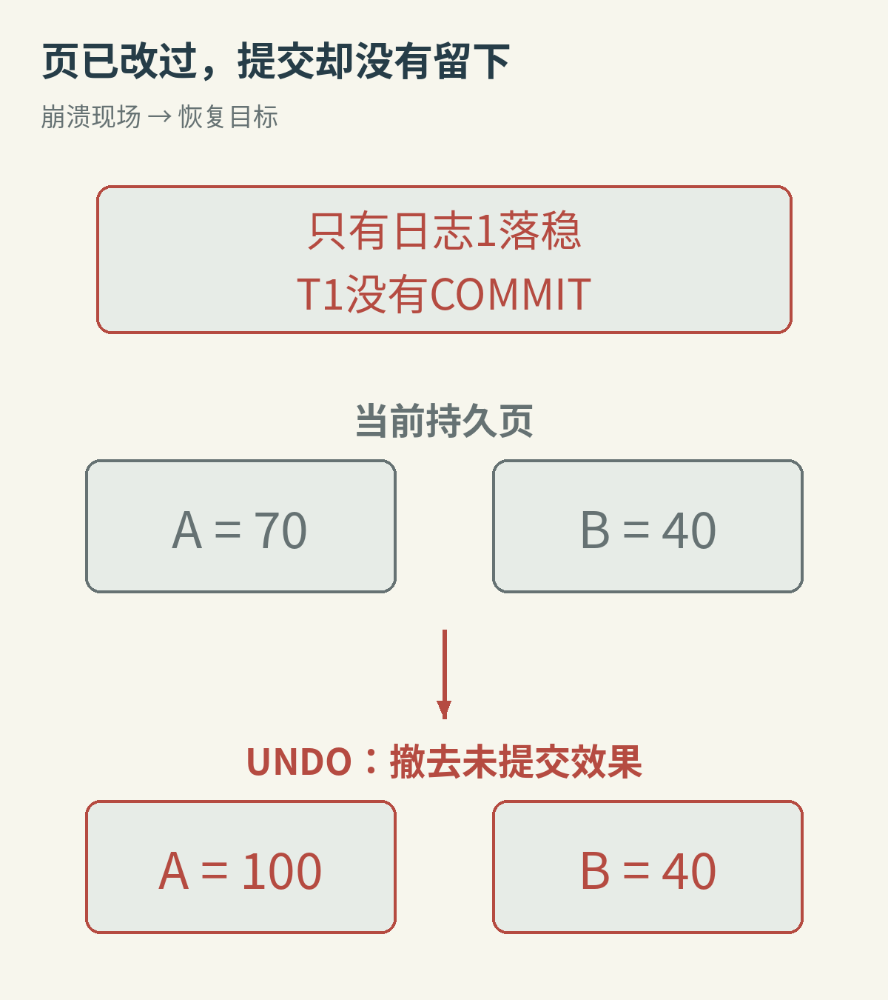

假如当初没先保存第1条日志，崩溃后我们只看见A=70。原来的值是100还是别的？这70是哪笔事务留下的？全无从判断。数据页抢在日志前面落稳，就会把恢复需要的证据弄丢——第一道门守的正是这个时刻。

## 8. 一个更像现场的例子：两个事务混在持久页上

继续沿用T1。它已经提交，逻辑结果是70、70，但B的新页可以暂时还没写回。

接着T2想反向转10颗：A从70到80，B从70到60。于是日志再追加两条：

- 第4条：T2把A从70改成80。
- 第5条：T2把B从70改成60。

让日志落稳到第5条，A页写回80，B页还留着最初的40。此刻断电。

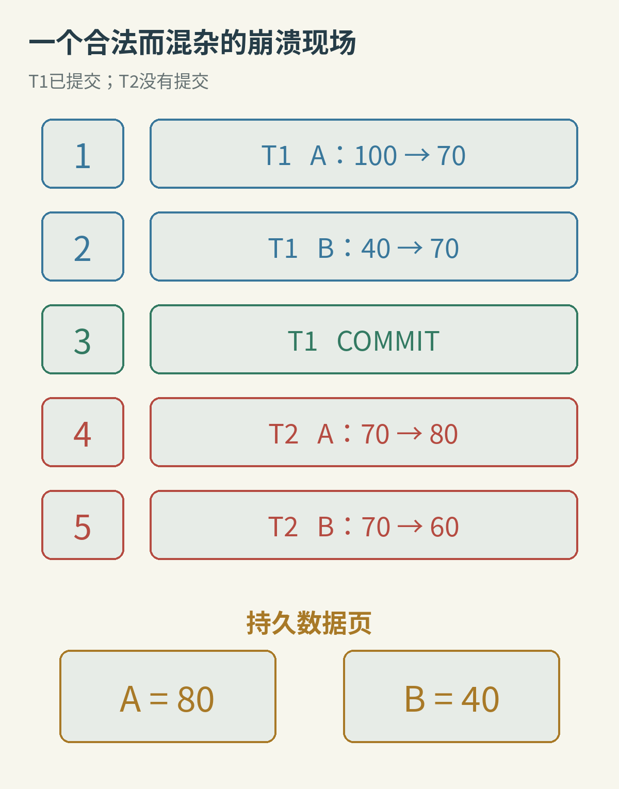

持久状态是A=80、B=40。它既不是最初的100、40，也不是T1完成后的70、70，更不是T2完成后的80、60。四个可能的结果摆在面前，磁盘上偏偏是第五个。

证据倒是没丢：T1有提交记录，T2没有。所以目标是保住T1、撤掉T2，最后回到70、70。

恢复过程可以写得很笨，但很好检查：先把日志里的修改顺序重做一遍，再逆序撤销那些没有持久提交记录的事务。让记录里的历史先走到尾部，再把没走完的尾巴消掉。

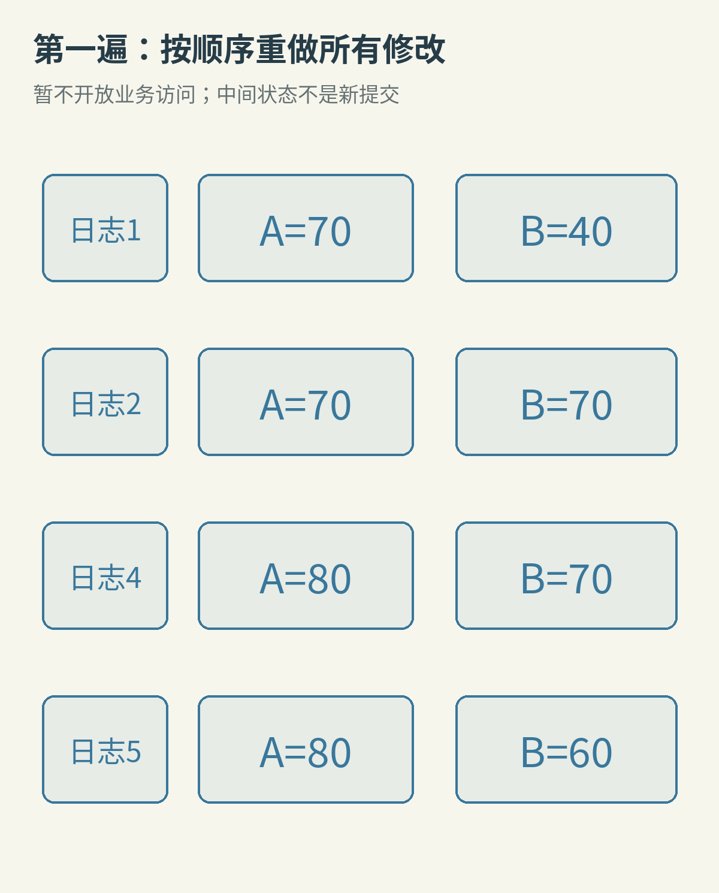

先重做。第1、2、4、5条依次把页状态推成：

70、40 → 70、70 → 80、70 → 80、60。

接着逆序撤销T2：第5条把B还原成70，第4条把A还原成70。

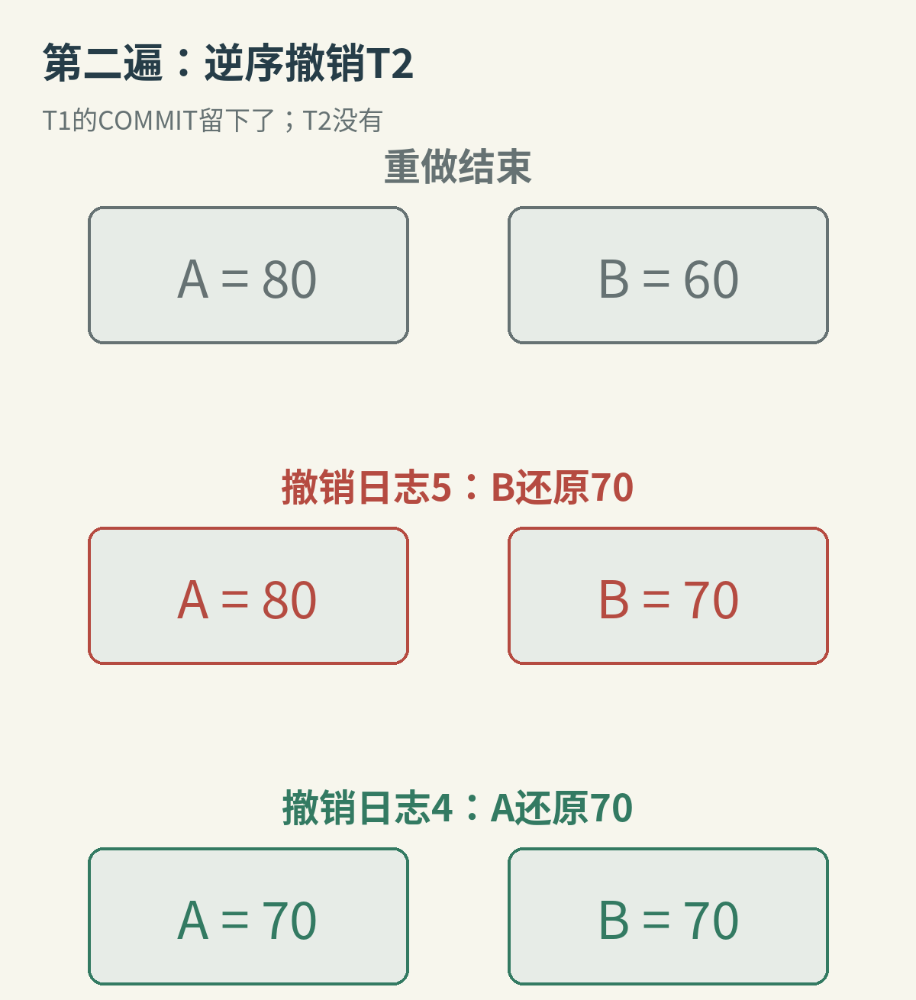

中间短暂出现的80、70不是一次新的业务提交。整个恢复过程都还没对玩家开放，只有最终状态才会拿出去继续服务。

## 9. 为什么撤销要倒着走？

拿一个更小的反例：同一笔未提交事务，先把A从100改成70，又把A从70改成60。

撤销时先撤第二次，60回到70；再撤第一次，70回到100。

如果照正序写旧值，先写100、再写70，最后反而停在70——一个谁都没打算留下的中间状态。

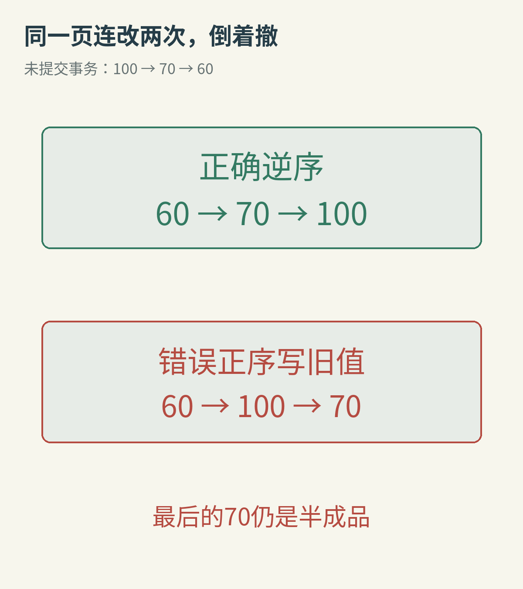

所以并不是“凡是恢复都应该倒着来”。重做仍然按原来的先后顺序走，只有撤销是沿着依赖关系往后退。脱衣服要按穿的反序，这里有一个严格的数值版本。

为什么重做不能也倒着走？因为重做是在重建"最后的样子"，谁排在后面谁说了算；倒着重做会让先写的那条记录反而最后落笔，把结果改写回去。撤销正相反：它要一层层剥掉，后留下的痕迹必须先抹去。两个方向各自服务于不同的目标。

## 10. 十几行代码，先看见完整逻辑

下面的函数只接受第3节约定的模型：串行事务、完整保留日志、完整的持久前缀、页级原子写入，以及恢复期间没有其他访问。它不校验任意外来日志。

记录U表示一次修改，依次保存类型、事务号、页名、旧值、新值；C表示提交。

```python
def recover(disk, durable_log):
    """只用于正文的串行、全日志模型。"""
    result = dict(disk)
    winners = {r[1] for r in durable_log if r[0] == 'C'}
    # 顺序重做所有保留的修改
    for r in durable_log:
        if r[0] == 'U':
            result[r[2]] = r[4]
    # 逆序撤销没有持久提交的尾部
    for r in reversed(durable_log):
        if r[0] == 'U' and r[1] not in winners:
            result[r[2]] = r[3]
    return result
```

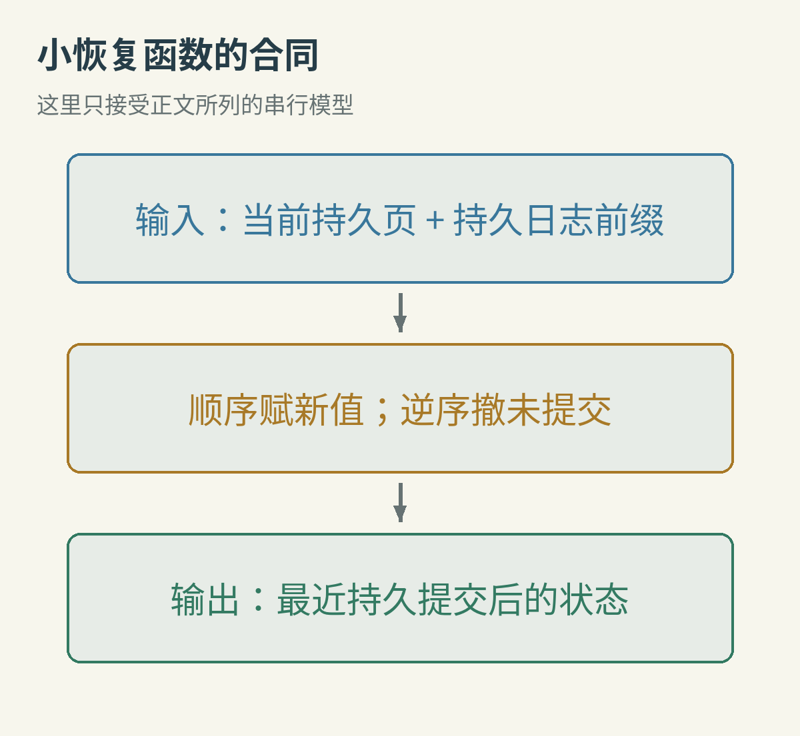

`winners`是恢复文献里的惯用叫法，这里指“持久日志中出现过提交记录的那些事务编号”。它和玩家输赢没有关系。

代码从当前的持久页出发，顺序写入所有记录的新值，再倒序把未提交事务的旧值写回去。主例返回`{'A': 70, 'B': 70}`。

不看代码也能理解它为什么对：对日志里改过的每个对象，顺序重做之后它一定停在最后一条相关记录的新值上；又因为事务是串行的，未提交的事务只可能堆在末尾。把这个尾巴逆序退回，就回到了最近一次持久提交之后。日志从没碰过的对象，恢复过程不会动它。

拿第8节的主例对着代码走一遍会更清楚。持久日志是第1到第5条，其中只有T1有提交记录，所以`winners`里只有T1。第一轮循环按顺序处理第1、2、4、5条，把A、B的新值依次盖上去，页状态走完70、40 → 70、70 → 80、70 → 80、60。第二轮从第5条往回走，第5条属于T2，把B写回旧值70；第4条也属于T2，把A写回旧值70；第2、1条属于T1，跳过。最终70、70。

代码里两个循环的顺序不是随便排的。如果先撤销再重做，T2的旧值会先盖上去，随后又被重做覆盖，结果就错了。

这套理由完全依赖前面的模型边界。一旦允许多个事务交错，或者允许某笔事务结束后再按别的规则回滚，同一个函数就不能原样搬过去。

## 11. 恢复的时候，又断电呢？

在主例的重做、撤销中间随便挑一个位置再崩一次。只要完整日志还在，重启后从头执行同一套恢复过程，还是会走到70、70。

具体走一遍。假设恢复刚做完重做、页停在80、60，还没开始撤销，就断电了。数据页是脏的，可日志完好——重启后程序根本不看那些脏页里写着什么，它从日志重来：重做一遍，再撤销T2，结果还是70、70。恢复中途留下的任何中间状态都会被同一套过程重新冲掉。

这靠两个条件撑着：恢复期间没有新的业务写入混进来，日志没有被提前删掉。

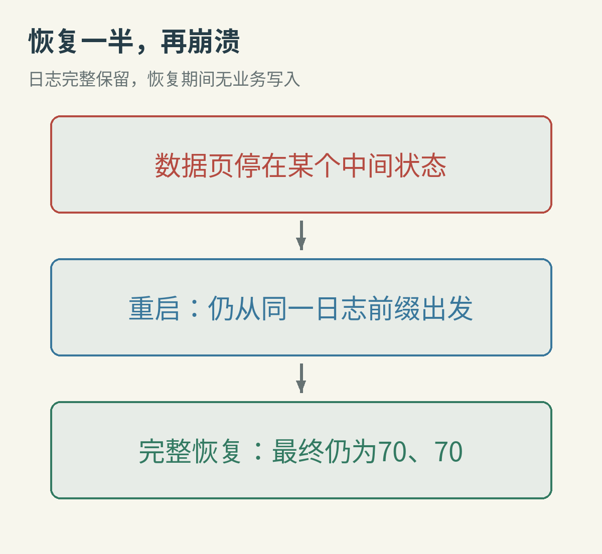

这里用的是“设为某个值”，重复写70还是70，这叫幂等的赋值。它和“每执行一次就减30”是两种东西。

不过单条赋值幂等，并不自动证明任意顺序都安全。整个算法还得守着重做正序、撤销逆序，以及前面那几条输入约定。重复恢复能成立，是这些条件一起凑出来的结果。

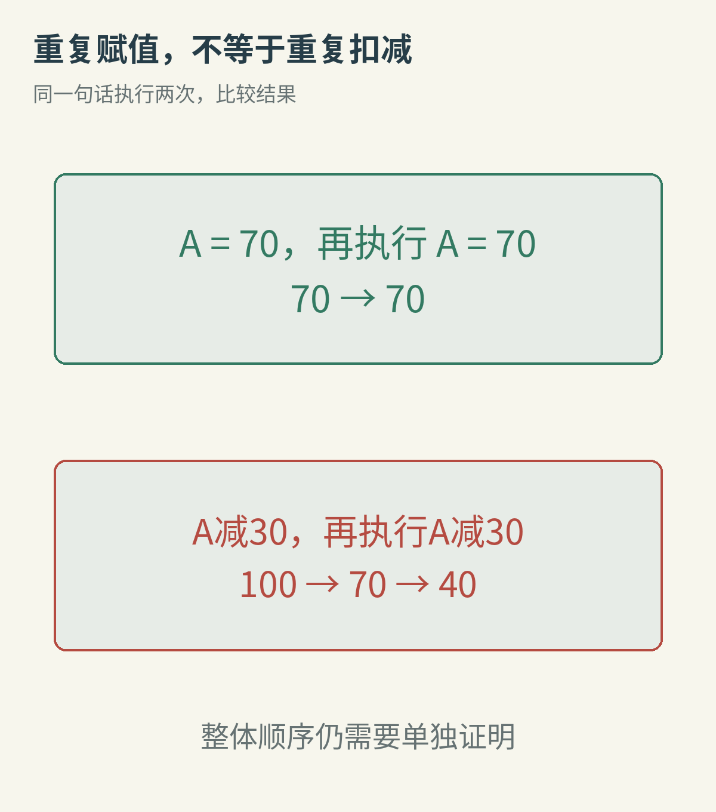

真实数据库不想每次重启都把很长的历史完整重跑一遍，还要支持更复杂的并发和回滚，所以会额外记录更多进度信息。我们这份简洁，是主动把问题切小换来的。

## 12. 把两个开关命名，复杂度就有了来处

第3节故意放开的两个策略，现在可以叫出名字了。

Steal：一笔事务尚未提交，它改过的数据页也允许写回持久存储。可以理解成缓冲区管理者提前收回这块内存的使用权，跟“偷走玩家的数据”没关系。这份自由换来的责任，是撤销未提交的效果。

No-force：事务提交时，不强制它改过的全部数据页立即落稳。这份自由换来的责任，是崩溃后把已提交的效果补做回来。

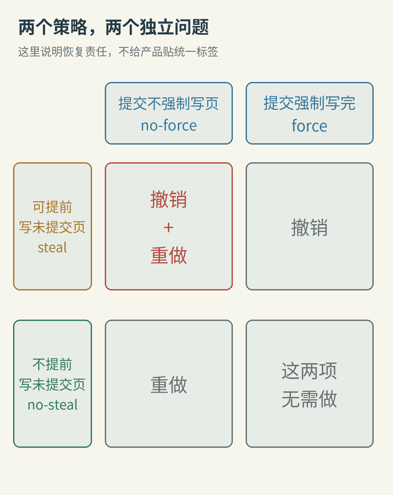

本篇选的是steal加no-force，所以UNDO和REDO都得谈。这两个责任是分别来的：steal让磁盘上可能出现未提交的痕迹，于是要有UNDO；no-force让已提交的结果可能还没落到磁盘上，于是要有REDO。关掉steal，UNDO的必要性就弱了；改成force，REDO的必要性也弱了。换个开关组合，需要的恢复工作也跟着变；这个小模型“每条日志都存旧值和新值”的做法，不是所有数据库的统一规定。

1992年，C. Mohan、Don Haderle、Bruce Lindsay、Hamid Pirahesh和Peter Schwarz发表ARIES论文。它面向细粒度锁、部分回滚这些更复杂的场景，把重演历史、页上的日志序列信息，以及“对回滚本身的记录”结合起来。[原论文](https://www.cs.cmu.edu/~15849g/readings/mohan92.pdf)

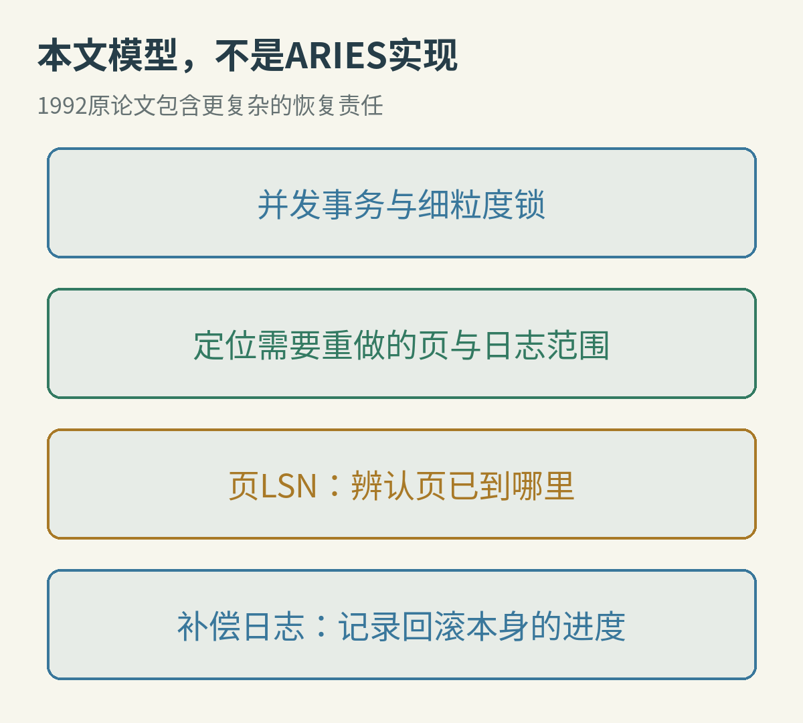

这段代码只借用了ARIES“先重做历史，再撤销未完成部分”的教学顺序。分析阶段、脏页表、页LSN判断、补偿日志记录、并发恢复，一个都没有实现。

SQLite的WAL模式也是另一回事。官方文档里的做法，是把新的页内容追加到一个单独的WAL文件，再通过检查点把进度推进到数据库文件，它有自己的读取、提交和检查点规则。[SQLite说明](https://www.sqlite.org/wal.html)

## 13. 我们实际把哪些地方弄“崩溃”了？

配套的[可运行实验](examples/wal_lab.py)没有只给一条理想时间线拍照。它枚举状态：程序发出到第几条记录、日志落稳到哪一条、A和B各自持久化到哪个版本。

从一个状态出发，只走合法动作——发出下一条记录、让日志前缀前进一步，或者在日志已经覆盖相关修改时写回数据页。走到一个没见过的状态，就把它加进待检查的集合。

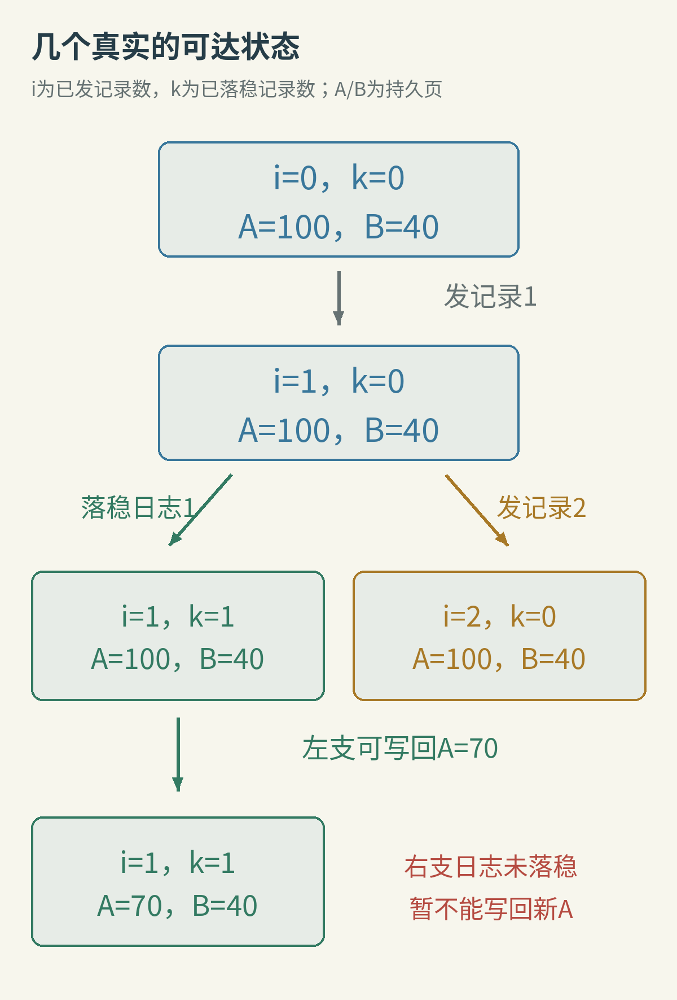

对固定的两笔事务，实际找到79个可达状态、156条状态转移。每个状态都当成一次可能的崩溃现场：丢掉没落稳的尾部，然后恢复。另外在恢复过程的每一次实际页赋值之后也插一次崩溃，一共检查292个这样的中断位置。

正确答案由另一套算法给出：每笔事务维护一份私有的修改集合，只有读到持久提交记录时，才一次性把这批修改发布到参考状态。这个检查器不去猜混乱的数据页里发生过什么。

关键在于这两套算法的出发点不同。恢复程序只看当前脏页和日志，它要“算对”；参考算法从一开始就知道每笔事务想做什么，它只是“按规则发布”。两条完全独立的路径得出同一个答案，才说明恢复逻辑没有偷偷依赖某个隐含假设。

接着把初始A、B，以及两次转移的数量，各自从−2遍历到2的整数，得到625组程序、49375个可达状态。负数只是拿来检查恢复算术的输入，不代表游戏该允许负库存——业务约束和恢复机制，是两层责任。

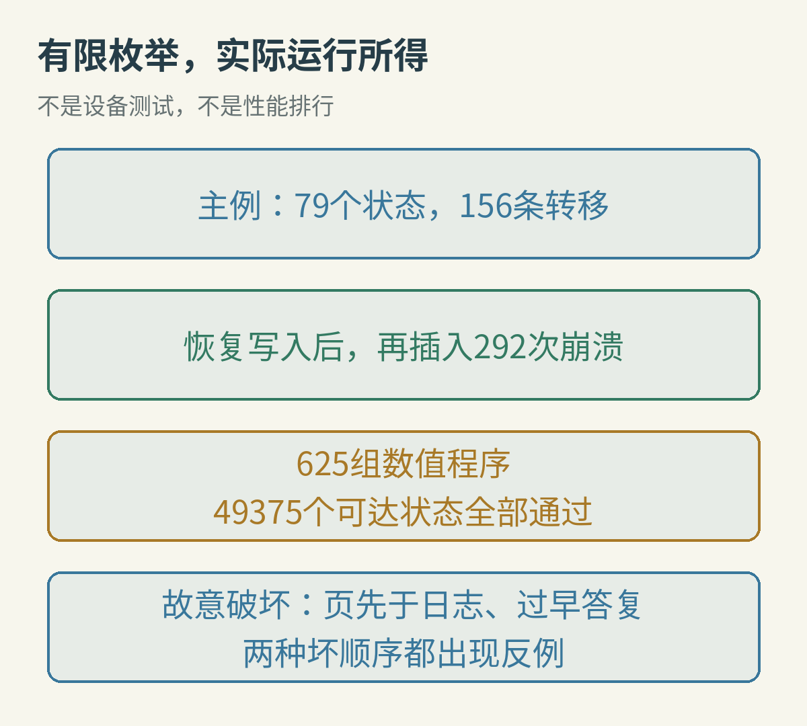

这些检查全部实际通过；也实际验证了两个反例：让数据页跑到日志前面，会丢掉撤销的证据；在提交记录落稳之前就确认成功，被承诺的结果会在崩溃后消失。有限枚举能帮忙找错，但它替代不了前面的条件与理由，更不是硬件可靠性认证。

## 14. 没收到成功，不等于一定失败

再看一个容易判错的时刻：提交记录已经落稳，系统正准备给玩家发回复，连接断了。

从存储恢复的角度看，这笔事务已经提交。从玩家的角度看，那句“成功”压根没出现。

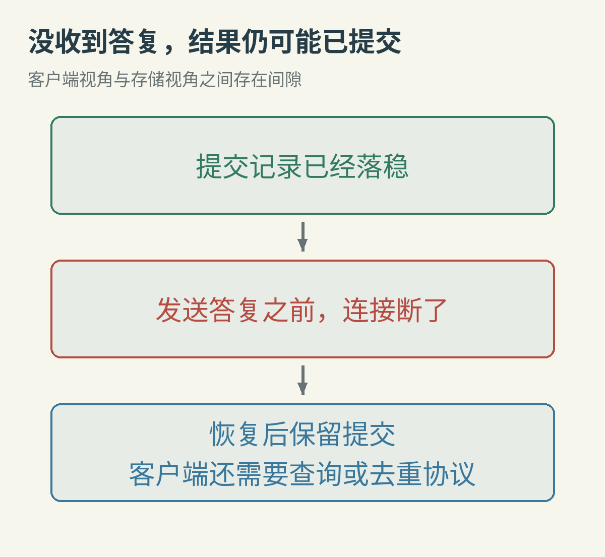

所以客户端没收到回复，只能说明结果暂时不确定，不能直接断定“数据库一定没做”。想重发业务请求，通常还需要请求编号、结果查询或者去重设计——那是架在事务之上的另一层协议，这里不把它算进WAL。

日志也不是永久备份的替身。数据页和日志所在的设备一起坏掉，本文“持久内容仍在”的前提就不成立了。

那能不能干脆一直留着日志？真实系统不会，因为恢复时间会随日志无限增长。检查点就是用来截断它的：先把内存里积累的修改稳妥地推进到数据文件，记下一个“到这里为止都已经反映在数据文件上”的位置，然后这段历史才可以丢。听上去简单，代价是这个位置本身必须可靠——它要么和数据页的落盘顺序严格配合，要么得能在重启时被重新确认。文件看着大就手动删掉WAL，是另一类事故。

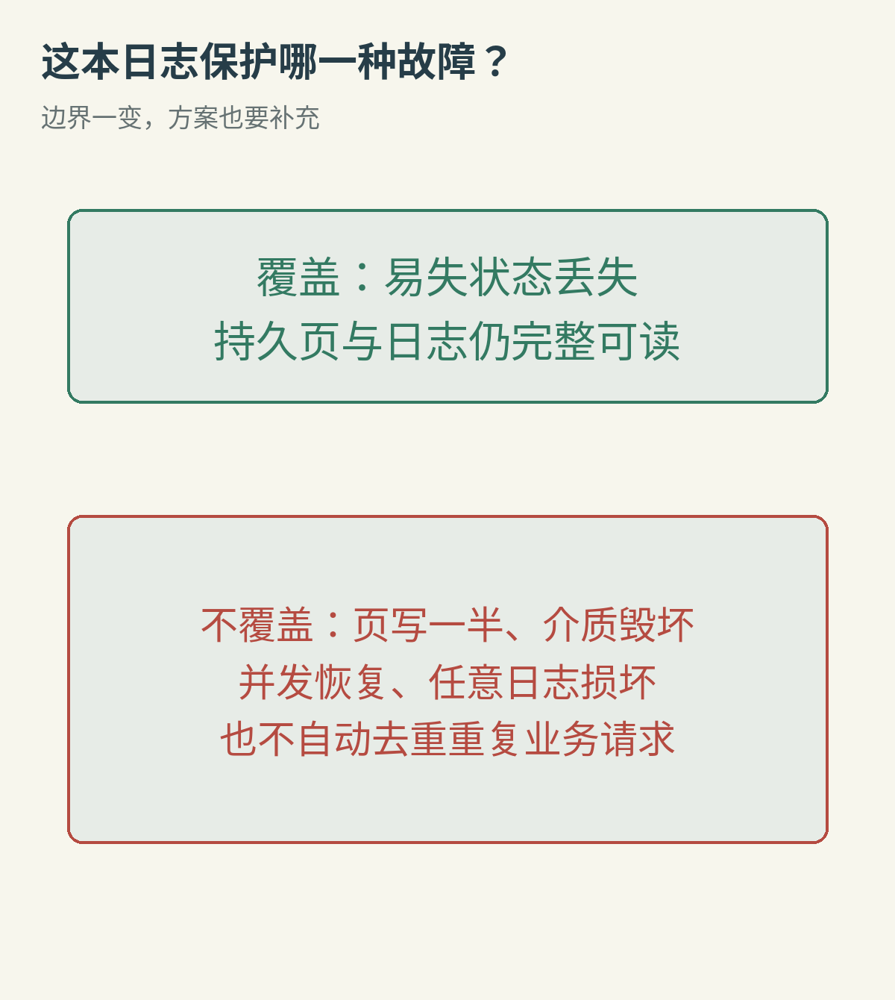

最后留两道能自己算的题。

第一题：仍用第8节的主例，但在崩溃前把T2的第6条提交记录也落稳，数据页仍是80、40。恢复结果是什么？

第二题：保留主例到第5条的日志，恢复执行到“B设为60”后再次崩溃，日志不变。重新恢复，会不会把10颗又转一次？

第一题应是80、60，因为两笔事务都有持久提交记录。第二题仍是70、70，因为T2没有提交，重复恢复最后还是会把它撤掉。

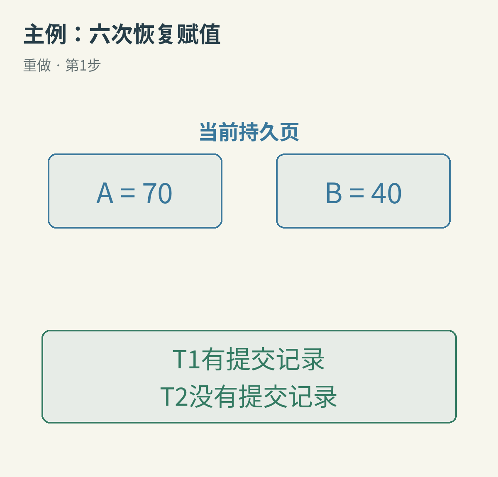

WAL真正值得记住的，不是“多写一个文件就安全”。它把一句对外的承诺，拆成了两条可以检查的先后关系：数据页不能抢在必要证据前面；成功答复不能抢在持久提交前面。

故障真的发生时，恢复程序照着日志走就行，不必猜“看起来做到了哪一步”。哪些效果必须保留、哪些必须撤去，证据里都写着。

---

原创正文与原创教学示意采用CC BY 4.0；第三方Jim Gray照片另按CC BY-SA 3.0 US，实验代码另按MIT。照片未修改，完整出处、素材范围、模型条件与AI辅助说明见[来源及素材说明](sources.md)。
