# Doom 入门①：一张平面地图，怎样变成能走进去的房间？

先看一张真正的游戏画面。

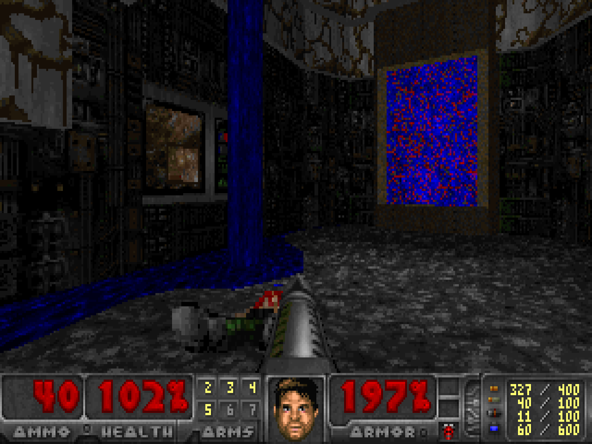

*这是 Freedoom 官方提供的实际游戏截图，运行引擎（负责让游戏运行、生成画面的程序）为 Chocolate Doom；不是 1993 年《Doom》的原版关卡或美术。原图为 1600×1200，官方说明它由 320×200 的渲染结果（根据游戏数据计算出的画面）按显示比例放大，并保留像素（组成图像的小色块）的清晰边缘。[截图原页与许可](https://freedoom.github.io/screenshots.html)*

你能认出脚下的地板、立起来的墙，能分辨哪里近、哪里远。甚至不需要玩过游戏，也会自然地觉得：这是一个可以走进去的地方。

现在想象把这座建筑的屋顶拿走，从正上方往下看。高低暂时消失，只剩一片片区域和它们的边界。

**怎样把这些平面上的线，变回刚才那种有高度的房间？**

这是本系列的第一站。我们先不碰让老电脑加速的 BSP，也不要求你懂三维建模、矩阵或 C 语言。今天只完成一件事：看懂经典 Doom 地图怎样描述“哪里是地板、哪里是天花板、哪里还有开口”。

Doom 的引擎代码和游戏素材是两回事。本文以 id Software 公开的 Linux Doom 1.10 源码核对结构；它是公开的历史代码版本，不等于本次运行了 1993 年 DOS 版。为了让读者能合法保存实际图像，我们主要使用开放许可的 Freedoom 素材。想先认认原版关卡，可以另看 [Doom 第一关 E1M1 的地图原页](https://doomwiki.org/wiki/File:E1M1_map.png)；该图是受版权保护的原版地图，链接不等于本文给它重新授权。

## 1. 先把整座基地缩成两个房间

整张真实关卡太复杂，第一次看容易被细节淹没。下面只用相邻的 A、B 两间房：A 在左，B 在右；玩家站在 A 中间，朝 B 看。

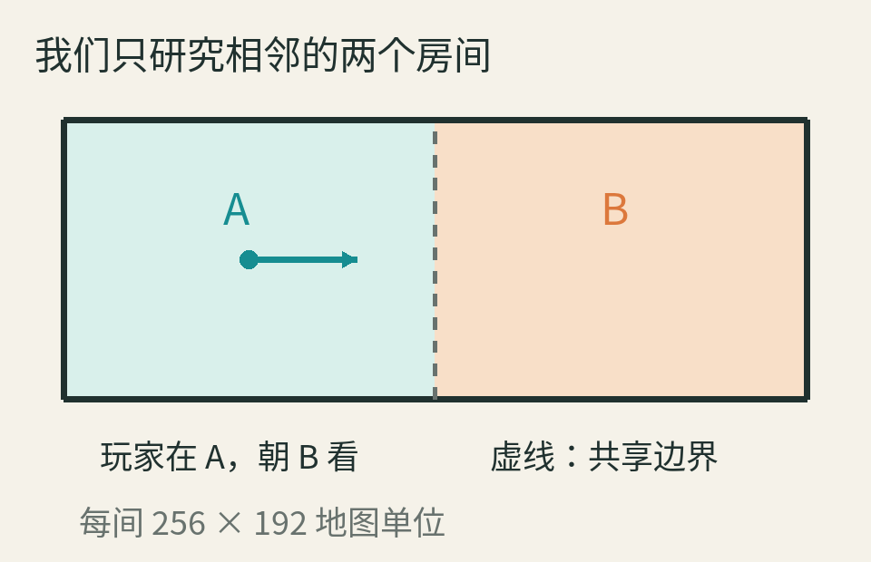

*这是后文始终使用的原创教学地图。它不是开场截图的平面图；两者没有冒充同一个地点。*

每间房在平面上宽 256、高 192。这里的数字是**地图单位**，先把它当作方格纸上的格数，别急着换算成米。一种游戏里的“1”，需要由游戏自己的比例约定来解释。

房间中间画着一条虚线。先记住这个疑问：这条线一定要变成一整堵墙吗？

如果一定如此，A、B 就被封死了，根本无法做出连通房间。可如果把线删掉，又怎样告诉电脑，跨过去之后地板可能变高、天花板可能变低？

答案藏在接下来三个小零件里：**点、边，以及边两侧的区域。**

## 2. 点只有地址，边才有方向

先画一个点。要让计算机以后还找得到它，就得给它一个地址。

我们规定：向右走，看 x；向上走，看 y。写成 `(256, 192)`，意思是“从原点向右 256，再向上 192”。括号里的两个数只是横向、纵向地址，不需要先学复杂数学。

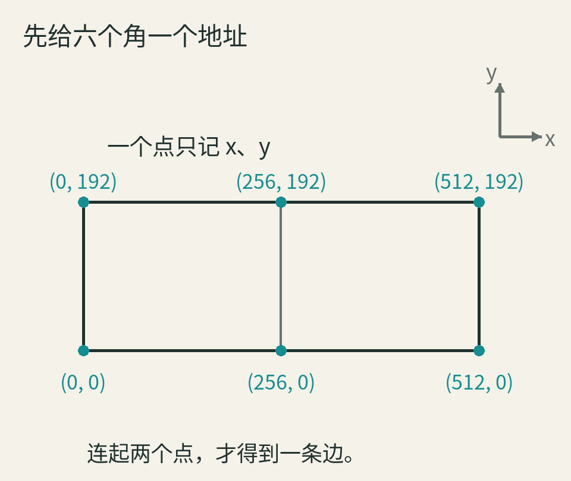

*原创示意。这里的“向上”指俯视地图的上方，还不是房间离地面的高度。*

这样，我们有了六个角。经典 Doom 把这样的点叫 **vertex，顶点**。源码里的地图顶点记录确实只有 x 和 y 两个坐标。[1]

接着，把两个顶点连起来。例如，从 `(256, 0)` 连到 `(256, 192)`，就是 A、B 之间那条竖线。

这类地图边叫 **linedef**，可以理解成“一条边的定义”。它会记住：从哪个顶点出发，到哪个顶点结束。它也能带着阻挡标志、触发动作等信息，但现在先只看几何关系。

请注意，我们说的是“边”，不是一律叫“墙”。

- 最外圈的边，背后没有另一个正常可进入的区域，通常形成实墙。
- A、B 之间的边，两侧都有区域，可能留下开口。
- 有些区域只是亮度或地面外观变了，它们之间也可以存在边，未必看得见一堵墙。

现在来看方向。让共享边的箭头从下指向上，沿箭头往前看，A 在左边，B 在右边。

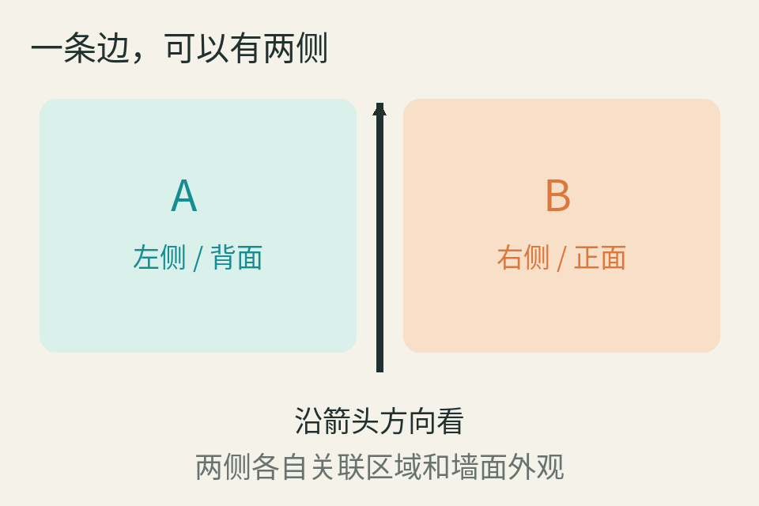

在经典地图约定里，一条有向边的右侧叫正面，左侧叫背面。这里的“正面”是数据约定，不是在说玩家此刻正对哪一面。调转边的箭头，左右称呼也会调换。[2]

**sidedef，边侧定义**，就是给某一侧附上一张说明卡：这一侧关联哪个区域，墙面上、下、中间分别用哪张图案图像（纹理），以及图案从哪个位置开始贴（纹理偏移）。[1][2]

暂时不用背四个英文词。把关系记成一句话就够了：

**两个点定出一条边；边可以有两侧；每一侧再去关联一个区域。**

## 3. 地图上没有高度？高度记在区域里

现在终于轮到房间的第三个方向了。

我们用 z 表示向上的高度。别把它和刚才俯视图里的 y 混淆：x、y 负责“在平面上哪儿”，z 负责“离参考平面多高”。

给 A 记两个数：

- 地板高度：0。
- 天花板高度：128。

给 B 也记两个数：

- 地板高度：24。
- 天花板高度：96。

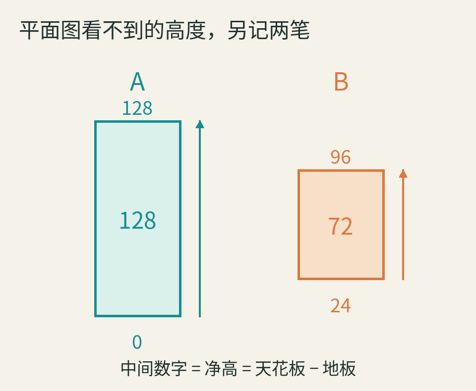

所谓**净高**，就是地板到天花板之间的高度。A 是 128−0=128，B 是 96−24=72。所以 B 既抬高了地板，也压低了天花板。

经典 Doom 用 **sector** 保存这样一组区域属性：地板高度、天花板高度、地板与天花板的图像、亮度，还有特殊效果等。[1]

很多教程把 sector 译成“扇区”。这个译名容易让人想到披萨的一块，但 Doom 的 sector 完全不必是扇形。本文直接称它为**区域**。

也不要立刻把“一个 sector”和“一间房”画等号。一间房可能为了台阶、灯光、坑洞而切成许多 sector；多个分开的地图片段，也可以关联同一个 sector 属性记录。我们的 A、B 恰好一间对应一个，只是为了容易理解。[2]

这并不是教程为了方便而虚构的按钮。下面是 Ultimate Doom Builder 项目文档里的真实 sector 信息面板：

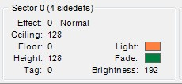

*实际软件界面原图，来自该项目文档的 sector 信息示例。它显示的是文档自己的 sector 0，不是本文 A 的编辑截图；也不是 1993 年开发工具的历史画面。[原文件](https://github.com/UltimateDoomBuilder/UltimateDoomBuilder/blob/bfb9653951445c7a4e4c46b1600e14358e901e44/Help/gzdb/features/sectors_mode/sector_info.jpg)*

图上最值得认出的三个词：

- **Ceiling 128**：天花板在 128。
- **Floor 0**：地板在 0。
- **Height 128**：两者相减得到净高 128。

后面的 Light、Brightness 是光照和亮度信息。我们先不研究它们。看懂前三行，就已经能把“平面区域另带两个高度”这件事对上真实工具了。

## 4. 把地板铺上，把天花板抬起来

回到 A、B。

A 的平面范围是左侧矩形。把这片范围的地板放到 z=0，再在 z=128 放一片天花板。

B 也这么做，只是它的地板在 z=24，天花板在 z=96。

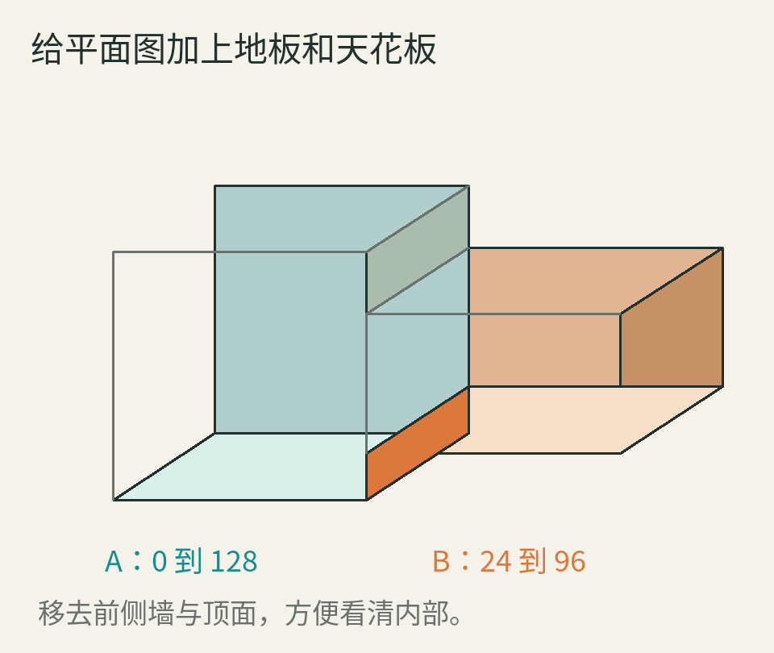

*原创几何示意，与前面的 A、B 坐标和高度一致。移去了靠近读者的侧墙和顶面，方便看到内部；不是游戏截图。*

你可以把这个过程想成给平面上的每个区域指定一段“允许存在空气的高度”。在 A 里，从 0 到 128 是房间内部；在 B 里，从 24 到 96 是房间内部。

这个说法很有用，但只用于理解空间。源码并没有逐格存储“空气粒子”，也不是先制造一块实体再把它挖空。它保留的是边界和高度，让其他程序按需要求出画面或碰撞关系。

外圈的墙比较容易理解：平面边界确定墙沿着哪里走，地板与天花板确定它上下延伸到哪里。

真正有趣的是 A、B 的共享边。它的上下应该怎么画？

## 5. 一条共享边，为什么能同时有台阶、开口和上墙？

我们让玩家始终站在 A 的同一位置、朝同一个方向看，每次只改 B 的一个高度。

### 第一步：两边一样高，共享边处没有高度差

先临时把 B 也设成地板 0、天花板 128。

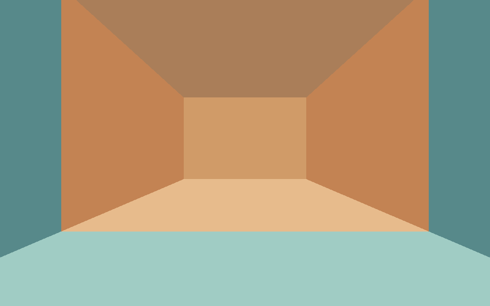

*原创模型计算图。按同一个观察位置和房间形状计算出来，颜色区分 A、B；不是 Doom 引擎的实际运行画面，也不用于说明 Doom 的绘制算法。下面两张沿用同一相机。*

这时，两边的空气从地板一直连到天花板。假设没有中间栏杆纹理、没有其他物体，共享边就不会因为高度差冒出一堵墙。图中的颜色交界用于让你认出两个区域，真实游戏可以让这种边界完全看不出来。

地图里有一条边，与画面里有一面实体墙，已经明显是两回事。

### 第二步：只把 B 的地板抬到 24

B 的地板上去了，A 的还停在 0。

站在 A 往 B 看，0 到 24 这段高度，在 A 这边仍是空气，在 B 那边已经落到地板下面。于是，边界上露出一段竖直的台阶侧面。

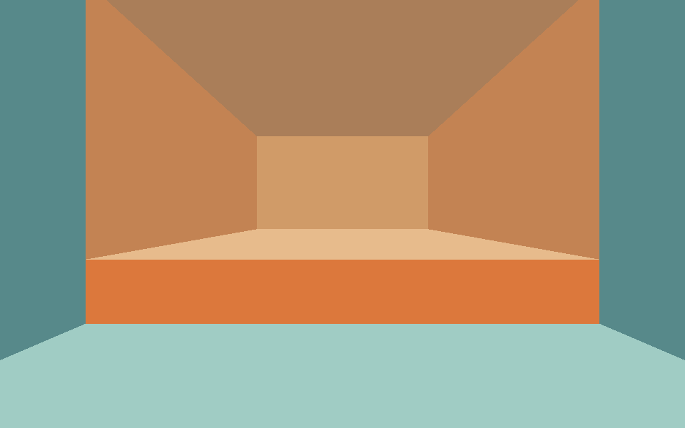

Doom 的墙面处理会把这一类部分作为**下墙段**处理，给它选下方纹理。你不需要另外画一个自由摆放的“长方体台阶”，高度差已经告诉程序这里该出现什么。[3]

这里说的是这个简单、正常的两区域例子；天空、特殊贴图技巧和引擎漏洞效果先不加入。

### 第三步：再把 B 的天花板降到 96

现在 A 的天花板仍在 128，B 的已经降到 96。

从 A 看过去，96 到 128 这段高度也被封住了，边界上出现**上墙段**。

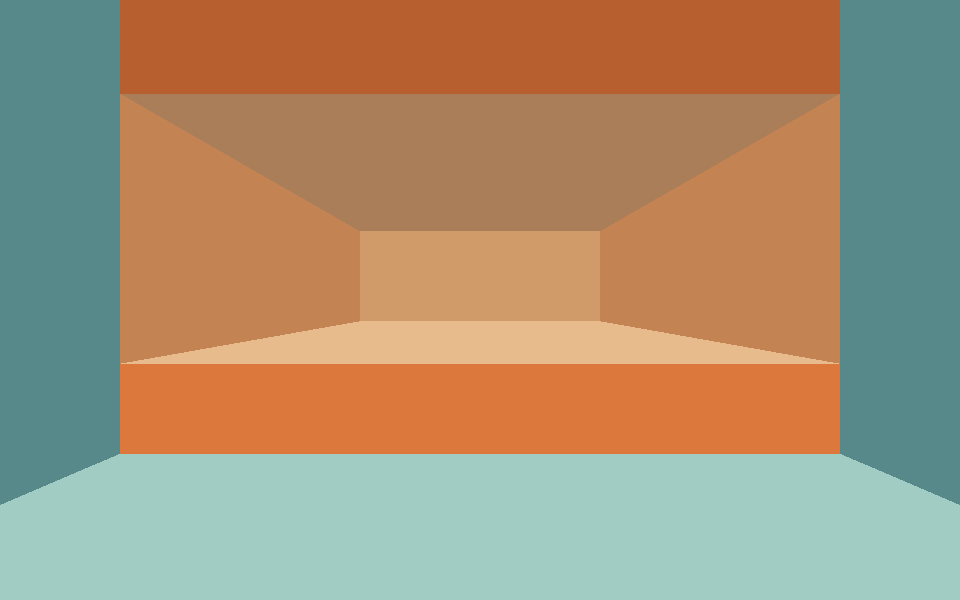

于是，同一条平面边界，在立体画面里对应三段：

1. 下方 0～24：台阶侧面。
2. 中间 24～96：两边空气相通，保留开口。
3. 上方 96～128：较低天花板前露出的上墙段。

如果刚才的透视图还有点难认，换成侧面切开的剖面图。

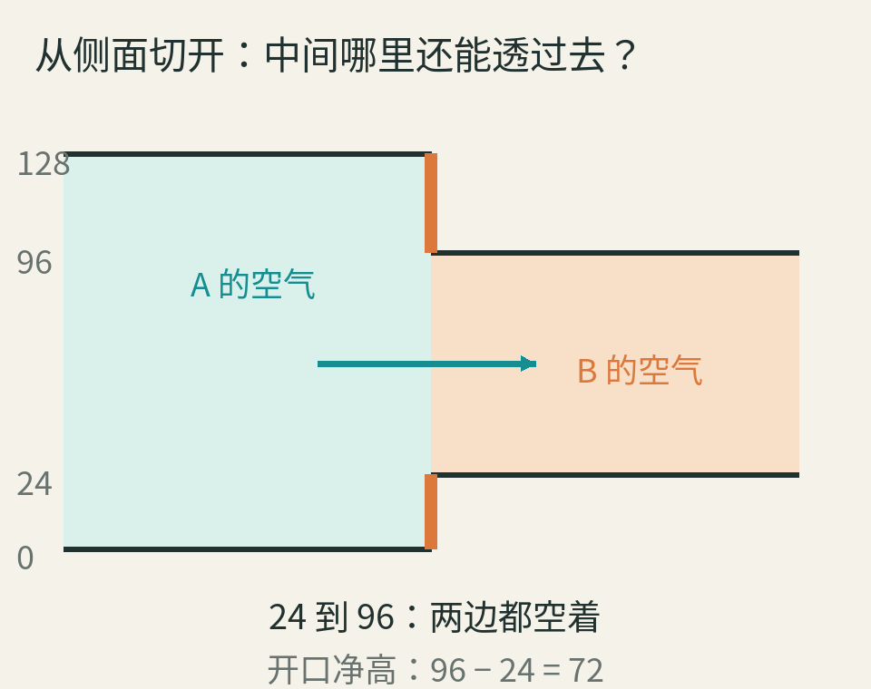

*原创侧剖面。横向是从 A 走向 B，纵向才是高度；它与俯视地图的观看方向不同。*

这就是“平面边界加高度”最重要的一步。**墙上留多少空，不是靠猜；比较相邻两片区域的高度就能得到。**

## 6. 只需要一个很小的公式

先把 A 的空气范围写成 0～128，再把 B 写成 24～96。

要同时属于两边的空气，必须高过两边地板，又低过两边天花板。于是：

- 开口底部取两个地板里**较高**的：24。
- 开口顶部取两个天花板里**较低**的：96。
- 开口净高：96−24=72。

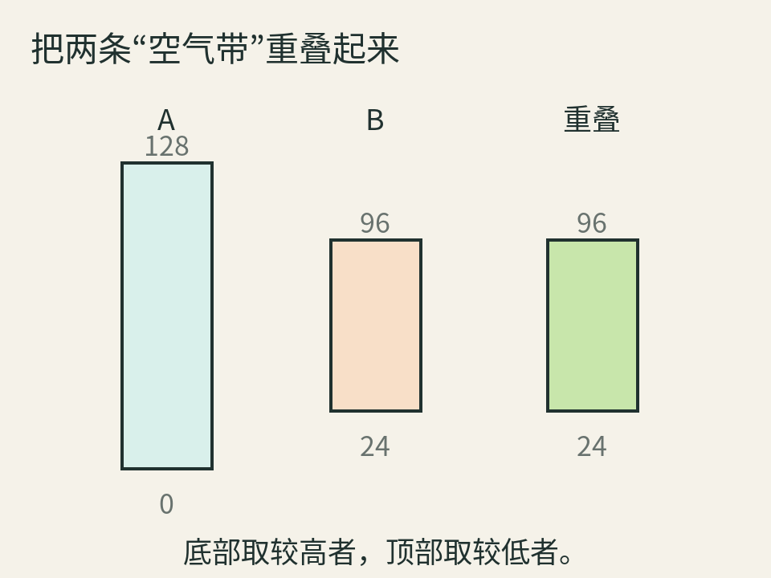

如果你愿意看公式，把“取较高者”写成 max，“取较低者”写成 min，就得到：

**开口底部 = max(A 地板，B 地板)**

**开口顶部 = min(A 天花板，B 天花板)**

**开口净高 = max(0，开口顶部 − 开口底部)**

最后那个 max(0，…) 是本教程方便表示“剩余开口”的写法：如果两段空气不重叠，就把开口记为零。源码的 `P_LineOpening` 会直接记录顶部减底部，某些情形可以是负数；不要把这里的展示写法说成源码逐字如此。[4]

这两种写法在我们的 A、B 例子里都给出 72。

把 B 的天花板继续压到 24 呢？B 地板也是 24，开口变成零。以后讲门时，我们会再用到“改变高度，就能改变开口”这个想法。但正常门还涉及专门的窄区域、触发和运动规则，本篇的整间 B 只是几何演示。

## 7. 真正的关卡，确实存着这些东西

现在可以从教学小方框走回真正的游戏文件了。

Doom 常把地图、图片、声音等数据放在 **WAD 文件**里。你可以先把它理解成一个有目录的资料包：目录告诉程序，哪段字节保存顶点，哪段保存边，哪段保存区域属性。[1][2]

下面这张图直接读取 Freedoom 项目里实际的 MAP01 地图数据，把其中的边画出来。

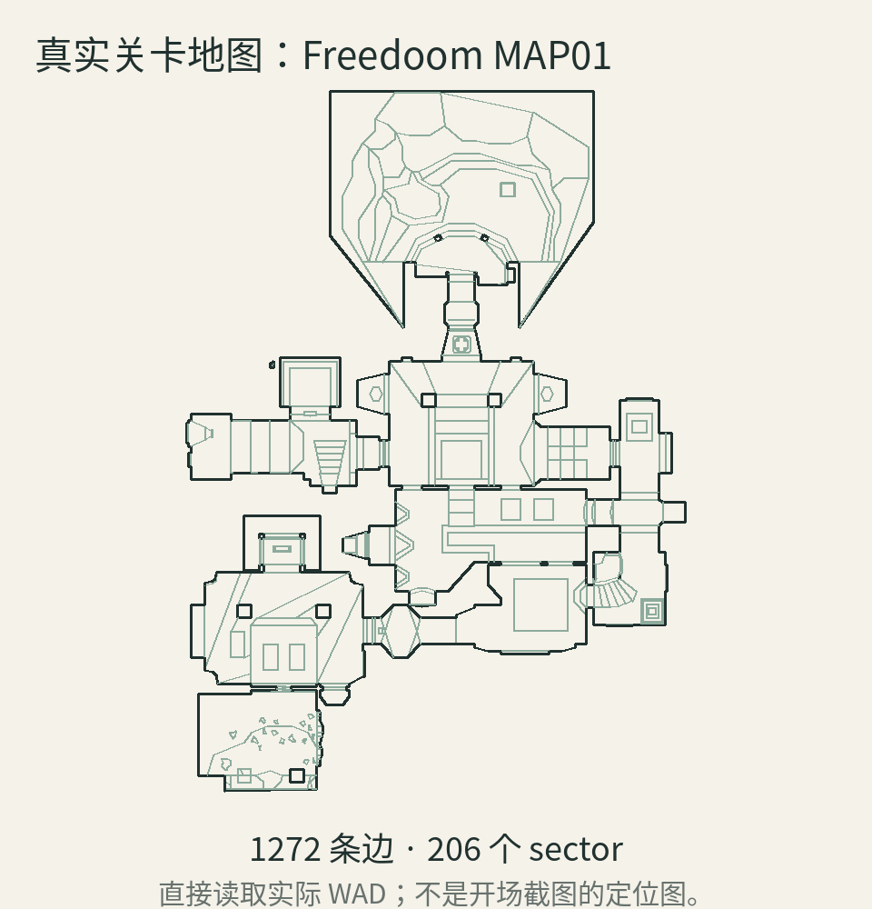

*由真实关卡数据绘制，不是游戏自动地图界面的截图。数据版本固定于 Freedoom 提交 3ac0196；图中绘制 LINEDEFS，没有把预处理产生的所有分割线都混进去。它也不是开场官方截图的地点定位图。原关卡和数据版权属于 Freedoom 贡献者，按 BSD-3-Clause 使用。[5]*

这一版有 1272 条地图边、206 个 sector。第一次看会觉得复杂，但电脑没有突然换一套魔法：仍然是点、边、两侧关系，以及区域属性，只是数量多了。

我们真的从文件里读出第 0 个 sector，得到地板 0、天花板 128。再沿着关联它的边侧记录，把它的边界找出来：

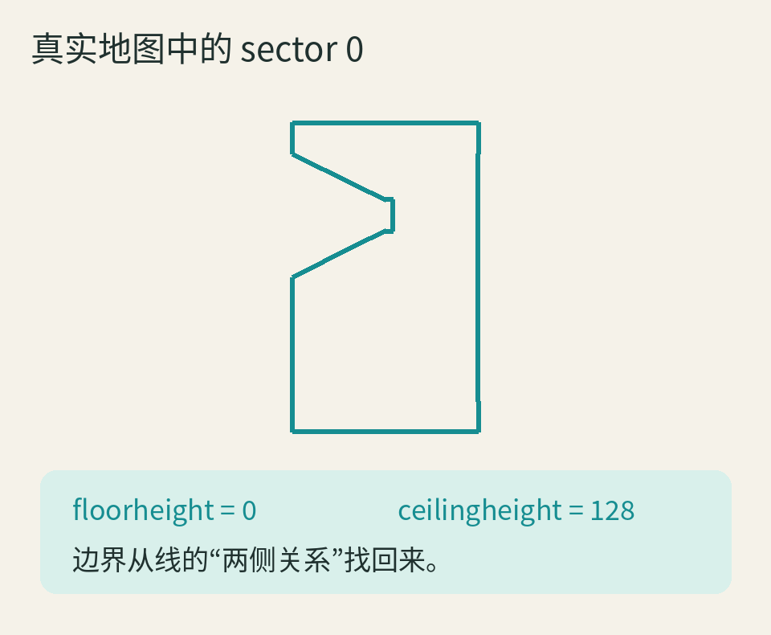

*真实关卡数据的局部可视化。编号是从 0 开始的文件记录索引；这片不规则区域不是本文原创 A 房间。为了看清边界，没有叠加怪物和道具标记。*

观察这个凹进去的轮廓。一个 sector 的形状不必是矩形，也不必像扇子。前面用矩形，只是为了让我们把注意力放在高度上。

还有一个很细、却能让你真正理解文件的地方：sector 记录本身没有把每个边界点都再抄一遍。形状关系通过“顶点→边→边侧→sector”连起来。高度属于 sector；轮廓要沿关联关系找。这正是图中的局部能从真实数据重建出来的原因。[1][2]

## 8. 房间有了，砖墙花纹从哪里来？

到目前为止，我们得到的房间只有形状。它可以是一片纯青色或纯橙色，也可以披上金属板、石砖、地砖。

下面三件东西都是真正的 Freedoom 图像素材，不是为了仿游戏临时画出来的。

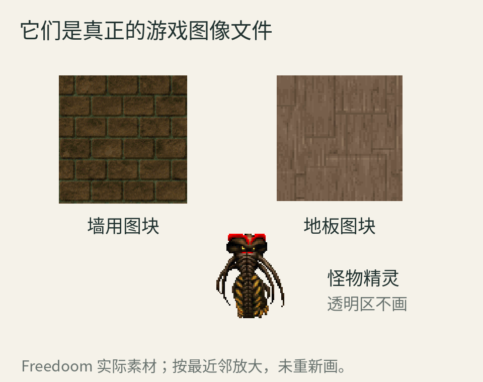

*素材分别来自 brick、floor0_1 与 trooa1 图像文件；展示时按最近邻放大，不把像素边缘抹平。原尺寸原文件也一并保留：[墙图块](assets/13a-brick-original.png)、[地板图块](assets/13b-floor-original.png)、[精灵](assets/13c-sprite-original.png)。均按 Freedoom 的 BSD-3-Clause 许可使用。[5]*

先看砖块图像。它提供的是颜色图案。程序要把图案铺到一段墙面上，还需要知道：墙在哪里、多高、多宽、该从图片哪个位置取颜色。

**纹理**，可以先理解为“用来给表面上颜色的图像”。经典 Doom 的墙纹理还能由一个或多个图块组合；这里展示的 brick 是墙用图块，不声称任何一张 PNG 都等于原引擎的一整张墙纹理。[6]

地板使用的图像常被叫作 **flat**。先记作地板、天花板用的图块就好，今天不急着学习它在屏幕上怎样取样。

精灵 **sprite** 则用来表现怪物、道具等对象。它不像房间墙面那样由刚才那套边和高度直接组成。透明位置让背景露出来；对象在世界中仍有自己的位置和游戏规则。如何让一张图像跟着视角出现，我们留到第四篇。

再看一张实际运行画面，把刚才的独立小图放回游戏的语境里：

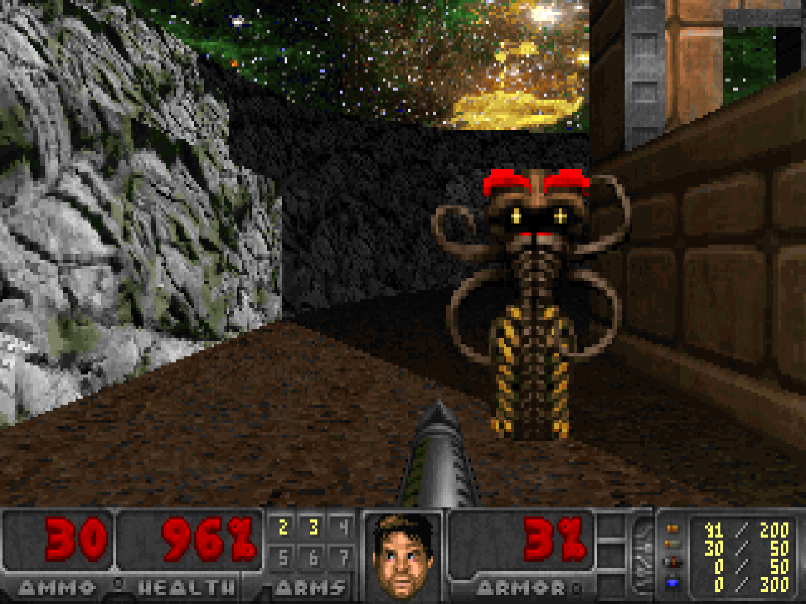

*Freedoom Phase 1 / Chocolate Doom 官方实际截图，1600×1200原文件；不是本次启动游戏截取。这里用它观察“对象的图像”与周围“房间表面”的区别，不断言画面恰好使用上图展示的那一帧，也不把它对应到本文的A、B房间。[来源与许可](https://freedoom.github.io/screenshots.html)*

墙、地板和怪物都出现在同一张最终画面里，但它们在数据中的职责不同。房间是空间结构；怪物是放进世界、按游戏规则活动的对象。

把前面的砖和地板图块放到同一个两房间教学模型上，效果就变成这样：

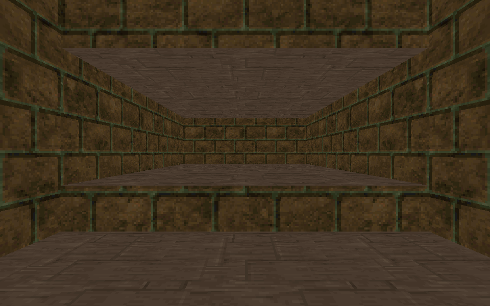

*原创教学渲染，使用 Freedoom 图像；不是 Doom 或 Chocolate Doom 实测画面。它沿用 A=(0,128)、B=(24,96) 和前面的相机，只改变表面着色。本模型不是经典引擎实现，纹理取样也只作说明。*

房间的开口和台阶并没有因为换了图案而改尺寸。把砖纹换成花纹墙纸，它还是同一个几何房间。理解这种“空间结构”和“表面颜色”的分工，是游戏开发和图像处理都会反复用到的基础。

## 9. 为什么大家爱把它叫作“2.5D”？

现在你已经有足够的准备，来理解那个听起来有点奇怪的词了。

经典 Doom 的普通 sector 在平面上有范围，再配一对地板、天花板高度。站在一个固定的 x、y 位置，通常对应一段由地板到天花板的竖直空间。

想在同一个 x、y 位置，既有楼下房间，又有独立的楼上房间，中间还隔着一层实体楼板，会怎样？

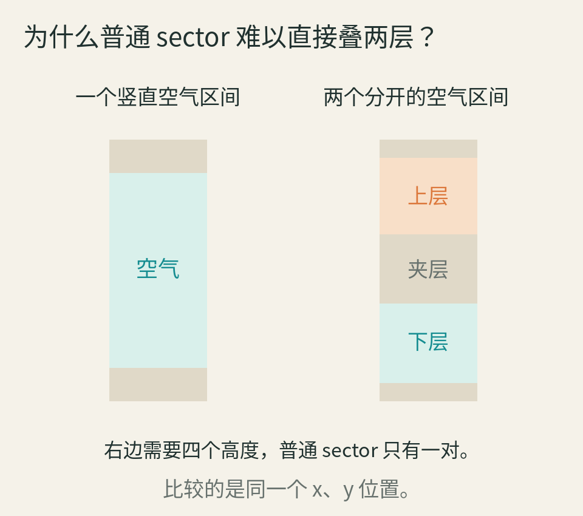

楼下需要自己的地板、天花板；楼上又要一对。普通的单个 sector 只有一对高度，无法直接表达图右那样两段彼此分开的空间。经典地图数据和渲染体系也不是任意三维实体建模系统。[1]

同样，一个 sector 的地板只记一个高度；在普通形式下，它是水平的。想要一条连续斜坡，就得让同一片地板不同位置有不同高度，这已经超出了这两个固定数字所表达的东西。

因此，“2.5D”是对这类结构取舍的一个方便称呼：主要平面布局加受约束的高度。

它仍然能显示透视，人物也有高度，台阶也有高低。这个称呼讨论的是**世界表示方式的限制**，不是“立体感是假的”。现代源代码移植版可以加入斜坡、三维地板等扩展，原版也有各种视觉技巧；不能把那些能力不加区分地倒写回这套基础结构。[7]

## 10. 最后一个重要区别：看得见，未必走得过

我们算出了开口高 72，是否就证明玩家一定能通过？

还没有。这个数字只回答几何开口的问题。

还要看台阶是否太高、角色高度是否放得下、这条边是否设置了阻挡、附近有没有其他物体挡路。真实移动检测也不能只盯着这一条边，角色身体会同时靠近多条边。[8]

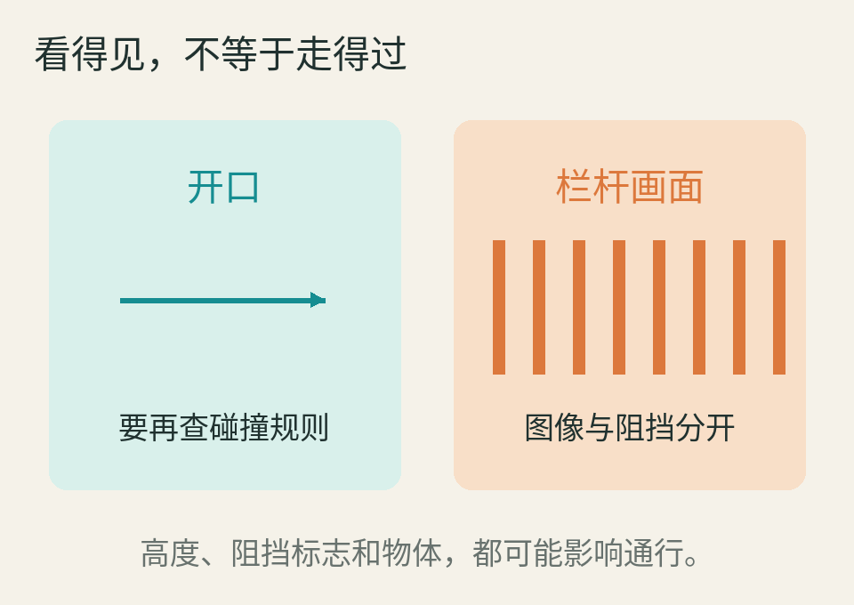

反过来，一张栏杆图像可以让你透过缝隙看到后面，但“画着栏杆”和“禁止角色穿过”仍然需要各自的数据或规则配合。图像负责怎么显示，碰撞系统负责哪些移动有效。

这里先不用掌握碰撞代码。只要别把“我看到了空隙”直接当成“程序一定允许我走过去”，后面读游戏引擎就少一个常见误会。

## 如果想动一下数字，试这三次就够了

不做实验，也不影响读懂本文。愿意验证的话，可以只拿纸算：固定 A 为地板 0、天花板 128，依次把 B 改成下面三种情况。

- B：地板 0，天花板 128。开口 0～128；没有高度差形成的上下墙段。
- B：地板 24，天花板 96。开口 24～96；净高 72。
- B：地板 24，天花板 24。开口净高 0；这条高度通道闭合。

想让电脑代算，可以运行附带的 [Python 小脚本](examples/opening.py)，只用标准库，不安装游戏、不下载数据、不连接网络。它是本教程的几何计算器，不是一个能启动的 Doom 地图，也不执行完整碰撞检测。

回头看开头的问题，答案现在可以说得很具体了：

**平面顶点和边负责“边界在哪”；边侧把边界关联到区域；sector 负责“地板和天花板多高”；相邻高度差决定哪里露出墙段、哪里留下开口；纹理再给这些表面上颜色。**

这一步解决了“世界里有什么”。下一篇，我们才站到世界里面，问另一个问题：**墙上一个位置，究竟应该画在屏幕的哪里？**

---

## 继续看原材料

1. id Software，[doomdata.h：地图文件结构](https://github.com/id-Software/DOOM/blob/master/linuxdoom-1.10/doomdata.h)。对应顶点、边、边侧与 sector 的记录；可先找 mapvertex_t、maplinedef_t、mapsidedef_t、mapsector_t。
2. Ultimate Doom Builder，[项目术语说明](https://github.com/UltimateDoomBuilder/UltimateDoomBuilder/blob/master/Help/terminology.html)。核对边的方向、两侧关系，以及 sector 可以包含多个封闭区域的含义。
3. id Software，[r_segs.c：墙段处理](https://github.com/id-Software/DOOM/blob/master/linuxdoom-1.10/r_segs.c)。上下墙段的判断和绘制比本文小例复杂；本文没有覆盖天空等特殊处理。
4. id Software，[p_maputl.c：P_LineOpening](https://github.com/id-Software/DOOM/blob/master/linuxdoom-1.10/p_maputl.c)。核对开口顶部取较低天花板，底部取较高地板。
5. Freedoom，[项目与素材许可](https://github.com/freedoom/freedoom)、[本文固定版本的 MAP01 数据](https://github.com/freedoom/freedoom/blob/3ac019628d70b812ffb722f7f2365771b76a9d29/levels/map01.wad)、[截图与截图许可](https://freedoom.github.io/screenshots.html)。
6. id Software，[r_data.c：纹理与图块的组织](https://github.com/id-Software/DOOM/blob/master/linuxdoom-1.10/r_data.c)。用于区分墙纹理与组成它的 patch 图块。
7. John Carmack，[1997 年源码发布说明](https://github.com/id-Software/DOOM/blob/master/README.TXT)。其中将斜坡等列为可增加的特性；本文不把现代端口扩展混入普通经典格式。
8. id Software，[p_map.c：移动检测](https://github.com/id-Software/DOOM/blob/master/linuxdoom-1.10/p_map.c)。可在 P_TryMove 里看到高度空间和台阶等检查。

本文由 AI 辅助研究、写作和制图。教学房间、几何图与计算例是本次原创；实际游戏图、编辑器界面和游戏素材逐项保留真实身份。未声称在本文环境中运行 Doom；教学渲染只验证本篇几何例，不冒充历史引擎实现。详细图片来源、许可和可复现材料见 [sources.md](sources.md)。
