# Doom 入门②：墙上的一个点，该画在屏幕哪里？

第一篇里，我们把一张平面地图变成了有地板、天花板和台阶的房间。

可电脑还有一个问题没回答：**房间里的点，应该放在屏幕的哪里？**

先看一张实际游戏画面。左侧墙面和天花板的边线向远处延伸，你能感觉到空间越来越深。明明显示器是平的，画面却让人自然地认出了前后。

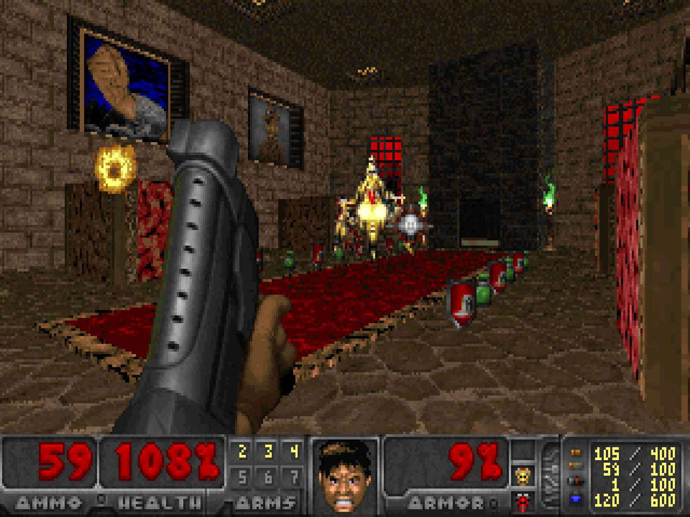

*Freedoom 官方提供的实际截图，由 Chocolate Doom 运行。它是负责让游戏运行、生成画面的程序，也叫游戏引擎；图中并非1993年Doom原版关卡或美术。官方把320×200的游戏画面按显示比例放大为1600×1200，保留小色块的边缘。[截图原页与许可](https://freedoom.github.io/screenshots.html)*

给世界里的点寻找屏幕位置，这件事叫**投影**。把游戏数据计算成最后能看到的画面，叫**渲染**；投影是其中的一步。

这一篇不用矩阵，也不要求你会三角函数。我们先看“向前走会发生什么”，再拿一个点，亲自算出它的位置。公式里最重要的动作，就是除以前方距离。

## 1. 人走近了，墙为什么会变大？

继续使用第一篇的双房间。A 在左，地板0、天花板128；B 在右，地板24、天花板96。每间的平面大小都是256×192地图单位。这里的单位是游戏地图使用的长度刻度，不直接等于米。

平面位置写成(x,y)：x向地图右边增加，y向地图上边增加。玩家在A中间，朝B看。下面两张是用同一房间数据计算的教学画面：

*起点：平面位置(128,96)，眼睛高度41，朝向+x。原创模型计算，采用Freedoom真实图块；不是运行Doom得到的截图。*

现在只向前走64，房间、表面图案、朝向都不改。

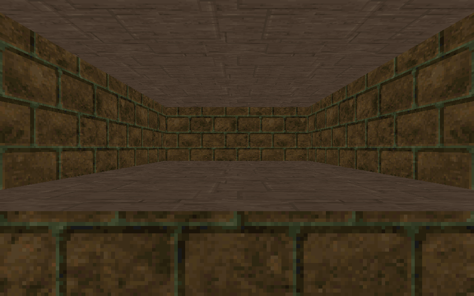

*前进后：平面位置(192,96)，眼睛高度仍为41。模型与前图相同，只变观察位置。*

你会看到近处的台阶、开口占据了更多画面。电脑没有真的把房间放大；改变的是人和房间的相对位置。

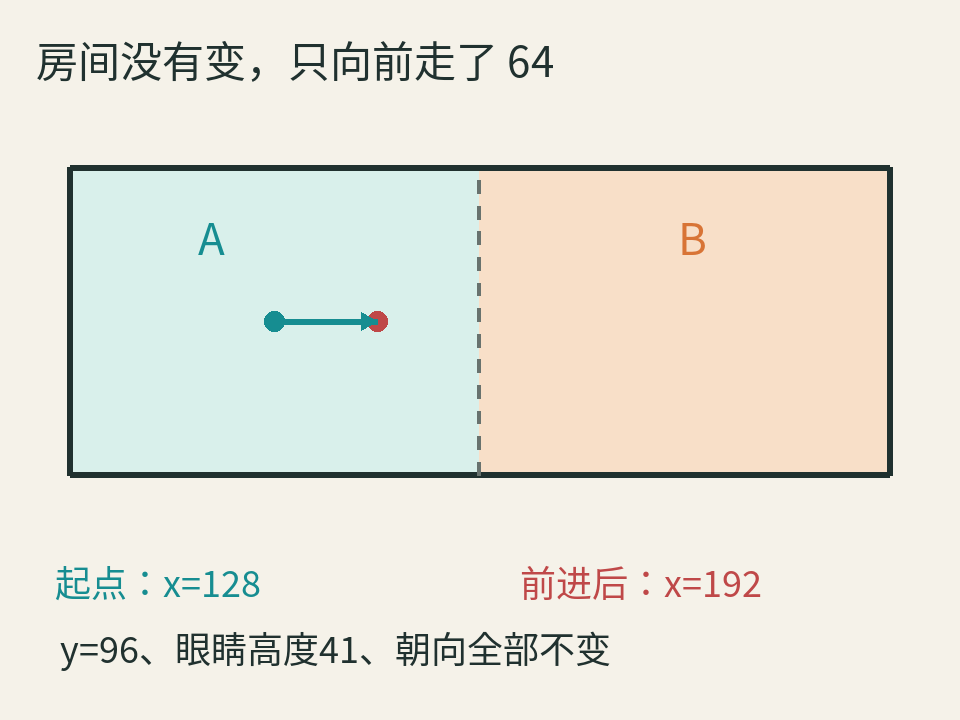

图形程序常把“从哪里看、朝哪里看”的观察者叫作**虚拟相机**。你可以先把它理解成一只放在游戏里的眼睛，不需要先学摄影器材。

要弄懂这种变化，我们先把“地图里的地址”和“屏幕里的地址”分开。

## 2. 屏幕也有地址，但向下才是行号增加

图像由许多小色块组成，一个小色块叫**像素**。显示器把它们排成行和列，才组成完整图画。

为了容易手算，本篇使用宽320、高200的教学画布。横向位置写作u，向右增加；纵向位置写作v，向下增加。

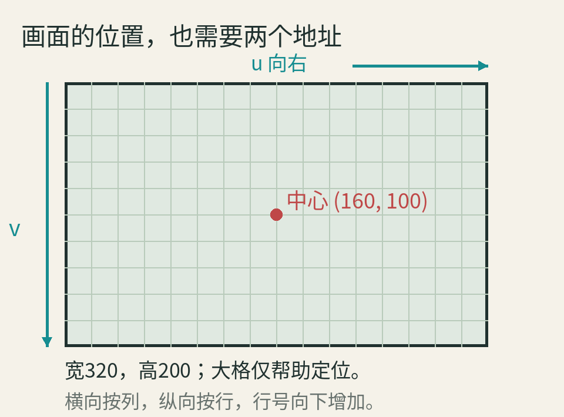

左上角是画布的起点，中心位置是(160,100)。如果一个点落到中心右边，就给u加一些；落到中心下面，就给v加一些。

图里的大网格只是帮助看方向，不是在说这块画布只有这么几个像素。真实320×200图像共有320×200=64000个像素。

如果“像素”还比较抽象，看下面这件真实材料：前面地板所使用的Freedoom图像文件。

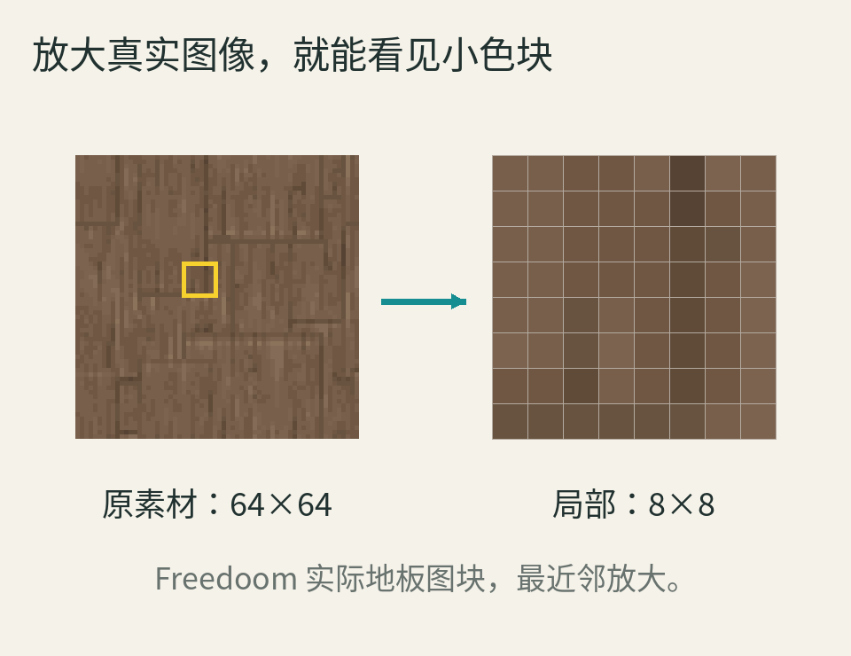

*左边是64×64原素材放大，黄色框所围的8×8局部在右边继续放大。采用最近邻放大：每个原像素变成一块同色方格，不凭空补细节。右侧格线为观察辅助。保留[原尺寸文件](assets/05-floor-original.png)，素材按Freedoom BSD-3-Clause许可使用。*

本篇的画布只画房间，没有底部状态栏，并把显示出来的像素当作正方形。它是方便理解的模型，不是从官方截图反推出来的完整运行参数，也没有复刻当年320×200画面显示成4:3时的比例调整。

接下来算出的u、v还可以带小数。它们表示画布上的位置；最后该覆盖哪些像素格，要再按绘图规则处理。现在先把位置算对。

## 3. 别急着看屏幕，先问这个点在你的哪边

回到起点，固定眼睛O的平面位置为(128,96)，高度为41。

我们在台阶上沿选一点P：平面位置(256,32)，高度24。它不是地图新增的一根柱子，只是在已有边缘上标一个便于追踪的点。

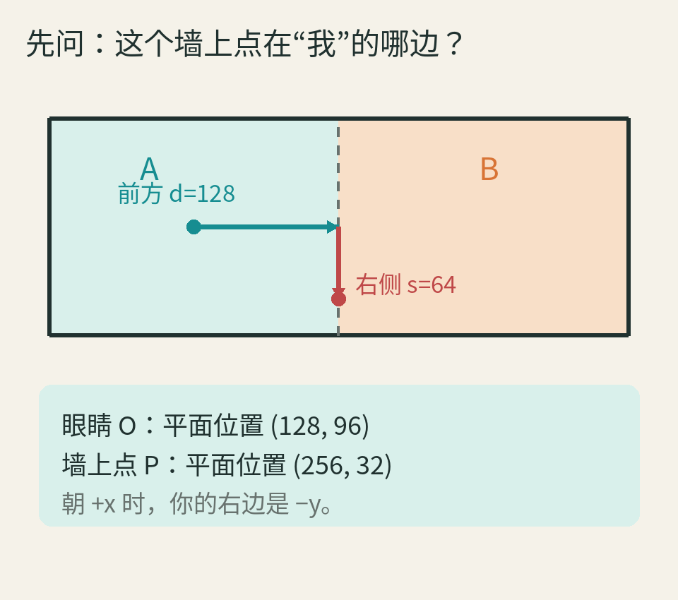

玩家朝+x，也就是俯视图的右边看。此时玩家自己的右侧，是俯视图的下边，也就是y减小的方向。你可以把纸转一下，或者把手指当玩家，就能确认这个左右关系。

因此，P相对玩家的位置是：

- **前方距离d**：256−128=128。
- **右侧偏移s**：96−32=64。

d和s只是给两个数取短名字，方便下一步写式子。d回答“往前多少”，s回答“往右多少”。偏向左边时，s可以是负数。

这一步很重要：地图上的x、y描述固定世界；d、s描述当前玩家眼中的前后左右。玩家一动或一转头，后一组数就会改变。

## 4. 在眼前放一扇看不见的窗口

想象眼睛前方有一块透明画布。把墙上的P和眼睛用直线连起来，连线穿过画布的地方，就是P应该出现的位置。

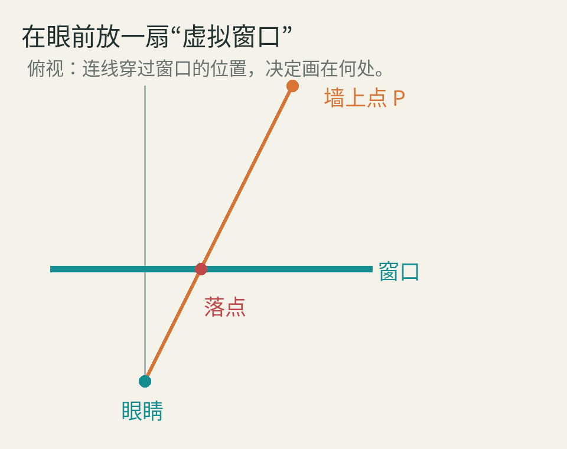

*原创几何示意。为看清连线，这里把玩家前方画成纸面上方；仍是在讨论刚才的眼睛与目标点，不表示人在地图上转了头。窗口画在眼前只是计算办法，不是在模拟眼球结构。*

为什么远近会影响结果？因为从眼睛出发，看向一个方向的连线是固定的。你沿这条线走得越远，前方距离和横向偏移就一起按比例变大。

对于P：向前128，向右64。所以每向前1份，就向右半份。

**64 ÷ 128 = 0.5。**

把大三角形缩小，形状不变；128缩成1，64就缩成0.5。这个比例叫s/d。把前方距离缩成1份，只是为了比较比例，不是把真实显示器放在离玩家1地图单位的地方。

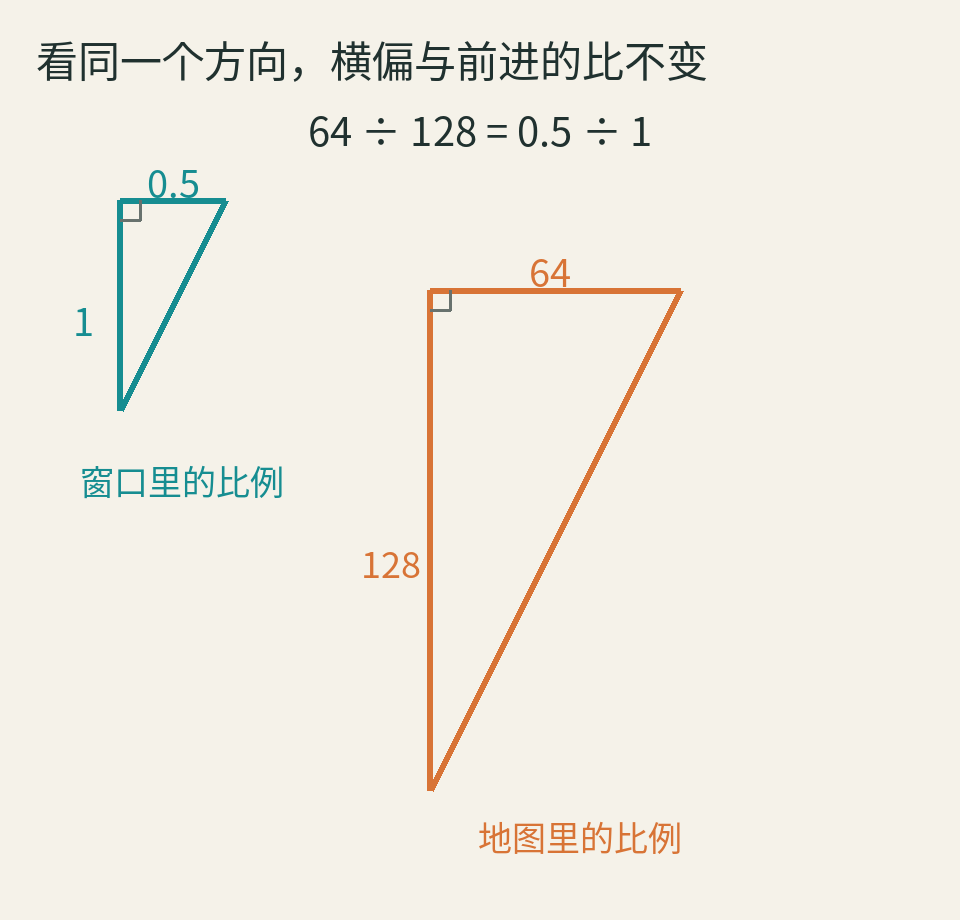

我们把教学相机的水平**视野**设为90°。视野就是能装进画面里的方向范围；90°相当于一个直角的张开程度，中心左右各分一半。

左右边界与正前方各相差45°，就像正方形的对角线：往前与横着走的长度相同。在这样的设定下，可以把眼前窗口想成：前方距离1，左边界在左侧1，右边界在右侧1。窗口中心到右边界，恰好对应半幅画面的160个像素宽。

P的s/d是0.5，只到右边界的一半。因此它应出现在中心右侧80个像素宽的位置：

**u = 160 + 160 × (64 ÷ 128) = 240。**

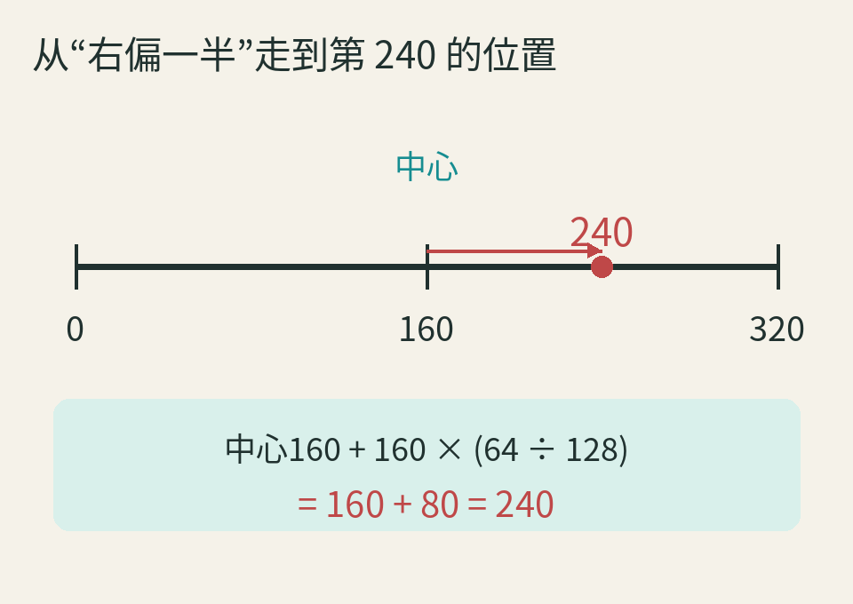

现在再把它写得稍微通用一点：

**u = 画面中心横坐标 + f × s/d。**

这里的f是一个以像素计量的缩放参数。本例f=160。你现在只需要知道它把“偏向某个方向的比例”换成“屏幕上偏出去多少”。后面我们会直接看改变f的效果。

如果s=0，也就是点在正前方，那么u=160，落在中心。如果s为负数，就向中心左侧走。公式不用另外为左边发明一套规则。

## 5. 上下位置怎么求？先减掉眼睛的高度

P在高度24，眼睛在41。它比眼睛低17。

我们把相对眼睛的高度叫q：

**q = 24−41 = −17。**

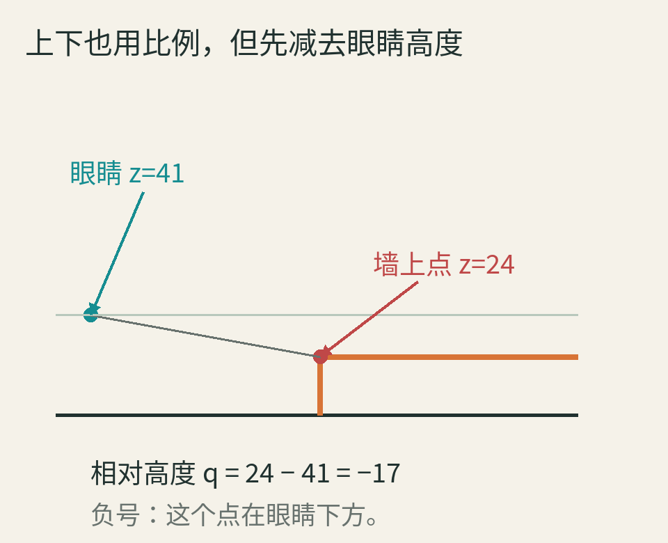

负号不是出错，它在告诉我们“在眼睛下面”。如果墙上另一个点比眼睛高，q就是正数。

上下投影同样用“偏离多少÷前方多远”的比例。区别只在于屏幕的v向下增加，而世界中的高度向上增加。

上下仍用同一个f=160，因为这个教学模型把像素当作正方形，横、竖方向按同一像素尺度换算。100只是画面中心所在的纵坐标，不是另一个缩放参数。

所以要写成：

**v = 画面中心纵坐标 − f × q/d。**

把本例的数字放进去：

**v = 100 − 160 × (−17 ÷ 128)**

**= 100 + 21.25 = 121.25。**

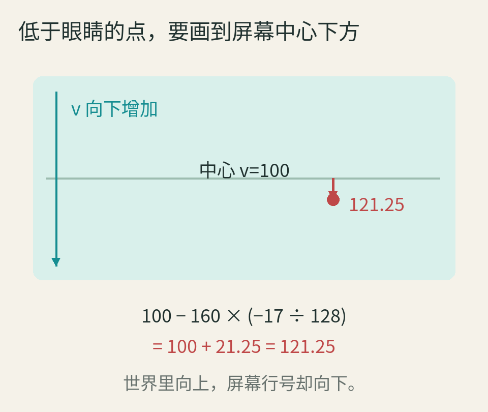

这里先减一个负数，结果变成加，是因为“世界里较低”对应“屏幕上靠下”。如果忘掉这个方向差别，地板就可能被你画到天花板那一边。

现在，P的位置已经完整了：

**(u,v) = (240,121.25)。**

把这个数标回模型画面，黄色点恰好落在台阶上沿。

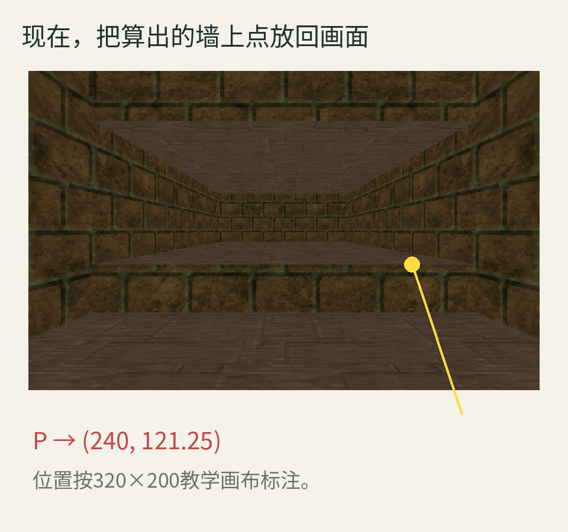

*黄色点是计算位置的标记。图像为便于阅读放大后的原创模型，坐标仍按320×200教学画布计；不是从实际游戏截图手工猜坐标。*

最值得记住的步骤是：先算相对玩家的前方、左右和上下，再分别除以前方距离。到这里，一点的投影已经完成了。

## 6. 一面墙怎么办？把边界上的点接起来

现在对A、B共享边的左右端点，也做同样的计算。这里说的是玩家视野中的左右：玩家朝地图右边看，所以画面左端对应地图北端y=192，画面右端对应地图南端y=0。

共享边在x=256；玩家在x=128，因此各处前方距离都是128。左端的右侧偏移为−96，右端为96。算出的横向范围，是40到280。

上一节知道，开口底部高度24会落到v=121.25。开口顶部高度96比眼睛高55，所以：

**v顶部 = 100 − 160 × (55 ÷ 128) = 31.25。**

这就得到了一个屏幕矩形：左40、右280、上31.25、下121.25。

再看B最远处的后墙，x=512，前方距离变成512−128=384。它的地板仍是24，天花板仍是96。算出来的矩形小了许多。

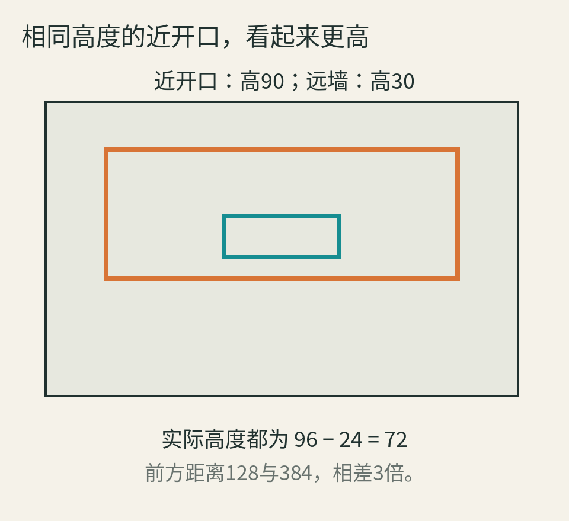

*橙色是近处开口边界，青色是远处后墙边界。矩形只是投影轮廓，不能把橙色开口整块当成实体墙涂满。图内“高90/30”指画布上的像素长度，不是地图高度。*

两个东西的实际高度都为96−24=72，但：

- 近开口：160×72÷128=90个像素高。
- 远墙：160×72÷384=30个像素高。

后墙的前方距离是3倍，画出来的高度就剩三分之一。近大远小由此出现，不需要在远处另外摆一面更小的墙。

只要一段竖直边的上下端共享同一个d，它的屏幕高度就可以写成：

**屏幕高度 = f × 实际高度 / d。**

这不是说整个地图里的墙都只有同一个距离。如果墙在俯视地图里斜着摆，不同位置的d可以不同，我们仍按各自的位置计算。

还有一个边界：共享边的上墙一直延伸到高度128。它在本例中会投到画布上缘之外。画面只保留落进画布的部分，并不代表房间的天花板被删掉了。

## 7. 一个常见错误：把斜着量的距离拿来除

你可能会想：既然公式要除以距离，直接量“眼睛到这个点”的距离不就行了？

先看同一面正对玩家的墙。

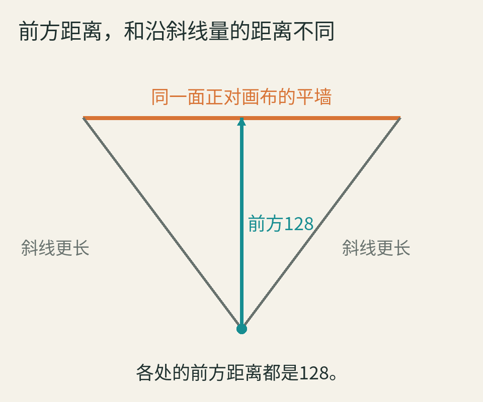

直指墙中心的连线较短，指向左右两边的斜线较长。但这些点的**前方距离d**都一样，都是128。

如果误把较长的斜线当除数，左右两边就会被缩得更多。原本平直的上沿、下沿，反而被算成弯曲的形状。

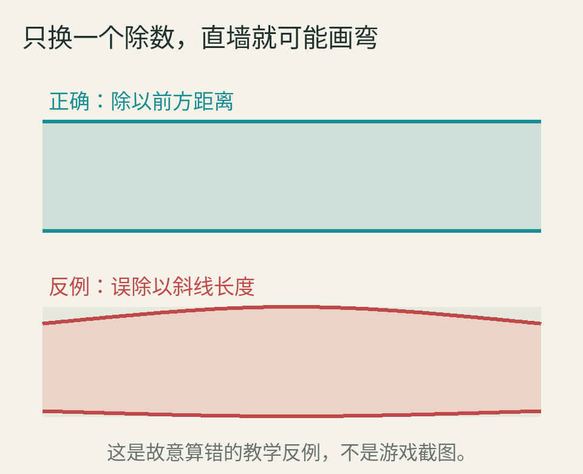

*原创错误对照。上下两幅使用相同墙高与眼睛位置，保持横向位置不变，只替换高度缩放的除数；下图故意算错，不是Doom实际画面的缺陷。*

这个错误常被称为“鱼眼式”变形，但这里讨论的是计算中的距离用错，不是在模拟某种真实镜头。

为什么前面的比例推导不会犯错？因为大、小三角形比较的，一直是“向前走多少”和“横着偏多少”，没有把斜边换进来。

**距离必须和推导里的方向对应。** 把一个看上去也叫“距离”的量换进去，公式可能仍能运行，画面却已经悄悄变了。

## 8. 转头，和换视野，各自改了什么？

### 转头：重新确定前后左右

玩家没有移动，只是从朝东转成朝北，世界里的墙当然还在原地。

改变的是“哪一个方向算前方，哪一个方向算右方”。

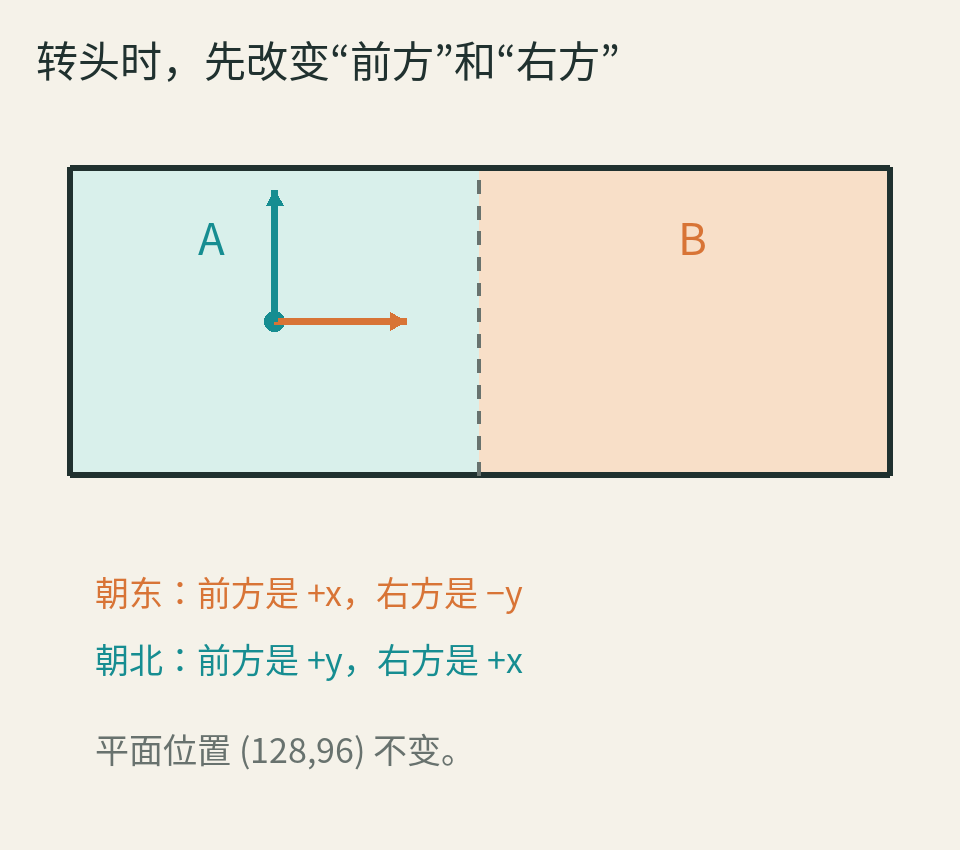

朝东时，我们用x差判断前方、用反向y差判断右侧。朝北以后，前方改成y增加的方向，右侧改成x增加的方向。

因此，投影前必须先按当前朝向重新算d、s。一般角度可以交给旋转运算；本篇用90°转身就能把机制看清，不需要先展开三角函数。

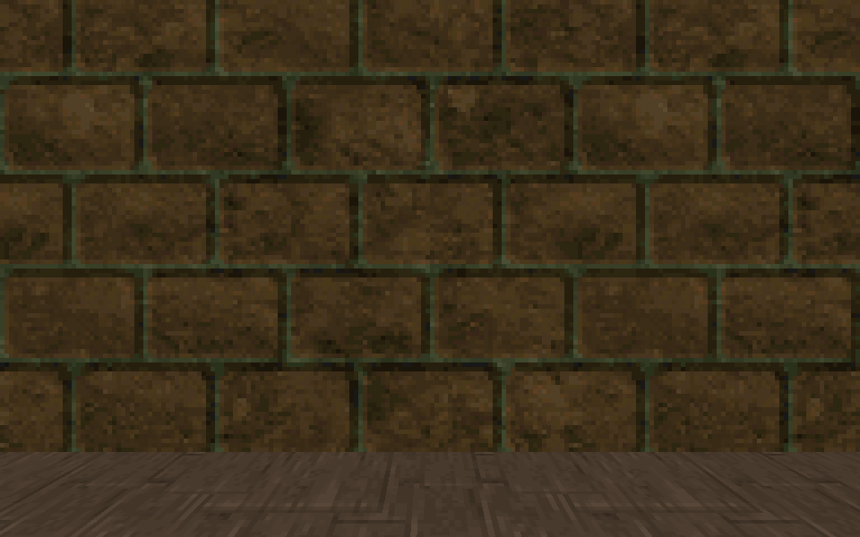

*仍在(128,96,41)，这次朝+y。与开头初始视图相比，只转了观察方向，没有移动或重新建造房间。*

这也说明，“右侧偏移s”不能永远等于世界地图的某一个坐标差。它要跟着你朝向哪儿而改变。

### 改视野：人在原地，把中心附近放大

现在转回朝东，不走路，只把f从160改成320。

所有点相对画面中心的偏移，在这个模型里都会乘2。因此，原来靠近画面边缘的部分可能跑到屏幕外，能看到的范围变窄了。

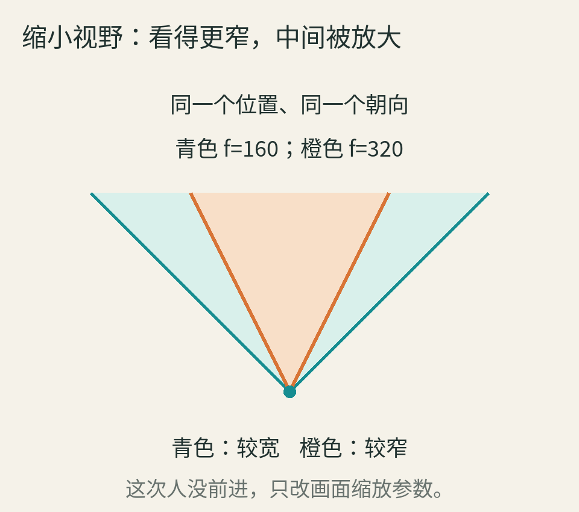

游戏设置里常把视野写作 **FOV，Field of View**，意思就是视野范围。它可以用夹角表示；程序再把那个角度换算成合适的投影参数。这里无需记换算公式，先看结果。

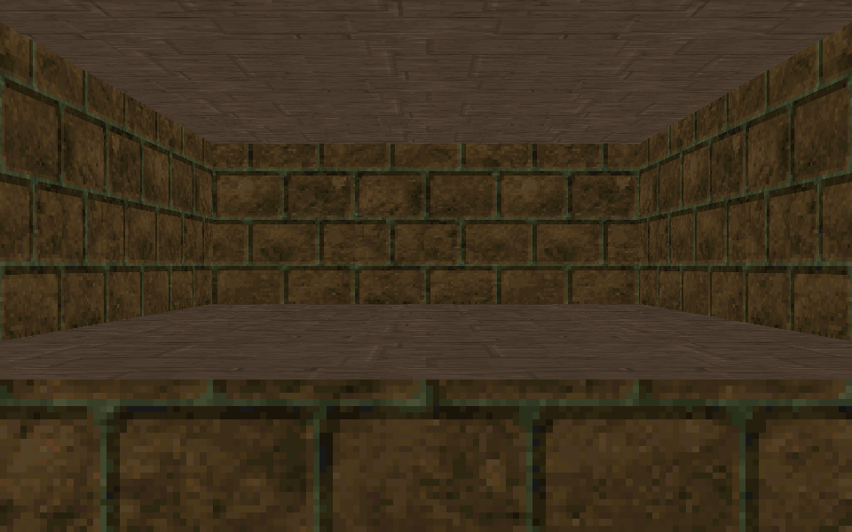

*位置、方向、房间都与初始图相同，只把f从160增至320。教学画面，不是实际游戏FOV设置截图。*

我们的P也随之从u=240跑到了右边界u=320。人没有向前走，是画面把中心附近放大了。

向前走和改f都能让东西变大，但它们改变的量不同：前进会改变各面墙的d，远近墙的变化幅度并不一样；改f是在此模型中统一放大相对中心的偏移。对照开头“前进64”的图与这里的图，远墙的大小就能帮助你分辨。

## 9. 哪些点不能直接代进公式？

我们一直把“点在眼前”当作前提。现在检查这个前提。

- d>0：点在前方，可以继续投影。
- d=0：点不在前方，公式还会遇到除以零。
- d<0：点在身后，不能因为除法给出了数字，就直接画到面前。

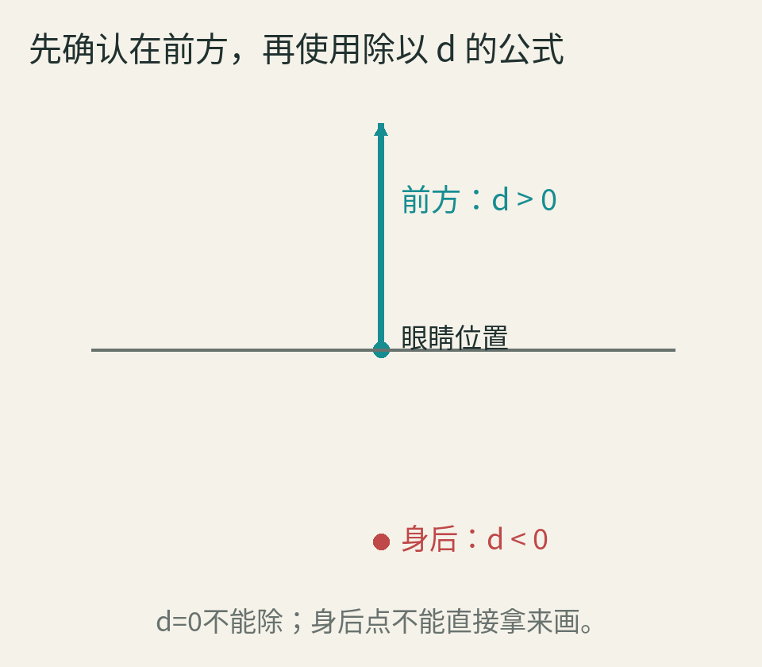

即使点在前方，结果也可能落到画布外。例如横坐标小于0，或者大于320。它只是越出了当前视野，不代表世界中的物体不存在。

一整条边更值得小心：它可能只有一部分进入视野。不能只看到一个端点在外面，就把整条边扔掉。

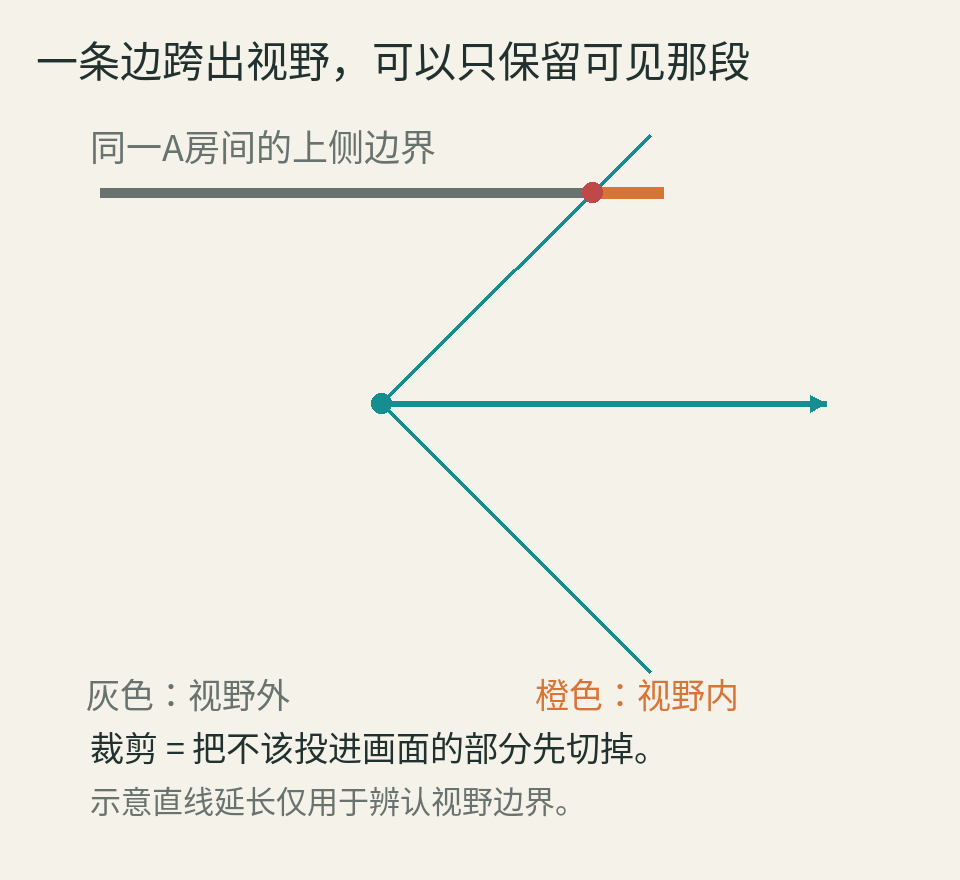

把不该进入当前画面的部分先切掉，这个处理叫**裁剪**。具体引擎可以用适合自己的坐标和表示来做。我们今天只要求简化公式用在合适的前方范围，不冒称经典Doom内部也照抄了同一种近处裁剪代码。

还有另一种“看不见”：一个点虽然投到了画布里，却被更近的墙挡住。那是下一篇要处理的遮挡问题。**“位置算得出来”与“最后一定看得到”还差了一步。**

## 10. 真正的 Doom 也逐点做这两行除法吗？

我们刚才学的是透视关系，不是一份逐字照抄的Doom程序。

在 id Software 公开的 Linux Doom 1.10 代码里，可以找到这些直接对应的工作：

1. `R_SetupFrame`取得当前观察位置、眼睛高度和朝向。这些信息决定“从哪里看”。[1]
2. `R_AddLine`处理墙段的方向与视野裁剪；角度到屏幕横坐标的映射，会用到预先准备的表。[1][2]
3. 墙段处理计算缩放比例及上下范围，再按屏幕的竖直列绘制墙面。`R_DrawColumn`负责的一次工作，是把某一列从某个起点画到某个终点。[3][4]

所以，本篇用比例从头算一个点，是为了让这些工程步骤有一个能理解的几何根基。实际实现还要考虑查表、整数精度、裁剪和重复计算如何节省，不能把教程里的几行Python当成历史引擎全貌。

再看这张真实画面。墙的边界应该落在哪几列，地板从哪一行开始出现，已经不再只是“电脑看起来应该这样画”的模糊直觉。

*复用官方实际截图，原图字节保留。它帮助把教学问题放回真实游戏，不表示本文计算了这个关卡的相机坐标或逐像素复现了它。[来源与许可](https://freedoom.github.io/screenshots.html)*

下一步还得决定墙面用什么图案、每格取什么颜色、谁遮住谁，才能得到最后这张图。投影把“画在哪里”这件事先解决了。

## 可选：用几个数字确认你真的理解了

不运行代码，也可以用今天的两行式子算：

- d=128、s=0、q=0：落在(160,100)，正中间。
- d=128、s=64、q=−17：落在(240,121.25)，就是我们的P。
- 保持s=64、q=−17，把d加倍成256：落在(200,110.625)，更靠近中心。
- d仍为128，把s改为−64：横坐标变成80，移到中心左边。

附带的 [project_point.py](examples/project_point.py)只需Python标准库。它会重算这些位置，并拒绝d≤0的输入；不下载数据，不安装游戏，不处理完整墙段裁剪、遮挡或像素取样。

把整篇压成一句可随时取出来用的话：

**先站到玩家的位置，把墙点拆成“前方多远、左右多远、上下多远”；再用左右或上下除以前方距离，换成相对屏幕中心的偏移。**

下一篇，我们不再问点该画在哪里，而是问：当好几面墙都投到了同一片屏幕上，电脑怎样尽早知道哪些根本不用画？

---

## 原材料与进一步核对

1. id Software，[r_main.c](https://github.com/id-Software/DOOM/blob/a77dfb96cb91780ca334d0d4cfd86957558007e0/linuxdoom-1.10/r_main.c)：R_SetupFrame、R_InitTextureMapping、R_ScaleFromGlobalAngle，核对观察位置、角度到屏幕位置及缩放处理。
2. id Software，[r_bsp.c](https://github.com/id-Software/DOOM/blob/a77dfb96cb91780ca334d0d4cfd86957558007e0/linuxdoom-1.10/r_bsp.c)：R_AddLine及墙段的视野/屏幕范围处理。
3. id Software，[r_segs.c](https://github.com/id-Software/DOOM/blob/a77dfb96cb91780ca334d0d4cfd86957558007e0/linuxdoom-1.10/r_segs.c)：R_StoreWallRange与墙列上下范围。
4. id Software，[r_draw.c](https://github.com/id-Software/DOOM/blob/a77dfb96cb91780ca334d0d4cfd86957558007e0/linuxdoom-1.10/r_draw.c)：R_DrawColumn及列的起止位置。
5. Freedoom，[官方截图](https://freedoom.github.io/screenshots.html)、[项目和素材许可](https://github.com/freedoom/freedoom)。本文保留完整BSD-3-Clause条款、贡献者清单与原尺寸图像；游戏素材不因Doom代码开放而自动获得同样许可。

本文由AI辅助研究、撰写与制图。几何推导、教学模型和算例为本次原创，真实截图和纹理分别标注来源；没有声称本次运行过Doom，也没有把模型结果当成历史引擎实测。具体版本、图像身份、许可及计算边界见 [sources.md](sources.md)。
