# Doom 入门③：电脑怎样提前知道，后面的墙不用画？

前两篇，我们让地图长出有高度的房间，又算出了墙上一个点该出现在屏幕哪里。

把世界位置换到屏幕上的这一步，叫投影；生成整张画面的过程，叫渲染。

但“位置算得出来”，还不等于“最后应该看得到”。如果面前有一堵实墙，后面那堵墙也能算出屏幕位置；把它直接画出来，画面就会穿帮。

*Freedoom官方实际截图，运行程序为Chocolate Doom。负责运行游戏、生成画面的这类程序叫游戏引擎。图中不是Doom原版美术；官方将320×200画面按显示比例清晰放大为1600×1200，本文保留原文件。[来源与许可](https://freedoom.github.io/screenshots.html)*

一种办法是先把后面的墙画好，再让近墙盖上去。它能得到正确结果，却可能做了最后完全看不见的工作。

这一篇问得更早一点：**能否还没逐条检查后面的墙，就知道整组都不值得继续？**

答案需要两件东西一起工作：一张提前整理好的分组图，以及一份不断更新的“哪些方向已经被挡住”的记录。我们从原来的两个房间开始，不先背树、向量或递归的定义。

## 1. 房间没搬走，只多了一段实墙

仍然是A、B两个相连的房间。A的地板0、天花板128；B的地板24、天花板96。平面中x向右、y向上，每间大小256×192地图单位。地图单位是量长度的刻度，不直接等于米。

眼睛还在(128,96,41)，朝+x看。前两个数是平面位置，最后一个是眼睛高度。

*沿用前篇的原创双房间计算模型，采用Freedoom真实图块；不是Doom实机截图。*

现在只加一段有厚度的实墙，放在两房间连接处的中间，从地板封到天花板。左右两边仍留着开口。

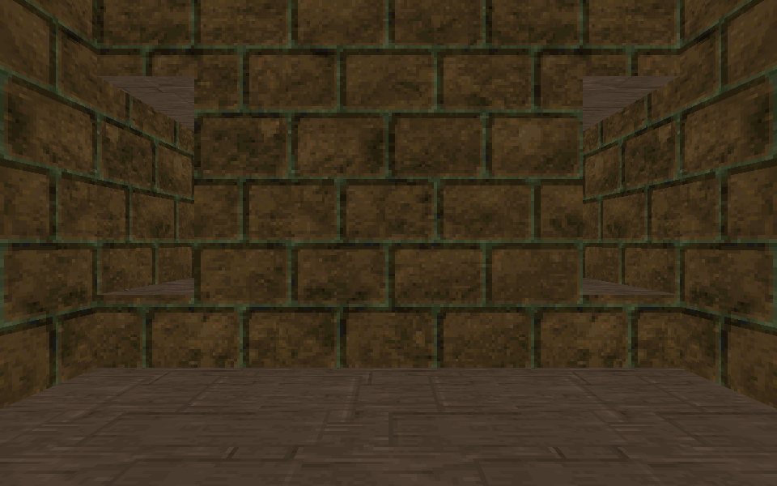

*观察位置、房间高度、表面图案都不变，只增加图中墙体。这里展示视觉遮挡，不讨论两侧开口是否足够玩家通过。*

把它放回地图，变化就很清楚：

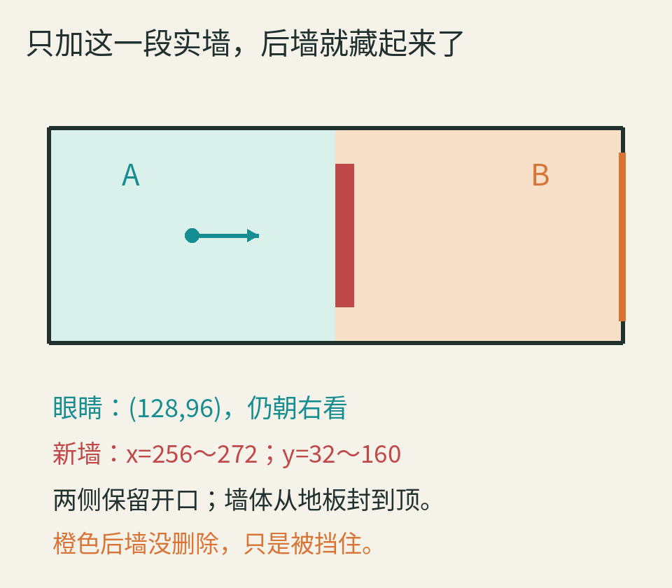

B的后墙没有删除。只是从这只眼睛出发，望向后墙的视线先撞上了新墙。

第二篇的投影公式仍能给后墙上的点算出位置。这叫“投到了画布里”；眼前这堵墙又提出了另一个问题：“到那里之前，有没有别的东西挡着？”

前面的物体挡住后面的物体，就叫**遮挡**。我们想省掉的，是那些确认被挡住以后，再做也不会改变画面的工作。

## 2. 先别找每堵墙，把地图装进几个组

如果地图只有几堵墙，全部检查一遍并不复杂。可真实关卡可能有上千条边。想一次跳过许多墙，得先知道它们属于哪一组。

我们在x=256的位置画一条上下延伸的直线。

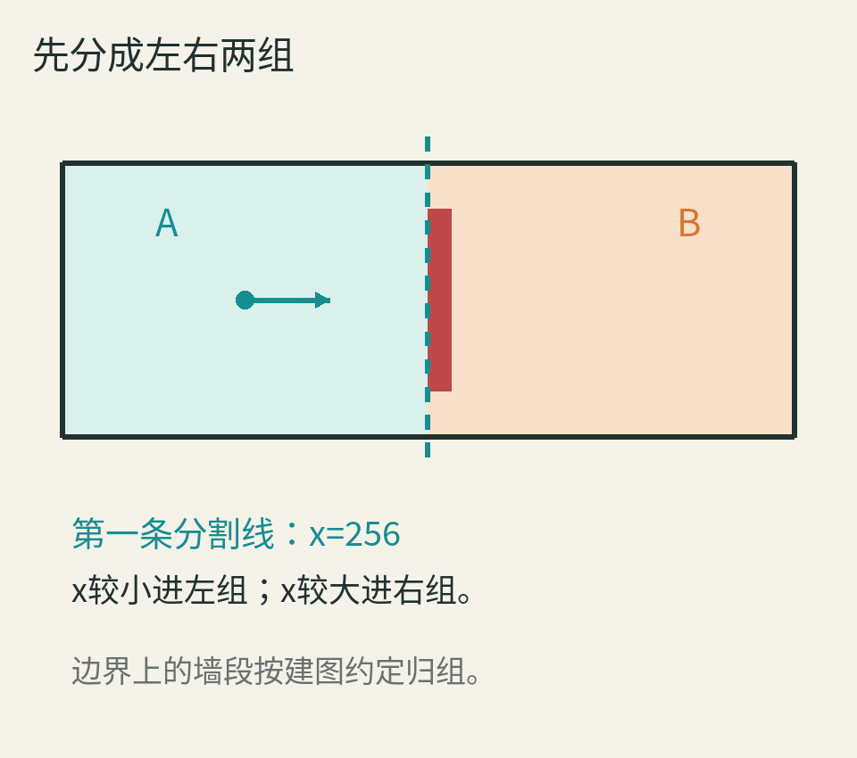

想象每一侧各有一个袋子：左边的边段进左袋，右边的边段进右袋。落在分割线上的边段，需要按建图程序的统一规则归组；这里不靠它们左右晃动来决定顺序。

接着，只打开右边的B袋，再用x=384这条线分成“B前半组”和“B后半组”。

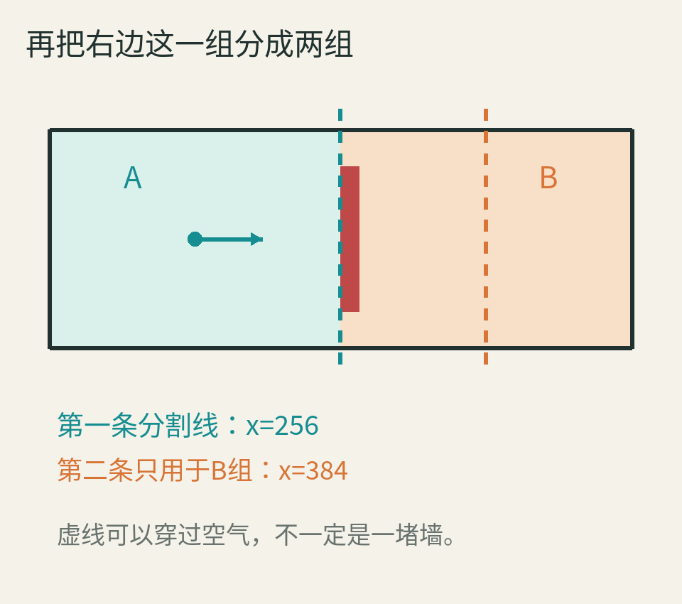

这里有个关键区别：**分组线不一定是一面墙。** x=384穿过B房间的空气，只是帮电脑整理数据。玩家不会撞上一条看不见的墙。

把“一个组分成两个组”的关系画出来，就得到下面这张图。

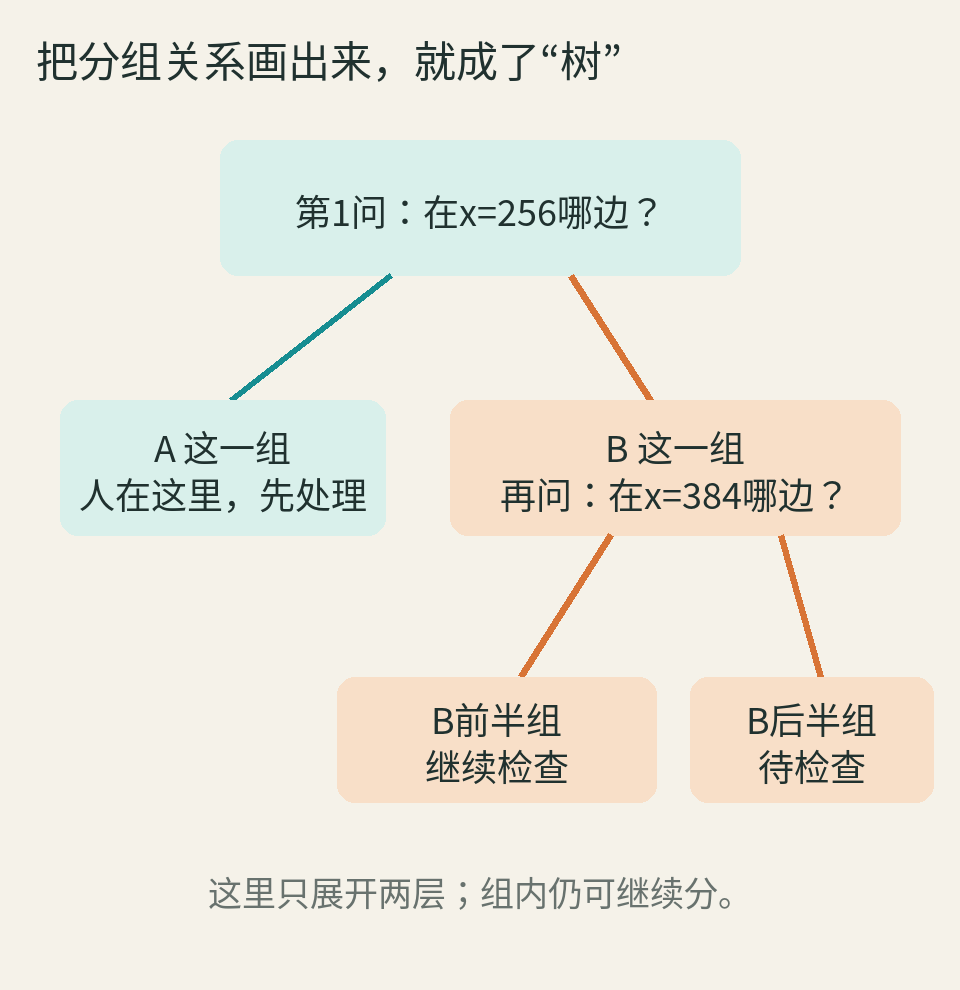

图中的“在哪边”会用两次：准备地图时，用分割线给边段等几何分组；生成每一幅画面时，再把玩家位置代入同一条线，决定先看哪组。线相同，两次检查的对象和用途不同。

图形程序把这种从一个入口不断分叉的关系叫**树**。每个带问题的框叫一个**节点**；从它出去的两条连线，通向两个子组。每次最多分两边，所以叫**二叉树**。

这个办法的正式名字是 **BSP，Binary Space Partitioning，二叉空间划分**。名字里重要的意思只有：用直线把平面空间一分为二，再在每一部分里继续分。

本图只展开两层。B前半组里还有新增墙体造成的凹凸，真实建图还需要继续细分；不要把这三个大袋子误认成一份已经做完的Doom地图文件。

现在先记住用途：以后若能排除B后半组，里面无论有多少条边，都可以一起跳过。

## 3. 一条边跨过分组线，怎么办？

看B房间上方那条边：它从x=256一直延伸到512。x=384的分组线正好从中间穿过。

不能只看它的中点，就把整条边随便塞进某一边。否则袋子标签写着“都在前半边”，里面却装进一截后半边的数据。

办法很直接：在交点处分成两段，各放各的。

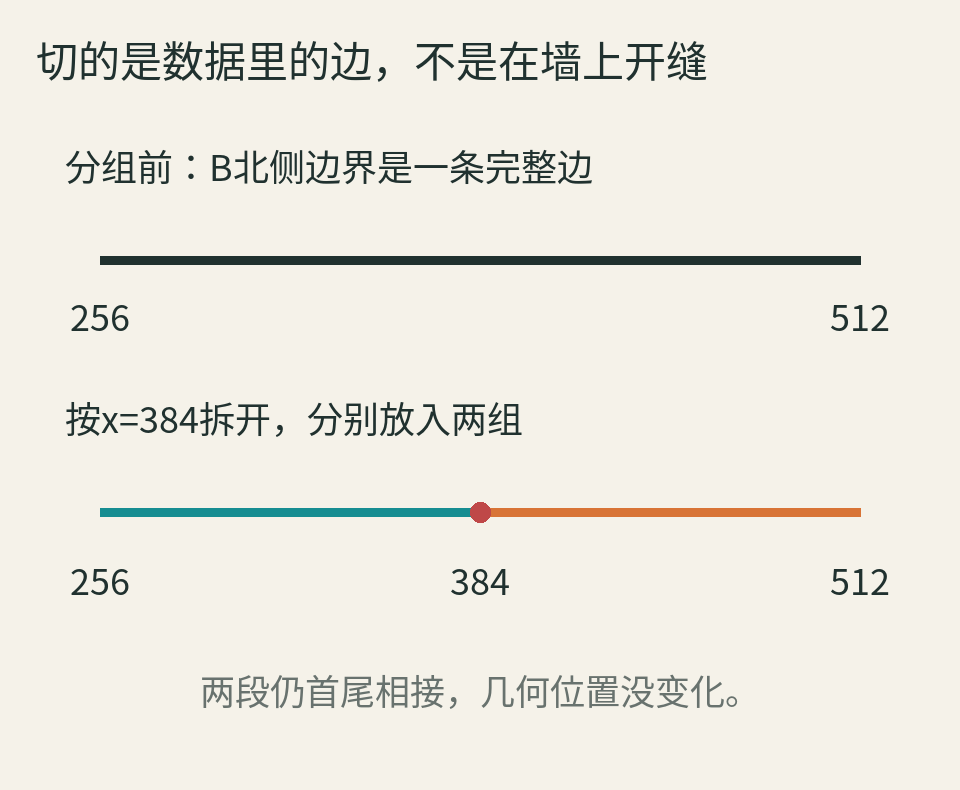

切开的是数据中的记录。两小段首尾仍连在一起，墙上没有被挖出一条缝。

Doom里，地图编辑时的一条边叫 **linedef**；为了这种分组而拆出的绘制边段叫 **seg**。你可以先把它们记成“原边”和“供绘制使用的小段”。同一条原边可能对应多个小段。[1]

分组和拆段主要在准备地图时完成。玩家移动时，程序读已经保存好的关系，不是每看到一堵墙就现场重建一棵树。稍后我们会直接打开真实地图数据，看看这些东西确实存在。

## 4. 眼睛在A，为什么先处理A？

第一处分割线是x=256。玩家的x=128，比256小，所以玩家在A这一侧。

这不需要复杂数学，只要比较两个数字。

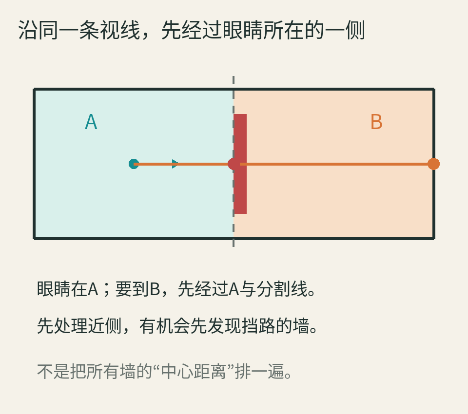

沿着一条指向B的直视线走，必须先经过A这一侧，穿过分割线，才能到B。**如果路上有A这边的不透明墙挡住，后面的B就不可能越过它抢先被看见。**

因此，先处理眼睛所在的一侧，有机会更早发现遮挡。然后再问另一侧是否仍值得进去。

这里的“近侧”指**玩家所在的这一侧空间**，不是“每一堵墙都比另一组所有墙更近”，也不是按墙中心到人的直线距离排一遍。我们只需要同一条视线沿途的前后关系可靠。

如果玩家移动到B后半，x变成448，会发生什么？

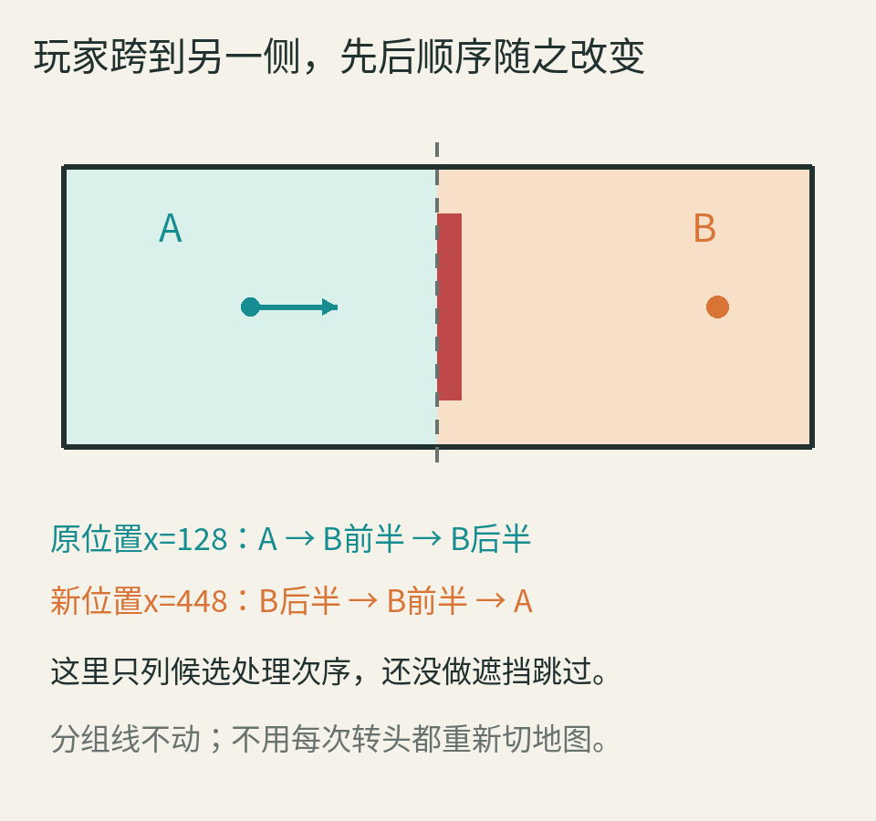

第一问先进入B；第二问先进入B后半。分组线没动，改变的是每次先走哪边。

图中列的是还没考虑跳过时的候选次序。运行时，一旦证明某一组看不见，那一项就可以不再继续。

对更复杂的树，程序只是走到每个分叉时，重复“先自己这一侧，再检查另一侧”。重复做同一种分组内检查，常被叫作递归；本篇不要求你会写递归程序，只要能沿图追踪先后就够了。

## 5. 已经挡住的地方，记在哪里？

先回到原观察位置，把目光从地图移到屏幕。

图像由小色块组成，每个小色块叫**像素**。同一横向位置、从上排到下的一串像素，叫一**列**。本篇继续使用宽320、高200的教学画布，横向从左到右。

新增实墙靠近玩家的一面在x=256。它左右两端的y是160和32，所以相对玩家，左偏64、右偏64；前方距离都是256−128=128。

套用第二篇“中心160加上横偏比例乘160”的方法，左右边界分别落在：

- 左：160+160×(−64÷128)=80。
- 右：160+160×(64÷128)=240。

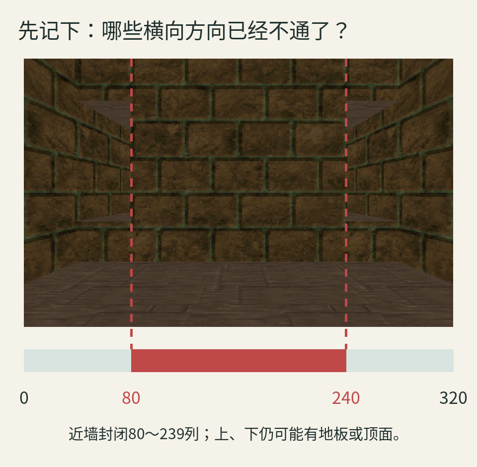

为方便按整列记数，本篇把边界80到240之间记成第80～239列。也就是包括左端80，不包括右端240。实际Doom使用角度查表和整数边界，临界列的取法还要以代码为准。

于是得到一条记录：**80～239这些列对应的方向，已经被近处实墙封住，后方不能再从这里露出来。**

注意，“封住”不是说这200个像素高全被涂成砖墙。图中你仍能看到A自己的地板。它说的是：在这些横向方向上，这堵普通实墙从本区域地板封到顶，没有可继续望进B的开口。

我们把这条记录画成一个小账本。图里还先列出下一节要算的B后半组候选范围100～219；现在先看它怎样与已封闭范围比较。

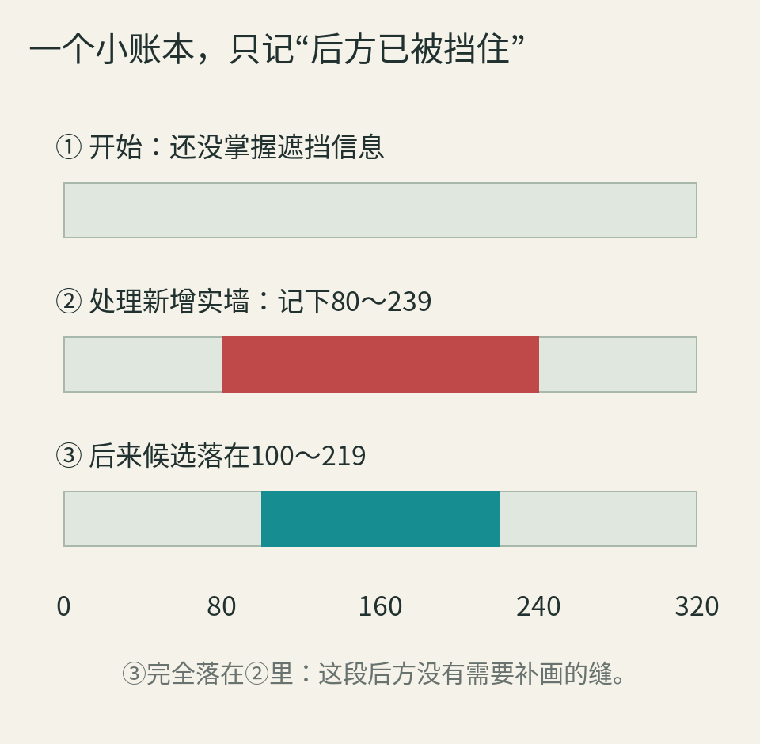

第一步，记录还是空的：尚不知道哪些方向能挡住后面。

第二步，处理新增实墙，把80～239记进去。

第三步，遇到一个后方候选，发现它只可能出现在100～219。这整段都已经封闭，就没有给它留下任何可见的横向缝隙。

经典Doom源码里的 `solidsegs` 就承担这种已封闭横向范围的记录；普通实墙与带开口的墙走不同处理分支。[2]

为了看清新增实墙的作用，这里只跟踪它产生的中间一段。完整渲染还会登记左右外墙等遮挡；增加有效的封闭记录，只会让更多后方候选被排除，不会让已经挡住的墙重新露出来。

## 6. 怎样一次跳过整个B后半组？

若要把组里的每段墙都投影一遍，才能知道整组被挡住，那省下来的工作还是不够早。

我们需要一个更便宜的粗检查：画一个简单外框，把组里的所有平面几何都包住。这个外框叫**包围框**，Doom源码常写作bounding box。

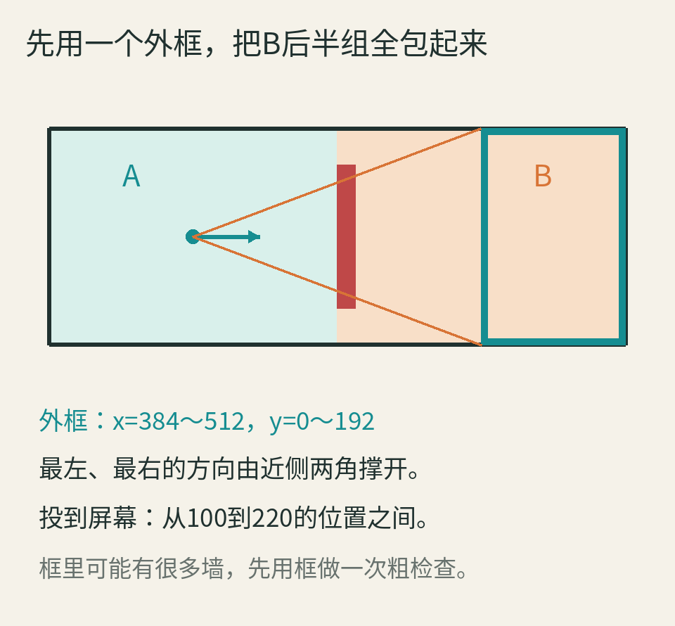

本例B后半组的外框是：x从384到512，y从0到192。

从青点出发，沿两条橙线找到青框靠近玩家的两个角。这张图是俯视地图；玩家朝地图右边看，所以地图上方那个角对应画面左边，下方那个角对应画面右边。

在本例的眼睛和外框位置下，最左和最右的方向恰好由这两个近角撑开；不能把“总选近角”套到任意位置。它们前方距离是384−128=256，左右偏移是−96与96。

于是外框的横向投影边界是：

- 左：160+160×(−96÷256)=100。
- 右：160+160×(96÷256)=220。

这就对应到刚才的候选范围100～219。它整段藏在已经封闭的80～239里。

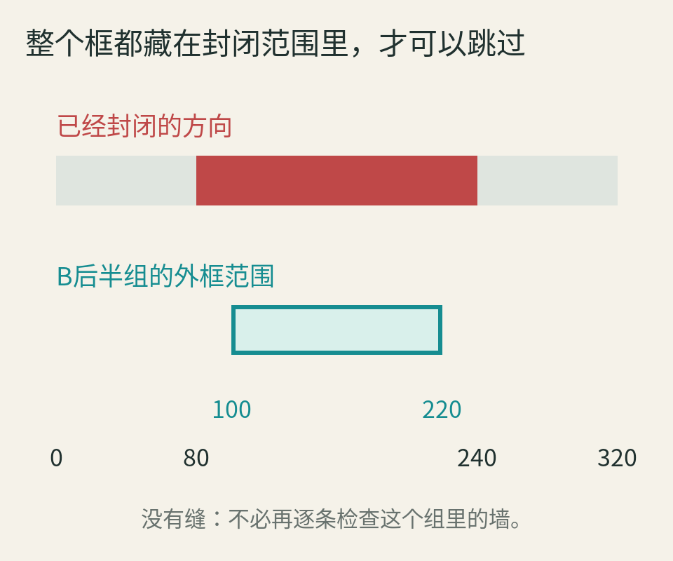

为什么这样不会漏掉框里的墙？把推理拆成三步：

1. 组里所有几何都被正确包在框内。
2. 框内几何的横向方向，不会超出这个框从眼睛看去的整体范围。
3. 连这个范围都没有缝，框里的东西自然无处露出来。

所以，我们不用为了这次画面，再逐条进入B后半组的墙段。**证明外框完全没机会，就等于提前排除了整组。**

但另一种结果没有这么强。

B前半组的外框从x=256开始，横向投影范围更宽，是40到280。中间虽然被封闭，两侧却还有空隙。

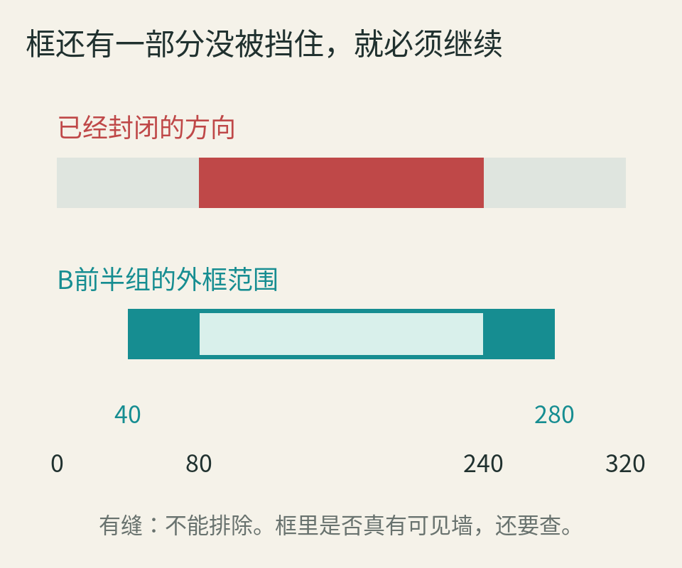

这时只能说“可能看得到”，必须继续深入。框比实际墙宽松：空隙里也许有墙，也许只是空地方。包围框通过检查，**不保证组里的每面墙都可见**。

宁可多检查一些可能可见的东西，也不随便删掉没有证明隐藏的内容。这叫**保守检查**：它允许“没省掉本来能省的工作”，不允许凭猜测把应该出现的墙省没了。

同样，如果包围框整个落在当前视野之外，也能排除；若只有一部分在视野里，就要保留可能进入画面的部分继续判断。[2]

## 7. 开口是最容易踩的坑

现在暂时拿走新增实墙，回看原来的两个相连房间。

你能看到上方一段墙，也能看到下方台阶，但中间仍能望见B的远墙。

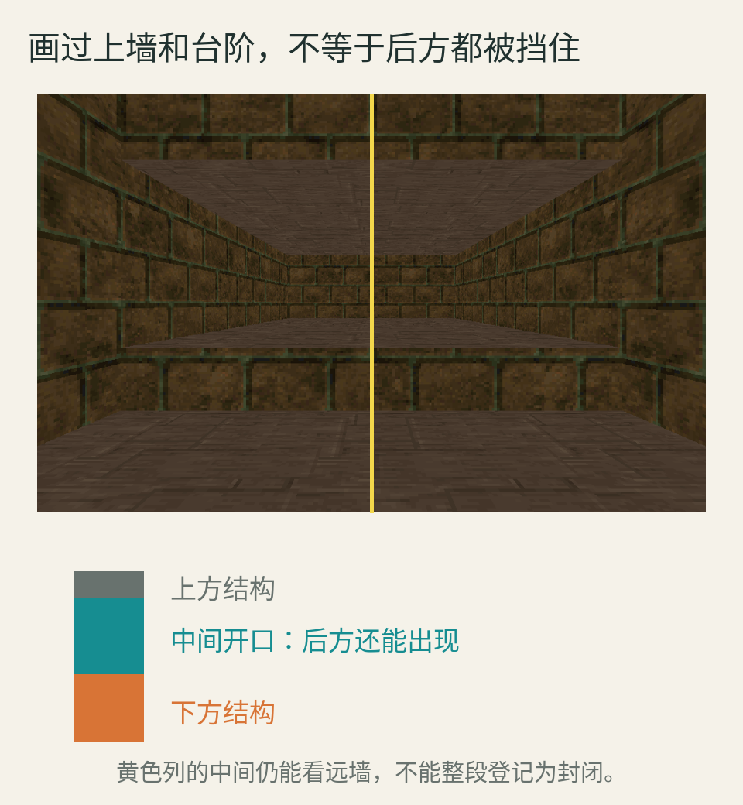

*上半部是实际计算的模型画面，黄色线选中间一列；下半部把同一列的开口范围画成易读示意。它不是整个列都由同一面墙填满。*

如果程序只想：“这里已经画过墙了，把整段横向范围记成封闭吧”，远墙就会被错误省掉。画面里会出现本不该有的缺失。

因此，**画过一点墙，不等于这个方向已经完全堵住。** 有门洞、有上下开口的边，不能像普通封闭实墙那样加入整段封闭记录。具体还要按上下范围继续绘制和裁剪。

在核对的Linux Doom 1.10里，普通实墙对应的 `R_ClipSolidWallSegment` 会更新这份记录；带开口的 `R_ClipPassWallSegment` 会利用已有记录，留下尚有可能的部分，但不会把自己整个横向范围塞进封闭表。[2]

函数名不用背。真正要记住的是判据：**后方是否还留着能被看见的开口，而不是当前有没有画过颜色。**

本文用的是普通不透明墙和普通区域开口，不把天空特殊处理、透明物体或地图视觉技巧归进这一个简单判据。

## 8. 把顺序与证据合起来，才真正省工作

现在把刚才分开的两件事接回去。

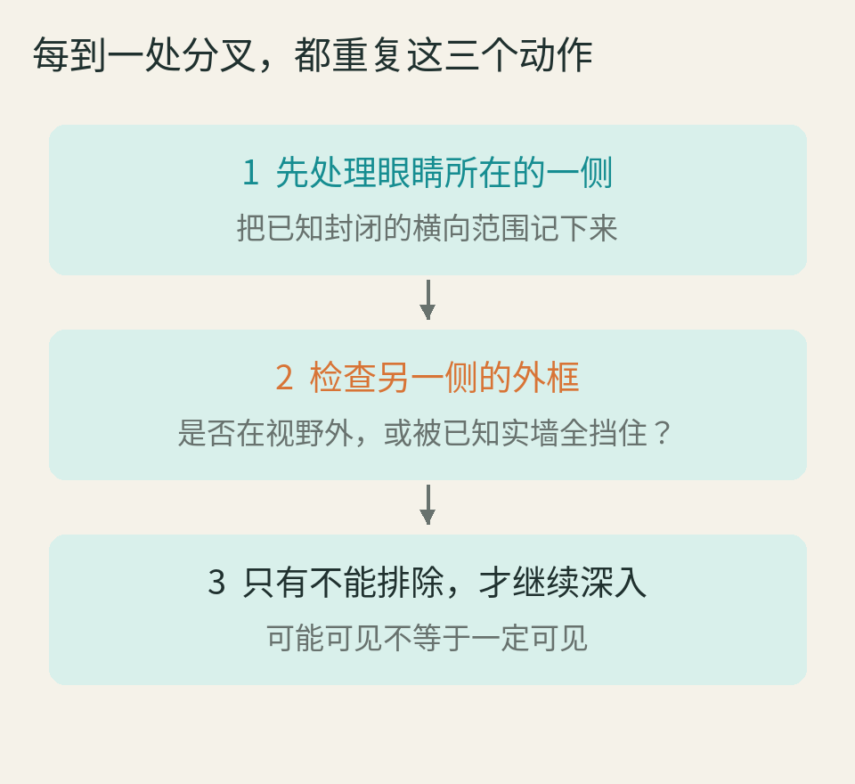

先处理近侧，让遮挡记录尽早积累；再用另一侧的外框试着排除一整组。不能排除，就进去重复同样的步骤。

这正是源码 `R_RenderBSPNode` 的核心顺序：先访问玩家所在侧，然后调用 `R_CheckBBox`，只有检查仍认为另一侧可能可见，才继续访问它。[2]

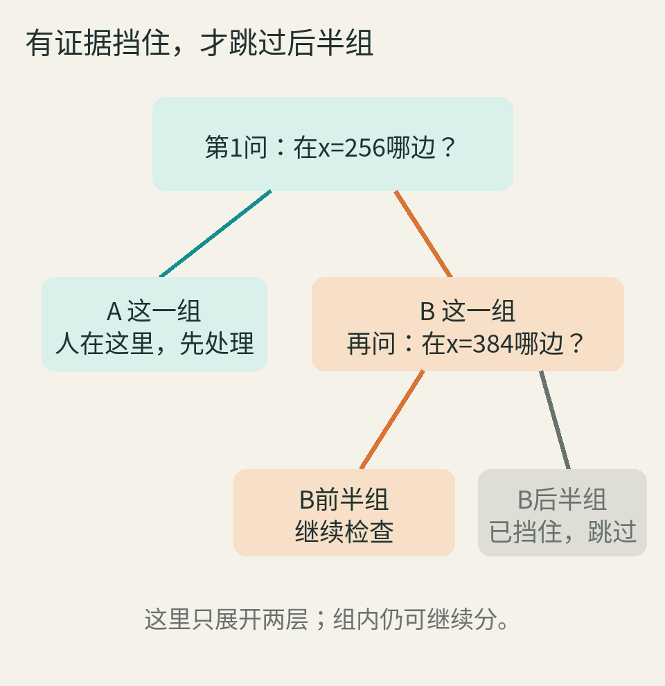

*教学树只展开两层。实际访问B后半前，还会处理B前半中可能可见的部分；它们新增的有效遮挡只会让后半更不可能露出来。即使只凭之前中间实墙的记录，也已足以排除B后半外框。*

用手指沿这张教学树走一次：

1. 玩家x=128，先走x=256左侧的A支路，处理同侧墙段并积累遮挡。
2. B组还不能整组排除，进入它后，先处理x=384近侧的B前半组，继续补充遮挡记录。
3. 轮到B后半组时，把它的100～219列与已封闭的80～239列比较；全部被覆盖，才跳过这条支路。

这是把前面的教学例连起来，不是实际MAP01某一帧的遍历记录。

不要把它理解成“BSP这三个字自动知道谁在前面”。分组给出空间关系与处理顺序；投影告诉我们占哪片画面；已经确认封闭的墙，才提供可用来跳过后方的证据。

如果先处理很远的组，遮挡记录还没建立起来，就可能错过早早省掉它的机会。顺序的价值在这里。

这也不是“建了一棵树，速度一定快多少倍”的承诺。开阔场景里很多区域确实可见，能跳过的组就少；分得太碎，又会增加边段和管理工作。本篇没有测帧率，也不保证检查次数总能缩到某个固定比例。

## 9. 真实地图里，能找到这些组吗？

能。下面不是照着教程想象出来的地图，而是直接读取Freedoom的一份实际MAP01文件后画出的边界。它装在WAD文件里；WAD可以先理解成Doom组织地图、图像等资料的数据包。

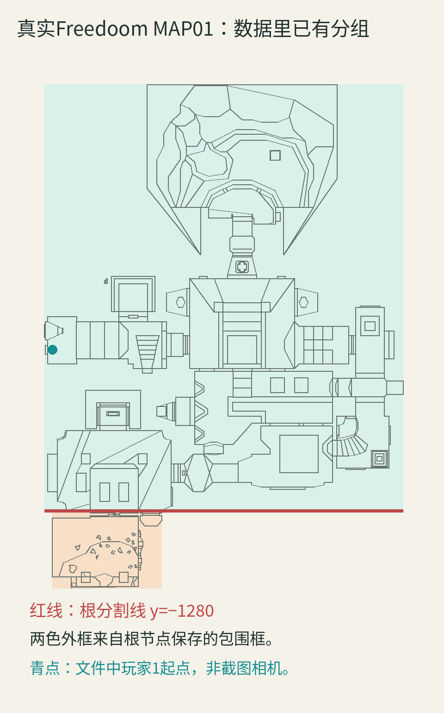

*取材固定提交3ac019628d70b812ffb722f7f2365771b76a9d29。红线和两侧外框来自文件的NODES记录；青点来自玩家1起点记录。这是数据可视化，不是编辑器截图，也不声称与开场官方截图属于同一地点或视角。*

地图文件里有专门保存节点、边段和末端组的部分。读取它们之后，可以把实际记录排成下面这张可读的卡片。

根节点，就是整张分组关系的入口。本文件入口的编号是703，编号从0开始。它保存的线从(400,−1280)向左延伸，因此这第一问只需要区分y在−1280的哪一边。

567和702不是两面墙的编号，而是两份后续分组记录的编号。沿引用继续找，就能到更多分叉，最终到不再继续分的末端组。这种末端常叫**叶子**；Doom里的对应记录叫 **subsector**。

这份文件实际包含704个分割节点、705个subsector，供它们处理的seg有2264个。它不是我们示意图那样只有三个大袋子。[1][3]

第一篇的 **sector** 是记录地板、天花板等属性的区域；这里的 **subsector** 是BSP末端的几何处理分组。不要只因名字像，就以为它们是一份东西。

本文件只有206个sector，却有705个subsector。同一属性区域可以被分成多个处理小组。数字不需要背，差别值得记住。

“原边被拆成小段”也能找到真实例子。文件中编号539的linedef，在同一侧对应两个seg：

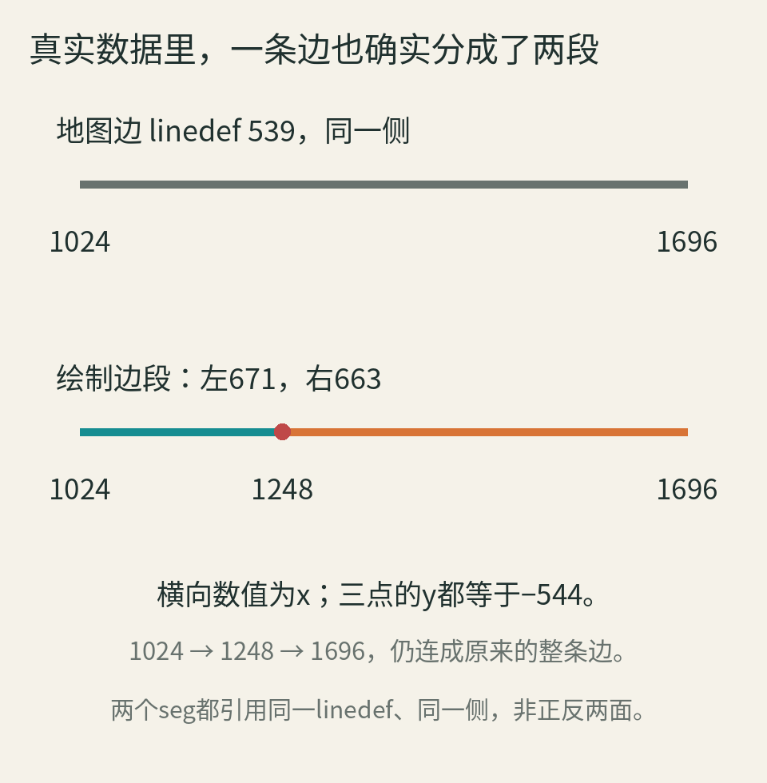

它们从1024接到1248，再接到1696，仍完整覆盖原边。这里特意检查了两个seg都指向同一原边、同一侧，避免把一条边的正反两面误当成“切成两段”。

这些原始数据证明：分割线、子组引用、外框和拆分边段，确实是这个关卡文件中可读取的结构。它们**不证明某一张截图实际跳过了多少组**。若要得到那种运行统计，必须真的运行并记录对应视角；本篇没有作这个声称。

## 10. 再看一眼真正的游戏画面

*官方实际画面；不是本文原创双房间模型，也不是本次运行所得。保留1600×1200原文件与Freedoom完整许可。[来源与许可](https://freedoom.github.io/screenshots.html)*

现在再想“电脑要不要把墙后的整片地图都画一遍”，你已经能给出一个更具体的答案：

**先把地图按空间关系分组。看画面时先处理眼睛所在侧，积累可靠遮挡；如果另一组的外框也整个没机会出现，就连组内墙段都不必逐个继续。**

这不是只靠眼睛猜“应该看不见”，而是用三个条件连起来：组包得住、顺序有依据、封闭范围确实没有洞。

地板、天花板、怪物图像和带透明部分的对象仍有各自的处理步骤；这一篇只讲清BSP按分组检查墙面时，怎样提前省掉一些工作，不把它当成整个游戏引擎。

下一篇，我们回到留下来的墙和物体：它们的外形已经有了，砖纹、地板花纹和怪物的小色块，又怎样被取出来、放进画面？

## 可选：不运行游戏，也能核对两个小问题

正文已经给出了完整答案。若想自己动手，附带两个只用Python标准库的短程序：

- [blocked_columns.py](examples/blocked_columns.py)：先封闭80～239，检查100～219还剩几列；再检查40～279，会留下40～79和240～279。它只是教学账本，不是Doom源码复刻。
- [inspect_bsp.py](examples/inspect_bsp.py)：只读附带的[Freedoom MAP01原数据](examples/freedoom-map01.wad)，打印本篇的实际节点/边段数量、根记录及539号边拆分。没有安装或运行游戏，也不请求网络。

最有用的小练习是不用代码回答：如果一个组有一小部分没有被挡住，应当“跳过整组”，还是“继续检查”？

答案是继续检查。因为“也许能看见”不能当成“已经证明看不见”。

---

## 原材料与进一步核对

1. id Software，[doomdata.h](https://github.com/id-Software/DOOM/blob/a77dfb96cb91780ca334d0d4cfd86957558007e0/linuxdoom-1.10/doomdata.h)：NODES、SEGS、SSECTORS的数据字段和末端引用标志。
2. id Software，[r_bsp.c](https://github.com/id-Software/DOOM/blob/a77dfb96cb91780ca334d0d4cfd86957558007e0/linuxdoom-1.10/r_bsp.c)：R_RenderBSPNode、R_CheckBBox、R_ClipSolidWallSegment、R_ClipPassWallSegment；[r_main.c](https://github.com/id-Software/DOOM/blob/a77dfb96cb91780ca334d0d4cfd86957558007e0/linuxdoom-1.10/r_main.c)：R_PointOnSide与从根启动遍历。
3. Freedoom，[MAP01固定版本](https://github.com/freedoom/freedoom/blob/3ac019628d70b812ffb722f7f2365771b76a9d29/levels/map01.wad)、[项目](https://github.com/freedoom/freedoom)、[官方截图与使用许可](https://freedoom.github.io/screenshots.html)。数据和图像保持自身BSD-3-Clause条款，不因本文正文授权而改变。

本文由AI辅助研究、原创撰写、编写计算与制图程序。模型图是本次实际计算结果；真实地图图直接来自注明版本的WAD，官方截图另列出处。没有声称本次运行过Doom或测过历史机器性能。逐图职责、数值范围和完整权利说明见[sources.md](sources.md)。
