# Doom 入门④：砖纹和怪物，怎样变成屏幕上的小色块？

前三篇，我们已经知道房间怎样表示、墙上的点怎样找到屏幕位置，以及被挡住的墙为什么可以提前跳过。

现在还差一件非常具体的事：**留下来的这一格屏幕，究竟应该是什么颜色？**

*Freedoom官方实际截图，由Chocolate Doom运行。让游戏运行并生成画面的程序叫游戏引擎；这里不是Doom原版美术，也不是本文模型。官方将320×200画面清晰放大并调整显示比例为1600×1200，本文保留原文件。[来源与许可](https://freedoom.github.io/screenshots.html)*

屏幕上的一个小色块叫**像素**。砖纹、地板花纹、怪物的脸，最后都得变成许多个像素的颜色。

这篇先不背一大串图形学术语。我们选一块真实砖图，再追踪一个屏幕像素，看看它的颜色怎么被找到。

## 1. 房间的形状，与表面的图案，是两份东西

继续用A、B相连的双房间。第三篇为了观察遮挡临时加的中间实墙先拿掉，恢复前两篇的开口。

A地板0、天花128；B地板24、天花96。眼睛仍在(128,96,41)，朝+x看。x向地图右边、y向上，41是眼睛的高度；长度用地图单位，不直接等于米。

先让每块表面只涂一种底色。

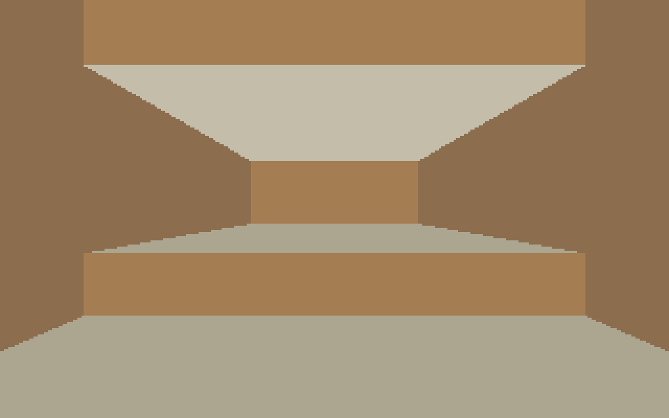

即使没有砖纹，房间也有近大远小，有台阶和开口。因为这些来自形状、位置和高度。

现在，几何不动，给墙面和水平面换上真实图像。

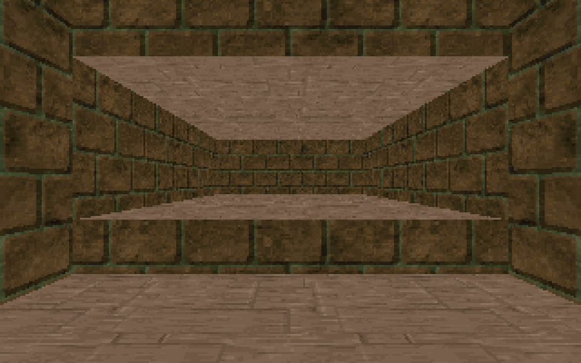

*两图均为本次原创计算，不是运行Doom所得。本篇明确重新指定图案的对齐方式，并先不做光照变暗，便于核对颜色；不宣称图块排列与前篇模型完全一致。先算320×200画布，再把每格放大为3×3，导出960×600。*

把一张图当成表面图案使用，通常叫**贴图**；供取颜色的图案数据叫**纹理**。你可以先把它想成“这块表面要用的花纹”，但别真以为程序给每一块砖都建了一个立体砖块。

## 2. 先打开真实图案，看清它本来有多小

下面是模型实际使用的两张Freedoom图像。

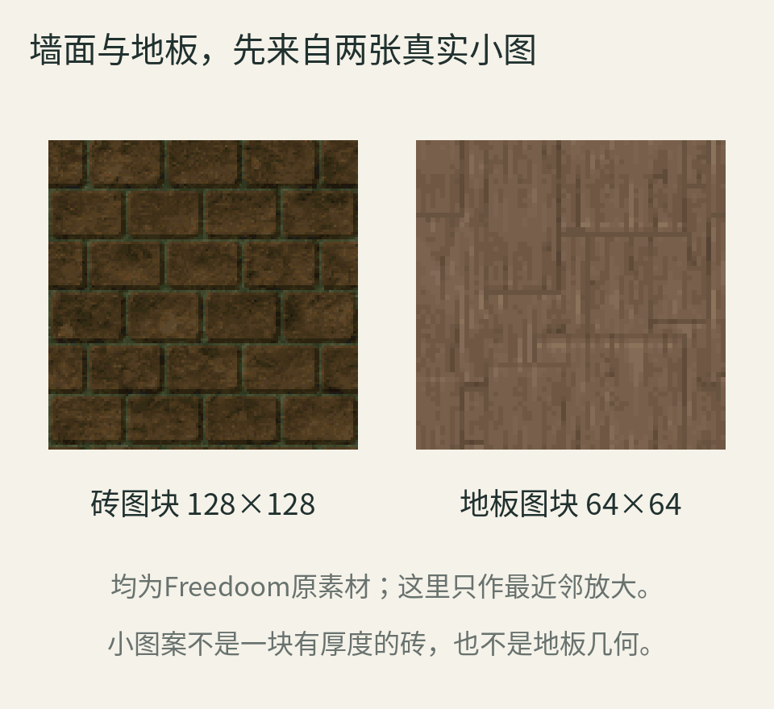

*左：brick.png，128×128；右：floor0_1.png，64×64。放大只重复原色块，没有生成新细节。保留[砖图原文件](assets/brick-original.png)与[地板原文件](assets/floor-original.png)，依Freedoom BSD-3-Clause许可使用。*

128×128表示横着128列、竖着128行。一张图只有16384个小格，却能反复用在许多墙面上。

素材图本身也由像素组成。为了和最终屏幕像素区别，图形学里也会把**纹理中的一个小格**叫作**纹素**，英文texel。两个词不是两种神秘物质，只是在区分“源图里的格子”和“最后画面里的格子”。

我们选砖图的第112列、第12行。编号从0开始，横向向右增加，纵向向下增加。

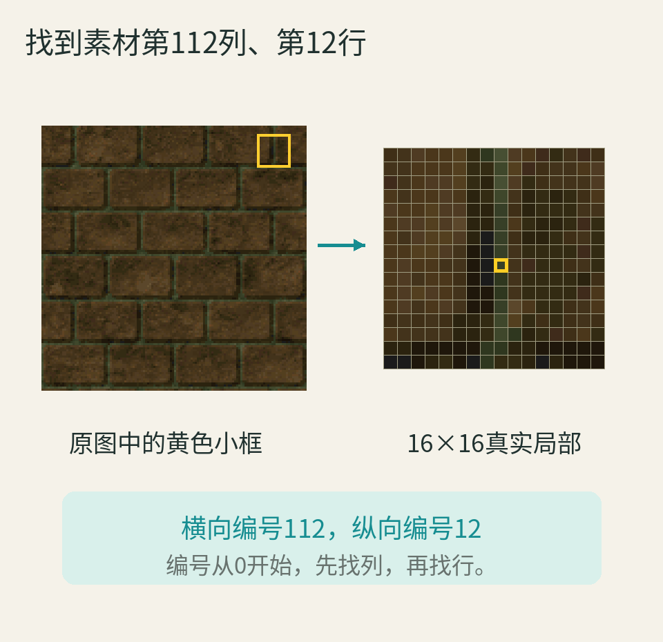

左边黄色框选中了原图的一小块，右边把这块16×16区域放大；其中黄色边框圈出的就是要追踪的那一格。

现在我们已经有了一个可以准确回答的问题：不是“取一个差不多的绿色”，而是“去这张图的第112列、第12行，读它保存的颜色”。

## 3. 为什么屏幕这一格，会去找素材那一格？

回到320×200的教学画布，选第180列、第136行。它在靠近玩家的台阶侧面上。

把世界位置换成屏幕位置叫**投影**。第二篇做过正向计算；现在可以反过来想：从眼睛穿过这格画面，沿同一条直线往前，会先碰到哪块表面？

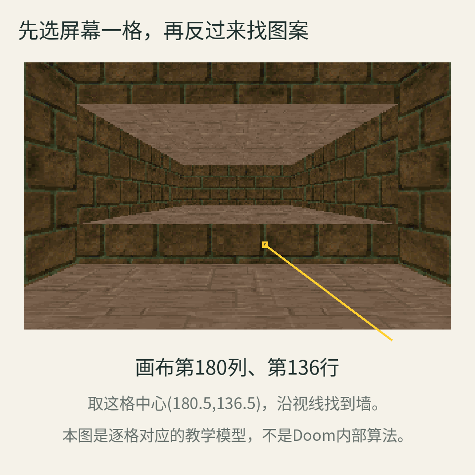

为避免一格的左边缘、右边缘说混，我们用这格的中心：(180.5,136.5)。小数不是多长出半个像素，只是说位置在这一格正中。

在本例中，这条视线先碰到共享边下方的墙面，位置是：

**(x,y,z) = (256,79.6,11.8)。**

如果想接上第二篇的比例：前方距离128；画布横向偏离中心20.5，对应地图横偏20.5×128÷160=16.4；纵向向下偏36.5，对应向下29.2。所以y从96减到79.6，z从41减到11.8。

不重算这些数，也可以先跟着下图看地址怎样换了一次。

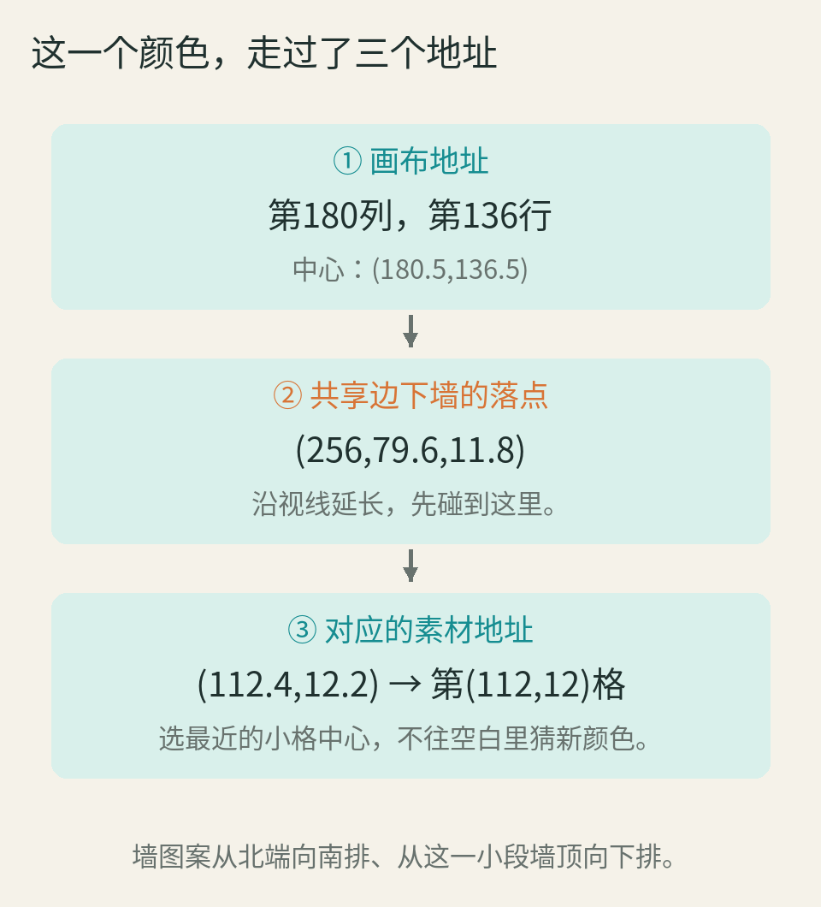

本篇把这段墙的花纹这样排齐：

- 沿墙从北端y=192往南排，图案的列号增加。
- 从这段小墙的顶部z=24往下排，图案的行号增加。
- 每个地图单位，对应源图一个格子的宽或高。

于是，墙上这个落点对应的素材位置是：

- 图案横向：192−79.6=112.4。
- 图案纵向：24−11.8=12.2。

它落在第112列、第12行那个小格里。这个格的中心是(112.5,12.5)，也是附近最近的格心；我们就取它保存的颜色。

**先找到谁负责这个屏幕像素，再找到那块表面图案中的位置，最后读一个源格。** 这件从图像中选颜色的事，叫**取样**或采样。

这里沿视线逐格追踪，是本篇解释对应关系的计算模型。经典Doom并不是为每个屏幕像素都照抄这段“沿直线找表面”的程序；后面会看它实际怎样组织墙与地板的绘制。

### 读出来的颜色是什么？

这次选中的真实源格，颜色数值是(55,63,39)。

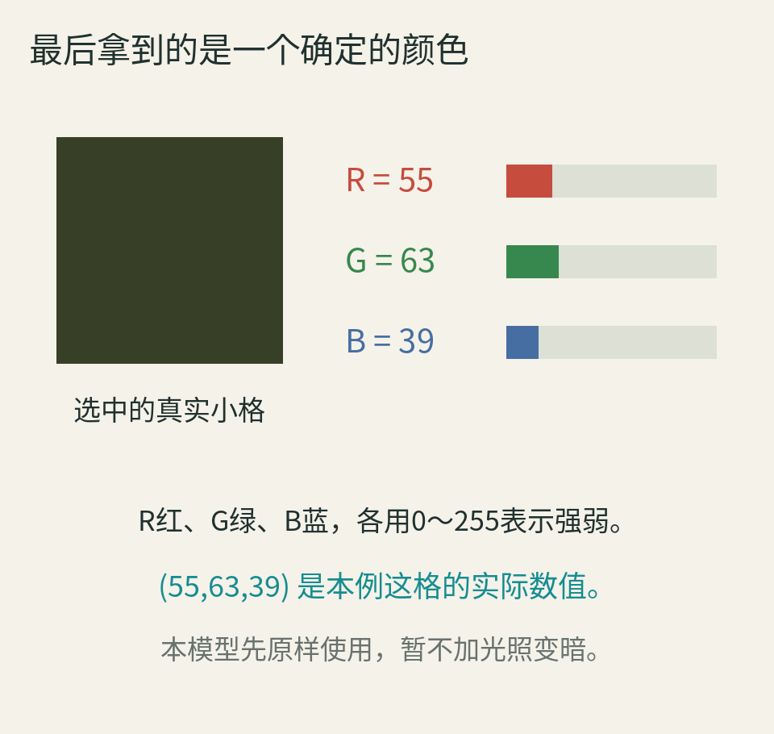

这三个数依次是R红、G绿、B蓝，合称**RGB**。在这里使用的颜色表示里，每个分量用0～255记录。我们先把这个颜色原样放进目标屏幕格，不再把它调暗，因此模型中的目标格也确实是(55,63,39)。

将来加入光照，颜色还可能变化。那是在“找到图案颜色”之后增加的处理，不是砖图本身被换成了另一张图。

## 4. 墙比图宽怎么办？用完一遍，再从头来

这张砖图只有128格宽，墙面却不一定只有128地图单位。

一种简单办法是重复使用：第一遍用完，第二遍从第0列重新开始。

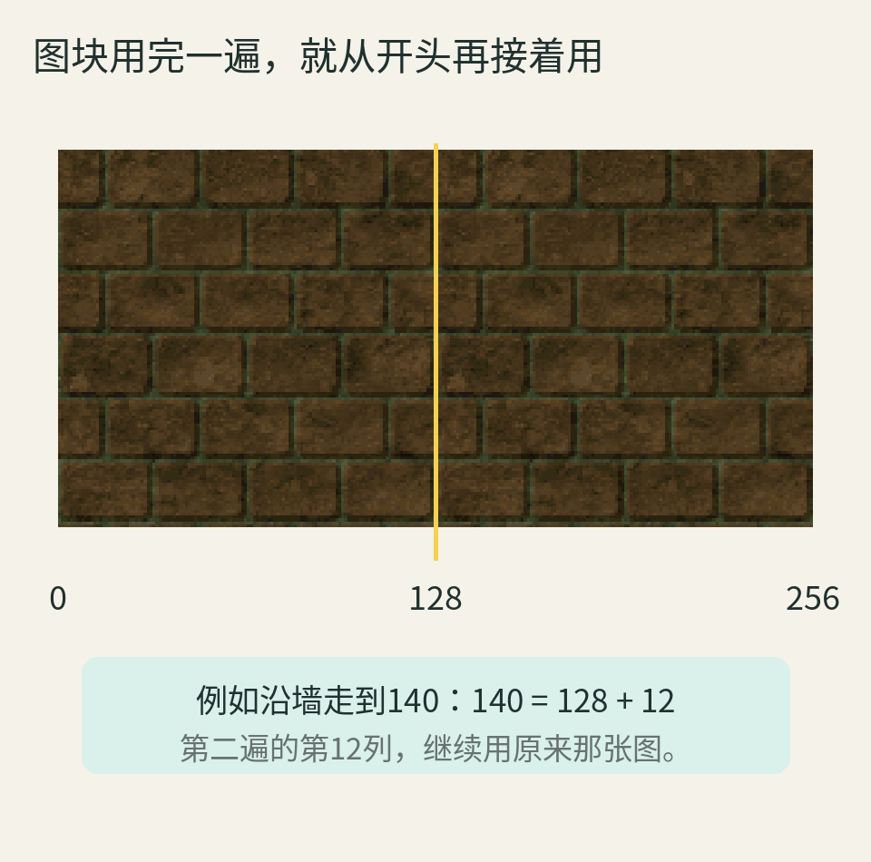

比如沿墙走到图案位置140：

**140 = 128 + 12。**

前128走完一整张，剩下12，所以继续读原图的第12列。

程序常用“除以128后剩下多少”，也就是**取余数**，完成这件事。只要对齐方式相同，位置12、140、268就能读到同一列；并不需要真的保存三张一模一样的图片。

这也解释了为什么地板和砖墙上会出现重复花纹。图案的细节有限，程序把它按照约定铺开。

对齐方式同样重要：从哪里起算、偏移多少、是否翻转，都会改变砖缝出现的位置。本篇把这些约定写明，是为了让一个颜色可以算得回去，不是说所有Doom墙纹理都必须这么对齐。

另一个小区别：这里的brick.png是一个真实源图块。经典Doom里，完整墙纹理还可以由多个图块组合；本模型直接拿这张图重复使用，不把“一个PNG”当成完整引擎纹理格式。[1]

## 5. 地板不是把墙图横过来那么简单

墙面上的一个位置，可以用沿墙多少、上下多少描述。地板上的一个位置，则要回答平面里两个方向各走了多少。

先从上面看B地板。它宽256、深192，一张64×64图块正好能排4列、3行。

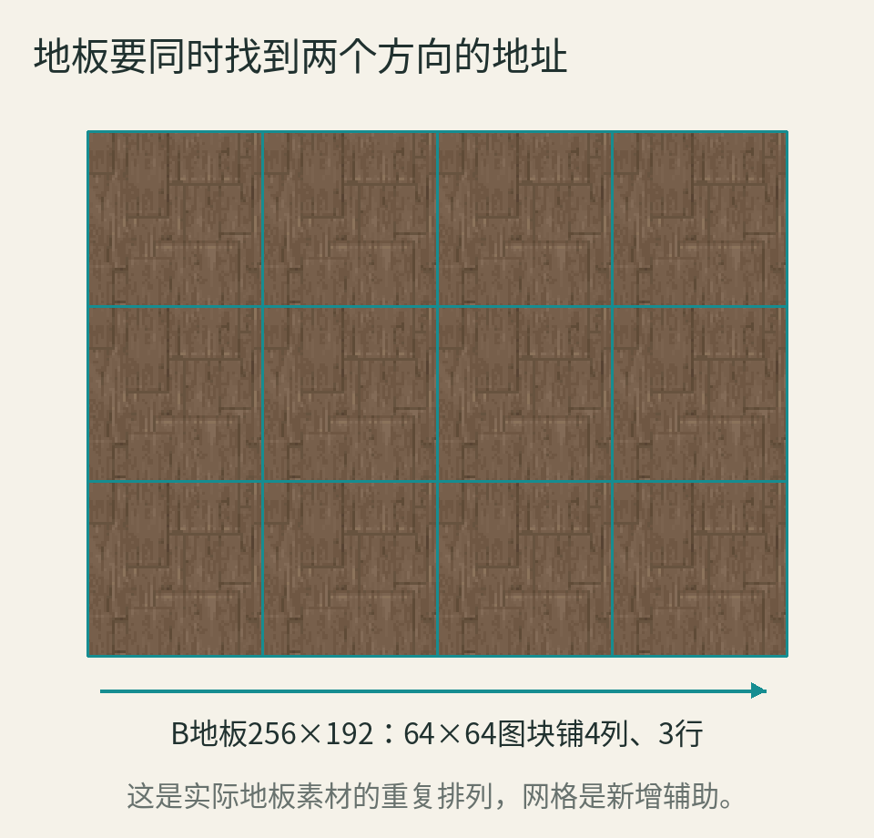

*使用真实地板原图重复排列。青色网格是教学辅助，并非原素材自带的亮线。*

本模型让图案一条轴沿地图x方向，另一条轴沿y减小的方向；超出64格就各自从头重复。换到其他设计，也可以采用不同方向和起点。

为了看清地板，现在把眼睛移到同一B房间里的(288,96,65)，仍朝+x。B地板24，加上离地41，眼睛高度就是65。

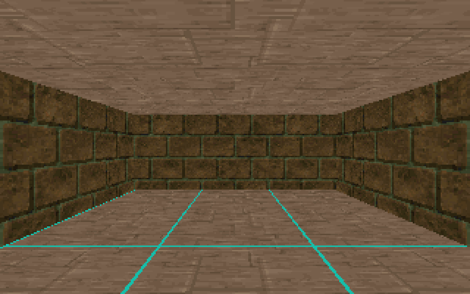

*仍是原来的B。只有观察位置变化，地板图块大小和房间尺寸没变；新增青线标出64×64重复单元。*

俯视时，每格一样大。站到里面看，远处的一块地板只占更少的画面，近处的同样大小区域则展开得更宽。

所以不能把素材图的一行，机械地原样抄成屏幕的一行。屏幕里的每个位置，仍要对应回地板上的位置，再去那里的重复图案找颜色。

墙和地板都在“选源格”，但它们在空间中朝向不同，怎样从画面走回表面，也不同。

## 6. 一格素材，不总是只对应一格屏幕

到这里，可能会自然冒出一个问题：小图变得比原来大了，哪里来的新细节？

答案是：不一定有新细节。

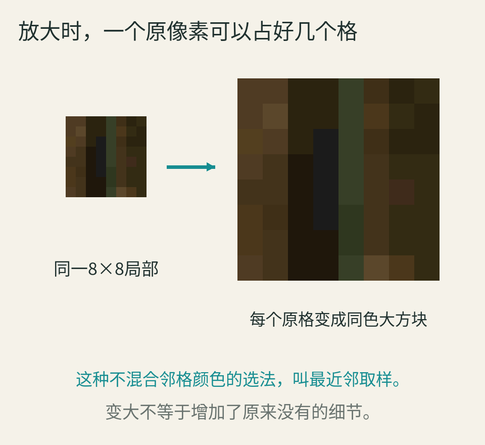

当很多屏幕格都找到了同一个源格，它们就会取得同一种颜色，看起来像把一个小方块放大了。

像本篇这样选择最近源格、不混合周围颜色的做法，叫**最近邻取样**。放大后保留硬朗的小方块，就是它容易认出的特点。

反过来，远处纹理缩得很小时，许多源格要挤进很少的屏幕格。它们不可能全都原样留下。

下面取同一砖图的16×16局部，把它缩成4×4。

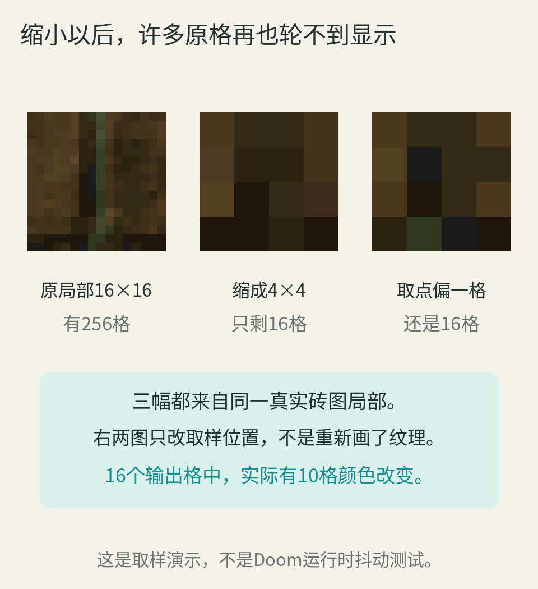

*原局部来自砖图横向104～119、纵向4～19。中图每隔4格取一个，位置为2、6、10、14；右图取点各向右、向下偏一格，改为3、7、11、15。结果为实际计算，放大只为了看清这16格。*

原来有256格，现在只剩16格。取点位置只变一点，某些砖缝可能被选中，也可能被跳过去。这次实际有10个输出格颜色改变。

这能帮助理解为什么远处细纹可能不稳定，移动时花纹有时会突然换样。但这张对比图是受控取样实验，**不是Doom运行时画面抖动或性能的实测**。

更复杂的图像处理可以综合附近许多源格，让缩小时的结果更稳定。本篇先把最基本的事实讲清：**输出格数变少，就必须决定保留哪些信息。** 放大、缩小和取样方法不能互相混为一件事。

## 7. 真正的Doom怎样安排这些取色动作？

本篇模型沿视线找到每格对应的表面，是为了把关系算得容易核对。经典Doom代码则利用墙与水平地面的结构，安排更规整的绘制步骤。

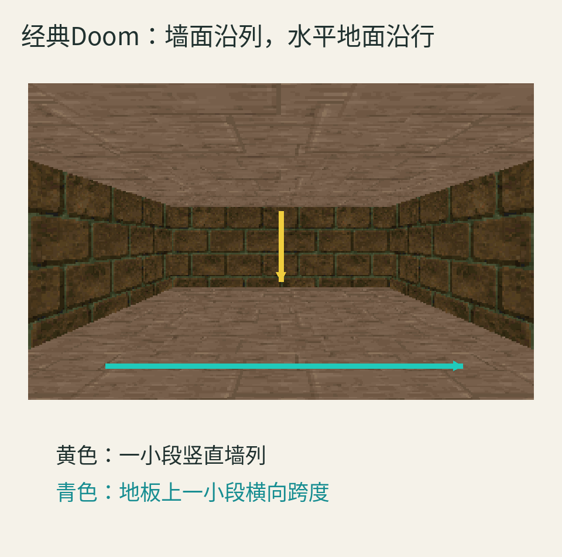

在公开的Linux Doom 1.10源码中：

- 墙面的 `R_DrawColumn` 处理一段竖直屏幕列，沿素材列逐步取颜色，写到画面的上、下位置。[2]
- 地板/天花板的 `R_DrawSpan` 处理一段横向屏幕行。span可以理解为“同一行里从这里到那里的一小段”；它沿地面取色，需要追踪地板图案的两个方向。[2][3]

这里说的是经典代码怎样把工作排成条，并不是说墙只能竖着摆，或地板画出来永远没有透视变化。

### 图像里还可以先存“颜色编号”

我们刚才把选中格的颜色说成RGB，其实这张真实PNG的内部还有一层：它先保存一个编号，再通过一张对照表找到RGB。

这张表叫**调色板**。本例选中的格，实际保存的编号是159。

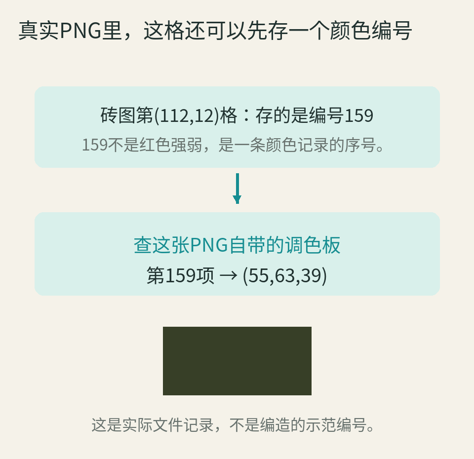

159不是“红色有159那么强”，它只是“去颜色表第159项找”。文件里的这项正好是(55,63,39)。这些数都从本篇保留的原PNG读取，没有手填一个看似合理的例子。

经典Doom也使用颜色编号，并在取样时通过亮度/效果对应表转换编号，再显示相应颜色。[2] 不过，本文展示的是Freedoom开发用的PNG原素材；引擎实际读取打包、转换后的游戏图像数据，并不是直接逐张打开这些PNG。

因此，理解本篇的地址和取色关系，不等于已经复刻了原引擎的素材打包、亮度表、整数精度和全部边界规则。

## 8. 怪物不是把一面砖墙剪成怪物形状

墙面是已有几何表面的图案。经典Doom里的许多怪物、物品，则使用一张独立图像放到合适位置。这类图像叫**精灵**，英文sprite；这里的“精灵”不是指游戏剧情里某种小生物。

先看一张真实Freedoom角色素材。

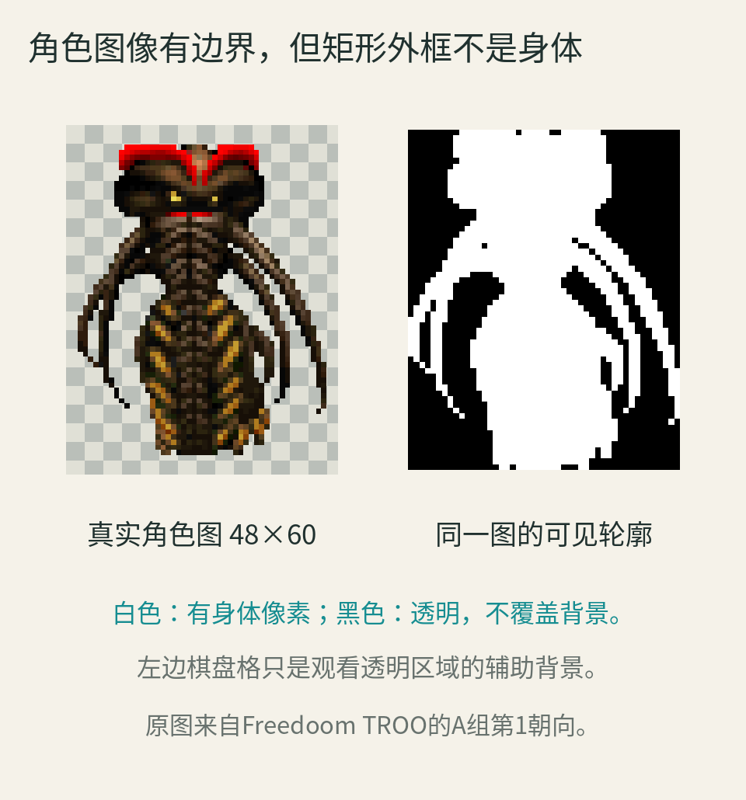

*源文件[TROO A1](assets/trooa1.png)，48×60。左边棋盘格是用来辨认透明处的辅助背景；右边白色表示有内容，黑色表示透明。都来自同一原文件，未补画角色。*

图像文件仍有一个矩形外框，但身体没有填满整个矩形。那些空地方不能把后面的墙、地板一起盖住。

把它放回同一个房间，就得到下面的教学计算结果。

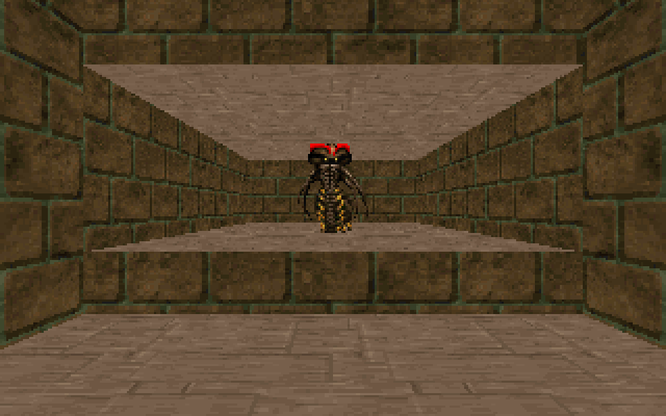

*原创模型，角色放在(352,96,24)，底部落在B地板。本例把原图一格当一个地图单位、用底边中点定位，便于解释；没有复刻原游戏角色尺寸、图像偏移或碰撞体。*

可以把这种显示方式想成一张保持面向画布的平面图案。先算这个角色应该多大、放在哪里，再逐格读取角色图。遇到透明位置，就让原先的背景留下来。

如果忘记跳过透明处，会是什么样？

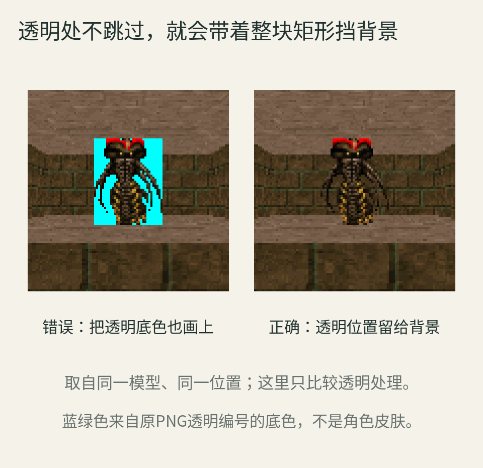

*左右取同一画面区域。左图故意把原PNG透明编号背后的蓝绿色也当普通颜色写出；右图保留背景。蓝绿色矩形是错误示范，不是角色皮肤或真实游戏缺陷。*

经典Doom的精灵图像会按列记录哪些小段有像素，并在绘制时跳过空白段。[4] 它不需要真的把一大片透明底色先涂上，再想办法擦掉。

“图片哪里透明”也不是“玩家哪里可以穿过去”。角色的碰撞规则是另一份数据，我们下一篇再分开看。

## 9. 绕到怪物背后，为什么能看到背面？

如果永远用同一张正面图，无论从哪边看，角色都会像一直盯着你。

一个常见办法是准备多个朝向图。这里仍只看同一个角色姿态，也就是文件名里的A，先不换成下一时刻的动画。

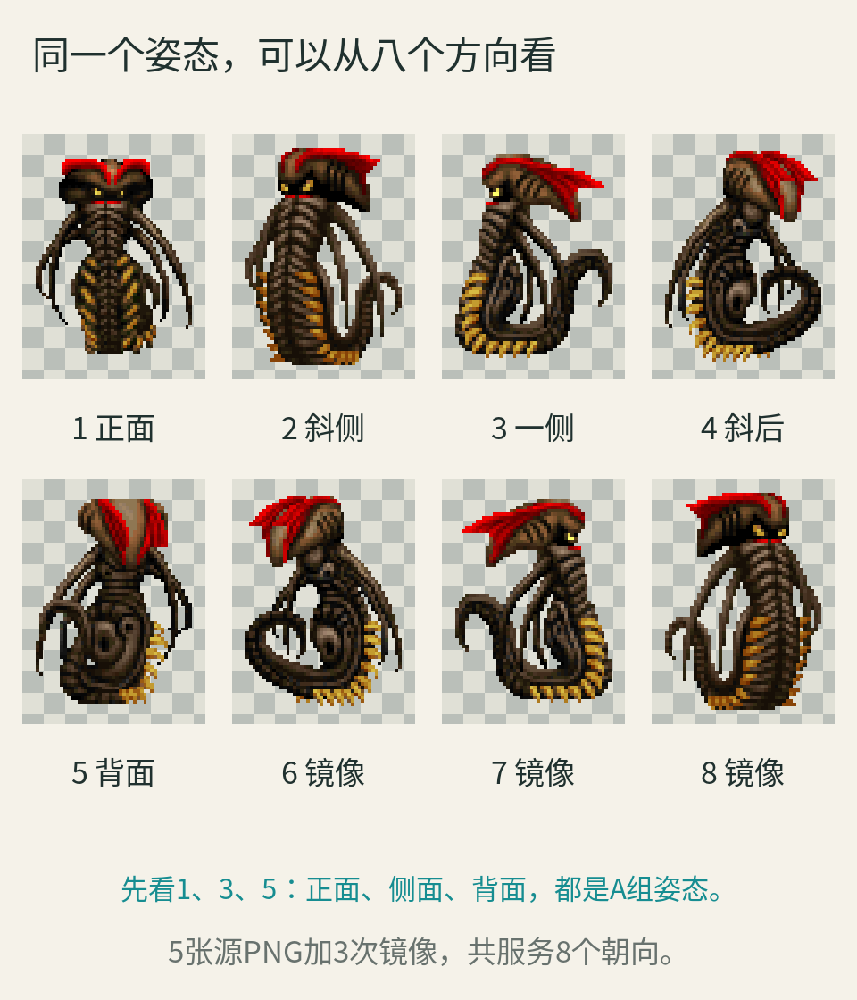

*先看1、3、5三幅，就能认出正面、侧面和背面。其余用于斜方向；6、7、8由对应原图水平翻转得到，不冒充三张另拍或另画的源文件。*

要选哪一张，得看**角色自己朝哪里，以及观察者在角色哪边**。这不只取决于玩家有没有转头。

例如角色固定朝西。你在它西边，看到正面；走到南边，看到侧面；走到东边，就看它背面。

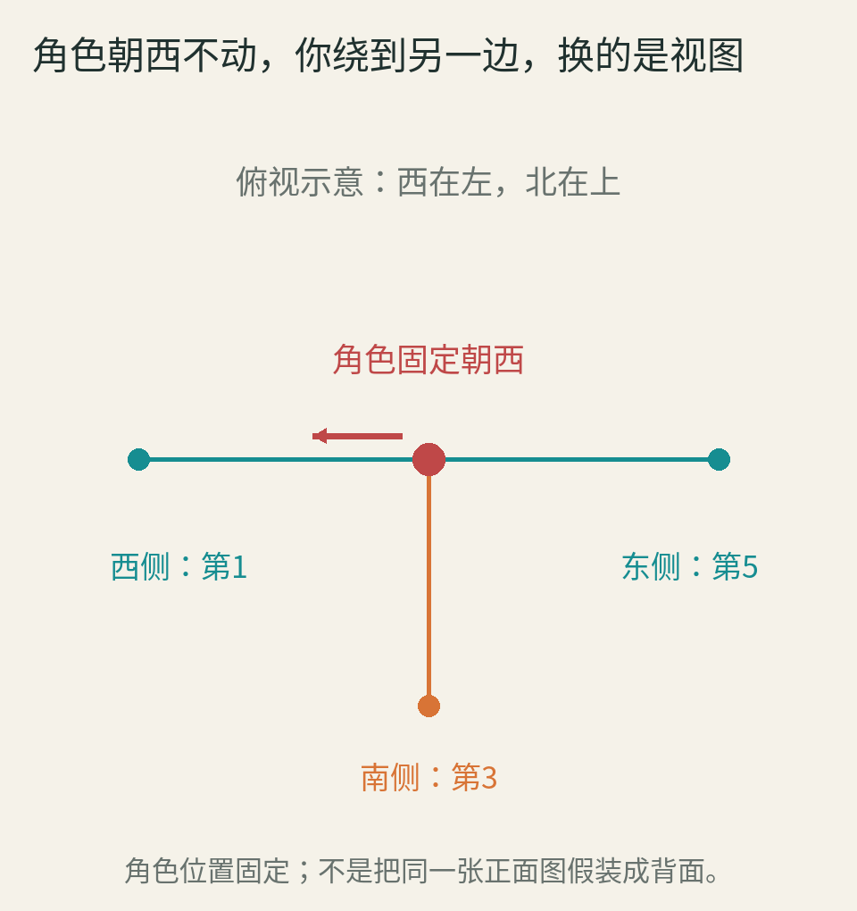

这三个位置与1、3、5的对应，按本文核对的经典朝向选择规则说明。[4] 图中只解释相对方向，没有声称实际运行了三段游戏录像。

文件名也保存了一点信息。比如 `trooa3a7.png`：同一张源图服务A姿态的第3和第7朝向，其中一个按原方向用，另一个水平翻转。

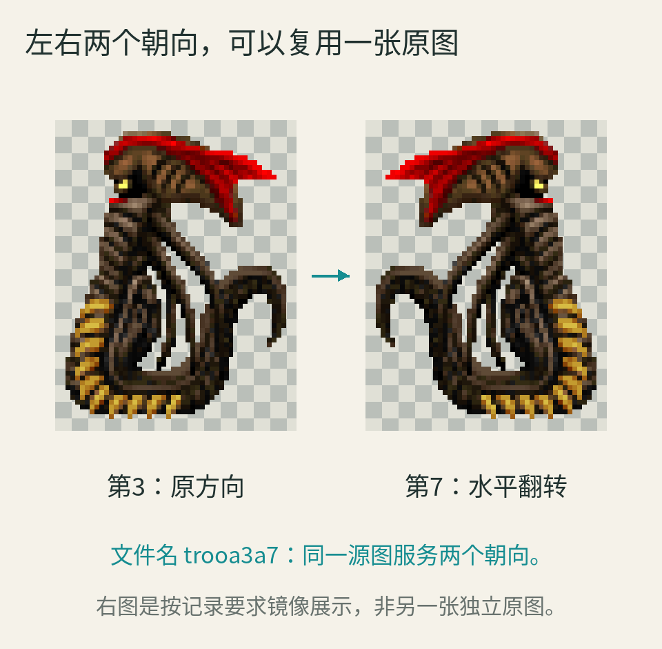

开发素材的文件名沿用了引擎图像条目的命名约定。经典数据包中使用不带.png的条目名；源码初始化这些条目时，会把两组“姿态字母+朝向数字”登记起来，并记录第二组需要翻转，绘制时再按观察方向挑选。[4]

所以这里有两种变化，别混在一起：

- **时间变了**：角色从一个动作姿态切到下一个，例如走路的下一步。
- **观察方向变了**：同一姿态换成从另一侧看它的图。

并非每个物品都需要八个朝向。代码也支持同一张图用于所有方向；这是素材与对象的选择，不是所有精灵必须遵守的外观规则。[4]

## 10. 回到最初那一小格

我们从一个画布位置出发，找到台阶侧面上的一点，算出素材地址，读出真实颜色(55,63,39)，再把它放回画面。

地板同样要找素材位置；角色独立图像还要处理透明和朝向。它们共有的主线是：**画面这一格由谁负责？该到它的哪一格里取颜色？**

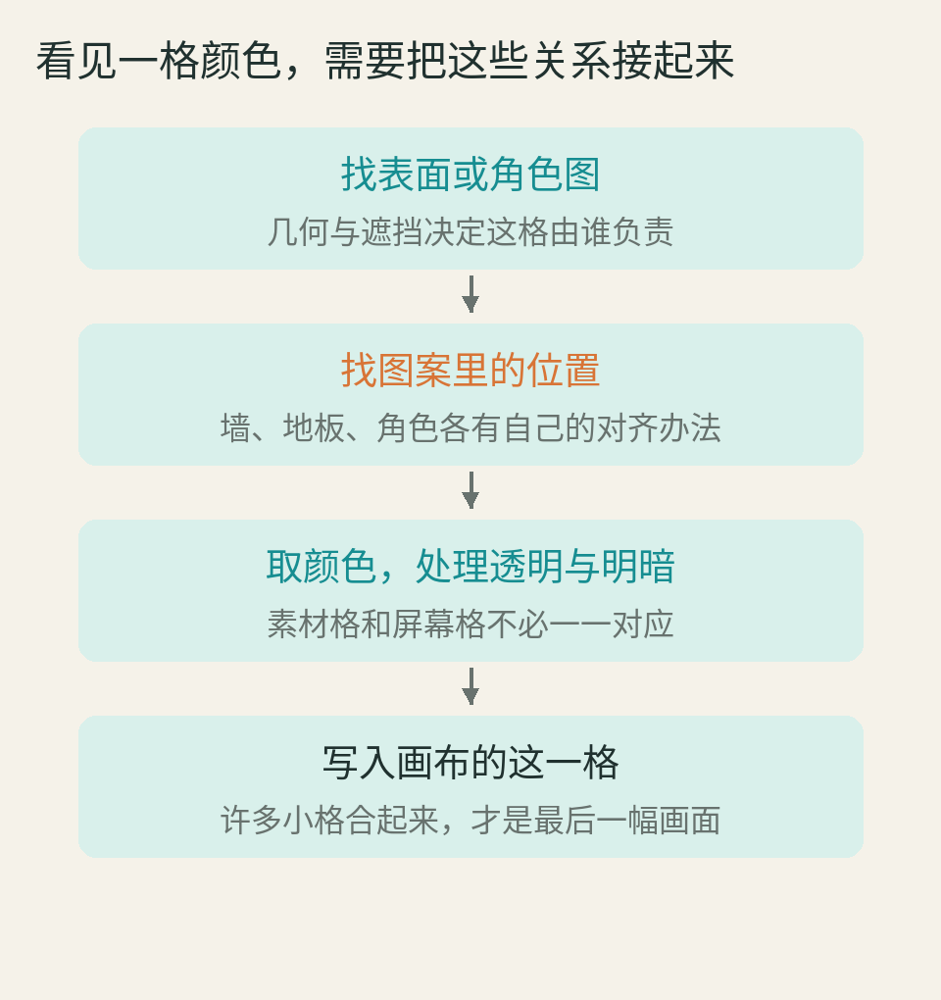

近大远小不是靠把原图猜着拉伸；砖图也不等于立体砖；精灵的透明矩形更不是角色的碰撞形状。把几何、素材、取样和显示结果分开，很多游戏画面的细节就开始有了可追踪的来路。

下一篇，我们从“看起来能过去”，走到“程序到底让不让过去”：玩家怎样碰墙、上台阶，门又怎样真正打开？

## 可选：自己重算这个素材地址

附带的[wall_sample.py](examples/wall_sample.py)只用Python标准库，会从第180列、第136行的中心算回本篇那段墙，输出(112,12)这个素材格。

它只算地址，不读取PNG、不绘制整幅画面，也不是原引擎代码。真实颜色与调色板编号已从随文保留的原文件核对；不运行脚本也能跟正文完成所有步骤。

你还可以直接回答：同样一张128宽图，位置140与位置12为什么可以读到同一列？因为完整走过128以后，剩余位置相同。

---

## 原材料与进一步核对

1. id Software，[r_data.c](https://github.com/id-Software/DOOM/blob/a77dfb96cb91780ca334d0d4cfd86957558007e0/linuxdoom-1.10/r_data.c)：墙纹理由图块组合、纹理列与精灵图像数据的装入。
2. id Software，[r_draw.c](https://github.com/id-Software/DOOM/blob/a77dfb96cb91780ca334d0d4cfd86957558007e0/linuxdoom-1.10/r_draw.c)：R_DrawColumn、R_DrawSpan、颜色编号与colormap对应。
3. id Software，[r_plane.c](https://github.com/id-Software/DOOM/blob/a77dfb96cb91780ca334d0d4cfd86957558007e0/linuxdoom-1.10/r_plane.c)：地板/天花板平面范围、行内取样起点与步进。
4. id Software，[r_things.c](https://github.com/id-Software/DOOM/blob/a77dfb96cb91780ca334d0d4cfd86957558007e0/linuxdoom-1.10/r_things.c)：R_InitSpriteDefs、R_ProjectSprite、R_DrawMaskedColumn，核对朝向选择、翻转及空白段处理。
5. Freedoom，[固定素材版本](https://github.com/freedoom/freedoom/tree/3ac019628d70b812ffb722f7f2365771b76a9d29)、[官方截图](https://freedoom.github.io/screenshots.html)。图块、角色和截图按自身BSD-3-Clause许可使用，不因Doom源码开放而获得商业原版美术授权。

本文由AI辅助研究、原创撰写、编写计算与中文制图。真实图像原文件保留；模型、取样对比和方向示意分别说明身份，没有声称本次运行过Doom或亲测游戏画面。逐图来源、计算约定、完整权利与边界见[sources.md](sources.md)。
