# Doom 入门⑤：门开了一条缝，为什么还是走不过去？

前四篇，我们把平面地图变成房间，把墙放到屏幕上，再给留下的表面取颜色。但一直站着看，还不能算真正“走进游戏”。

你向前走，为什么不会穿进墙？门正在上升，为什么已经看见对面，却还不能过去？站在升降台上，为什么人也会跟着升高？

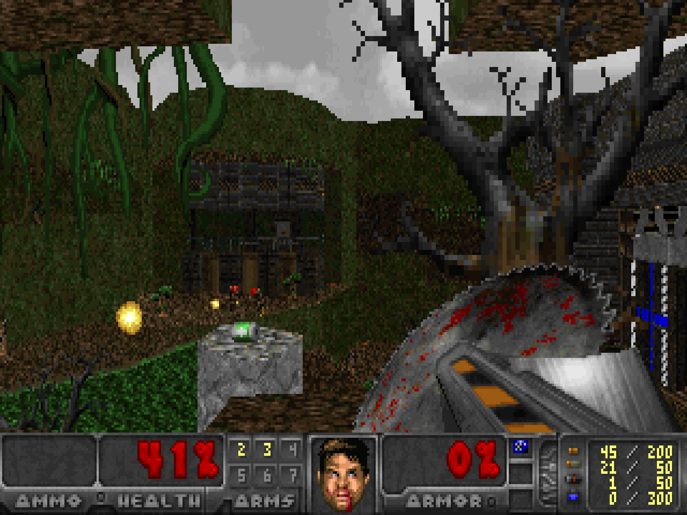

*Freedoom官方实际截图，由Chocolate Doom运行；引擎就是负责运行游戏、更新世界并生成画面的程序。原文件1600×1200，来自320×200画面放大并调整显示比例。这张图用于观察真实空间，不是后面门或平台的运行录像。[官方来源与许可](https://freedoom.github.io/screenshots.html)*

这篇只追一个问题：**世界的高度或人的位置变了，电脑怎样判断“身体还放得下吗”？**

## 1. 先看同一扇门的三个时刻

沿用熟悉的双房间：A的地板0、天花128；B的地板24、天花96。数字都是地图单位，不直接等于米，也不是屏幕上的小色块数量。

眼睛仍在(128,96,41)，朝地图的+x方向看。x向地图右边、y向上，z表示离统一高度基准多高。这里的41是眼睛高度。

我们在两间房之间加一扇门。先看它关着、开了一部分、打开到预定高度的样子。

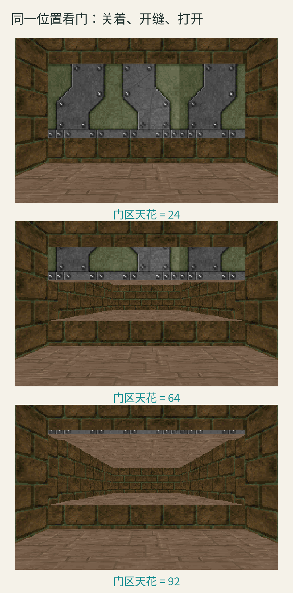

*三幅都是本次原创模型计算，使用真实Freedoom砖、地板、金属面板图像；不是运行Doom所得。各先算320×200，再用最近邻方式放大。中间那幅看得到后墙，但门下只有40单位高。*

先记住中间那幅。我们稍后会算出，**这道缝能让视线经过，却容不下经典Doom中正常站立的玩家。**

这不是画面和通行规则“各说各话”。视线只需要一条通路，身体需要一块有宽度、有高度的空间。

## 2. 这扇门，其实是一小片会降低天花的区域

第一篇说过，地图里保存一组地板、天花等属性的区域叫sector。这里重新用日常话理解：把一块地圈出来，给它记上“地板多高，顶多高”。

原来B从x=256一直延伸到512。现在只把它最前面16单位深的一条，划成独立的门区D；剩下的B从272开始。A和外侧轮廓不变。

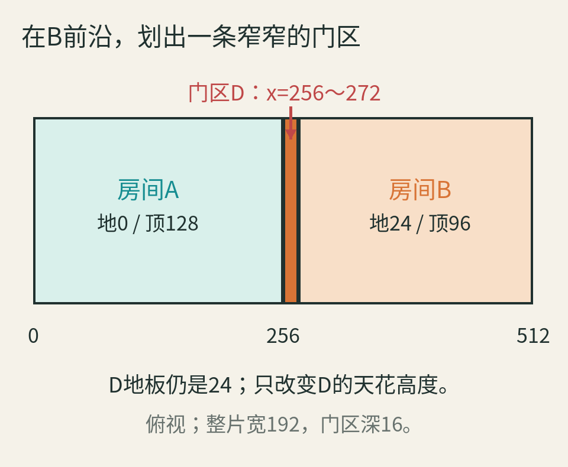

D地板仍是24。关门时，让D的天花也降到24：地板和天花重合，中间没有可通过的空间。

开门时，不用把整间房拖走，只把D的天花逐渐抬高。沿着视线把房间剖开，就看得更清楚了。

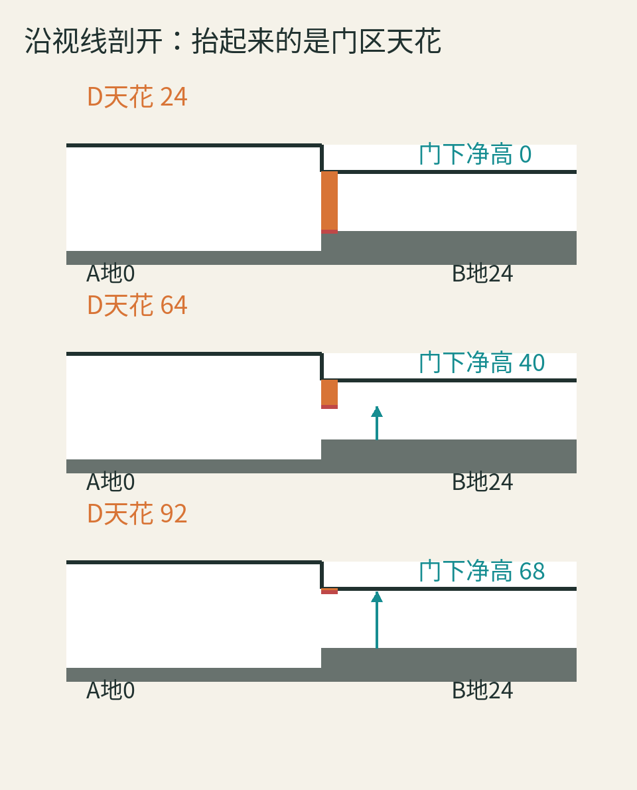

**净高**就是中间真正空出来的高度，算起来只要“顶减地”：

- 关着：24−24=0。
- 开缝：64−24=40。
- 打开：92−24=68。

注意，门区有16单位的深度。俯视看，它是一条窄区域，不是一条没有厚度的画线。

金属外观又是另外一份数据。下面是两张真实的Freedoom材料图。

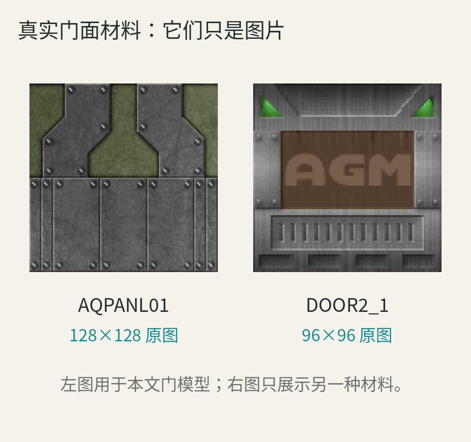

*左图用于本文模型的门面，右图只展示另一种门材料。均仅重复原色块放大，保留[AQPANL01原文件](assets/aqpanl01.png)和[DOOR2_1原文件](assets/door2_1.png)。花纹叫纹理，供表面取颜色；它本身没有“遇到玩家就打开”的动作。*

把同一张金属图贴在普通墙上，它仍然可以是一堵不会动的墙。**门的动作来自地图属性与程序规则，不是图片里画了门就自动成为门。**

## 3. 这不是只存在于教学模型里的做法

看一份真正的Freedoom地图。我们继续使用前几篇的同一版MAP01原文件，从它的记录画出平面边界。

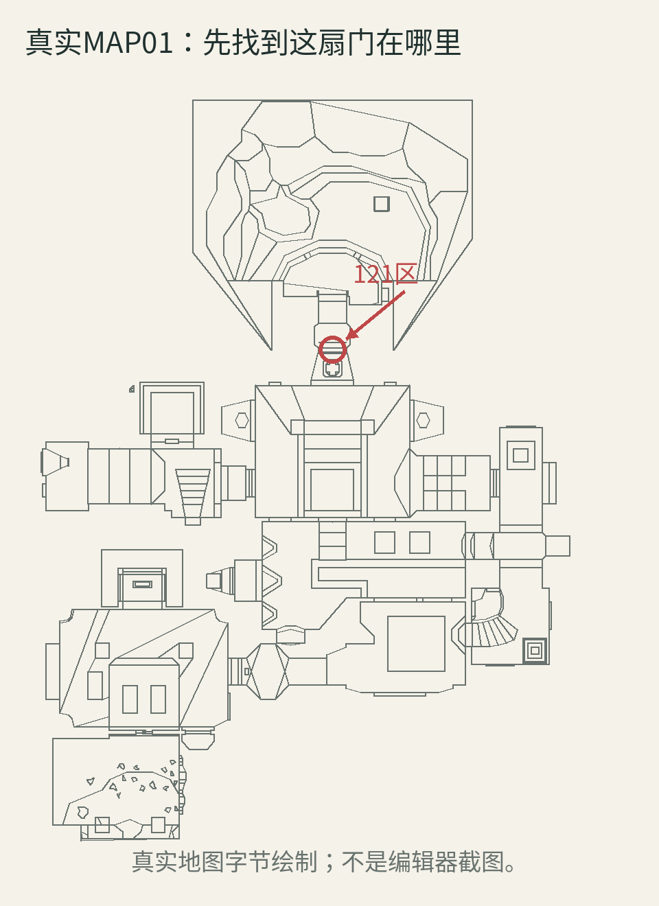

*这是读取真实地图字节后绘制的图，不是地图编辑器截图。它与开头官方游戏截图不是同一观察位置的配对，不以两者互相证明局部细节。*

放大红圈。编号121的窄区域夹在40区和130区之间，横向128、纵向16。为看清边界，下图把纵向特别拉长了。

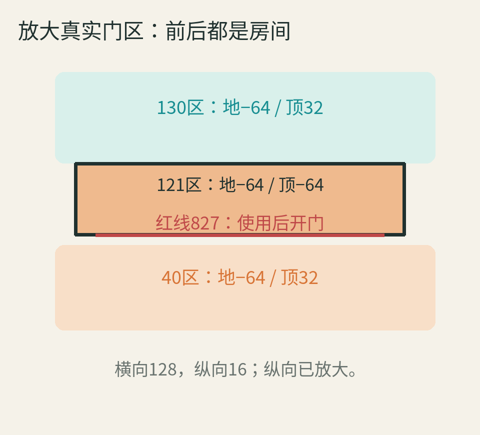

它的地板是−64，天花也是−64。负数不代表出错，只代表这里比这份地图选的高度0更低。**初始净高仍是0：−64−(−64)=0。**

红色的827号边线还记录了一种特殊动作：类型31。对应经典引擎的手动开门路径，它会把背后的门区打开，到顶后保持开启。玩家发出使用门的动作，程序找到这条门边的动作记录，才开始按门型逐次更新门区高度。

这里还能追到上一节的真实金属面板：827号边线前侧的上部纹理名，就是AQPANL01；该版材料定义把它组成128×128纹理，使用同名图块。

这条证据链是：**真实地图的一小片区域，真实高度记录，真实动作编号，再到真实表面材料。**不是看见一张像门的图片就猜出全部机制。

不过，这扇实际地图门是“开后保持开启”；后文讲等待再关闭时，会明确换成普通normal门规则。两者不能混成同一种动作。[原地图](examples/freedoom-map01.wad)可供只读核对，完整出处见文末。

## 4. 判断能不能走，先得知道人有多大

回到教学门：刚才门下的净高是40地图单位。要判断能不能过去，现在得量玩家的身体。

画第一人称视野时，我们常用一个“眼睛位置”。检查通行时，只检查这个点远远不够。

经典Doom正常活玩家的定义有两项重要尺寸：平面半宽16，身高56。平面上要检查的是32×32的占地区域。

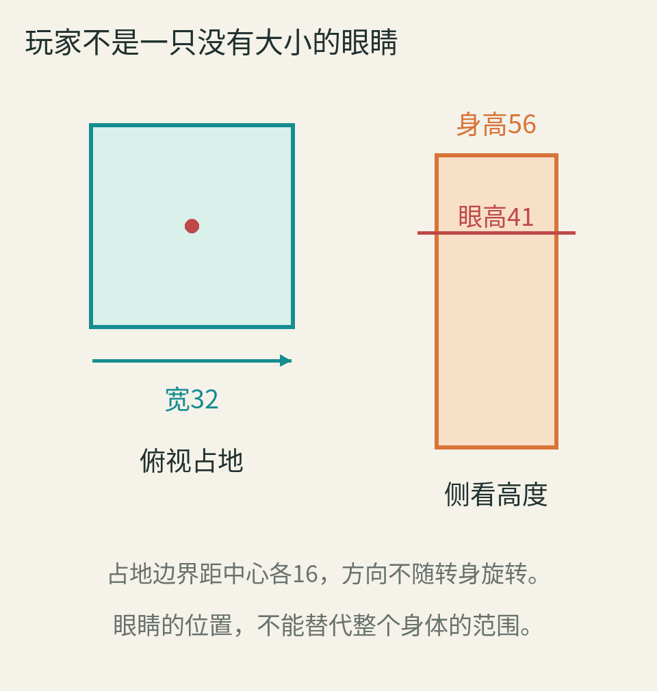

这里特意画方形。源码，也就是程序的原始文字，虽然把半宽字段叫radius，英文常译“半径”，但这条经典碰撞检查，也就是检查身体是否触及不允许进入的范围，构造的是x±16、y±16的方框，检查它是否碰到阻挡边线。**不能看见radius这个名字，就把它说成精确的圆形碰撞。**

这种贴着地图横纵方向的范围，叫**轴对齐包围盒**：不管玩家面朝哪里，盒子的边仍平行于地图的x、y方向。词听起来长，图里就是那块不跟着转身旋转的方框。

侧面再检查脚底和头顶之间的56单位。图中的41是本系列默认眼高，不是身高，也不代表每种动作状态下眼睛永远固定在那里。

上一篇角色图片有透明边缘。那决定哪里画颜色；这里的范围决定哪里可能阻挡。**看起来空白的图片角落，不自动等于身体能穿过去。**不同角色也可以有不同尺寸，不能把某张怪物图的小色块（像素）数量当成玩家尺寸。

## 5. 一步能不能走，至少要过三道不同的检查

先把“碰撞”这个词落到具体事情上：程序拿准备去的位置，检查它有没有与规则不允许的墙、角色或高度范围冲突。

### 第一关：横向身体有没有伸进墙？

假设B尽头的实墙在x=512，玩家中心原来在x=480。身体最右侧是480+16=496，尚未碰墙。

现在想把中心移到500。中心仍小于512，可最右侧已经到了516，越进墙后面了。

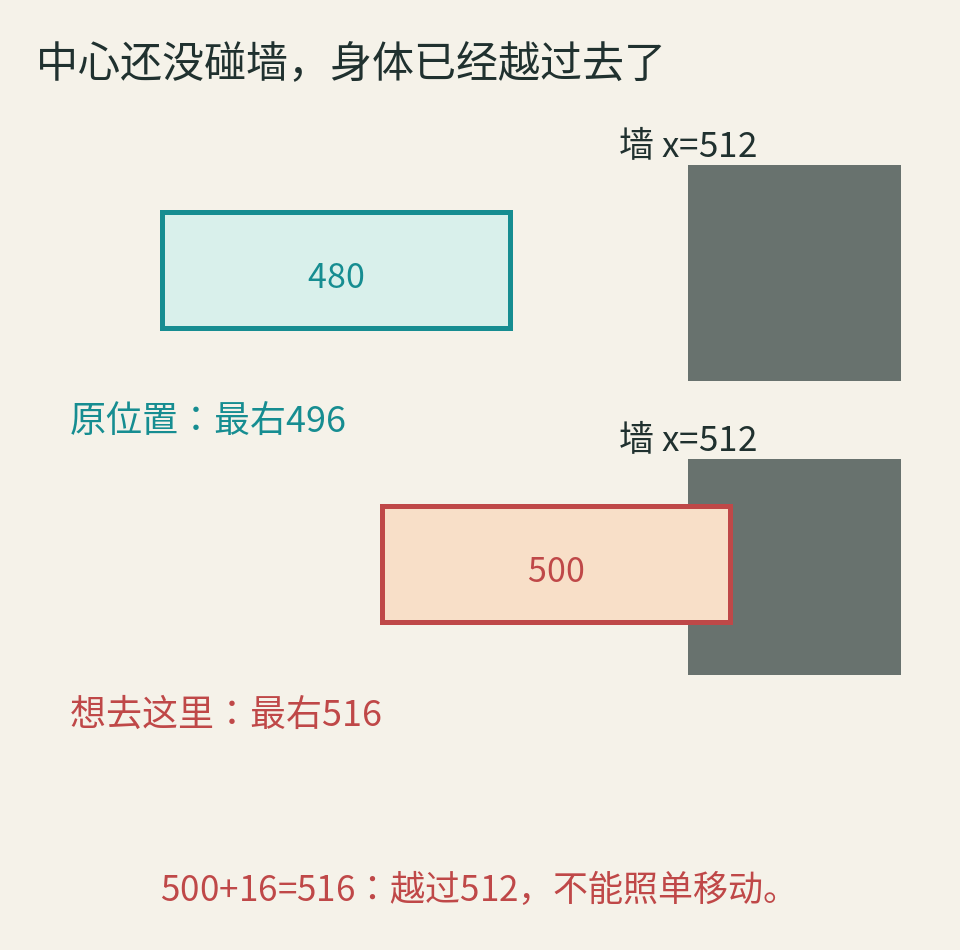

图按横向占用展开，不是把占地盒改成细长形。关键在于：**不能只问“中心过墙了吗”，还要问“身体边缘过墙了吗”。**

只看这堵单独的竖直墙，两者刚好接触时，中心在496，因为496+16=512。但这个算式不是整台引擎的通行保证：实际还涉及边界判断、其他墙和角色。

### 第二关：脚下的台阶会不会太高？

回到A进B。玩家当前脚底在0，B地板24，向上需要跨24单位。

经典普通移动检查会拒绝“新地面高出当前脚底超过24”的情况。因此24不因这项检查被拒；如果把台阶改成25，就会因这项检查被拒。

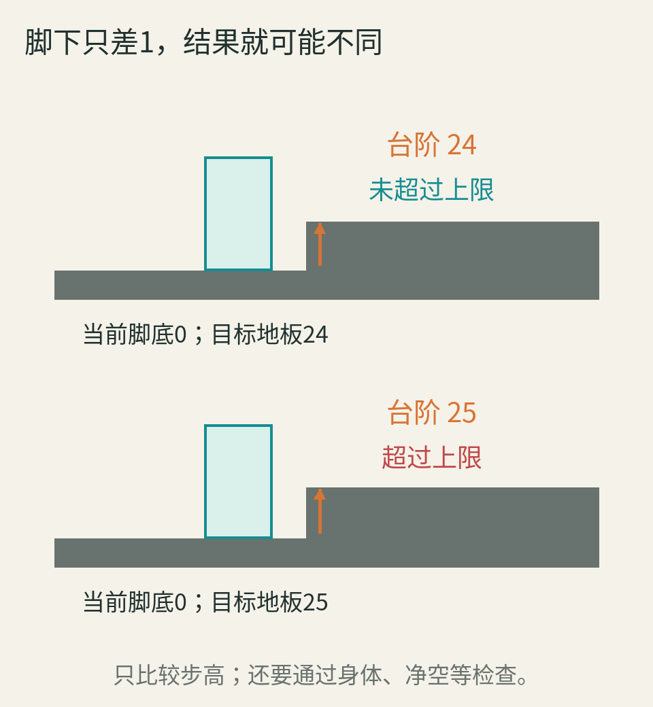

这里没有要求读者记游戏常数。更重要的是区分两个问题：**门里装得下人，与脚能不能抬到那块地面，是两项检查。**

24不是跳跃高度，也不是玩家只能往下落24单位。我们讨论的是这条普通上台阶判断。

### 第三关：头顶有没有足够空间？

假设已经考虑到门区地板24。若门区天花只到79，净高79−24=55，比身高56少1，身体放不下。

再多开1，让天花到80，净高56，才刚好通过这项净高检查。

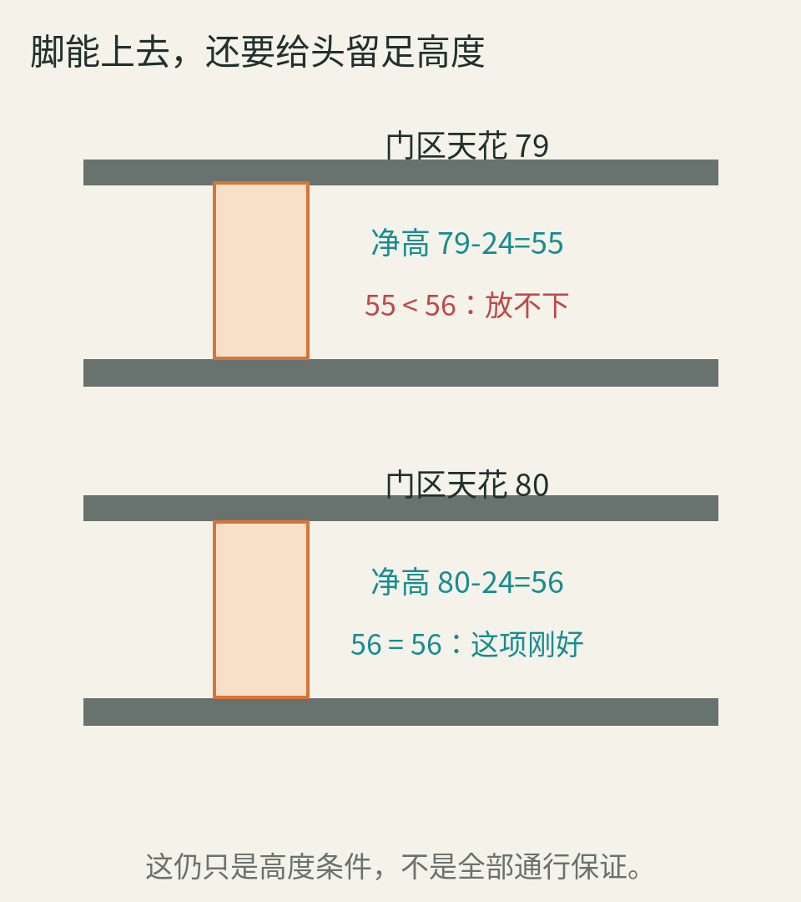

这就解释了开头的中间画面。天花64时，门下净高只有40；眼睛能透过这道缝看到后面，56高的身体仍过不去。打开到92时，净高68，才有多余空间。

真实移动还会考虑当前脚底到有效天花的距离，并检查身体触及的周围边线。若前后地板不同，通行开口取**更高的地板、更低的天花**；碰到多条边时，条件还会继续收紧。

所以不能只查询“中心落在哪个房间”，就宣布整个人安全。方框可能还压着旁边一条更低的门边，或者前方另有角色阻挡。[这些判断在固定版本源码中的位置](https://github.com/id-Software/DOOM/blob/a77dfb96cb91780ca334d0d4cfd86957558007e0/linuxdoom-1.10/p_map.c#L450-L497)

## 6. 为什么斜着推墙，人却可能沿墙滑过去？

假设你同时想“向前”和“向右”，右边却是一堵直墙。全部照走会穿墙；全部取消又会让人一下子钉住。

一个容易理解的调整是：去掉推向墙的那部分，留下沿着墙的那部分，再试一次。

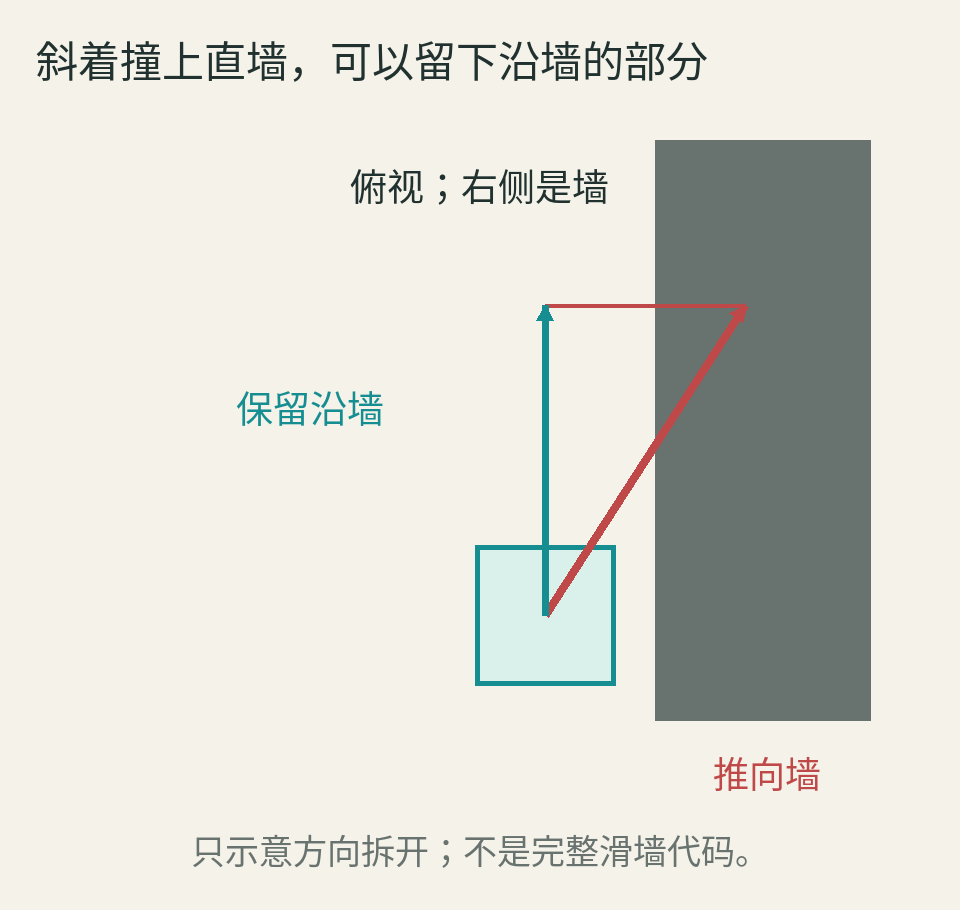

对竖直墙，经典滑墙代码会去掉剩余移动中的x方向部分；对水平墙，则去掉y方向部分。也就是图里的直观拆法。

完整实现还要找最近的阻挡边、先移到墙前、留一点余量、重新尝试，必要时用其他尝试方式。斜墙和拐角更复杂，图只解释为什么“被挡住”不一定等于“一点都不能动”。

这也不是随便把玩家一次瞬移很远再看终点。实际移动路径有分步与检查，本篇的“想去哪里”只是把候选位置这个概念单独拿出来。

## 7. 门正在运动时，要重新回答同样的问题

现在给教学门区D安排一种普通normal门动作：打开，到顶等一会儿，再关上。

为了记住下一次该做什么，程序保存它当前的**状态**。这里的状态没有神秘含义，就是“正在上升”“等候”“正在下降”这样的标签，外加等待剩多久等数值。

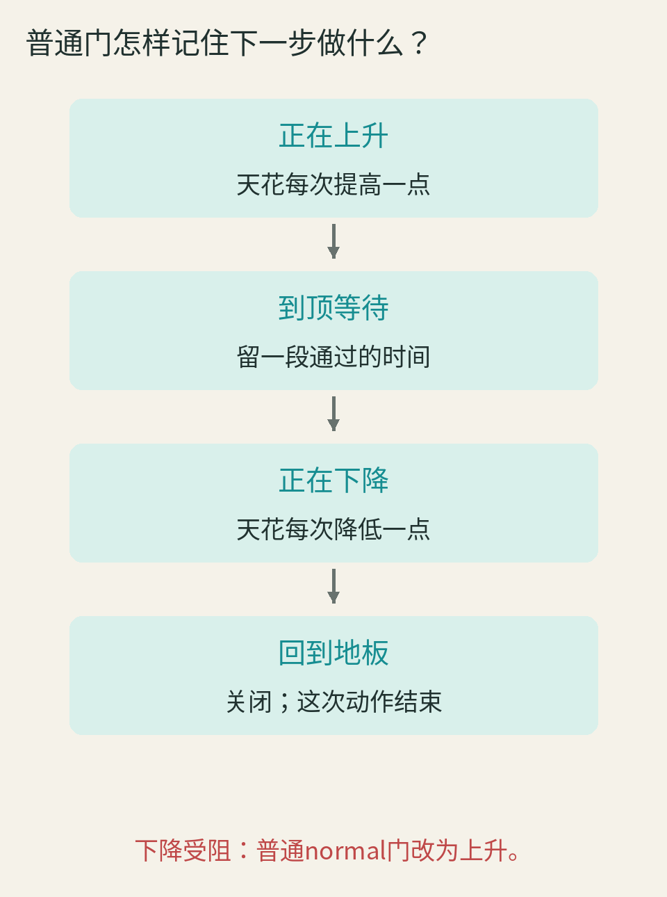

每次更新，程序把D的天花提高或降低一点，检查结果，再决定继续、等候还是改方向。例如这次读到“正在上升”，就抬高一点；还没到顶，下次仍按“正在上升”处理，到顶才换成“等候”。这个标签决定下一次做什么。连续看很多次小变化，门就像平稳地移动起来。

为什么前面把最高处设成92，不直接设96？经典这类门的目标计算，会找**与门区相邻的区域中最低的天花，再减4**。教学门两边分别128和96，较低的是96，所以目标92。

这不是找全地图最低天花，也不是所有门型永远用同一公式。实际MAP01例子的相邻顶都是32，因此按其手动打开路径，目标会是28；它和教学房间的坐标当然不同。

如果普通normal门正在下降，下面站着一个不能再压低的活玩家，就会发现高度不够。对应受阻分支会让门重新上升。源码里受阻结果名叫crushed，在这里不能直接翻成“已经把玩家压伤了”。

其他门型可以有不同处理，包括只开不关、专门关闭等。本节说明的是一种具体普通门，不承诺所有关门都遇人回弹。[普通门与其他类型的源码分支](https://github.com/id-Software/DOOM/blob/a77dfb96cb91780ca334d0d4cfd86957558007e0/linuxdoom-1.10/p_doors.c)

## 8. 换成升降台：这次动的是地板

门讲清后，把门示例暂时拿掉，恢复A、B相通。我们在B中间圈出一块平台：x从320到448，y从32到160。

平台天花仍是96，改为让它的地板从24逐渐提高。下面仍从A的同一位置观察。

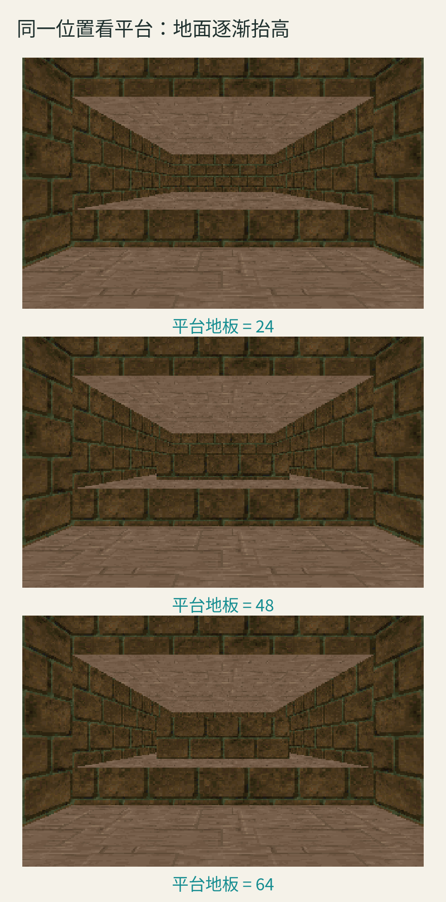

*这是没有站人时的几何外观对比，不是“玩家一定能被托到64”的证明。平台顶使用同一真实地板图，侧面使用砖图；三幅均为本次模型计算，不是游戏截图。*

地板图案不是铺在空气里的纸片。平台高度升高后，边界两侧地板的高差变大，于是多出可见的侧面。这与第一篇两间房之间出现台阶侧面的原理相同。

那么，为什么站在上面的人会跟着走？源码更新地面时，会重新检查附近物体。对于**原先脚底正贴着地板**的角色，把它的脚底高度更新到新的地板高度。

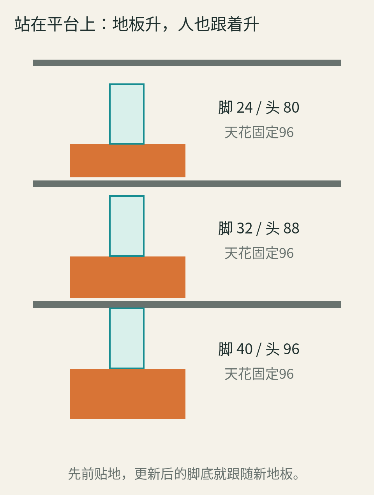

按身高56来算：

- 地板24，脚在24，头在80。
- 地板32，脚在32，头在88。
- 地板40，脚在40，头正好到96。

这次没有要求玩家一步跨上16高的台阶。是它已经站在平台上，平台改变高度后，脚底随之更新。正在空中、没有贴地的角色，不会无条件被当成粘在平台上。

接着，能不能继续升到42？脚到42，头就要到98，可天花只有96。

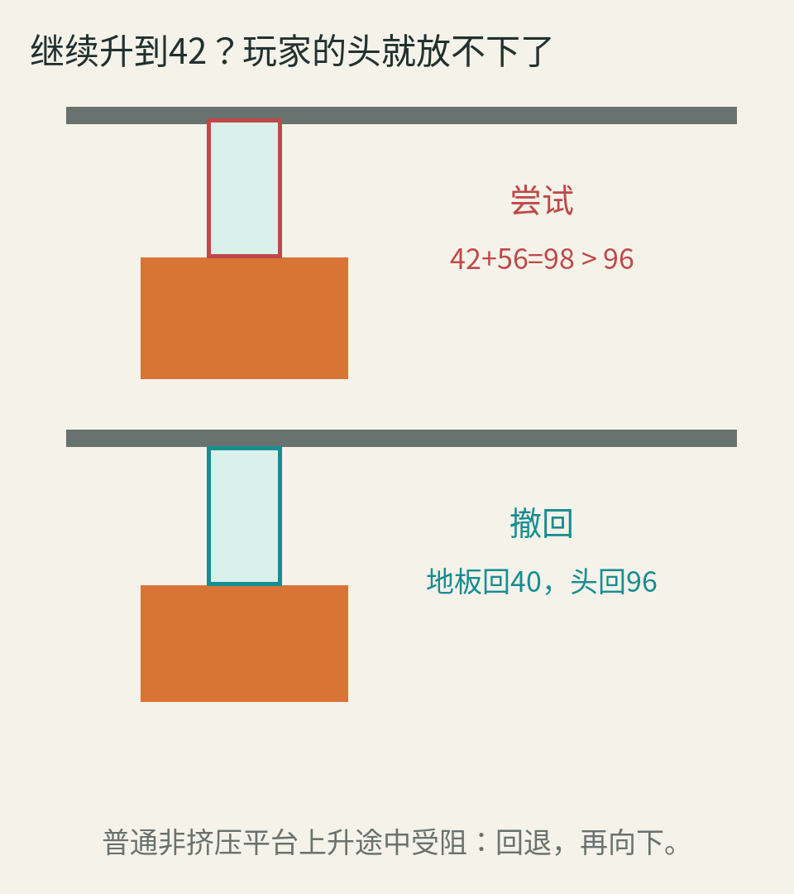

本例采用**非挤压平台**，就是这条处理路径不硬把活玩家挤进不足的空间。先沿本例的数字走一遍：头顶98超过天花96，这一步撤回，地板回到40，贴地玩家的头顶回到96；平台再按这一种规则改向下降。也就是上升途中的普通一步受阻后，先恢复地板高度并重新处理角色，再改变运动方向。

这里特意说“上升途中的普通一步”。假设预定目标高于42，42还不是到站那一步；原版到站分支及其他物体、挤压机关有不同细节，不能把这幅图推广成“任何升降物遇到任何东西，都必然反向”。

现在也能回头读懂三幅空平台外观了：**没有人的几何可以升到48或64，不代表载着56高玩家也有同样的空间。**

## 9. 动了这么多，第三篇的空间树要不要重做？

第三篇的BSP，是把平面逐层分成两侧、组织找墙次序的数据结构。这里不需要重新学树，只看一件事：我们的门和平台改变过地图的x、y边界吗？

没有。门区还是那一条，平台还是那一块；变的是它们各自记录的天花或地板高度。

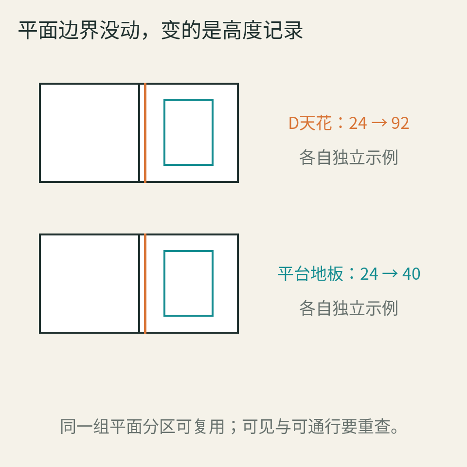

因此，**这类只改区域高度、不挪动平面边线的运动，可以继续使用原来的二维BSP。**这是对这些具体运动方式的结论，不是说所有动态几何都能免费处理。

与此同时，可见和可通行的答案必须更新。同一条门边，刚才净高0，现在可能净高68；绘制要读新高度，移动检查也要读新高度。

这正是这个小世界逐渐连起来的地方：同一份区域高度，既影响画面上的门缝，也影响玩家的头能不能过去。

## 10. 最后，把“动”与“看”接起来

到这里，我们不必背所有函数名，也能说清一轮更新大概在做什么。一幅画面也叫一帧；把更新后的世界画出来，就得到新的一帧。

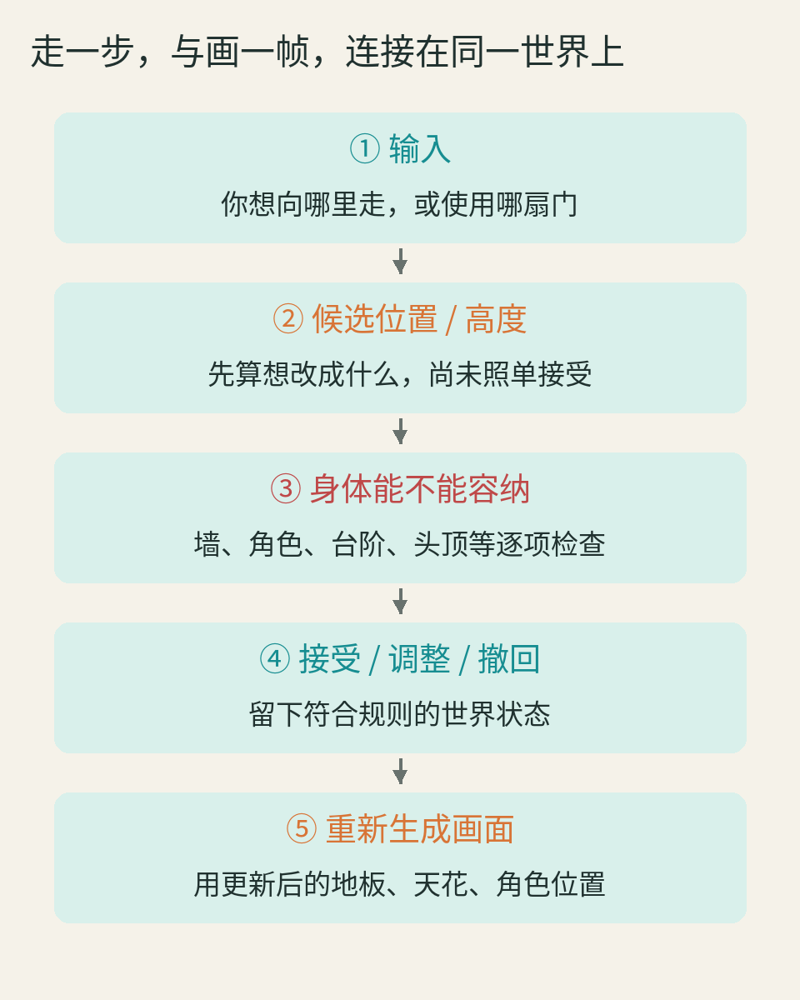

你提出一个意图：往前走，或者使用一扇门。程序算出准备修改的位置或高度，按具体规则检查，再接受、调整或撤回。随后，用留下的世界状态生成下一幅画面。

这张图概括两条相关工作，不是经典源码逐行执行顺序图；有的高度变化是先临时修改、检查后再回退，不能理解成所有动作都严格先验算再写入。

现在再回答开头的三个问题：

- **为什么不会只因眼睛没碰墙就穿过去？** 因为还要检查有尺寸的身体占地。
- **为什么门开缝后仍可能过不去？** 因为看得见只需要视线通路，站立通过需要足够净高、可跨台阶和不被阻挡的占地。
- **为什么平台能托人，又可能升不动？** 因为贴地角色随地板更新，但新的脚底和头顶仍得容纳在空间里。

读完能分开这三件事，比记住“Doom是2.5D”更有用。这个世界确实有高度、有上下运动，只是选择了一套很具体的地图组织与规则。

下一篇，也是这个入门系列的最后一篇，我们会把地图、找墙、画面与更新接成完整链条，再看这些安排怎样帮助当年的电脑少做工作。

## 来源与延伸

本文是原创教学解释。真实素材、地图来自固定版本Freedoom；机制依据固定版本id Software公开源码。没有运行游戏或声称原版性能测试。逐图身份、素材权利、计算边界与复算范围见[完整来源说明](sources.md)。
