# Doom 入门⑥：一台电脑，怎样来得及画完这个世界？

前五篇，我们搭起两个房间，让墙出现在正确位置，给墙面贴上图案，又让门和平台动起来。

但会算，不等于来得及算。走动时，一张画面刚显示出来，下一张又要开始了。

*Freedoom官方实际截图，由Chocolate Doom运行；引擎是负责更新游戏、生成画面的程序。原文件1600×1200，官方说明来自320×200输出的清晰放大与显示比例调整。不是本文在旧电脑上测出的画面。[来源与许可](https://freedoom.github.io/screenshots.html)*

屏幕上的小色块叫像素，一幅完整画面叫一帧。320×200共有64000格；如果每格都从头做一遍复杂计算，重复工作很快就会堆起来。

最后这一篇不寻找一个包办一切的“神奇技巧”。我们沿着一小列真实砖纹，看几种安排怎样合作：**不用每次重算，已经算过的尽量记住，已经拿到的数据尽量复用。**

## 1. 先分清：谁在计算，东西又存在哪里？

CPU是执行程序指令的处理器；内存是运行时临时放数据的空间。CPU需要读数据、算出结果、再把结果写回去。少做计算与少搬数据，是相关但不同的事情。

先给这两个名字找一个实物参照。

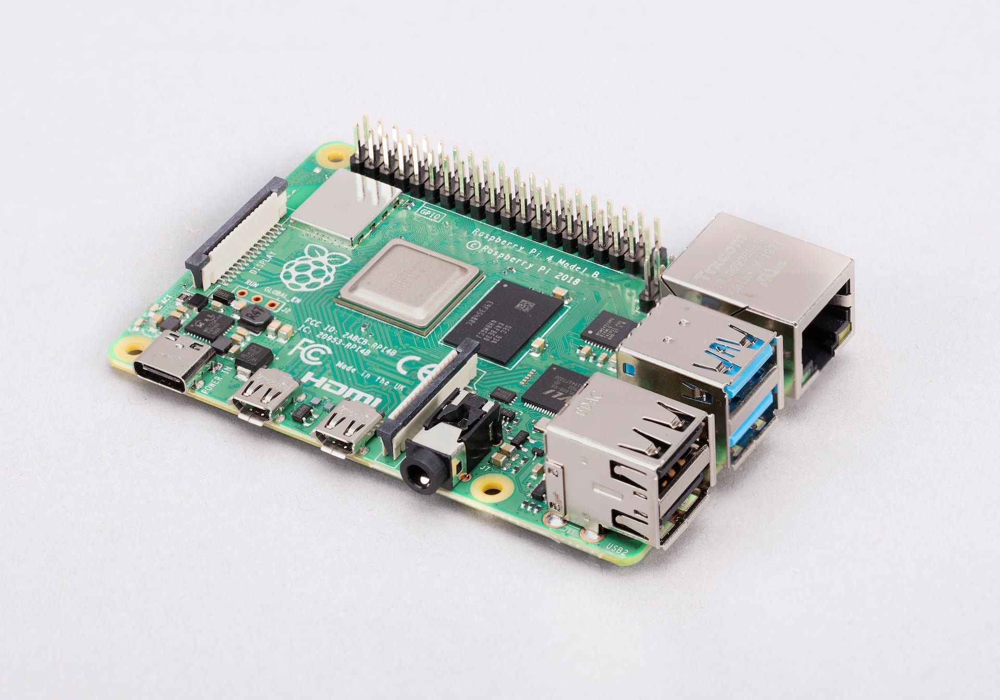

*这是现代Raspberry Pi 4 Model B的官方文档照片，不是Doom当年的电脑，也不是本篇测试机。中央银色封装内包含CPU等部件，旁边黑色长方形芯片是内存；这里只借实物区分“执行”和“暂存”两种角色。照片原尺寸1920×1344，未改原文件。来源：Raspberry Pi Documentation，[原图](https://github.com/raspberrypi/documentation/blob/208ec7debc5b30b3ce6a1426eff453f2359f2165/documentation/asciidoc/computers/sbcs/images/rpi4b.jpg)，[CC BY-SA 4.0](https://creativecommons.org/licenses/by-sa/4.0/)。*

回到游戏，一轮工作至少涉及三类事情。

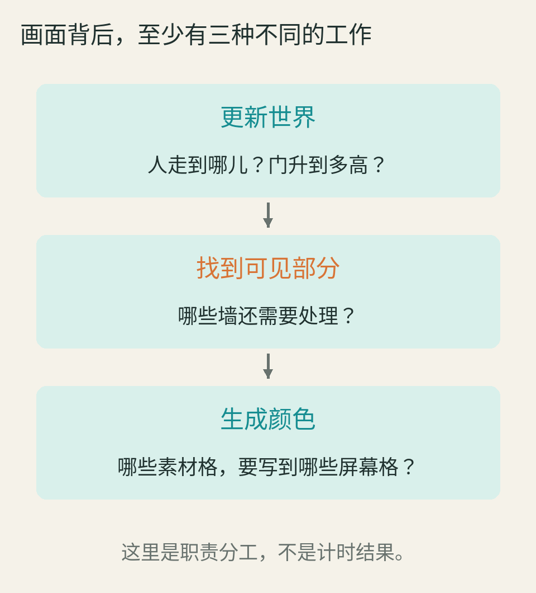

第五篇的移动和机关主要回答“世界变成了什么样”；第三篇的分区与遮挡帮助排除不用处理的墙；第二、四篇解释留下的东西落在哪里、该用什么颜色。

前面能省掉整批墙，当然很好。但剩下来的墙面仍有许多像素要处理。这时，就要继续减少小循环里的重复工作。

## 2. 画一小列砖纹，没必要每一格都重新出发

我们仍用原来的A、B双房间，暂时不加第五篇的门或平台。下图黄色标记只帮助你找到一小列墙面。

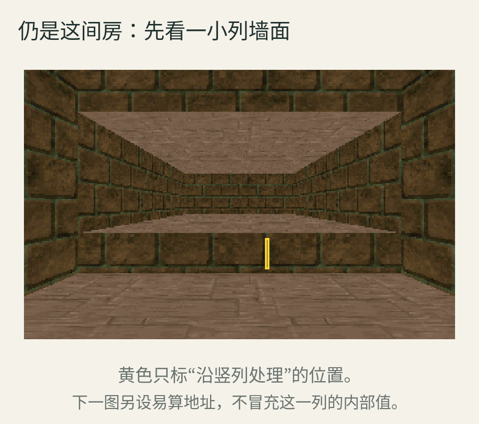

*复用第四篇的原创模型结果，使用真实Freedoom砖图；不是实际游戏截图。下文另设一组容易手算的取样地址，不声称它们就是黄色位置的原版内部参数。*

供墙面取颜色的图案数据叫纹理。我们打开同一张真实砖图，选第112列、第12到15行。编号从0开始。

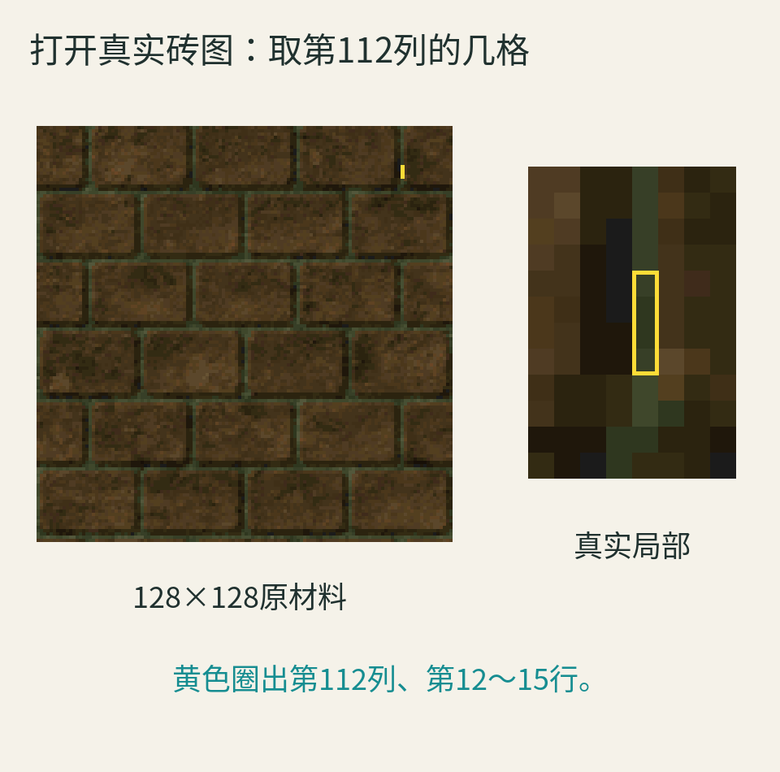

*图块128×128；右侧是原图8×12区域的放大，没有生成纹理细节。[原图文件](assets/brick-original.png)*

假设要填屏幕上从上到下的8格，素材纵向位置从12.25开始，每填一格，向下走0.5。这个每次增加的量，叫**步长**。

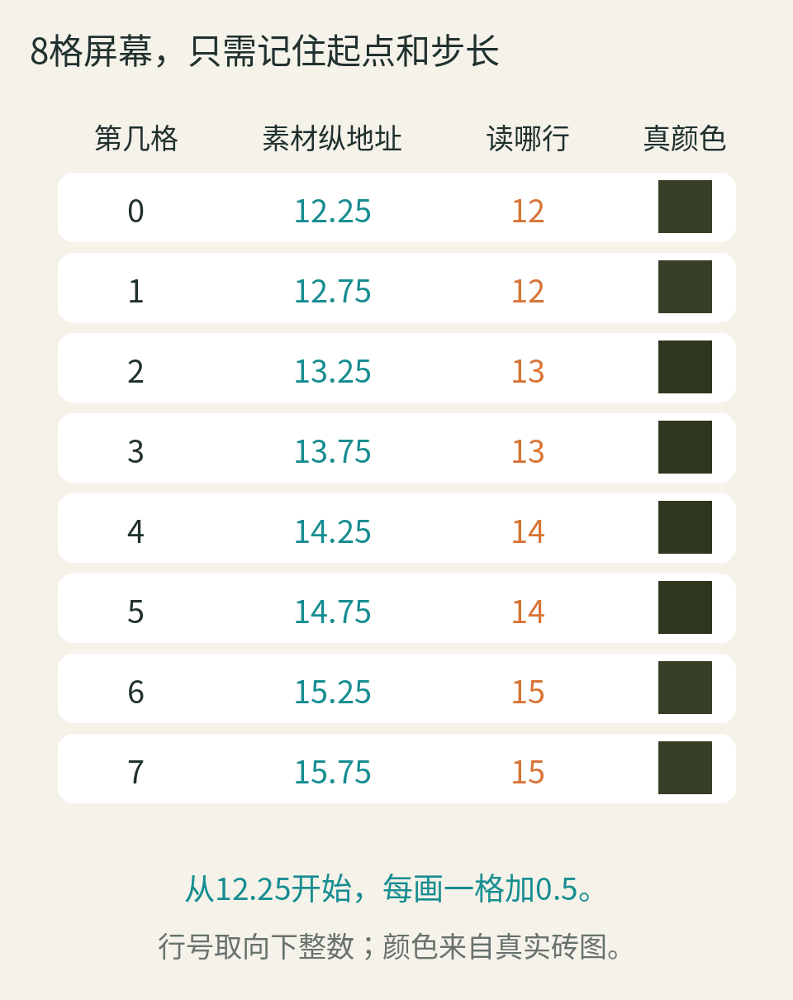

为什么素材位置可以有小数，最后却读整数行？小数表示我们在图案上的连续位置；真正取颜色时，本例选择所在的那个小格，所以12.25和12.75都读第12行。

第二格的地址有两种算法：可以从12.25重新计算“加了几次0.5”，也可以直接接着上一格加0.5。

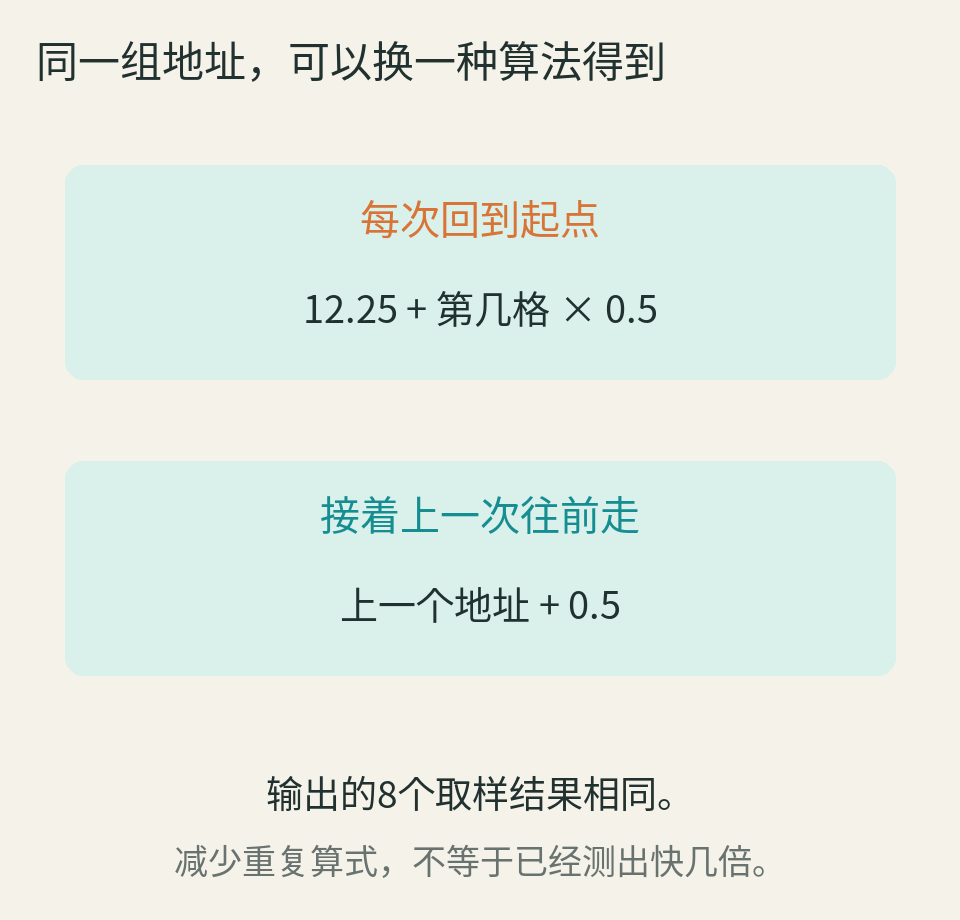

第一格知道起点后，后面7格只需连续加7次。结果没有改变，改变的是计算的组织方式。

这正能帮助理解经典源码中的`R_DrawColumn`，即专门负责画一列的一段程序：先准备当前素材位置和步长，循环里取颜色、写一格，然后让素材位置增加一个步长。它没有为这列的每一个像素都重新搭一套完整的投影过程。[一手实现](https://github.com/id-Software/DOOM/blob/a77dfb96cb91780ca334d0d4cfd86957558007e0/linuxdoom-1.10/r_draw.c#L101-L148)

先想一个每行4格的小画面，按行存成一长串：第一行编号0、1、2、3，第二行4、5、6、7。屏幕上第1列的下一行，是从编号1到5，相差4；紧挨着的编号2仍在同一行。宽度换成320，相同道理就是相差320。

这里也有个容易想错的地方：向屏幕下一行写，并不是向内存里紧挨着的下一格写。在这个320宽的画面布局里，同一列相邻行的存放位置相差320；原代码会直接把写入地址增加320。起始行的位置还可以通过预先准备的表找到。

这都是少重复算的方法。**我们没有因此测出“快了几倍”**：取色、写入、循环和别的工作还在，具体耗时取决于机器与实现。

## 3. 地址有12.25，为什么还能主要用整数记？

整数不是只能表达粗糙的整块距离。关键是约定“这个整数的1，究竟代表多大”。

就像1.25元可以记成125分。125是整数，金额并没有因此变成125元。

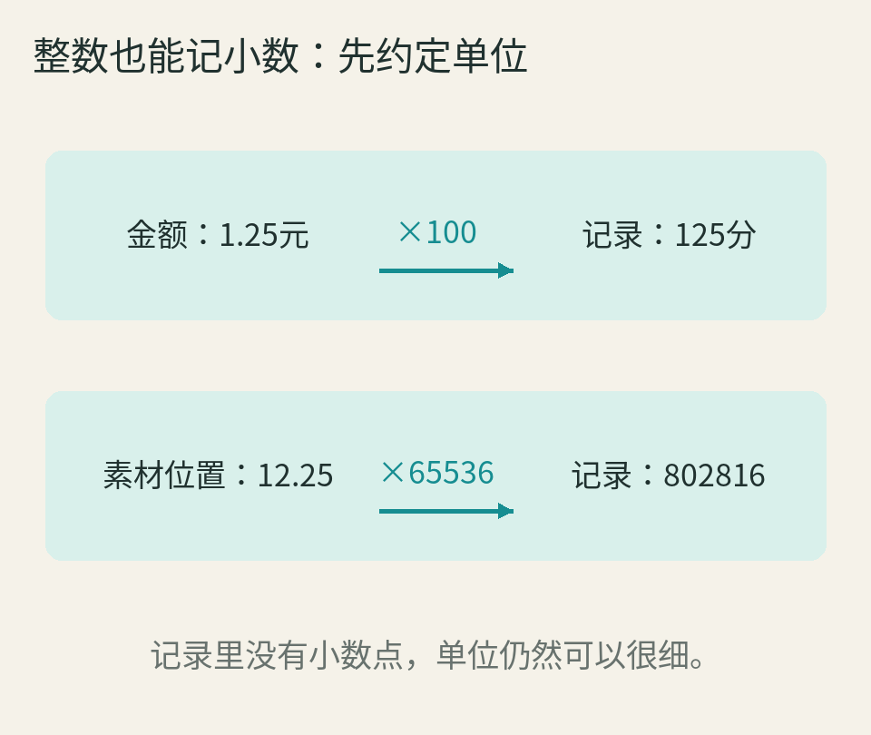

Doom的一种常用安排是：**把1个单位分成65536份，用整数数这些小份。**

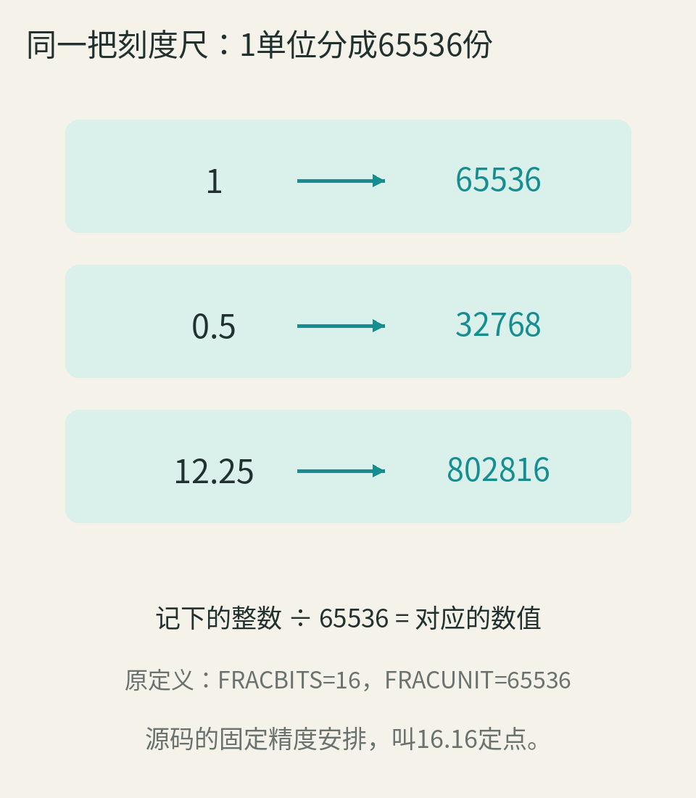

这样，我们的一小列就能改写成：

- 起点12.25，存成802816。
- 步长0.5，存成32768。
- 下一格：802816+32768=835584，读回就是12.75。

只要所有数采用同一把尺，整数相加就能表示带小数的位置相加。

这种把小数点的位置事先约定好的表示方法，叫**定点数**。“定”说的是刻度固定，不是物体站着不动。

为什么是65536？计算机里的一个**二进制位**只有0、1两种状态；16个位能组合出65536种情况。该版源码把32位数安排成通常所说的16.16定点，其中16位提供小数刻度。你不必先会写二进制，只需记住这里“一小份”是1÷65536单位。

### 相乘时，不能只把两个大整数乘完就收工

看一个简单例子：1.5×2.25=3.375。

两个数都放大65536倍后，相乘结果就带上了两份缩放。但我们希望最终仍是“只放大一份”的定点数，所以要除回一个65536。

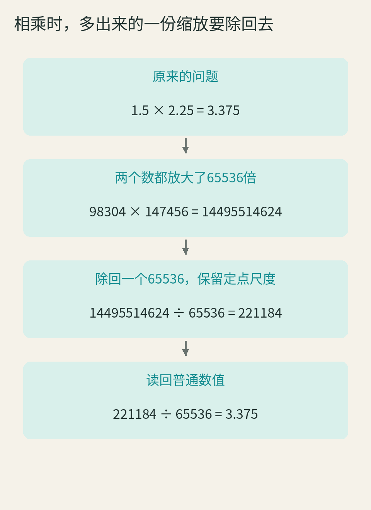

源码的`FixedMul`会先用更宽的整数保存中间乘积，再把结果缩回约定尺度。用更宽的中间容器很重要：两个数各自装得下，它们的乘积却可能装不下。

在本例中没有舍入误差，因为0.5、0.25等数刚好能落在这些细刻度上。但这不适用于所有小数。

## 4. 定点有代价，也不是“从来不用浮点”

试着保存0.1。乘65536得到6553.6，仍然不是整数。本例若向下舍掉尾数，就只能存6553。

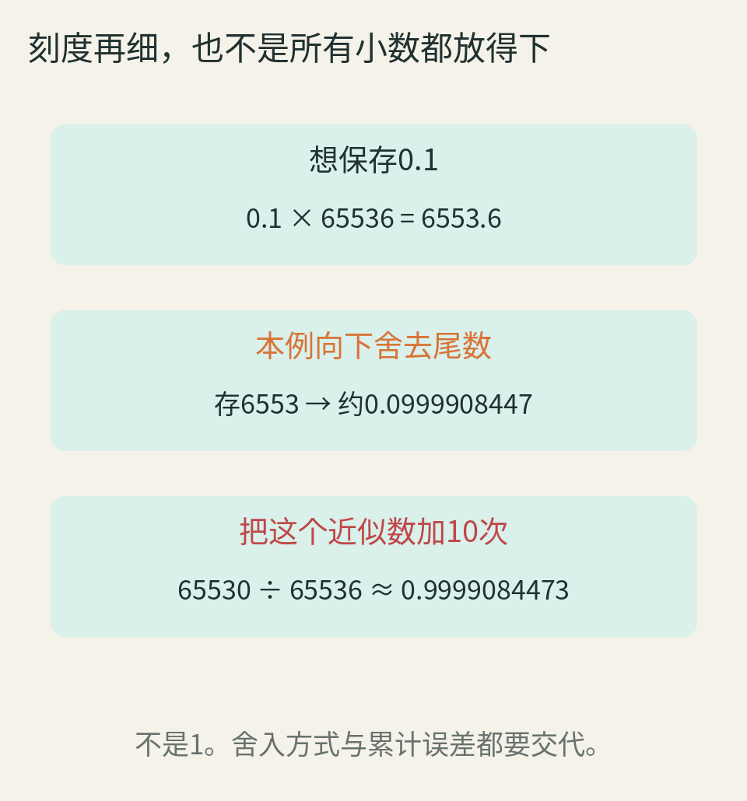

把这个近似数加10次，读回约为0.9999084473，而不是精确的1。小误差也可能积累。

所以，定点不等于没有误差。它还有有限的数值范围。这种能表示正负值的32位16.16安排的可表示范围约为−32768到32768以下；超过容器能放的范围就是**溢出**，不能指望结果自动变成正确的大数。

还有一个必须说清的版本边界：本文核对的是id Software公开的Linux Doom 1.10代码。在这份代码里，定点除法`FixedDiv2`的启用实现确实用了`double`，一种浮点数类型，随后再转回定点结果。

**浮点数**的表示允许小数尺度随数值范围变化。这里不用展开它的全部格式；你只需要知道，它是另一种带近似规则的数值表示，并没有在这份Doom代码里绝迹。[定点实现原文件](https://github.com/id-Software/DOOM/blob/a77dfb96cb91780ca334d0d4cfd86957558007e0/linuxdoom-1.10/m_fixed.c)

因此，准确说法是“大量位置、比例和步进采用定点安排”，不是“Doom所有运算都只用整数”，更不是“今天任何电脑用整数一定更快”。公开Linux版本也不能逐条替代当年其他版本的实现证据。

## 5. 一些经常要用的答案，可以预先排成表

人转头时，程序经常需要知道一个方向对应“横着多少、竖着多少”。先不背三角函数，看看一条长度为1的箭头。

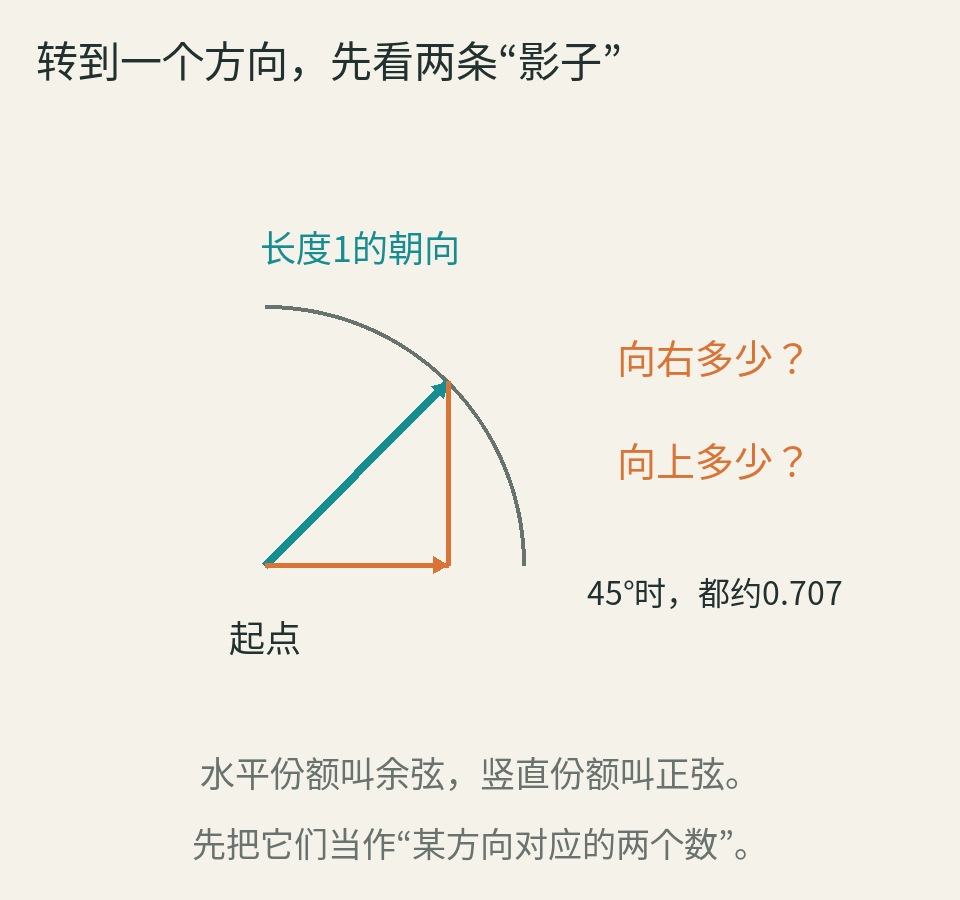

它越朝右，水平份额越大；越朝上，竖直份额越大。水平份额叫**余弦**，竖直份额叫**正弦**。在这里，先把它们当作“给定方向后对应的两个数”。

经常需要相同方向的数，能不能提前算好，使用时按编号取出？这就叫**查表**。

真实源码里确实有这种数据。下面直接从固定版本的`finesine`数组取值；数组就是按编号排列的一组数据。图中右侧除以65536，读成普通数值。

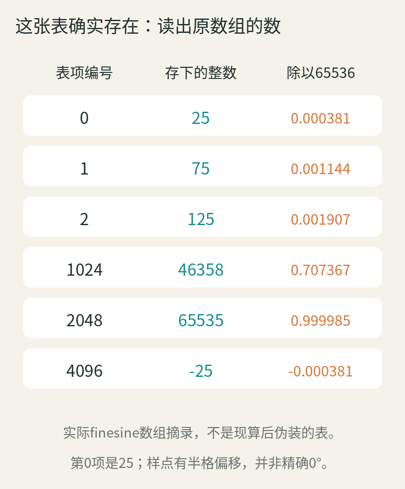

先实际查一次。一圈分成8192个方向格；从朝右开始逆时针转约八分之一圈，落到第1024格。读取正弦表的第1024项，得到整数46358；除以65536，读回约0.707367，便是这个方向的竖直份额。前一步是“方向变编号”，这一步是“编号取出数，再按定点刻度读回”。

横向份额也要取出来，才能拼出方向箭头。余弦借用同一张表，从编号再加2048的位置取数：1024+2048=3072。该项是46323，读回约0.706833。于是这个格代表的单位方向约为(0.706833,0.707367)，供程序计算转头后的前方或位置变换。再逆时针转约四分之一圈，编号变成3072，横向份额改从第5120项取，成为负数，竖直份额仍为正：箭头从右上转到了左上。这里只演示方向数怎样随转头更换，不冒称完整相机实现。

为什么这两个接近45°的份额略有不同，第0项也不是0而是25？因为表取的是每个方向格的中间：第k项对应(k+0.5)×360°÷8192。第1024项约45.02197°，不是精确45°；第0项也略大于0°。这就是**半格偏移**。源码留下的生成式能看出这个偏移；数组已作为常量数据存在，不必在画每一格时重算。

加2048就是往后移四分之一圈。为了让最后一个方向也能这样读取横向份额，正弦数组在8192项之后多留2048项，一共10240项；编号从0到10239。正弦和余弦并不是两张独立保存的完整表。

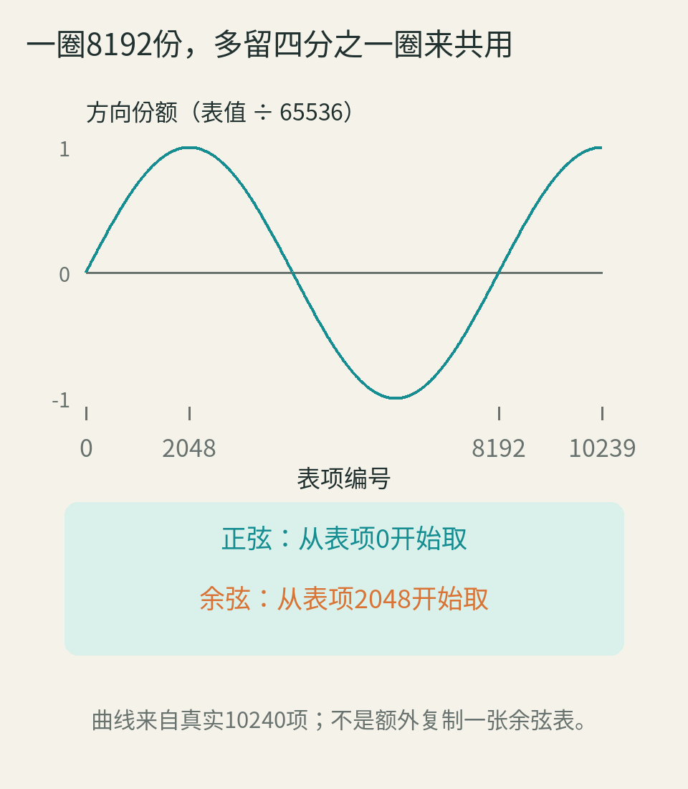

图中横轴是表项编号，纵轴是表内整数除以65536之后的方向份额；0表示这一方向上的分量为零，负数表示朝该轴的反方向。

这件事并不神秘：同一条周期性的曲线换一个起点，就能回答另一种方向份额问题。

查表也不是白送。存储空间常按**字节**计量，1字节包含8个二进制位。按这里每项4字节算，这一数组占40960字节。它用存储空间换取使用时少做一些计算，并接受离散方向和数值近似。表过大、访问不合适，也会有成本；不能把“查表一定更快”当通用定律。

## 6. 一格颜色，能不能先只记一个编号？

第四篇已经见过调色板，也就是“颜色编号对应实际颜色”的表。现在从内存的角度再看一次。

刚才说过，1字节是8个二进制位，能有256种不同组合。若每个像素只存0到255之间的颜色编号，一格就可以用1字节。另一个常见办法是分别记下红、绿、蓝三种颜色成分，简称RGB。

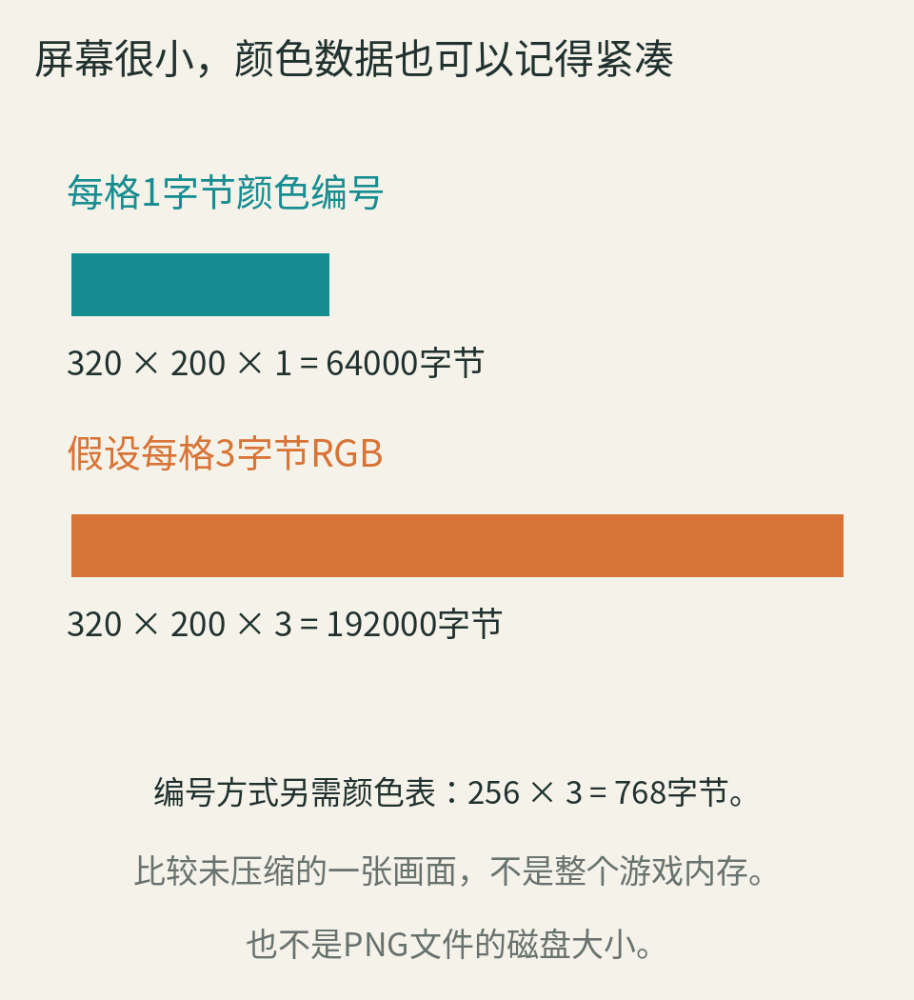

一张320×200画面：

- 只存颜色编号：64000字节。
- 假设每格直接存红、绿、蓝三个1字节分量：192000字节。
- 编号方式另加一份256色、每色3字节的颜色表：768字节。

这里比较的是**一张未压缩画面的表示大小**，不是整个游戏所需内存，也不是某个PNG压缩文件的体积，更没有计入全部地图、声音、程序和工作空间。

真实的砖图源文件也提供了可查看的编号例子。

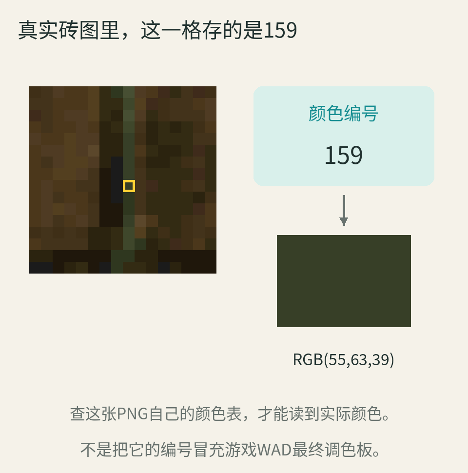

它这一格存的是159；在这张PNG自己的颜色表里，159对应RGB(55,63,39)。这能具体说明“先存编号、再找颜色”是什么意思。

但不能把源PNG的159直接说成游戏最终屏幕中的159。开发源图、打包后的资源，以及游戏光照所用的颜色映射，是不同环节。本文用源图做表示方法的实物例子，没有跳过这些区别。

## 7. 数据已经读过一次，为什么还要不停从文件拿？

内存不仅放画面，还放计算要用的材料。如果同一块数据反复用，每次都重新从文件读，会多出读入工作。

先看真实文件长什么样。WAD是这类游戏使用的一种资源容器，里面有许多带名字的数据块；每块常称作lump。下面是同一份Freedoom MAP01目录的部分记录。

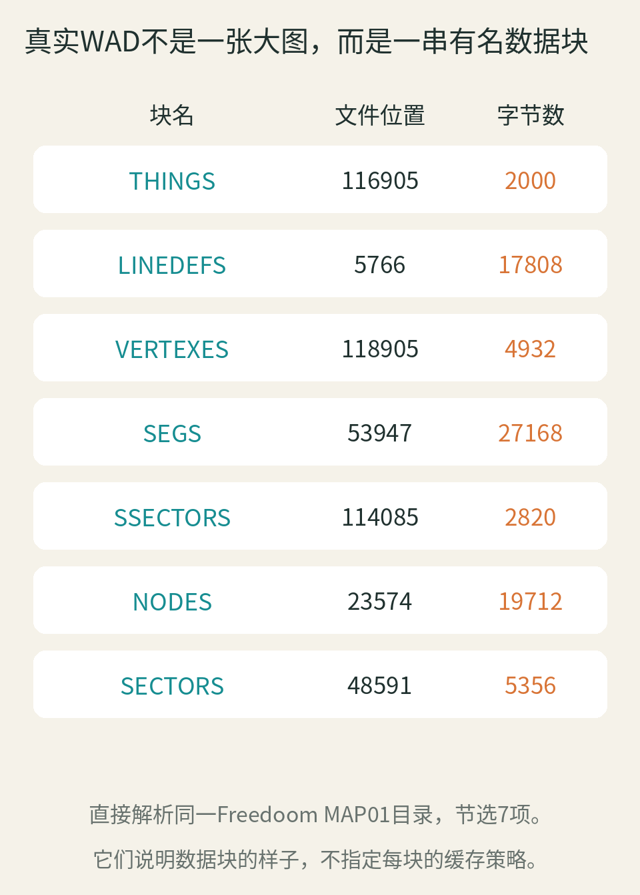

*直接解析[原WAD](examples/freedoom-map01.wad)，这里只节选7项。文件位置表示从文件开头数多少字节能找到该块；不是内存地址，也不是截图里编造的十六进制窗口。*

经典资源读取函数会先问：我要的块，在内存里已经有一份吗？

没有，分配空间并从文件读入；有，就复用现成副本，并根据本次用途更新它的标签。这种为以后复用而保留副本的办法，叫**缓存**。

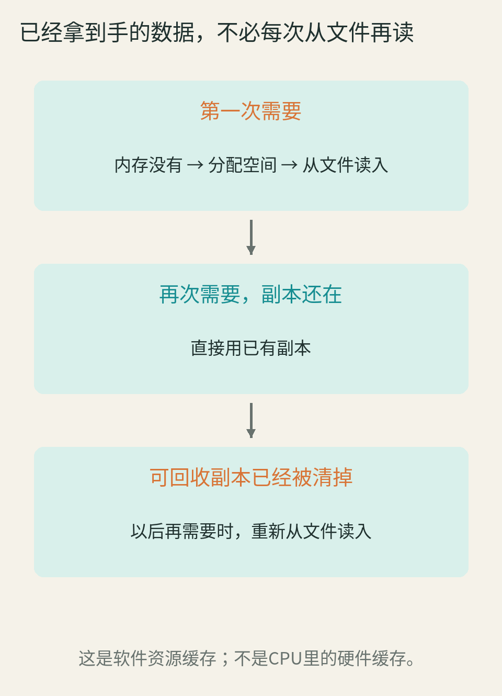

可是内存空间有限，不可能把所有副本永远留下。原代码会区分不同用途的内存块；标成可回收的一类，在分配空间有需要时可以清掉。它们以后再次被需要，再重新读入。

这不是“每次用完立刻删除”，也不是“所有数据永远常驻”。更不能只看目录，就断言上图每个地图块都采用同一缓存生命周期：目录用于认识块，具体保留规则还由调用者指定。

这里讲的是**软件管理的资源缓存**，不是CPU芯片内部的硬件缓存。原版的可回收分配器也不等同于一种严格“最久没用就最先删”的规则。[资源缓存实现](https://github.com/id-Software/DOOM/blob/a77dfb96cb91780ca334d0d4cfd86957558007e0/linuxdoom-1.10/w_wad.c#L471-L501)、[内存块分配与回收](https://github.com/id-Software/DOOM/blob/a77dfb96cb91780ca334d0d4cfd86957558007e0/linuxdoom-1.10/z_zone.c)

## 8. 有时候，还可以直接少生成一些不同的样本

前面的安排努力保住结果，减少重复工作。另一种取舍则会明确改变画面：少取一些横向样本，把一个结果复用到相邻两列。

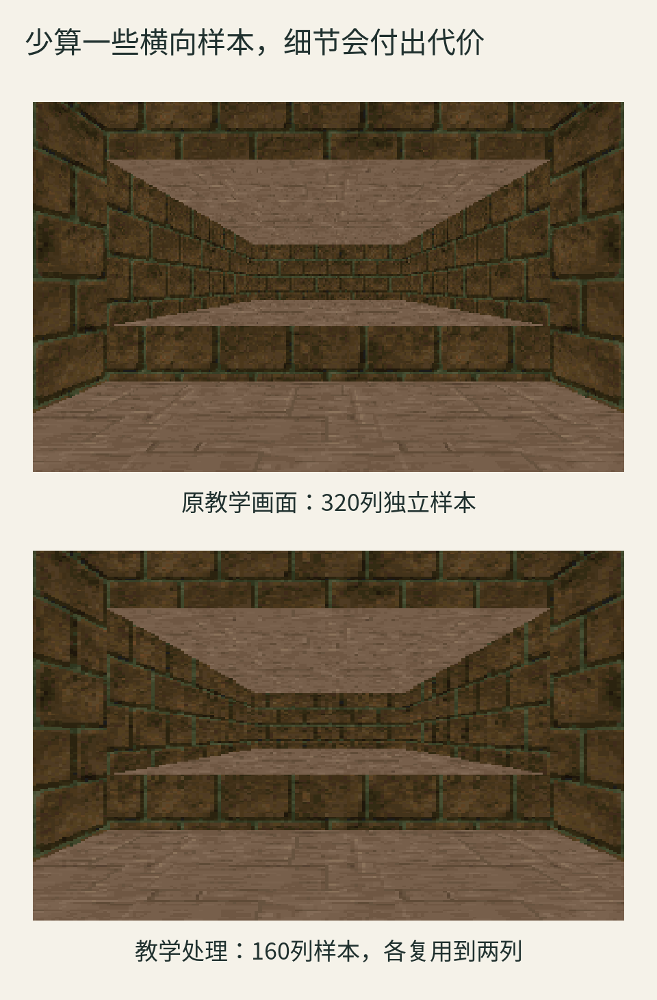

*上：前篇原创模型的320×200结果；下：本次明确取第0、2、4……318列，再分别复制到相邻两列。两幅都用最近邻方式放大。它是仿照“双列复用”思想的处理结果，不是实际切换Doom设置的截图，也不声称取样位置逐像素复刻原版。*

看全图差别可能不强烈，所以把同一个16×16小区域放大。

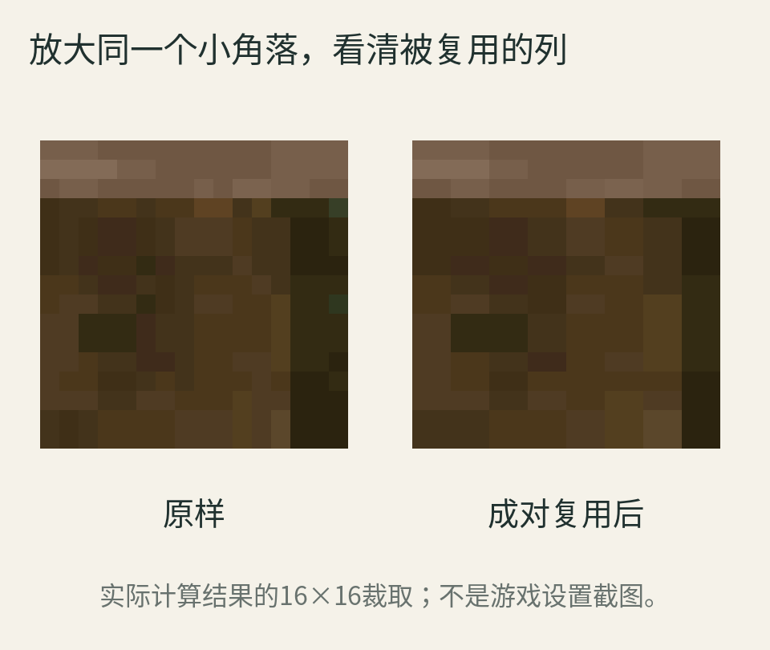

横向独立样本从320列减为160列，相邻两列会变得一样。墙还在那里，窄小的图案细节却可能丢掉。

经典源码里的低细节画列路径，也会把取到的同一颜色写到相邻两个目的列。这说明它不是单纯在宣传“更快”，而是有可指出的工作量改变和画质代价。

不过，**样本数减半，不等于整个游戏耗时减半**。两列仍需要写入，移动、找墙、声音等其他工作也仍然存在。本篇没有运行计时对比，不能把这两张图说成帧率测评。

## 9. “每秒35次”也不等于任何机器都能显示35帧

前一篇的门每次抬高一点，涉及世界按时间向前更新。把这种逻辑更新的小步叫一个tic，可以理解成游戏内部的时间节拍。

所核源码定义的`TICRATE`是35。它规定逻辑时间的安排，不是替任何电脑签下一张“稳定35帧”的保证书。

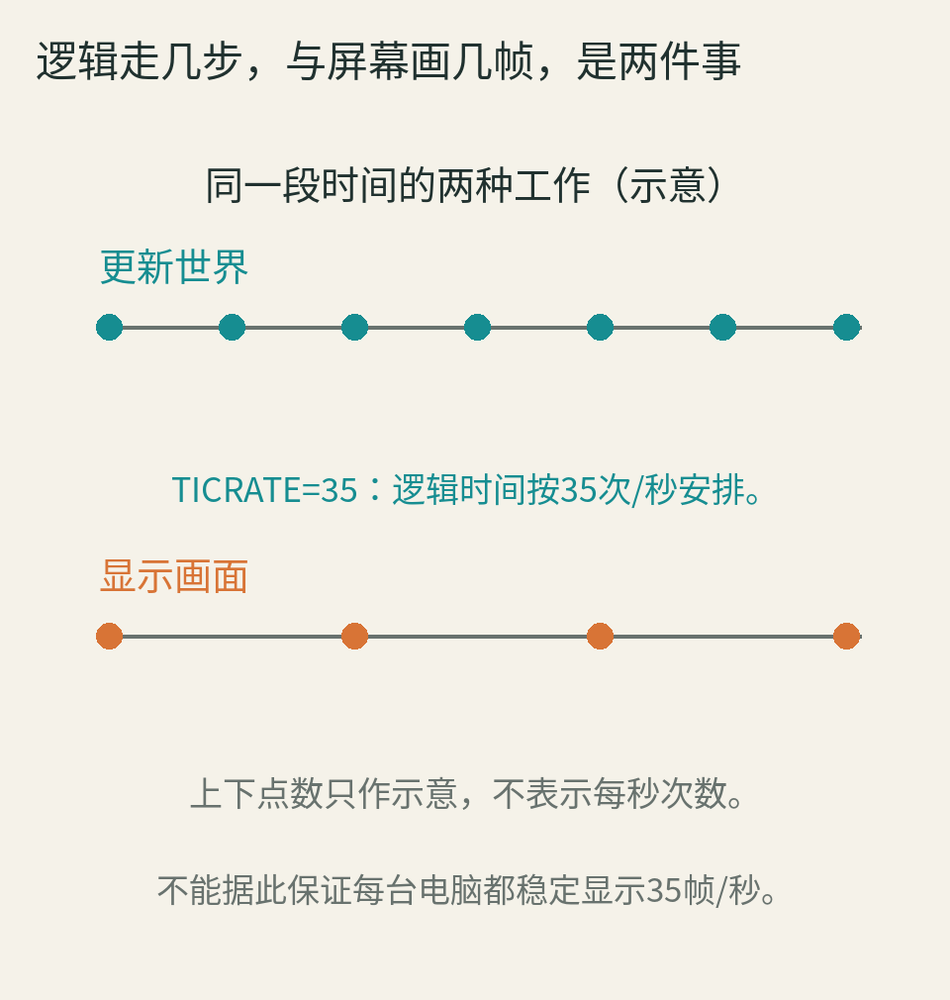

*图中点数是简化示意，没有按35个点逐一绘制，也不表示真实机器一秒只更新7次或显示4帧。*

更新世界与把当前世界画出来，是两件相关但不同的工作。主循环先安排逻辑更新，再调用显示路径；当机器负担、等待或其他条件变化时，不能从一个逻辑常数直接读出真实显示速度。

同样，列内少一次计算、少读一次文件，都是优化依据；要回答“某台机器到底快了多少”，仍需要指定硬件、版本、场景和测试方法。本文给出的是可核对的机制和数据量，不伪造一个漂亮的性能数字。

## 10. 六篇走完，真正连起来的是什么？

现在回看，我们不是把“Doom很厉害”换成了更多术语，而是逐层找到了可以指出对象、算出小例、看见结果的原因。

地图决定房间和高度；规则更新世界；可见性工作排除不必继续处理的部分；投影与取色把留下的对象变成像素。在这些过程中，连加减少重复算式，定点统一小数刻度，查表复用预先准备的值，资源缓存减少重复读入；必要时还可以拿细节换工作量。

它们没有哪一种能够单独解释整个游戏，也没有哪一种永远适合所有硬件。**真正值得学的是：先看工作究竟重复在哪里，再决定提前做、接着做、记下来，还是有理由地少做。**

如果你能用自己的话说明“0.5为什么可以记成32768”“表的第0项为什么不一定是0”“双列复用为什么不保证总耗时减半”，这个系列的最后一层就已经接上了。

系列到这里结束。今后再打开一个游戏画面，可以先从最小的问题开始追：这一格颜色从哪里来，这一步移动为什么被拒绝，这一次重复工作能否被省掉？

## 来源与计算边界

本文依据固定版本公开源码、Freedoom真实材料和明确标注的原创计算。没有运行原版Doom、测试历史硬件或声称平台截图。现代实物照片、每幅教学图的职责与许可、所有关键数值和表示范围，见[完整来源说明](sources.md)。
