# 计算机的记忆，曾经是一串在水银里奔跑的声音

这根金属管看上去不像内存。

它没有一排排可以插进主板的芯片，也没有供人读写的刻度。管身上有螺钉，两端封起来，旁边的一把尺子告诉我们：这件器物只有几十厘米长。

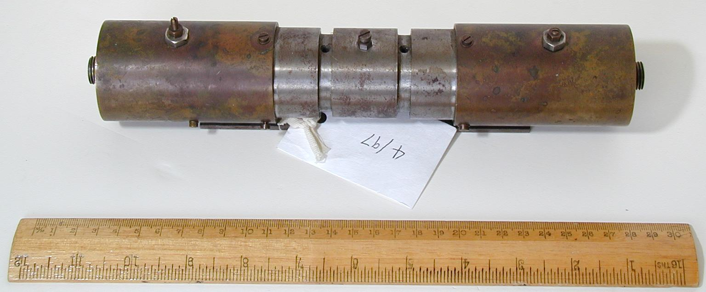

图：EDSAC I短延迟线，馆藏编号CL-4/97。馆藏记录的外形尺寸为274×50×50毫米，不是内部声程长度。© University of Cambridge Computer Laboratory，来自[Relics馆藏](https://www.cl.cam.ac.uk/relics/database/?machine=EDSAC+I)，[CC BY 4.0](https://creativecommons.org/licenses/by/4.0/)，原图未修改。

可是在早期计算机里，这样的器件确实能够保存信息。它给正在运算的计算机暂存数字和指令，需要时再读出来。里面的比特没有安静地停在某个角落，而是变成一串声波包，沿着水银往前走。

声波走到头以后，电路把信息读出来，整理一下，再从另一头重新发送。

**只要这一圈接着一圈的接力没有断，机器就能记住那串0和1。**

这带来三个问题：

- 如果数据一直在走，什么时候才能读到想要的那一段？
- 声音越传越变形，为什么不会很快把内容弄丢？
- 既然是“记忆”，为什么还需要一只温控器？

我们用同一串八位数据，把这三个问题拆开。最后再回到真实的EDSAC，弄清楚资料里的17位、35位、512字和1024字分别在数什么。

## 1. 先认识这台占据房间的计算机

EDSAC是Electronic Delay Storage Automatic Calculator的缩写，名称中就有“延迟存储”。它由Maurice Wilkes领导的剑桥团队建造，1949年5月6日完成了有记录的首次全自动计算。

下面的照片拍于1948年6月，仍在这次运行之前。照片里的机架、电子管和操作设备，是整台机器的一部分；开篇的管子只是它的一个器件。

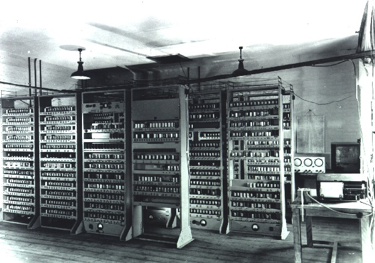

图：EDSAC I，1948年6月。Copyright Department of Computer Science and Technology, University of Cambridge. Reproduced by permission. [原始照片目录](https://www.cl.cam.ac.uk/relics/archive_photos.html#EDSACI)，[CC BY 2.0 UK](https://creativecommons.org/licenses/by/2.0/uk/)，原图未修改。

这里说的“声音”，是液体中的机械振动。数字的0和1控制规定时刻有没有一小包超声波；超声波的频率很高，人耳不能直接把这种载波听成一串口令。

我们也不需要打开任何历史器件。**水银有毒，本文只读史料、看图和运行数字模型，不提供制作、拆解或灌装水银延迟线的实验。**

## 2. 一个比特，可以是一个规定时刻有没有脉冲

**比特**就是一个可以取0或1的信息单位。要把它交给真实机器，必须约定什么物理现象代表0，什么代表1。

这里采用一种直观约定：

- 轮到某一小段时间时，有一小包脉冲，记为1；
- 轮到那段时间却没有脉冲，记为0。

这一小段留给一位数据的时间，叫**时隙**。

注意，“没有脉冲”也必须有自己的时隙。如果只数听见了多少次响动，101和11就容易混在一起；把时间切成格子，空格才有明确含义。

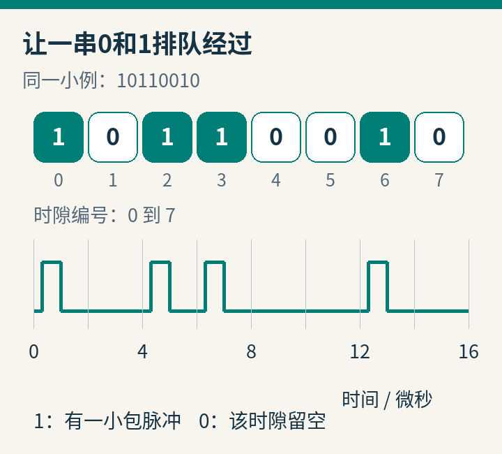

本篇的贯穿小例是10110010。图中每个时隙长2微秒；1微秒等于一百万分之一秒。八个时隙合起来是16微秒。

**这是一根只有八个时隙的教学延迟线，不是EDSAC真实的容量。**我们借用2微秒这个便于联系历史的节拍，把容量大幅缩小，好让每一位都看得清楚。图里的矩形也只表示“有脉冲包”，不描绘实际超声载波的每一次振动。

## 3. 电信号怎样钻进一管液体？

答案藏在管子两端的石英晶体里。

石英具有**压电效应**：电与微小机械形变之间可以相互转换。发送端用电信号驱动晶体振动，把机械振动耦合进液体；接收端受到传来的振动，再产生相应电信号。负责这种能量形式转换的器件，叫**换能器**。

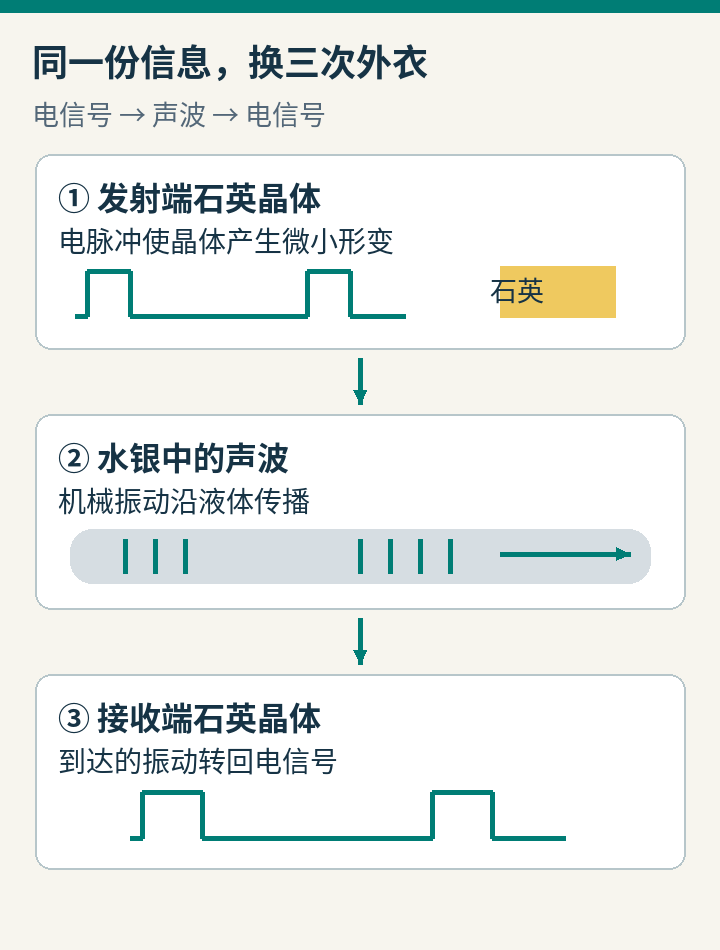

要保存10110010，就按时隙依次决定发不发一小包振动。信息在电路中体现为电信号，在液体中体现为声波包，到另一端又变回电信号。

这里没有八颗被涂成0或1的水银小球，也不是整管液体从左端流到右端。沿管传播的是扰动；液体中的物质主要在平衡位置附近振动。

在David Wheeler对剑桥馆藏短延迟线的回忆性说明中，脉冲包约长1微秒，可能的发送间隔为2微秒，包内使用约13.5 MHz的载波。MHz表示每秒百万次振动，因此“脉冲包出现的节拍”和“包内振动的频率”是两件事。[馆藏器件说明](https://www.cl.cam.ac.uk/relics/database/?machine=EDSAC+I)

选择水银也不是为了利用它看起来像金属镜面的颜色。Wheeler提到，水银与石英的声学特性匹配较好，便于把振动从一端传进去、在另一端接出来。这是一项器件工程取舍，不意味着任意液体和任意晶体都可以互换。

## 4. 传播不是瞬间完成的，时间就成了存储空间

把一小包振动发进去，它要经过一段时间才会到达接收端。

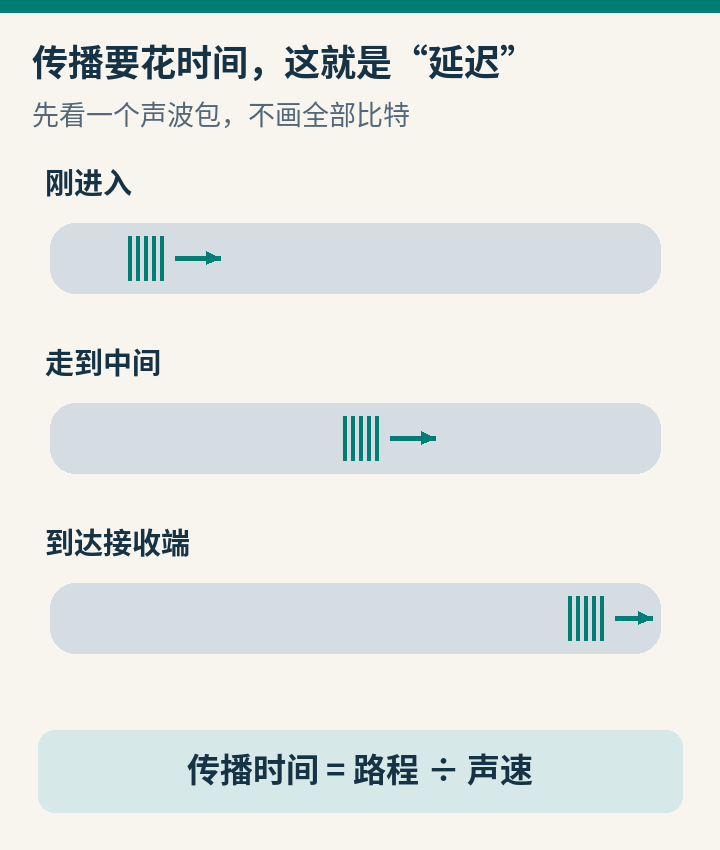

只看液体里的传播，时间可以这样算：

传播时间 = 声程长度 ÷ 声速。

我们把管内实际经过的路程叫**声程**。外壳有多长，并不必然等于有效声程；外壳还要容纳晶体、连接和安装结构。

真正的一圈还包括接收、检测、控制和重新发送的电路时间。因此，设计闭环时需要配合的是**整圈的时间**，不能拿外壳尺寸随便一除，就认定得到了机器的循环周期。

为什么时延能保存信息？因为在第一位还没走到出口时，后面的几位已经可以相继进入。于是同一根管子里，能同时存在一列间隔开的声波包。

像一座单行桥：第一辆车还在桥上，后面的车已经上桥。但比喻到这里就够了，真正的管子里传播的是波，不是装着数字的小车。

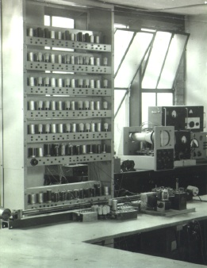

图：1947年6月的实验存储管，来自[剑桥档案照片目录](https://www.cl.cam.ac.uk/relics/archive_photos.html#EDSACI)。它记录的是早期实验阶段，不能当作1949年完整机器的照片。Copyright Department of Computer Science and Technology, University of Cambridge. Reproduced by permission. [CC BY 2.0 UK](https://creativecommons.org/licenses/by/2.0/uk/)，原文件仅261×338像素，保持原件，不以生成图补细节。

## 5. 一根只能延迟的管子，还不是能长久保存的内存

假设我们只发送一次10110010，然后什么也不做。

八位数据到达出口后，管子就逐渐空了。它只是让信号晚一点出现，并没有使信号永远留下。

要变成存储器，需要把出口接回入口，而且不能只用一根线粗糙地连接。

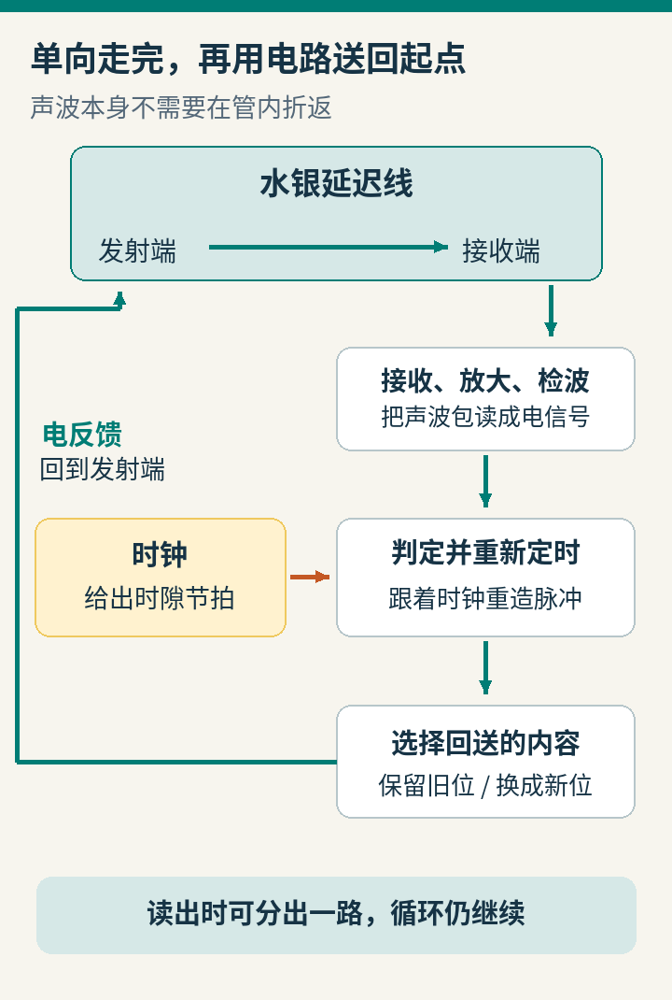

闭环分成几步：

1. 接收端把声波变成电信号。
2. 放大电路把微弱信号提高到便于处理的范围。
3. **检波**把高速载波包的“有或无”提取出来。
4. 电路按统一节拍重新产生规整的脉冲。
5. 如果要保持原数据，就把这些脉冲送回发射端；如果要写新数据，就在选定时隙换成新内容。

给整个系统提供节拍的电路叫**时钟**。这里的时钟不是显示几点几分的钟，而是不断给出“现在轮到下一格了”的同步信号。

这套把信号重新判定、整理并送回的过程，叫**再生**。

下面的实物提醒我们，再生不是一个纯粹的箭头。它需要真实的电子器件和连接。

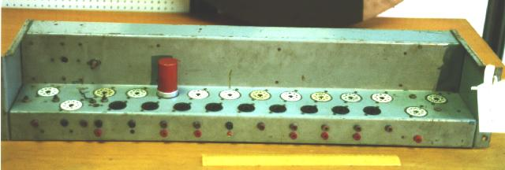

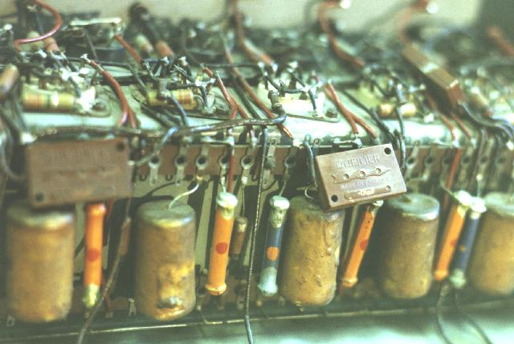

图：馆藏CL-2/97机架的正面与背面。它的具体原用途未被馆藏确认，因此这里用于观察EDSAC时代的电路构造，**不是断言图中某个元件就是延迟线的检波器**。© University of Cambridge Computer Laboratory，[馆藏记录](https://www.cl.cam.ac.uk/relics/database/?machine=EDSAC+I)，[CC BY 4.0](https://creativecommons.org/licenses/by/4.0/)，两张原图均未修改。

## 6. 为什么不能只把变小的声音放大？

因为放大也会放大噪声。如果每一圈都只是原样复制上一次的波形，毛刺、形状变化和时间偏移就可能一起传下去。

数字再生的关键，是利用我们本来只需要区分0和1这一点。

先用一个与原机电路无关的简化模型看：假设接收到的八个强弱数值是0.82、0.08、0.71、0.65、0.12、0.06、0.76、0.11；把0.5设为判断门槛。

超过或等于门槛就判为1，低于门槛就判为0，再用统一规格重新生成脉冲。

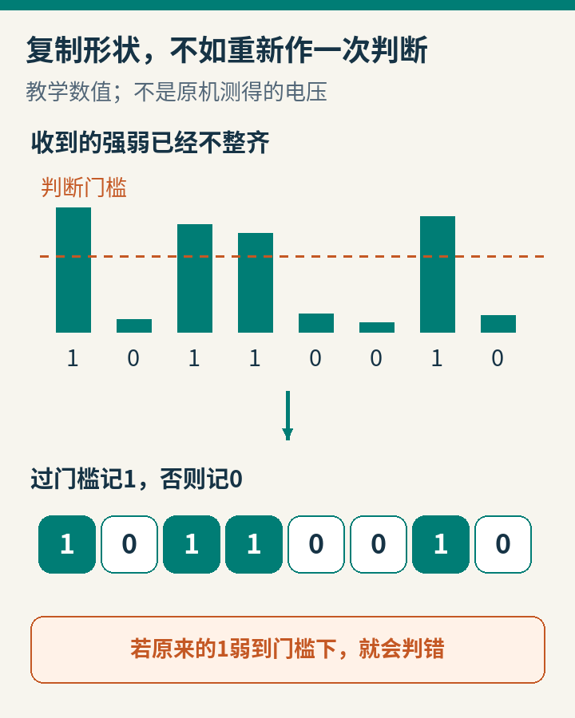

这样得到的仍然是10110010。0.82与0.65虽然不相同，却都足以代表1；我们不必把它们不同的高度一圈圈保存下来。

但这不是魔法纠错。如果第三位本来代表1，却衰减到0.31，它就会被判成0。再生之后，这个错误的0反而会变得很规整。

所以，再生的意义是：**在输入仍能被正确区分、时间仍对得上的范围内，把累积的小变形重新压回干净的数字状态。**它不能保证任意弱信号、任意干扰或任意时序偏差都能恢复。

图中的数值、门槛和强弱柱是教学模型，不是对EDSAC原件做过的示波器测量。

## 7. 数据在移动，“第几位”怎样不乱？

回到我们的八位小圈。约定t=0时，第0位刚好到达读口，之后每2微秒来一位。

- t=0，读到第0位：1；
- t=2，读到第1位：0；
- t=4，读到第2位：1；
- ……
- t=14，读到第7位：0；
- t=16，第0位又回来了。

先说清下图怎样读：一行按“从此刻开始将会读到的顺序”排列，橙框是当下的读口，**不是管内从左到右的空间照片**。每过2微秒，原先第一位已经读出并回送，排到接下来这圈的队尾。比如t=0最左边的第0位那个1，在t=2这一行位于最右边，到t=16才再次回到橙框。

图只选了五个时刻；t=4到t=14之间省略了几行，读图时要看每行左边的时间，不能把每两行都当成相隔2微秒。

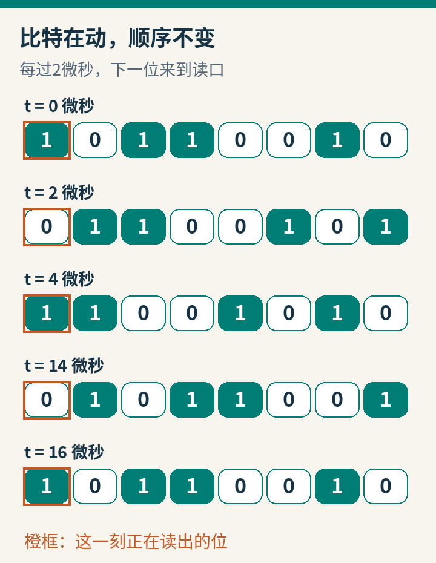

只要循环周期和时钟保持合适关系，机器就能通过计数知道当前读到第几格。第0位并不是永远待在管子最左边，而是每隔一圈，在约定的时刻重新出现。

这就是延迟线存储特别有趣的地方：**地址的一部分，藏在时间里。**

## 8. 把几位合起来，就得到一个“字”

计算机处理数据时，经常把一组比特当成一个单位，叫**字**。字长由机器设计决定，不等于中文里的一个汉字，也不一定是今天常见的8位字节。

为了继续手算，暂时把八位分成两个四位字：

A = 1011；B = 0010。

于是A在0到8微秒这段时间通过读口，B在8到16微秒通过。下一圈，A在16到24微秒，B在24到32微秒。

如果有多根管子，机器可以先选择一根，再等待其中指定的字经过。

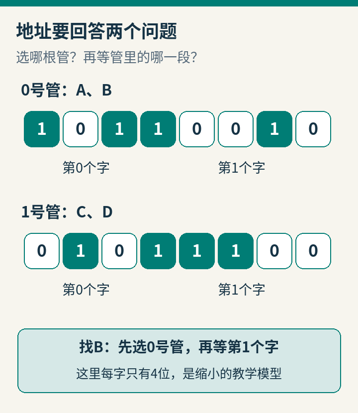

**选管**是在空间上选路，**等字**是在时间上选位置。

图中另加一根装着C、D的教学管，只为了把这两种选择拆开。每管两字、每字四位仍是缩小模型，不是EDSAC地址线的实际接法。

真实的控制电路还要知道哪个时刻是一圈的开头、哪个时刻是一个字的边界。光看数据不能可靠地知道这些，因为很多位可能都是0；边界必须来自系统自己的节拍和控制状态。

## 9. 同样读B，为什么这一次等5微秒，下一次等15微秒？

假设请求在t=3微秒到达。B的开头将在t=8到达，所以要等：

8 − 3 = 5微秒。

再花一个字的时长，也就是8微秒，才把B的四个时隙全部接收完。本例把“收齐”记在这段时间结束的t=16。

如果请求在t=9才来，B的开头已经过去，不能把它后半截当成整个字。下一次完整开头要等到t=24：

24 − 9 = 15微秒。

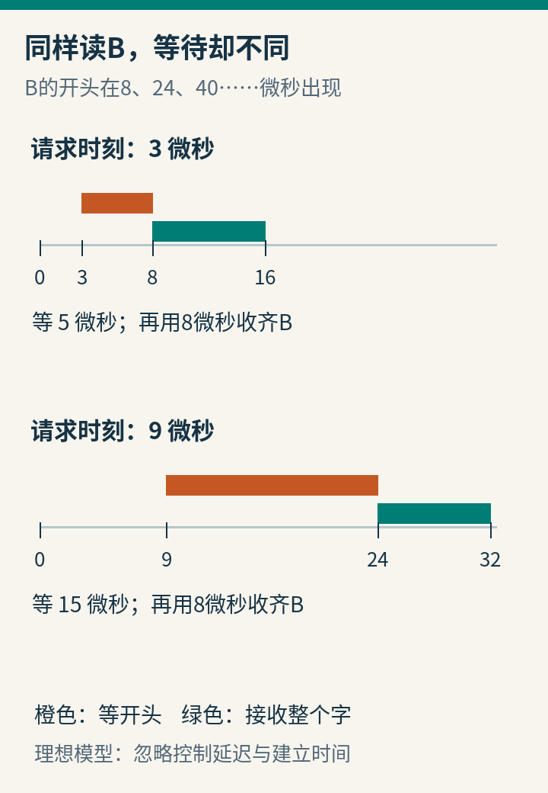

这个模型暂时忽略控制电路的响应、建立时间和处理器是否忙碌。因此，请求恰在t=8到达时，我们允许等待为0；真实电路不能据此被要求做到没有任何准备时间。

如果请求可以均匀地落在一圈中的任意时刻，单看“等目标开头”这一项，等待从0到接近一圈，平均是半圈。本例就是平均8微秒。

这个平均值有两个条件：到达相位均匀，并且只计算等待开头。它不是完整读取耗时，更不是EDSAC执行一条指令的平均时间。

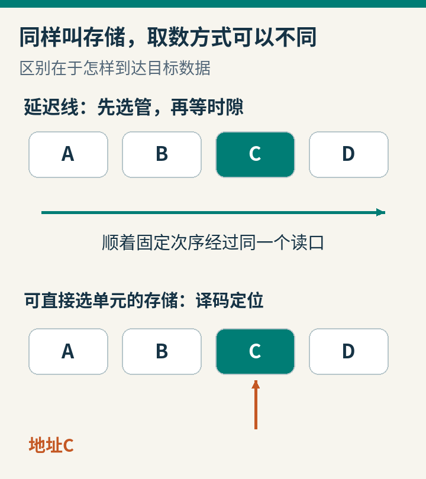

**随机访问**中的“随机”也不是随便抽一个数，而是能够按地址选择指定位置。延迟线里同一根管的各字要按次序经过读口，访问延迟会受到它们当下位置的影响。

这与磁芯内存靠交叉线路选择某个存储单元，是不同的问题。本文不需要重讲磁芯的磁化和破坏性读出；这里只比较“怎样找到目标”。

## 10. 不停循环的数据，又怎样改写？

保存，并不意味着每次都必须把旧数据原样送回。

假设现在要把B从0010改成0101，A保持1011。

控制电路先选中这根管子。A的四个时隙经过时，仍把原来四位回送；轮到B的四个时隙，就不再回送原值，改送0101。

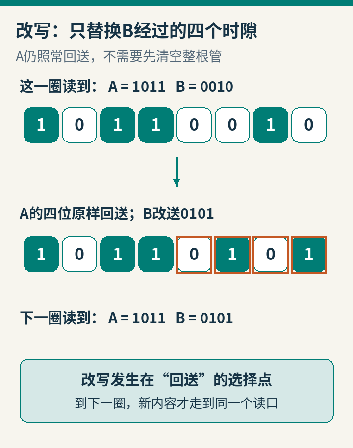

这相当于在接力的交接点换掉指定内容。新的四位还要走一圈，才会重新到达同一读口。

这里“读”和“保持”也没有冲突：接收端已经得到电信号，可以把它分出一路交给计算电路，同时继续回送。读数据不等于必须停止循环。

反过来，如果关掉回送，我们模型中的第一圈还能读到原先在路上的数据；之后送回去的都是0，后续内容也就消失了。历史机器的实际衰减和断电过程更复杂，但它显然不能像一块刻好字的石碑那样脱离运行条件长期保存数据。

## 11. 回到EDSAC：17位短字，为什么能配成35位长字？

现在可以放下四位教学字，进入真实EDSAC的计数。

资料里会同时出现“18个位置”“17位短字”“36个位置”“35位长字”。它们并不自动矛盾，因为有人数时序位置，有人数真正用来表示数值的位。

以短字使用时，一段包含18个二进制时序位置，其中17位用于数据，另一个位置留给时序需要。17位里已经包括符号位，也就是参与表示正负的那一位。[剑桥Echo说明第5.3—5.4节](https://www.cl.cam.ac.uk/events/EDSAC99/simulators/echo/flat.html)

把两段相邻的存储位置作为一个长数使用时，中间原本分隔短字的那一位也可以利用，于是有效位数是：

17 + 1 + 17 = 35。

总共仍占两段18位时长，也就是36个时序位置，保留一个间隔位置。

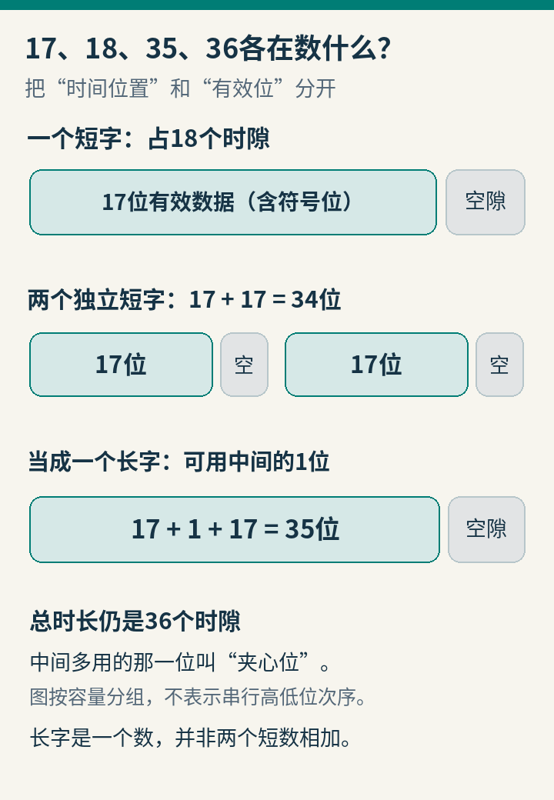

中间这一位常被叫作**夹心位**，英文是sandwich digit。

这不是机器凭空造出一个比特，而是改变两段时间作为整体使用时的安排。也不能把两个短数直接相加，就以为得到了对应的长数：长字要作为一个整体解释，其中只有一个整体的符号位，位的权重也要按长格式计算。

这张图只解释容量账目，没有画真实串行发送时的高低位先后。把数值书写顺序和电路处理顺序混为一谈，会产生另一种误解。

## 12. 短管不一定只存短字，长管也不是只存一个长字

开篇那根器件是**短延迟线**。Wheeler介绍它时，说它用于保存约35位的一个字。机器中这样的短管可服务于算术寄存器或控制用途；寄存器是计算电路附近保存少量当前状态的地方。

主存使用的则是更长的管子。一根主存长管可以容纳32个17位短字，或者按长格式组成16个35位长字。这两种说法在数同一条时间队列。

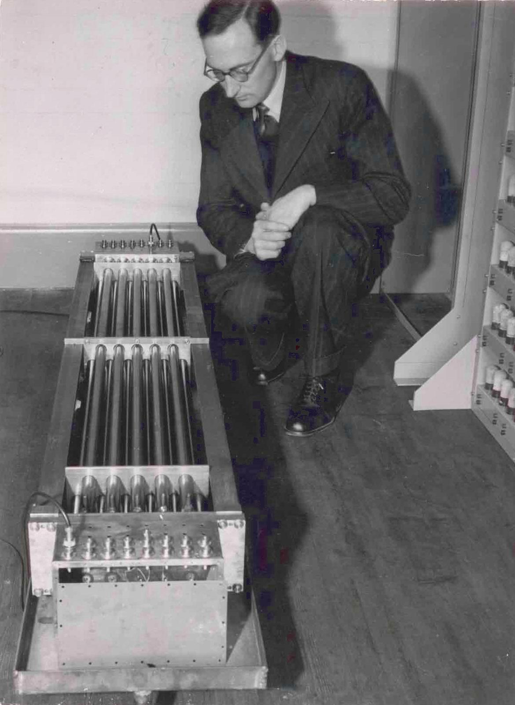

图：Maurice Wilkes与水银延迟线组。原目录没有为这张照片单列准确拍摄日，不将它标成1949年5月6日现场。Copyright Department of Computer Science and Technology, University of Cambridge. Reproduced by permission. [剑桥档案目录](https://www.cl.cam.ac.uk/relics/archive_photos.html#EDSACI)，[CC BY 2.0 UK](https://creativecommons.org/licenses/by/2.0/uk/)，原图未修改。

因此要分清两个不同的“长短”：

- 长管、短管，说的是器件和延迟用途；
- 长字、短字，说的是数值格式及所占的一段或两段字位置。

我们还能复算一笔时序账：一根主存长管的32段短字位置，每段18个时隙，共576个时序位置。若按每时隙2微秒计算，对应1152微秒，即1.152毫秒的循环节拍量级。

576不能直接写成576位全部可用的数值容量：全按短字算是32×17=544个有效位；全按长字算是16×35=560个有效位。两种格式中保留间隔的方式不同。[剑桥EDSAC规格汇编](https://www.cl.cam.ac.uk/events/EDSAC99/statistics.html)、[架构说明](https://www.cl.cam.ac.uk/events/EDSAC99/simulators/india/arch.html)

这也不是说每次读取、每次运算都恰好用1.152毫秒。我们计算的是位节拍和存储队列的关系；控制流程、算术和输入输出还会占用时间。

## 13. 512字还是1024字？还要问“哪一个阶段”

EDSAC不是一天之内，把全部计划硬件装齐再按下开关的。

1949年5月6日的运行日志记载，机器打印了0到99的平方表，用时2分35秒；同一条记录还写明：**第一组有四根存储管在运行。**

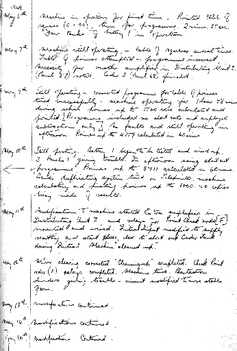

图：EDSAC I日志第一页的原始档案图。历史手写字在这个原件中很小，下文依据[David Wheeler转录的日志](https://www.cl.cam.ac.uk/relics/elog.html)说明，不要求读者在手机上辨认全部笔迹。Copyright Department of Computer Science and Technology, University of Cambridge. Reproduced by permission. [照片目录](https://www.cl.cam.ac.uk/relics/archive_photos.html#EDSACI)，[CC BY 2.0 UK](https://creativecommons.org/licenses/by/2.0/uk/)，原图未修改。

日志本身是当时的记录；网上的文字版本是Wheeler后来的转录。把这两层区分开，比编一个“第一次开机时屋里所有人的反应”更接近真实历史。

按每根32个短字位置计算，四根对应128个短字位置，或者64个长字位置。这是根据根数换算的容量，不是在说首个程序实际把这些位置全部用满。

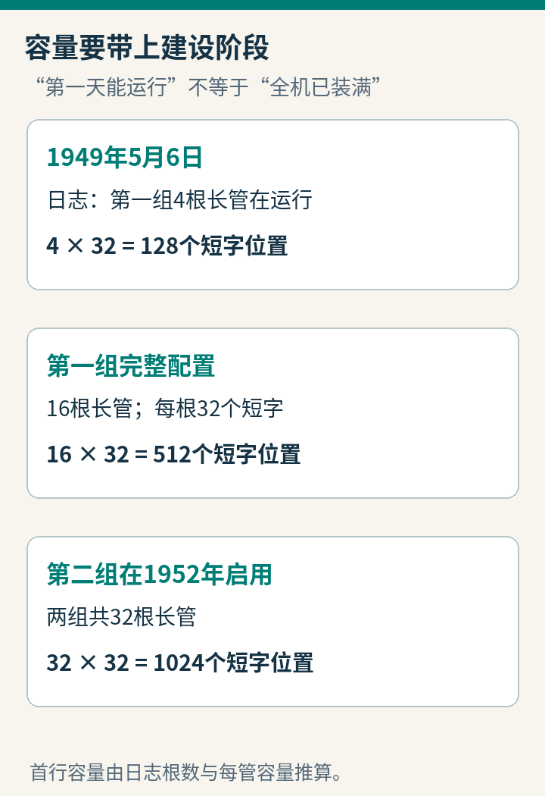

常见的“初期512字”，说的是第一组16根长管完整配置时的512个短字位置。剑桥规格汇编把第二组启用记在1952年，两组共32根，合计1024个短字位置。[日志与注释](https://www.cl.cam.ac.uk/relics/elog.html)、[分组及扩充说明](https://www.cl.cam.ac.uk/events/EDSAC99/statistics.html)

所以，读历史机器的参数时，至少要问三件事：

1. “字”指17位短字，还是35位长字？
2. 说的是设计上完整配置，还是当时已经在运行的部分？
3. 说的是1949年首次运行、第一组完成，还是后来的扩充？

一台机器的经历比一行参数表长。首日四根、完整第一组十六根和后来的三十二根，不能被挤成同一张“1949年首日规格”。

## 14. 温度为什么会改变一串0和1的命运？

现在看另一件实物：它像一根温度计，上面接着电线。

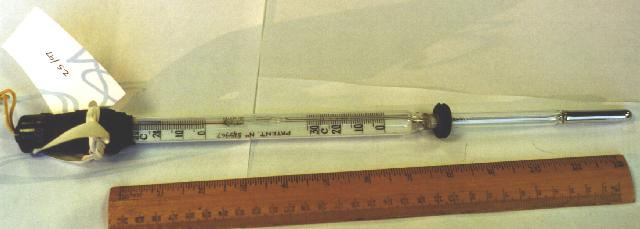

图：EDSAC温控器，馆藏CL-25/97。© University of Cambridge Computer Laboratory，[馆藏说明](https://www.cl.cam.ac.uk/relics/database/?machine=EDSAC+I)，[CC BY 4.0](https://creativecommons.org/licenses/by/4.0/)，原图未修改。

如果比特只是一个已经刻在金属上的标记，室温变化一点，似乎不会立刻让它挪到隔壁位置。但延迟线的地址和时间绑在一起，问题就不同了。

传播时间取决于声程和声速。温度变化会影响传播条件，也可能伴随器件尺寸变化。如果一圈回来时提前或落后，接收脉冲就可能与时钟所允许的时间窗口错开。

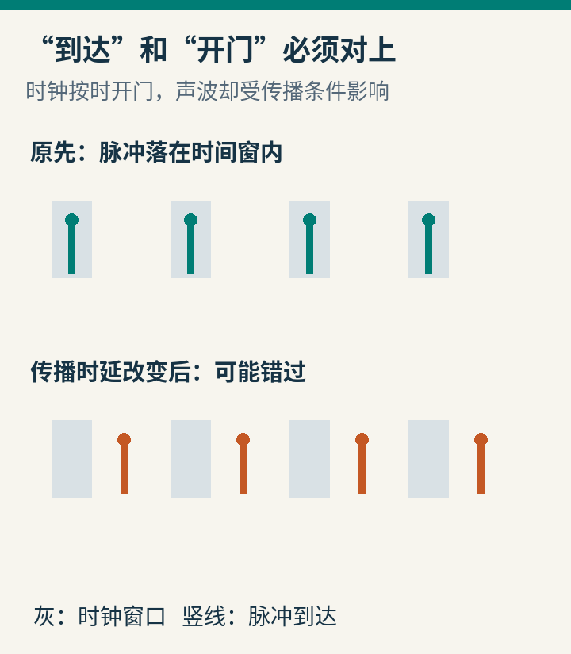

图中只画“对上”和“错过”两种状态，没有给出EDSAC真实的允许温差或采样裕量；线条的偏移也不是某个温度对应的实测值。

理想要求可以写成一句话：

整圈时间 ≈ 整数个时隙的总时长，并保持在电路允许的偏差范围内。

等号附近那一点余地，要靠实际器件和时序设计决定。再生电路可以把仍落在合适窗口内的信号重新定时，但不能无限地追回已经跑偏的脉冲。

Wheeler的器件回忆提到过两条思路：让频率随温度变化而跟踪，或者让温度保持稳定。他说最终采用恒温箱来稳定延迟线。这只温控器，就是“记忆需要维持正确节奏”的实物证据。[短延迟线及温控器记录](https://www.cl.cam.ac.uk/relics/database/?machine=EDSAC+I)

## 15. 还要拦住不请自来的回声

看到“循环”，很容易以为声波在管内像乒乓球一样，两端来回反弹，顺便保存数据。

恰恰相反，我们需要的是：声波沿一个方向到达接收端，信息被电路读取并再生，然后由发射端重新发送。未经控制的反射声波可能在错误时刻到达，制造多余干扰。

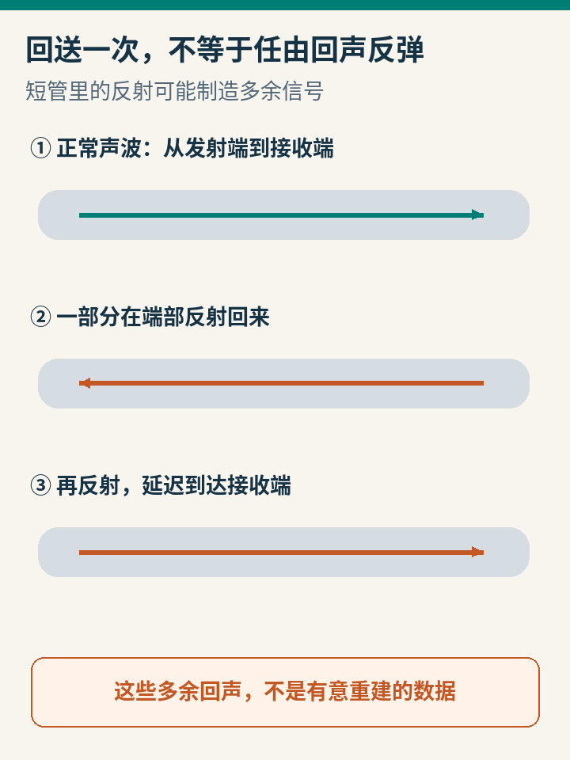

Wheeler在解释开篇那根短管时，专门提到：衰减太小，会让脉冲反射后再次回来造成干扰，因此有螺钉伸入水银中增加衰减；他同时指出，较长的主存管不需要同样的额外处理。[CL-4/97器件回忆](https://www.cl.cam.ac.uk/relics/database/?machine=EDSAC+I)

这不是“能量损失越少就一定越好”。我们想留下的是按照节拍排队的数据，不是每一个曾经出现过的振动。适当地消耗掉不需要的波，有时正是保存正确信息的一部分。

## 16. 不碰水银，也能检查这套逻辑

文章附有一个只使用Python标准库的[八时隙模型](examples/delay_model.py)，以及本次运行生成的[完整数据](examples/results.json)。不运行它，也不影响理解主线。

模型做了四件可以直接核对的事：

- 正常回送时，连续三圈都读到10110010；
- 关掉回送时，第一圈之后读到的都是0；
- 在B经过时改送0101，下一圈成为A=1011、B=0101；
- 在t=3和t=9请求B，分别等5和15微秒，再接收8微秒。

它还逐一检查了8000组请求时刻与相位组合，确保“下一次到达”没有早于请求，并且等待小于一圈。我们同时检查了门槛模型：轻微的强弱差异能恢复原位，降到错误一侧的位不能恢复。

这是理想的时隙队列模型，**不是EDSAC模拟器，也没有模拟水银声学、电子管电路、真实温漂或完整指令执行**。它的价值是让正文中的时间和数据可以重新算一遍，而不是给历史器件补一份不存在的实测报告。

你还可以只拿纸笔做一道题：如果t=23微秒请求B，它下一次从什么时候开始，等多久，又在什么时候收齐？

答案是t=24开始，等待1微秒，t=32收齐。算清这三个时刻，就已经掌握了本篇最重要的访问时序。

## 17. 原来，“记住”也可以是一种不停重做的动作

一根管子并不会独自记忆。

声传播提供时间，石英在电与声之间转换，时钟划出空位，电路把变形的信号重新整理，控制逻辑决定回送还是替换，温控装置努力让这一切继续对得上。

只看某一瞬间，数据在变换位置；从一圈接一圈的秩序看，同一份内容却保留下来了。

理解EDSAC的延迟线，不只是记住“早期电脑用过水银”这个冷知识。它让我们看到：**存储并不总是把某种东西放着不动，也可以是把一套有秩序的过程持续维持下去。**

原创正文与原创教学图按[CC BY 4.0](https://creativecommons.org/licenses/by/4.0/)提供；历史照片保留图注所列的各自许可。完整事实依据、素材清单、代码范围和AI辅助说明见[sources.md](sources.md)。
