# 代码分开编译，函数地址最后是谁填上的？

一个稍大的程序，通常会把代码分放在多个源文件里，方便分别编写和修改。但处理器运行时，这些部分还得接得上。

假设你和同学各写一小段程序。**函数**可以先理解为一段能够被调用、执行完再把结果交回来的代码。你们给这样一个函数取名 answer。

你负责：“去问一个叫 answer 的函数，把它给的数字交出来。”同学负责：“只要有人来问，我就返回 42。”

把人写的源代码处理成机器能执行的指令，是**编译**要完成的核心工作。两份文件可以分别做这一步：你这一份先做完，甚至不用等同学把代码发过来。可是，处理器真正执行调用时，必须知道往哪里走。

**连另一份代码会被放在哪里都不知道，调用指令怎么先写出来？**

我们做了一个主要指令只占 20 字节的小程序。字节是衡量这些指令占多少空间的单位，后面会把它们一格格摊开看。两份文件分别处理，最后合成可执行文件，运行后的结果如下。

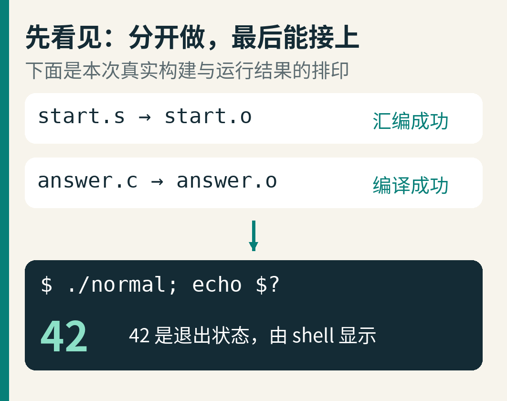

图1：真实构建与运行结果的排印。先看两个白框：两份源文件分别处理成功；再看下面的 42：合在一起的程序确实取回了同学提供的数字。这里不打印文字，而是把 42 作为退出状态交给系统；命令行外壳 shell 用 echo 把状态显示出来。一般程序常用 0 表示成功，我们特意用 42 传回实验答案，它不是一次意外报错。图中的文件后缀和“汇编”马上解释，暂时不用记命令。

接下来，我们要追踪的不是“42 怎样算出来”，而是**那次调用怎样准确地抵达返回 42 的代码**。

下面会用同一份小程序的图和数字走完这条路线。命令和完整源码留在后面，想动手时再用；不运行代码，也能跟着数清那次调用要走多远。

## 1. 一个可以暂时欠着的答案

把“这段代码做什么”和“它最后放在哪里”拆开，问题就有了余地。

编译器可以先决定大部分动作。遇到暂时不知道位置的目标时，先留下名字，再附上一条明确的处理记录：以后找到这个名字的定义，按照规定的方法修改某个字段。这里的**字段**，就是文件里一小段按规则存放某项信息的字节。

负责把这些独立部件接起来的程序，叫**链接器**。它不是靠猜“这里好像该填地址”，而是读取目标文件专门保存的记录。

本次实验的两份源文件是：

- start.s：程序入口，也就是开始执行的那段代码。调用 answer，然后把返回值作为退出状态。
- answer.c：只有一个 C 函数，返回 42。

.s 文件用汇编语言写，指令离处理器更近；.c 文件用 C 语言写。前者经过汇编器，后者由 GCC 编译并汇编，各自产生一个 .o 文件。这一步还没有把两份代码链接起来。[GCC 对编译阶段和 -c 的说明](https://gcc.gnu.org/onlinedocs/gcc/Overall-Options.html)

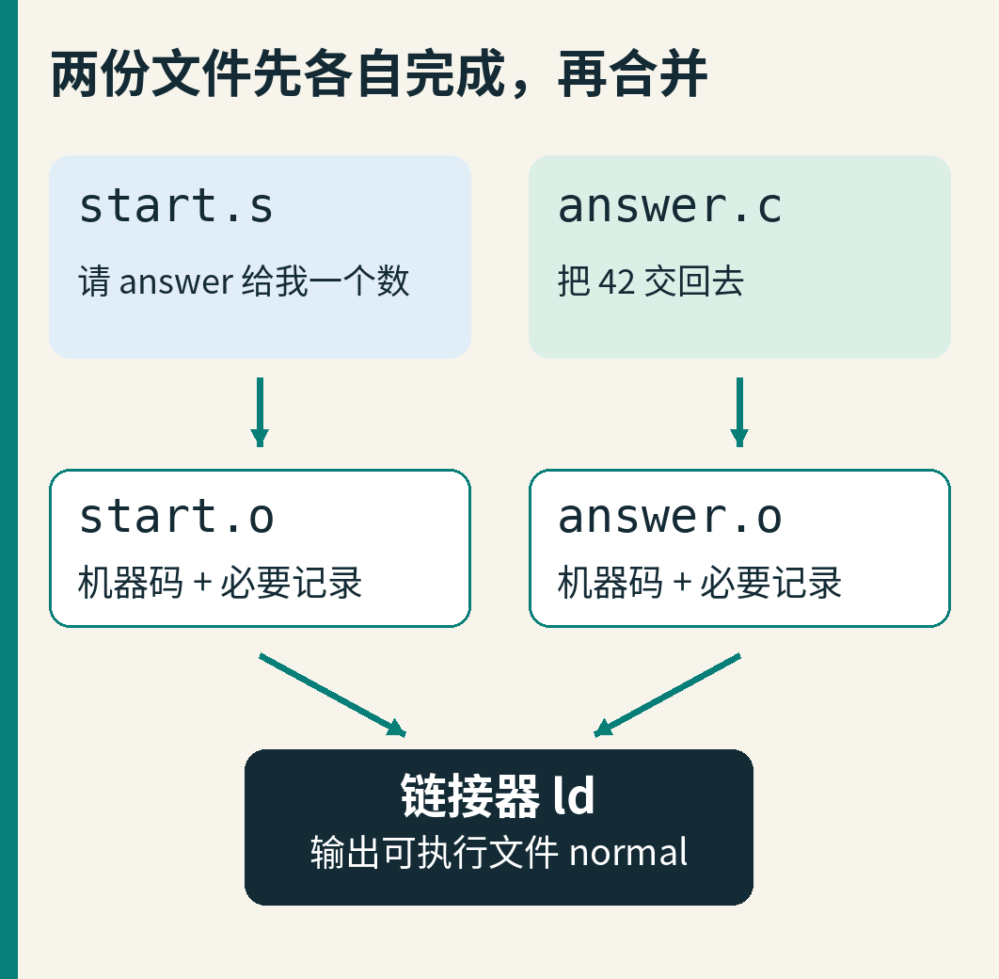

图2：我们刻意把入口写得很短，避开普通 C 程序启动时的一大批辅助代码。这里的 start.o 和 answer.o 都是已经生成的真实目标文件；图中的“机器码＋必要记录”是对内容的概括。

**目标文件**可以先理解为一份“已经翻译了很多内容、还允许继续组装”的文件。它不仅装着机器指令，也装着供后续工具使用的信息。不能把这里的 .o 直接当成已经准备好运行的完整程序。

我们固定使用 Linux 上的 x86-64 指令体系、ELF64 文件格式，以及 GCC 14.2.0、GNU binutils 2.44。汇编器 as、链接器 ld、查看文件的 readelf 和 objdump 都来自这套已安装工具。

这很重要：下面的字节和算式属于这个明确实例。iOS 通常使用的 Mach-O 文件、其他处理器的指令和重定位类型，需要按各自规则分析，不能照搬这几行数字。

## 2. 先认清手里的东西：它是一份 ELF 文件

**ELF** 是 Executable and Linkable Format 的缩写，也就是一种可执行文件与可链接文件使用的组织格式。一个文件采用 ELF，不代表它已经能直接运行；本例 start.o 的文件类型仍然是“可重定位文件”。

它开头的字节真的长成这样。


图3：前六个字节取自真实 start.o；ELF64、X86-64 和 .text 的 14 字节大小由 readelf 核验。下面三个框解释与本文相关的节，没有声称文件只含这三部分。

先补一点读图常识。**字节**是这里计数的基本单位，一个字节有 8 个二进制位。工具喜欢把一个字节写成两个十六进制字符：从 00 到 ff，能表达十进制的 0 到 255。

十六进制只是记数法。数到 9 后接 a、b、c、d、e、f，再进位。因此 0x0e 是十进制 14，0x10 是 16；开头的 0x 提醒你“这串数用十六进制读”。暂时不用背全部换算，关键地方都会给十进制说明。

ELF 文件中的一些内容按用途装进不同的**节**，英文是 section。可以把节看成有名称和属性的内容区：

- .text 通常放机器指令。名字里虽然有 text，却不是一段给人读的普通文章。
- .symtab 是符号表，登记与名字有关的信息。
- .rela.text 是与 .text 有关的一组重定位记录，说明哪些地方还需要如何处理。

除此之外还有保存名字字符串的节、其他数据节等。我们不必一次拆开全部房间，先跟着一个调用走。

readelf 擅长查看 ELF 的结构、符号和重定位；objdump 可以把机器指令翻译成便于人看的汇编表示，这叫**反汇编**。反汇编不是恢复原始 C 源码，变量名、注释和原来的写法并不会自动回来。[GNU readelf 2.44 手册](https://sourceware.org/binutils/docs-2.44/binutils/readelf.html)、[objdump 手册](https://sourceware.org/binutils/docs/binutils/objdump.html)

## 3. 一个名字，在两份表里承担不同角色

在程序中写 answer，首先是在提一个名字。机器文件里与这种名字相关的记录，叫**符号**。它可能表示一个函数，也可能表示一份数据，或其他需要被工具识别的对象。

我们分别查看两份 .o 的符号表，挑出 answer 这一项。

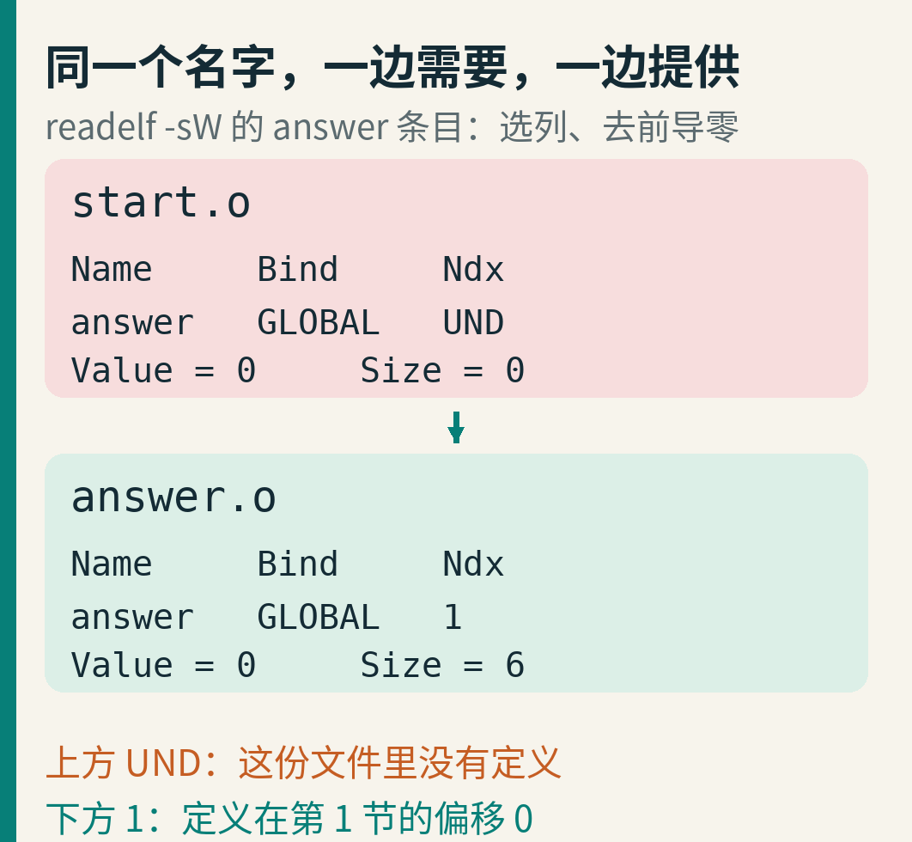

图4：真实 readelf 符号条目的选列排印。为便于手机阅读，Value 的十六进制前导零被去掉。start.o 的 answer 没有定义；answer.o 的 answer 是一个 6 字节的函数，位于该文件第 1 节 .text 的起点。

这里每一列都回答一个小问题。

Name 是名字。Bind 的 GLOBAL 表示它属于可以参与跨目标文件连接的全局符号。Ndx 指出定义与哪个节相关；特殊值 **UND** 是 undefined，表示“这份文件里没有它的定义”。

请留意，两行的 Value 都是 0，意思却不能混为一谈：

- 在 start.o 里，answer 是 UND。这里的 0 **不是在承诺函数位于地址 0**。
- 在 answer.o 里，answer 已定义在第 1 节。Value 为 0，表示它在这一节的起点，即节内偏移 0。

**偏移**就是相对于某个明确起点，往后数多少字节。“第几节＋节内偏移”已经能在这个目标文件里定位定义，但还没有决定整个程序中最终的地址。[ELF gABI 符号表，第 5.5、5.7 节](https://gabi.xinuos.com/elf/05-symtab.html)

链接器读到两份记录，就知道 start.o 所需的 answer，可以由 answer.o 提供。这一步常叫**符号解析**：把对名字的引用，与合适的定义对应起来。

知道“谁提供它”还不够。接下来还得知道：“调用指令的哪一部分要改，究竟改成多少？”

## 4. 机器指令已经写出，但其中一段还没定下来

看 start.o 的第一条指令。工具从 0 开始给这个节里的字节编号：第一格的偏移是 0，第二格是 1，依次往后数。这种编号表示“离起点有多远”，不是日常说的“第几个”。

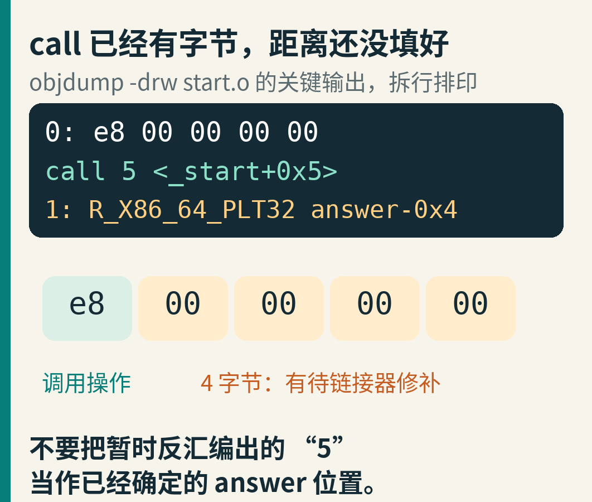

图5：真实 objdump 输出的关键部分，拆行排印。图里的 _start 是我们给程序入口取的符号名；“_start+0x5”表示从入口往后 5 字节。最后一行保留了重定位的 answer−0x4：它记录目标名字和附加数，后面会分开解释。下方把同一条指令的五个字节放大，不是另造一套机器格式。

我们现在只需要认出一种指令：**call**，调用另一段代码。这里这条 x86-64 调用指令一共 5 字节：

- 第一个字节 e8，表明这是这种形式的调用。
- 后面四字节，保存调用要跨越的相对距离。

“相对”意味着它不一定直接写下目标的完整地址。就像告诉你“从某个位置再走 9 步”，而不是直接给出房间的全部门牌。距离的起点很严格，稍后会数清楚。

眼下，后四字节全是 00。反汇编器忠实地按这些暂时的字节解释，于是显示 call 5：距离为零，暂时落在这条 5 字节指令之后。

这不是说 answer 已经放在偏移 5，更不是说它位于地址 0。**如果只截走指令行、忽略紧挨着的重定位信息，就会把一个尚未完成的文件读错。**

这里把四个零口语化地叫“占位”。但不是所有平台、所有重定位字段最初都必须为零。对本例而言，真正有约束力的是旁边那条重定位记录。

## 5. “在偏移 1 处改”，这个偏移从哪里算？

在开始算数前，必须排除一个很容易藏起来的错误：不同工具说的“位置”，可能采用不同起点。

我们给同一处补丁建立几组坐标。


图6：数字来自本次真实文件。start.o 的 .text 从文件偏移 64 开始，补丁字段在该节偏移 1，因此它在文件偏移 65。链接后的 normal 中，.text 在文件偏移 4096，安排的虚拟地址却是 0x401000。每一行都先说明从哪里数。

这张图里，“文件偏移”回答的是：从磁盘文件的第一个字节开始，要往后数多少字节？“节内偏移”则只从某个节的开头数。

**虚拟地址**是程序运行所在地址空间里的地址。这里你只需要把它理解为程序使用的地址编号，不要把它当成内存条上的物理位置。虚拟地址如何翻译成物理地址，是另一层问题。

所以，重定位记录里的 Offset=1，不是让链接器去修改整个文件的第 1 字节。对于这个可重定位目标文件，它指的是被修改节中的字节偏移。记录所在的节还保存着关联，告诉工具“这里说的是 .text”。[ELF gABI 重定位，第 6.1 节](https://gabi.xinuos.com/elf/06-reloc.html)

只要每个数字都带着自己的起点，后面的减法就不会把不同坐标硬凑在一起。

## 6. 链接器收到了一张怎样的说明书？

这就是 start.o 中的那条记录。

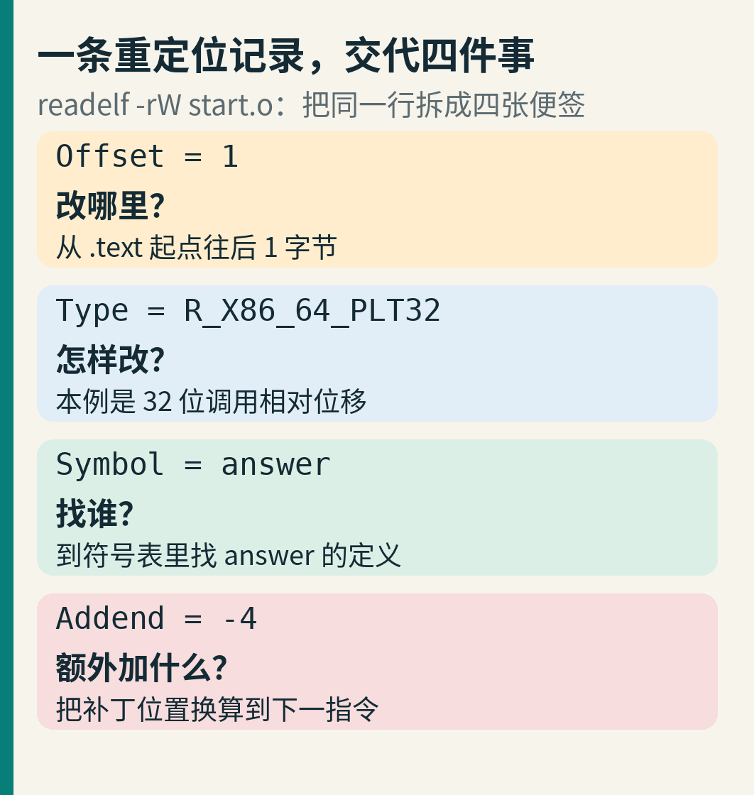

图7：真实 readelf -rW 输出的一条记录，分栏重排。Offset=1、R_X86_64_PLT32、answer 和附加数 −4 都保持原意；为何是 −4，暂时只记下问题，后面亲手推出来。

可以用四句话读它：

1. 改哪里？改 .text 中偏移 1 开始的字段。
2. 怎么改？按 R_X86_64_PLT32 规定的方式处理这个 32 位调用相对位移。
3. 找谁？引用符号表中 answer 对应的那项。
4. 还加什么？计算时带上附加数 −4。

**重定位**不是对代码里的所有数字统一加一个常量，而是按记录，把具体引用接到具体定义，并修改指定位置。这种记录的类型决定计算方式和结果写入方式；不同处理器会定义不同类型。

**下面两点是进阶边界，可以先跳到第7节看布局和距离。**

这里的记录采用 RELA 形式，附加数作为单独字段保存。ELF 还有 REL 形式，会从待修改位置中取得隐含的附加数。知道存在这一区别就够了，不要根据这个全零占位的例子，断言所有文件都采用相同做法。[ELF gABI 重定位](https://gabi.xinuos.com/elf/06-reloc.html)

R_X86_64_PLT32 这个长名字里有 PLT。PLT 是 procedure linkage table，通常译为过程链接表，可以提供一段把调用引向实际函数的中转代码。**看见类型名中的 PLT，不等于最后一定会经过中转。**

本次是**静态链接**，也就是在生成可执行文件时，把本例需要的代码连接起来。answer 的定义已经在同一个最终可执行文件中，GNU ld 把调用直接接到 answer。我们实际检查了最终指令，也确认最终文件没有 .plt 节。这与 GNU 工具对该重定位类型的直接解析行为相符。[GNU binutils 的相关实现说明](https://sourceware.org/pipermail/binutils-cvs/2018-February/047522.html)

## 7. 先决定摆放，再决定要走多远

本次链接时，我们明确要求输出代码节从虚拟地址 0x401000 开始，并按 start.o、answer.o 的次序提供输入。

实际结果很整齐：start.o 的代码长 14 字节，answer.o 的代码长 6 字节，两者之间没有填充。


图8：这是本次实际布局，不是通用承诺。真实程序里，链接脚本、对齐要求、其他输入节以及链接器处理都可能影响布局。链接器也会组织 ELF 的头部、属性等，不是只把两个完整 .o 文件首尾拼接。

现在 answer 的位置终于确定了：

从 0x401000 向后 14 字节，就是 0x40100e。

于是，链接器拥有完成补丁所需的信息：目标的位置、待修补的位置、计算类型和附加数。

处理之后，再用 objdump 看同一条调用，结果变成了下面这样。

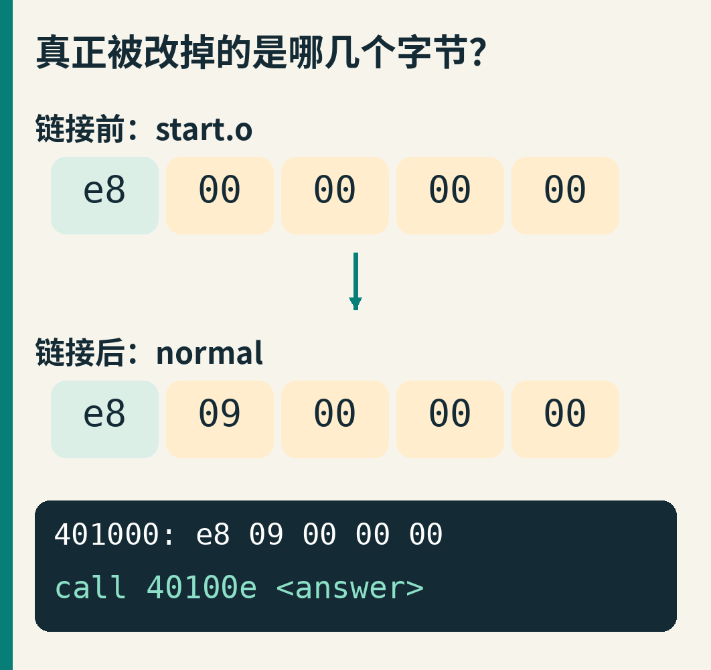

图9：前后字节来自真实文件，并由独立的小型 ELF 读取程序核验。e8 没变，后四字节字段写成 09 00 00 00；由于高三字节原本也是零，数值上真正改变的字节只有其中一个。

这时标题里的问题已经有了答案：**在这次静态构建中，是链接器在知道最终布局后完成了修补。**

不过还有一个更有意思的细节：它没有把 answer 的完整地址 0x40100e 直接塞进指令，而是填了距离 9。

为什么恰好是 9？

## 8. 不看大地址，也能把 9 数出来

把输出代码节的起点暂时看成 0，就好算了。

- call 从偏移 0 开始。
- call 自己长 5 字节，所以紧接着的下一条指令位于偏移 5。
- answer 从偏移 14 开始。

这种 call 的位移，**从下一条指令的位置算起**。因此要写入的是 14−5，也就是 9。


图10：每个小格是一个真实代码字节的位置。黄色区域是 5 字节 call，蓝色区域是入口剩下的 9 字节，绿色区域是 6 字节 answer。这里算的是字节距离，不是“向后跳 9 条指令”。

处理器执行它时，会保存返回位置，然后用这个相对距离找到目标。answer 完成后执行返回指令，回到调用之后，入口代码再请求退出。返回路径不需要链接器为每一次运行另填一个答案。

同一算术用完整地址写，就是：

`0x40100e − 0x401005 = 9`

x86-64 在这里采用**小端序**：一个多字节整数的低位字节放在低地址。所以 32 位整数 9，也就是 0x00000009，在连续四个字节里显示为 09 00 00 00。

“64 位机器”不意味着每个数字、每条指令中的每个字段都是 64 位。这条调用的距离字段就是 32 位有符号整数。它的可表示距离有限，范围为 −2³¹ 到 2³¹−1 字节；不是任意远的目标都能用这一种编码直接抵达。

## 9. 进一小步：那个 −4 原来是在换起点

前面的“目标减下一指令”已经足够理解主线。下面只是把它与重定位公式对上，不想读符号也可以直接去下一节。

把目标 answer 的最终地址记为 S，把**待修补的四字节字段开头**记为 P。

注意，P 在 call 的第二个字节。call 的第一个字节是 e8，后面才是四字节字段。字段的四个字节依次在 P、P+1、P+2、P+3；跨过它们以后，第一个位置才是 P+4，也就是下一条指令的开头。

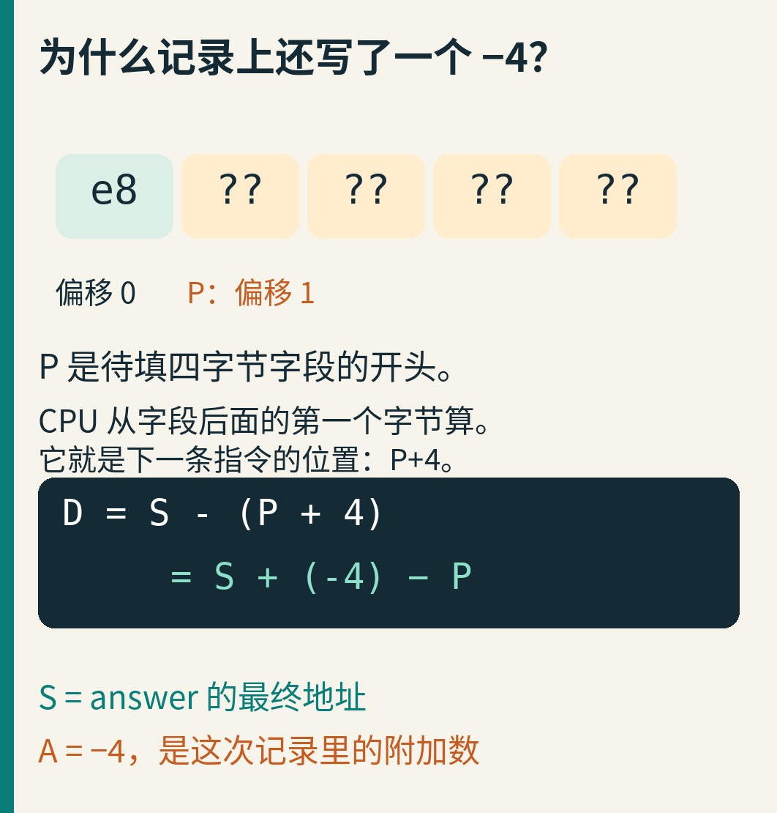

图11：图中的问号只在解释“这个字段待定”，不代表文件里真有问号字节。实际 start.o 对应字段是四个零。图中 D 表示要写入的相对距离。

想写进去的距离可以这样变形：

`D = S − (P + 4) = S + (−4) − P`

这就是本例附加数 A=−4 的来处。把实际数字代入：

`S = 0x40100e`

`P = 0x401001`

`A = −4`

所以 `S+A−P = 9`。

这里有一条必须保留的精确边界：AMD64 ABI 的表中，R_X86_64_PC32 写成 S+A−P；R_X86_64_PLT32 的一般计算写成 L+A−P，其中 L 是相关 PLT 入口的地址。**本次 GNU ld 已把这次调用直接解析到 answer，才可以按直接目标 S 来完成上述计算。**不能把两个重定位类型在所有情形下都画等号。[AMD64 ABI 1.0，第 4.4.1 节和表 4.9](https://gitlab.com/x86-psABIs/x86-64-ABI/-/jobs/artifacts/master/raw/x86-64-ABI/abi.pdf?job=build)

现在看 −4，就不神秘了。它不是“函数前面有四个隐藏字节”，也不是把 42 减去 4；它是在两种计数起点之间做修正。

## 10. 做三个变化，看看这套解释站不站得住

好的解释应该能预测变化，而不只解释已经看到的一次结果。

### 变化一：在两段代码中间加 16 字节

我们保留原来的 start.o 和 answer.o，不重新编译它们，只在链接时插入一个 padding.o。它的代码节里有 16 个字节的 nop，也就是“空操作”指令。这里只用来占空间，调用仍会直接越过它们抵达 answer。

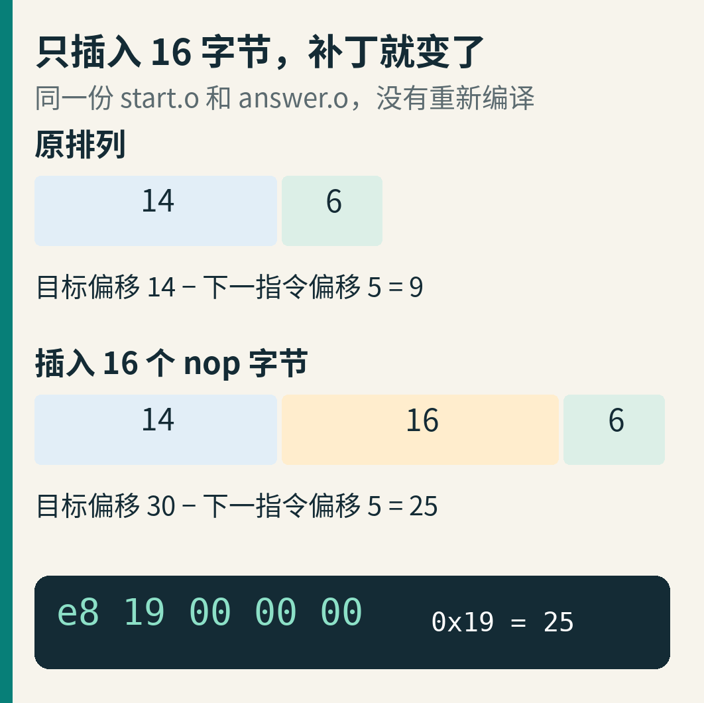

图12：两行采用同一字节比例；蓝色是 14 字节的入口代码，绿色是 6 字节的 answer，黄色是新插入的 16 字节填充。实际新布局把 answer 推到偏移 30，下一指令仍在偏移 5，所以距离变成 25；它的十六进制是 0x19。程序实测仍以 42 退出。

这一次，调用字段变成 19 00 00 00。

**同一个 start.o，可以因为与不同材料一起链接，而得到不同的最终指令字节。**这正是“最后再决定距离”有用的地方。调用方不必因为另一份代码的摆放改变，就先重写自己对 answer 的含义。

### 变化二：把 answer 排到入口前面

我们再将输入顺序改成 answer.o、start.o，仍指定从 _start 开始执行。

于是 answer 位于偏移 0，_start 位于偏移 6。call 的下一条指令在偏移 11，所以要写入 0−11，也就是 −11。

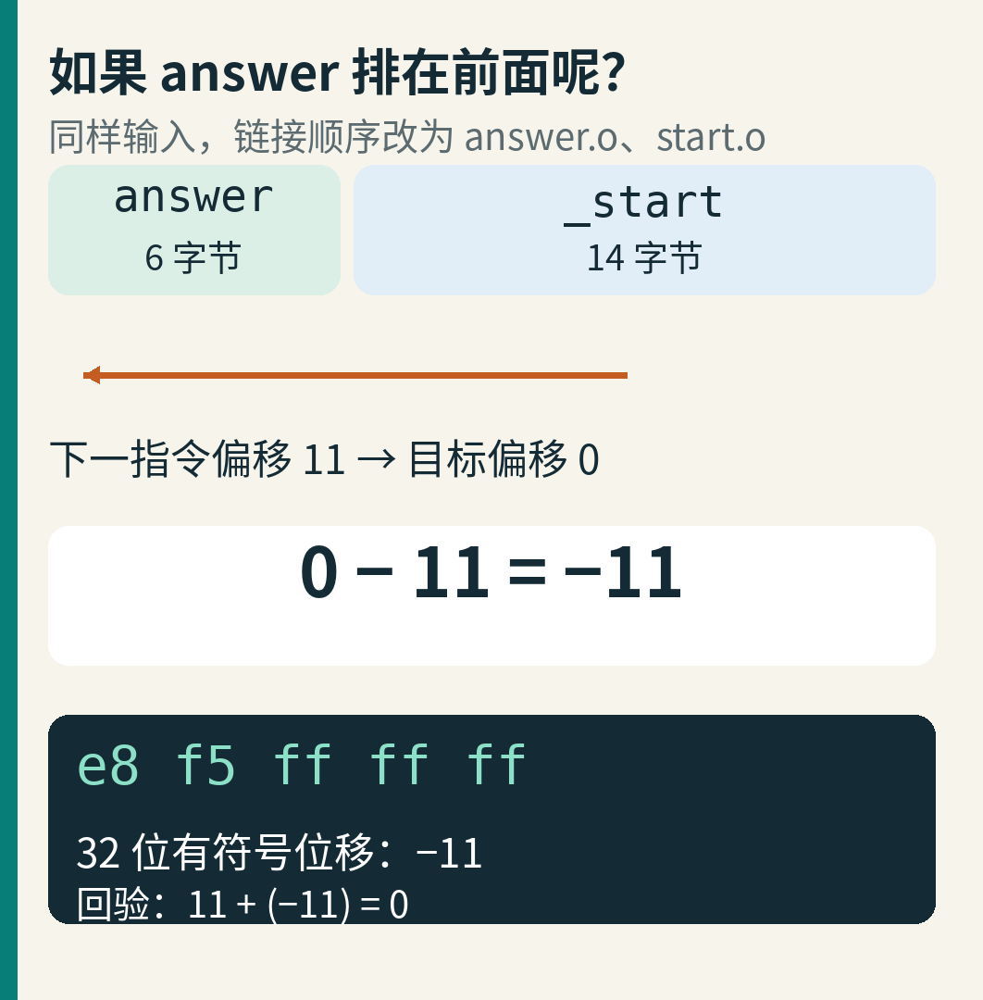

图13：真实倒排输出。函数在文件中靠前，不代表程序必须从它开始运行；入口仍然由 _start 指定。这次程序同样返回退出状态 42。

负数怎么塞进四个字节？这里用 32 位二进制补码表示，−11 的位模式为 0xfffffff5，小端排列就成为 f5 ff ff ff。

不用先学完补码，也可以检查方向和终点：从偏移 11 加上 −11，确实回到偏移 0。补码细节不会改变这条可手算的路线。

### 变化三：两段代码一起搬远一些

最后，我们另做一份静态可执行文件，把代码节起点改成 0x501000，内部排列仍然不变。


图14：这是两次分别链接、分别运行的真实文件对照，没有冒充操作系统把同一文件在运行时随机搬家的实测。两次调用字段都是 09 00 00 00，退出状态都是 42。

两端地址同时加上一个相同的量，相减时这个量会抵消。

这就是相对寻址有用的原因之一：代码块的某些内部关系不依赖整体放在哪里。但它**不自动证明整个程序都是位置无关代码**。程序里还可能含绝对地址、跨模块引用和其他必须处理的关系。

尤其本例输出的文件类型是 ET_EXEC，是按指定地址生成的静态可执行文件；它不是一份用来展示运行期地址随机化的 PIE 可执行文件。PIE 是 position-independent executable，即位置无关可执行文件。我们证明的是这段相对调用在两次构建中的距离不变，不是整个文件可以随意搬动。

## 11. 两种真实失败，比一句“链接出错”更有用

### 缺少定义：别人没有来

如果只把 start.o 交给静态链接器，answer 的定义始终找不到，链接会失败。

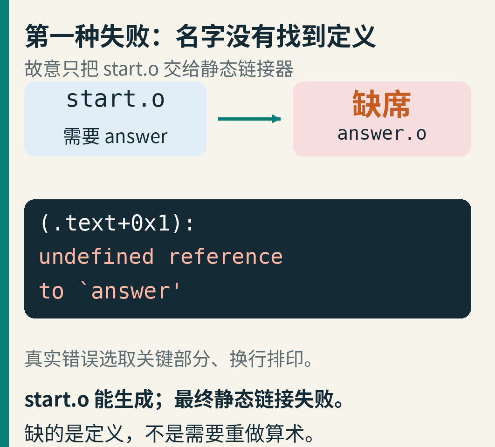

图15：真实 GNU ld 错误的关键部分，换行排印。完整错误还包含发生错误的文件和函数信息。命令退出状态为 1。

这里 start.o 已经成功产生，说明“这一份源文件能被处理成目标文件”和“所有依赖都已满足”是两件事。

遇到这种错误，应检查实现所在的目标文件或库有没有参与链接、符号名称是否一致、定义是否对外可见等。把编译器反复运行十遍，不会让从未加入链接的 answer.o 自动出现。

### 重复定义：来了两位，都说自己是同一个人

如果故意把 answer.o 在链接命令里写两遍，本次会得到另一种失败。

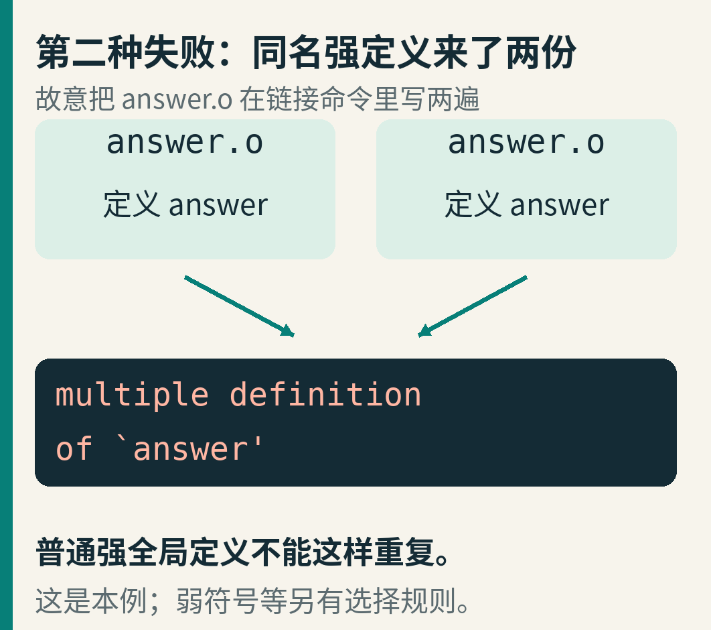

图16：真实 GNU ld 重复定义错误中的关键短句。这个例子里，两份都是普通的强全局定义；完整错误标出第二份定义与先前定义的位置。

链接器不是“同名就随便挑一个”。普通强全局定义这样重复，会产生冲突。真实系统还有弱符号等规则，不能根据这个例子说“任何两个同名符号都会报错”。

同样，链接成功也不是“两个源文件的接口从此一定正确”。普通 ELF 符号记录并不完整保存 C 函数的全部参数类型约定。名字接上了，但调用方和实现方若对参数、返回值等理解不一致，仍可能出问题。这里的两份代码按同一 x86-64 调用约定配合，返回整数放在约定的寄存器中。

所谓**调用约定**，就是双方对参数怎么传、结果放哪里、哪些状态需要保留等达成的一套规则。名字与地址解决的是接线问题，规则还得让接通的两端能够交流。

## 12. 这不是只有手写汇编才会遇到的事

你可能会想：前面把入口写成汇编，是不是才“造出”了这种留空现象？

我们又做了一个普通 C 调用方。它声明 answer 是一个不接收参数、返回整数的函数，然后调用它，把结果加 1。另一个文件仍然是原来的 answer.c。

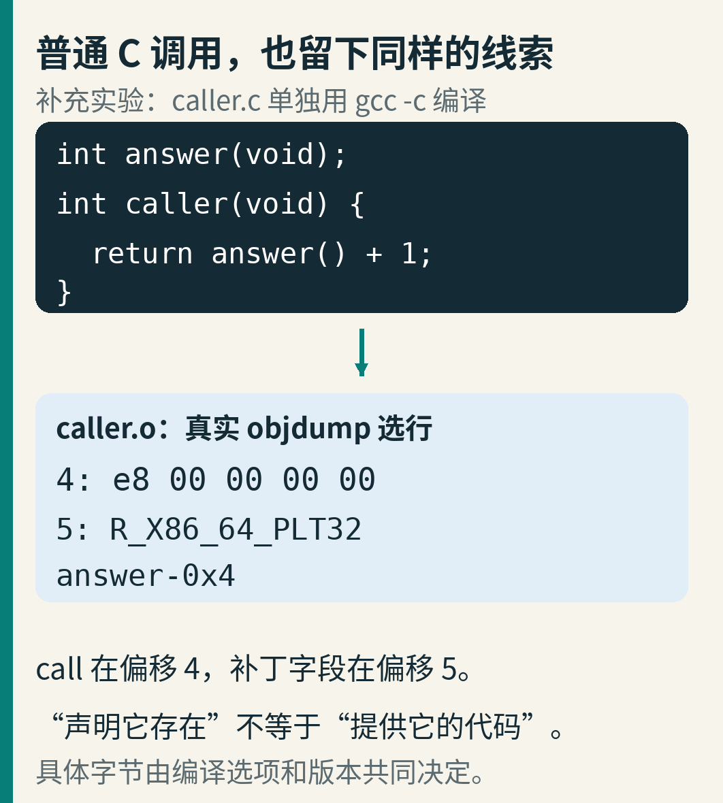

图17：上半是原创 C 源码，下半是实际编译得到的 caller.o 中，objdump 对调用与重定位的选行排印。这里 call 在节内偏移 4，四字节字段在偏移 5；它没有沿用主例入口的偏移 0 和 1。

我们这里只把 caller.c 单独编译成 .o，目的是查看编译器留下的记录，没有把它当成另一份已经运行的完整程序。

最上面的 `int answer(void);` 是**声明**：告诉编译器这个名字该怎样被使用。它没有提供实现，不会凭空产生“返回 42”的机器码。实现仍在 answer.c 中。

这个补充例子说明，手写的短入口只是帮我们减少干扰。真实 C 编译过程也会在目标文件中留下外部符号与重定位记录。

采用更高优化、链接时优化，或者改变源程序，调用还可能被内联、折叠或改写。本文特意固定选项，保留一条可观察的实际调用。某次优化后没有这条重定位，不意味着链接机制不存在；首先要看工具最终生成了什么。

## 13. 静态链接、动态链接、装载，谁负责哪一段？

本例没有使用 C 标准库，也没有需要在运行时另找的共享库。最终文件没有动态解释器条目，readelf -r 也显示没有剩余重定位记录。我们观察的这个调用已经在生成文件时接好。

这不等于“任何程序的所有地址都由静态链接器一次填完”。

**动态链接**允许某些代码放在共享库中，程序和库在装载或运行时按规则配合。静态链接器会先完成能完成的布局与连接，并可能留下供动态链接器处理的信息。动态链接器再根据实际装入的模块与其地址，进行所需的符号查找、重定位等工作。有些调用绑定也可能延后到首次使用，具体取决于格式、实现和选项。[ELF gABI 动态链接](https://gabi.xinuos.com/elf/08-dynamic.html)


图18：职责边界示意。中间一层包含一般动态程序可能需要的工作，并不表示本例实际运行了动态链接器。操作系统装载程序时主要按程序头描述的段安排映射，不能把本文为链接讲的“节”与装载用的“段”当成完全相同的东西。[ELF gABI 程序装载](https://gabi.xinuos.com/elf/07-pheader.html)

再往下，程序访问虚拟地址时，处理器与操作系统还要处理虚拟地址到物理位置的映射。这与“answer 这个名字对应哪段代码”是不同问题。

把这几层分开，你就不会拿页表去解释链接时的未定义符号，也不会以为链接器已经替操作系统挑好了每一个物理内存位置。

## 14. 可选：亲手看同一份目标文件怎样变成四种结果

如果手边已有 Linux x86-64 和 GCC、GNU binutils、Python 3，可以按[复现实验说明](README.md)进入随文 examples 目录，再运行：

```sh
python3 reproduce.py --out ./my-results
```

my-results 必须是一个新的或空的目录。脚本不会下载东西、安装软件或修改系统设置；它只编译本文自带的小源码、调用查看工具、运行四个小程序，并把输出保存到你指定的位置。完整说明见[复现实验说明](README.md)。

要先看懂主例源码，也只需抓住两部分。answer.c 是：

```c
int answer(void) { return 42; }
```

start.s 的四条实际指令是：

```asm
call answer
mov %eax, %edi
mov $60, %eax
syscall
```

第一条是今天追踪的调用。其余三条把返回的整数移到 Linux x86-64 退出系统调用所需的位置，选择退出操作并请求系统执行。eax、edi 是寄存器名称，可以暂时理解为处理器内部按规则使用的小存储格。这几行依赖 Linux x86-64 的接口，不能直接拿去当其他系统的退出程序。

完整 .s 还包含标明节、全局符号、函数大小和非可执行栈要求的指示；它们在[源码](examples/start.s)里，没有被当成额外 CPU 指令。命令和核验过程都在[复现脚本](examples/reproduce.py)中。

脚本的检查不只看“能不能运行”。它会：

- 核对 start.o 的 .text 是 14 字节，answer.o 的 .text 是 6 字节。
- 读取并保存 readelf、objdump 的完整输出。
- 用另一段独立的 ELF 读取代码，直接检查文件中的符号、重定位和实际字节。
- 对四次构建分别验证“下一指令地址＋有符号位移＝answer 地址”，并确认退出状态均为 42。
- 确认缺失定义与重复强定义都按预期失败。

本次结果是：原排列 9，加 16 字节后 25，整体平移后 9，倒排后 −11。不同编译器版本或选项可能改变函数长度和布局，届时应重读真实输出，不能强迫每台机器都复现同一个字节位置。

## 最后，把这件事用四句话讲给同学

一份代码单独生成目标文件时，不必知道所有外部函数最终放在哪里。

它先保留名字，以及“到哪里、按什么规则、带什么附加数去修改”的重定位记录。

链接器把引用与定义对应起来、安排布局，再算出并写入需要的字段。本例写入的是相对距离 9，而非完整函数地址。

所以，两份代码能独立准备，并不是因为地址问题消失了，而是因为**未知部分被清楚地记录下来，交给信息更完整的阶段解决**。

如果你现在能解释“同一个 start.o 为何一会儿填 9、一会儿填 25”，就已经从那五个真实字节里，看见了链接器最核心的一份工作。

## 来源与许可

关键依据包括 [ELF gABI 符号表](https://gabi.xinuos.com/elf/05-symtab.html)、[重定位](https://gabi.xinuos.com/elf/06-reloc.html)、[AMD64 ABI 官方项目](https://gitlab.com/x86-psABIs/x86-64-ABI)以及 GNU 工具文档。所读 gABI 网页标为 ELF Object File Format 4.3 DRAFT；本次取得的 AMD64 ABI PDF 标为 Version 1.0，日期 2025-03-12。版本与适用边界不可省略。

18 幅正文图与独立封面均为原创。图中的工具结果来自本文原创小程序在上述环境中的实际运行，采用选列、拆行或忠实排印，均不是终端、浏览器或平台截图。数值示意与真实输出的职责分别写在图注中。

本文由 AI 辅助研究、撰写、编程和制图，并实际执行与核对了示例。原创正文与原创图采用 [CC BY 4.0](https://creativecommons.org/licenses/by/4.0/)；原创实验和制图代码采用 MIT 许可。第三方规范、工具文档与其版权不包含在上述再授权中，未在本篇重分发第三方图片或规范 PDF。完整出处、逐图说明和许可范围见 [sources.md](sources.md)。
