# 给网格打一个洞，为什么点、边、面的账突然变了？

如果你正在给游戏做一个箱子模型，下面三种操作看起来都很普通：保持完整、拿掉盖子、在中间打通一条隧道。

但有一本只会加减法的小账本，会给出三个不同答案：2、1、0。

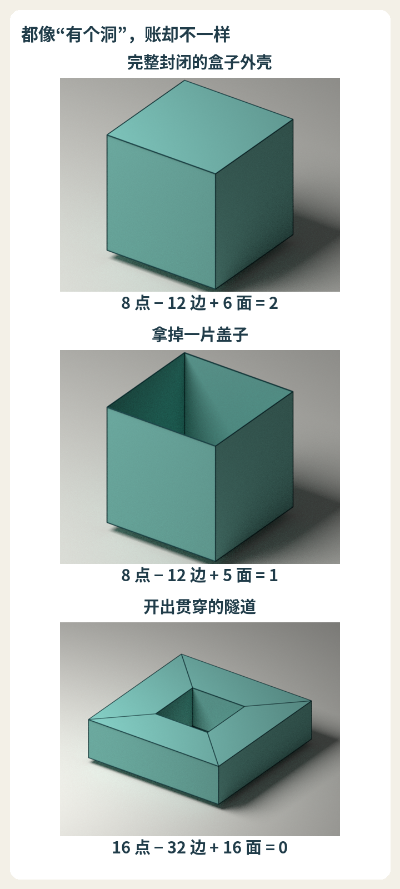

这些不是照片，也不是某款游戏的现成素材。本文用程序生成了真正的点与面数据，送入Blender 4.3.2渲染，并从原始网格实际数出点、边、面。细黑线是帮助看清连接的显示层，不参与网格计数。完整输入、渲染脚本和结果都随文保留。

最有意思的还不是“打洞会变”。如果只是把箱子的每个面切成许多小面，这个答案反而一直不变。

**什么变化只是把同一件东西画得更细，什么变化真的改变了它的连接方式？** 我们从一只八个角的方盒开始，一步步把这件事算明白。无需先学过拓扑学。

## 1. 先把三种对象认清，不急着背公式

这里的“网格”，不是表格软件里的格子，而是一种表示模型表面的方法：用点确定位置，用边连接点，再让一圈边围出一片面。

- 顶点：例如方盒的一个角。
- 边：例如两个相邻角之间的那条连接。
- 面：例如盒子的顶盖。

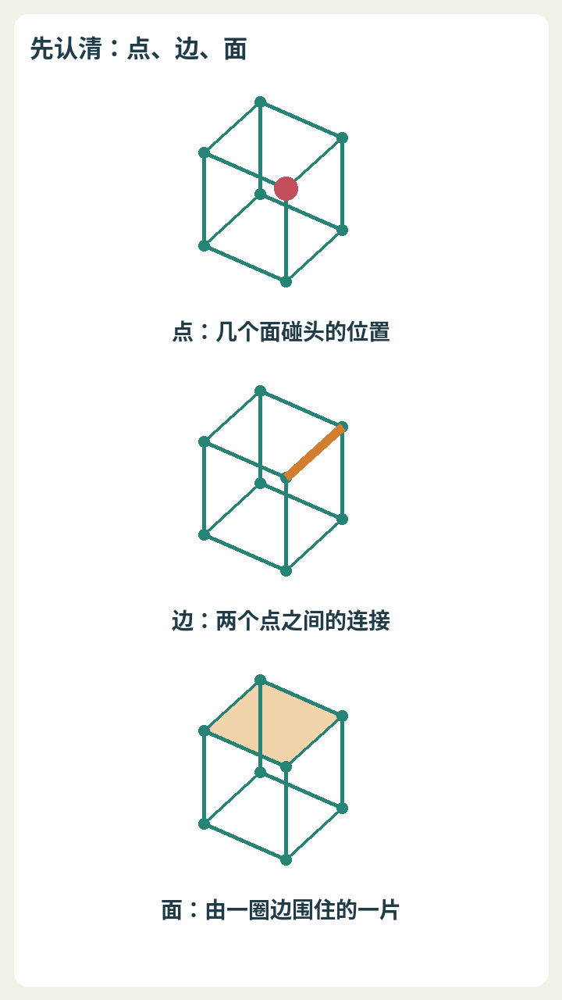

一个面可以是三角形，也可以是四边形。本文先允许普通四边形，好让“盒子有六个面”这件事保持直观。稍后再把它们拆成三角形。

先记一个小限制：我们说的一片面，是里面没有另外挖洞的一整片区域。一个中间空心的方框，不能为了省事就当成普通的一片面；它需要继续分割。这一点很快会用到。

## 2. 看见三个面，不表示盒子只有三个面

从斜上方看盒子，通常只看见顶面和两个侧面。但背面、底面仍然在那里。

为了不漏数，暂时把盒子画透明，并给八个角编号0到7。编号只是名字；从0开始并不会少一个点。

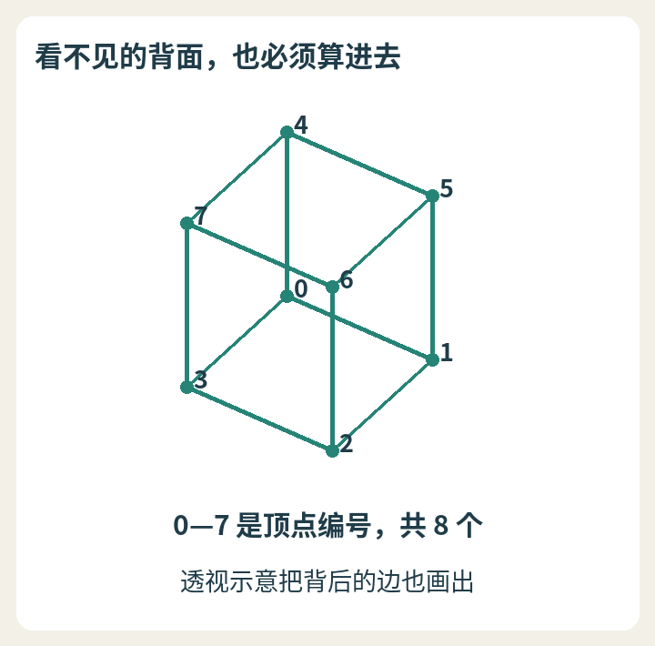

现在数：

1. 顶部四个角，底部四个角，共8个顶点。
2. 顶部一圈四条边，底部一圈四条边，再加连接上下的四条边，共12条。
3. 上、下、前、后、左、右，共6个面。

这个计数不依赖盒子有多大，也不依赖相机从哪里看它。遮住的东西不能从账本里消失。

## 3. 同一条边，被两个面提到，只算一次

这是计算机里很容易出错的地方。

假设两个三角形共用一条斜边。读第一个三角形的顶点顺序，可能遇到“2到0”；读第二个三角形，又遇到“0到2”。它们不是两条不同的边，只是同一条边被反向描述了。

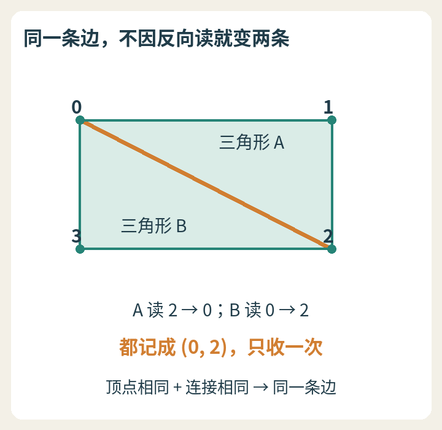

本文采用一个简单办法：把每条边的两个端点编号排成“小编号在前，大编号在后”。于是两次记录都变成`(0, 2)`，只收进账本一次。

这依赖我们当前的普通网格约定：两点之间的同一连接用同一个端点对表示，不讨论两个端点之间还有多条不同弯曲边的更一般结构。

还有更微妙的一层：**顶点编号相同，与顶点位置相同，是两件事。** 两个不同编号的点可以恰好放在同一个位置，却仍然属于两片没有接起来的面。后面会让这种“假装缝好”的盒子现形。

## 4. 方盒的第一笔账：8减12加6

把顶点数记作V，边数记作E，面数记作F。它们只是三个计数的短名字，不是三个额外对象。

现在计算：

`V − E + F = 8 − 12 + 6 = 2`

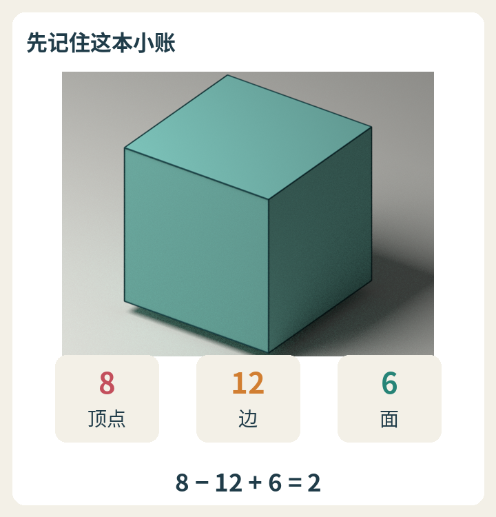

这个“点数减边数再加面数”的结果，称为**欧拉示性数**，常用希腊字母χ表示。看到χ时，把它读作“这本账算出的那个数”就可以继续往下走。

先别把“等于2”当成所有模型的规定。我们只证明了这只方盒算出来是2。标题里的开口盒、方环已经在提醒我们，等号右边可能改变。

真正需要追问的是：为什么有些操作会改变V、E、F，却不改变它们合起来的结果？

## 5. 给一个面加对角线，两个变化刚好抵消

拿盒子的一片四边形，在两个相对角之间加一条对角线。

这一片四边形变成两片三角形。原来的四个角都还在，没有新增顶点。

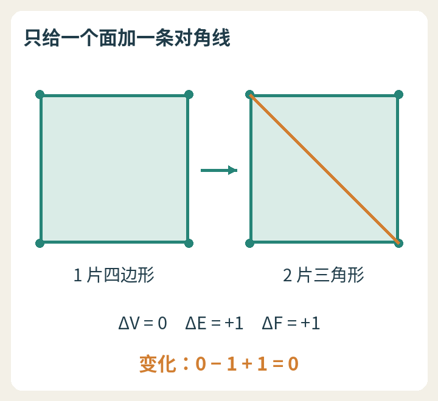

逐项写增量：

- V增加0。
- E增加1。
- F从1变2，净增加1。

所以整个账本的变化是：

`0 − 1 + 1 = 0`

原来是2，现在仍然是2。我们只是增加了一种“怎样分片”的描述，没有在表皮上撕口子，也没有打通隧道。

以后看到公式里的Δ，不必紧张，它只是“变化量”的简写。例如ΔE=1，就是边数多了一条。

## 6. 在一条边中间插入新点，又会怎样？

原来一条边连接A和B，现在在中间加点C，把AB改成AC与CB。

别把这个操作理解成给盒子多贴一根线。原来的那条AB被替换了，所以是从1条边变成2条，净增加1条。

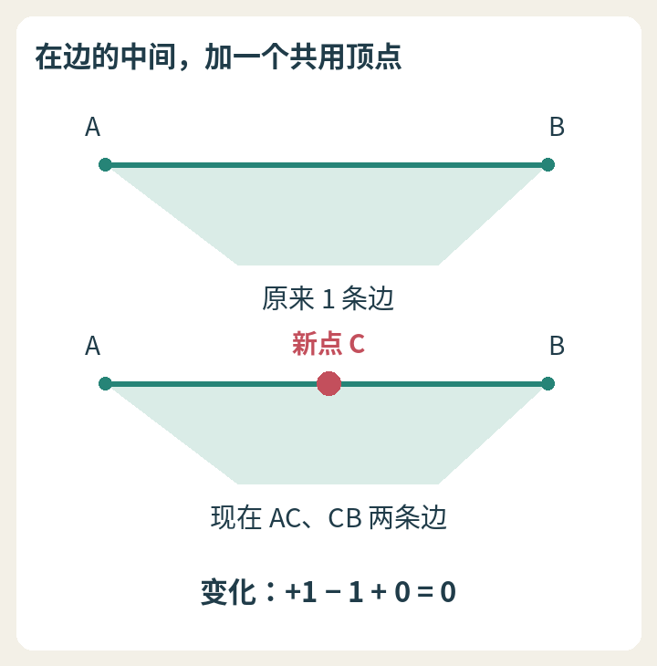

- 顶点增加1。
- 边增加1。
- 面数不变。相邻面只是边界上多经过一个点。

账本变化：`1 − 1 + 0 = 0`。

如果这条边原本由两个面共用，两个面必须一起改用同一个新点C。只给其中一面加一个自己的C，另一面完全不更新，就没有完成同一个“共边细分”操作。模型可能看着没裂，数据结构却已经不一致了。

这个提醒，在制作和导入游戏模型时比公式本身还实用。

## 7. 在一个面中央加点，千万别把“新面数”当“净增面数”

再试一次：给四边形中央添一个点，然后把它连到四个角。

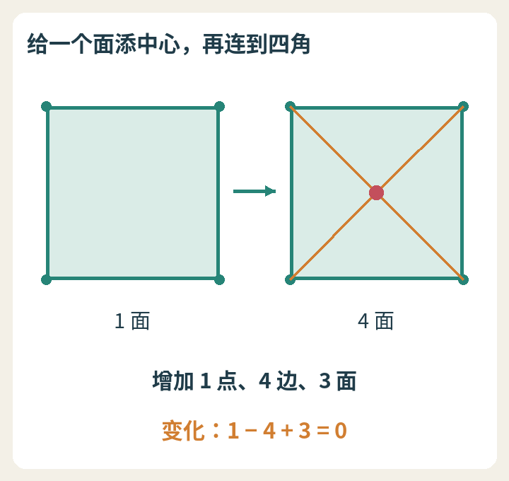

这次增加1个点、4条辐射状的边。现在共有4个三角形，但原来的1片四边形已经被替换，所以面数净增3，不是4。

于是：

`1 − 4 + 3 = 0`

账本仍然不变。

你现在已经掌握了一个很重要的数学工作方式：遇到复杂操作，先别盯着操作后的总数发愁，而是追踪“哪些东西真的新增、哪些东西被替换、哪些东西仍然共用”。

这里的零，不是巧合相撞。每个合法分片动作，都在另一项里付出了对应的变化。

## 8. 真正把方盒切碎，程序也给出相同答案

下面三只盒子来自实际生成的网格。第一只每个面是一片四边形；第二只把每条原边分成2段；第三只分成4段。

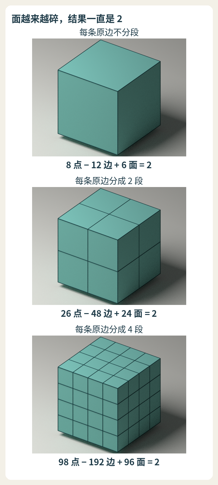

三份账分别是：

- 8−12+6=2。
- 26−48+24=2。
- 98−192+96=2。

为什么第二只不是六个面各自9点，总共54点？因为相邻面的边和角要共用。把每个面的顶点独立相加，就把同一个位置的连接关系重复记了。

附带程序按共享坐标构造这些规则方盒时，会把应当共用的点分配为同一个ID。这个生成步骤针对的是本篇精确规则网格，并不意味着任意导入模型都能靠“坐标看着接近”无脑合并。

这组实际输出，是前面局部记账的检验，不是用几个例子代替所有情形的证明。

## 9. 把盒子揉圆，为什么不需要重新算一遍？

给细分盒子的每个顶点换一个位置，把它们推到同一个球面上；面仍然连接原来的那些顶点ID。

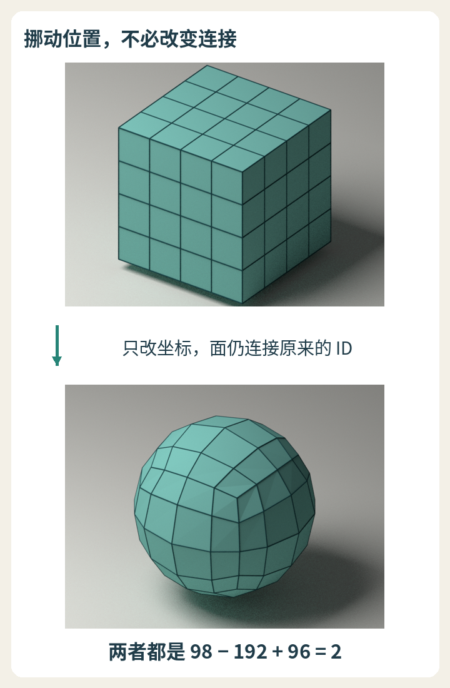

V、E、F都没变，因此χ当然没变。图中圆壳仍是有限多边形组成的近似，并不是数学上的光滑球面。

这说明：这本账主要关心**怎样连接**，不是“看起来有多圆”。

研究拉伸、弯曲时哪些连接性质保持不变的数学，叫拓扑学。直观上，可以想象用柔软但不能撕裂、不能随意粘接的材料改变外形。

不过，“任意移动顶点都安全”是错误的。你可以把面挤扁，也可能让两片面穿过彼此。只数ID的账本依旧不变，几何外观却可能坏掉。我们会在最后把这个能力边界说清楚。

## 10. 一模一样的外观，也可能不是同一张网

现在看另一只盒子。乍看和前面的完整方盒没有区别。但它其实是六片独立方形，只是恰好摆在一起。

为了看清，把每片面沿自己的方向稍微移开。

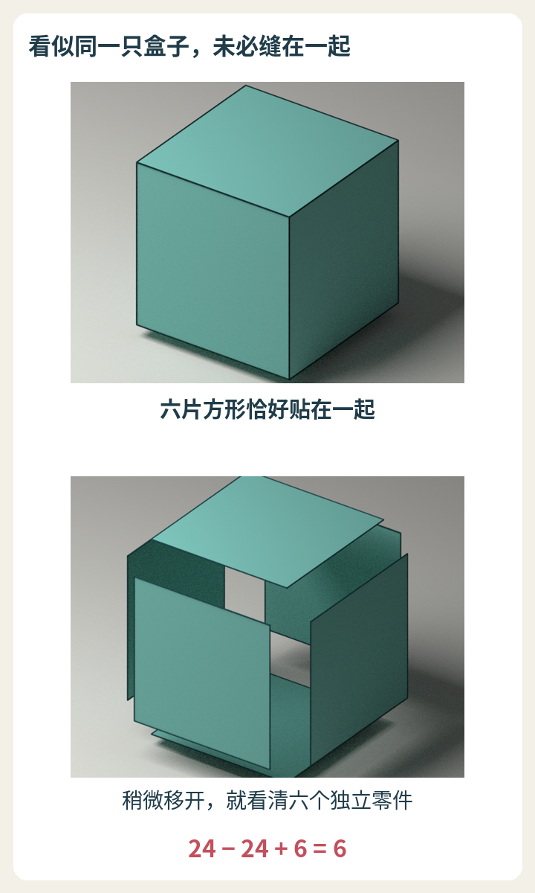

每片方形各有4个顶点、4条边、1个面。六片互不共享，因此：

`V = 6×4 = 24`

`E = 6×4 = 24`

`F = 6`

所以χ=24−24+6=6。

这是在计算**按ID连接的网格**。若另行把空间中重合的位置当成同一个点，相当于你又做了一次粘接，研究对象已经变了。

游戏模型可能为了材质、法线或其他用途保留分开的数据。这里并不是说“分开的点一律错误”，而是说：先确定你想检查的是哪一层连接，再解释统计结果。别拿一张渲染图替数据结构作证。

## 11. 取下顶盖，为什么只少一个面？

回到那只真正缝起来的方盒。只删除顶面，保留四个侧面和底面。

顶盖四个角仍然被侧面使用，顶盖四条边也仍然是侧面的上沿。因此不能把顶面、它的四条边、四个点一起从账里抹掉。

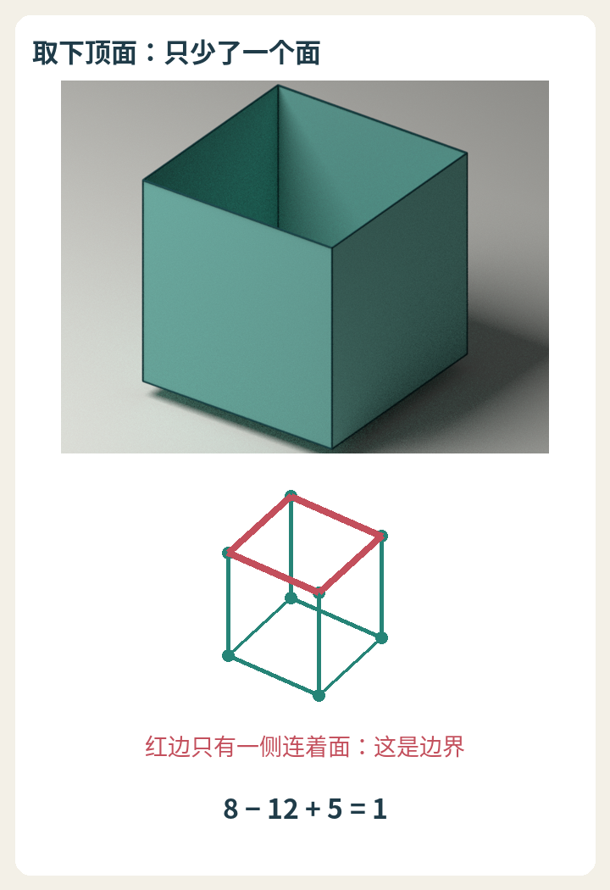

新的计数是8点、12边、5面，χ=1。

这时出现了一圈**边界**：上沿那些边只有一侧连接着面，另一侧是开口。这里“边界”是表面本身的裸露边缘，不是照片里物体的轮廓线。

一只封闭盒子在图片里当然也有轮廓，但沿着那些轮廓边翻到背面，仍然能找到相邻面。它没有这种裸露边界。

“删面却保留共享边点”，就是这次从2变1的全部原因。

## 12. 我们一直在数表皮，不是在数里面的实心空间

真实木箱有厚度，箱板里面有材料，盒子里面还装得下空气。本文把它简化为一张没有厚度的表面。

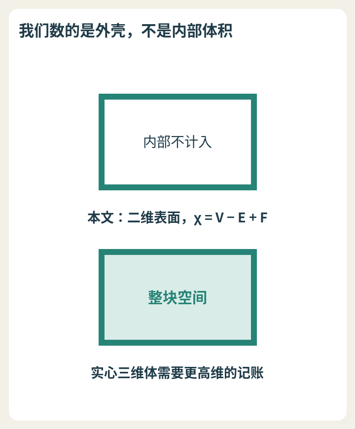

为什么要特意说这一句？因为“一个立方体”既可能指外面的六片面，也可能指连同内部一起的一整块三维体。这两个数学对象不是同一个东西。

我们使用V−E+F，是在给由点、边、面组成的二维表面记账。若把内部也作为三维单元加入，还要增加对应的高维项，不能继续把这条短公式原样搬过去。

因此，后文说“球面型”，指像一个完整气球的**表皮**；不是把球里所有空气也算进来。

## 13. 球面型表面为什么总会遇见这个2？

现在补一个可以看懂的证明思路。对象是一张连通、没有洞口、没有把手、局部正常的球面型网格，面分割也都合规。

把它想象成画在气球上的线条。选一片面，把这片区域看成画面外侧，其余网格就能画成一张没有交叉的平面图。边可以弯，长度可以变，但谁连着谁不变。

方盒对应的平面图，可以画成两个方框加四条连接线：

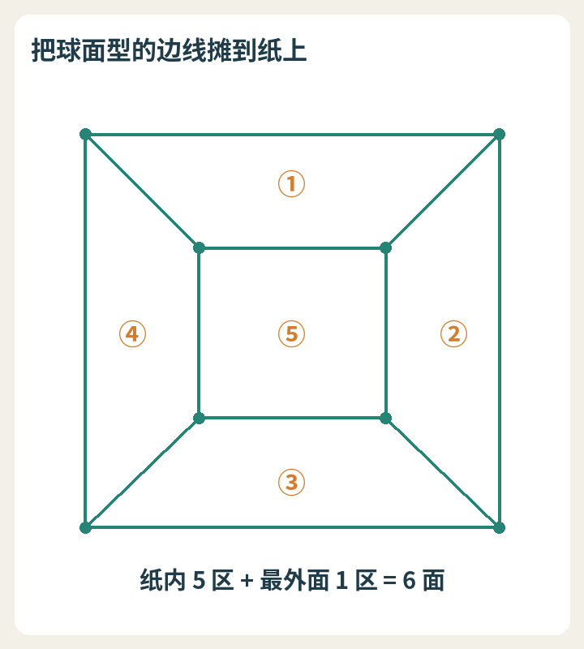

图里有五个有边框围着的内部区域。第六个面在哪里？就是最外面那一大片区域。

没有把第六面删掉，只是换了表示方式。**平面图里数面，要把外部区域也记进去。**

下面先只数内部区域，把这个数叫R。我们将证明V−E+R=1。最后把外部区域补回去，就得到2。

## 14. 先把环上的边，一条条删掉

图中若有一条绕圈的路线，叫一个环。例如四边形的边框就是一个环。

从环上删去一条边时，这条边两端仍可沿环的其他部分绕到彼此，因此图不会被拆成两块。同时，原来被这条边分开的两个区域会连成一个。

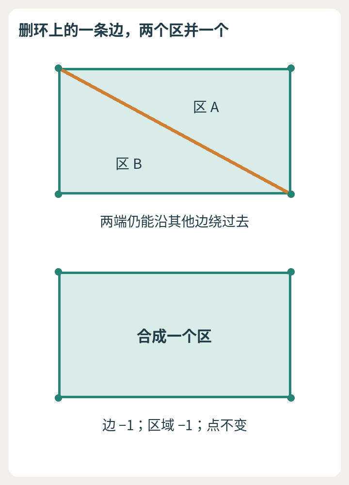

- 顶点数不变。
- 边数少1。
- 内部区域数少1。

V−E+R的变化是`0−(−1)+(−1)=0`，仍然没有变。

不断这样删，直到再也没有环。留下的是一张仍然连通、却没有绕圈路线的线网。这样的图叫树。这里的“树”不必画得像植物，只要满足这两个连接条件就行。

注意不能随意删任何一条边。某条边若是两部分之间唯一的连接，删掉就会把图拆开，刚才的步骤便不适用。我们特意选择环上的边，就是为了避开这一点。

## 15. 树为什么留下1？剪到最后看一眼

一棵有限的树，如果不止一个点，总能找到一个只连着一条边的末梢。

删掉这个末梢和它连接的那条边，点数与边数各少1，V−E不变。继续剪，最后只剩一个点、零条边。

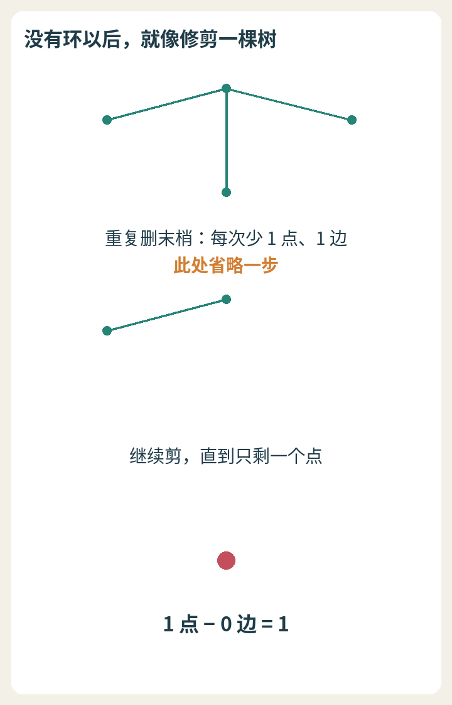

最后的结果是1−0=1，所以原来的树也满足V−E=1。

树没有内部封闭区域，R=0。前面删环边的过程中，V−E+R又一直没变，因此最初的平面图满足：

`V − E + R = 1`

再把一直没有算进R的那个外部区域补上：

`F = R + 1`

于是：`V − E + F = 2`。

这个证明针对能够这样画成平面图的球面型网格。不能把环面硬摊到纸上、忽略切口粘接规则，然后声称也证明它等于2。

## 16. 真正穿透一条隧道，2就不在了

来看这只方形环。它不是删掉一块顶盖的开口盒，而是有内壁、有外壁、上下面也相接的一张完整表皮。

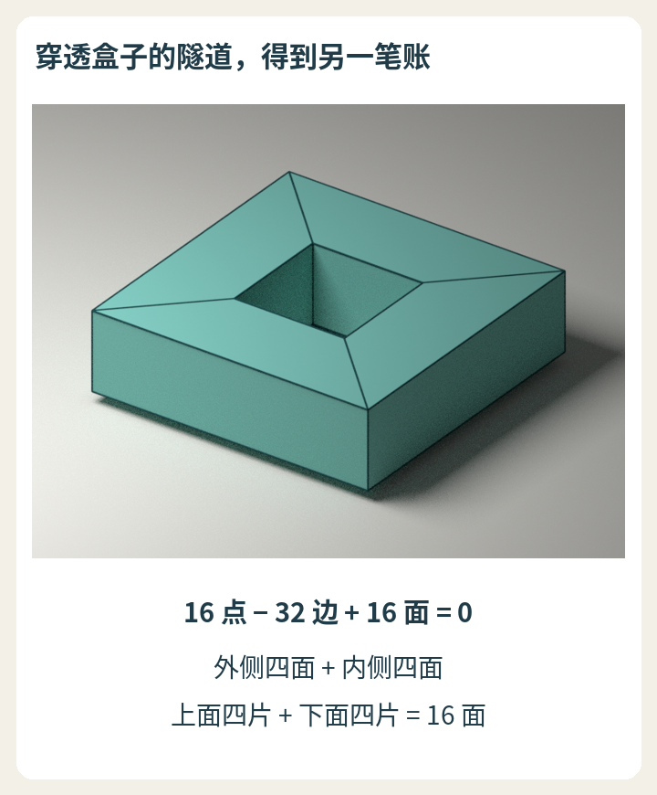

可以直接数面：外侧4片、内侧4片，上面围着孔的4片，下面再4片，总共16片。

上下两层，各有外圈4点、内圈4点，所以一共16点。边可分成上下两层各12条，再加8条竖边，共32条。

因此：

`16 − 32 + 16 = 0`

上面围着孔的区域为什么要分成4片？因为完整的“带洞方框”不符合前面普通单片面的约定。若把它强算成一片，却又继续使用同一套V−E+F计数，就混淆了面结构。

更重要的是，这张表面没有裸露边界。看起来能从中间穿过去，不表示它是一张有破口的皮。

## 17. 方形的环，与圆圆的环面

把环做圆，得到常见的甜甜圈形状。这里仍然只研究外面的皮，不研究里面的糕点体积。

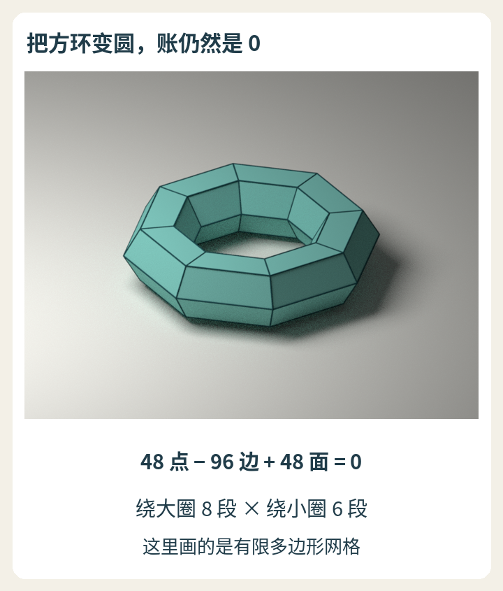

本文生成的环面沿大圈分8段，沿小圈分6段。于是：

- 每个格点由两种位置共同确定，顶点有8×6=48个。
- 每个格点向两个网格方向各对应一条唯一边，共2×48=96条。
- 四边形格子有8×6=48片。

48−96+48=0，和方形环相同。

这里的“8段”和“6段”是网格分辨率，不是环面有八个孔或六个把手。分得更细，只会改变描述密度，不会凭空增加一条隧道。

## 18. 先卷成圆筒，再把两端接起来

环面的计数最容易在接缝处漏账。换一种表示，把它想象成一张8列、6行的矩形格子纸。

平摊时有9×7=63个点。横向边8×7=56条，纵向边9×6=54条，共110条。面有48片，所以χ=63−110+48=1。

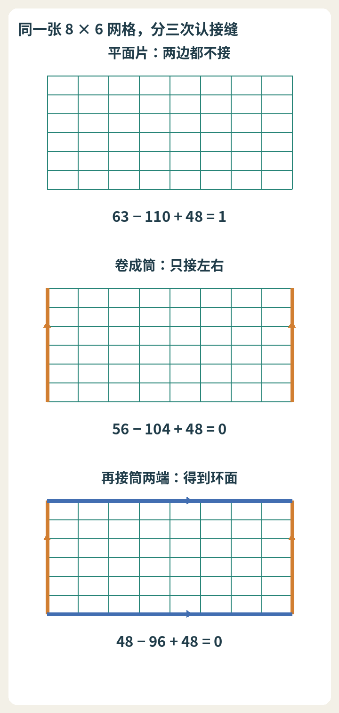

第一步，把左右两边对应粘接，形成圆筒侧面。

原本左右各自记录的7个边界点，两两认作同一点，顶点减少7。左右各自的6条边，两两认作同一条，边减少6。面不变。

得到56点、104边、48面，χ=0。

第二步，再把圆筒两端对应接起来。

每端一圈有8个点、8条边。成对粘接后，点数减8，边数也减8，得到48点、96边、48面，χ仍是0。

这个过程解释了一件容易误会的事：不是每次“粘一下”都固定改变同一个数。要具体追踪被认同的点和边。

## 19. 图上画了四个角，数据里可能只有一个

把接成环面的矩形重新画平，四个角看起来分得很开。但按刚才的两组粘接，它们最终都代表同一个点。

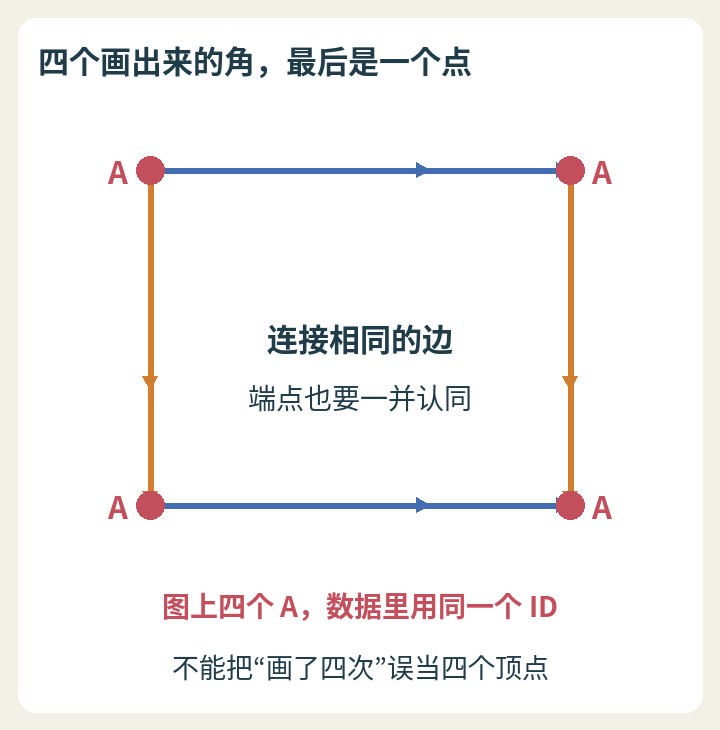

这张图里的箭头规定对应方式：左右两边沿同一上下方向对应，上下两边沿同一左右方向对应。这里没有加扭转。

如果把接缝两侧的点都保留为不同ID，却只把它们摆到相同位置，得到的就是“看起来接上”的网格，和真正共享ID的环面不是同一本账。

因此，模型导入时出现重复顶点、拆开的面，或者有意保留的接缝，都可能影响按原始ID计算出的χ。统计前先明确是否需要建立一份用于拓扑检查的共享连接表示。

不能因为视觉上没漏光，就断言所有连接一定正确。

## 20. “有个洞”太含糊，先问是哪一种

现在可以把开篇的两个变化分开了。

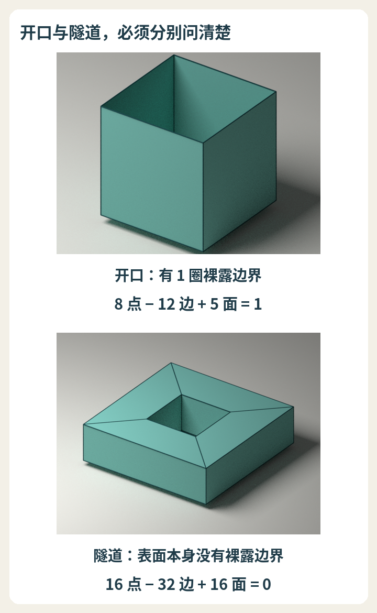

第一种：在皮上拿掉一小片，留下一圈裸露边缘。开口盒就是这样，从2变1。

第二种：做出一条贯穿通道，通道内壁仍与外面的皮连续连接。方形环属于这种，没有裸露边缘，从2变0。

在讨论封闭、可定向的表面时，后一种独立通道通常用“把手”来计数。你可以想象给气球表皮接上一段弯管，形成一只可以穿绳子的把手。

不要只说“这个模型一个洞，所以χ等于多少”。至少还要说清楚：它是开口边界，还是一个把手？表面是不是连成一片？

## 21. 再多一个把手，实算会得到负数

下面这份原创网格真的有两条贯穿通道。它是从一片5×3方格板中留出两个分离的内部空格，再加上上下表面和所有侧壁构造的。

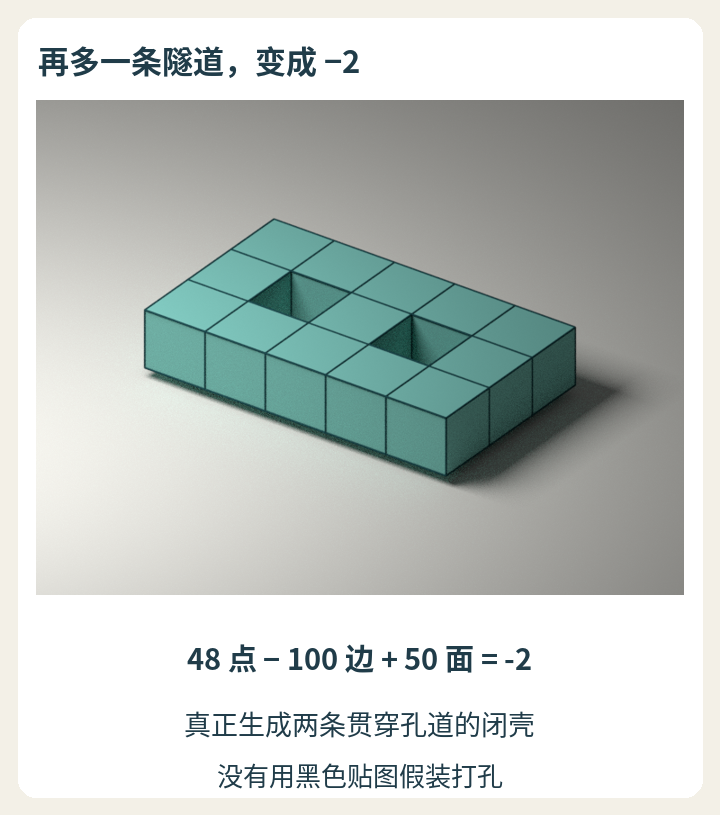

程序实际得到48个顶点、100条边、50个面：

`48 − 100 + 50 = −2`

负数不表示点数错误，也不表示模型“不存在”。它只是说明这本账不是长度、面积或物体数量，完全可以小于零。

从没有把手的球面型外壳，到一个把手的环面，再到两个把手，依次出现2、0、−2。

对于满足条件的表面，这个模式会继续下去。但现在还差一句非常重要的“满足什么条件”。

## 22. 一条更一般的公式，要带着使用说明一起出现

对**紧致、连通、可定向的二维表面**，若有g个把手、b圈边界，欧拉示性数是：

`χ = 2 − 2g − b`

先逐个拆开那些词：

- 连通：整张皮能沿着自身从一处走到另一处，不是几块散开的零件。
- 表面局部正常：内部一点附近像一张小圆片，边界一点附近像半张小圆片。不能在同一条边岔成三张皮，也不能把两张壳只捏在一点上。
- 可定向：可以为整张表面一致地选择一侧。对本文正常的盒子外壳和环面，可以一直认定哪边朝外。
- 紧致：本篇的有限、封口或带完整边界的模型属于这一类；无限延伸的平面等对象不在这里直接套用。

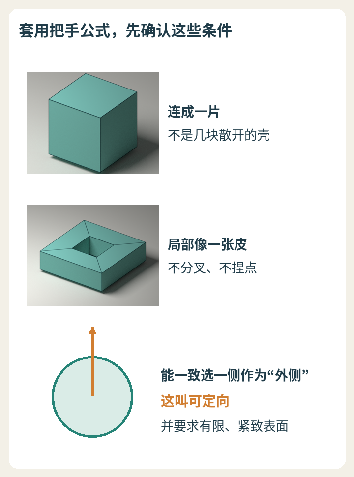

这是一条表面拓扑的推广定理，不是“观察三张图片就证明所有情形”。本文前面完整拆解了球面型的2；一般表面公式与定向的进一步说明，可见[斯坦福CS164拓扑讲义，PDF第52—57页](https://graphics.stanford.edu/courses/cs164-10-spring/Protected/10cs164-05-17.pdf)。

直观理解：从球面型出发，每增加一个把手，减2；每拿掉一片互不重叠的圆片、留一个新边界圈，减1。前提是这些动作确实产生所描述的正常表面，而不是任意删除若干三角形。

## 23. 一圈边界，不等于一条边

开口盒的上沿由四条边组成，但它们连成的是**一圈**边界，所以b=1，不是4。

圆筒侧面则有上下一共两圈边界。每圈可以被分成很多短边，b仍然是2。

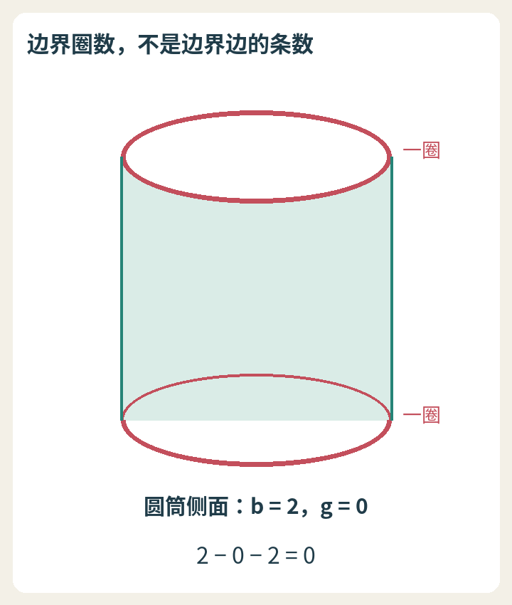

圆筒侧面没有把手，g=0；有两圈边界，b=2，因此χ=2−0−2=0。它与第18节“只接左右”的网格账一致。

这个例子也可以防止另一种混淆：圆筒中间能穿过去，但它作为一张有两个开口的侧面，不等同于一个没有边界的甜甜圈表皮。日常语言里的“能穿过去”，不足以决定g和b。

先辨认对象，再代数字，公式就不会变成猜谜。

## 24. 两只不相连的盒子，为什么不是2？

如果场景里放两只互不连接的完整盒子，全部点、边、面数量都加倍。

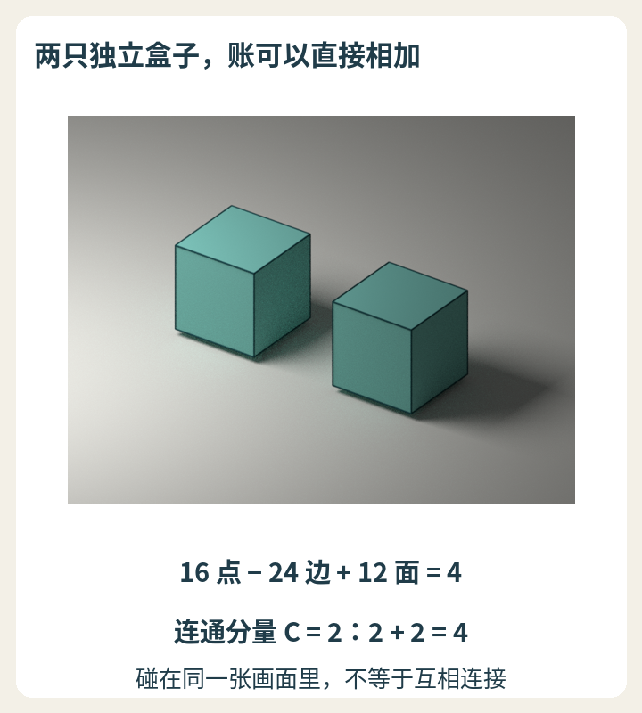

16−24+12=4，而不是2。

这是因为它们有两个**连通分量**：各自是一张完整的皮，但彼此之间没有路径。

对这种互不相交的数据集合，账可以逐个算再相加。每只盒子贡献2，两只就是4。若有C个正常可定向表面，所有把手总数为G，所有边界圈总数为B，那么把各分量公式相加，就得到`χ=2C−2G−B`。

这里的加法要求分量确实分开。若两个壳共用一个点，那不是两份完全独立的数据；下面正好来看这个反例。

## 25. 三张面挤在同一条边上，哪里不对？

正常封闭网格的一条边旁，应该接两片面，一片在这边，一片在那边。边界边旁只有一片。

现在故意造三片三角形，让它们共用同一条边。

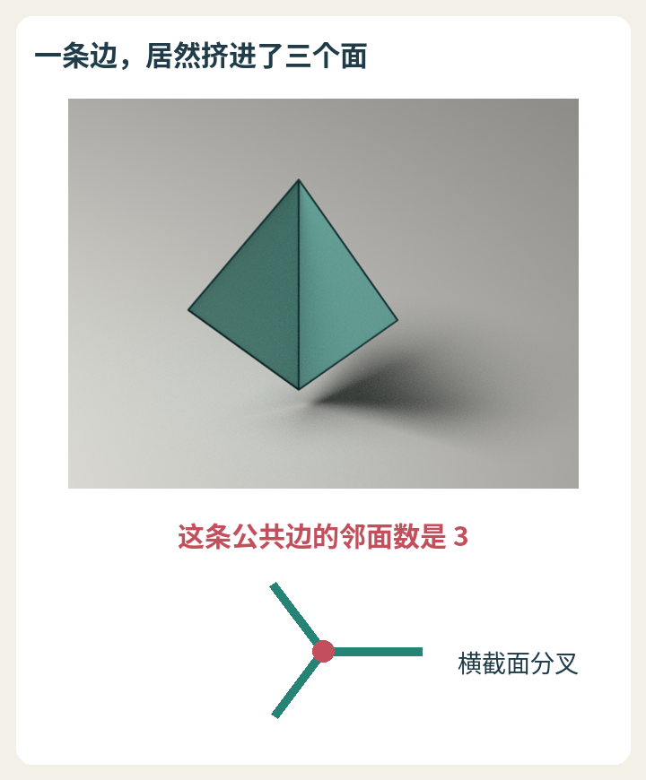

斜视渲染中有一片被另外两片遮住；下方横截面把三条分支都展开了。从这条边中间切一刀看横截面，会看到三条分叉。它不像一张可以摊开的小纸片，而像三张纸沿同一条折痕粘在一起。

这种局部结构不符合普通二维表面的条件，常称为非流形结构。先记住可见问题，再记术语就够了。

你仍然能机械地算出V−E+F，但不能把结果直接塞入刚才的表面公式，反推出一个所谓把手数。公式的输入条件已经被破坏了。

数值能算出来，与数值具有你想要的解释，是两回事。

## 26. 每条边都连两片面，也还不够

再造一个更隐蔽的模型：两只四面体，各自封闭，只把一个顶点认成同一个ID。

四面体，就是四片三角形围成的小尖锥。它的每条边依旧连接两片面。单查“每条边的邻面数是否等于2”，这份模型会过关。

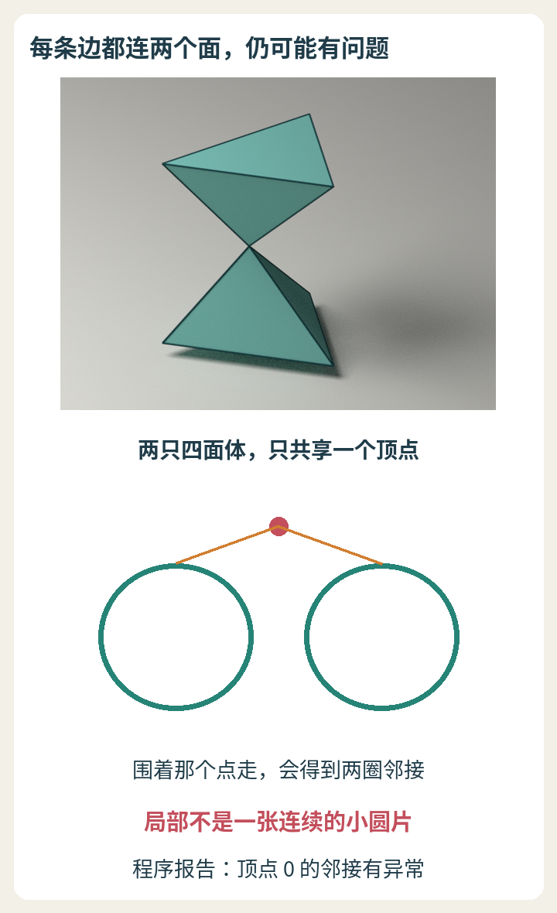

问题出在共用的那个点。围着它稍微绕一圈，你会遇到属于上面壳的一圈邻接，和属于下面壳的另一圈邻接。两圈只在中心那个点被捏在一起，附近并不是一张小圆片。

附带程序因此不仅数边旁边的面，还检查每个顶点周围的邻接是否连成一个正常的圈或边界路径。这个反例实际有7点、12边、8面，χ=3；顶点0被报告为异常。

这不是完整工业网格修复器，只是让“条件要检查”落实为一个可以复算的例子。

## 27. 同一个χ，不能担保一模一样

环面χ=0。圆筒侧面也χ=0。它们一样吗？当然不一样：前者没有边界，后者有两圈边界。

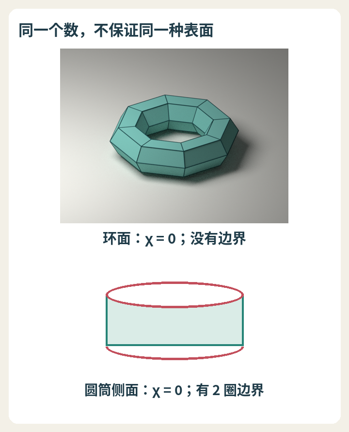

甚至“χ=2”也不能脱离条件使用。例如一张球面型外壳，再放一张与它分开的环面，合计2+0=2，却并不是单独一张球面。

在特定类别里，χ连同边界数、定向等信息可以帮助分类。脱离类别，它只是一个很有用、却并不包办一切的特征。

“不同的χ，说明不能只靠正常拉伸把它们当成同一张表面”，与“相同的χ，保证是同一对象”，不是同一句话。前一句在相应的拓扑条件下成立，后一句需要额外条件。

这也是许多算法特征的共同边界：一个数能排除不少错误，未必能证明所有正确。

## 28. 欧拉不是在给游戏模型写检查器

我们今天把这本账放进程序，是后来的应用视角。欧拉研究的是多面体的几何关系。

下面是史密森图书馆收藏的一幅真实版画数字图，题为欧拉像。保留了扫描时的色卡和底部刊印文字，不能把它当成照片。

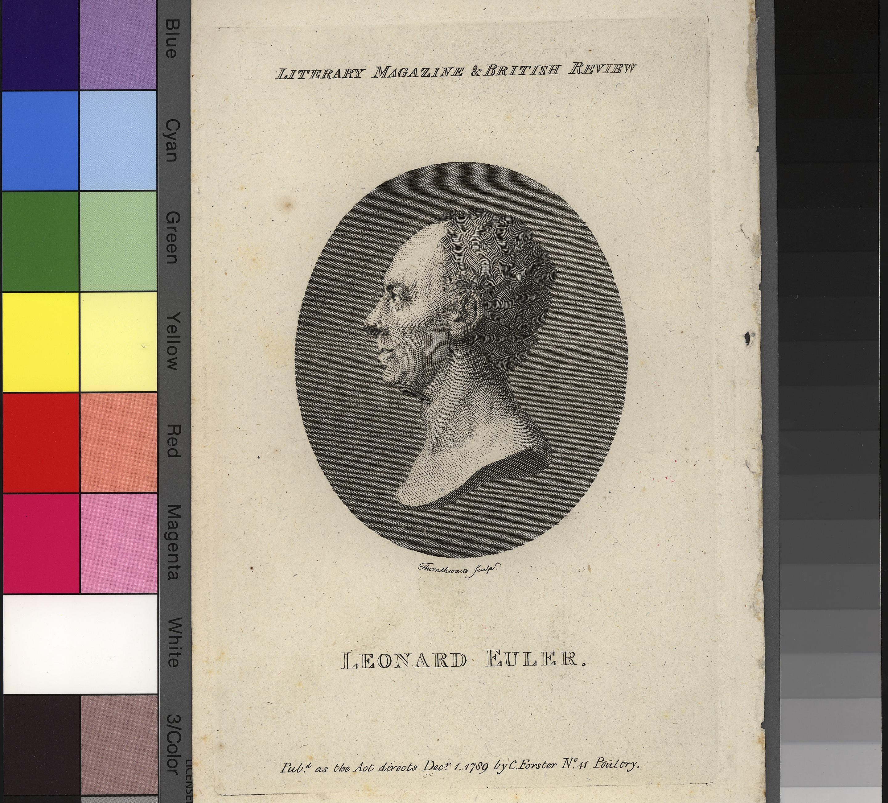

图像来源：[Smithsonian Libraries and Archives，SIL-SIL14-E2-07](https://library.si.edu/image-gallery/73170)。馆藏标注“No Copyright – United States”；本库不把它另行标成原创或CC BY。图中底部可辨认1789年12月1日的刊印信息。

欧拉相关论文《Elementa doctrinae solidorum》在Euler Archive的编号是E230。馆藏目录记录写作年1750、发表年1758，刊于《新评论》第4卷109—140页。写成、出版和后来的肖像刊印，显然是三件事。[馆藏记录](https://scholarlycommons.pacific.edu/euler-works/230/)

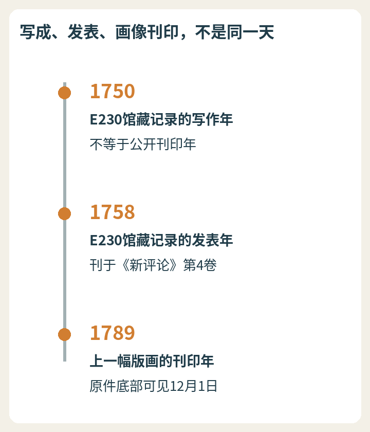

资料也要做“账本检查”。该馆藏网页的英文摘要把一个正负关系写反了；拿我们已经数清的立方体代入，就能发现不对。因此本文不照抄那句摘要，也不把未取得的原论文全文说成已经逐页核读。

历史材料值得尊重，但可核的数学例子同样值得坚持。引用来源并不等于停止思考。

## 29. 十来行核心代码，怎样把小账自动算出来？

现在才来看代码。因为你已经知道它应该做什么，而不是把符号当成魔法。

每个面保存一圈顶点ID；沿这一圈依次读相邻两个点，最后一个点还要连回第一个。再把端点排序，放入集合。集合会自动去掉重复记录。

```python
edges = set()
for face in faces:
    following = face[1:] + face[:1]
    for a, b in zip(face, following):
        edges.add(tuple(sorted((a, b))))

V = len(vertices)
E = len(edges)
F = len(faces)
chi = V - E + F
```

这里`len`是数条目；`zip`让当前点与下一个点一一配对；`set`是只保留不同条目的集合。代码假设面已经是有效、不重复列同一点的普通多边形，并且没有另存而未列入面的孤立线段。

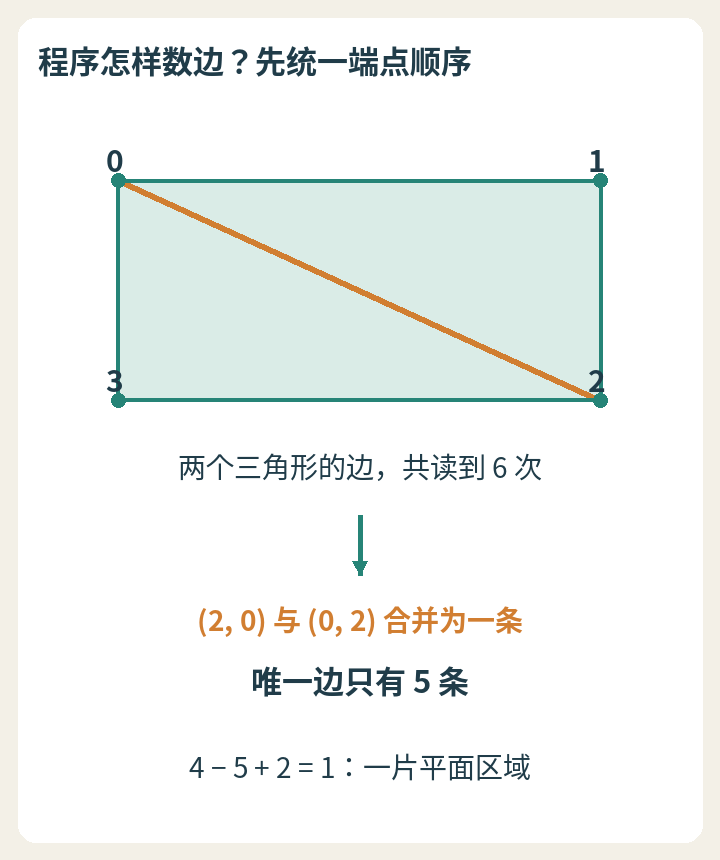

随文的[mesh_lab.py](examples/mesh_lab.py)还包含模型生成、边界统计与局部邻接检查。它实际验证了8种方盒细分、100种环面分段组合、150次固定种子的随机合法细分，以及各个专门反例和三阶段接缝计数，共271项检查。完整结果见[results.json](examples/results.json)。

这里说的是代码实际运行的范围，不是已经验证所有可能的模型。若需要原始网格，[meshes.json](examples/meshes.json)保留了16个模型的全部顶点和面。

## 30. 把它带回游戏建模，应该用在检查流程的哪一站？

假设你要的是一只正常封闭、没有把手的箱子外壳。模型出来后，别只问“χ是不是2”。更可靠的顺序是：

1. 先确认数据层：顶点ID是否按照预期共享，是否存在分开的零件。
2. 检查边旁边有几片面；是否出现意外边界、三面共边。
3. 检查顶点附近是不是一张正常的局部表面。
4. 在这些条件和模型目标明确后，再用χ与预期交叉核对。
5. 另查几何问题：面是否退化、自交、重叠，方向与形状是否符合用途。

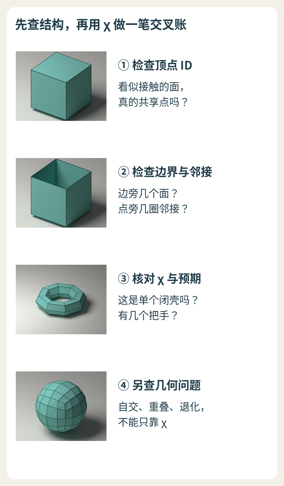

为什么最后还需要几何检查？因为只要ID连接表没有变，即使你把一个顶点挪到错误位置，让表面穿进自己，V、E、F也不会自动报警。

χ很像一道便宜而有解释力的交叉账，不是最终验收章。它的长处是把“我觉得连接不对”变成几个可以追踪的整数变化。

可选地运行本文脚本，就能得到同样的计数。Blender渲染命令、版本、原始输出和已知限制写在[示例说明](examples/README.md)；不运行也不影响前面的推理。

## 31. 收尾前，留一道不用电脑的题

原来的方盒有六片四边形。现在给每一片都加一条对角线，把它完全改成三角网格。

先自己算三件事：顶点变了吗？一共多几条边？面数从多少变成多少？

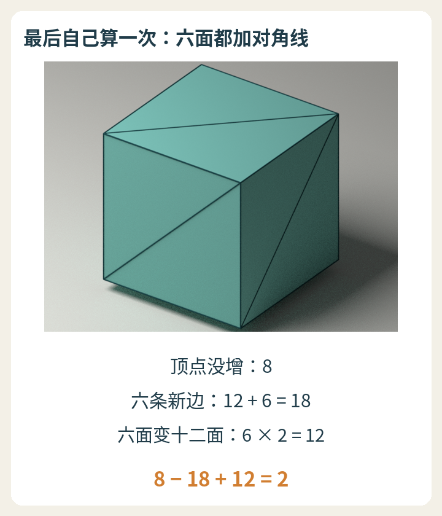

答案是8点、18边、12面。因为没有新增角，每面新增一条对角线，共6条；六片四边形各拆成两片，所以有12片三角形。

8−18+12仍然是2。

再回头看最初的三张图，你现在应该不需要背诵答案了：

- 只是细分，变化在点、边、面之间互相抵消。
- 取下一片仍由其他面共用边点的盖子，只少一个面，得到1。
- 真正增加一条把手式通道，连接类型变了，闭环表皮得到0。

欧拉示性数有趣的地方，正是它把复杂外观暂时放到一边，问了一个朴素的问题：**这些部分，到底怎样连成一件东西？**

---

原创正文采用[CC BY 4.0](https://creativecommons.org/licenses/by/4.0/)。原创程序采用MIT许可；原创模型、图解与渲染按素材清单说明。历史版画保留馆藏权利标注，不受正文许可覆盖。完整事实出处、图像身份和权利见[来源与素材说明](sources.md)。
