# 旋钮只走一格，读数为什么跳了四格？Gray 码给现实留出的余地

把一个旋钮从第3格慢慢转到第4格。

正常期待是：屏幕先显示3，再显示4。可如果你把变化过程放慢，屏幕可能短暂冒出7，接着是5，最后才落在4。

轴没有瞬移，计算机也没有算错加法。问题发生在更早的一步：三个传感器各自说的都可能是真的，可它们说的并不是同一个时刻的真话。

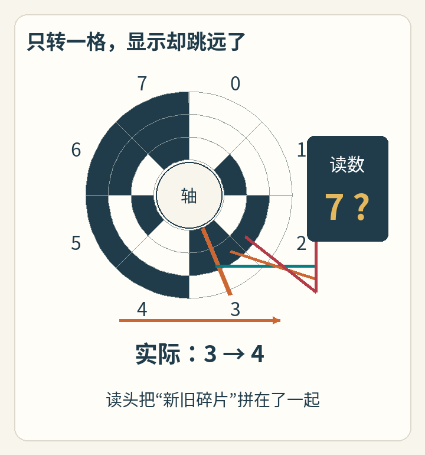

这篇要讲的 **Gray 码，也叫格雷码**，解决这个问题的方式很有意思：它不先要求传感器变得绝对整齐，而是重新安排每个位置的标签，让不整齐更难造成离谱的结果。

我们从八格纸盘开始。你会亲手排出全部标签，算一次编码与解码，看到历史专利里的真实图纸，再用可以运行的小实验检查它究竟保证了什么。没有学过数字电路也没关系；需要的二进制与异或，会在用到时解释。

## 1. 一个旋转角度，怎样变成三个数字？

机器不能直接“看见第几格”。它需要某种物理标记。

想象轴上固定着一张圆盘，盘上有三圈轨道。每圈在不同角度有透光区和遮光区。圆盘一侧是光源，另一侧是三个读头，每个读头只看一圈。暂且规定：透光记1，遮光记0。

三个读头就能给出三位，例如011。这类把位置变成电信号的装置叫**编码器**；如果各个位置的标签不同，就可以通过当前标签直接辨认位置。这是绝对式位置编码的基本想法。真实编码器也有反射光学、磁、电容等实现，下面只用一个理想的透射模型帮助理解，不把所有产品都画成同一种结构。[1][2]

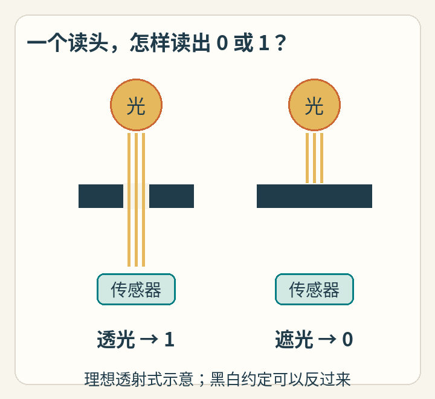

先不管圆盘。把三圈展开成三条横纸带，每格写一个三位标签。

三位二进制从左到右的权重是4、2、1。某一位是1，就把它的权重加进来；是0，就不加。因此：

- 001代表1。
- 010代表2。
- 011代表2+1，也就是3。
- 100代表4。

三位共有2×2×2=8种组合，恰好可以标记第0格到第7格。为什么从0开始？只是为了让编号和二进制自然对应，不会少掉任何一格。

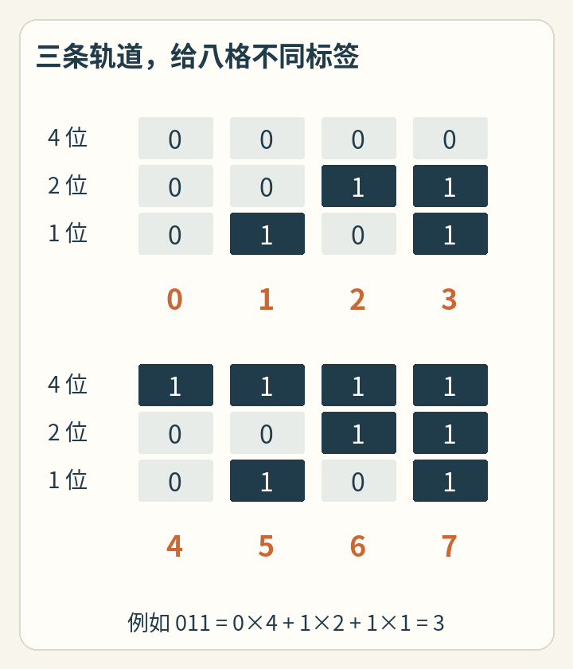

纸带向前移动，三个读头从上到下读三位。把纸带绕回轴上，就能得到一个八格码盘。**“三圈”负责三位，“八个扇区”负责八个位置**，不要把它们混为一谈。

## 2. 麻烦藏在 011 → 100 的那一瞬间

第3格的标签是011，第4格的标签是100。

跨过这条边界时，高位必须从0变1，中位必须从1变0，低位也必须从1变0。纸上的三件事写在同一个箭头上，现实里却未必在同一个瞬间完成。

轨道边界可能略有偏差，读头安装可能不完全对齐，电子信号传播也需要时间。即使机械刻线理想，三个输出到达后级的时刻也可能有先后。这些是不同的物理原因，却会产生相似的逻辑难题：我们采到了一些旧位，又采到了一些新位。

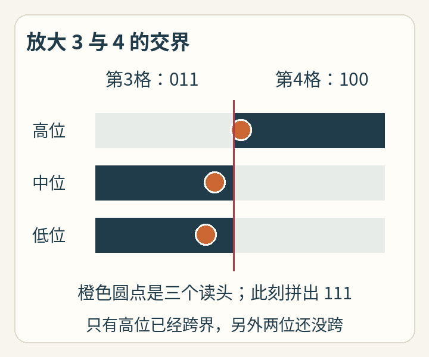

假设高位先变，接着中位变，最后低位变：

**011 → 111 → 101 → 100**

把这些标签按普通二进制读出来，就是：

**3 → 7 → 5 → 4**

每个读头都只从自己的旧值切换到了自己的新值，没有哪个必须凭空产生错误。错误来自把这些不同步的片段当成了同一个完整位置。

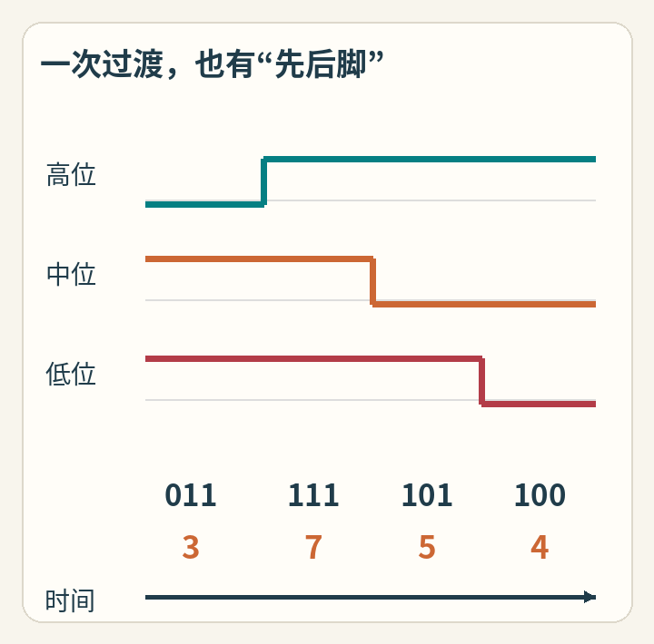

这里画的是一种可能的先后顺序，不是说所有编码器都会按这个顺序抖动。换一种先后，还可能短暂经过别的标签。

把问题放宽一点：三个变化位都可能已经变，也可能还没变。每位两种状态，最多有2³=8种组合。对011→100这个边界，这八种恰好就是000到111的全部三位串。

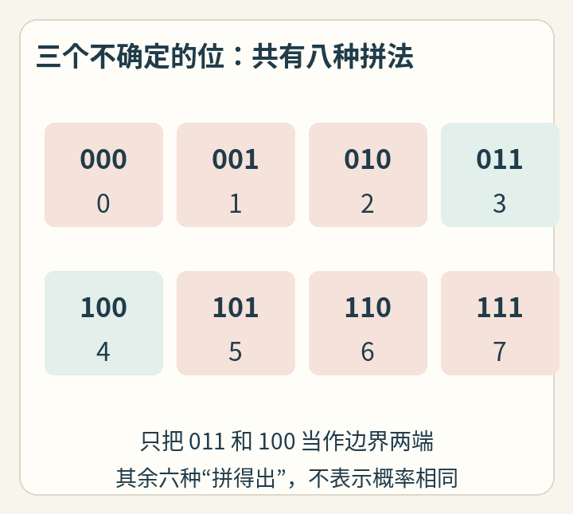

注意，这是一张**可能性清单，不是概率表**。它没有声称八种同样常见，也没有声称一次实际过渡会把八种都经过。给定一种严格先后，一次单调过渡只会走其中一条短路线。

但它已经说明一件事：仅凭“实际位置只挪了一点”，不能保证“读出的数值也只挪一点”。编码方式会放大物理上的小不整齐。

## 3. 不改位置，改每个位置的名字

现在试一个有点反直觉的想法。

为什么第3格一定要叫011，第4格一定要叫100？我们需要的是八个不同的名字，未必需要这些名字本身就是普通二进制计数顺序。

给第3格换成010，给第4格换成110。

这次过渡是：

**010 → 110**

只有最左一位改变。中间位一直是1，最低位一直是0。

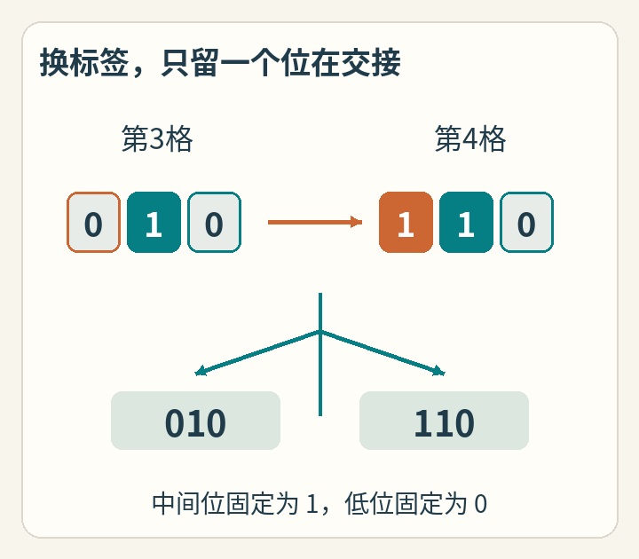

如果读头还停留在旧侧，收到010；如果已经进入新侧，收到110。只要另外两位保持正确，且这次混读只涉及这一对相邻位置，就拼不出第三种标签。

解码之后，得到的只会是第3格或者第4格。

这不是让边界变得毫无模糊。你可能稍早读到4，也可能稍晚还读到3。它让模糊**留在这条边界的两侧**，而不是被编码放大成7或者0。

我们想把这种性质推广到整张盘：每对相邻位置的标签，都只相差一位。这样的一类顺序称为Gray码。本文具体构造的是最常用的**二进制反射Gray码**；并非所有满足“相邻只变一位”的顺序都必须长得和它一样。

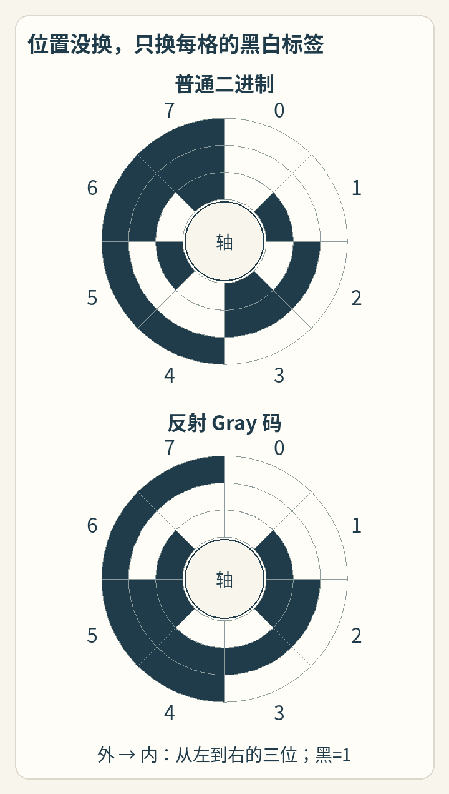

比较两个盘时，请把目光固定在同一条扇区边界上，再由外到内看三圈。普通二进制有些边界会同时改变多圈；下面的Gray码盘，每条边界都只改变一圈。最后一格回到第0格，也包含在内。

图中黑色记1，便于纸上印刷；前面的透光模型把透光记1。实际制作时可以选择透孔、反射或黑白检测。关键是编码端与读出端一致，不能把示意图的墨色直接当作器件的电平规格。

## 4. 八个好名字，不靠试出来：用镜子扩展

先只做一位。

顺序是0、1。这两项只差一位。

现在把它抄一份，但把第二份**倒过来**，得到0、1、1、0。问题是有重复，不能给四个位置取不同名字。

于是给前半份统一加前缀0，后半份统一加前缀1：

**00、01、11、10。**

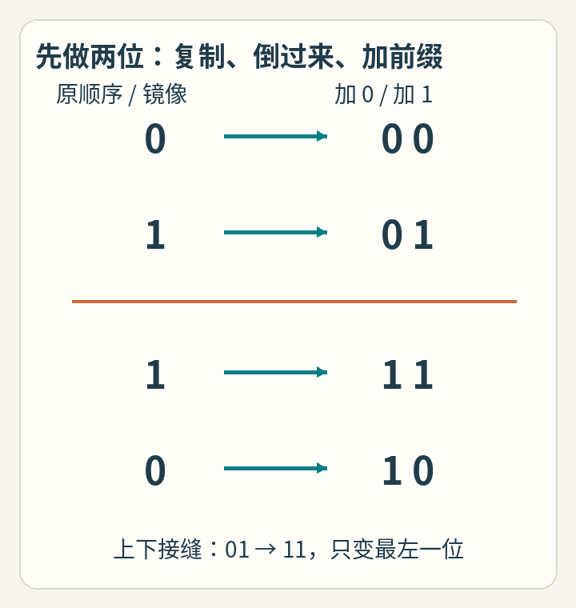

为什么第二份要倒着抄，而不是照抄？

因为我们想让上下两份的接缝特别容易处理。前半份的末尾后缀是1；倒过来的后半份开头后缀也是1。接缝于是是01→11，旧后缀完全相同，只有新增前缀改变。

如果第二份仍按原顺序，接缝会变成01→10，两位一起变，刚解决的问题就回来了。

再用同样办法，把两位扩成三位：

前半段保留旧顺序00、01、11、10，统一加0；后半段写成倒序10、11、01、00，统一加1。

结果是：

**000、001、011、010、110、111、101、100。**

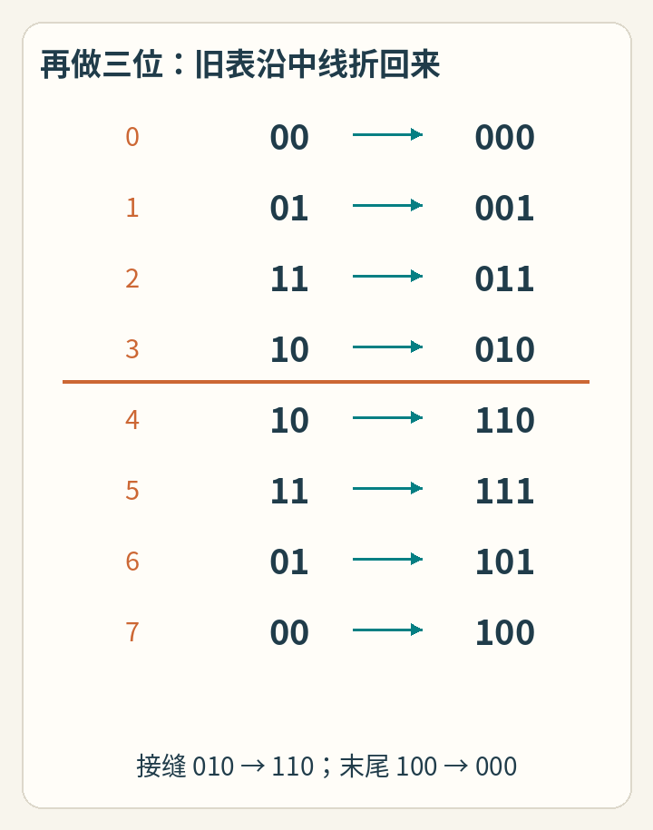

它们依次对应物理位置0、1、2、3、4、5、6、7。**101在这里是第6格的名字，不是“因为101的普通二进制值是5，所以它在第5格”。**

名字和位置之间的映射变了，这是使用Gray码必须付出的理解成本。稍后我们会把映射算回来，不必永远背一张表。

## 5. 能从三位做成四位、十位吗？

可以，但“照着画得出来”还不够，我们要知道为什么不会突然在某个接缝失败。

假设手里的旧表已经满足：每个标签不同，相邻只变一位，首尾也只变一位。反射扩展后分三处检查。

**第一处：各半段内部。**前半段只是给每项都加同一个0；后半段只是把原顺序倒过来并加同一个1。相邻的旧后缀仍只差一位，统一前缀没有添新差异。

**第二处：两半段之间的接缝。**它们接的是同一个旧末项，后缀完全相同，只差前缀0或1。

**第三处：整张表的尾巴绕回头部。**整张表的第一项是0加旧首项，最后一项是1加旧首项，也只差前缀。

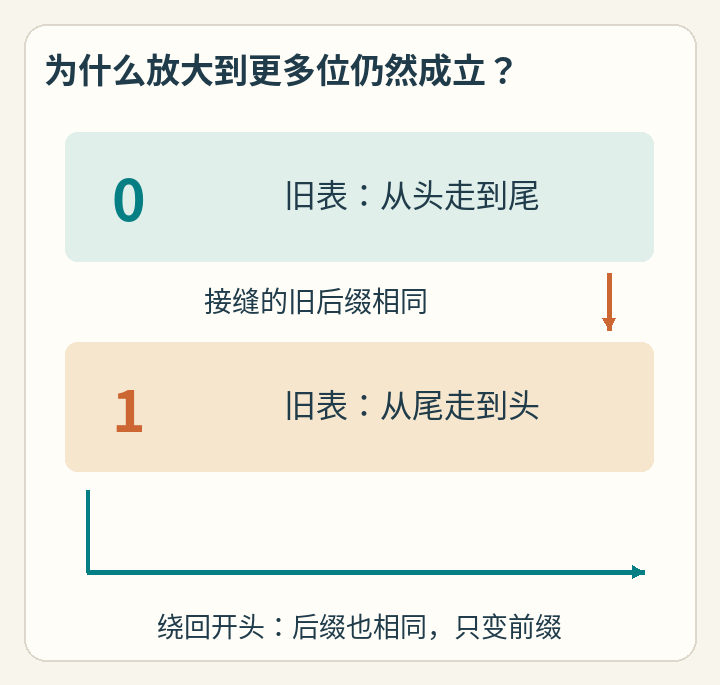

同时，前半段与后半段的前缀不同，绝不会互相重名；每个半段内部又继承旧表的不同标签。因此数量确实翻倍，不是靠重复名字凑出来。

从一位的0、1开始，就可以反复扩展。这类“先证明一个起点，再证明每次扩展都会保持性质”的推理，叫**数学归纳法**。这里它并不神秘：我们只是把每一个可能出问题的地方都检查了一遍。

还有一种看法很漂亮。把三位串放到立方体的八个角上；两串只差一位，就用一条边相连。三位反射Gray顺序恰好沿边走遍八个角，再回到起点。

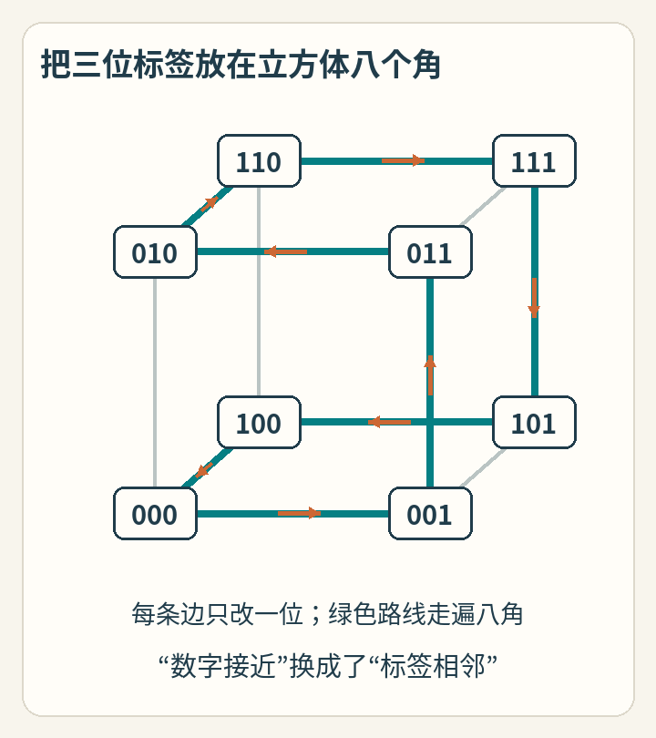

这幅图里的“近”，是**标签差几位**，不是数字差多少。000和100只差一位，所以在立方体上相邻；它们如果被当作普通二进制整数，却差4。

这个“对应位置不同的位数”还有一个名字：**Hamming距离**。Gray码要求顺序中的相邻标签距离为1。知道这个名称即可继续阅读，暂时不需要更多编码理论。

下面的动画把八次交接走完。即使关闭动画，前面的完整码表和双码盘仍保留全部信息。

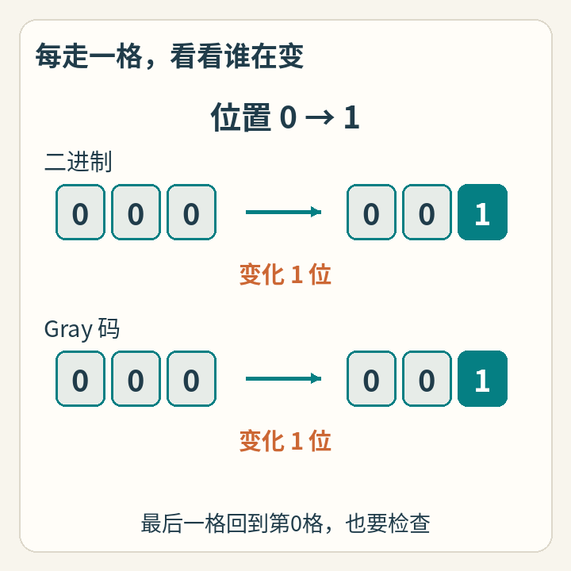

## 6. 不背整张表，一行运算就能生成标签

先学一个小工具：**异或**，写作⊕。

对两个0或1，规则只有一句：相同得0，不同得1。它不产生进位。

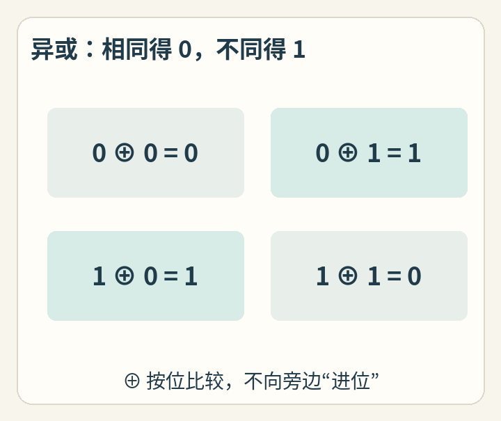

异或也可以逐位应用在两串二进制上。比如110与011，从左到右比较：1与0不同，得1；1与1相同，得0；0与1不同，得1，所以结果是101。

对本文这套反射Gray顺序，位置编号n的标签可以这样算：

**Gray(n) = n ⊕ (n右移一位)。**

“右移一位”就是把所有位向右挪一个位置，最左补0，最右原来的位被移出去。这里n是非负整数。

以第6格为例：6的三位二进制是110，右移一位是011，两者异或得到101。

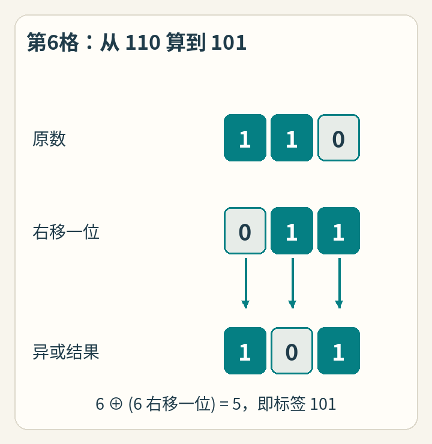

Python里，异或符号是`^`，右移符号是`>>`。因此代码是：

```python
def encode(n):
    return n ^ (n >> 1)

print(format(encode(6), "03b"))  # 101
```

别被代码的短骗了：真正的设计不是找到一个神奇运算符，而是安排好相邻位置的关系。这个公式是反射构造的紧凑表达。

你也可以把它读成逐位规则。把编号三位叫b2、b1、b0，把Gray三位叫g2、g1、g0，下标只是位置标号：

- g2直接等于b2。
- g1等于b2⊕b1。
- g0等于b1⊕b0。

也就是说，最高位照抄；之后每一位都记录：**原编号里的这两个相邻位，是一样还是不一样？**

## 7. 读到 101，怎样知道它代表第6格？

沿着刚才的逐位规则倒着想。

最左位没有被隐藏，所以b2=g2。已经知道b2，又知道g1是在报告“b2和b1是否不同”，就能恢复b1：若g1=0，b1和b2相同；若g1=1，b1和b2相反。

这正好仍可以用异或表示：b1=b2⊕g1。然后用同样办法求b0=b1⊕g0。

拿101来算：

1. 最左位是1，抄下来，b2=1。
2. 下一位是0，表示“不翻转”，b1=1⊕0=1。
3. 最后一位是1，表示“翻转”，b0=1⊕1=0。

得到110，也就是6。

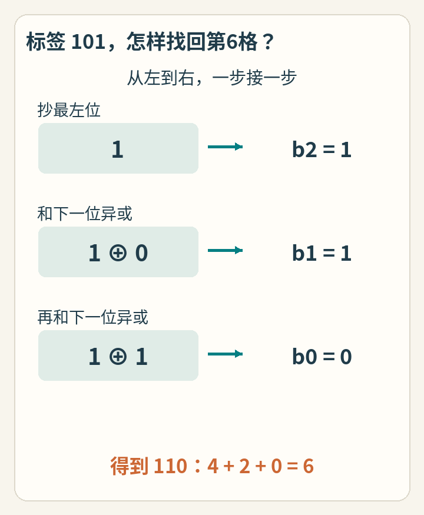

注意第二步用的是**刚恢复出的二进制位**，不是把Gray相邻两位一对一对随便异或。第三步必须接着上一步的结果走，才构成正确的解码链。

为什么这样就能还原？异或有一个很方便的性质：一个位和自己异或等于0，而任何位和0异或仍是自己。于是相同项出现两次，会抵消。

例如g2=b2，g1=b2⊕b1，所以g2⊕g1=b2⊕b2⊕b1=b1。

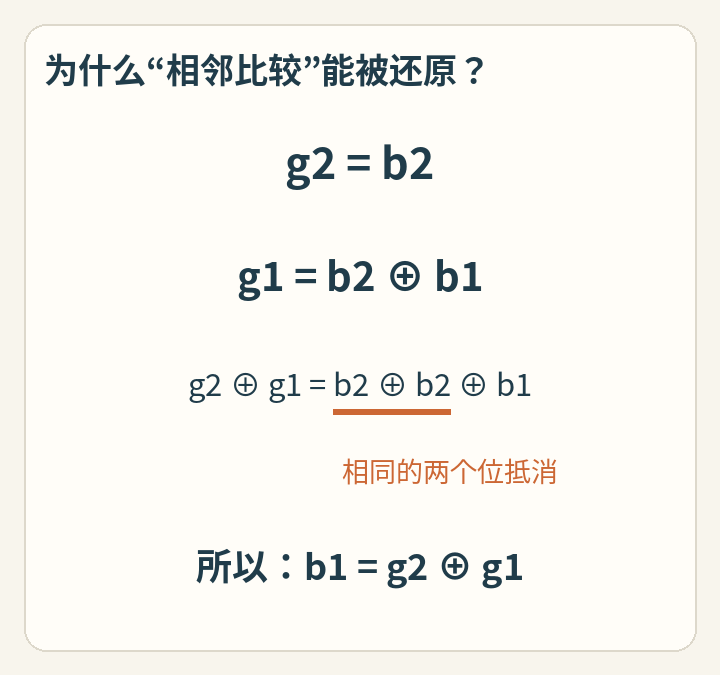

更一般地，从最左边一路累计异或，就能恢复每一位。完整程序里的整数写法稍有不同，但做的是同一件事：

```python
def decode(gray):
    n = 0
    while gray:
        n ^= gray
        gray >>= 1
    return n

print(decode(0b101))  # 6
```

这里`0b101`表示“把101这串位交给函数”，不是把十进制一百零一交进去。你可以分别计算encode(6)与decode(encode(6))，观察名字怎样来回转换。

## 8. 名字来自 Gray，但原始问题并不是这只旋钮

Frank Gray的美国专利《Pulse Code Communication》在1947年11月13日申请，1953年3月17日授权；专利说明书首页（PDF第5页）载明其与Bell Telephone Laboratories的关系。[3]

它讨论的是把信号样本变成一串开、关脉冲。电子束穿过带孔掩模，孔的位置决定哪些脉冲出现。若扫描途中电子束偏到相邻行，普通二进制的多位交界可能把很小的位置偏移放大为很大的编码错误。专利使用“反射二进制码”这个名称，并给出相关掩模与转换电路。

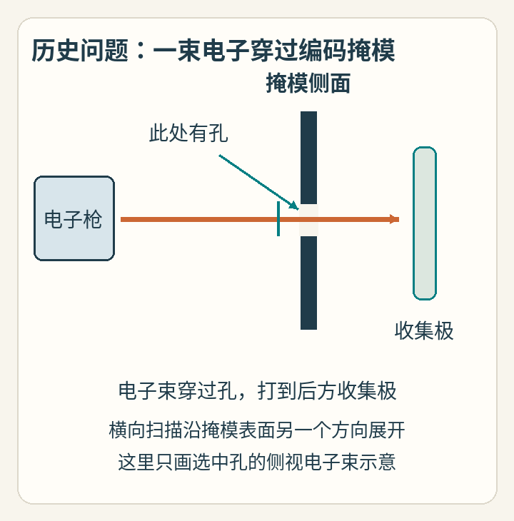

下图是专利的第2张原始图纸：左边标作反射二进制编码掩模，右边是普通二进制掩模。它不是今天这篇临摹后冒充的历史插图。图内小英文与细孔保留原样；手机上先比较整体孔形，有需要可打开[完整尺寸图纸](originals/US2632058-drawing-2.png)查看细部。

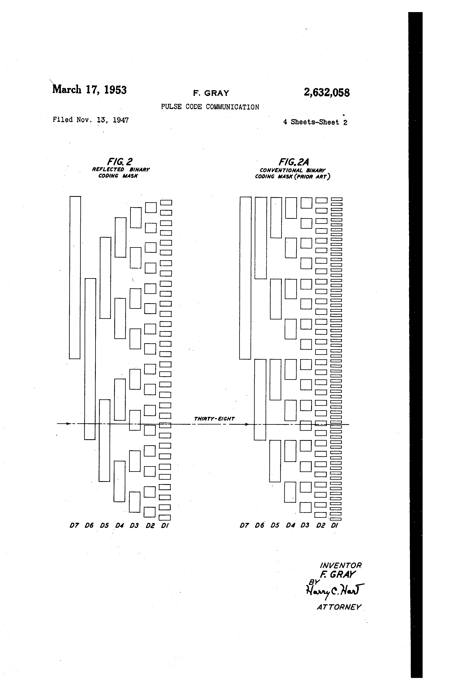

原件：Frank Gray，US2632058，Sheet 2，1953。图纸从原始专利PDF中提取，未重画；它与本文原创教学图的权利说明不同，详见[图片与来源](sources.md)。

旋钮读头和电子束不是同一种器件，遇到的却有相似结构：**一个连续物理变化被切成离散标签时，相邻标签怎么排，决定了跨界时会有多尴尬。**

这里讲的是这份专利中可核对的工作，不把它延伸成“Gray是历史上所有单步变位排列的唯一发明者”。一项技术的名称、某份专利的日期和整个数学思想的起源，是不同的问题。

## 9. 把模型真的跑一遍：读头错开一点会发生什么？

前面的时间线是假设一组先后。现在把“稍微错开”写成明确的数，实际计算一遍。

把每格宽度规定为1。位置x=3.9时，理想读头处于第3格；到x=4.0，跨入第4格。我们让高、中、低三个读头相对于理想位置，分别偏移：

**+0.06格、−0.01格、−0.05格。**

高位读头看得稍靠前，中位和低位稍靠后。每个读头在自己看到的位置取所属扇区，再只交出它负责的那一位。最后把三位合并，Gray一栏还要做正确解码。

这些参数是人为设置的教学模型，不是某款编码器的出厂误差，也不是在真实设备上量出来的数据。程序用分数做精确算术，避免这里本来不想讨论的浮点舍入。

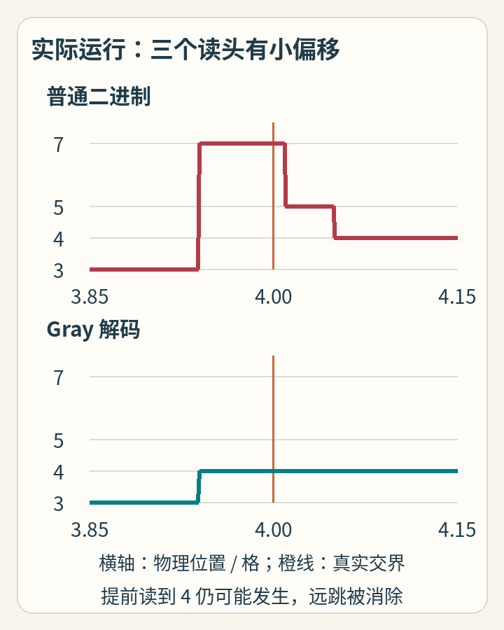

看看四个位置：

- x=3.90：三个读头仍都取第3格的信息，普通二进制读3。
- x=3.97：高位已经看到了第4格，中、低位仍看第3格，读7。
- x=4.03：高、中位已经进入第4格，低位仍在第3格，读5。
- x=4.10：三位都来自第4格，读4。

使用Gray标签后，中间位与最低位跨界前后根本不变。高位一换，就从010变110，解码只出现3和4。

但请看橙色竖线：**Gray读数已经变成4时，理想位置可能还没到4。**它没有把安装偏移消灭，只限制了在这对相邻位置之间混读的后果。

你可以打开[交互实验：拖动位置与三个读头](examples/lab.html)，故意调乱它们。先停在3.970，再改高位读头的偏移，亲眼看同一个物理位置如何得到不同的标签。这个网页只在本地浏览器计算，不连接设备。

## 10. 不能只挑成功边界：把整圈都检查

对三位情况，把0→1、1→2……6→7，以及7→0全部检查，很快就能完成。

位数更大呢？八位可以标记256格。我们实际枚举了全部256个循环边界，统计普通二进制每个边界要改几位。

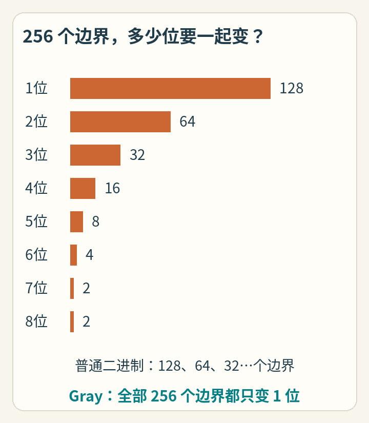

结果是：128个边界改1位，64个改2位，32个改3位，接着是16、8、4、2，最后还有2个边界要改全部8位。

最后的两个分别是127→128与255→0。后一个容易被只检查“递增到最后就停”的测试漏掉，但圆盘真的会绕回来。

反射Gray码的256个循环边界，全部只改1位。

更细一点：若某个边界有k位改变，在“各变化位可独立取旧值或新值”的模型里，有2ᵏ个候选混合串。八位二进制把全部边界的候选数加起来，是2304个“边界与候选串”的组合，其中1792个不是该边界原来的两个端点。Gray对应512个组合，全部是旧端点或新端点。

这些计数**不是故障次数，也不是实际出错率**。同一个比特串出现在不同边界，会分别计数；真实概率还取决于速度、采样时刻、传感器等。穷举给出的是这个模型允许哪些情况。

配套程序还把位宽1到12都做了一遍：

- 检查8190个循环边界，包括各个位宽的首尾。
- 检查98304个普通二进制混合候选、16380个Gray混合候选。
- 将反射生成的整张表，与异或公式生成的整张表逐项比较。
- 将每个Gray标签解码，检查是否回到原位置。

全部断言已实际运行通过。文件是[gray_lab.py](examples/gray_lab.py)，完整结果在[results.json](examples/results.json)。只需要Python标准库：

```text
python gray_lab.py
```

测试能帮我们发现实现和图表是否自相矛盾；第5节的推理则解释了为什么反射构造可以继续扩展。**有限范围的穷举，不替代一般性的证明；数学证明，也不替代具体实现的测试。**

## 11. 最容易记错的一点：它不是纠错码

你可能会想：相邻只变一位，是否意味着“哪怕任意一位读错，也只会差一格”？

不成立。

正确标签000代表第0格。假设并不是在边界交接，而是中间那位因为干扰突然从0变1，收到010。按我们的Gray表解码，这是第3格。

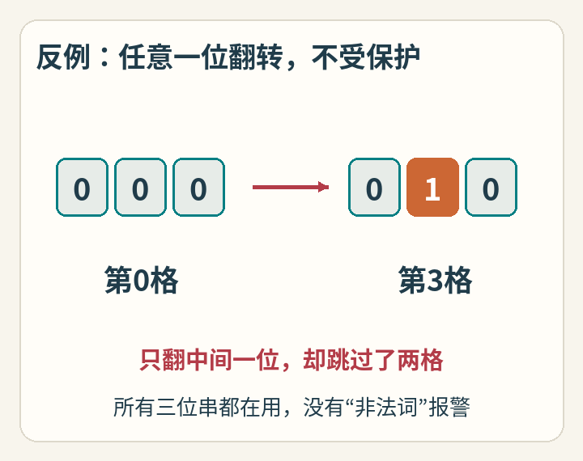

Gray保证的是一个有条件的句子：**当物理位置正在相邻两格之间切换，而且只存在这些变化位的新旧混读时，单步变位标签不会拼出第三个位置。**

它并不保证：随便翻转哪一位都安全；任何脏污都只错一格；任何电路毛刺都能识别；收到一个码字就能自动知道它是否可信。

三位的八种串都被我们拿来命名位置，没有空出来的“非法标签”。任意一个位翻转，仍会落到另一个合法名字上。想让接收端识别并纠正某些任意翻转，需要额外结构，例如冗余、校验与特定的纠错码。

如果读过本库的[Hamming码文章](https://github.com/zyuanming/tech-articles/blob/15954edb28e6f3c6fa98dbc8e4e8ef1ce2b9d8b5/articles/2026-10-10-hamming-correct-errors/read.md)，可以用一句话区分：**Hamming码把合法词拉开距离，为错误留出辨认空间；这里的Gray顺序让物理上相邻的位置贴近，减少跨界时的混合歧义。**它们可以服务不同层次的问题，但不能互相代替。

## 12. 又一个陷阱：相邻两次采样，不一定相邻两格

假设圆盘从第0格转到第1格，再转到第2格；但程序只采到起点和终点。

真实标签按顺序是000→001→011。每一步都只变一位。

采样记录却是000→011，一眼看去变了两位。

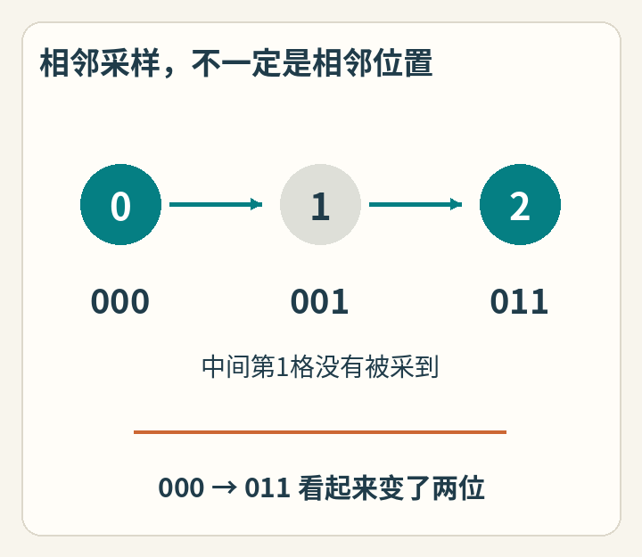

这不反驳Gray的性质，因为它从来没有承诺跨两格也只变一位。

还有更严重的情况：如果各读头的偏移太大，或者各位采集时刻相差太远，以至于有的位来自第2格、有的来自第3格、有的来自第4格，那么第3节“只在旧、新两个端点间混合”的前提已经消失。不能再原样搬用那个保证。

因此，在真正电路里仍然要考虑速度、读头几何、采样、信号稳定与同步。处在电平交接区的电子器件，还可能有无法立即当成理想0或1的状态；这篇的离散模型没有模拟这些电气过程。

**Gray码改善了编码结构，不是发了一张“时序从此不用管”的免检证。**

## 13. 我的旋钮只有六格，剪掉两格行不行？

再做一个容易上手、也很容易踩坑的变化。

我们已经有八个标签。如果只需要六格，就保留前六项：

000、001、011、010、110、111。

从头往后看，每一步都只变一位，好像没有问题。可圆盘会从最后一格绕回第一格。新的首尾接缝是：

**111 → 000。**

三位全变了。

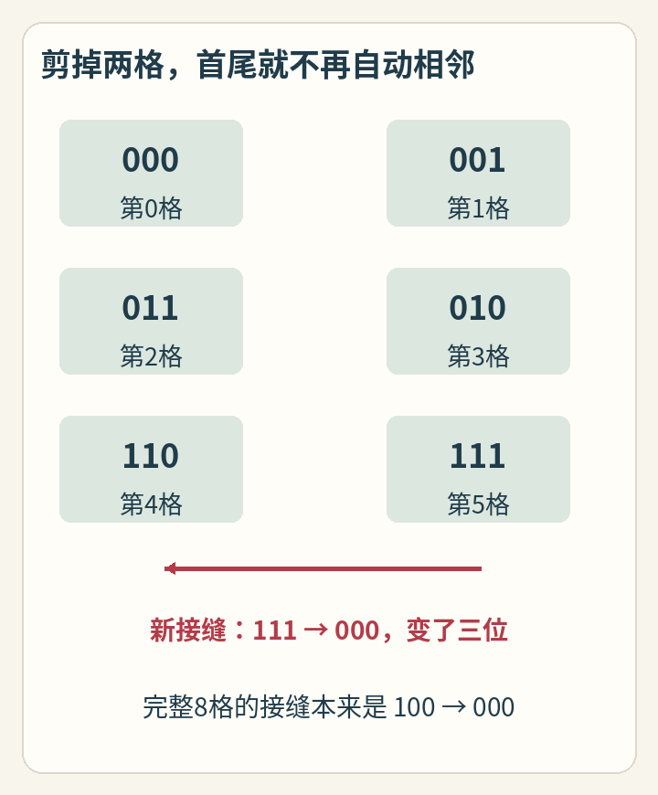

如果它只是不会绕回的直线标尺，端点之外也不使用，要求会不同。**线性序列的相邻性质，与一个闭环的相邻性质，必须分开检查。**

六格并非做不到。下面这一圈就是一个有效例子：

**000、001、011、010、110、100，再回000。**

逐条检查，每个箭头都只改一位。

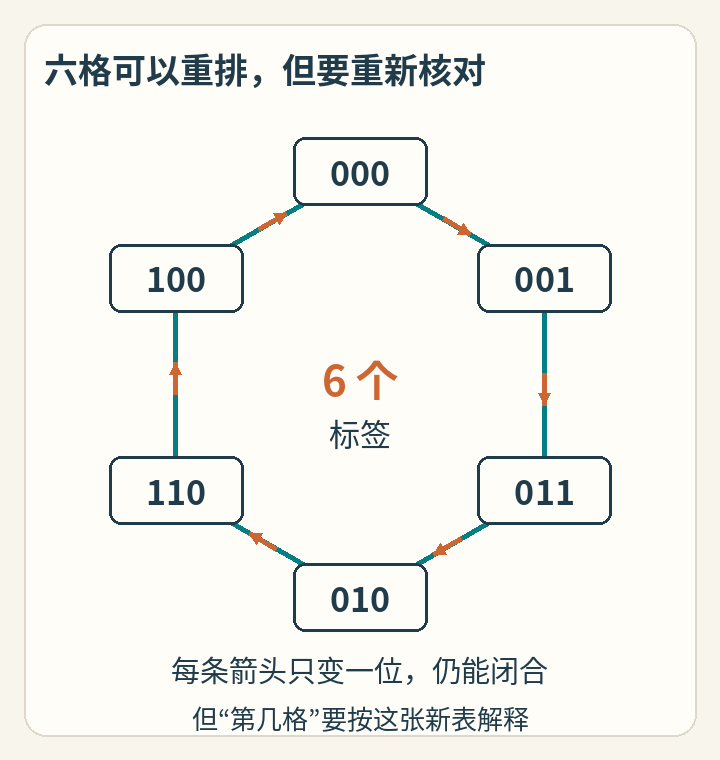

代价是：它不再等于“对编号0到5直接使用原来公式”的那张表。这里的100被我们安排在第5格；用原三位反射Gray解码器会得到7，所以要使用新的映射或相应转换规则。

厂家也有处理非2的幂分辨率的Gray码安排。OMRON资料中的余码式处理就是具体例子；实际接线和换算必须看型号文档，不能拿这篇的六格教学表替代产品规范。[1]

可以再想深一小步：能不能把**五个**互不相同的二进制标签排成一圈，每步也只变一位？

如果给每个标签数一数1的个数，翻一位一定会让奇偶性改变。走一步从偶数变奇数，再走一步变偶数。走奇数步不可能回到起点的奇偶性。因此，在“每条边恰好翻一位”的条件下，五步这样的奇数闭环不可能成立。这个结论与用了几位无关。

一个实际需求“我要五格”仍可能通过别的硬件、重复状态或不同的边界处理实现；不可能的是上面这组严格数学条件同时成立，不是世界上不能有五挡旋钮。

## 14. 换了码，并不会把八格变成八百格

八个等宽扇区，每格宽360°/8=45°。你把标签从普通二进制换成Gray码，仍然只有八个标签，仍然只能区分这八个区间。


这叫**分辨率**层面的问题：有多少个不同的位置地址。[1]

而“这些区间的边界是否刻得准确”“整个盘相对轴是否装偏”“读头是否稳定”，又会影响实际测量准确程度。Gray码不会自动修正这些几何和电气误差。

甚至“误差不超过一格”这种常见短语，也要补上条件：在本文的局部交接模型里，结果限于那条边界的两个相邻地址；它并不等于对任意真实角度、任意故障、任意速度，都证明了一个完整的角度误差上界。

到这里，我们终于可以准确描述它的价值：**在合理控制的单个位置边界上，它减少了多个比特交接不整齐引发的远处误读。**这已经很有用，不需要再给它加上全能光环。

## 15. 做一次纸上实验，把“我懂了”变成能解释

打开[可打印的两套纸带](examples/print.html)。里面有普通二进制与Gray两套三轨纸带，每格位置相同。使用浏览器打印即可，黑色格记1，白色格记0；也可以照着用方格纸画。

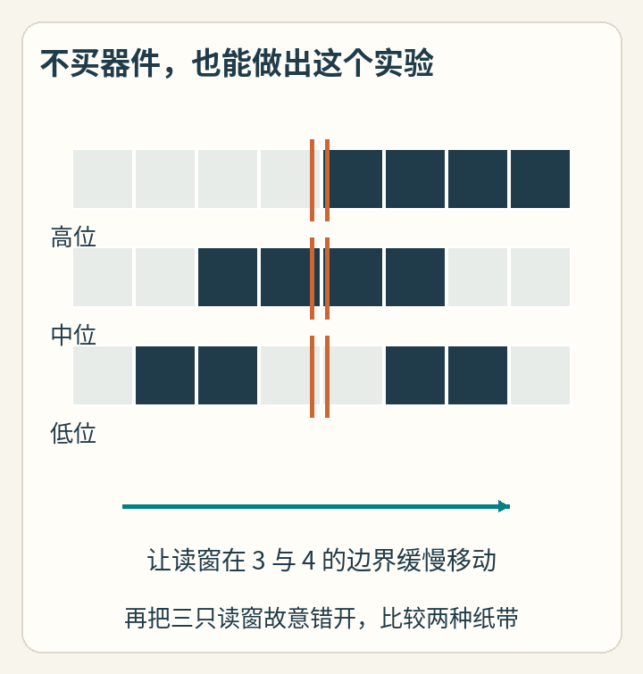

用三条窄纸片或透明片，各画一条竖线当作读窗。分别对准高、中、低三条轨道。第一次让三条读线对齐；第二次故意让高位读线稍微领先，另外两条落后一点。

先观察3与4的边界，不必一次转完整圈：

1. 在二进制纸带上，找出011、111、101、100依次出现时，三条读线分别处在哪边。
2. 换成Gray纸带，维持同样的读线错位，看看为什么其中两条轨道不需要变。
3. 让朋友不看本文，听你解释“为什么这次最多是3或4”。解释中应该出现“只涉及这两格”“其他位保持正确”两个前提。
4. 然后故意把一条读线挪得很远，跨出这个局部范围。你能指出原来推理的哪一步不再成立吗？

如果不方便打印，交互实验可以完成前两步。纸上实验的价值则是：你会看到一串比特背后，真的可以是三个错开的观察位置，而不只是屏幕里三个突然跳变的数字。

## 16. 可以跳读的进阶：短公式为什么会只变一位？

前面的反射构造已经解释了相邻性质。若还想把它与异或公式接起来，可以研究二进制加1时发生了什么。

一个非最大值整数加1，会把末尾连续的1全部变成0，再把它们左边第一个0变成1。例如：

**0111 → 1000。**

这里形成一段连续翻转的区域。更左边的位如果存在，保持不变。

Gray每一位在报告“二进制相邻两位是否不同”。如果这两位都翻转，原来相同，翻完仍相同；原来不同，翻完仍不同。也就是说，这一对的异或结果不变。

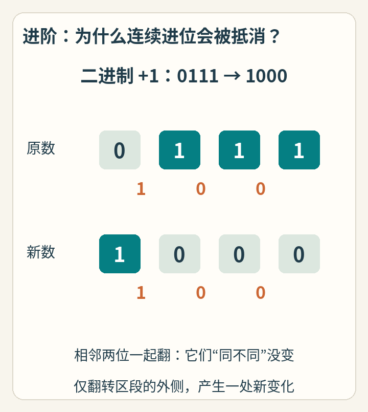

只有那段翻转区域和不翻转区域的交界，恰好一边翻、一边不翻，才会改变“相同还是不同”的回答。把最高位左边想象成一个永远为0的补位，也能统一处理翻到最高位的情况。

所以普通加1时，Gray标签只有一位变化。至于固定位宽的最大值绕回0：例如111→000，两边所有原位都翻转，内部相邻关系都不变，只有最高位相对于左侧补0的关系改变，仍只有一位变化。

这段解释还没有单独证明“公式顺序恰好就是那张反射表”。若想补全，可以按最高位分两半：前半最高位为0时，低位公式就是小一位的Gray序列；后半的低位结果对应前半的倒序。你也可以先用配套程序逐项比对，再自己写出这个归纳证明。

## 17. 留三道小挑战

**挑战一：四位的接缝。**普通二进制7→8是0111→1000。用公式算出两端的Gray标签，再圈出唯一变化位。

答案是0100→1100，只变最高位。普通二进制允许的局部混合有16种；Gray只留下两个端点。

**挑战二：把标签倒着走。**如果旋钮从4退回3，保证还成立吗？

成立。两个标签相差一位这件事没有方向性，110→010也只变一位。至于程序怎样从连续读数判断方向，还要结合采样是否漏步等条件，不能仅凭一个孤立标签判断。

**挑战三：为什么三个读头不能标十格？**如果每个读头只能稳定输出0或1，又要求每格名字唯一，三位就只有八种组合。换一种排序不会创造新标签。至少需要更多可区分信息，或者改变“单次读出即可确定位置”的要求。

## 结尾：聪明有时是给不完美留出空间

Gray码没有发明不会抖动的世界。

读头仍会错开，物体仍在连续移动，计算机仍只能在某些时刻取得离散信息。它做的是先承认这些事实，再问：**能不能把标签安排得更体谅现实？**

普通二进制很适合算数，却未必适合直接跨过一个同时改变多位的物理边界。Gray顺序用一点编解码工作，换取更温和的交接。我们既看到它的作用，也知道不能拿它去承诺任意纠错、无限采样速度或凭空提高精度。

下一次你看到“一行位运算”的小技巧，可以多追问一句：它最初是在迁就现实里的哪一种麻烦？答案有时比代码本身更有趣。

## 来源与实验

[1] OMRON，[Gray码特性FAQ](https://www.ia.omron.com/support/faq/answer/34/faq00941/)及[旋转编码器术语：分辨率、绝对码与余码](https://www.ia.omron.com/support/guide/34/explanation_of_terms.html)。用于现代编码器术语与实际应用背景，本文的纸盘、六格例子和测试数据另行构造。

[2] Renishaw，[编码器系统介绍](https://www.renishaw.com/en/introduction-to-encoder-systems--47256)及[光学编码器工作方式](https://www.renishaw.com/en/how-optical-encoders-work--36979)。用于区分标尺/读头与不同光学实现；未将本篇透射式简图说成其产品的内部结构。

[3] Frank Gray，[US2632058A：Pulse Code Communication](https://patents.google.com/patent/US2632058A/en)，[原始PDF](originals/US2632058.pdf)。申请与授权日期见原件首页和图纸页；全四张图纸的查看索引、素材权利与使用范围见[来源说明](sources.md)。

原创中文正文与原创教学图采用CC BY 4.0；配套代码见[MIT许可](examples/LICENSE.txt)。第三方原始图纸不因本文许可而重新授权。本文使用AI辅助研究、写作、编程与绘图；所有数值实验为实际运行的教学模型，没有进行编码器硬件实测。
