# 耳机只有左右两只喇叭，游戏里的声音为什么还有前后上下？

游戏里，你站在走廊中央。画面前方没有人，耳机里却传来一声响动。你转过身，想找出声音从哪里来。

先不讨论你判断得准不准。一个更基础的问题已经很奇怪了：**耳机明明只有左、右两个发声单元，程序为什么有机会让人分辨前方、后方，甚至上方？**

答案的入口，不在“再增加几只藏起来的喇叭”，而在两只耳朵平时究竟收到什么。

我们先研究一条路径：声音从右边传来，经过头、耳廓和躯干，到达一只耳朵后，会怎样改变？把输入简化成“只在一个时刻给出1，其他时刻都是0”，路径随后产生的一串输出，就叫这条路径的**脉冲响应**。它记录的是这条路径怎样影响声音，不是当前游戏里那声响动的录音。

下面两条曲线是从同一个右方声源对应的公开测量数据整理出的左右耳脉冲响应。横轴是样本的时间次序，往右表示更晚；纵轴是响应数值，正负表示响应数值在零点的两侧。橙色是右耳，蓝色是左耳，纵轴用了相同尺度。先比较明显起伏出现的早晚，再比较形状：它们不只是高矮不同。

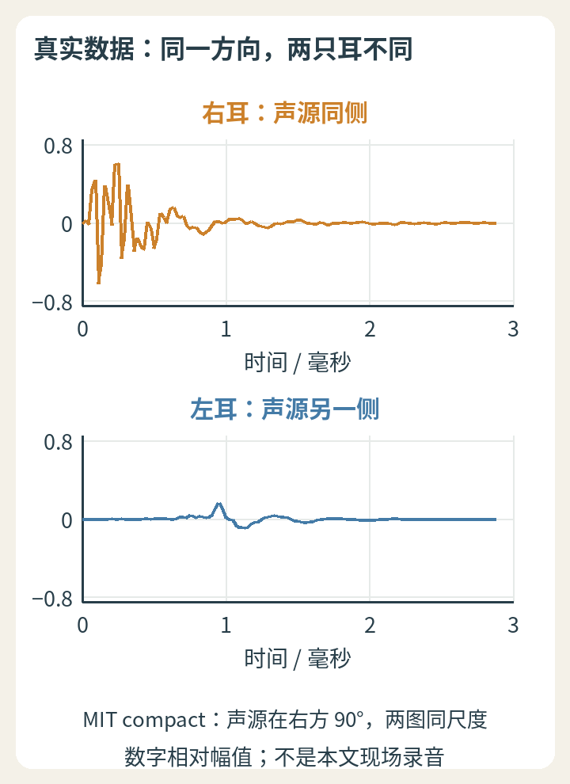

这不是本文现场录下的一声响。它是MIT研究者发布的、经过处理的双耳响应数据，实际测量不一定直接播放理想脉冲；后面会解释数据经过哪些处理，以及为什么不能把某个峰直接当成声音到耳的唯一时刻。

我们要做的事情很具体：**从一段单声道声音出发，算出两段不同的数字，让左右耳机分别播放。** 沿着这条路，就能看懂游戏音频里常见的HRTF，以及那个听起来很抽象的词：卷积。

## 1. 先认一认真正的测量对象

耳朵的外形并不是装饰。下面照片中的头和上半身是测量用的假人，头两侧装着模拟耳结构和麦克风。研究者可以把声源放在不同方向，记录左右两边的结果。

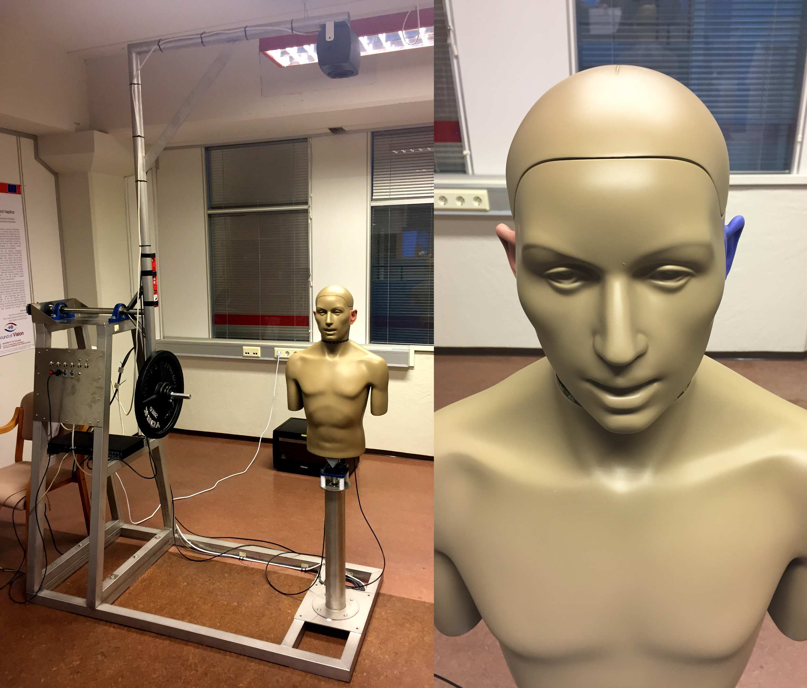

这张是2019年《The Viking HRTF Dataset》论文图1的原始照片图块，来自冰岛大学的另一项实验；**不是1994年MIT数据的拍摄现场**。照片作者为Simone Spagnol、Kristján Bjarki Purkhús、Rúnar Unnthórsson、Sverrir Karl Björnsson，按论文的[CC BY 3.0许可](https://creativecommons.org/licenses/by/3.0/)使用。完整出处见[原论文](https://itsadive.create.aau.dk/wp-content/uploads/2019/05/SMC2019_paper.pdf)。

为什么要带一个头和上半身？因为真实世界中的声音到达耳内之前，会遇到头、耳廓和躯干。这些物体会改变声音。只把两支裸麦克风相隔一段距离摆好，得到的结果不会自动包含同样的改变。

本文数值实验使用的是另一套有明确开放使用条件的资料：Bill Gardner和Keith Martin于1994年在MIT Media Lab测量并发布的KEMAR数据。我们取其中较短的compact版本，不使用照片所属的Viking数据来计算。[MIT数据主页](https://sound.media.mit.edu/resources/KEMAR.html)

现在先不急着记人名和缩写。最重要的观察是：**身体参与了声音到耳朵的过程。**

## 2. 音频文件里的正负数字，究竟在记什么？

声音传播时，空气压力在平衡值附近起伏。麦克风把这种变化转换成电信号，数字设备再按照固定的时间间隔记录它。

记录下来的一个数叫**样本**。相邻两个数之间隔多长时间，由**采样率**决定。

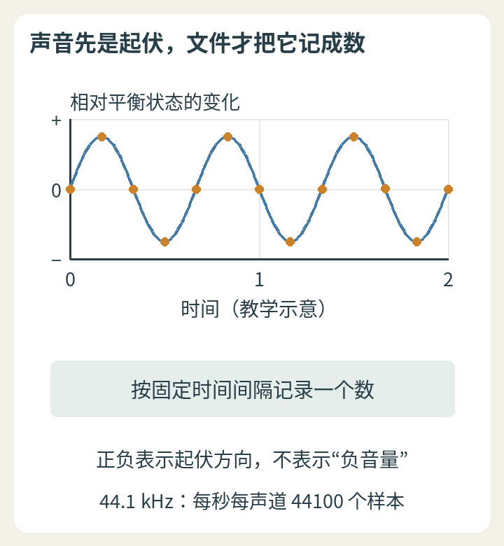

比如44100 Hz，意思是每秒、每个声道记录44100个样本。它也写成44.1 kHz，因为1 kHz就是1000 Hz。

这里的“声道”，可以先理解成一条按时间排列的数字队列。单声道文件有一条，立体声文件通常有左右两条。

一个样本是负数，不表示“负音量”。它表示记录的变化处在参考零点的另一侧。连续几个数可能是正、零、负、零，再回到正；扬声器按这串变化推动空气，才形成声音。

后面的计算暂时不用知道电路怎样工作。你只需要接受一个便利的表示：一小段数字声音可以写成一个数列，例如`[1, 2, 0]`。这个三数字例子只是手算教材，不是适合直接播放的音频。

## 3. 两个声道，为什么不等于只能表示一条左右线？

耳机的发声位置确实只有耳边两个。程序不能隔空把它们搬到你背后。

但在日常听音时，脑也不是直接读到一个写着“后方”的标签。进入左右耳的，是两份随时间变化的信号；位置判断要利用这些信号中的线索。


于是，程序可以尝试反过来做：假设同一声音真的从某个方向传来，左右耳各会收到怎样的变化？把这两份变化算出来，再通过耳机播放。

这是一种重建线索的办法，不是对听觉结果的保证。通用数据与个人耳形不匹配、耳机自身的音色、佩戴方式、头部是否转动，都可能影响效果。有的人会把前后听反，也可能觉得声音仍然在头里。

因此，“两个声道不够放下三维坐标”这个疑问，误把声音当成了只存两个位置数字的表格。实际的每个声道都包含大量随时间变化的数，可以携带时间差、强弱差和不同频率的变化。

## 4. 先约好前、右、后，否则算对了也可能播反

我们采用本文MIT文件的方向约定，从头顶向下看：

- 正前方是0°。
- 正右方是90°。
- 正后方是180°。
- 正左方是270°，也可写成−90°。

离开水平面向上抬起，还需要一个**仰角**。例如“方位0°、仰角40°”，就是前上方。

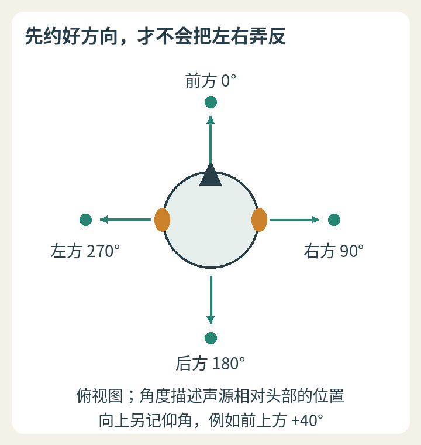

这些角度描述的是声源相对头部的位置。不同游戏引擎可能采用不同的坐标轴、角度正方向和左右手规则；不能只看到变量叫`angle`，就把一个数据集的数字原封不动塞进去。

本文选了四个方向：前、右、后、前上40°。先看右方，因为左右两耳的差异最容易在图里看见。

## 5. 第一条线索：到两只耳朵的时间不一样

右边有个声源，右耳离它近一些，左耳处于头的另一侧。声音到两耳的过程不同，时间可能有差别。

先用一个故意简化的算术例子：假定两条有效声程相差0.20米，并用343米/秒作为教学计算的声速，那么额外时间是：

```text
时间差 = 路程差 ÷ 速度
       = 0.20 ÷ 343 秒
       ≈ 0.000583 秒
       = 0.583 毫秒
```

1毫秒是一秒的千分之一。这个差别很小，但它仍能成为双耳信号里的信息。

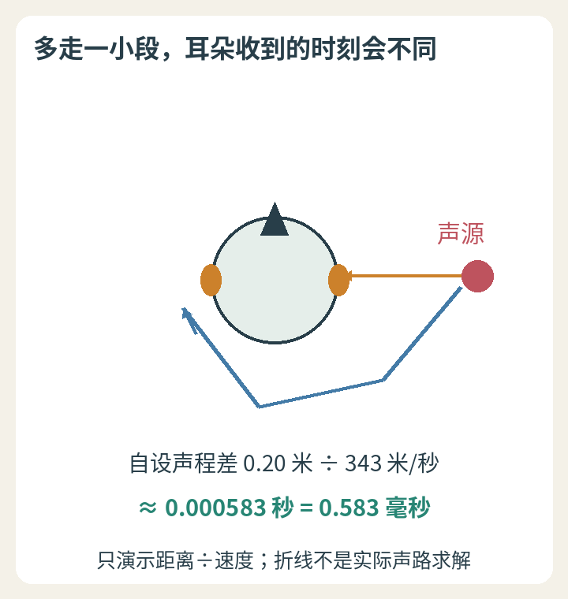

图里的折线不是严谨的声波绕头路径。真实传播涉及绕射等现象，也随频率变化；我们在这一节只用它理解“多走一段路，可能晚一点到”。

这种双耳之间的时间差常写作**ITD**，英文是interaural time difference。先记住“耳间时间差”就够了，不必记英文拼写。

## 6. 真实曲线上，哪个点才算“到达”？

回头看开篇曲线。它不是“一个点突然跳起来，然后立即归零”，而是一串正负起伏。

如果让程序比较左右最大峰的位置，右耳最强绝对值出现在样本编号5，左耳出现在42。它们相差37个样本，换成时间约为0.839毫秒。

但我们也可以采用另一种明说规则的读法：各自在自己的最大绝对值的5%处设一道门槛，寻找第一次达到门槛的样本。得到右耳3、左耳30，相差27个样本，约0.612毫秒。


这里的样本编号从0开始。把间隔除以44100，是因为每秒有44100格：

```text
27 ÷ 44100 秒 ≈ 0.612 毫秒
37 ÷ 44100 秒 ≈ 0.839 毫秒
```

这两个数字不矛盾。它们回答的是不同的问题。

**最大峰位置差不是一条无需解释的“生理ITD真值”；5%门限也只是本文采用的可复算定义。** 声音经过不同路径和滤波后，峰形会改变；更专业的ITD估计还有其他方法与适用条件。初学时最值得养成的习惯，是先问“这个数怎么算出来的”，再问“它代表什么”。

## 7. 第二条线索：另一只耳朵收到的强弱也会变

开篇蓝色曲线比橙色小很多。声源在右边，头部会影响传到左耳的声音，这通常被直观地称作**头影效应**。

但头不是对所有声音都作用相同的一块“音量布”。要理解这一点，先拆开“声音”这个大词。

**频率**描述起伏有多快。每秒重复100次叫100 Hz；每秒重复1000次叫1000 Hz。低频起伏较慢，高频起伏较快。

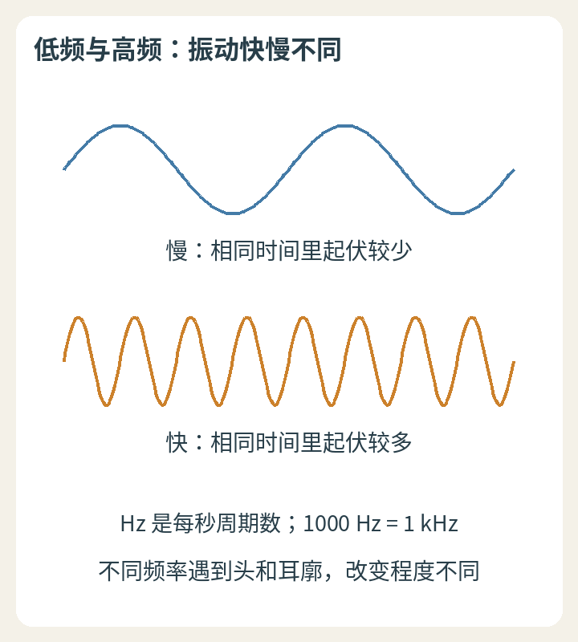

真实的响动通常包含许多不同频率的成分。头和耳廓对不同频率的影响可以不同，所以“左耳整体乘0.2”虽然能产生左右强弱差，却未必像一个真的右方声源。

下面要看一张频率图。横轴不再是时间，而是频率：往右表示更快的起伏。纵轴需要一个新单位dB，我们先把它降到容易比较的倍数。

## 8. 不怕dB：这里先把它读成幅度倍数

本文频率图中的dB，是数字滤波幅度相对于同一个数字参考值的表示。它不是耳边声压级，也不是对你听力的测量。

对这里的幅度比较，可以先记三个近似关系：

- 0 dB对应1倍。
- +6 dB约对应2倍。
- −6 dB约对应0.5倍。

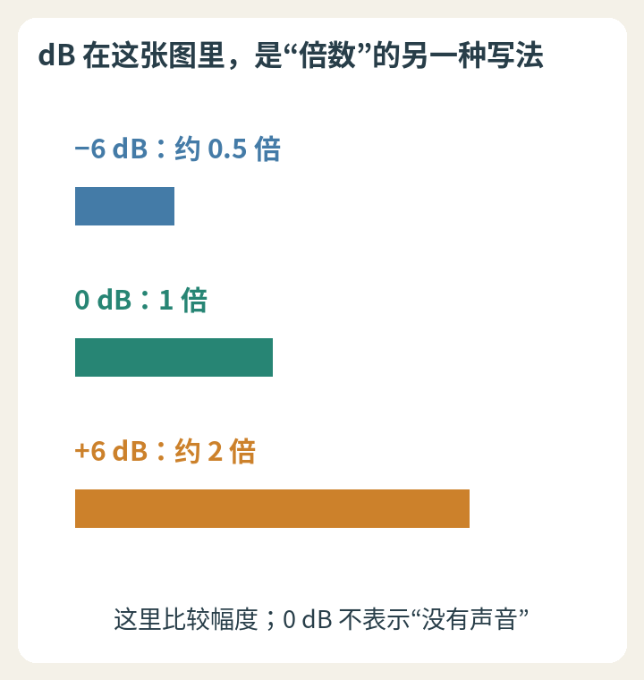

因此，0 dB不是“静音”。它表示与选定参考一样大；负dB也不是“负声音”，只是小于参考。

若想知道转换规则，幅度倍数为`r`时，这里用`20 × log10(r)`。`log10`可以先理解成把跨度很大的倍数压缩到一把较方便的尺子上。后面的主要结论并不要求你手算对数。

现在看同一右方方向的实际结果。

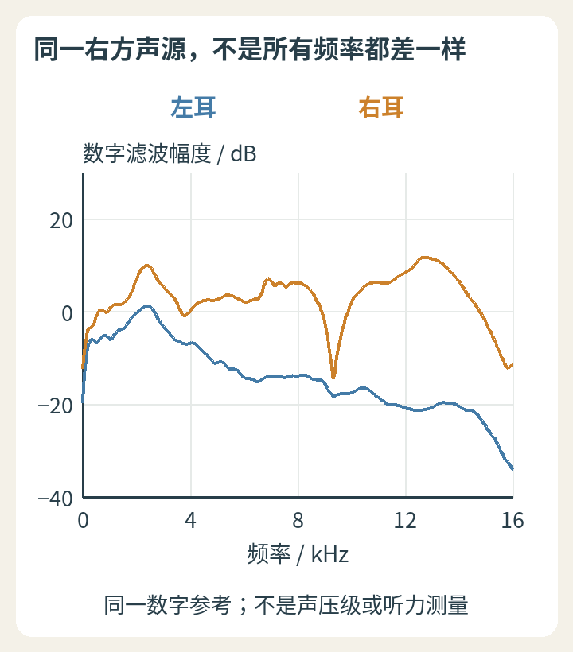

蓝线和橙线之间的距离并不是从头到尾相同。某些频段差得很大，某些频段靠近一些；曲线里还有峰和凹口。

这就是比“左小右大”更丰富的事实：**方向改变的，不仅可能是一个总音量数，还可能是声音内部不同频率的比例。**

## 9. 耳廓上的褶皱，为什么也有用？

看一组真正的耳廓模型，褶皱、凹陷和外缘都能直接看见。

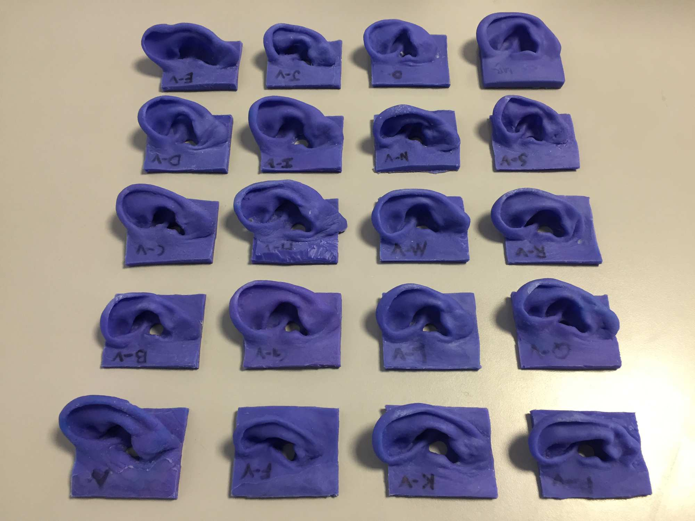

这是2019年Viking论文图3的原始照片，含KEMAR耳廓的硅胶复制品，以及根据博物馆仿真人头模具制作的其他耳廓。它不是“20位受试者的实验合影”，也不是本文自己做的模型。Spagnol等四位作者，CC BY 3.0；详见[原论文](https://itsadive.create.aau.dk/wp-content/uploads/2019/05/SMC2019_paper.pdf)。

声音遇到这些结构时，不同部分会沿不同方式传播、反射并相加。这里先用一个极小的数学事实理解“相加”的后果。

如果两股变化在某个时刻分别是`+1`和`+1`，加起来是`+2`；如果分别是`+1`和`−1`，加起来就是0。

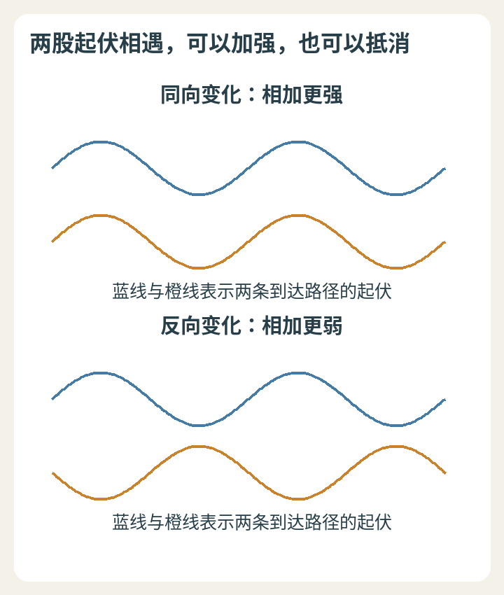

这不是说声音总能完美抵消，而是解释为什么“多了一条路径”不一定让所有频率都更强。路径差对应的时间差，对不同起伏速度会造成不同的对齐关系。于是，有些频率加强，有些频率减弱，频率图上就可能出现峰与凹口。

声源从前面移到上面，遇到耳廓结构的方式改变，频率形状也可能跟着改变。这给前后、上下判断增加了线索。

## 10. 抬高声源，不是再装一只“上声道”

下面把同一套MIT数据的两个方向放在一起：正前方，以及方位仍为0°、仰角40°的前上方。为避免混淆，这里只比较同一只耳。

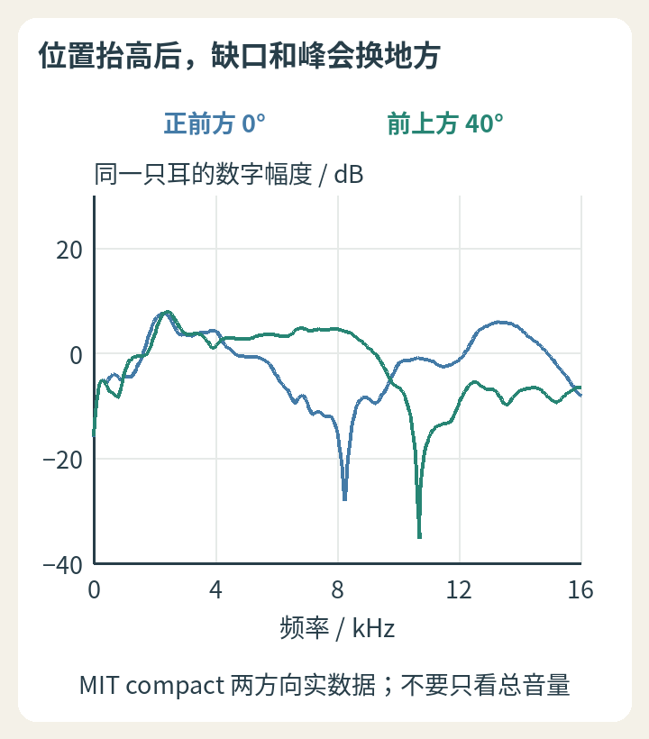

蓝线和绿线并不相同。特别是较高频段的凹口位置与整体形状，有可见变化。

如果只用一个“左边百分之多少、右边百分之多少”的滑块，你很难表达这种区别。两个方向可能都在头部正中面上，左右强弱相近，却具有不同的频率形状。

请不要从这一张图推出“只要有某个凹口，每个人就一定听到上方”。个人耳形、信号本身含有哪些频率、耳机改变了什么，都会影响实际判断。图能确实证明的是：**这套公开响应中，不同仰角对应的数字滤波形状不同。**

## 11. 左右完全一样，也不能推出“一定在正前方”

再比较正前方和正后方。下面每一组里的左右响应都相等，因此各画一条重合曲线；但前方和后方的形状并不一样。

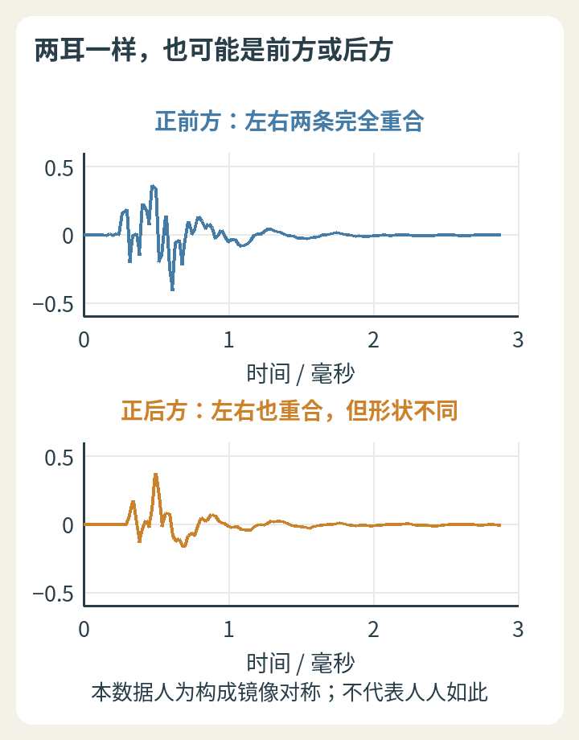

这里还有一个重要的数据边界：我们使用的compact集合是根据左耳测量、利用镜像方向构造左右对称配对的。正前和正后都处在镜像对称面上，所以对应左右数组相同。

这并不意味着真实的人类左右耳必定一模一样，也不意味着每个人的正前、正后录音都会严格逐样本相等。[MIT数据说明](https://sound.media.mit.edu/resources/KEMAR/hrtfdoc.txt)

它是一个很好的反例：即使把“左右强弱相等”和“左右时间相等”同时告诉你，也不足以唯一确定前后。还需要利用其他线索；而当线索不够或不匹配时，前后混淆正是可能发生的事情。

## 12. 这些短短的数字，究竟怎样测出来？

回到真正的装置。一个基本思路是：先播放已知的测试信号，再记录两耳实际收到的信号，比较两者，从中估计声音经过这条路径后被怎样改变。

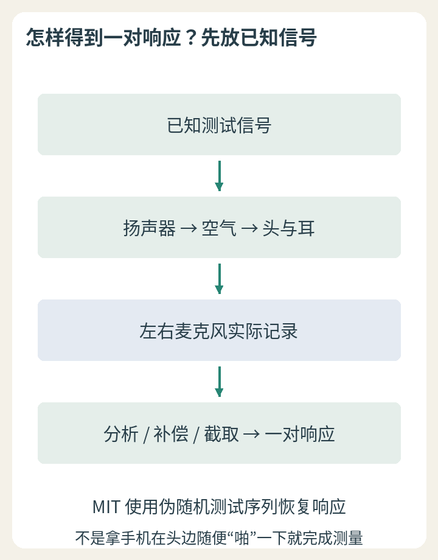

MIT在1994年的这项测量使用了伪随机测试序列。你可以把它先理解成一段预先知道内容、便于后续分析的测试声音，而不是随便录一次拍手。测量包含710个位置，扬声器距头部中心约1.4米，采样率44.1 kHz。[MIT技术说明](https://sound.media.mit.edu/resources/KEMAR/hrtfdoc.txt)

不过，麦克风收到的并不只包含“耳朵的秘密”。扬声器、麦克风以及测量处理也会参与结果。

本文取用的compact版本，对扬声器响应做了补偿处理，并截成每声道128个样本，还按前面说的方式构成镜像双耳配对。它适合轻量的教学演示，但不能冒称为完全未经处理的双耳现场录音，也不能宣称测量链的所有影响都被完美去除了。[MIT FAQ](https://sound.media.mit.edu/resources/KEMAR/KEMAR-FAQ.txt)

128个样本在44100 Hz下占约2.902毫秒。样本编号0到127之间的时间跨度略短，约2.880毫秒，因为128个点之间只有127个间隔。这与“一个128样本缓冲区占用128格时间”是不同计数问题。

还有一个容易踩的坑：文件经过截取、对齐和补偿后，横轴起点不是一个可以直接认定为“扬声器刚开始发声”的绝对时刻。不要拿曲线起点去反推1.4米的完整传播时间。

## 13. 什么叫响应？先给系统一个极简单的输入

想象一串数字：绝大多数都是0，只在某一格放一个1。这叫一个**单位脉冲**。

它不是必须亲耳播放的“超短爆音”，而是理解数字系统的理想小工具：只在一个时刻给出一点输入，看后面会产生什么。

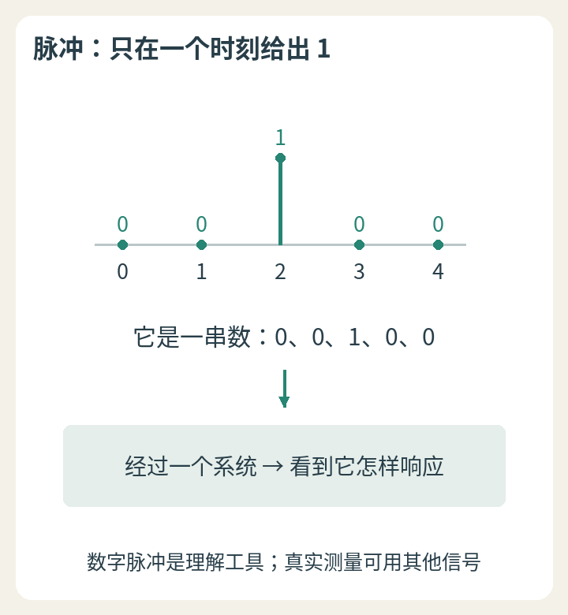

假设某个小系统对一个1的回应是：这一格输出1，下一格输出0.5，再后面都是0。我们就用`[1, 0.5]`记录它的**脉冲响应**。

这里的“响应”不是只有一个数，而是一串随时间展开的影响。输入那一刻过去了，影响未必立刻消失。

真实头耳路径的响应复杂得多，可能有许多正负起伏。开篇的128个数字，就是这样一串随时间排列的响应表示，经过了上一节说明的测量处理。

实际测量不一定直接播放理想脉冲。用合适的已知测试信号和分析方法，也可以估计出脉冲响应；不要把理解模型与测量手段混成同一件事。

## 14. 为什么测过一次，就能拿去处理其他声音？

这需要两个近似前提。

第一个是**线性**：把输入放大两倍，回应也放大两倍；把两次输入相加，它们各自造成的回应也可以相加。

第二个是短时间内系统基本不变：同样的输入晚一格到，回应就整体晚一格，不会无缘无故换一种形状。计算这一小段声音时，我们先固定头与声源的相对方向。

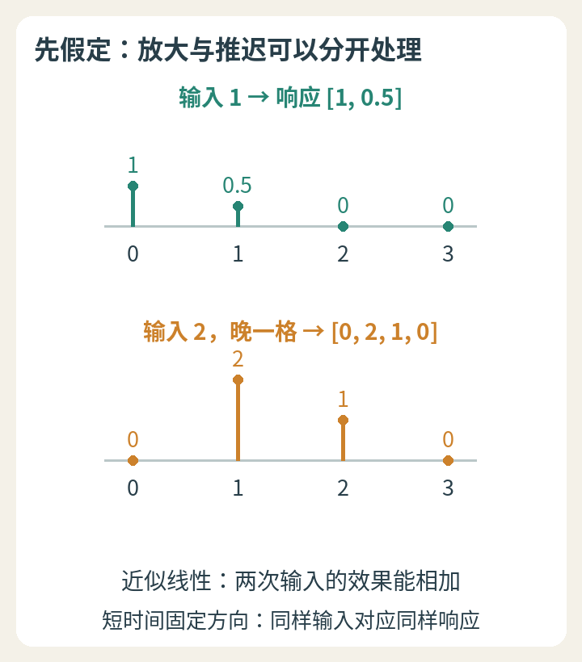

这两条一起常被概括为“线性时不变系统”的模型。名字虽然长，操作其实只有两件事：**按输入大小缩放响应，按输入时间移动响应。**

如果头正在快速转动，方向就变了，程序需要更新响应；如果设备发生明显失真，线性近似也可能不够。这里不是说现实永远不变，而是先在合适范围内使用一个能够算清楚的模型。

## 15. 卷积，先别背公式，来记三行账

现在给系统输入三个数：

```text
输入 x = [1, 2, 0]
响应 h = [1, 0.5]
```

样本编号从0开始。

第0格输入1，所以从第0格开始留下一串影响`[1, 0.5]`。

第1格输入2，所以把同一个响应乘2，得到`[2, 1]`；但它发生在第1格，因此要向右错开一格。

第2格输入0，不会增加新的贡献。


把每一列相加：

```text
第0格：1                 = 1
第1格：0.5 + 2           = 2.5
第2格：      1 + 0       = 1
第3格：          0       = 0

输出 y = [1, 2.5, 1, 0]
```

这就叫**卷积**。在这个问题里，它的直观含义是：每一个输入样本都留下自己的响应尾巴，把同一时刻到来的所有尾巴相加。

它不是把两串数字同位置逐项相乘。如果只算`1×1`和`2×0.5`，你会丢掉“第0格输入在第1格仍有影响”这件事。

## 16. 公式只是这本账的缩写

如果当前要算第`n`格输出，往回看第`k`格输入：它距离现在已经过去`n−k`格，所以应该乘响应里的第`n−k`项。

再把所有有效的`k`加起来：

```text
y[n] = 所有 x[k] × h[n−k] 的总和
```

`x[k]`表示输入第k格，`h[n−k]`表示那次输入经过这么多格之后还剩多少影响。下标超出数列范围的项，按0处理。

例如前一节的第1格，只有两项有贡献：

```text
y[1] = x[0] × h[1] + x[1] × h[0]
     = 1 × 0.5       + 2 × 1
     = 2.5
```

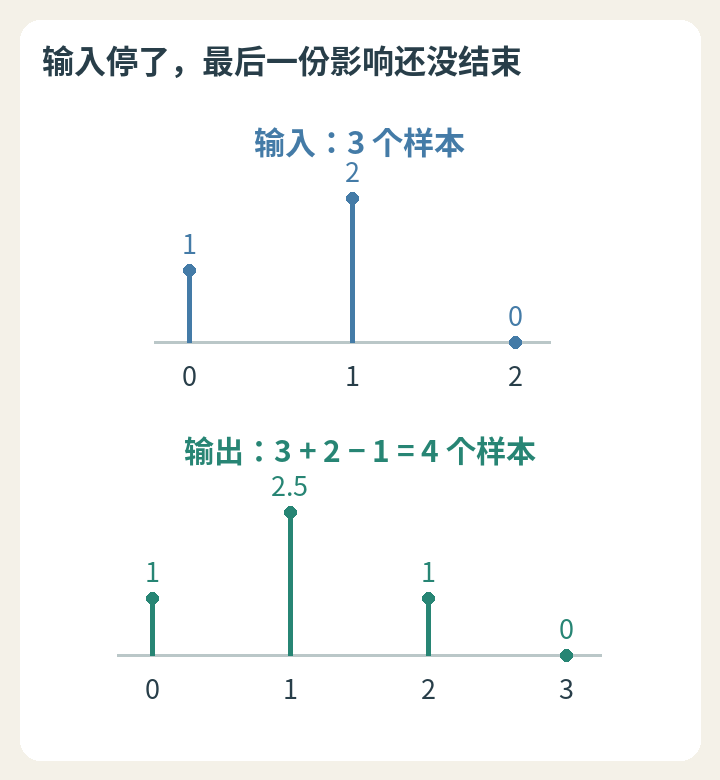

一般地，长度为N的输入与长度为M的响应做完整卷积，结果保留`N+M−1`个样本。因为最后一个输入的影响还可能向后延伸`M−1`格。

这里保留四格，即使最后一格数值恰好是0；长度来自完整计算规则，不是从尾部某个零猜出来的。真实音频里若把所有尾巴都生硬剪掉，最后一小段响应就可能丢失。

## 17. 从一个小系统，变成左右两只耳朵

现在，把手算的`[1, 0.5]`换成某个方向对应的左耳128个数，再用同一输入算一遍，得到左声道。

随后把响应换成该方向的右耳128个数，仍用同一输入，再算一遍，得到右声道。

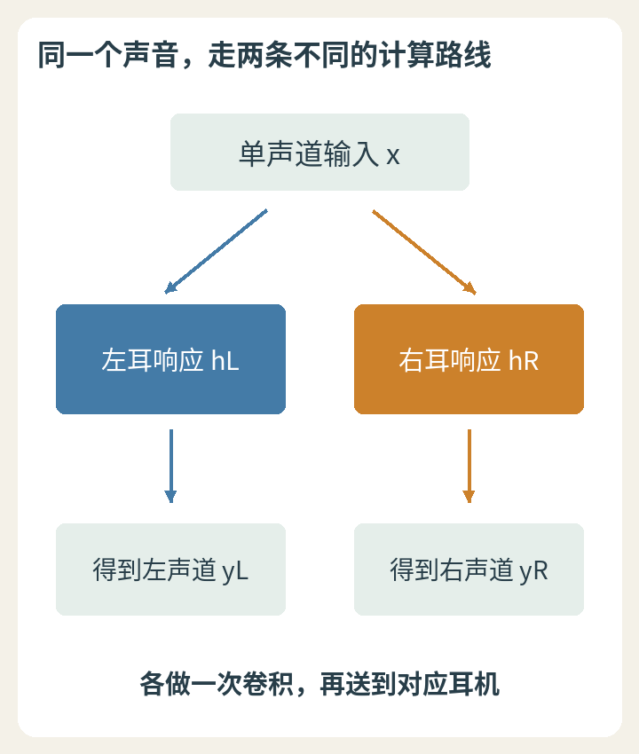

写成程序结构，就是：

```python
left  = convolve(sound, response_left)
right = convolve(sound, response_right)
```

两个结果长度相同，按时间对齐后，左声道送到左耳机，右声道送到右耳机。

这里没有增加“后方声道”或“上方声道”。方向体现在选用了哪一对响应，以及它们怎样改写输入。

当然，左右接反了，方向线索也会跟着出问题。数据文件的通道顺序、方位约定和实际输出接线，都属于需要核对的基本事实。

## 18. 实际算一次：同一短音变成四种方向

本文附带的程序真的读取了四个MIT compact WAV文件，并生成了一组可下载的音频结果。

输入不是游戏脚步录音，而是程序生成的四次短噪声：每次约90毫秒，边缘逐渐起落，在两秒的输入中分开出现。噪声包含较丰富的频率成分，方便观察不同频段被怎样改变。

下面是右方版本生成后，重新打开输出WAV得到的实际波形局部。蓝、橙使用相同纵轴尺度，截取第一声开始后25到45毫秒。

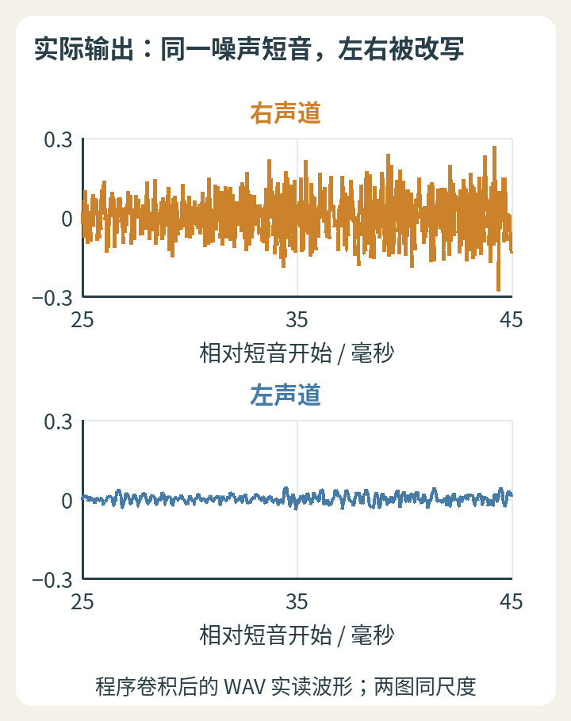

这一步不是把开篇的响应图复制一遍。开篇画的是滤波器本身；现在画的是**一段实际输入经过滤波器之后的输出**。

输入有88200个样本。每耳响应有128个样本，所以完整输出每声道有88327个样本，时长约2.00288秒。

你可以选择打开[试听页面](examples/listen.html)，比较未加方向处理的输入，以及前、右、后、前上40°四个版本。没有自动播放；使用耳机时，从较低、舒适的音量开始即可，不要为了“听出方位”把音量越开越大。这是算法演示，不是听力测试。

即使完全不试听，图和手算也足够理解计算过程。如果前后听不出来，不能据此断定程序失败，更不能据此判断自己的听力：这里使用的是通用假人响应，没有为你的耳形和耳机做个性化校准。

本文完成的是文件生成、数值与文件格式检查，没有把个人主观听感当作测试证据。

## 19. 到这里再认识两个缩写：HRIR与HRTF

**HRIR**是head-related impulse response，头相关脉冲响应。它以时间顺序记录响应，我们刚刚用来卷积的就是这种表示。

**HRTF**是head-related transfer function，头相关传递函数。它描述这条路径怎样改变不同频率的幅度和相位。

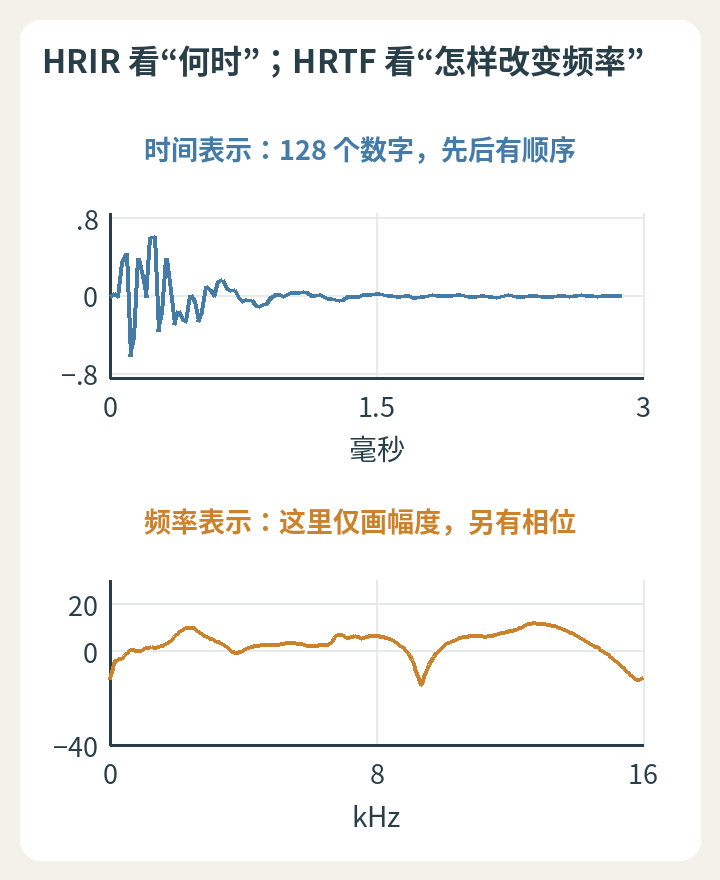

读这张图时，左图横轴按时间走；右图横轴改为频率，表示每秒起伏多少次。右图不是声音继续播放的时间线：固定一个频率，沿竖直方向找到曲线，读出这条路径对该频率的幅度影响。曲线的峰和凹口说明不同频率受到的改变不同。

“相位”可以先理解成一种起伏在周期中的对齐位置。第9节里，同向变化能够加强、反向变化可能抵消，就已经用到了这种对齐差异。

时间表示与频率表示通过傅里叶变换联系起来。这里不需要先学会变换的全部推导；你已经能在时间领域用移位、乘法和加法完成卷积。

但必须保留一个边界：**只画幅度的频率图，不是完整HRTF。** 如果把相位和时序信息丢掉，就不能指望仅凭这条幅度曲线完整还原原来的双耳响应。

工程里常把一整套双耳方向滤波方法简称为“HRTF处理”。看到这个词时，可以先在脑中还原成那张双路图：同一声音，分别经过方向相关的左、右响应。

## 20. 为什么“延时一下，再调音量”还不够？

延时确实能制造时间差。左右采用不同增益，也确实能制造强弱差。这两件事不是没有用。

问题是：固定增益对所有频率给出同一个倍数；纯延时会改变时序，却不会凭空生成频率幅度图中的那些峰和凹口。

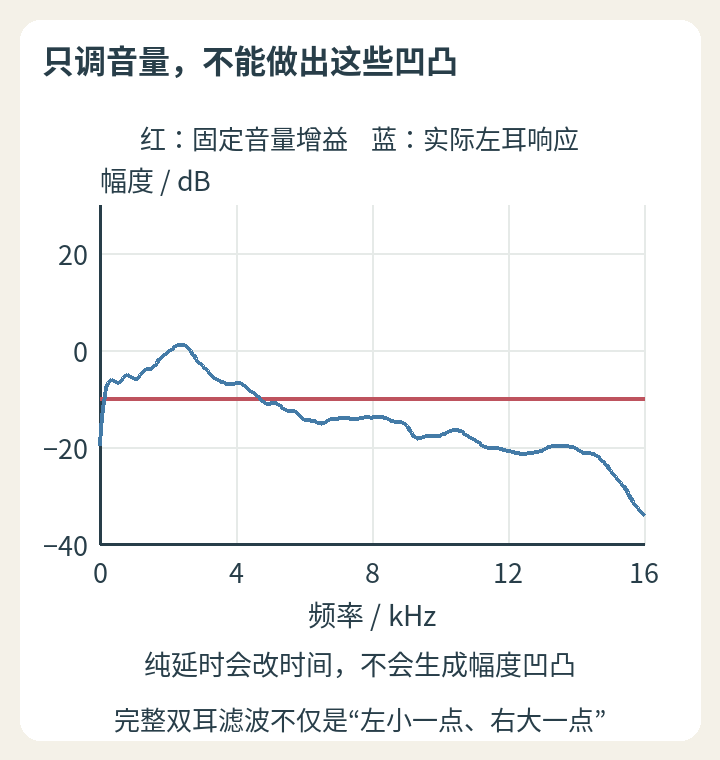

所以，仅有延时和固定音量，不能一般性地复现真实方向响应的完整频率形状。它们表达了部分线索，不等于全部线索。

作为一个实际接口例子，Web Audio标准把`equalpower`声像处理和`HRTF`处理区分开。后者利用按方向组织的响应数据进行滤波。这能帮助你理解游戏或网页音频设置里为什么可能同时出现“左右声像”和“HRTF”选项，而不是把它们当成完全同义词。[W3C Web Audio 1.0，HRTF panning](https://www.w3.org/TR/webaudio-1.0/#hrtf-panning)

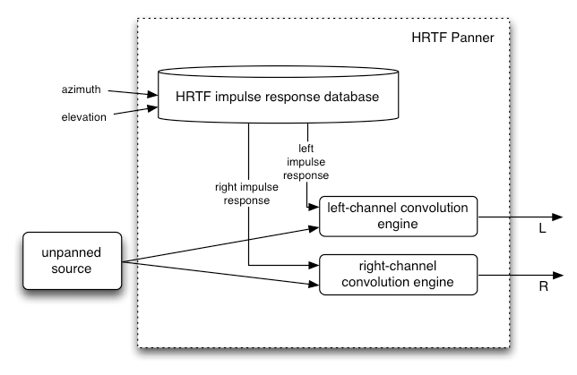

这是规范中的原图。图中left-channel convolution engine与right-channel convolution engine分别表示左右卷积处理；HRTF impulse response database是按方向取用的响应集合，azimuth和elevation分别表示方位与仰角；右侧L、R就是左右输出。原图英文小字可以配合这段中文和第17节的大字号双路图阅读。Copyright © 2021 W3C®（MIT、ERCIM、Keio、Beihang），原像素未修改；按[W3C Software and Document License 2015](originals/W3C-NOTICE.txt)使用。

本文没有运行某个浏览器或游戏引擎的HRTF实现；实际生成的文件来自附带的Python程序，不能冒称某款游戏的听音结果。

## 21. 一个很容易好心办坏事的步骤：分别把左右拉到一样大

做音频时，常有人担心一边太小，就把左右分别放大到“各自合适”的程度。若你的目标是保留原来的双耳线索，这样可能改掉恰恰需要留下的强弱关系。

以右方响应为例，用“先平方、求平均、再开平方”的**均方根**数值概括一串样本的整体大小，右耳约为左耳的4.88倍。这里算的是响应样本的数字幅度指标，不是主观响度，也不是耳边实际声压级。


如果各自除以自己的均方根，强弱比例就被人为拉成1比1了。其他独立归一化方式不一定恰好得到图里的等高条，但同样可能改变耳间比例。

本文为全部方向、两个声道选用同一个整体增益，让输出不过载，同时保留方向之间与双耳之间的相对关系。实际写回16位WAV后，所有输出的最大绝对数字幅值约0.28001，没有碰到表示范围的边界。

这只说明数字文件没有削顶，不代表任何播放设备上的声压一定安全。你最后听到多响，还取决于设备音量与耳机。

## 22. 同一套数据，为什么不是每个人都觉得准？

第9节那组耳廓已经给出了线索：耳形不同，对声音的改变就可能不同。

下面是Viking研究中制作耳廓模型的实际照片。它展示从仿真人头的耳部取得模具并制作硅胶耳廓的过程，不是本文自己实施的实验，也不是请读者对真人耳道做翻模。

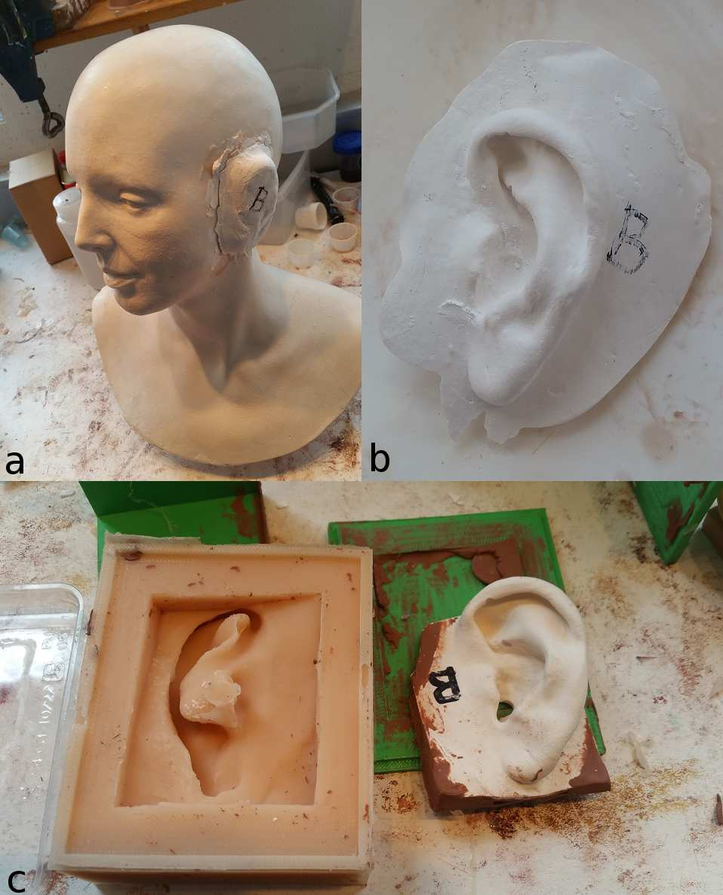

原图为Spagnol等，2019，CC BY 3.0，[论文图2](https://itsadive.create.aau.dk/wp-content/uploads/2019/05/SMC2019_paper.pdf)。

假人数据的优点是可以公开、可重复、方便比较；限制是它终究不是每位使用者的头和耳。通用响应的频谱线索可能与一个人平时学到的线索不一致。

此外，耳机本身也会改变不同频率的强弱。把计算结果送进耳机，并不等于数值不经任何变化就到了鼓膜。个体化响应、耳机补偿和佩戴条件，都是更完整空间音频系统可能需要考虑的部分。[MIT FAQ](https://sound.media.mit.edu/resources/KEMAR/KEMAR-FAQ.txt)、[Microsoft Research空间音频研究介绍](https://www.microsoft.com/en-us/research/project/spatial-audio/)

这解释了一个看似令人失望、实际很重要的事实：数学上正确地完成卷积，不等于人人都能在所有条件下准确定位。算法验证与感知效果评估回答的是两类问题。

## 23. 头一转，世界里的声源为什么不能跟着转？

假设钟表固定在你原来的正前方。你向右转头90°，钟表没有移动，它此时就在你的左边。

程序若还用原来的“正前方响应”，耳机中的线索就可能与这个真实关系不一致。于是，需要利用头部朝向更新声源的相对方向。

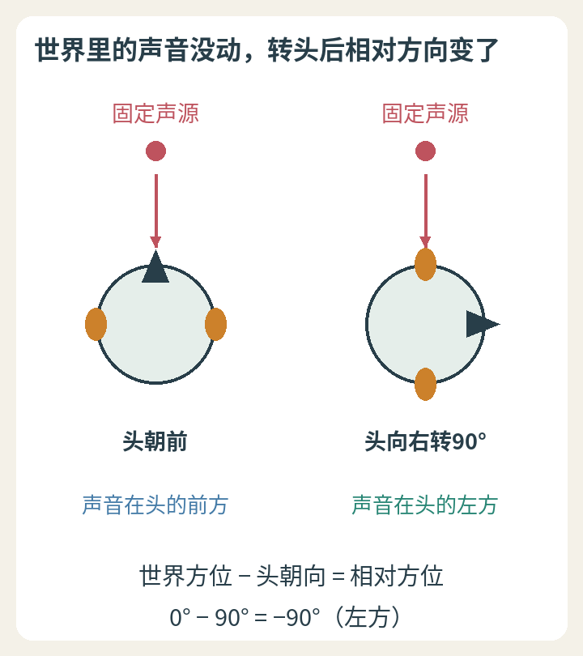

在本文平面例子里：

```text
声源相对方位 = 世界声源方位 − 头部朝向
             = 0° − 90°
             = −90°，也就是左方
```

这就是头部追踪在空间音频中的一个基本作用：使方向线索随着听者转头而更新，尽量保持声源在世界中的位置。[Microsoft Research空间音频介绍](https://www.microsoft.com/en-us/research/project/spatial-audio/)

实际程序还要处理没有刚好测过的中间方向，以及从一对滤波器换到另一对时如何平滑过渡。否则突然切换数字，可能产生不自然的突变。本文只演示四个静止方向，没有假装实现连续头部追踪。[MIT FAQ](https://sound.media.mit.edu/resources/KEMAR/KEMAR-FAQ.txt)

## 24. 一对HRTF，包办不了整个游戏声场

游戏知道声音在哪里，只解决了问题的一部分。声音还可能很远、被墙挡住，或在房间里反射。

这些变化与“来自头的哪个方向”有关联，却不能都压缩成同一个方向标签。

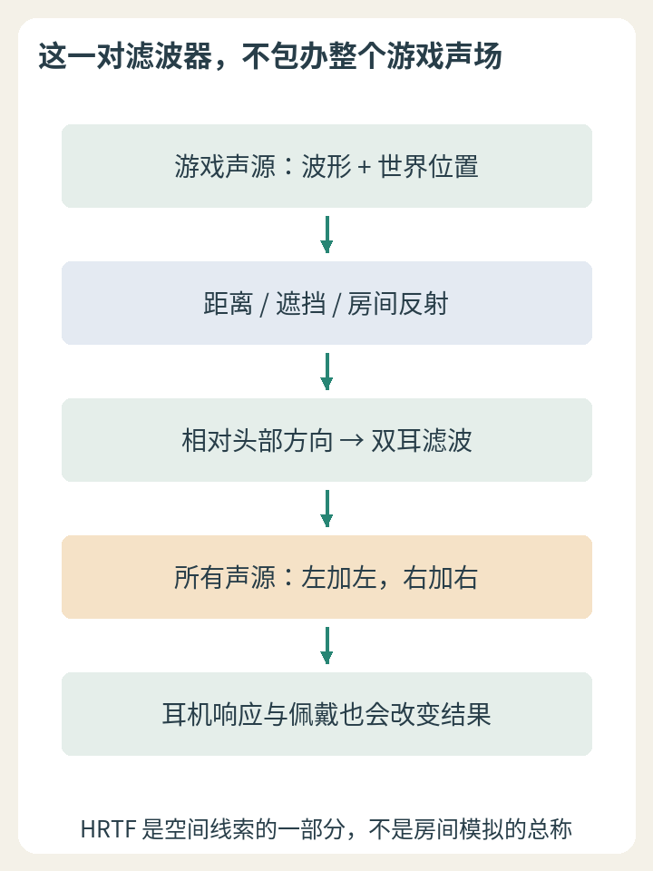

可以先按职责理解一条简化流程：

1. 游戏给出声音本身和世界位置。
2. 距离、遮挡、房间反射等模型决定额外变化。
3. 根据声源与头的相对方向，进行双耳处理。
4. 多个声源的左输出相加，右输出相加，再做合适的整体混音处理。
5. 最后通过实际耳机播放。

图是理解职责的示意，不要求所有引擎都严格按这个单一路径排列。反射也可能需要按各自到达方向单独处理。

例如枪声的直达部分来自右方，墙面反射可能从左后方到达。只给整个声音套一个“右方”滤波器，不会自动恢复所有反射的空间结构。[MIT FAQ，距离与反射问题](https://sound.media.mit.edu/resources/KEMAR/KEMAR-FAQ.txt)

所以，HRTF是空间音频的重要组成部分，却不是“完整房间声学模拟”的另一个名字。

## 25. 若想复算，先检查采样率，别急着调效果

附带程序在[examples/audio_lab.py](examples/audio_lab.py)，实际结果在[results.json](examples/results.json)。示例需要Python和NumPy，运行方法写在[实验说明](examples/README.md)中。它是可选练习，不影响前面静态图文的理解。

最先检查的参数不是“空间感强度”，而是输入、响应与输出对样本时长的约定是否一致。


27个样本在44100 Hz下约0.612毫秒，在48000 Hz下是0.5625毫秒。若把44100 Hz的响应只改标签当48000 Hz使用，它的时序与频率对应关系就变了。

需要转换时，应做正确的重采样，让新数字序列仍然描述同一个随真实时间变化的响应，而不是仅改文件头里的一个数。[MIT FAQ，采样率转换](https://sound.media.mit.edu/resources/KEMAR/KEMAR-FAQ.txt)

本次实际运行完成了这些检查：

- 四个输入响应均为44100 Hz、双声道、16位、每声道128样本。
- 一个单位脉冲与每只耳的响应卷积，结果与响应逐样本一致。
- 手算例子得到`[1, 2.5, 1, 0]`。
- 800组短随机数列中，直接双循环与NumPy卷积的最大绝对差约为`3.55 × 10⁻¹⁵`，属于本次浮点计算的微小舍入差。
- 五个生成WAV重新读取后，采样率、声道数、样本数和量化误差均通过程序断言。

这证明的是这份代码和文件在所列检查范围内一致，不是对所有音频引擎或所有人的听感背书。

## 26. 最后，把整条路用自己的话串起来

你现在可以不靠缩写复述这个过程：

现实声音从某方向传来，会被头、耳廓与身体改变。左右耳收到的时刻、相对强弱，以及不同频率的比例，都可能不同。

研究者测出一对响应。程序拿一段输入声音，分别与左、右响应做卷积，就得到两段应该送到左右耳机的数字。


卷积也不再是一道突然出现的公式：每个输入样本留下一串影响，按发生时间摆好，再把同一格里的贡献加起来。

最后要保留的几条边界同样重要：

- 两个声道能包含多种空间线索，但不保证所有方向都被每个人准确听出。
- 耳间时间差的数值要附带估计方法，最大峰差不能直接冒充唯一真值。
- 只调音量、只加延时，不能一般性地复现完整的方向相关频谱。
- 测量数据有自己的处理历史，通用假人响应不等于个人响应。
- 房间、距离、遮挡、头部运动与耳机，仍需要各自被认真处理。

耳机没有真的把扬声器搬到你身后。真正巧妙的地方，是程序抓住了一个可以计算的接口：**你最终接收到的，是两只耳朵各自随时间变化的信号。**

---

原创正文与原创解释图采用[CC BY 4.0](https://creativecommons.org/licenses/by/4.0/)。MIT响应数据保留原作者、原版权和数据使用条件；三幅Viking论文照片采用CC BY 3.0；W3C原图保留其软件与文档许可；示例代码采用MIT许可。完整事实来源、素材对应关系、实测与模型边界见[来源及权利说明](sources.md)。
